# Architecture

This document explains how FNB Manager is built: what it must achieve, the systems around it, the containers and packages it is made of, how its data is shaped, the main flows, where it runs and where each secret lives, the decisions behind it, the planned Zalo extension and the risks it carries. It is written for the owner (sections 1, 2, 7 and 12 are a good first read), for a developer taking the work over on another machine, for reviewers and testers, and for whoever operates the platform after go-live. It describes the repository as it stands on 2026-11-12 and marks every part with one of the six status words that [requirements.md, section 1.5](requirements.md#15-conventions) defines: verified locally, built, in build, designed, planned, waits for owner. Security has its own document, [security.md](security.md).

Last updated 2026-11-12

State on 2026-11-12: phases 1 to 4 are complete; phases 5 and 6 are complete locally and their cloud steps wait for the owner; phases 7, 8 and 9 are verified locally; phase 12 step 12a is verified locally, step 12b is in build and step 12c is planned; phases 10 and 11 are designed at roadmap level, with their detailed design pending; phases 13 to 20 are planned and wait for the owner's Track Z paperwork ([roadmap.md](roadmap.md) section 5). The last commit is `0f8fa1d` (2026-11-08); the phase 9 and phase 12 work is in the working tree and not yet committed ([status.md](status.md)).

## 1. Goals and quality attributes

### 1.1 Goals

1. **Verified sales data for every store.** Sales are pulled from the POS into one POS-agnostic database, and every business day is checked against the POS's own daily totals (roadmap principle 4).
2. **Reports a shop owner understands on a phone.** Hôm nay and the periodic reports Ngày, Tuần, Tháng and Năm today; thematic reports, settings and manual data next (phase 10).
3. **Strategy without a server-side model.** An aggregate-only data pack that the owner's own assistant turns into a plan, which the app stores and follows up (ADR-003, phase 11).
4. **Push as well as pull.** A daily digest and failure alerts on lawful, configurable channels (phase 12).
5. **Zalo apps later on the same backend.** A staff Mini App (Track B) and a customer loyalty Mini App (Track C).
6. **Portability.** Another store, account, owner or POS is configuration or one new connector package, not a change to the schema or the reports (Track D).

### 1.2 Constraints

- No servers to run and no manual deployment (ADR-001): the web app is static on GitHub Pages, data and auth live in Supabase, scheduled compute runs on GitHub Actions and inside Supabase (`pg_cron`, Edge Functions).
- Free tiers during build and pilot: Supabase Free and a public GitHub repository. Supabase Pro comes before public launch, or earlier at about 400 MB (gate G4).
- The repository is public, because GitHub Pages on a free account needs it (ADR-001). It holds code and generic documents only; anything shop-specific stays in the gitignored `docs/private/`, in secrets or in the database.
- TypeScript everywhere; database logic is SQL in migrations with pgTAP tests (ADR-002).
- Vietnamese interface first, English second; money in the tenant's currency, VND first.
- Lawful by design: consent, data-subject deadlines and message rules are part of the schema (ADR-021).

### 1.3 Quality attributes

The last column links the numbered requirements behind each attribute in [requirements.md](requirements.md); section 9 of [test-plan.md](test-plan.md) traces each of them to its tests.

| Attribute | Target or rule | How the architecture meets it | Status | Requirements |
|---|---|---|---|---|
| Correct numbers | Every synced store-day matches the POS daily totals: exact invoice count, net within the larger of 1,000 ₫ and 0.05 % ([sync.md](sync.md)); at least 99 % of store-days reconciled (ADR-014) | One `sync_checks` row per store-day; verified badges in the app; report numbers computed once, in SQL (ADR-029) | verified locally: every store-day of both shops matches, from each store's first sales day | [FR-DQ-01 to FR-DQ-13](requirements.md#34-dq--data-quality-and-reconciliation), [FR-ANA-01 to FR-ANA-17](requirements.md#35-ana--analytics-and-metric-registry) |
| Freshness | Today's numbers younger than 35 minutes during opening hours, three days running (phase 7 acceptance); more than 90 minutes of opening time without a successful sync raises `sync_stale` | `pg_cron` calls the `sync-incremental` Edge Function every 30 minutes per open store; nightly job at 03:23 Asia/Ho_Chi_Minh; dead-man's switch in the database and in the nightly job | verified locally; the three-day check waits for owner | [NFR-AVL-01 to NFR-AVL-04](requirements.md#44-avl--availability-and-data-freshness), FR-SYNC-23 |
| Security and tenant isolation | No member reads another tenant or a store outside their scope; `anon` reads nothing; no credential in the database or the repository | RLS on all 52 `public` tables, helpers in the unexposed `app` schema, ADR-006, single-use tickets (ADR-028) | verified locally (pgTAP) for RLS, isolation and credentials; TLS refusal in the CLI and an audit of every function's `search_path` are open (NFR-SEC-05 and NFR-SEC-09 built); the live RLS run waits for owner | [NFR-SEC-01 to NFR-SEC-15](requirements.md#41-sec--security), [FR-TEN-01 to FR-TEN-17](requirements.md#31-ten--tenancy-members-roles-and-access) |
| Privacy and lawfulness | Per-purpose consent with evidence, data-subject deadlines, a message log kept at least one year, no personal data in alerts | Consent ledger, `data_subject_requests` with deadline trigger, outbox with retention, count-only alert facts | verified locally (ledgers, outbox); data-subject tooling planned (phase 17a) | [NFR-PRV-01 to NFR-PRV-07](requirements.md#42-prv--privacy), [FR-CMP-01 to FR-CMP-20](requirements.md#313-cmp--legal-compliance) |
| Performance | Initial JavaScript at most 400 kB gzipped; Lighthouse mobile performance at least 85 and accessibility at least 90; report-sized queries under 1.5 s; a refresh under 2 minutes on production (phase 8) | Lazy chunks checked at build; aggregates plus a live half for recent days; argument limits on report functions | verified locally: Lighthouse on the demo 93 performance and 100 accessibility; report queries well under a second on a synthetic tenant of 54,000 invoices; production timing waits for owner | [NFR-PERF-01 to NFR-PERF-09](requirements.md#43-perf--performance) |
| Cost | Run on free tiers; database under the 300 MB ceiling of phase 7 | One compressed payload document per store-day (ADR-027); retention at every scheduler tick; free notification channels first (ADR-018) | verified locally: 285 MiB with the full history after compaction | [NFR-COST-01 to NFR-COST-06](requirements.md#45-cost--cost) |
| Accessibility | WCAG 2.1 AA contrast, axe with no serious violation, no horizontal scroll at 360 px | Accessible table under every chart; focus moved to the heading on navigation; Playwright axe checks at 360 and 1280 px | verified locally | [NFR-A11Y-01 to NFR-A11Y-05](requirements.md#46-a11y--accessibility) |
| Internationalisation | Vietnamese default, English alternative; every string through `t()` | Seven message areas, 1,002 keys per language, completeness tests; `Intl` formatting by tenant locale and currency | verified locally; notification language in build (NFR-I18N-04) | [NFR-I18N-01 to NFR-I18N-06](requirements.md#47-i18n--internationalisation) |
| Usability | Mobile first; one card pattern; plain-language sentences; deep links; print; CSV with a UTF-8 BOM | `ReportCard` contract ([web-app.md](web-app.md)); sentences from i18n templates, never from a model | verified locally | [NFR-UX-01 to NFR-UX-07](requirements.md#48-ux--responsive-ux), [FR-REP-01 to FR-REP-20](requirements.md#36-rep--periodic-reports) |
| Maintainability | Small packages with contracts; one engine for both runners; one metric registry | pnpm workspace, TypeScript strict, Biome, Vitest, pgTAP, parity suite | verified locally (NFR-MNT-01 to NFR-MNT-04, NFR-MNT-08): 1,415 unit tests passed and 32 gated tests skipped in 142 files on 2026-11-12; 31 pgTAP files with 1,648 planned tests (file plans read at 15:41); 63 Playwright tests. The drift checks and the column-name lint are planned (NFR-MNT-06, NFR-MNT-07) | [NFR-MNT-01 to NFR-MNT-11](requirements.md#49-mnt--maintainability) |
| Observability | Every run, check, alert and message recorded in our own tables; logs carry counts only | `sync_runs`, `sync_checks`, `app.sync_alerts`, `outbound_messages`, `alert_events`; `fnb status`, `fnb doctor`, `fnb notify status` | verified locally (NFR-OBS-02 to NFR-OBS-04); job summaries built (NFR-OBS-01) | [NFR-OBS-01 to NFR-OBS-04](requirements.md#410-obs--observability) |
| Public-repository hygiene | No shop name, identifier, credential or revenue figure in tracked files, logs or the bundle | gitleaks and `scripts/check-public-safe.mjs` in CI; bundle check at build; CI output numbers accounts instead of naming them | verified locally (NFR-HYG-01, NFR-HYG-03 to NFR-HYG-05); the history scan built and run in CI (NFR-HYG-02); the preflight log lint planned (NFR-HYG-06) | [NFR-HYG-01 to NFR-HYG-06](requirements.md#411-hyg--public-repository-hygiene) |
| Portability | Another store, account, owner or POS by configuration | `PosConnector` contract with a conformance suite; tenants, stores and accounts are rows; scheduler and static host are deployment choices | verified locally for another store, account and base path (FR-POR-01, FR-POR-02, FR-POR-10); another POS, scheduler or static host built (FR-POR-03, FR-POR-11); the CSV connector and the deploy-your-own guide planned (phase 20a) | [FR-POR-01 to FR-POR-12](requirements.md#316-por--portability) |

## 2. System context

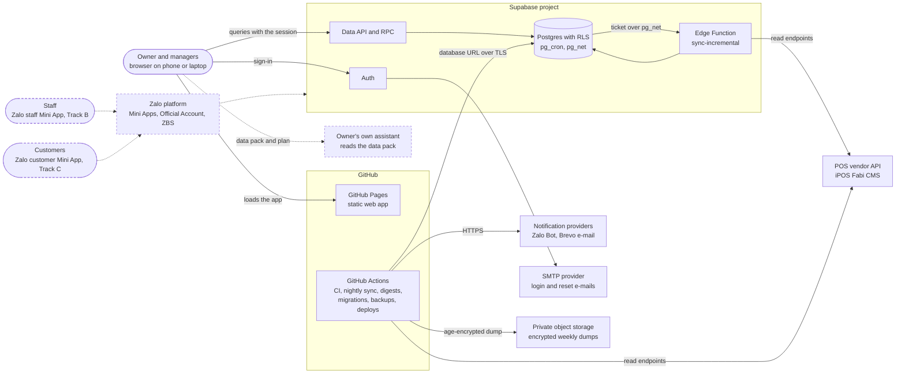

Dashed elements are planned. Solid elements exist in the code; the cloud project behind them waits for the owner.

| Neighbour | What crosses the boundary | Status |
|---|---|---|
| Owner and managers | Sign-in with e-mail and password; Hôm nay and the periodic reports; later settings, exports and plans | verified locally; cloud login waits for owner |
| Staff | Today a `staff` membership can read the web app within its store scope; their own Zalo app comes in Track B | planned (phases 13 to 15) |
| Customers | Loyalty Mini App in Track C | planned (phases 16 to 19) |
| POS vendor API | Login per POS account; sales, catalogue, shifts, adjustments and daily control totals through documented read endpoints only (ADR-025) | verified locally against both shops' accounts |
| GitHub Pages | The static bundle; a build without Supabase variables is a demo that never calls the network | built; serves the demo until the repository variables exist |
| GitHub Actions | CI on every push and pull request; scheduled sync, digests, notification ticks, backups; migrations and deploys | CI built; the scheduled jobs, migrations and the Edge Function deploy skip with a note until their secrets exist (waits for owner); the Pages deploy builds the demo until the variables exist |
| Supabase | Postgres, Auth, Data API, Edge Functions, `pg_cron`, `pg_net` | verified locally on the Docker stack; the cloud project waits for owner |
| Notification providers | Digests and alerts over HTTPS: Zalo Bot API and Brevo e-mail API; Telegram, Resend and signed webhooks next | Zalo Bot verified locally against a mock of its API (12a); Brevo in build (12b); the others planned (12c); no real provider account exists yet (waits for owner) |
| SMTP provider | Supabase Auth invitations and password-reset e-mails | waits for owner ([go-live.md](go-live.md) step 1) |
| Private object storage | Weekly `age`-encrypted dumps from `backup.yml` | built; waits for owner |
| Owner's own assistant | The owner downloads the data pack and runs the strategy step there; the plan comes back by `fnb publish-plan` or by pasting it in the app (ADR-003) | designed (phase 11; detailed design pending) |
| Zalo platform | Mini App identity, Official Account webhooks and messages, ZBS templates | planned (Tracks B and C, section 11) |

## 3. Containers

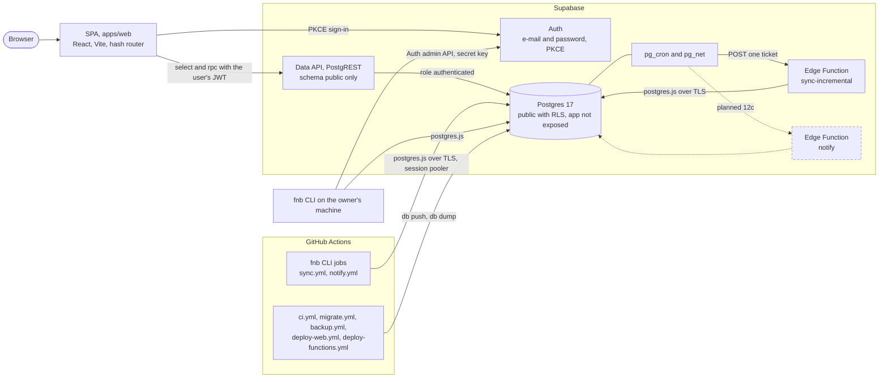

| Container | Technology | Responsibilities | Connects as | Status |
|---|---|---|---|---|
| SPA (`apps/web`) | React 19, Vite 8, `createHashRouter`, supabase-js, TanStack Query, ECharts loaded lazily, Tailwind CSS | Login and password reset; Hôm nay from fact rows; Ngày, Tuần, Tháng, Năm from the report functions; demo mode; print and CSV | the signed-in member, through RLS; the bundle holds only the publishable key and the project URL | verified locally (phases 6 and 9) |
| Supabase Auth | Supabase Auth with PKCE and persisted sessions | E-mail and password logins; sign-ups disabled; members are created or invited by `fnb tenant add-member` | issues the JWT that PostgREST turns into role `authenticated` | verified locally; cloud settings wait for owner |
| Data API (PostgREST) and RPC | PostgREST over `public` (`max_rows = 1000`) | Table reads under RLS; the 16 report functions through `supabase.rpc()`; owner and manager writes to the manual-input and settings tables | role `authenticated` (or `anon`, which may read and execute nothing) | verified locally |
| Postgres | PostgreSQL 17 with `pg_cron` 1.6.4, `pg_net` 0.20.4, `pgcrypto`, `supabase_vault` | The canonical model, payload documents, aggregates, report functions, legal ledgers, the notification outbox and rules, the incremental schedule | owner of every table is `postgres` | verified locally |
| Edge Function `sync-incremental` | Supabase Edge Runtime (Deno 2), `verify_jwt = false` | Claims a single-use ticket, then runs the incremental sync of one store with `@fnb/runner` | `postgres` through the injected `SUPABASE_DB_URL` (or `FNB_DB_URL`), TLS for any non-local host | verified locally; deploy waits for owner |
| Edge Function `notify` | Deno | Runs the notification cycle on single-use tickets, like the CLI | `postgres` | planned (12c) |
| `pg_cron` and `pg_net` | Postgres extensions | Job `sync-incremental` every 30 minutes, created only by `app.enable_incremental_sync`; a notification schedule in 12c | jobs run as `postgres` | built; no job is scheduled until the owner enables it |
| `fnb` CLI (`apps/jobs`) | Node 22 through tsx, postgres.js, supabase-js for the Auth admin API only | 16 commands: tenants, members, onboarding, sync windows and incremental runs, status, doctor, masking, digests, notifications ([sync.md](sync.md)) | `postgres` through `DATABASE_URL` locally or `SUPABASE_DB_URL` in CI; the secret key only for `tenant add-member` | verified locally (phases 5 and 7); `digest` and the 12b `notify` commands in build |
| Actions jobs | GitHub-hosted Ubuntu runners | CI; nightly sync with digests, ticks and status; extra notification ticks; weekly encrypted backup; migrations; Pages and Edge Function deploys; keep-alive check; cron-delay probes | the secrets of each workflow ([secrets.md](secrets.md)) | CI built; the rest skip until their secrets exist |

Supabase Storage, Realtime and Vault are installed with the platform but hold nothing of ours today: the schedule deliberately keeps no credential in Vault (ADR-028), and Storage is planned for staff photos (phase 14b).

The jobs and the Edge Function connect as `postgres`, which owns every table and bypasses RLS. Their safety comes from the schema and the code, not from policies: tenant-consistent composite foreign keys; database functions that refuse a store, account, run or destination outside the tenant they are given (for example `app.record_runner_notification` and `app.digest_scope_check`, SQLSTATE `22023`); and the digest builder switching to role `authenticated` with the recipient's claims before it reads (section 6.4). [security.md](security.md) treats this trust boundary.

## 4. Components

The graph comes from the `dependencies` (solid) and `devDependencies` (dashed) of every `package.json`, plus the import map of the Edge Function (`supabase/functions/sync-incremental/deno.json`, written by `scripts/function-imports.mjs`).

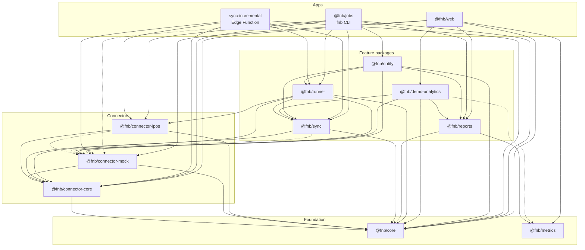

| Package or app | Owns | Entry points | Status |
|---|---|---|---|
| `@fnb/core` | The canonical POS-agnostic model as zod schemas (sales, lines, payments, shifts, stores, catalogue, adjustments, daily totals, data-quality flags) and the shared rules: business date, size suffixes, payment-kind classification, money arithmetic, the Vietnam holiday and Tết calendar | `.` | verified locally |
| `@fnb/connector-core` | The `PosConnector` contract with 9 capability flags, the registry, typed errors, window helpers and the conformance suite every connector must pass | `.`, `./conformance` | verified locally |
| `@fnb/connector-mock` | A seeded synthetic connector shaped like a Vietnamese drinks shop, for tests, the demo and end-to-end runs | `.` | verified locally |
| `@fnb/connector-ipos` | The typed client and adapter for the iPOS Fabi CMS API: login and token cache, master data, sales reports, invoices, shifts, adjustments | `.` | verified locally |
| `@fnb/sync` | The runtime-agnostic sync engine: mapping, store-day planning, void and edit detection, adjustments, checks, run bookkeeping, the incremental operation with its change detection and CPU and wall-time guard, redaction; the Postgres and in-memory repositories | `.`, `./postgres` | verified locally |
| `@fnb/runner` | What the CLI and the Edge Function share around the engine: `POS_ACCOUNTS_JSON` entries, connector sessions, the incremental run of one store, the `Notifier` and the dead-man's switch | `.`, `./postgres` | verified locally |
| `@fnb/metrics` | The typed metric registry mirrored from [metrics.md](metrics.md): 41 metrics, report mappings, 10 benchmark context entries | `.` | verified locally |
| `@fnb/reports` | The typed contract of the 16 report SQL functions, periods and deep-link keys, coverage, comparisons, the exact decomposition, sentence parts, and the Ngày, Tuần, Tháng and Năm card definitions | `.` (`sideEffects: false`) | verified locally |
| `@fnb/demo-analytics` | The TypeScript port of the report SQL over days generated by the mock connector, held to the SQL by the parity suite | `.` | verified locally |
| `@fnb/notify` | Channel adapters (Zalo Bot, Brevo), Vietnamese templates, the digest built from the Ngày model, digest-line rules, the outbox dispatch cycle, chat linking, the outbox notifier for runner alerts, test helpers | `.`, `./outbox`, `./postgres`, `./render`, `./testing` | 12a verified locally; 12b in build |
| `@fnb/jobs` | The `fnb` CLI (`bin/fnb.mjs` registers tsx and runs `src/cli.ts`) | bin `fnb` | verified locally; 12b commands in build |
| `@fnb/web` | The single-page app ([web-app.md](web-app.md), [apps/web/README.md](../apps/web/README.md)) | application | verified locally |
| `supabase/functions/sync-incremental` | The Edge Function handler, its Deno socket for postgres.js and the generated import map | `index.ts` | verified locally |

Two rules keep the graph honest. Connectors depend only on `@fnb/core` and `@fnb/connector-core`, so no vendor detail leaks downstream (ADR-004, ADR-012). And `@fnb/reports` depends only on `@fnb/core` and `@fnb/metrics`, so the same card models serve the web app, the demo, the digest and later the data pack. `packages/datapack` is designed for phase 11a but not yet created; a `csv` connector is planned for phase 20a.

## 5. Data architecture

### 5.1 From the POS to a report card

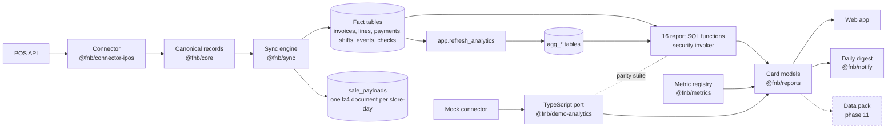

### 5.2 Canonical POS-agnostic model (ADR-004)

Every POS detail stays inside its connector package. Connectors emit canonical records; the engine writes them into tables that know nothing about the vendor: `tenants`, `pos_accounts`, `stores`, the catalogue (`items`, `store_items`, `item_types`, `item_classes`, `units`, `customizations`, `sources`, `payment_methods`, `promotions`, `packages`, `devices`), `customers`, the facts (`invoices`, `invoice_lines`, `invoice_payments`, `invoice_events`, `shifts`) and the bookkeeping (`sync_runs`, `sync_checks`). POS ids stay verbatim in `external_id` columns and relations between POS entities use them, so a re-synced catalogue never breaks a fact. Catalogue rows that disappear from the POS become inactive, never deleted. The full vendor payload is kept (section 5.5), so any future column can be back-filled without a re-sync. [schema.md](schema.md) is the field dictionary; [connectors.md](connectors.md) is the connector contract.

### 5.3 Multi-tenancy and row-level security (ADR-005)

- Every row of a tenant carries `tenant_id`; store rows carry `store_id`; account rows carry `pos_account_id`. Composite foreign keys reference the pair (`tenant_id`, `store_id`) or (`tenant_id`, `pos_account_id`), so the database refuses a row that names tenant A with a store of tenant B, whoever writes it.
- Access is a row in `tenant_members`: a login, a role (`owner`, `manager`, `staff`, `viewer`, `publisher`) and an optional store scope (`store_ids`, null for every store).
- `owner`, `manager`, `staff` and `viewer` are the data roles. `publisher` sits outside them on purpose and reads no sale and no aggregate (ADR-013).
- RLS is on for all 52 `public` tables, with 80 policies on 50 of them; the payload documents and the POS token cache have no policy and no grant, so no API role reaches them. `anon` holds no privilege on any table and may execute no function.
- The policy helpers live in schema `app`, which the Data API does not expose; the membership helpers are `security definer` with an empty `search_path`, and policies call them as `(select app.helper())` so they run once per statement.
- Default privileges make a future table read-only for `authenticated` and invisible to `anon` until a migration grants more.

The role-by-capability matrix is in [security.md](security.md).

### 5.4 Business day and money (ADR-007)

- Instants are `timestamptz`. The sync assigns `business_date` from the store's IANA time zone and `business_day_start_minutes`: a sale at 00:30 under a 05:00 day start belongs to the previous day. The same rule is `businessDate` in `@fnb/core` and is used by reports, shifts, digests and the schedule.
- Money is `numeric(14,2)` in the tenant's currency, quantities `numeric(12,3)`, shares and rates fractions (`0.250` is 25 %).
- Reports end at the last complete business day of the selected stores (the as-of rule in [web-app.md](web-app.md)); Hôm nay owns the running day.

### 5.5 Sale payload documents (ADR-027)

The full backfill of both shops put the database at about 850 MB, two thirds of it vendor payloads on sales rows. The sync therefore writes null to `invoices.raw`, `invoice_lines.raw` and `invoice_payments.raw` and keeps every payload in `sale_payloads`: one lz4-compressed JSON-lines document per store and business date, with line and tender payloads stripped of the fields equal to their invoice's. The documents compress about ten times and the full history fits under the 300 MB ceiling. Shifts, events and catalogue rows keep their payload on the row. The document is written by `app.store_sale_payloads` in the same transaction as the store-day.

### 5.6 Aggregates and the hot and cold rule (ADR-010)

- Ten aggregate tables (`agg_daily_sales`, `agg_hourly_sales`, `agg_item_daily`, `agg_category_daily`, `agg_payment_daily`, `agg_shift_cash`, `agg_size_mix_daily`, `agg_modifier_prefs_daily`, `agg_basket_pairs_28d`, `agg_attach_daily`), the refresh log `analytics_refreshes` and the calendar `dim_calendar` form the analytics layer. They are ordinary tables with the same RLS as the facts, because Postgres does not apply RLS to materialised views.
- `app.refresh_analytics` (`security definer`, one advisory lock per tenant) rewrites a date range; the sync calls it for every window and touched date, and an owner or manager may call `refresh_my_analytics` for at most 92 days.
- Business dates before yesterday are read from the aggregates; yesterday and today are computed live from the facts, so today is right after every incremental run without a refresh ([schema.md](schema.md), "Hot and cold rule").

### 5.7 Metric registry (ADR-026)

`@fnb/metrics` holds 41 metrics in six groups (sales 13, time 6, baselines 4, menu 2, cash 5, customers 11), each with id, Vietnamese and English labels, unit, formula, grain, direction, source, report mapping and status: 29 available now, the rest waiting for customer identity, costs or seat counts. `metric_value(store_ids, metric_id, from_date, to_date)` computes the 21 available store-day and store-period metrics in SQL. Ten dated benchmark context entries sit apart from tenant metrics. A test keeps the registry equal to [metrics.md](metrics.md).

### 5.8 Report functions and the demo port (ADR-029)

- Every sum, ratio, median and forecast of a report is computed by one of 16 `security invoker` SQL functions, called through `supabase.rpc()` as the signed-in member: `store_coverage`, `period_compare`, `period_compare_by_store`, `period_series`, `daily_baselines`, `hourly_profile`, `metric_compare`, `item_summary`, `payment_summary`, `promotion_summary`, `shift_review`, `store_targets`, `item_velocity`, `month_pace`, `forecast_accuracy`, `item_lifecycle`. Twelve of them refuse more than 50 store ids; those whose result can grow refuse more than 900 rows, and those with a range limit refuse a longer range (SQLSTATE `22023`). The four phase 8 functions among them (`period_compare`, `item_velocity`, `month_pace`, `forecast_accuracy`) have neither check in SQL; the client contract caps store ids at 50 ([api.md](api.md#32-reports)).
- TypeScript adds only what sits on top of the rows: changes, the exact decomposition of ticket change, like-for-like selection, rankings, statuses and sentence drivers. These are pure card models in `@fnb/reports` (Ngày 9 cards, Tuần 8, Tháng 10, Năm 7).
- The demo cannot run SQL in the browser, so `@fnb/demo-analytics` ports the same functions to TypeScript over days generated by the mock connector. The parity suite applies the real migrations in PGlite on every test run, and on Postgres in the CI `database` job, loads the same days and compares every row and value.

### 5.9 Notification data (phase 12)

`outbound_messages`, the message log since phase 2, is now also the outbox: queue rows with a state machine enforced by a trigger and a dedupe key, kept at least one year (400 days by default). The alert catalogue holds 15 rules with tenant and store overrides in `alert_rules`; `channel_policies` holds 27 global send rules (one per channel kind and message class) with tenant overrides that CHECK constraints keep above the legal floor; `notification_channels` holds destinations that name an environment variable, never a credential; `alert_events` holds alert episodes and `digests` the daily digests. Every send decision is taken in SQL when a dispatcher claims a message. [schema.md](schema.md), "Notifications and alerts (phase 12)", is the reference.

### 5.10 Database inventory on 2026-11-12

| Item | Count | Source |
|---|---|---|
| Migrations | 28 (phase 2: 8; phase 8: 5; phase 7: 5; phase 9: 4; phase 12: 6) | `supabase/migrations/`, all applied locally |
| Tables in `public` | 52, RLS on all | catalogue |
| Views in `public` | 2, `security_invoker`, no longer used by the app | catalogue |
| Tables in `app` | 7, no grant to any API role | catalogue |
| RLS policies | 80 | catalogue |
| Enum types | 22 | catalogue |
| Functions | 150: 25 in `public`, 125 in `app` | catalogue |
| Triggers | 29 | catalogue |
| pgTAP files | 31, 1,648 planned tests (file plans read 2026-11-12, 15:41; step 12b may still change them) | `supabase/tests/`; [test-plan.md, section 8.2](test-plan.md#82-pgtap-files) |

## 6. Key flows

### 6.1 Nightly sync on GitHub Actions

Status: verified locally with the CLI; on Actions it waits for owner (secrets). The digest and tick steps are in build (12b).

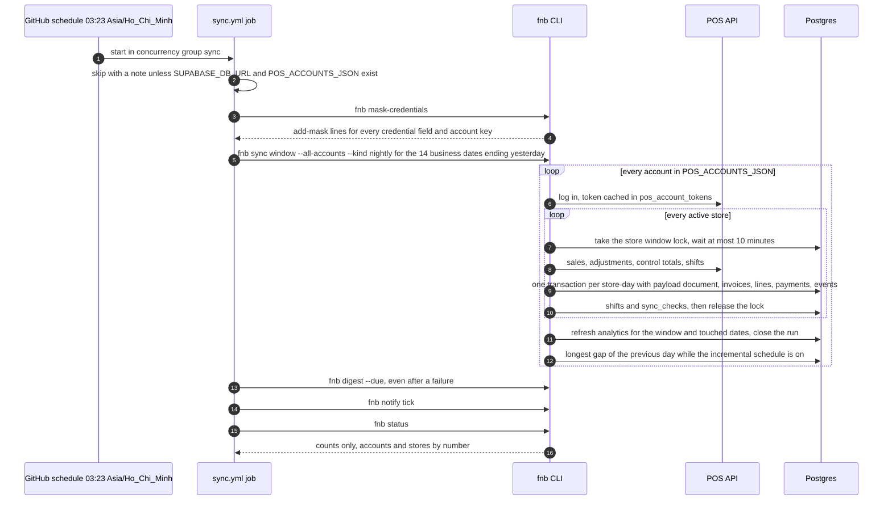

The secrets reach only the configuration check and the steps that run `fnb`, so checkout, setup and `pnpm install` run without them. A failed store-day rolls back alone; the next run completes the window. Two consecutive runs change nothing ([sync.md](sync.md), "Idempotency").

### 6.2 Incremental sync through `pg_cron` with single-use tickets (ADR-028)

Status: verified locally; no job is scheduled until the owner runs `app.enable_incremental_sync`; the deploy waits for owner.

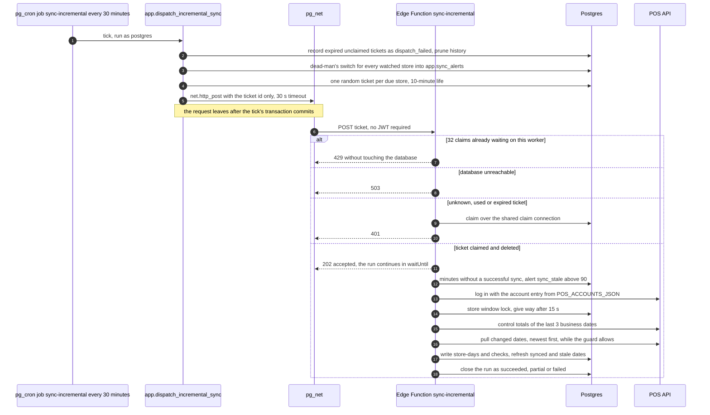

Before any claim the function answers 405 to anything but `POST`, 400 to a body without a ticket, and 500 when its secrets are unusable or its database URL would allow plaintext. A store is due when it is watched (active, account not paused, not opted out), its account is not `auth_failed`, and it is open at the tick or was open in the 30 minutes before it; unknown opening hours mean every tick. The guard keeps a run within 105 s of wall time and 1.2 s of estimated CPU on the Free plan and hands what does not fit to the nightly job ([sync.md](sync.md), "CPU and wall-time guard"). A manual run uses `app.issue_incremental_sync_ticket`; `fnb sync incremental` runs the same code from a small server without the Edge limits.

### 6.3 A report page in live and demo mode

Status: verified locally (phase 9).

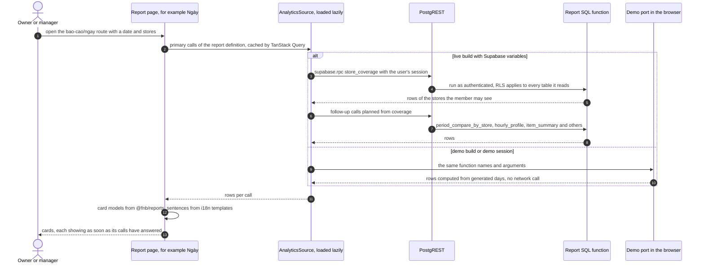

The URL is the source of truth for period and stores (`#/bao-cao/ngay?date=YYYY-MM-DD&store=<id>,<id>`). A failed call turns its card into an error card with a retry; a call refused for size (`22023`) asks for fewer stores or a shorter period. Hôm nay is different: it reads fact rows through the `RowSource` and computes its numbers in `src/metrics/today.ts`.

### 6.4 Digest and alert dispatch (phase 12)

Status per step: the Zalo Bot channel, linking, the outbox, the SQL tick and `fnb notify tick`, `status`, `link` and `test` are verified locally (12a); the digest, the alert episodes, Brevo e-mail, `fnb digest`, `notify unlink`, `notify job-failed`, the outbox notifier in the CLI and the Actions steps are in build (12b); the `notify` Edge Function with its `pg_cron` schedule, the failure listener workflow, Telegram, Resend and webhooks are planned (12c).

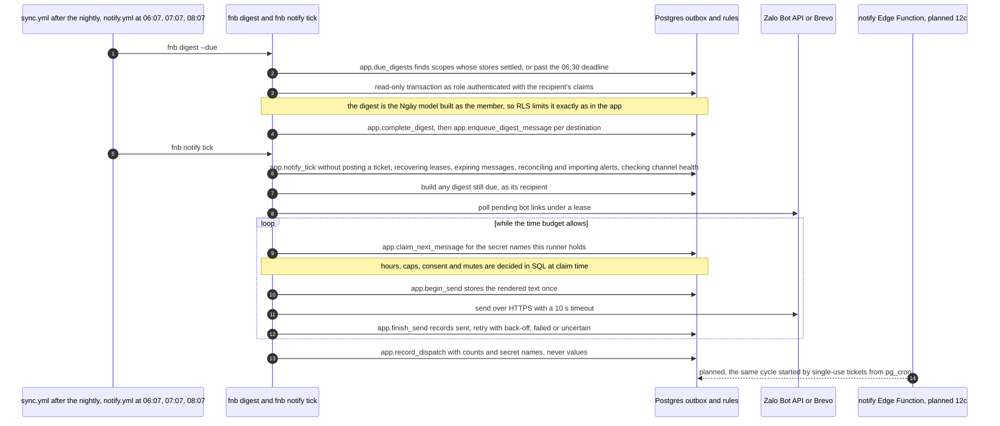

`notify.yml` passes `--skip-if-scheduler-healthy` and `--budget-seconds 300`: once the Supabase dispatcher runs (12c), the Actions tick exits at once while that dispatcher is healthy and steps in only when it is not.

Alerts reach the same outbox from several sources:

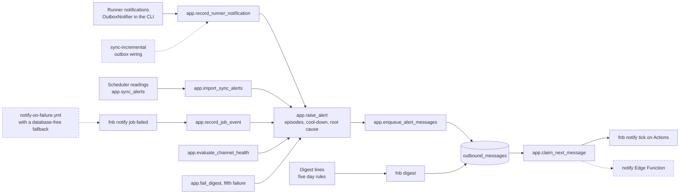

Rules that fire today: `auth_failed`, `sync_failed`, `sync_stale`, `sync_dispatch_failed`, `job_failed`, `channel_failed`, `digest_failed`, and the five digest lines `revenue_below_baseline`, `ticket_drop`, `drawer_variance`, `unverified_day`, `zero_sales_day`. `zero_sales_open` and `nightly_missing` are in the catalogue and resolved by `app.reconcile_alerts`, but nothing raises them until step 12c. Episode facts and message parameters are count-only (`app.facts_are_count_only`), so no error text, name, address or URL reaches an alert.

### 6.5 Data pack and plan publishing (phase 11)

Status: designed at roadmap level; the detailed design is pending. The diagram follows the roadmap (phases 11a and 11b) and ADR-003 and ADR-013.

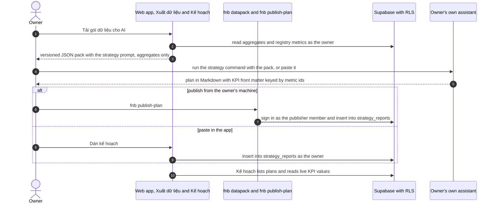

What exists already: `strategy_reports` with RLS (owners, managers and publishers in scope insert, owners and managers update and delete), the `publisher` role, the aggregates, the registry's `data_pack` mapping, and the placeholder routes `#/xuat-du-lieu` and `#/ke-hoach/*`. What does not exist yet: `packages/datapack`, `fnb datapack`, `fnb publish-plan`. One design point is open: the publisher reads no aggregate, so the pack must be built by an owner or manager session or by the CLI's own connection, not by the publisher (a correction of the ADR-013 wording, which says the publisher reads aggregates, has been requested). The pack and the prompt stay the same if an API key is ever added (ADR-003).

## 7. Deployment and environments

| Environment | What runs | Data | Where its configuration lives | Status |
|---|---|---|---|---|
| Local stack (developer machine) | Supabase in Docker: Postgres 17, Auth, PostgREST, Studio, a mail catcher; ports 54321 (API), 54322 (database), 54323 (Studio), 54324 (mail catcher); Vite on 5173; `supabase functions serve` for the Edge Function; the `fnb` CLI | the synthetic seed (tenant `demo-fnb`, stores `TEA` and `COF`); on the build machine also a real tenant loaded with the CLI, so `supabase db reset` is never run there | `.env` and `apps/web/.env.local`, both gitignored | in use |
| CI (GitHub-hosted runners) | `ci.yml`: secret scans; lint, typecheck, unit tests, the import-map check and `deno check`; a Supabase stack with most services excluded, `db reset`, pgTAP and the parity suite on Postgres; Playwright against a fresh stack | synthetic seed and fixture tenants only | no secrets | built; runs on every push to `main` and every pull request |
| Cloud project (Supabase Free, Singapore region) | Postgres, Auth, Data API, the `sync-incremental` Edge Function, `pg_cron` and `pg_net` | real tenants | the dashboard settings, Edge Function secrets, the database password | waits for owner ([go-live.md](go-live.md)) |
| GitHub Pages | The static SPA built by `deploy-web.yml` under the base path that `configure-pages` reports (`/fnb-manager/` for this project site) | none: the demo generates its numbers in the browser, the live build reads through the user's session | repository variables `SUPABASE_URL` and `SUPABASE_PUBLISHABLE_KEY`, public by design | built; serves the demo until the variables exist |
| Scheduled and deploy jobs on Actions | `sync.yml`, `notify.yml`, `backup.yml`, `migrate.yml`, `deploy-functions.yml`, `deploy-web.yml`, `workflows-active.yml`, two cron probes | the cloud database | GitHub secrets: given to single steps in `sync.yml`, `notify.yml` and `deploy-functions.yml`, to the whole job in `migrate.yml` and `backup.yml` | built; the jobs that need secrets skip with a note until they exist |
| Owner's machine against the cloud | `fnb tenant add-member`, `onboard`, backfills, `notify link`; `supabase secrets set` | the cloud database | the owner's `.env` | waits for owner |

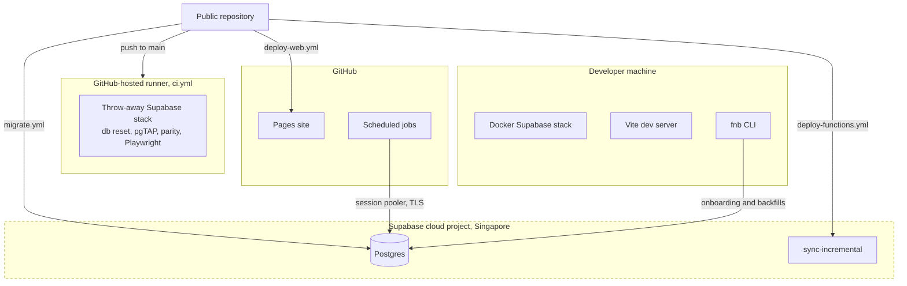

### 7.1 Where each secret lives (ADR-006)

Credentials live in three places only: the owner's local `.env`, GitHub Actions secrets, and Supabase Edge Function secrets. The database holds account metadata, external ids, a POS session-token cache that no API role can read, and the names of notification secrets, never their values. [secrets.md](secrets.md) is the full contract; [security.md](security.md) covers rotation and masking.

| Secret or variable | Local `.env` | GitHub | Supabase | Used by |
|---|---|---|---|---|
| `POS_ACCOUNTS_JSON`, `IPOS_APP_KEY` | yes | secrets | Edge Function secrets | the CLI and `sync-incremental` |
| `DATABASE_URL` (local), `SUPABASE_DB_URL` (cloud session pooler) | yes | secret `SUPABASE_DB_URL` | injected `SUPABASE_DB_URL`; optional `FNB_DB_URL`, `FNB_DB_CA_CERT` | the CLI; the Edge Function |
| `SUPABASE_SECRET_KEY` | yes | documented secret; no workflow reads it | injected | `fnb tenant add-member` only (Auth admin API) |
| `SUPABASE_ACCESS_TOKEN`, `SUPABASE_DB_PASSWORD`, `SUPABASE_PROJECT_ID` | yes, for the owner's own CLI steps | secrets | not applicable | `migrate.yml`, `backup.yml`, `deploy-functions.yml` |
| `SUPABASE_URL`, `SUPABASE_PUBLISHABLE_KEY` | yes | variables, public by design | not applicable | the web build (as `VITE_SUPABASE_URL` and `VITE_SUPABASE_PUBLISHABLE_KEY`) |
| `BACKUP_AGE_RECIPIENT`, `BACKUP_S3_ENDPOINT`, `BACKUP_S3_BUCKET`, `BACKUP_S3_ACCESS_KEY_ID`, `BACKUP_S3_SECRET_ACCESS_KEY` | no | secrets; the `age` private key stays offline with the owner | not applicable | `backup.yml` |
| `NOTIFY_ZALO_BOT_TOKEN`, `NOTIFY_EMAIL_API_KEY`, `NOTIFY_EMAIL_FROM`, `NOTIFY_EMAIL_FROM_NAME`, `NOTIFY_TELEGRAM_BOT_TOKEN`, `NOTIFY_WEBHOOK_SECRET` | optional | secrets read by `sync.yml` and `notify.yml` | function secrets once the `notify` function exists (12c) | the notification dispatchers; rows store only the name |
| `FNB_INCREMENTAL_WALL_MS`, `FNB_INCREMENTAL_CPU_MS` | no | no | optional function secrets | the incremental guard |
| Zalo secrets per brand (`ZALO_APP_SECRET_<brand>`, `ZALO_OA_SECRET_<brand>`, `ZALO_OA_REFRESH_TOKEN_<brand>`), `ZMP_DEVELOPER_REFRESH_TOKEN`, `VOUCHER_CALLBACK_PATH_SECRET` | no | not yet | planned function secrets | Tracks B and C |
| Publisher login for `fnb publish-plan` | planned | no | no | phase 11b |

`docs/secrets.md` still names the Zalo Bot secret `ZALO_BOT_TOKEN` and omits four `NOTIFY_*` names; the code and workflows use the names above. A correction has been requested; the update is scheduled for step 12c.

## 8. Cross-cutting concerns

### 8.1 Security

Least privilege by construction: RLS on every table, an unexposed `app` schema, no credential in the database or the repository, a schedule that holds no key (ADR-028), masked CI logs and a scanned public repository. The threat model, the role matrix and the gaps are in [security.md](security.md).

### 8.2 Privacy

Personal data is kept to what the POS already records (customer phone and name on invoices, cashier names on shifts) plus member logins and notification destinations. Notifications carry aggregates and names of stores, items and shifts, never customer data; alert facts are count-only. Consent is a per-purpose, append-only ledger; data-subject requests carry statutory deadlines; the message log is kept at least one year and its bodies 90 days. Details and gaps are in [security.md](security.md), section 8.

### 8.3 Internationalisation

Vietnamese is the default language and English the alternative. Strings live in `apps/web/src/i18n/messages/<area>.vi.json` and `.en.json` for seven areas (core, metrics, reports and one per periodic report), 1,002 keys per language; tests fail on a missing or misplaced key, a key in two files, JSX text that bypasses `t()` and any report key without a translation. Numbers, dates and money go through `Intl` with the tenant's locale and currency. Vietnamese follows the registry's spelling (hóa đơn, hủy, tùy). Report sentences are templates, reviewed by the owner in [reports/cau-van-bao-cao.md](reports/cau-van-bao-cao.md). Digests and alerts are Vietnamese only today (`packages/notify/src/messages/vi.ts`).

### 8.4 Accessibility

WCAG 2.1 AA contrast is the standard. Every chart has an accessible table; every screen sets its title and moves focus to its heading after navigation; the period label of the report navigator is a polite live region; wide tables scroll inside their card with the first column pinned. Playwright runs axe at 360 and 1280 px and checks that no page scrolls sideways at 360 px.

### 8.5 Performance budgets

| Budget | Value | Enforced by | Last measured |
|---|---|---|---|
| Initial JavaScript | at most 400 kB gzipped, lazy chunks excluded | `apps/web/scripts/check-size.mjs` in every `pnpm --filter @fnb/web build`, so in every Pages deploy (CI's end-to-end job uses plain `vite build`) | about 215 kB at phase 6 |
| Lighthouse mobile | performance at least 85, accessibility at least 90 | manual recipe in [apps/web/README.md](../apps/web/README.md) | demo build: 93 performance, 100 accessibility, 100 best practices, SEO 60 because of the deliberate `noindex` |
| Năm report | renders within 8 s on a four-times-slower CPU | Playwright | passing at the phase 9 verification |
| Report-sized queries | under 1.5 s | phase 8 acceptance, measured at verification | well under a second on a synthetic tenant of 54,000 invoices |
| Analytics refresh | under 2 minutes on production | phase 8 acceptance | about 1.3 s for 92 days of a synthetic two-store tenant; production waits for owner |
| Incremental run | 105 s wall time and 1.2 s estimated CPU on the Free plan, at most 390 s and 2 s when raised | the run guard in `@fnb/sync` | a run with nothing changed takes about half a second |
| Window sync | one month in under 5 minutes within the call budget (ADR-014); 60-minute job timeout on Actions | the 400-call budget per run, the `sync.yml` timeout | a month in under a minute with four connector calls per account |
| Data API page | 1,000 rows (`max_rows`); report lists capped at 900 rows | `supabase/config.toml`, `app.require_report_rows` | not applicable |
| Database size | under the 300 MB ceiling; `fnb doctor` yellow from 400 MiB, red from 475 MiB | phase 7 acceptance, `fnb doctor` | 285 MiB after compaction (phase 7) |

### 8.6 Observability

- **Our own tables first**, because platform logs are kept one day on the Free plan: `sync_runs` (timings, counts, call budget, flags, a redacted error), `sync_checks` (per store-day), `analytics_refreshes`, `app.sync_alerts` (scheduler readings), `outbound_messages`, `alert_events`, `digests` and `app.notify_settings` (last tick and dispatch, count-only).
- **Commands:** `fnb status` (runs, unmatched and checked store-days, open alerts), `fnb doctor` (database, migrations, logins, freshness, pause risk, schedule, size) and `fnb notify status` (outbox, destinations, episodes, digests).
- **Scheduler internals:** `cron.job_run_details` (kept 7 days) and `net._http_response` (kept 6 hours by `pg_net`).
- **Logs** carry counts and numbered accounts and stores only; errors pass through the redactor first.
- **In the app:** the freshness badge reads the latest successful run; the verified badge reads `sync_checks`. There is no client-side error reporting.
- **Delivery of failures** to a phone: `sync_stale`, `auth_failed` and the other alerts of section 6.4 (12b), and the listener for failed workflows (12c).

### 8.7 Error handling

- **Connectors:** typed errors; up to three attempts with exponential back-off from one second, never for authentication, schema or capability errors; a call budget of 400 per run; 30 s per HTTP attempt in the iPOS transport.
- **Sync:** one transaction per store-day, so a failure rolls back that day only; runs close as `succeeded`, `partial` or `failed`; a failing analytics refresh leaves the run succeeded with a warning and the next run repairs it; abandoned incremental runs are closed after 10 minutes.
- **Accounts:** a login the POS rejects marks the account `auth_failed` once; the next successful login clears it.
- **Notifier:** `notifySafely` keeps a failing channel from failing a run.
- **Outbox:** retries after 1, 5, 30, 120 and 360 minutes with jitter, five attempts, an `uncertain` state when a send may have happened, lease recovery for crashed dispatchers.
- **Digests:** a failed build retries after 5, 15, 60 and 120 minutes and raises `digest_failed` at the fifth failure.
- **Web app:** an error card with a retry per report card; a size refusal asks for fewer stores or a shorter period; a chart error boundary keeps the table visible.
- **CLI exit codes:** 0 success; 1 failure, a red `doctor` check or a failed `notify test`; 2 usage error; `notify job-failed` adds 3 (database unreachable within 10 s) and 4 (connected, record failed).

### 8.8 Portability

| To add | You do | Code change | Status |
|---|---|---|---|
| A store under an onboarded account | `fnb onboard` discovers it; backfill | none | verified locally |
| Another POS account | one more `POS_ACCOUNTS_JSON` entry with a neutral key; `fnb onboard` | none | verified locally |
| Another owner | a fork with its own Supabase project, because each owner runs their own deployment ([roadmap.md](roadmap.md) section 8); a further tenant in the same project is a row created by `fnb tenant create` | none | built; the deploy-your-own guide is planned (phase 20a) |
| Another POS | a package that implements `PosConnector` and passes the conformance suite | one new package | built (contract); CSV connector planned (phase 20a) |
| Another scheduler | `fnb sync incremental` from a small server instead of `pg_cron` | none | built |
| Another static host | any static host for the SPA (Cloudflare Pages is the documented fallback); `VITE_BASE_PATH` sets the base | none | built (FR-POR-11; ADR-023) |
| Another time zone, day start or currency | store and tenant columns | none | built; tests cover several time zones and a 05:00 day start |

## 9. Technology stack

Versions are the ranges in the `package.json` files; `pnpm-lock.yaml` fixes the exact versions and CI installs with `--frozen-lockfile`.

| Layer | Technology | Version | Source |
|---|---|---|---|
| Runtime | Node.js | `>=22` (`.nvmrc` 22) | root `package.json`, `.nvmrc` |
| Package manager | pnpm workspace (`apps/*`, `packages/*`) | `pnpm@9.15.3` | `packageManager` |
| Language | TypeScript, strict, ES2022, NodeNext | ^7.0.2 | root devDependencies, `tsconfig.base.json` |
| Lint and format | Biome | ^2.6.6 | root devDependencies |
| Unit tests | Vitest (jsdom ^31.0.0 and Testing Library for the web app) | ^5.1.0 | devDependencies |
| TypeScript runner | tsx (runs the CLI and scripts) | ^4.23.15 | root devDependencies |
| Database | PostgreSQL | 17 (local 17.11) | `supabase/config.toml` |
| Extensions | `pg_cron` 1.6.4, `pg_net` 0.20.4, `pgcrypto` 1.3, `uuid-ossp` 1.1, `supabase_vault` 0.3.1, `pg_stat_statements` 1.11 | as listed | catalogue |
| Supabase CLI | `supabase` npm package, run as `pnpm exec supabase` | ^3.0.0, locked 3.0.0 | root devDependencies |
| Database tests | pgTAP through `supabase test db` | bundled with the CLI | `supabase/tests/` |
| Edge Functions | Supabase Edge Runtime (Deno 2); CI type-check with Deno | runtime 1.77.9 measured locally; Deno v2.7.3 in CI | [sync.md](sync.md), `ci.yml` |
| Database driver | postgres.js | ^4.1.0; the Edge Function pins 4.1.0 | package manifests, `deno.json` |
| Validation | zod | ^4.6.7; the Edge Function pins 4.6.7 | package manifests |
| API client | `@supabase/supabase-js` | ^2.119.0 | `apps/web`, `apps/jobs` |
| Web framework | React and React DOM; `react-router-dom` (hash router); `@tanstack/react-query` | ^19.3.1; ^7.18.5; ^5.107.1 | `apps/web/package.json` |
| Web build | Vite with `@vitejs/plugin-react` | ^8.3.6; ^6.2.1 | `apps/web/package.json` |
| Styling | Tailwind CSS with `@tailwindcss/vite` | ^4.3.5 | `apps/web/package.json` |
| Charts | ECharts, a lazy chunk | ^6.1.0 | `apps/web/package.json` |
| End-to-end tests | Playwright with `@axe-core/playwright` | ^1.65.0; ^4.14.0 | `apps/web/package.json` |
| Parity tests | PGlite | 0.3.16 (exact) | `packages/demo-analytics/package.json` |
| Performance audit | Lighthouse, not a dependency | 13.5.0 through `pnpm dlx` | [apps/web/README.md](../apps/web/README.md) |
| Secret scan | gitleaks Docker image | v8.30.1 | `ci.yml` |
| CI actions | `actions/checkout`, `actions/setup-node`, `pnpm/action-setup`, `actions/configure-pages`, `actions/upload-pages-artifact`, `actions/deploy-pages`, `denoland/setup-deno` | v5, v5, v4, v6, v5, v5, v2 (major tags) | `.github/workflows/` |
| Backups | `supabase db dump`, `age`, the AWS CLI for the S3-compatible upload | runner packages | `backup.yml` |
| Hosting | GitHub Pages; Supabase Free during build and pilot | not applicable | ADR-001, ADR-023 |

## 10. Architecture decisions

The records are in [decisions.md](decisions.md). ADR-001 to ADR-026 are dated 2026-11-07 and ADR-027 to ADR-029 2026-11-08. ADR-030 to ADR-033 are reserved for the phase 12 decisions and will be written in step 12c; the design they record is already described in [schema.md](schema.md), "Notifications and alerts (phase 12)".

| ADR | Title | Status | Effect on the architecture |
|---|---|---|---|
| 001 | Static frontend on GitHub Pages, data and auth in Supabase, scheduled compute in GitHub Actions | accepted | No server to run; the repository is public and holds code only |
| 002 | TypeScript everywhere | accepted | One language and toolchain; database logic in SQL with pgTAP |
| 003 | No paid AI API; the strategy runs under the owner's own assistant subscription | accepted | The platform prepares an aggregate-only data pack and stores plans; no model runs on our side |
| 004 | Canonical POS-agnostic schema behind a connector interface | accepted | Vendor details stay in connector packages; `external_id` and the payloads keep everything |
| 005 | Multi-tenant from day one | accepted | `tenant_id` on every row, membership roles with store scope, RLS everywhere |
| 006 | Credentials never in the database or the repository | accepted; amended 2026-11-08 for the Edge Function runner | Secrets only in `.env`, GitHub secrets and Edge Function secrets |
| 007 | Business day and money conventions | accepted | `timestamptz`, a business date by store time zone and day start, `numeric(14,2)` money |
| 008 | Local development on a Dockerised Supabase stack | accepted | Everything is built and verified locally and in CI before any cloud project |
| 009 | Connector tests use synthetic fixtures; live checks are opt-in | accepted | No recorded real response in the repository; live suites need `LIVE=1` |
| 010 | Analytics aggregates are job-refreshed tables with RLS, not materialised views | accepted | `agg_*` tables under the same RLS as the facts |
| 011 | Early manager value: first live screen before the full sync engine | accepted | The order of phases 5 to 8 |
| 012 | Connector contract with capability flags, proven by a mock connector and a conformance suite | accepted | `PosConnector` with 9 capabilities; reports hide what a POS cannot feed |
| 013 | Least-privilege identities for the strategy path | accepted | A `publisher` member inserts plans; its text says it reads aggregates, which the database does not allow (correction requested) |
| 014 | Realistic acceptance gates | accepted | At least 99 % of store-days reconciled, call budgets, flake-free end-to-end runs, encrypted and restore-tested backups |
| 015 | Secret and identifier scanning uses generic rules in CI | accepted | gitleaks and generic patterns in CI; the private identifier list is checked locally |
| 016 | Loyalty: our ledger is the system of record; iPOS CRM is an optional rail | accepted; rail choice pending (gate G2) | The Track C ledger lives in Supabase; the synced invoice is the proof of purchase |
| 017 | One Zalo App and one verified Official Account per brand; two Mini Apps per brand | accepted | Zalo identifiers and secrets are per-brand rows and secrets |
| 018 | Messaging economics: in-app first, free OA window second, paid templates last | accepted | The outbox enforces quotas and fallback order |
| 019 | Cross-border hosting of personal data: dossier or exemption before launch | open | Gate G3 before Track C goes public; `tenants.legal_form` records the entity type |
| 020 | Two runners, one sync engine: incremental on Supabase, heavy jobs on GitHub Actions | accepted | Edge Function on `pg_cron` for the day; Actions for nightly, backfills, backups and the CLI |
| 021 | Legal compliance is built into the schema, the apps and the campaign engine | accepted | Consent ledger, data-subject deadlines, channel policies, a message log kept at least one year |
| 022 | Zalo policy rules are acceptance criteria | accepted | Track B and C build rules: no outbound links, in-app terms, performance gates |
| 023 | Supabase and GitHub operating conventions | accepted | New key scheme, session pooler, encrypted weekly dumps, masking, hash routing with PKCE, no CSP on Pages; the promised `db diff --strict-coverage` and generated-types drift checks are not in CI yet |
| 024 | iPOS CRM is already present; the loyalty ledger stays independent of it | accepted; rail choice at gate G2 | CRM is used at most to attach a member and consume voucher codes |
| 025 | Connectors use documented read endpoints only; vendor security observations are handled privately | accepted | The connector calls documented read endpoints only and stores nothing from any other |
| 026 | Standard KPI methods in the metric registry | accepted | One registry of 41 metrics for reports, digests, the data pack and KPI follow-up |
| 027 | Sale payloads live in one compressed document per store-day | accepted | `sale_payloads`; `raw` is null on the sales rows |
| 028 | Scheduled calls to the incremental Edge Function carry a single-use ticket, not an API key | accepted | No credential exists for the schedule |
| 029 | Report numbers come from SQL; the demo runs a parity-tested TypeScript port | accepted | 16 RPC functions; a parity suite holds the port to the SQL |

## 11. Future architecture: Tracks B and C

Tracks B (staff on Zalo, phases 13 to 15) and C (customer loyalty on Zalo, phases 16 to 19) reuse the platform: the same Supabase project, the same RLS model, the same outbox and the invoice stream as proof of purchase. Everything below is planned and waits for the owner's Track Z paperwork (Zalo accounts and verification, legal form, e-invoice status, privacy notice). It is drawn from the roadmap and the deep dives [zalo-integration-architecture.md](deep-dives/zalo-integration-architecture.md), [zalo-mini-app-platform.md](deep-dives/zalo-mini-app-platform.md), [zalo-oa-and-messaging.md](deep-dives/zalo-oa-and-messaging.md), [staff-app-on-zalo.md](deep-dives/staff-app-on-zalo.md), [loyalty-programme-design.md](deep-dives/loyalty-programme-design.md) and [ipos-loyalty-integration-design.md](deep-dives/ipos-loyalty-integration-design.md). Those deep dives use the earlier phase numbering, two higher than the roadmap, and call two functions `zalo-auth` and `zalo-oa-webhook`; the roadmap names them `zalo-session` and `oa-webhook` ([roadmap.md](roadmap.md), companion documents).

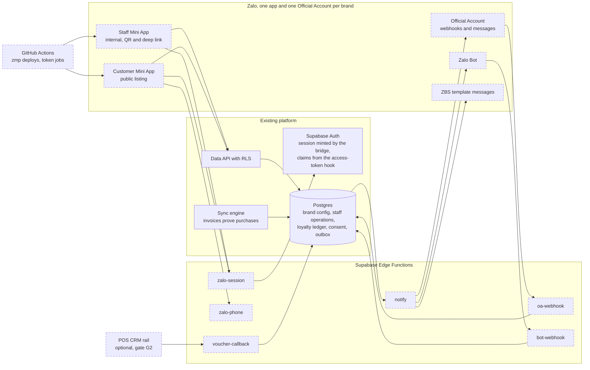

| Concern | Planned design | Phase |
|---|---|---|
| Identity | The Mini App's access token is verified server-side with the app-secret proof; because Supabase trusts only its own sessions, `zalo-session` finds or creates an Auth user through the admin API and returns a real session; a custom access-token hook adds tenant, store scope and role claims for RLS. Staff pair their first device with a 6-digit manager-issued code valid 10 minutes, never a password | 13, 14a |
| Phone numbers | The single-use phone token (valid 2 minutes) is decoded once by `zalo-phone`, only at the step that needs it, after a purpose screen; the phone in international form is the join key to synced invoices | 13, 18a |
| Client storage | Mini Apps run on `https://h5.zdn.vn` without LocalStorage or cookies; sessions go in Native Storage with an Authorization header; every function answers CORS for that single origin | 13 |
| Configuration | Per-brand rows (`brands`, `zalo_apps`, `oas`, `mini_apps`, `zbs_templates`, `gmf_groups`) and per-brand secrets; `app-config.json` generated per tenant in CI, so one codebase builds one Mini App per brand | 13 |
| Webhooks | `oa-webhook` and `bot-webhook` run with JWT verification off, verify the provider's signature on the raw body, answer 200 within 2 seconds, de-duplicate and finish in `waitUntil`; signature checks start in observe mode and then fail closed | 13 |
| Tokens | The OA access token lasts 25 hours and its refresh token is single-use, so exactly one job refreshes it every 12 hours under a row lock; a second job rotates the Mini App deploy token (one-month life) | 13 |
| Messaging | The phase 12 outbox gains the `zalo_oa`, `zalo_gmf` and `zalo_zbs` kinds already declared in `channel_kind`: in-app first, free consultation messages inside the 48-hour window, paid ZBS templates last, marketing consent checked before any promotional send (ADR-018) | 13, 15, 19a |
| Staff operations | Roster, checklists with photos in per-brand Storage buckets, cash count against the synced drawer total, handover notes, incidents, approvals, read receipts | 14, 15 |
| Loyalty ledger | `memberships`, an append-only `loyalty_ledger`, `stamps`, `pending_checkins`, `receipt_claims`, `coupons`, `coupon_codes`, `redemptions`; reconciliation after each sync through four earning paths in precision order; clawback on voided or edited invoices; anti-fraud rules as configuration | 17a |
| Coupon rails | Per store: a CRM code pool, a CRM validation callback answered by `voucher-callback` (idempotent on the sale id), or a POS payment-discount entry verified by staff | 16b, 18b |
| Compliance | Consent with evidence at join, a never pre-ticked marketing toggle, data-subject tooling with cascading deletion, the 72-hour breach runbook, the cross-border dossier or exemption (gate G3), Supabase Pro before public launch (gate G4) | 17a, 19b |

## 12. Known risks and technical debt

| Risk or debt | Effect | Mitigation today | Next step |
|---|---|---|---|
| No cloud project yet | TLS to the injected database URL, CPU accounting on shared workers, the three-day freshness criterion, the live RLS run, refresh timing and Lighthouse on the live app are unproven | Everything runs on the local stack and in CI | Owner creates the project ([go-live.md](go-live.md)); rerun the open acceptance checks |
| Supabase Free limits | 500 MB database (about 18 MiB of growth a month with two stores, so roughly a year), pause after about 7 idle days, no platform backups, logs kept one day, 5 GB egress | Payload compression (ADR-027), retention at every tick, the nightly job as keep-alive, `fnb doctor` thresholds, our own log tables, the weekly encrypted dump | Gate G4: Pro before public launch, or at about 400 MB, a second owner or mandatory daily backups |
| Backups not running | Until the owner sets the bucket and recipient secrets, the real data exists only in the local stack (and later the cloud project) | `backup.yml` is ready and skips with a note | Owner sets the backup secrets; restore drill in phase 20b |
| GitHub cron delays, the 60-day disable rule and Actions terms | Scheduled runs start late or stop | Incremental sync runs in Supabase (ADR-020); off-peak minutes and the cron time-zone field; `workflows-active.yml` re-enables workflows weekly; `notify.yml` runs three times each morning; cron probes measure the delay | A small server running `fnb sync incremental` is the documented fallback |
| Edge Runtime compatibility | postgres.js over the runtime's `node:net` misreads large results, so the function uses its own Deno socket (`postgres-socket.ts`) and no type lookups; a runtime upgrade could break it | A probe read 30,000 rows correctly; CI type-checks the function with Deno | Re-verify after each runtime upgrade and at the first cloud deploy |
| CPU time is estimated, not measured | The runtime reports no CPU time, so the guard uses a model (each sale counted twice) | Runs close as `partial` and the nightly job covers the rest | Measure on the cloud project |
| Undocumented private POS API | A vendor change can break the sync | Fixture-backed contract, zod validation with passthrough, payloads kept, opt-in live smoke tests, data-quality flags | Watch `sync_runs` failures and flags; adjust the connector |
| Two implementations of every report function | Each SQL change needs the same change in the TypeScript port | The parity suite fails the build on any difference (ADR-029) | Keep the cost per function in mind when adding report functions |
| Jobs run as the database owner | A bug in a job is not stopped by RLS | Composite tenant-consistent keys, database functions that refuse rows outside the given tenant, digests built as the member, pgTAP and integration tests | Consider a dedicated least-privilege database role for the jobs (open) |
| Documentation drift | Several documents trail the code: the roadmap's phase 12 row and ADR range, the ADR-013 publisher wording, the Zalo Bot secret name in `docs/secrets.md`, and the phase 12 parts of `docs/sync.md`, `README.md` and `docs/go-live.md` | Each gap has been recorded with proposed text for the owner of the file | Most phase 12 updates are scheduled for step 12c; the final pass checks the documents against the code |
| CI checks promised but not built | No `db diff --strict-coverage`, no generated-types drift check, no column-name lint, no guard against `db reset --linked` | pgTAP covers the schema; Biome and TypeScript cover the code; no workflow runs a linked reset | Owner decides: build the checks or amend ADR-023 and the roadmap |
| Phase 12 effort | The roadmap row says 2.5 days; the three-step plan (12a, 12b, 12c) is considerably larger, so the roadmap's calendar is optimistic | Steps 12a, 12b, 12c each end in a verification | Update the roadmap once the owner agrees |
| Known small issues | pgTAP tests that compare with the seed's `current_date` fail on a long-lived local stack (a fresh stack, as in CI, passes); two indexes duplicate the leading column of unique indexes (about 7 MB); demo largest contentful paint about 2.9 s; zod loads at start-up; a chart label hides at about 305 px of chart width; the year comparison drops one day after a leap year, first in March 2028 | Listed in [status.md](status.md) and [roadmap.md](roadmap.md) | Fix opportunistically |
| Unknown opening hours | Stores without hours are synced around the clock, about 48 small calls a day per store | Works, only costs calls | Settings for opening hours (phase 10b) |
| No CSP or HSTS headers on Pages; session in browser storage | A script injection would expose the session | React escaping, no raw HTML, no third-party origin in the bundle, bundle scan, RLS limits the damage to the member's own scope | Cloudflare Pages is the drop-in fallback (ADR-023); see [security.md](security.md) |
| Owner actions open | Cloud project, secrets and variables, SMTP, backup destination, the tea shop's POS password change, Track Z paperwork | [go-live.md](go-live.md), [status.md](status.md) | Owner |
| Personal data before Track C | Customer phones and names are readable by every data role, on invoices within the member's stores and in `customers` across the tenant; hosting in Singapore is a cross-border transfer | Minimal data, consent ledger, the `legal_form` decision field | Gate G3 and the legal read before Track C goes public (ADR-019) |
| Zalo platform drift | Prices, review rules, token lifetimes and messaging windows change | Policies and channels are data; the deep dives mark confidence levels | Re-check the deep dives before phase 13 |

Related documents: [requirements.md](requirements.md), [test-plan.md](test-plan.md), [plan.md](plan.md), [api.md](api.md), [development.md](development.md), [glossary.md](glossary.md), [user-guide.md](user-guide.md), [roadmap.md](roadmap.md), [status.md](status.md), [decisions.md](decisions.md), [schema.md](schema.md), [sync.md](sync.md), [web-app.md](web-app.md), [metrics.md](metrics.md), [connectors.md](connectors.md), [secrets.md](secrets.md), [go-live.md](go-live.md), [security.md](security.md), [operations.md](operations.md).
