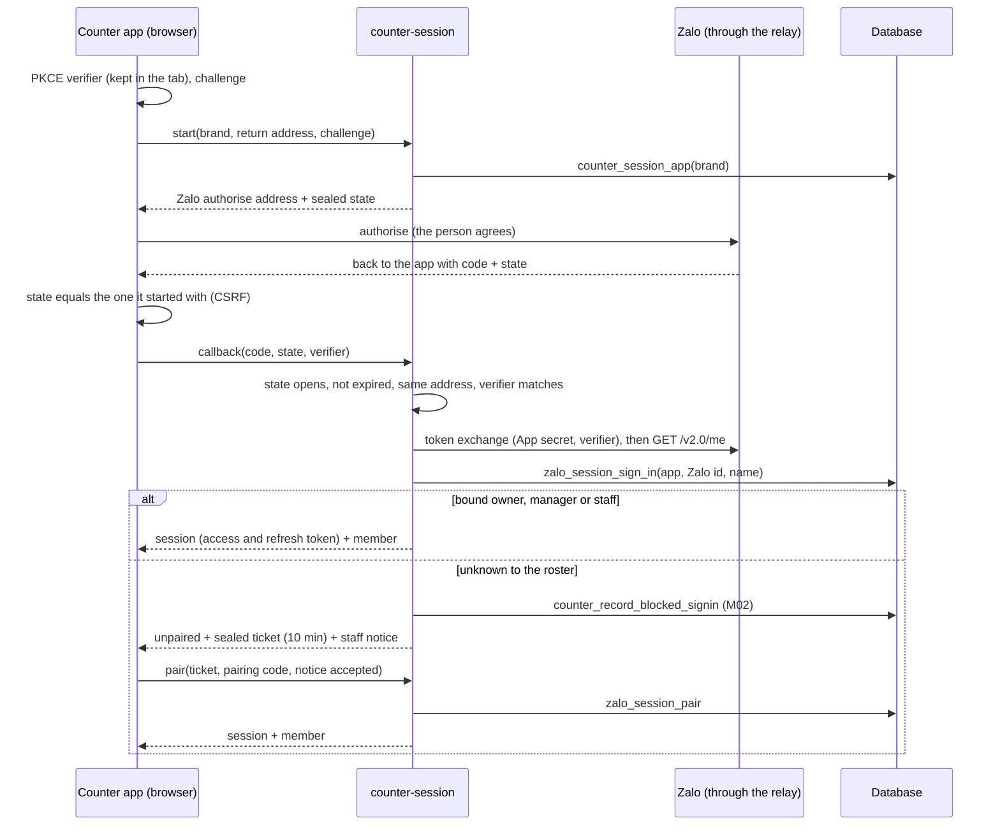

# The counter web app

As of 2026-11-28 · decision record [ADR-066](../decisions.md#adr-066--the-counter-web-app-its-own-app-in-the-monorepo-zalos-web-login-through-a-new-function-browser-printing-first-a-chime-unlocked-once-per-shift) (builds ADR-064) · server side: [native-till.md](native-till.md)

## Purpose

The native till's counter (native-till.md section 8): a web app on a tablet fixed at the counter, which managers also open on their phones. It signs in with Zalo; a person who is not on the store's roster is refused. It runs on the `counter_*`, `staff_*` and `manager_*` functions of the native till and on the menu tables the managers write under RLS. It is generic: brands are `brand-1`, stores `sa-1`, all values synthetic; a brand's look and names come from its private configuration.

## 1. Sign-in (Zalo's web login)

- The state and the ticket are sealed with AES-GCM under keys derived from the brand's App secret (HMAC-SHA-256 with a purpose label), so the browser can neither read nor forge them, and a ticket never opens as a state.
- Only owners, managers and staff get a session; a viewer or a publisher bound to the brand's app is refused (`role_not_allowed`).
- The session is a normal Supabase session (the `memberships` claim, RLS); the app keeps it in the browser's storage and refreshes it. Signing out ends it on the device.
- A manager adds a blocked person from Quản lý → Nhân sự ("Thêm vào danh sách"): the roster row and a six-digit pairing code valid ten minutes; the person signs in again with Zalo, types the code and accepts the staff notice.

## 2. The app

`apps/counter`: Vite, React, TypeScript and Tailwind, a hash router, the Mini Apps' theme style sheet, formatters, `PriceText` and component kit (`@fnb/zalo-mini/ui-kit`, `/i18n`, `/app-config`), React Query for the manager pages. The brand's look comes from the configuration of the brand's staff Mini App: `COUNTER_APP_CONFIG` names the brand's generated `app-config.json` (private), else the synthetic configuration of `VITE_BRAND_KEY`. Environment: `VITE_SUPABASE_URL`, `VITE_SUPABASE_PUBLISHABLE_KEY`, `VITE_COUNTER_SESSION_URL` (default: the function under the API), `VITE_BRAND_KEY`.

| Section | Who | Screens | Server |
|---|---|---|---|
| Đơn | everyone | the queue (S02) in three lanes, the order detail (S03) with the e-invoice card (the pill and the company row), the payment dialog (Q01 frames 4 and the card tab), cancel and refund (Q03) | `counter_board` every 2 s, `counter_order`, `counter_order_act`, `counter_record_payment`, `counter_refund`, `counter_order_einvoice`, `counter_request_invoice` |
| Tạo đơn | everyone | Q01: menu grid, options, ticket (with the member code, the stamps the order earns its member, and "Hóa đơn công ty"), table or takeaway, payment, the paid state with the e-invoice pill, print | `counter_menu`, `counter_table_map`, `counter_create_order`, `counter_request_invoice`, `counter_order_einvoice` |
| Bàn | everyone | the table map with calls and "Tới ngay" | `counter_table_map`, the board's calls, `counter_ack_call` |
| Món | everyone | sold-out switches (S05), pausing app orders | `counter_menu`, `counter_set_sold_out`, `counter_set_pause` |
| Ca làm | everyone | clock-in with the counter code and the opening cash, the blind count and its "Đối chiếu" after it (Q02), my month with each past shift's "Đối chiếu" | `staff_clock_in`, `staff_clock_out`, `staff_my_shift`, `staff_shift_reconciliation` |
| Quản lý | owners, managers | menu and prices with the price log, the day's overview, requests (M01, with the customers' acceptances), staff (M02), shifts (with another person's "Đối chiếu"), worked days and the day's reconciliation, e-invoices (the failing list with "Thử lại"), the money a provider reported that no order took (Tiền chờ xử lý, settled with a note), QR codes | the menu tables under RLS, `invoices` and `invoice_lines`, `manager_requests`, `manager_request_read`, `manager_answer_request`, the roster functions, `manager_blocked_signins` and its two answers, `manager_shifts`, `staff_shift_reconciliation`, `manager_confirm_shift`, `manager_close_shift`, `manager_worked_days`, `manager_day_reconciliation`, `manager_counter_qr`, `table_qr_links`, `rotate_table_qr`, `manager_einvoices`, `manager_retry_einvoice`, `manager_payment_exceptions`, `manager_resolve_payment_exception` |

Layout: a top bar (the brand, "Quầy", the shift, the sound, the network, the person and the time), then a left rail on a tablet (72 px at 1024, 88 px from 1280) or bottom tabs on a phone. Buttons are 56 px high on the counter, chips and steppers keep a 44 px target, every state is a word (never colour alone), dialogs keep the focus and close with Esc.

## 3. The queue

- The board answers only what changed since its cursor; the app merges each answer (`orders/board-model.ts`): a newer version wins, an order it changed itself is not overwritten by an older answer, closed orders of the business day stay for refunds.
- New orders and new staff calls ring the chime (Web Audio, two tones; a vibration where the device has one) once the sound was turned on with a tap; every chime is counted on `<html data-chimes>`.
- An order accepted longer ago than the store's `late_order_minutes` is drawn red with "Chờ lâu · N phút" (the database's `late` flag).
- A failed poll keeps every order shown and says "Mất mạng"; the first answer after it says how many orders arrived meanwhile. Actions are not queued offline. A refused poll (42501: the person was locked or lost the store) signs the person out at once.
- Two devices on one order: each action names the version it saw; the stale one gets `conflict` with the current order, which the screen shows with a toast. The same step twice is a replay.
- Completing an unpaid order is refused by the database (`payment_required`) and the screen says why; "Thu tiền" opens the payment dialog. Cash and card need the cashier's open shift at the store (the drawer is compared with the cash they recorded); the database refuses a payment without one (`shift_required`, "Bạn chưa vào ca ở quầy này"), owners and managers included.

## 4. Shifts

Clocking in takes the counter's code (the printed QR holds the app's address with `?ma=<code>`; the tablet's camera reads it where the browser has BarcodeDetector, otherwise the 22 characters under the QR are typed) and the opening cash counted by note. Clocking out is blind: the count by denomination is sent as a total, and only the answer shows the expected cash and the difference. A difference waits for a manager, who confirms it from their own device (never their own shift) with a reason and a note, stored as the shift's close note; the cashier may count again. A manager closes a forgotten shift with the time, the count and a note.

"Đối chiếu" (Q02 frame 1, `staff_shift_reconciliation`, since 2026-11-28) shows the opening cash, the cash sales and cash refunds the person recorded (orders and totals), the paid-outs (always 0 until they are recorded), the expected and counted cash and the difference in words, and beside them what is not in the drawer (card, card refunds, VietQR, the Zalo wallet). The app asks for it only once the person's count is recorded (`mayReadReconciliation`): never for the person's own open shift, so no expected figure reaches the tablet before the count, a manager's own shift included. It shows after a count that differs (with the reason step), after a matching count that closes the shift (until "Xong"), after a manager confirmed the difference while the page was open, and for any past shift from "Ca gần đây". Owners and managers open another person's shift from Quản lý → Ca làm at any time; an open one shows the figures so far, not counted.

## 5. Printing

`print/printer.tsx` is the seam: a `TicketPrinter` takes a `Ticket` (plain lines with a size and an alignment, `print/ticket.tsx`). v1 renders the ticket into the page and opens the browser's print dialog; while it prints, only the ticket is on paper, 80 mm wide. An ESC/POS printer over WebUSB or Web Bluetooth is a second `TicketPrinter` fed the same lines. A counter order prints after its payment and can be printed again; any order prints from its detail.

## 6. Decisions and deviations from the designs (recorded 2026-11-28)

1. The count at clock-out is blind (the database's rule), so Q02's "Đối chiếu" column before the count is shown only after it; the cashier's reason for a difference is chosen by the confirming manager and stored in the close note: the database has no field for the cashier's own reason. Since migration `shift_difference_reason` (2026-11-28) it has one: the clock-out answer says `reason_required`, and the cashier counts again with the reason and a note (`staff_clock_out(p_counted_cash, p_reason, p_note)`), which the manager then reads beside the numbers. Since 2026-11-28 the Ca làm page asks it after a count that differs: the four reasons and a one-line note (1–200 characters), sent with the same count; the manager's confirmation shows it beside the numbers and starts from it. "Đối chiếu" itself (`staff_shift_reconciliation`, section 4) is drawn after the count as the design draws it, with two lines the design does not have: the paid-outs ("Chi từ két", 0 until they are recorded) and the card refunds outside the drawer ("Hoàn qua thẻ"); a matching count, which closes the shift at once, shows it in a card above the clock-in until "Xong" (the design's "Tổng kết ca" has more: the orders, the shift's log, printing; not built).
2. The manager PIN at the counter (Q02, decision D3) is not built: the database has no PIN; the manager confirms from their own device.
3. The payment dialog offers cash, card and, when the store's VietQR provider is on (`counter_payment_methods`), a VietQR the walk-in pays by bank transfer; it turns "Đã nhận tiền" only when the server's bank confirmation pays the order (ADR-067, ADR-068). The wallet, the member scan (C20), the company invoice and the e-invoice status of Q01 wait for their providers. The member scan's server side exists since migration `stamp_member_codes` (2026-11-28: `counter_member_lookup`, `counter_attach_member`). Since 2026-11-28 the ticket has "Quét mã thành viên" (the card picked is attached once the order exists) and a counter order's detail has "Gắn thẻ thành viên": the camera reads the QR where the browser has BarcodeDetector, else the 8 digits are typed and their Luhn check digit is tested before any call; only the shortened name and the stamps are shown. Cash and card without an open shift at the store say so in the dialog with "Vào ca", before and after the server's `shift_required`; so does a cash refund refused off shift (`counter_refund`'s `shift_required`, migration `cash_refund_needs_shift`), whose submit stays open for a refund after clocking in. With a member on the ticket, the ticket says how many stamps the order earns ("Đơn này cộng thêm N dấu khi hoàn thành.", the design's "đơn này cộng thêm N ly nước" worded as stamps) by the server's rule: one per unit of the lines whose item `counts_for_stamps` (`counter_menu`, migration `counter_menu_stamp_flag`), at the brand of the first line, nothing while that brand's card is off or when nothing counts; the member dialog says it too.
4. A counter order enters the queue when it is created (the database accepts it at once, unpaid) and is paid right after; closing the payment dialog leaves it in the queue as "Chưa thu tiền" (Q01 drew payment before the queue).
5. The roster has two roles (staff and manager); the designs' cashier, barista and waiter are not separate roles. The database lets a manager add a manager; the screen offers the manager role to owners only (D10).
6. The requests inbox answers confirm, decline and cancel with a message; "propose another time" and "replied" (M01) have no state in the database, so the answer itself stops the clock and a new time is written in the message. Since migration `request_proposals_and_reads` (2026-11-28) the database has the proposal (`manager_answer_request(..., p_proposed_for)`, status `proposed`) and the first reading (`manager_request_read`, the inbox's `unread`). Since 2026-11-28 the inbox records the first reader when a request is opened, shows the unread count (inbox, Quản lý, the manager's tab) and proposes another time with a date and a clock (not the free slots the design draws: the database has no table capacity to offer them); confirming a proposed request names the new time in the reply. "Replied" stays the answer itself. Since migration `customer_accept_proposal` (2026-11-28) a customer accepts the time proposed in the app; the inbox lists such a request right after the new ones in "Chưa xử lý" with a mark of its own ("Khách đồng ý giờ mới", a dot and words for screen readers), counts it with the unread ones (the inbox's pill, Quản lý, the manager's tab) and says how many were accepted, until an owner or manager opens it (`manager_request_read`) or answers it; it then moves to "Đã xử lý". The request's detail says when the customer accepted in the app. A proposal on an app request tells the manager that the customer can accept it there.
7. Fonts and the brand's art are the system font and the tile wordmark until the font and art pieces of ADR-059 are built.
8. A member of several stores chooses the device's store at sign-in; the full store switch (S14) comes later.
9. E-invoices (ADR-069, ADR-070; wired 2026-11-28): the order detail and the paid state of Q01 carry the pill ("Đang xuất…", "Đã xuất" with the number and the lookup code, "Chưa xuất được" with "Hệ thống tự thử lại, đơn vẫn hoàn tất.", "Không xuất được" once the job gave up), read with the order and every 15 seconds while the job may change it. "Hóa đơn công ty" sits on the ticket as Q01 draws it, but `counter_request_invoice` takes a paid order, so the company keyed there is checked and held in memory and sent right after the payment (a refusal is said and the order's detail sends it again); a paid counter order's detail has the same row; an order of the app has none (its customer asks in the app, C18). The form has C18's fields and checks (`checkCompany` of `@fnb/zalo-mini/ordering`, the server checks again) and one request id per opening. Quản lý → Hóa đơn điện tử lists the failing documents (the counts, the filters failing, pending and all, the error class in words, the attempts, the next attempt or when it gave up) with "Thử lại"; the count of failing documents is on its card and is added to the badge of the manager's tab.
10. Money held for a manager (ADR-068; built 2026-11-28, acceptance criterion 6, closing gap 5 of the test plan's section 10.15): when a verified provider reports money the server cannot apply to an order (another amount, late, a second payment of a paid order, a reference nobody issued), `checkout_settle` keeps it in `payment_exceptions`, and none of it is in the day's revenue. Quản lý → Tiền chờ xử lý (`/quan-ly/tien-cho-xu-ly`, `manager/payment-exceptions-page.tsx`) lists the store's money newest first with the filters "Chờ xử lý" (the default), "Đã xử lý" and "Tất cả": the amount, the kind in words with a line that explains it and, when it differs, the order's amount ("Đơn cần …"), the provider (VietQR, Ví Zalo), the reference, the linked order (a link to its detail) or "Chưa gắn đơn nào", and the time received. "Xử lý" opens a dialog: the way ("Đã trả lại khách", handed back outside the app, or "Bỏ qua, không trả lại") and a note the server requires (1 to 200 characters on one line, checked as the server checks it, each problem said under its field), then a confirmation, since the server never changes a resolution; the confirmation ignores taps for half a second, so a double tap on "Tiếp tục" never confirms, and one confirmation sends one call. Each answer is worded: done, a replay ("ghi chú cũ được giữ"), `already_resolved` (said on the page, the list read again), 42501, 22023 (back to the note) and the network (the same confirmation tries again). A settled row says the resolution, who (the person, a roster name, else "Quản lý hoặc chủ quán") and when, with the note. The open count is on the section's card and added to the badge of the manager's tab, and Đối soát ngày on Quản lý → Ca làm says "N khoản tiền chờ xử lý, chưa tính vào đối soát →" with a link while any is open. The server has no "resolved" filter, so "Đã xử lý" asks for `refunded` and `dismissed` and merges them newest first. An exception of a brand-wide account (no store) is listed only to owners and managers with every store, as the server answers.
11. Left for later, as the plan orders: online payment flows, ZBS, the roster (S07), payroll (S11), stock (S08), the weekly report (S12), promotions (S13), the store switch (S14).

## 7. Security

- Every action is decided by the database again (`counter_*`, `staff_*`, `manager_*`, RLS on the menu tables); hidden buttons are never the control. A write RLS silently skips (an update with no row) is shown as refused.
- The sign-in's state and ticket are sealed; the browser keeps the PKCE verifier and compares the state at the return (CSRF); return addresses are an exact list; CORS lets in only their origins.
- The build carries a CSP meta element (scripts from the app only, connections to the app, the API and the function) and `scripts/check-bundle.mjs` fails a build that holds a secret, a non-anon JWT, an e-mail address or a non-synthetic UUID.
- Names, notes and table labels are written as text everywhere, the printed ticket included; so are a buyer's company and address. The managers' e-invoice list holds error classes only, never a buyer's data, and no tax code goes into an address or a log. The list of money held holds no payer name or account number; its notes, references and order numbers are written as text, a long reference wraps.

## 8. Tests

| Level | Suite | What |
|---|---|---|
| unit | `counter:unit` (296, `pnpm --filter @fnb/counter test`) | the web login (state, PKCE, CSRF), Vietnam time, the CSP, the catalogs, cash (counts, change, differences at their boundaries), the board model, the ticket, the draft, tables and the menu search, the manager helpers, the cashier's reason and the clock-out stages, the member code (Luhn, the attach rule), the payment's shift rule, the inbox's proposal and unread, the e-invoice pill's states, the company row's decision table and form (errors linked to their fields, one request id), the managers' error classes; the ticket's stamps (EP, BVA, the decision table of card and units), the customers' acceptances in the inbox (the mark, the order, the tabs, the unread count at its boundaries, opening reads it, markup as text), "Đối chiếu" (who may ask, never one's own open shift, the lines and signs, each answer worded, failures, markup as text), the refund's "Vào ca"; the money held for a manager (`counter:unit/payment-exceptions`, 21, and `counter:component/payment-exceptions`, 18: the reader's classes, the note at 1, 200 and 201 characters and with control characters as PostgreSQL counts them, the decision tables of an answer and of who resolved it, the filters, the dialog's states and its double taps, each refusal worded, markup and long references as text, Đối soát ngày's line at 0 and 1) |
| unit | `zalo:unit/web-login` (20), Deno `counter-session` (11) | the sealed state and ticket, the token exchange on the mock Zalo, the relay's one new call, the function's use cases, refusals, CORS and logs |
| integration | `counter:integration` (33, `node scripts/with-local-stack.mjs npx vitest run -c vitest.integration.config.ts`) | the app's own calls through PostgREST with real sessions: the board and its cursor, another store refused, a counter order from the draft with its replay, the lifecycle with payment required, a staff refund refused, a conflict and a replay, sold out, an update RLS skips, the manager reads; the cashier's reason, shift_required at another store, the member code (lookup, attach, replay, IDOR, guesses limited), the inbox's reading and proposal, the customer's deletion and export read by the customer app's readers; the e-invoice pill, the company row (the client's checks agree with the server's field by field, the replay, the conflict, an app order, another store), the managers' list and retry, C18's window on day 7 and day 8, IDOR and the saved companies; the ticket's stamps over the real menu equal what the order earns on completion (and nothing with the card off), the customer's acceptance (replay, not_allowed, request_conflict, proposal_expired at its instant, unknown_request for another customer's or a website request, staff refused) and the inbox's flag until opened, "Đối chiếu" blind for the person's own open shift (a manager's too, no expected figure in the answer), the figures so far for a manager, the breakdown adding up to the expected cash after the count, other staff refused; the money held for a manager (`payment-exceptions`, 6: the four kinds made through `checkout_begin` and `checkout_settle` and never applied, who reads which store's and the brand's account's, the list's limits, open → refunded with a replay and `already_resolved`, the client's note check agreeing with the server's, IDOR for staff, another store, another tenant and an unknown id) |
| database | pgTAP `274_counter_sign_in` (48), rows in `120` and `47` | the blocked sign-ins, their privileges and bounds |
| end to end | `counter:e2e` (163 runs: 45 tablet cases on 1280×800 and 1024×768 in Chromium and 1280×800 in WebKit, 14 phone cases in Chromium and WebKit; 4 skip by design) | sign-in allowed and blocked (criterion 5), shifts (criteria 6 and 7), orders (criteria 1 and 4, late, two tablets, offline), tables and sold out (criterion 2), the counter order with change and the printed ticket, the manager pages, the CSP and the bundle, the role and store checks; the cashier's reason (Q02), the payment without a shift, the member code typed and scanned (Q01), the inbox's unread, reading and proposal (M01); the e-invoice pill on the paid state and the order detail, the company row on the ticket and on a paid counter order, the managers' failing list with its badge and retry, staff refused; the ticket's stamps (pastries only, the card off), "Đối chiếu" never asked while the shift is open and shown after the count, a matching count's breakdown until "Xong" and a past shift's from "Ca gần đây", a manager reading another person's open shift and not their own, the customer's acceptance counted and marked in the inbox until opened (the first reader kept), the refund's "Vào ca"; the money held for a manager (`payment-exceptions`, criterion 6): its count on the tab and the card, each row's fields, settled after the confirmation and found under "Đã xử lý" with who and the note as text, Đối soát ngày's line leading to it and gone once settled, a note of 201 and 200 characters, a control character refused, the owner settling it first, readable in light and dark, staff and another store refused |

Run the end-to-end suite from `apps/counter` with the local stack running: `node scripts/with-local-stack.mjs npx playwright test`. It builds the app, seeds a synthetic tenant (`ct-e2e-…`), serves the mock Zalo on 127.0.0.1:5768, runs the real `counter-session` with Deno on 5767 and removes the tenant at the end; it never calls Zalo or the cloud.
