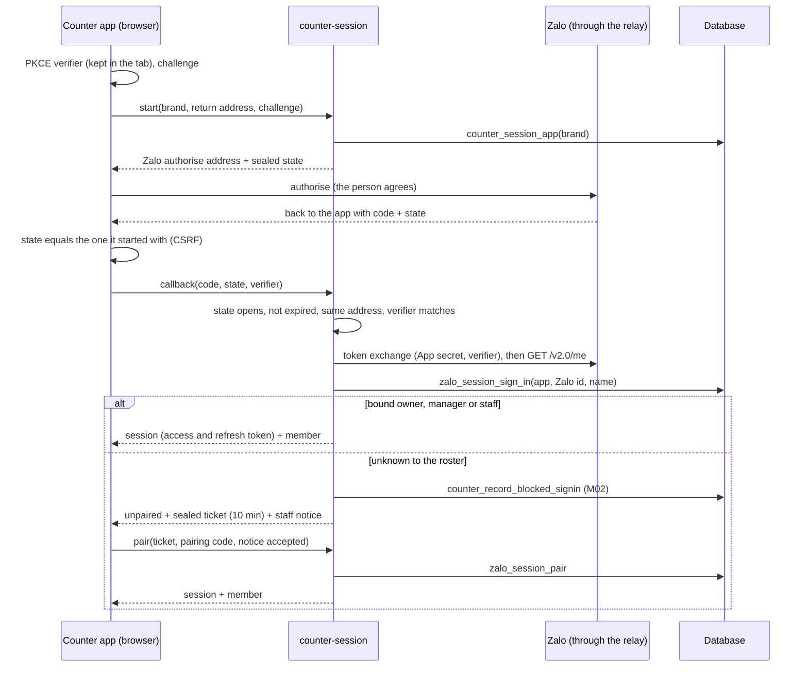

# The counter web app

As of 2026-11-28 · decision record [ADR-066](../decisions.md#adr-066--the-counter-web-app-its-own-app-in-the-monorepo-zalos-web-login-through-a-new-function-browser-printing-first-a-chime-unlocked-once-per-shift) (builds ADR-064) · server side: [native-till.md](native-till.md)

## Purpose

The native till's counter (native-till.md section 8): a web app on a tablet fixed at the counter, which managers also open on their phones. It signs in with Zalo; a person who is not on the store's roster is refused. It runs on the `counter_*`, `staff_*` and `manager_*` functions of the native till and on the menu tables the managers write under RLS. It is generic: brands are `brand-1`, stores `sa-1`, all values synthetic; a brand's look and names come from its private configuration.

## 1. Sign-in (Zalo's web login)

- The state and the ticket are sealed with AES-GCM under keys derived from the brand's App secret (HMAC-SHA-256 with a purpose label), so the browser can neither read nor forge them, and a ticket never opens as a state.
- Only owners, managers and staff get a session; a viewer or a publisher bound to the brand's app is refused (`role_not_allowed`).
- The session is a normal Supabase session (the `memberships` claim, RLS); the app keeps it in the browser's storage and refreshes it. Signing out ends it on the device.
- A manager adds a blocked person from Quản lý → Nhân sự ("Thêm vào danh sách"): the roster row and a six-digit pairing code valid ten minutes; the person signs in again with Zalo, types the code and accepts the staff notice.
