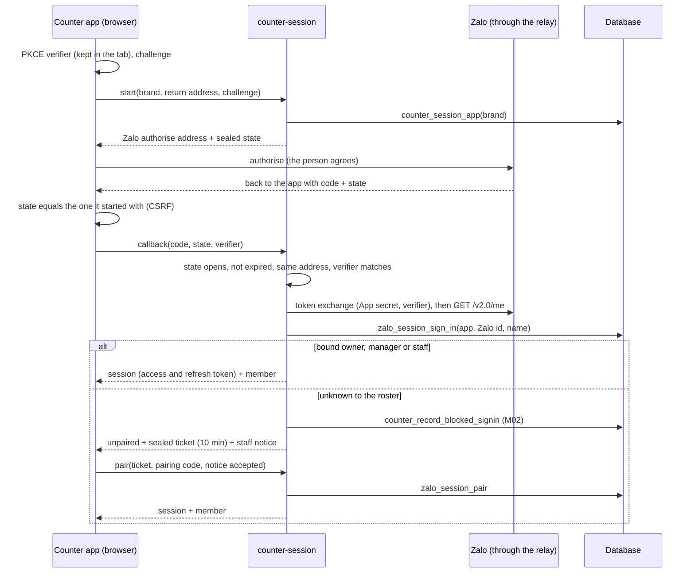

# The counter web app

As of 2026-11-28 · decision record [ADR-066](../decisions.md#adr-066--the-counter-web-app-its-own-app-in-the-monorepo-zalos-web-login-through-a-new-function-browser-printing-first-a-chime-unlocked-once-per-shift) (builds ADR-064) · server side: [native-till.md](native-till.md)

## Purpose

The native till's counter (native-till.md section 8): a web app on a tablet fixed at the counter, which managers also open on their phones. It signs in with Zalo; a person who is not on the store's roster is refused. It runs on the `counter_*`, `staff_*` and `manager_*` functions of the native till and on the menu tables the managers write under RLS. It is generic: brands are `brand-1`, stores `sa-1`, all values synthetic; a brand's look and names come from its private configuration.

## 1. Sign-in (Zalo's web login)

- The state and the ticket are sealed with AES-GCM under keys derived from the brand's App secret (HMAC-SHA-256 with a purpose label), so the browser can neither read nor forge them, and a ticket never opens as a state.
- Only owners, managers and staff get a session; a viewer or a publisher bound to the brand's app is refused (`role_not_allowed`).
- The session is a normal Supabase session (the `memberships` claim, RLS); the app keeps it in the browser's storage and refreshes it. Signing out ends it on the device.
- A manager adds a blocked person from Quản lý → Nhân sự ("Thêm vào danh sách"): the roster row and a six-digit pairing code valid ten minutes; the person signs in again with Zalo, types the code and accepts the staff notice.

## 2. The app

`apps/counter`: Vite, React, TypeScript and Tailwind, a hash router, the Mini Apps' theme style sheet, formatters, `PriceText` and component kit (`@fnb/zalo-mini/ui-kit`, `/i18n`, `/app-config`), React Query for the manager pages. The brand's look comes from the configuration of the brand's staff Mini App: `COUNTER_APP_CONFIG` names the brand's generated `app-config.json` (private), else the synthetic configuration of `VITE_BRAND_KEY`. Environment: `VITE_SUPABASE_URL`, `VITE_SUPABASE_PUBLISHABLE_KEY`, `VITE_COUNTER_SESSION_URL` (default: the function under the API), `VITE_BRAND_KEY`.

| Section | Who | Screens | Server |
|---|---|---|---|
| Đơn | everyone | the queue (S02) in three lanes, the order detail (S03), the payment dialog (Q01 frames 4 and the card tab), cancel and refund (Q03) | `counter_board` every 2 s, `counter_order`, `counter_order_act`, `counter_record_payment`, `counter_refund` |
| Tạo đơn | everyone | Q01: menu grid, options, ticket, table or takeaway, payment, print | `counter_menu`, `counter_table_map`, `counter_create_order` |
| Bàn | everyone | the table map with calls and "Tới ngay" | `counter_table_map`, the board's calls, `counter_ack_call` |
| Món | everyone | sold-out switches (S05), pausing app orders | `counter_menu`, `counter_set_sold_out`, `counter_set_pause` |
| Ca làm | everyone | clock-in with the counter code and the opening cash, the blind count (Q02), my month | `staff_clock_in`, `staff_clock_out`, `staff_my_shift` |
| Quản lý | owners, managers | menu and prices with the price log, the day's overview, requests (M01), staff (M02), shifts, worked days and the day's reconciliation, QR codes | the menu tables under RLS, `invoices` and `invoice_lines`, `manager_requests`, `manager_answer_request`, the roster functions, `manager_blocked_signins` and its two answers, `manager_shifts`, `manager_confirm_shift`, `manager_close_shift`, `manager_worked_days`, `manager_day_reconciliation`, `manager_counter_qr`, `table_qr_links`, `rotate_table_qr` |

Layout: a top bar (the brand, "Quầy", the shift, the sound, the network, the person and the time), then a left rail on a tablet (72 px at 1024, 88 px from 1280) or bottom tabs on a phone. Buttons are 56 px high on the counter, chips and steppers keep a 44 px target, every state is a word (never colour alone), dialogs keep the focus and close with Esc.

## 3. The queue

- The board answers only what changed since its cursor; the app merges each answer (`orders/board-model.ts`): a newer version wins, an order it changed itself is not overwritten by an older answer, closed orders of the business day stay for refunds.
- New orders and new staff calls ring the chime (Web Audio, two tones; a vibration where the device has one) once the sound was turned on with a tap; every chime is counted on `<html data-chimes>`.
- An order accepted longer ago than the store's `late_order_minutes` is drawn red with "Chờ lâu · N phút" (the database's `late` flag).
- A failed poll keeps every order shown and says "Mất mạng"; the first answer after it says how many orders arrived meanwhile. Actions are not queued offline. A refused poll (42501: the person was locked or lost the store) signs the person out at once.
- Two devices on one order: each action names the version it saw; the stale one gets `conflict` with the current order, which the screen shows with a toast. The same step twice is a replay.
- Completing an unpaid order is refused by the database (`payment_required`) and the screen says why; "Thu tiền" opens the payment dialog. Cash and card need the cashier's open shift at the store (the drawer is compared with the cash they recorded); the database refuses a payment without one (`shift_required`, "Bạn chưa vào ca ở quầy này"), owners and managers included.

## 4. Shifts

Clocking in takes the counter's code (the printed QR holds the app's address with `?ma=<code>`; the tablet's camera reads it where the browser has BarcodeDetector, otherwise the 22 characters under the QR are typed) and the opening cash counted by note. Clocking out is blind: the count by denomination is sent as a total, and only the answer shows the expected cash and the difference. A difference waits for a manager, who confirms it from their own device (never their own shift) with a reason and a note, stored as the shift's close note; the cashier may count again. A manager closes a forgotten shift with the time, the count and a note.

## 5. Printing

`print/printer.tsx` is the seam: a `TicketPrinter` takes a `Ticket` (plain lines with a size and an alignment, `print/ticket.tsx`). v1 renders the ticket into the page and opens the browser's print dialog; while it prints, only the ticket is on paper, 80 mm wide. An ESC/POS printer over WebUSB or Web Bluetooth is a second `TicketPrinter` fed the same lines. A counter order prints after its payment and can be printed again; any order prints from its detail.

## 6. Decisions and deviations from the designs (recorded 2026-11-28)

1. The count at clock-out is blind (the database's rule), so Q02's "Đối chiếu" column before the count is shown only after it; the cashier's reason for a difference is chosen by the confirming manager and stored in the close note: the database has no field for the cashier's own reason.
2. The manager PIN at the counter (Q02, decision D3) is not built: the database has no PIN; the manager confirms from their own device.
3. VietQR, the wallet, the member scan (C20), the company invoice and the e-invoice status of Q01 wait for the providers and their functions; the payment dialog offers cash and card.
4. A counter order enters the queue when it is created (the database accepts it at once, unpaid) and is paid right after; closing the payment dialog leaves it in the queue as "Chưa thu tiền" (Q01 drew payment before the queue).
5. The roster has two roles (staff and manager); the designs' cashier, barista and waiter are not separate roles. The database lets a manager add a manager; the screen offers the manager role to owners only (D10).
6. The requests inbox answers confirm, decline and cancel with a message; "propose another time" and "replied" (M01) have no state in the database, so the answer itself stops the clock and a new time is written in the message.
7. Fonts and the brand's art are the system font and the tile wordmark until the font and art pieces of ADR-059 are built.
8. A member of several stores chooses the device's store at sign-in; the full store switch (S14) comes later.
9. Left for later, as the plan orders: online payment flows, e-invoices, ZBS, the roster (S07), payroll (S11), stock (S08), the weekly report (S12), promotions (S13), the store switch (S14).

## 7. Security

- Every action is decided by the database again (`counter_*`, `staff_*`, `manager_*`, RLS on the menu tables); hidden buttons are never the control. A write RLS silently skips (an update with no row) is shown as refused.
- The sign-in's state and ticket are sealed; the browser keeps the PKCE verifier and compares the state at the return (CSRF); return addresses are an exact list; CORS lets in only their origins.
- The build carries a CSP meta element (scripts from the app only, connections to the app, the API and the function) and `scripts/check-bundle.mjs` fails a build that holds a secret, a non-anon JWT, an e-mail address or a non-synthetic UUID.
- Names, notes and table labels are written as text everywhere, the printed ticket included.

## 8. Tests

| Level | Suite | What |
|---|---|---|
| unit | `counter:unit` (90, `pnpm --filter @fnb/counter test`) | the web login (state, PKCE, CSRF), Vietnam time, the CSP, the catalogs, cash (counts, change, differences at their boundaries), the board model, the ticket, the draft, tables and the menu search, the manager helpers |
| unit | `zalo:unit/web-login` (20), Deno `counter-session` (11) | the sealed state and ticket, the token exchange on the mock Zalo, the relay's one new call, the function's use cases, refusals, CORS and logs |
| integration | `counter:integration` (7, `node scripts/with-local-stack.mjs npx vitest run -c vitest.integration.config.ts`) | the app's own calls through PostgREST with real sessions: the board and its cursor, another store refused, a counter order from the draft with its replay, the lifecycle with payment required, a staff refund refused, a conflict and a replay, sold out, an update RLS skips, the manager reads |
| database | pgTAP `274_counter_sign_in` (48), rows in `120` and `47` | the blocked sign-ins, their privileges and bounds |
| end to end | `counter:e2e` (99 runs: 29 tablet cases on 1280×800 and 1024×768 in Chromium and 1280×800 in WebKit, 6 phone cases in Chromium and WebKit) | sign-in allowed and blocked (criterion 5), shifts (criteria 6 and 7), orders (criteria 1 and 4, late, two tablets, offline), tables and sold out (criterion 2), the counter order with change and the printed ticket, the manager pages, the CSP and the bundle, the role and store checks |

Run the end-to-end suite from `apps/counter` with the local stack running: `node scripts/with-local-stack.mjs npx playwright test`. It builds the app, seeds a synthetic tenant (`ct-e2e-…`), serves the mock Zalo on 127.0.0.1:5768, runs the real `counter-session` with Deno on 5767 and removes the tenant at the end; it never calls Zalo or the cloud.
