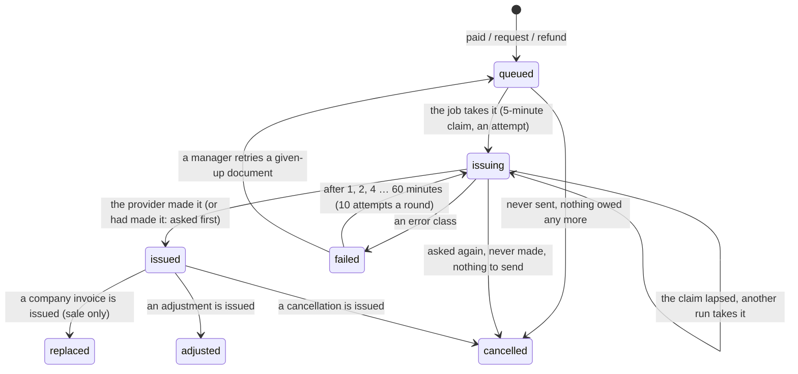

# The native till: owned menu, orders, payments and the counter

As of 2026-11-27 · architecture for implementation · decision records ADR-060 to ADR-065 (proposed), which amend [ADR-058](../decisions.md#adr-058--online-ordering-server-priced-orders-one-status-machine-in-sql-pay-at-the-counter-through-the-checkout-sdk-first-staff-key-orders-into-the-till-delivery-last)

## Purpose

On 2026-11-27 the owner of the first brand chose to make this platform the till of the stores that switch to it, instead of keying online orders into the POS. This document is the architecture of that "native" mode: the menu and prices the managers own, the one-time import from the POS catalogue, table QR codes and staff calls, orders and their fixed lifecycle, payment records and the seams for online payment and e-invoices, the counter web app's server side, the stamp card tied to the Zalo account, the hand-off to the sales facts, the requests inbox and shift clock-in. It is generic: brands are `brand-1`, stores `sa-1`, all values synthetic. The owner's governing plan and the earlier technical spec are private; where they fix a rule, this document states the rule without the brand.

What [online-ordering.md](online-ordering.md) (ADR-058) still holds: the Zalo review rules (section 2), the Checkout SDK contract and its MACs (2.5, 6.2, 6.3), the security-definer boundary, idempotency, polling, presence, the threat cases (10.3) and the test design (12). What it no longer holds: prices from the POS, the drift guard, keying orders into the till and matching them back, and its status machine; those are replaced below. Its first build is parked on the local branch `parked/ordering-pos-priced-menu`.

## 1. Decisions at a glance

1. **A store has a till mode.** `ipos` (the default: the POS is the till, our platform reads it) or `native` (our platform is the till for that store). The mode is a per-store setting only an owner with every store changes. Other brands and stores keep `ipos`.
2. **Native stores own their menu.** Categories, items, sizes with a price each, option groups with option prices, labels, photos and per-store availability live in our database, per brand. Every price change is written to an append-only price log with who and when. The POS catalogue can seed a brand's menu once (an import); nothing keeps the two in step afterwards.
3. **Every order line snapshots its price.** Item, size and option names and prices are copied onto the line at placement; a later price change never alters an old order or a report.
4. **One fixed lifecycle, enforced by the database.** `awaiting_payment` → `accepted` → `preparing` → `ready` (takeaway) or `serving` (table) → `completed`; `cancelled` only from `awaiting_payment` and `accepted`. The server refuses every other transition, whatever a screen sends.
5. **Payment status is separate from the lifecycle.** An order paid online leaves `awaiting_payment` only when the server receives a verified notification from the gateway or the bank. A pay-at-counter order enters the queue at once as `accepted` with payment `unpaid` ("Chưa thu tiền") and can be completed only after the counter records the payment.
6. **Every cancel and refund is logged** with who, when and how much, in the order's append-only event log and the refund records.
7. **Payments: three ways, server-confirmed.** Zalo's Checkout SDK for e-wallets, a dynamic VietQR with automatic bank notification through a provider adapter (a mock first), and cash or card at the counter. Every placement carries an idempotency key; a job re-queries a transaction whose notification is late; provider secrets live only on the server.
8. **E-invoices are issued by the server** after each paid order, through a provider-agnostic adapter with a mock and a queue with retries; a customer may ask for a company invoice with a tax code.
9. **The counter is a web app** on a tablet (managers open it on a phone), signing in with Zalo; staff not on the store's list are refused by the database. Its server side is the `counter_*` functions of this document.
10. **The customer is followed in the app first.** Paid Zalo messages (ZBS) only for "takeaway ready", booking confirmations, cancellations and refunds, between 06:00 and 22:00; promotions only to customers who opted in, at most two a week.
11. **Stamps belong to the Zalo account.** One stamp per drink when an order completes, no phone needed; nine stamps give a free tenth drink as a reward on the account; a cancel or refund takes the order's stamps back.
12. **Native orders feed the sales facts.** A completed and paid native order becomes an invoice of the store, as if a connector had synced it, so every report keeps working.

## 2. Till mode and store settings

`store_ordering_settings`, one row per store (replacing ADR-058's `ordering_store_settings`):

| Column | Default | Meaning |
|---|---|---|
| `till_mode` | `ipos` | `ipos` or `native`; written only by `set_store_till_mode` (an owner with every store) |
| `ordering_enabled` | false | customers may order at this store (native stores only) |
| `order_types` | `{table}` | subset of `table`, `takeaway` (takeaway arrives in the owner's phase 2) |
| `payment_methods` | `{counter}` | subset of `counter`, `zalo_checkout`, `vietqr`; the online two are switched on when their provider is configured |
| `payment_window_minutes` | 15 | an online order waits this long for its payment, then is cancelled (`payment_timeout`) |
| `late_order_minutes` | 10 | an accepted or preparing order older than this is shown red at the counter (the owner fills the exact value at the trial) |
| `prep_minutes` | 10 | the earliest pick-up after placement |
| `max_order_amount` | 2,000,000 | the largest order total |
| `staff_presence_required` | true | ordering closes when no counter device polled in 180 seconds |
| `paused_until`, `paused_reason`, `paused_by` | null | set by `counter_set_pause` |

Closures (`ordering_closures`) and the store's opening hours decide when ordering is open; `app.ordering_state(store, type, at)` answers `accepting` or the first reason that holds it: `ordering_off` (no row, not enabled, not native, or the type not offered), `hours_unknown`, `closed_today`, `paused`, `closed_now`, `last_orders_passed`, `no_staff_online`, `busy`. Takeaway orders for a later time while the store is closed are the owner's phase 2.

## 3. The owned menu

### 3.1 Tables

| Table | Holds | Rules |
|---|---|---|
| `menu_categories` | `brand_id`, `name` (1–40), `sort_order`, `visible` | per brand |
| `menu_items` | `brand_id`, `category_id`, `name` (1–60), `description` (≤ 200, one line, no link or phone), `photo_path`, `labels` (`best_seller`, `new`), `sort_order`, `visible` (on sale), `restricted` (alcohol: never visible), `counts_for_stamps` (a drink), `order_types`, and the import's `source_*` columns | a visible item needs a visible category and at least one active size |
| `menu_item_sizes` | `item_id`, `label` (null for a single size, else 1–20 such as "Vừa", "Lớn"), `price` (whole đồng, 1 to 100,000,000), `sort_order`, `is_default`, `active` | one default size per item; labels unique per item |
| `menu_option_groups` | `brand_id`, `name` (1–40: ice, sweetness, toppings), `min_select` 0–20, `max_select` 1–20 ≥ min, `sort_order` | per brand, shared by items |
| `menu_options` | `group_id`, `name` (1–40), `price_delta` (whole đồng, 0 to 1,000,000), `sort_order`, `is_default`, `active` | |
| `menu_item_option_groups` | `item_id`, `group_id`, `sort_order` | the item and the group of one brand |
| `menu_store_items` | `store_id`, `item_id`, `offered`, `sold_out_until`, `sold_out_by` | per-store availability; staff switch sold out |
| `menu_price_changes` | `item_id`, `size_id` or `option_id`, `old_price`, `new_price`, `changed_by`, `changed_at` | append-only; written by triggers on every price insert and change |
| `menu_imports` | `brand_id`, `store_id`, `imported_by`, `imported_at`, counts | one row per brand: the import runs once |
| `app.menu_versions` | `brand_id`, `version` | moved by triggers on every menu and availability change |

Sizes are full prices, not surcharges (the spec has a price per size). Size could have been an option group with a surcharge, but a till keys a size as a different price, and the price log then reads naturally.

### 3.2 Who writes

Owners and managers whose scope holds every store of the brand write the menu directly under RLS (the house pattern of the settings tables), and `app.brand_in_scope` is the rule. Viewers read. Staff read the menu and switch items sold out only through the `counter_*` functions. The price log is written by triggers, so a direct write cannot skip it, and no role may change or delete a log row.

### 3.3 The one-time import

`import_menu_from_pos(p_brand, p_store)` (an owner with every store) seeds an empty brand menu from the POS catalogue of one of its stores: a category per POS item type, an item per POS base name with a size per POS size (the store's list price, else the item's), the POS option groups of `item_option_groups` (written by the master-data run) as option groups whose option prices are the option items' prices, alcohol and beer marked restricted and hidden, everything else visible as the owner chose on 2026-11-26. It records `menu_imports` and refuses a second import (`already_imported`) and an import into a brand that already has items (`menu_not_empty`). Afterwards the POS and the menu are independent.

### 3.4 What customers and the counter read

- `customer_menu(p_store_code, p_order_type)`: the store, its ordering state, the menu version, the visible categories with their orderable items (sizes with prices, option group ids, labels, photo, description) and the option groups; items sold out or not offered at the store are left out, and their ids are listed in `unavailable_items` so a basket can say which of its items just went.
- `customer_menu_version(p_store_code)`: the menu version, `unavailable_items` and the ordering state in about 200 bytes. The app calls it every 3 seconds while the menu or the basket is open, so an item switched sold out at the counter disappears within 5 seconds (acceptance criterion 2).
- `counter_menu(p_store)`: every item of the store with its sold-out state and whether it earns a stamp, and the stamp card of each brand, for the counter's order form, its ticket and toggles (section 18).

## 4. Tables, QR codes and staff calls

`store_tables` (`label` 1–20 unique among the store's active tables, `area` such as a floor or the yard, `sort_order`, `active`, `qr_version`, `qr_token_sha256`, `qr_issued_at`) and per-tenant keys in `app.table_qr_keys`, as ADR-058 section 4 designed: the QR carries `base64url(first 16 bytes of HMAC-SHA-256(tenant key, 'table:' || id || ':' || version))`, the database keeps only its SHA-256, `table_qr_links` prints the links again, `rotate_table_qr` kills a printed card at once, and `customer_table(p_store_code, p_table_token)` answers the table or `table_unknown`, misses limited per caller and store.

"Gọi nhân viên": `customer_call_staff(p_store_code, p_table_token)` opens a call for the table (one open call per table; a repeat answers the open call; at most 6 calls per customer in 15 minutes). The counter sees open calls in `counter_board` and on `counter_table_map`, and `counter_ack_call(p_call)` ("Tới ngay") closes it with who and when. Calls are `table_calls` rows.

## 5. Orders

### 5.1 The lifecycle

States: `awaiting_payment`, `accepted`, `preparing`, `ready`, `serving`, `completed`, `cancelled`. The last two are terminal.

```mermaid
stateDiagram-v2
    [*] --> awaiting_payment: C, online payment chosen
    [*] --> accepted: C, pay at the counter / S, order at the counter
    awaiting_payment --> accepted: P, verified payment notification
    awaiting_payment --> cancelled: C, J (payment window), S
    accepted --> preparing: S "Bắt đầu pha"
    accepted --> cancelled: S with a reason; C while unpaid
    preparing --> ready: S, takeaway
    preparing --> serving: S, table "Xong, mang ra"
    ready --> completed: S, paid
    serving --> completed: S, paid
```

Actors: **C** the customer who placed the order; **S** a member with role `staff`, `manager` or `owner` whose scope holds the store; **P** the payment confirmation, a service-role function called only by a verified gateway or bank notification (or the re-query job); **J** the minute job.

| # | Transition | Actor | Rule |
|---|---|---|---|
| T1 | new → `awaiting_payment` | C | payment method `zalo_checkout` or `vietqr`; not shown at the counter |
| T2 | new → `accepted` | C, S | payment method `counter` (table orders only from the app), payment `unpaid` |
| T3 | `awaiting_payment` → `accepted` | P | a verified notification with the order's amount; payment becomes `paid` |
| T4 | `awaiting_payment` → `cancelled` | C, J, S | the customer backs out, the payment window passes, or staff cancel; nothing was paid |
| T5 | `accepted` → `preparing` | S | a takeaway order must be paid first (takeaway is prepaid) |
| T6 | `preparing` → `ready` | S | takeaway only |
| T7 | `preparing` → `serving` | S | table only |
| T8 | `ready` → `completed` | S | payment `paid` |
| T9 | `serving` → `completed` | S | payment `paid` (a counter order only after "Đã thu") |
| T10 | `accepted` → `cancelled` | S, C | staff with a reason code; the customer only while the order is unpaid; a paid order's cancellation opens a refund |

Anything else is refused as data (`not_allowed` with the current state and version), never applied. A staff action names the `version` it saw; an order that moved on answers `conflict`. Repeating the transition to the state the order is already in is a replay (no second event). Every transition writes one row of `order_events` (append-only: actor kind and user, from and to, reason, amount where money moves).

### 5.2 Payment status

`unpaid`, `paid`, `refund_pending`, `refunded`, `partially_refunded`. `paid` is set only by the counter recording cash or card (S, step 4) or by the server's verified online confirmation (P). Cancelling a paid order sets `refund_pending` and records a refund to make; the counter records a cash or card refund at once, an online refund goes back through the provider. A manager may refund a completed order in full or in part (a money step, not a lifecycle step). Stamps follow the money: a refund takes back the order's stamps.

### 5.3 Placement

`customer_place_order(p_request jsonb)` with `request_id`, `store`, `type`, `table_token`, `pickup_at`, `lines` (`size` id, `qty` 1–20, `options` ids, `note` ≤ 100), `note` ≤ 200, `payment` (`counter`, `zalo_checkout`, `vietqr`), `expected_total`, `menu_version`. In order and writing nothing until every check passes: the shape (22023); the session and the replay (`request_id` with the SHA-256 of the canonical request: the same request answers the first order with `replayed: true`, a different one `request_conflict`); the store of the app's brand (22023); the ordering state; the block list; the call limit (20 in 15 minutes per customer, 200 per store) and at most 3 open orders per customer; the table token (`table_unknown`); every size orderable now (`item_unavailable` with the items), every option in a group of the item within its limits (`option_invalid`); the totals from the menu prices (`price_changed` with the new total when `expected_total` differs; `amount_over_limit`); the payment method allowed for the store and the type (`payment_not_allowed`: takeaway needs online payment). Then the order, its lines with their price snapshots, its first event and, for a pay-at-counter order, its number.

`counter_create_order(p_request jsonb)` is the counter's form for customers without the app: the same lines and checks without the session limits, payment `counter`, state `accepted`.

Order numbers count from 1 per store and business date in `app.order_counters`, under a row lock, and are given when the order reaches `accepted`, so an unpaid online attempt never takes a number. They read `#007`.

### 5.4 The counter queue

`counter_board(p_store, p_cursor)` answers the ordering state, the counts per state, every order changed since the cursor among the open ones and the business day's closed ones (at most 200), the open table calls, the new cursor, and records the caller's presence. The app polls it every 2 seconds while open (a new order reaches the counter within 3 seconds of its payment), and orders older than `late_order_minutes` carry `late: true`. `counter_order(p_order)` gives the detail and the timeline; `counter_order_act(p_order, p_action, p_expected_version, p_reason)` takes `start`, `done`, `complete` and `cancel`. A counter that lost its network keeps its orders and, back online, asks the board from its last cursor, which answers every change it missed.

## 6. Payments (built in step 4, migration `order_payments`)

- **Records.** `order_payments` (`order_id`, `method` `cash`, `card`, `zalo_checkout`, `vietqr`; `amount`; `status` `pending`, `succeeded`, `failed`, `voided`; `provider`, `provider_ref` unique per provider; `idempotency_key` unique per order; `recorded_by`; the void's who, when and why) and `order_refunds` (`payment_id`, `method`, `amount`, `status` `due`, `pending`, `succeeded`, `failed`; `reason`, `requested_by`, `recorded_by`, `provider_ref`, times). Each payment, undo and refund writes an `order_events` row with the amount. Nothing is marked paid without a succeeded payment record of the amount.
- **At the counter.** `counter_record_payment(p_order, p_method, p_amount, p_expected_version)`: cash or card for the full total, by staff of the store on an open shift there ("Đã thu"; `shift_required` otherwise, and a trigger refuses any other writer, so every cash payment lands in a counted drawer; added 2026-11-28); `counter_void_payment(p_payment, p_reason)`: by the person who recorded it within 10 minutes, a manager later, refused after completion or a refund; `counter_refund(p_order, p_amount, p_reason)`: staff settle the due refund of a cancelled paid order in full, every other refund (a completed order, a part, an online refund the provider failed, settled in cash) needs an owner or manager of the store. Deviation: the plan's "manager above a store threshold" has no threshold setting yet, so every refund but the due one of a cancellation needs a manager.
- **Online seams.** For the service role only, called by the payment Edge Functions after they verified the customer or the provider's signature: `checkout_payment_start(p_user, p_order, p_method, p_idempotency_key)` opens a `pending` attempt of the full total (the same key answers the same attempt, one pending at a time, at most three failed); `checkout_payment_confirm(p_provider, p_provider_ref, p_payment, p_amount, p_success, p_reason)` settles it (a provider's transaction answered once; another amount fails it; money arriving after a cancellation is kept as a due refund); `checkout_payments_pending(p_older_than_minutes, p_limit)` lists the attempts the re-query job asks the provider about again; `checkout_refund_confirm(p_refund, p_success, p_provider_ref, p_reason)` settles an online refund. Built on 2026-11-28 (ADR-067, ADR-068, migration `online_payments`): the provider adapters in `packages/payments` (`createPayment`, `verifyNotification`, `queryStatus`, `refund`; the Checkout SDK, a dynamic VietQR with SePay's and a mock bank's notifications), the configuration rows `payment_providers` switched by an owner, the functions `checkout-order`, `checkout-webhook`, `bank-webhook` and `payments-job`, one settlement `checkout_settle` for every verified notification and re-query, and the manager queue `payment_exceptions` for money never applied (partial, late, duplicate, unknown). Deviations: the re-query job lists attempts through `checkout_job_work`, not `checkout_payments_pending` (it needs Zalo's linked order id and the provider row; the older function stays for its callers); a VietQR is declared to Zalo through the bank-transfer popup (`Payment.openCheckoutPopup`) and reported with `purchase-payment`, not through the Checkout sheet's own bank method, whose notify carries no amount.
- **Reconciliation.** Daily revenue equals the gateway's transactions plus the shifts' counted cash (acceptance criterion 6): built in step 8 as `manager_day_reconciliation(store, date)` (section 12).

## 7. E-invoices (first release)

Every order whose payment succeeds, at the counter or online, gets its sale invoice "made from a cash register", issued by the server through a provider adapter with a mock first, retried with back-off and alerting after the last attempt; a refund or an undone payment is corrected at the provider; a customer may ask for a company invoice with a tax code, which replaces the sale invoice. Built 2026-11-28 (ADR-069, ADR-070): section 17 is the design. Deviations from this first sketch: the records are `e_invoices` (one per document: sale, company replacement, adjustment, cancellation) and `invoice_requests` (the company's data, once), not one `einvoice_requests` table; the worker is its own Edge Function `einvoice-job` woken by a minute job, not the `notify` dispatcher; the adapter has six operations (`issue`, `query`, `replace`, `adjust`, `cancel`, `lookup`).

## 8. The counter web app

A web app on a tablet at the counter, the same app on a manager's phone. It signs in with Zalo (OAuth for web), and a server function maps the Zalo identity to a staff login the way `zalo-session` does for the staff Mini App; a person who is not an active member of the store's roster gets no session (acceptance criterion 5), and every `counter_*` function checks the store scope again. It polls `counter_board`, plays a sound for new orders, prints the barista ticket on the tablet's thermal printer, and keeps the orders it shows while offline. It is built after this server work.

## 9. Customer messages

In the app first: the order screen polls `customer_order` every 3 seconds while open. ZBS template messages only for a takeaway order ready, a booking confirmation, a cancellation and a refund (with the amount and the date the money returns), only between 06:00 and 22:00 (after 22:00 the app alone), each through the outbox of ADR-030 with count-only logs. Promotions only to customers who opted in, at most two a week. Table orders get no Zalo message.

## 10. The stamp card (built in step 5, migration `stamp_cards`)

- **Tables.** `stamp_card_settings` per brand (`enabled`, `stamps_per_reward` 2–30, 9 by default, `reward_name`; a brand without a row uses the defaults; written by its owners and managers); `stamp_cards` per brand and customer login, the Zalo account with no phone (`stamps` toward the next reward, `total_earned`); `stamp_rewards` (`available`, `used` on one order, `void`; the stamps it took; the order that made it and the one that used it); `stamp_entries`, the append-only ledger (`order_earned`, `order_reversed`, `reward_issued`, `reward_used`, `reward_returned`, `reward_voided`, each with its `delta`, the `balance_after`, who caused it and a note). Cards, rewards and entries are written only by the ledger functions; a card goes with the customer's login.
- **Earning.** When an order of a customer's Zalo account is completed (and so paid), it earns one stamp per unit of its lines that count for stamps (drinks, not bread), less the free drink when it used a reward, once per order; an order keyed at the counter without a customer earns none. Each time the card reaches `stamps_per_reward` a reward is issued and those stamps leave the card (two at once when a large order passes two).
- **Using a reward.** `customer_place_order` with `use_reward: true` takes the customer's oldest available reward off the order as the cheapest drink's size price (options are still paid): `no_reward` without one, `reward_not_applicable` without a drink, and `price_changed` with the `discount_amount` when the app expected another total. `customer_check_cart` shows the same discount (`reward`: `applied`, `no_reward`, `reward_not_applicable`). An order the reward makes free (total 0) is accepted and paid at once, logged as paid by the reward, with no payment record.
- **Cancellation.** A cancelled order gives back the reward it used. It never earned stamps: an order can be cancelled only before completion, and stamps come with completion.
- **Refunds.** A succeeded refund takes back the order's stamps in proportion to the money refunded over what was paid, rounded to the nearest stamp (half up), all of them on a full refund, counting what earlier refunds took. When the card holds too few stamps, the newest unused reward is voided and its stamps return to the card first; a reward already used cannot be taken back, so what is still missing is written on the entry as a shortfall for the manager. A pending online refund takes nothing until the provider confirms it.
- **Reading.** The customer reads the card through `customer_stamp_card()` (stamps, how many make a reward, the reward's name, the available rewards, the last 20 entries with order numbers); owners, managers and viewers of the tenant read the tables; staff and other tenants read nothing.
- **Deviations, recorded 2026-11-27.** (1) The existing loyalty ledger and programme tables are not reused: their memberships need a customer record with a phone and their earn rules work on synced invoices and bill amounts, while the native card is per Zalo account with no phone and counts drinks; a separate small ledger keeps both correct. (2) A partial refund rounds to the nearest stamp, a reading the plan leaves open. (3) Acceptance criterion 4 ("a paid order cancelled: refunded exactly, its stamps taken back, the log naming who cancelled") is proven in two parts: a paid order cancelled is refunded exactly, its stamp effect (a reward it used) is undone and the log names who cancelled and who refunded; a refunded completed order loses its stamps. (4) The owner still has to fix a daily stamp cap and the stamps' validity.

## 11. Native orders in the sales facts

Built in step 6 (migration `native_sales_facts`).

- **The account.** Each tenant gets one POS account of connector `native` (account key `native`), created with the first completed order together with its payment methods `cash` (kind cash), `card` (card), `zalo_checkout` (e-wallet) and `vietqr` (bank transfer). Stores keep their own POS account; no store points at the native one, so the sync never pulls it.
- **The invoice.** When an order is completed (and so paid), `app.native_order_invoice` writes one `invoices` row of its store through the columns the sync writes: external id `native-<order id>`, the order's business date, sold at completion, opened at placement, the table and its area, `sale_type` `table` or `takeaway`, source `native-app` (Ứng dụng) or `native-counter` (Quầy), gross the subtotal, a stamp reward as a bill discount, net and paid, the main payment method and the order number in `raw`. Its `invoice_lines` are one item line per order line keyed by the size (the item as base name, the size label, the menu category as item type) and one modifier line per option; its `invoice_payments` are the net of each method, with the provider's transaction reference for an online payment. Running it again changes nothing.
- **Refunds.** A refund counts on the business day it is handed back (ADR-071, defect D-1; the owner's default, reversible): for cash, the business day of the shift whose drawer paid it out; for card and online refunds, the store's business day at the instant the refund succeeded; never before the order's own day (`app.refund_business_date`). A refund of the order's own business day rewrites the invoice: `edited` with net and paid less those refunds, or `voided` by a full refund (keeping the amounts, as the sync does), its payments the net of each method, and an `invoice_events` row (`edited` or `voided`, the refund's amount and reason, source `native_refund`). A refund of a later business day never changes the earlier day: the invoice keeps its amounts, status and payments, and the refund is its own document of the refund's day (`app.native_refund_documents`): external id `native-<order id>-refund-<refund id>`, status `refund`, sold and closed when it succeeded, gross 0, net and paid minus the refund, one payment of minus the refund in its method with the provider's reference, no line, no receipt number and no phone, `raw` naming the order, its number and day, and the refund; the refund day is marked for the refresh. Completing an order writes the documents of refunds already settled the same way, and running either writer again changes nothing. A pending online refund changes nothing until the provider confirms it; a cancelled order never had an invoice, so its refund writes no document.
- **Refund documents in the reports.** A document of status `refund` is in every sum (net, paid, cash, the payment methods: a deduction from the day's revenue, in the hour it was handed back) and in no count: never an invoice, an order, a visit or an e-invoice sale. The daily and hourly facts and their aggregates, the payment aggregate's invoice count, the zero-sales alert and its resolution, the voucher spike, data quality, member share and the capture rate of `customer_metrics` count `completed` and `edited` invoices only; Tổng quan ngày, the web app's Hôm nay and the export's daily check do the same, and `export_control_totals` counts the documents in `refund_invoices`. Totals over the two days equal what the order was paid less what was handed back. The sync never sees them (another POS account).
- **Reports.** The reports read yesterday and today live from the invoices, so a completed order shows at once. Every invoice write marks its business date; the minute job (`ordering_tick`) refreshes the aggregates of up to two marked dates once they leave the live window, so the stored history of a tenant without a POS sync still fills, and a late refund of an old day reaches its aggregates.
- **Deviations, recorded 2026-11-27.** (1) Native invoices carry no receipt number: the phone loyalty programme matches claims and bill captures by receipt number, and a native order already earns stamps, so it must not earn twice; the order number is in `raw`. (2) The sync compares and changes only the invoices of the store's own POS account (`packages/sync` postgres queries), so native invoices never count in the POS control totals or the shift payments. (3) Native toppings are options, so they are modifier lines, and the topping attach rate (computed from item lines with the topping role) does not count them. (4) An edited native invoice keeps its lines; only the totals and payments follow the refund.

## 12. The requests inbox and shifts (built in steps 7 and 8)

- **Requests (built in step 7, migration `store_requests`).** One inbox per store for every request a customer sends: `store_requests` (`kind` `booking`, `workshop`, `hold` of an item, `application` for a job; `channel` `website` or `app`; the name and phone typed, the phone kept in E.164; the party size of a booking; the time asked for, required for a booking, a workshop and a hold, 30 minutes to 60 days ahead; the subject (which workshop, item or position) for every kind but a booking; a note; status `new`, `confirmed`, `declined`, `cancelled` with who answered, when and the message, or the customer's cancellation). A store takes bookings by default and switches the other kinds on (`store_ordering_settings.request_kinds`); `request_answer_minutes` (30 by default) is the answer the website promises, after which a new request is overdue. The app submits with `customer_submit_request` under the customer's session; the website's form posts to the Edge Function `web-requests` (built 2026-11-28: CORS and the brand from `WEB_REQUEST_ORIGINS`, strict fields, a honeypot, a 3-second fill time, a 4 KiB body, a client key that is an HMAC of the address and the user agent; api.md section 5), which calls the service-role `web_submit_request(brand, client key, request)` (anon gets nothing; only the SHA-256 of the client key is kept). A booking or a hold must fall inside the store's opening hours on an open day (`time_outside_hours`). Both are idempotent per request id from the same submitter (anyone else replaying it gets `request_conflict`), limited to 5 calls a day per customer and 3 an hour per website client, 100 per store in each window, and 3 new requests per submitter. Owners and managers of the store read the inbox with `manager_requests(store, status, limit)` (new first, the contact, when the answer is due, overdue) and answer with `manager_answer_request(id, status, message, version)`: new to confirmed, declined or cancelled, confirmed to cancelled, a message required to decline or cancel; the message goes to the customer by hand (an OA message) until ZBS templates exist. The customer lists their own requests (`customer_requests`) and cancels a new or confirmed one (`customer_cancel_request`). Requests are read only by the store's owners and managers (they carry contacts), deleted with the customer's account and purged by the minute job 180 days after their date. Deviation: the plan's website path was an anonymous rate-limited function; the database keeps anon closed and leaves the client key (and any captcha) to the Edge Function, which is not built yet; a request from the website can only be found again by its id, so a deletion request by phone needs a manager.
- **Shifts (built in step 8, migration `staff_shifts`).** `staff_shifts` (`store_id`, `user_id`, `business_date` of the clock-in, `clock_in_at`, `opening_cash`, `clock_out_at`, `expected_cash`, `counted_cash`, `cash_difference`, `status` `open`, `awaiting_confirmation`, `closed`, `closed_by`, `close_note`). "Vào ca": `staff_clock_in(store, counter token, opening cash)` by a member of the store with the store's counter QR code (`manager_counter_qr(store, rotate)` prints it; a table's code or another store's never matches; 5 wrong codes in 15 minutes lock the person, 20 the store), one shift at a time. "Ra ca": `staff_clock_out(counted cash)` with a blind count (the open shift never shows the expected cash) compared with the opening cash plus the cash payments the person recorded during the shift, less the cash they handed back (a voided payment does not count); equal closes the shift, a difference keeps it awaiting a manager: no new shift until an owner or manager of the store confirms it with a note (`manager_confirm_shift`; nobody confirms their own), and counting again while it waits closes it when the count matches. A forgotten clock-out is closed by a manager with the time, the count and a note (`manager_close_shift`). Worked days (`manager_worked_days(store, month)`, `staff_my_shift(month)` for one's own): per business date, the hours between the recorded clock-ins and clock-outs over the store's hours per day (`standard_day_hours`, 8), at most 1, to two decimals, summed over the month and read against `standard_month_days` (28); a night shift counts on the date it started; an open shift counts once closed (acceptance criterion 7). `manager_day_reconciliation(store, date)` gives the day's native revenue (the invoices of its orders and the refund documents that count on it, section 11), its payments by method, the online payments the provider confirmed for its completed orders less the confirmed online refunds that count on the day, the card payments and the cash the day's shifts counted against what the counter recorded, `matched` when the revenue equals online + card + counted cash and every shift is closed (acceptance criterion 6). Each refund is subtracted on the day it was handed back (ADR-071), so a refund of the day before leaves that day as it matched and matches the drawer that handed it back. Explanations outside the match: `paid_not_completed` (money taken for orders of the day not completed yet), `cash_refund_owed` (cash still owed back for the day's cancelled paid orders) and `cancelled_cash` (the net cash of cancelled orders in the day's drawers: taken for the day's cancelled orders less handed back on the day; the difference they cause is its opposite). Đối soát ngày shows the last two in words when they are not zero. Shifts are read by the store's owners and managers and by their person. Deviations, recorded 2026-11-27: (1) the POS's `shifts` and the phase 14b `cash_counts` describe the POS till and stay as they are; native shifts are a table of their own. (2) The presence check is the counter QR code only; location is not used. (3) Cash is attributed to the person who recorded it, one drawer per person on shift. (4) The plan leaves open how hours become a worked day; the rule above (hours over 8, at most one a day) is the safer reading and both numbers are configurable per store.

## 13. Security and privacy

- All the rules of ADR-058 section 10 stand: security-definer functions in `app` behind thin `public` wrappers with an empty `search_path`; prices and totals computed only in SQL; a customer's order found by its id and the session together (another customer's id answers as an unknown one); staff by `app.has_store_scope`; the function and table matrices (`pgtap:120`, `121`) cover every new name; RLS on every table, `anon` nothing.
- The price log, the order events and the stamp ledger are append-only for every role.
- Provider keys (Checkout, bank, e-invoice) live only in Edge Function secrets, named in configuration rows.
- Personal data: the Zalo login, a name and a photo the customer agreed to share, the phone only from the owner's phase 2; notes and company tax data are kept with the order; a deletion request clears the customer link of orders and the stamp card (personal-data law 91/2025/QH15, ADR-019's frame).

## 14. Tests

The levels and techniques of ADR-058 section 12 apply. Per step: pgTAP (`260_native_catalogue`, `261_ordering_state`, `262_table_qr_and_calls`, `263_orders`, `265_order_pricing`, `266_order_state_transitions`, `267_order_idempotency`, `268_order_idor`, `269_order_payments`, `270_stamp_cards`, `271_native_sales_facts`, `272_store_requests`, `273_staff_shifts`), rows in `03`, `120`, `121`, `123`, `125`; `core:unit/order-lifecycle` (the transition table as the oracle); `jobs:integration/ordering-concurrency` (one order per `request_id` under parallel calls, gap-free numbers under parallel acceptance, two counter devices acting on one version). Each of the seven acceptance criteria gets a scripted check.

Acceptance criteria proven in pgTAP: 4 (a paid order cancelled is refunded exactly, its stamp effect undone, the log naming who cancelled; a refunded completed order loses its stamps) in `269_order_payments` and `270_stamp_cards`; 6 (the day's revenue on the app equals the provider-confirmed online payments, the card payments and the cash counted at the end of the shift, and a short day does not match) in `271_native_sales_facts` and `273_staff_shifts`, and with refunds handed back on a later business day (ADR-071) in `299_acceptance_day_reconciliation` and `301_refund_business_day`; 7 (each person's monthly worked days equal the recorded clock-in and clock-out times) in `273_staff_shifts`.

## 15. Steps

1. Native catalogue, price log, store availability, the one-time import, store settings and the ordering state.
2. Tables, signed table QR codes and staff calls.
3. Orders, lines, events, the lifecycle, idempotency, numbers, the counter queue and sold-out toggles within 5 seconds.
4. Payment records and the counter methods, required before completion; the seams for online methods.
5. Stamps on completion and their reversal.
6. Native orders into the sales facts.
7. The requests inbox.
8. Shift clock-in and clock-out with the cash comparison and monthly worked days.

After these: the online payment providers, the e-invoice provider, ZBS, the counter web app, the customer Mini App screens and the website.

## 16. Hardening after the first apps (built 2026-11-28)

What the customer app and the counter app found missing on the server, built in migrations `staff_lock_guards` to `request_proposals_and_reads` (20261128300000 to 20261128370000) and the Edge Function `web-requests`:

1. **Lock guards.** `deactivate_staff` refuses one's own roster entry and the tenant's only owner; `update_staff` refuses a change of their role or stores (`42501` with the hints `own_entry`, `last_owner`).
2. **Cash and card need a shift.** `counter_record_payment` answers `shift_required` when the person has no open shift at the order's store, and a trigger on `order_payments` refuses any other writer, so every cash payment lands in a drawer a clock-out counts (Q01-I8, Q02). Card follows cash, as the design records it at the counter.
3. **The cashier's reason for a difference.** `staff_clock_out(p_counted_cash, p_reason, p_note)`: the blind count's answer says `reason_required` when it differs; the person counts again with one of `wrong_change`, `unrecorded_order`, `petty_cash`, `unknown` and a note; the manager still confirms with their own note, never on their own shift. The manager PIN at the counter (D3) is not built: the confirmation stays on the manager's own signed-in device.
4. **When an order should be ready.** Every order answer carries `ready_estimate_at`: the acceptance plus the store's `prep_minutes` (0–120, 10) and not before the pick-up time; recomputed from the start; null in every other state.
5. **The stamp card's member code (C20, Q01).** `customer_stamp_code()` issues a code valid 10 minutes (a QR of a 128-bit token and an 8-digit number with a Luhn check digit; only their SHA-256 kept; a new code revokes the last); `counter_member_lookup(store, code)` shows the counter the shortened name of a joined customer and the stamps, nothing else (5 misses of a person and 20 of a store in 15 minutes, then locked; a mistyped check digit is not counted); `counter_attach_member(order, code, version)` attaches the holder to a counter order, whose drinks earn on that card when it completes (at once when completed in the last 30 minutes), logged as an order event, shown to the customer on their card.
6. **The customer's own data (C19).** `customer_delete_account(true)` deletes a never-joined login at once (refused while an order is open or a refund owed; a joined customer goes through `customer_request_deletion`): the stamp card, codes, requests, blocks, the login and its Auth user go, orders and invoices stay as money records without the link and the notes typed, and a keyed hash with counts proves it. `customer_export_data()` gives one JSON of everything held about the login, recorded with its counts only.
7. **The website's forms.** The Edge Function `web-requests` (api.md section 5): CORS and the brand from `WEB_REQUEST_ORIGINS`, strict fields, a honeypot, a 3-second fill time, a 4 KiB body, an opaque client key, then `web_submit_request`. The database now refuses a booking or a hold outside the opening hours or on a closed day (`time_outside_hours`), from the app as well.
8. **The inbox's proposals and readings (M01).** `manager_answer_request(..., p_proposed_for)` proposes another time (the clock stops; the customer sees it; confirming moves the booking there), and `manager_request_read` records the first owner or manager who opened a request; the inbox counts the unread ones.

Left for later: the manager PIN (D3); only owners adding or locking a manager (D10, the owner's decision); a shift for cash refunds (built on 2026-11-28, section 18 item 3); requiring a shift to key a counter order (Q01-I8 reads so; the payment is where the drawer is touched, so the order is left open to managers); takeaway slots (C17), which wait for phase 2. Company invoices (C18) were built with the e-invoices (section 17); their screens are wired separately (2026-11-28: the customer app's C18 and saved companies, the counter's pill, company row and managers' list; see the customer app's README and `counter-app.md` section 6).

## 17. E-invoices and company invoices (built 2026-11-28)

ADR-069 and ADR-070; migrations `einvoices` (20261128500000) and `einvoice_foreign_key_indexes` (20261128510000); `packages/einvoice`; the Edge Function `einvoice-job`. The owner's plan puts e-invoices in the first release: "mỗi đơn thu tiền xong, máy chủ tự xuất hóa đơn qua API của nhà cung cấp hóa đơn", of the kind made from a cash register. The provider is not chosen; the mock runs everything locally and in the e2e runs.

### 17.1 The provider row

`einvoice_providers`, per brand, or per store for a store that invoices under a tax code of its own (the most specific row decides): `adapter` (`mock` until a provider is chosen), `mode` `off | sandbox | live` (the mock never live), `secret_name` (`EINVOICE_KEY_<NAME>`, the Edge Function secret with the credentials; a name shaped like a value is refused by a CHECK), `settings` `{seller_tax_code, template, series, vat_rate}`: template `1` (VAT invoice, a rate of 0, 5, 8 or 10) or `2` (a household business's sales invoice, `none`), the six-character series of a cash register (`C` or `K`, the year, `M`, two characters). Written only by `einvoice_set_provider` (an owner with every store of the brand), each change logged with before and after in `einvoice_provider_changes` (append-only). A store is "e-invoicing on" while its row's mode is not `off`.

### 17.2 The documents and their states

`e_invoices`, one row per document the provider is asked to make:

| Kind | Made when | Amount | Ends |
|---|---|---|---|
| `sale` | the order's payment status becomes paid at a store whose provider is on | what the order holds when the job takes it (paid less refunded) | `issued`, then `adjusted`, `replaced` or `cancelled` |
| `replacement` | a company invoice request (section 17.5) | the same, once the sale invoice is issued | `issued`, then `adjusted` or `cancelled` |
| `adjustment` | a refund succeeds (or a payment is undone) and the provider holds an amount that may differ | what the order holds less what the provider holds, fixed when taken | `issued` or `cancelled` (nothing to change) |
| `cancellation` | the same, when the order holds nothing | minus what the provider holds; the provider may answer `unsupported` and the job adjusts to zero | `issued` or `cancelled` |

Every attempt after the first asks the provider for the document by our id before making it, and every result is recorded only under the claim it was given, so a lost answer or two overlapping runs never make a second invoice. A failure is kept as its class (`timeout`, `unavailable`, `rate_limited`, `rejected_auth`, `not_configured`, `unknown` are retried; `rejected_data`, `rejected_duplicate`, `unsupported` give up at once); giving up raises `einvoice_failed` (owners and managers, count-only facts, an hour's cool-down). No buyer data is on a document.

### 17.3 Queueing: one reconciliation per order

Triggers on `orders.payment_status` and on a succeeded `order_refunds` row call `app.einvoice_reconcile` (serialised per order by an advisory lock): a paid order without a live sale invoice gets one (only while its store's provider is on: orders paid while e-invoicing is off are not invoiced by the server); when the order holds nothing, documents that never reached the provider (no attempt yet) are cancelled here, with their company request; when a document is or may be at the provider and what the provider holds may differ from what the order holds, one correction is queued (at most one waits per order). A sale invoice waits while its order is cancelled and its refund is still owed (the refund settles it). A correction waits until nothing else of its order is on its way, then the job computes it; one with nothing to change is settled without a call.

**A refund on a later business day (ADR-071).** The e-invoices follow the order's money, never the sales facts, and already agree with the rule that a refund counts on the day it is handed back: the refund's success queues the correction, and the job issues it when it takes it, so the adjustment is dated the refund's day or later, never the sale's; the sale invoice keeps its amount and becomes `adjusted`, as the order's invoice in the sales facts keeps its amount on its own day while the refund is a document of the refund's day. One edge: a sale invoice not yet issued when a later day's refund succeeds (the provider down) is issued for what the order then holds, with its "Giảm trừ đã hoàn tiền" line; the sales facts of the two days still add up to it. Tested in pgTAP `301_refund_business_day` section 9 (a sale issued on one day for 64,000, a refund of 29,000 the next, the adjustment of -29,000 issued that day).

### 17.4 The job

`einvoice-tick` (pg_cron, `app.enable_einvoice_jobs(url, schedule)`, off after the migration) posts a single-use ticket to `einvoice-job` while work waits (`app.einvoice_work_where`, the same rule as the work list). The function claims the ticket (`einvoice_job_claim`), takes up to 10 documents (`einvoice_job_work`: sale invoices first, then company invoices, then corrections; each under a 5-minute claim with its amount fixed), runs each through `runWorkItem` of `@fnb/einvoice` and reports `einvoice_job_result`, then sends the company invoice emails through the mailer (`EINVOICE_MAILER=mock`; no real email provider yet), within 25 seconds. The log holds counts and classes only.

### 17.5 Company invoices (C18, Q01)

`customer_request_invoice` and `counter_request_invoice` check a company again whatever the screen did (ADR-070): the tax code trimmed to `^\d{10}(-\d{3})?$` (13 bare digits hyphenated), the name 1–200 and the address 1–300 characters on one line without control characters or `< > { }`, an email of at most 254 characters; one request per order, idempotent per request id; the caller's own paid order (another customer's answers `unknown_order`), not refunded, inside the window (the payment's local date plus `store_ordering_settings.company_invoice_days`, 7 by default: day 7 yes, day 8 no); 10 calls an hour per customer. The request (`invoice_requests`: the buyer's data once, `received → issuing → issued → emailed | failed | cancelled`) queues a `replacement` that waits for the sale invoice and replaces it, the sale invoice becoming `replaced` in the same step. "Lưu công ty này cho lần sau" keeps up to 10 `saved_companies` per login, read by that customer alone (row-level security), deleted with the account; the customer's export holds both.

### 17.6 What the apps read

- **The counter's pill** (`counter_order_einvoice`): `pending` "Đang xuất…", `issued` "Đã xuất" (with the number and the lookup address), `retrying` "Chưa xuất được. Hệ thống tự thử lại, đơn vẫn hoàn tất.", `failed` (given up: a manager retries), `cancelled`, `off`, `none`; with the company request.
- **The customer** (`customer_invoice_status`): whether a company invoice can be asked now and why not, the last day, the request and the order's invoice; `customer_saved_companies`, `customer_delete_saved_company`.
- **The managers** (`manager_einvoices`, `manager_retry_einvoice`): the failing documents with their error class and attempts, the counts, and a retry.

### 17.7 Security and privacy

The job's functions are the service role's alone; the counter's are staff of the store; the managers' are owners and managers of the store; `e_invoices` is read by owners, managers and viewers (no buyer data on it), `invoice_requests` by owners and managers, `saved_companies` by its customer only; nothing is written directly. The provider's credentials live in an `EINVOICE_KEY_` secret, redacted from every log. A buyer's data is checked twice (the database, then the adapter before sending), refused rather than escaped when it carries markup or a line break, and escaped again in the email.

### 17.8 Tests

pgTAP `291_einvoices` (the foreign keys' indexes, the provider row, queueing at the counter and online, the states, claims and back-off, giving up and the alert, corrections, the pill and grants) and `292_company_invoices` (every field's classes and boundaries, the decision table of refusals, the window, idempotency, IDOR, the limit, saved companies, the replacement and the email, the counter's row, deletion and export); rows in `03`, `26`, `31`, `47`, `120`, `121`, `170`, `280`; `einvoice:unit/checks`, `mock`, `work`; `einvoice:integration/parallel-work` (gated: ten runs taking work at once, ten results of one document at once) and `job-e2e` (gated: the database and the job's code end to end with the mock: a lost answer recovered, a company invoice replacing the sale invoice and emailed, a refund adjusting it); Deno `einvoice-job`.

### 17.9 Open questions for the owner, the accountant and the provider

1. Which provider (EasyInvoice publishes the most; MISA's pages could not be read automatically; Viettel, VNPT and BKAV need their partner documents). ADR-069 lists what each needs.
2. Whether an order a stamp reward made free (total 0) needs an invoice of zero value; the server issues none today.
3. A refund after the company invoice: an adjustment of the company invoice is queued (as for a sale invoice); a company invoice asked for after a refund is refused (`refunded`).
4. Whether a full refund is cancelled at the provider (where it still can) or always adjusted to zero; the job asks to cancel and adjusts when the provider refuses.
5. The window (7 days) and replace rather than adjust for a company invoice (decision D5 of the missing-screens design).
6. Orders paid while e-invoicing is off are not invoiced later by the server.

## 18. Phase 1 gaps closed on the server (built 2026-11-28)

What the counter and customer screens of phase 1 still needed from the server, in migrations 20261128600000 onwards:

1. **The stamp flag on the counter's menu (Q01).** `counter_menu` answers `counts_for_stamps` on every item (the flag `order_lines.counts_for_stamps` copies at placement) and `stamp_cards: [{brand_id, enabled, stamps_per_reward}]` for the brands of the store, so the ticket of an order keyed for a member says how many stamps it will earn: the sum of the quantities of its flagged lines, nothing while the brand's card is off. The customer menu already had the flag. The answer only gained fields (migration `counter_menu_stamp_flag`; pgTAP `293_counter_menu_stamps`).
2. **The customer accepts a time proposed (M01, C08).** `customer_accept_proposal(p_request, p_request_id)`: the customer of an app request accepts the time an owner or manager proposed, only while the request is `proposed` and the time is still ahead (`proposal_expired` from that instant), idempotent per the app's request id (a replay answers the acceptance, the id on another request is `request_conflict`); another customer's request answers as an unknown id. It ends as the manager's confirm ends (`confirmed`, moved to the time proposed, the proposal kept, the version moved on) and records `customer_accepted_at`; the manager's answer stays as the proposal left it. **Decision:** the inbox shows it with a flag of its own, `accepted_unseen` (counted, listed right after the new requests) until an owner or manager opens or answers it, which records `accept_seen_by` and `accept_seen_at`; marking the request unread again was not chosen because it would erase who first read the contact (M01-S6). The opening hours are not checked again at acceptance (migration `customer_accept_proposal`; pgTAP `294_customer_accept_proposal`).
3. **Cash refunds need an open shift (Q02, Q03-I3).** `counter_refund` answers `shift_required` (nothing written) when the refund would be settled in cash and the caller has no open shift at the order's store that began by then, after the order's own refusals (`not_refundable`, `amount_over_refundable`, `manager_required`); owners and managers are not exempt, and the trigger `order_refunds_need_shift` refuses any other writer of a cash refund recorded by a person. A refund is settled in cash when the order was paid in cash, or when a manager hands back in cash an online refund the provider failed; a card refund (on the terminal) and an online refund (through the provider) touch no drawer and are not gated. So every cash movement, in and out, lands in a drawer a clock-out counts (migration `cash_refund_needs_shift`; pgTAP `295_cash_refund_shift`). This closes the "shift for cash refunds" left for later in section 16.
4. **"Đối chiếu" after the count (Q02).** `staff_shift_reconciliation(p_shift)`: the opening cash, the cash sales and cash refunds the person recorded during the shift (count and total; undone payments left out), the paid-outs (none are recorded yet, so 0; a petty-cash difference is explained with the reason `petty_cash`), the expected cash, the count, the difference and whether it matched, and what is not in the drawer (the card payments and card refunds the person recorded, the store's VietQR and Zalo wallet payments settled during the shift, to be reconciled with the provider in the day's report). The count stays blind: the person of the shift reads it only once their count is recorded (`count_required` while the shift is open, with the shift as they see it and no expected figure), owners and managers of the store read another person's shift at any time (an open one up to now). **Decision:** a manager's own shift follows the person's rule, so a manager on shift counts blind too (migration `shift_reconciliation`; pgTAP `296_shift_reconciliation`).
5. **Expired member codes are purged (C20).** The hourly pg_cron job `stamp-codes-purge` (17 minutes past each hour, scheduled by the migration as the bill deadlines are, pure SQL) runs `app.purge_stamp_member_codes`, which deletes the codes that expired more than a day ago (the horizon `customer_stamp_code` already used for a customer's own), at most 20,000 a run, oldest first. Misses and locks live in `app.code_attempts` and are left alone, and a purged code was already dead, so a lookup of it is the same miss as before (migration `member_code_purge`; pgTAP `297_member_code_purge`).
