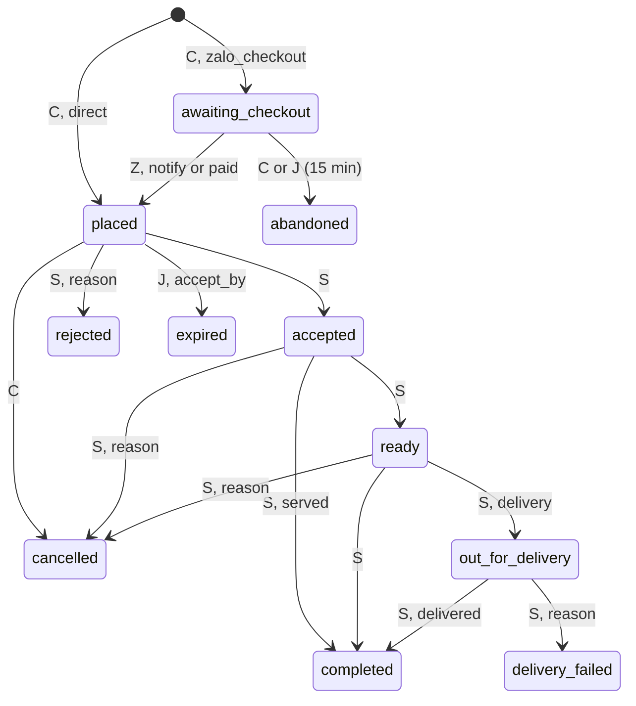
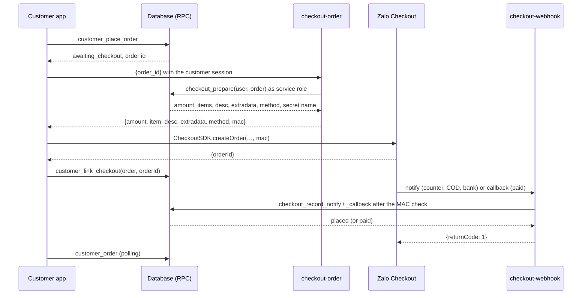

# Online ordering in the customer Mini App

As of 2026-11-26 · design for implementation, phase by phase · decision record [ADR-058](../decisions.md#adr-058--online-ordering-server-priced-orders-one-status-machine-in-sql-pay-at-the-counter-through-the-checkout-sdk-first-staff-key-orders-into-the-till-delivery-last) (proposed)

## Purpose

This document designs online ordering in the customer Mini App: the Zalo rules that apply, the online menu derived from the POS catalogue, table QR codes, orders and their status machine, payment at the counter and through Zalo's Checkout SDK, the staff order queue and the hand-off to the till, delivery, customer notifications, security and privacy, test design and a phased plan. Screens and visual identity are designed separately; this document owns the back end, the flows, the rules and the security, and names screens only by what they must show and do. It is generic: brands are `brand-1`, stores `sa-1`, and every value is synthetic.

Decided by the owner, not reopened here:

- Customers see the menu with prices and order inside the customer Mini App.
- Order types: at the table (a QR code per table), takeaway pick-up, and delivery. Delivery is built last and designed now.
- Payment: at the counter first; online payment through Zalo's Checkout SDK later.
- Orders arrive in the staff Mini App as a queue with a sound; staff accept, prepare, mark ready or served, and key the order into the iPOS till themselves. Pushing orders into iPOS (FoodHub, O2O) is a later option; only its seam is designed.
- The web dashboard stays multi-brand and neutral.

Markers: **[high]** read on a primary Zalo, Supabase or legal page on 2026-11-26 (or the date given); **[medium]** official but ambiguous, a community answer, or our earlier research; **[unverified]** inference, or not found in any document. Facts about our own code are stated as found in the repository on 2026-11-26.

## 1. Decisions at a glance

1. **Zalo's rule decides the release gate.** A Mini App that creates orders, shows prices and has a payment function must integrate the Checkout SDK; without it, prices must be hidden. Pay-at-the-counter orders therefore go through the Checkout SDK with its cash method (`COD`) or a custom method named for the counter. Phases 1 to 7 ship to testers only (Development and Testing builds); the first public version with prices is the one submitted with the Checkout SDK (phase 8).
2. **The price is the POS price.** The online price of an item at a store is the store's POS price for the order type (dine-in or takeaway), read from `items` and `store_items`. There is no separate online price, so the order total equals what the till charges.
3. **Prices are computed only in SQL.** The customer app sends item ids, quantities, options and the total it displayed; `customer_place_order` computes every line and the total, refuses a different total as `price_changed`, and stores a snapshot of names, prices and options.
4. **One status machine, owned by the database.** Every transition of an order goes through `security definer` functions that check who may make it, write an append-only `order_events` row and bump the order's `version`. Apps never update an order row.
5. **Three independent states per order:** fulfilment (`status`), money (`payment_status`) and the till hand-off (`till_state`). They move separately; reports and the queue read all three.
6. **Idempotent everywhere.** A customer's request carries a `request_id`; a staff action carries the `version` it saw; a Zalo callback is unique on its transaction id. A repeat gets the first answer with `replayed: true`.
7. **Unaccepted orders expire.** An order nobody accepts within the store's `accept_timeout_minutes` (default 10) expires, the customer is told plainly, and nothing is charged.
8. **No order without someone watching.** A store accepts orders only while a staff device has polled its queue in the last 180 seconds, within opening hours, before the last-order cut-off and not paused.
9. **Table QR codes are keyed tokens, not table numbers.** The QR carries a 128-bit HMAC token per table and version, keyed per tenant; the database stores only its SHA-256, can print it again, and rotates it on demand.
10. **Staff key orders into the till; the sync matches them back.** The synced iPOS invoice is matched to the online order by receipt number when staff give it, else by store, time window, order source and amount. A matched order of a member earns loyalty on a new path `F`, through the existing earn rules; in a staff-mode store the paid order becomes a bill capture.
11. **The menu stays in step with the POS without new iPOS calls.** The menu reads the catalogue tables as they are; sales already synced reveal a changed price (`invoice_lines.list_unit_price`), which hides the item until the owner refreshes the catalogue once.
12. **Polling first, Realtime later.** The staff queue polls a cheap cursor function every 4 seconds while visible; Supabase Realtime is added later only as a doorbell carrying no data.
13. **In-app status first; paid messages optional.** Customers follow their order in the app; a ZBS transaction template for "ready" is optional per brand, off by default.
14. **Delivery uses owner-defined areas, not device location.** No location permission, no coordinates stored; addresses and receiver phones are visible only to the store's staff while the order is open and are blanked 30 days after it ends.
15. **Everything is keyed by tenant, brand and store.** Menus are per brand, availability and settings per store, tokens per tenant; nothing brand-specific is in code.

## 2. Zalo's rules for an ordering Mini App

### 2.1 The rule, as Zalo states it today

The Checkout SDK introduction **[high]** (page updated 9/11/2026): "Zalo Mini App Platform (Nền tảng) yêu cầu tất cả các đối tác tham gia phát triển ứng dụng có tính năng thanh toán phải tích hợp Checkout SDK" (the platform requires every partner whose app has a payment feature to integrate the Checkout SDK), and "Tất cả các phương thức thanh toán phải được khai báo trên hệ thống… Tất cả các giao dịch phát sinh trên Nền tảng đều phải được người dùng xác nhận và hệ thống ghi nhận dữ liệu" (every payment method must be declared on the platform; every transaction must be confirmed by the user and recorded by the platform).

The review policy, section 8 "Tích hợp Checkout SDK" **[high]**, opens with "Mini App có tính năng thanh toán bắt buộc phải tích hợp Checkout SDK" and gives a two-column table:

| Needs the Checkout SDK ("Cần Checkout SDK") | Does not ("Không cần Checkout SDK") |
|---|---|
| "Mini App có phát sinh đơn hàng, có chức năng thanh toán và có hiển thị giá tiền trực tiếp trên Mini App" (the app creates orders, has a payment function and shows prices directly) | "Trường hợp hiện tại Mini App chưa có nhu cầu sử dụng Checkout SDK, Mini App vui lòng không hiển thị giá tiền của sản phẩm/dịch vụ và thay đổi chức năng mua hàng – thanh toán sang "Liên hệ" hoặc "Tư vấn"" (if the app does not use the Checkout SDK yet, it must not show prices and must change its purchase and payment function to "Contact" or "Consult") |

Section 4.4 lists purchases tied to real-world services in the compliant column, so ordering food and drink is allowed **[high]**. The developer agreement of 25/09/2026 does not mention the Checkout SDK and says the platform "không cung cấp dịch vụ thanh toán, không nắm giữ tiền" (provides no payment service and holds no money) **[high]**.

### 2.2 What this means for our earlier notes

- "A loyalty-only app needs no Checkout SDK; in-app ordering would make it mandatory" (zalo-mini-app-platform.md): **true**. The loyalty app shows no prices and takes no orders. An app that takes orders with prices sits in the "needs" column; the only alternative the policy offers (no prices, "Liên hệ"/"Tư vấn") cannot take orders.
- "No prices with buy buttons until Checkout SDK is integrated" (zalo-design-and-review-standards.md, ADR-022): **true but too narrow**. The literal text says that without the SDK the app must not show prices at all, buttons or not. A price list without an order button is not explicitly allowed. The roadmap's 18a default ("Xem tại quầy", no prices) stays right for every public build until the Checkout SDK ships.
- No page gives an exception for pay at the counter, pay on pick-up or F&B **[high: none found]**.

### 2.3 How pay at the counter satisfies the rule

The Checkout SDK itself offers a cash method and custom methods, so an order paid later at the counter can still be "declared, confirmed by the user and recorded" by the platform:

- Method `COD` ("Phương thức thanh toán COD") exists, and the console's "Cấu hình Thanh toán khi nhận hàng (COD)" needs only a Notify URL and a Redirect Path, with no payment-provider contract **[high]**.
- A "Phương thức riêng" (custom method: code, name, logo, sandbox flag) can be added under both full and custom integration **[high]**, so the sheet can say "Thanh toán tại quầy" instead of "pay on delivery". Whether a custom method under full integration needs the platform's approval is **[unverified]**; `COD` is the fallback.

The design: every order of a public build goes through `CheckoutSDK.createOrder` with a MAC made on our server. A pay-at-counter order forces the counter method (`method: {"id": "<counter method code>", "isCustom": true}`, or `COD`); Zalo then posts a signed notify to our server, we answer `returnCode: 1`, and only then does the order reach the staff queue. When staff take the money at the till, our server reports the order paid with `updateOrderStatus` (`custom-callback-payment` or `cod-callback-payment`), so Zalo's record matches. That reviewers accept a counter method for table and pick-up orders is **[unverified]**: no page says it, and the plan asks Zalo's support channel before the phase 8 submission (section 15).

### 2.4 Merchant setup and verification

| Step | What it needs | Source |
|---|---|---|
| Owner verification (KYB) | Mandatory for every Mini App since 15/10/2025, through a verified OA of the same business or documents (business or household registration and the legal representative's ID) | verification page, updated 4/12/2025 **[high]** |
| F&B as a conditional business line | "Kinh doanh/ Quản lý dịch vụ ăn uống" needs a document showing the business line and the food-safety certificate ("Giấy chứng nhận cơ sở đủ điều kiện an toàn thực phẩm") | same page **[high]** |
| Restricted goods | "Rượu, Bia và các loại đồ uống có cồn" are restricted: alcohol, beer included, is never offered online (`online_menu_items.restricted`) | regulated products page, 15/04/2025 **[high]** |
| Checkout SDK, general settings | Mini App management → Checkout SDK → "Cấu hình chung": Callback URL, private key, security method (HmacSHA256 by default), app status | integration setting page **[high]** |
| Counter or COD method | Notify URL and Redirect Path only | same **[high]** |
| ZaloPay | A ZaloPay merchant account (live and sandbox registration at mc.zalopay.vn and sbmc.zalopay.vn), then Merchant App ID, Key1, Key2 and Redirect Path in the console | tutorial **[high]** |
| ZaloPay before review | A community thread says ZaloPay integration needs a Mini App that has already passed review | community answer **[medium]** |
| Bank transfer | Notify URL, bank, account number, account name and transfer content; one bank-transfer configuration per Mini App. The custom bank-transfer integration with a dynamic VietQR is in beta until the end of 03/2027 | integration setting and bank-transfer pages **[high]** |
| MoMo, VNPay | Their own credentials; VNPay's IPN goes to Zalo's endpoint | integration setting page **[high]** |
| Review | 3 working days; one pending version; at least 10 visits a month afterwards | review policy 9.1, 9.2 **[high]** |

### 2.5 The Checkout SDK contract we build against

All **[high]** from docs.zaloplatforms.com/docs/MA/checkoutSdk (pages updated 9/11/2026), except where marked.

- **`CheckoutSDK.createOrder`** (`import { CheckoutSDK } from "zmp-sdk/apis"`): `amount` (number), `item` (array), `desc` (string), `extradata` (JSON string, forwarded to the provider), `method` (JSON string `{id, isCustom}`, forcing one method), `mac`, `success`, `fail`; answers `{orderId, messageToken}`. From zmp-sdk 2.45.0 a request without `mac` is not processed.
- **The request MAC.** Keys sorted ascending, joined as `key=value` with `&` (`amount=…&desc=…&extradata=…&item=…&method=…`, `item`, `extradata` and `method` as JSON strings), then HMAC-SHA256 keyed with the console's private key. "Đối tác BẮT BUỘC phải thực hiện tạo mac tại Merchant Server… tuyệt đối không lưu trữ PrivateKey tại Mini App": the key never reaches the app.
- **The result inside the app.** From zmp-sdk 2.45.0 the app listens for `EventName.PaymentDone` and calls `CheckoutSDK.checkTransaction`: `resultCode` 1 success, 0 in progress (ask again), −1 failed, −2 the user chose no method and left. With a `PaymentDone` listener the Redirect Path is ignored.
- **Callback (ZaloPay, MoMo, VNPay, PayME).** POST `{data, mac, overallMac}` to the Callback URL from 118.102.2.29 or 49.213.78.2. `data` holds `appId`, `orderId`, `transId`, `method`, `transTime`, `merchantTransId`, `amount`, `description`, `resultCode` (1 or −1), `message`, `extradata` (URI-encoded), `paymentChannel` and `oaMessageToken`. `mac` is HMAC-SHA256 of `appId={appId}&amount={amount}&description={description}&orderId={orderId}&message={message}&resultCode={resultCode}&transId={transId}` in that fixed order; `overallMac` covers every `data` key sorted ascending and is the one that protects `method` and `extradata`. The merchant must check that the amount equals its own. The answer is `{returnCode, returnMessage}`: 1 success, 2 a duplicate `transId`, anything else a failure that is not retried. With no result after 20 minutes the merchant calls `getOrderStatus`.
- **Notify (COD, bank transfer, custom methods).** POST `{data: {appId, orderId, method}, mac}` with `mac` over `appId=…&orderId=…&method=…`; the user's checkout completes only after the merchant answers `returnCode: 1`. The notify carries no `extradata` and no amount.
- **Server APIs** at `https://payment-mini.zalo.me`, each with a MAC whose signed string includes `privateKey=…` (the key is signed over, never sent): `updateOrderStatus` (`/api/transaction/{Mini App id}/cod-callback-payment`, `bank-callback-payment`, `custom-callback-payment`, `purchase-payment`; `appId`, `orderId`, `resultCode`, optional `interactToken`), `getOrderStatus` (`/api/transaction/get-status`), `createRefund` (`/api/refund/create`, ZaloPay and MoMo only, full or partial) and `getRefundStatus` (`/api/refund`). Which `resultCode` means refunded is contradictory between two pages (0 on one, 2 on the other) **[high, conflicting]**.
- **Journey message at 0 ₫.** After a Checkout SDK payment, a "Thanh toán thành công" message (template 104000) can be sent free with the `oaMessageToken` of the callback, at most 2 messages per token, token valid 15 days **[high]**.

### 2.6 Fees and settlement

No Checkout SDK page publishes a fee **[high: none found]**. Zalo holds no money (agreement 1.2), so fees and settlement follow each provider's merchant contract; our earlier note of about 1.0–1.2 % for ZaloPay is **[medium]**. The counter method moves no money and costs nothing from Zalo **[unverified]**.

### 2.7 Other review rules an ordering app must meet

- No navigation out of the app except Privacy and Terms documents shown inside it (review policy 4.1, agreement 8.2(j)) **[high]**; with "every method declared", an external payment page is effectively forbidden.
- Terms and policies must name the business (4.8) **[high]**.
- Developer information is mandatory in the app (agreement 5.5(a)): name, business or household registration code, address, phone, description of goods or services, Mini App version, and how support and complaints are handled; 5.5(b) adds a visible support contact **[high]**. A "Thông tin người bán" screen and an ordering-terms document cover this (phase 8).
- Login cannot be forced (6.4) and permissions are asked in context with a working refusal (6.1–6.3) **[high]**: a visitor may browse and order without joining the loyalty programme; the phone permission is asked only for delivery or joining.
- Personal data only with explicit consent (7) **[high]**; our reading of the personal-data law is in section 10.4.

### 2.8 Not verified; to confirm before building the phase that needs it

- Whether reviewers accept a counter or COD method for table and pick-up orders (phase 8).
- Whether a custom method under full integration needs approval (phase 8).
- Whether the Checkout SDK console is usable before the customer app's first published version, and whether ZaloPay needs a reviewed app (phases 8 and 11).
- Whether `payment-mini.zalo.me` refuses servers outside Vietnam the way the Graph does (ADR-057); until a test from the cloud says otherwise, the design routes those calls through the relay (phase 8).
- Whether a WebSocket stays open in Zalo's WebView, whether audio can play without a tap, and what happens in the background (phase 6, device check).

## 3. The online menu

### 3.1 Source of truth and the price rule

The POS is the source of items and prices. The online menu is a curated view over the synced catalogue: `items` (per POS account), `store_items` (per-store prices and active flags), `item_types` (the POS's categories) and, from phase 3, the option groups of section 3.3. The online menu adds what the POS does not hold: whether an item is offered online, its section, a display name, a description, a photo, a sort order and per-store availability.

The unit price of an item at a store, for an order type, is computed by one function, `app.online_item_price(store, pos_account, item_external_id, order_type)`, and nowhere else. Decision table (a provisional precedence: section 3.5 checks it against real sales on the first day):

| Order type | `store_items.takeaway_price` | `items.takeaway_price` | Price used |
|---|---|---|---|
| table | any | any | `store_items.list_price`, else `items.list_price` |
| takeaway, delivery | set | any | `store_items.takeaway_price` |
| takeaway, delivery | null | set | `items.takeaway_price` |
| takeaway, delivery | null | null | `store_items.list_price`, else `items.list_price` |

An item is not orderable when its price is null or 0, when `items.active` is false or `items.is_modifier` is true, or when the store's `store_items` row exists and is inactive. Prices are whole đồng (ADR-007 keeps `numeric(14,2)`; the checks require a zero fraction for VND tenants) and include VAT as the POS holds them. Whether takeaway prices also apply to delivery is an owner question (section 14).

### 3.2 What the owner curates (web dashboard, per brand)

- **Sections.** The owner's categories (some shops call them "houses"). `seed_online_menu(brand)` creates one section per POS item type used by the brand's items, named as the POS names it; the owner renames, merges, hides and orders them. A section may carry hours (for example breakfast only).
- **Items.** Nothing is offered until the owner switches it on (`visible` defaults to false), so a new POS item never appears online by surprise. Per item: section, display name (1–60 characters, defaulting to the POS `base_name` or `name`), description (at most 60 characters, no line break, link or phone number), photo, sort order, the order types it is offered for, optional hours, and `restricted` (alcohol and anything on Zalo's restricted list; a restricted item can never be made visible).
- **Sizes.** POS items sharing a `base_name` in a section are shown as one card with a size choice (`size_label`); each size stays its own POS item with its own price, so the till gets the right item. The owner can split or join groups (`variant_group`).
- **Photos.** Uploaded from the web dashboard, resized in the browser to at most 640 px wide WebP under 120 kB (and a 320 px thumbnail under 40 kB), stored in the public Storage bucket `menu-photos` at `<tenant>/<brand>/<uuid>.webp`. Menu photos carry no personal data; write access is limited to owners and managers of the tenant by Storage policies.
- **Per store.** Whether the store offers the item online at all (`offered`), and the sold-out switch, which staff also set (section 7.4).

### 3.3 Options, sizes and combos from the POS

iPOS customizations hold option groups: each group has a name, `Min_Permitted`, `Max_Permitted`, its option items (`LstItem_Id`) and the items it applies to (`list_item`) **[high: our connector's schema]**. Today the connector keeps only zero-priced options and writes neither the applies-to list nor the group limits (`toModifiers` in `packages/connector-ipos/src/connector/catalog.ts`). Phase 3 therefore extends the canonical catalogue with `optionGroups` (ADR-012: a connector change with its mock and conformance suite), written by the same master-data run into three catalogue tables:

- `item_option_groups`: `pos_account_id`, `external_id` (the customization id and the group's position), `name`, `min_select` (0–20), `max_select` (1–20, at least `min_select`), `active`, `raw`.
- `item_option_group_options`: the option items of a group, by POS item external id, with a sort order.
- `item_option_group_targets`: the items a group applies to.

An option's price is `app.online_item_price` of its option item (zero allowed). An option whose item is sold out at the store is not offered; an item with a required group (`min_select` ≥ 1) that has no available option is not orderable. Options are keyed into the till as the POS modifier items they are.

Combos (`packages`) are not offered in the first phases: the package payload's shape for choices is **[unverified]** in our data. A later phase offers fixed-content packages at `packages.list_price`, keyed as the package.

### 3.4 Availability, opening hours and the "closed" state

An item is shown as orderable at a store when every condition holds: curated visible with a visible section; not restricted; offered at the store; `sold_out_until` null or past; `price_check_since` null; within the item's and section's hours; the order type allowed; a positive price (3.1). Items not orderable for a passing reason (sold out, outside hours) are listed greyed with the reason; items not offered at all are left out.

Ordering at a store is open when `app.ordering_state(store, order_type, at)` answers `accepting: true`. Its reasons, checked in this order:

| Reason | When | The app says (meaning, not final copy) |
|---|---|---|
| `ordering_off` | the store's ordering is not enabled, or the type is not offered | ordering is not available at this store |
| `hours_unknown` | `stores.opening_hours` is null or has no pair | ordering is not available at this store |
| `closed_today` | an `ordering_closures` row covers today's business date | closed today, with the reason the owner typed |
| `paused` | `paused_until` is in the future | not taking online orders until the given time |
| `closed_now` | outside opening hours | opens at the given time |
| `last_orders_passed` | within `last_order_minutes` of closing | last online orders were at the given time |
| `no_staff_online` | no staff device polled the queue in 180 seconds (when `staff_presence_required`) | not taking online orders right now |
| `busy` | open `placed` orders reach `max_waiting_orders` (default 15) | busy, try again in a few minutes |

The menu stays browsable with prices in every state (in a build where prices may show at all, section 2.3); only the order action is held, with the reason.

### 3.5 Staying in step with the POS without extra iPOS calls

In the code today, the catalogue tables are written only by a master-data run (`fnb sync master-data`, onboarding and bootstrap); the nightly `sync window` and the incremental runs write sales, not the catalogue. The design keeps that and adds no schedule:

1. **The menu reads the catalogue as it is.** A curation row points at a POS item by `(pos_account_id, item_external_id)`, so a catalogue refresh never breaks it; an item the POS drops becomes inactive (ADR-004) and leaves the menu.
2. **Drift is detected from sales already synced.** After every sync, next to `app.reconcile_loyalty`, the runner calls `app.online_menu_drift(tenant, from, to, at)`. A completed sale line of an online item whose `list_unit_price` equals neither the store's online dine-in price nor its takeaway price sets `price_check_since` on that item at that store, which hides it there, and raises the alert `menu_price_drift` (owners and managers, count-only facts: how many items, which store). A sold item the catalogue does not know raises `menu_new_pos_item`. Lines without a `list_unit_price` are ignored.
3. **The owner refreshes once.** "Cập nhật thực đơn từ POS" in the web dashboard asks for one master-data run of the account (`request_catalogue_refresh`, a single-use ticket in the style of ADR-028, at most 3 per account per day); the CLI command does the same. A successful run clears `price_check_since` for items whose prices now agree.
4. **A scheduled nightly refresh** would cost one master-data run per account per night. It is an owner decision (section 14), off by default, because iPOS calls are kept to a minimum.

The same check validates the provisional price precedence of 3.1: a store whose takeaway sales disagree with the takeaway rule shows up on the first day as drift on many items at once, which the phase 3 acceptance watches for.

### 3.6 Tables

| Table | Holds | Key rules |
|---|---|---|
| `online_menu_sections` | `tenant_id`, `brand_id`, `name` (1–40), `sort_order`, `visible`, `hours` (the `stores.opening_hours` shape, checked by `app.opening_hours_valid`, null for always), `source_item_type_external_id`, attribution columns | (`tenant_id`, `brand_id`) → `brands` |
| `online_menu_items` | `tenant_id`, `brand_id`, `pos_account_id`, `item_external_id`, `section_id`, `visible` (default false), `display_name`, `description` (≤ 60), `photo_path`, `sort_order`, `variant_group`, `order_types` (subset of `table`, `takeaway`, `delivery`), `hours`, `restricted` | unique (`brand_id`, `pos_account_id`, `item_external_id`); `visible` implies a section and not `restricted`; the POS account must belong to a store of the brand (trigger) |
| `online_menu_store_items` | `tenant_id`, `store_id`, `pos_account_id`, `item_external_id`, `offered` (default true), `sold_out_until`, `sold_out_by`, `price_check_since` | unique per store and item; the store must belong to the item's brand |
| `ordering_store_settings` | one row per store, section 5.2 | the store's row exists only once an owner enables ordering |
| `ordering_closures` | `store_id`, `starts_on`, `ends_on`, `reason` (≤ 80) | `ends_on` ≥ `starts_on`, at most 62 days |
| `item_option_groups`, `item_option_group_options`, `item_option_group_targets` | section 3.3 | catalogue tables: written by the sync only |
| `app.online_menu_versions` | `brand_id`, `version`, `changed_at` | bumped by triggers on every menu, availability, settings and catalogue change; no API role |

### 3.7 Functions

| Function | Caller | Does |
|---|---|---|
| `customer_menu(p_store_code, p_order_type default null)` | customer session (visitor or member) | the store's ordering state (3.4), its sections and orderable items with the price for the order type, sizes, option groups, photos and greyed reasons, pick-up slots, `menu_version`; only stores of the session's brand (`app.customer_app_store`); 22023 for a malformed code or type and for a store that is not the brand's, as the existing customer functions answer an unknown store |
| `staff_menu_availability(p_store)` | staff of the store | every online item of the store with its sold-out state, for the toggles |
| `seed_online_menu(p_brand)` | owner with every store | sections from item types and hidden item rows for the brand's POS items; idempotent |
| `request_catalogue_refresh(p_pos_account)` | owner or manager with every store of the account | issues one master-data ticket, at most 3 a day |
| `app.online_item_price`, `app.ordering_state`, `app.online_menu_drift` | internal | 3.1, 3.4, 3.5 |

The answer of `customer_menu` is one JSON document of roughly 30 kB for 150 items, so one call per screen suffices; photos load lazily from their thumbnails.

## 4. Tables and table QR codes

**Model.** `store_tables`: `tenant_id`, `store_id`, `label` (1–20 characters, unique among the store's active tables, such as "Bàn 5"), `area` (≤ 40), `sort_order`, `active`, `qr_version` (starts at 1), `qr_token_sha256` (unique), `qr_issued_at`. Owners and managers of the store write label, area, order and active; only functions write the QR columns.

**The token.** `t = base64url(first 16 bytes of HMAC-SHA-256(tenant key, 'table:' || table id || ':' || qr_version))`, 22 characters. The key is 32 random bytes per tenant in `app.table_qr_keys`, created at the tenant's first table, readable by no API role, and restored with the database, as ADR-052 does for the erased-phone key. The database stores only SHA-256 of the token, so a copy of the table alone reveals nothing, while `table_qr_links(store)` (owners and managers of the store) recomputes the links for printing again.

**What a QR carries.** `https://zalo.me/s/<customer Mini App id>/?store=<store link key>&src=table&t=<token>`: the existing store deep link (`storeDeepLink`, with `table` added to `LINK_SOURCES`) plus the token. No table label, id or tenant is in clear text.

**Scanning.** The app reads the route parameters at launch or on `OpenApp`, calls `customer_table(p_store_code, p_table_token)` and gets `{state: "ok", table: {label, area}}` or `{state: "refused", refusal: "table_unknown"}`. Unknown, rotated, inactive and other-store tokens get the same refusal. Misses count against a guessing limit (section 10.3). The app keeps the table in memory for 3 hours and sends the token again with the order; the database resolves the table again then, so a client cannot name a table it has no token for.

**Rotation.** `rotate_table_qr(p_table)` moves `qr_version`, which kills the old QR at once; the owner prints the new one. Deactivating a table kills its QR too. There is no periodic rotation: printed codes would have to be replaced each time.

**Forged and abused tables.** A token cannot be guessed (128 bits) or derived without the key. A photographed QR still works from anywhere; the design bounds that rather than proving presence, because location would be sensitive data and a weak proof: every order is tied to a Zalo identity verified by the Graph, the customer limits of section 10.3 apply, staff reject a suspected prank with `suspected_prank`, three such rejections block the login from ordering for 7 days (`customer_order_blocks`, owners and managers can lift it), table orders are paid at the counter so a prank costs at most wasted preparation, and the owner rotates a leaked QR.

**Printing.** The web dashboard prints one card per table: the QR, the table label and a neutral instruction ("Quét bằng Zalo để gọi món"), with the brand's theme from its configuration (ADR-056).

## 5. Orders

### 5.1 Data model

`orders` (RLS on; no API role writes it):

| Column | Type | Meaning |
|---|---|---|
| `id` | uuid | Primary key; unique with `tenant_id` |
| `tenant_id`, `brand_id`, `store_id` | uuid | Composite foreign keys to the tenant's brand and store; the store belongs to the brand |
| `customer_login_id` | uuid null | The customer login (`app.customer_logins`); set null when the login is deleted |
| `customer_id`, `membership_id` | uuid null | Set when the login has joined; the membership is the one `app.customer_session_membership()` gives at placement |
| `order_type` | text | `table`, `takeaway` or `delivery` |
| `table_id`, `table_label` | uuid null, text null | Table orders only; the label is a snapshot |
| `pickup_at` | timestamptz null | Takeaway: null for "as soon as possible", else the chosen time |
| `delivery_zone_id`, `delivery_address`, `delivery_note`, `receiver_name`, `receiver_phone`, `delivery_fee` | | Delivery only (section 8); `receiver_phone` in E.164, selected by no API role |
| `business_date`, `order_no` | date, integer null | `app.store_business_date(store, placed_at)` and the number of the store's day, set when the order is placed; unique (`store_id`, `business_date`, `order_no`) |
| `status`, `payment_status`, `till_state` | enums | Sections 5.3 and 5.4 |
| `version`, `change_seq` | integer, bigint | `version` starts at 1 and moves by one at every change; `change_seq` takes the next value of `app.order_change_seq` at every change, for the staff board's cursor |
| `payment_method` | text | `counter` or `zalo_online` as chosen; `paid_method` (`cash`, `card`, `bank_transfer`, `ewallet`, `other`) and `paid_at`, `paid_by` once paid |
| `checkout_order_id`, `checkout_method` | text null | Zalo's order id and method from the Checkout SDK; unique per brand |
| `subtotal`, `delivery_fee`, `discount_amount`, `total` | numeric(14,2) | Computed by the database; `discount_amount` is 0 until rewards can be applied online; CHECK `total = subtotal + delivery_fee − discount_amount`, whole đồng |
| `note` | text null | At most 200 characters, no control character |
| `request_id`, `request_hash` | uuid, text | Idempotency (5.6); unique (`customer_login_id`, `request_id`) |
| `menu_version`, `terms_version` | bigint, text | What the customer saw and accepted |
| `placed_at`, `accept_by`, `accepted_at`, `accepted_by`, `ready_by`, `ready_at`, `completed_at`, `closed_at`, `closed_reason`, `closed_by`, `auto_closed` | | Times and actors of the status machine |
| `receipt_no`, `till_total`, `till_keyed_at`, `till_keyed_by`, `invoice_id`, `match_method` | | The till hand-off and its match (section 7.5); `invoice_id` unique, set null if the invoice is deleted |
| `personal_data_blanked_at` | timestamptz null | Section 10.4 |
| `created_at`, `updated_at` | timestamptz | |

`order_lines`: `tenant_id`, `order_id`, `line_no` (1–30), `pos_account_id`, `item_external_id`, `item_name` (the display name at placement), `size_label`, `quantity` (integer 1–20), `unit_price`, `options` (jsonb array of `{group, item, name, price}` as priced at placement), `options_amount`, `line_total` (CHECK `quantity × (unit_price + options_amount)`), `note` (≤ 100).

`order_events` (append-only, like the loyalty ledger: a trigger refuses update, delete and truncate for every role except the data-subject deletion and a tenant's cascade): `tenant_id`, `order_id`, `kind` (`status`, `payment`, `till`), `from_state`, `to_state`, `action`, `actor_kind` (`customer`, `staff`, `system`, `zalo`), `actor_user_id`, `reason_code`, `reason_text` (≤ 200), `occurred_at`. It is the timeline the customer and staff see and the audit trail of every action.

Later phases add `order_payments` (each online attempt and each callback: `kind`, `method`, `amount`, `status`, `checkout_order_id`, `trans_id` unique, `result_code`, `recorded_at`) and `order_refunds` (`amount`, `reason`, `status`, `refund_id`, `requested_by`, `approved_by`).

### 5.2 Store settings

`ordering_store_settings`, one row per store, written by owners and managers whose scope holds the store, with CHECK ranges:

| Column | Default | Range or values |
|---|---|---|
| `enabled` | false | |
| `order_types` | `{table, takeaway}` | subset of `table`, `takeaway`, `delivery` |
| `checkout_mode` | `direct` | `direct` (orders reach staff at once; tester builds and the local stack) or `zalo_checkout` (every order through the Checkout SDK; required for a public build) |
| `payment_methods` | `{counter}` | subset of `counter`, `zalo_online` |
| `accept_timeout_minutes` | 10 | 3–30 |
| `prep_minutes` | 15 | 5–120; the earliest pick-up and the default "ready in" |
| `last_order_minutes` | 30 | 0–120 before closing |
| `pickup_slot_minutes` | 15 | 5, 10, 15 or 30 |
| `max_order_amount` | 2,000,000 | 50,000–20,000,000 |
| `max_waiting_orders` | 15 | 3–100 |
| `staff_presence_required` | true | |
| `till_source_external_id` | null | the POS order source staff choose for online orders (section 7.5) |
| `match_tolerance_amount` | 0 | 0–50,000 |
| `delivery_requires_prepay` | false | delivery only |
| `paused_until`, `paused_reason`, `paused_by` | null | set by `staff_set_ordering_pause` |

### 5.3 Placing an order

`customer_place_order(p_request jsonb)`, customer session (a visitor may order; a member also links the membership):

```json
{
  "request_id": "aaaaaaaa-aaaa-4aaa-8aaa-000000000001",
  "store": "sa-1",
  "type": "takeaway",
  "table_token": null,
  "pickup_at": null,
  "delivery": null,
  "lines": [{"item": "ITEM-1", "qty": 2, "options": ["OPT-3"], "note": "ít đá"}],
  "note": null,
  "payment": "counter",
  "expected_total": 70000,
  "menu_version": 42,
  "terms_version": "ordering-terms-1"
}
```

The function, in this order, writing nothing until every check passes:

1. **Shape** (22023 on failure): the keys above and no others; `request_id` a UUID; `type` one of three; 1 to 30 lines; `qty` an integer 1–20; at most 10 options per line, no repeat; notes within their lengths, without control characters; `expected_total` a whole number; every text trimmed.
2. **Session and replay**: `app.customer_session()` (42501 otherwise); an order with the same `request_id` for this login returns its answer with `replayed: true` when `request_hash` (SHA-256 of the canonical request) matches, else `refused: request_conflict`.
3. **Store and state**: the store is one of the app's brand (22023 otherwise, as for `customer_menu`); `app.ordering_state` accepts the type (its reason as the refusal); the login is not blocked (`blocked`).
4. **Limits**: the `customer_place_order` call limit of section 10.3 (`rate_limited` with `retry_after`); at most 3 open orders of the login across stores (`too_many_open_orders`); at most 10 orders of the login at the store on its business date (`daily_limit`).
5. **Type specifics**: a table order resolves its token (`table_unknown`); a takeaway `pickup_at` is null or at least `prep_minutes` ahead, before the last-order time and within today's opening hours (`pickup_time_invalid`); delivery as section 8.
6. **Lines**: every item orderable for the type at the store now (else `item_unavailable` with the items); every option belonging to a group targeting the item, every group's count within `min_select` and `max_select` (`option_invalid`); prices from `app.online_item_price`.
7. **Totals**: subtotal, delivery fee and total computed; above `max_order_amount` is `amount_over_limit`; a total different from `expected_total` is `price_changed` with the new total and the current `menu_version`, and nothing is written.
8. **Terms**: `terms_version` must be the published ordering terms (`terms_outdated`).
9. **Write**: the order, its lines and its first event; with `checkout_mode = direct`, status `placed`, `order_no` from `app.order_counters` (row-locked per store and business date), `accept_by = placed_at + accept_timeout_minutes`; with `zalo_checkout`, status `awaiting_checkout` and no number yet.

Answer: `{state: "placed" | "awaiting_checkout" | "refused", refusal, order: {id, order_no, status, payment_status, total, lines, accept_by, …}, replayed}`. Business refusals are answers, not errors, as in the rest of the customer API; malformed input is 22023 and a wrong caller 42501.

### 5.4 The status machine

Fulfilment states: `awaiting_checkout`, `placed`, `accepted`, `ready`, `out_for_delivery`, `completed`, `rejected`, `cancelled`, `expired`, `abandoned`, `delivery_failed`. The last six are terminal.



Actors: **C** the customer who placed the order; **S** a member with role `staff`, `manager` or `owner` whose scope holds the store; **M** a `manager` or `owner` of the store; **Z** Zalo, through a verified notify or callback handled by the service role; **J** the minute job `app.ordering_tick`.

| # | From → to | Actor | Conditions and effects |
|---|---|---|---|
| T1 | new → `placed` | C | `checkout_mode = direct`; all checks of 5.3 |
| T2 | new → `awaiting_checkout` | C | `checkout_mode = zalo_checkout`; hidden from staff |
| T3 | `awaiting_checkout` → `placed` | Z | a verified notify for the counter method linked to the order, or a verified callback with `resultCode` 1 and the order's amount; the number and `accept_by` are set now |
| T4 | `awaiting_checkout` → `abandoned` | C, J | the customer backs out, or 15 minutes pass |
| T5 | `placed` → `accepted` | S | `ready_in_minutes` 5–120 (default `prep_minutes`) sets `ready_by` |
| T6 | `placed` → `rejected` | S | a reason code: `item_unavailable`, `store_busy`, `closing_soon`, `outside_delivery_area`, `cannot_prepare`, `suspected_prank`, `other` (with text); an online payment is refunded (6.4) |
| T7 | `placed` → `cancelled` | C | only before acceptance; an online payment is refunded |
| T8 | `placed` → `expired` | J | at `accept_by`; an online payment is refunded |
| T9 | `accepted` → `ready` | S | |
| T10 | `accepted` → `completed` | S | served straight to a table |
| T11 | `accepted` → `cancelled` | S | reason `customer_request`, `item_unavailable` or `other`; counted in the shift's anomalies; an online refund waits for a manager |
| T12 | `ready` → `completed` | S | served or picked up |
| T13 | `ready` → `out_for_delivery` | S | delivery only; optional shipper from the roster |
| T14 | `ready` → `cancelled` | S | reason `not_collected` or `customer_request` |
| T15 | `accepted`, `ready`, `out_for_delivery` → `completed` | J | at the end of the store's business day, `auto_closed = true`; an unpaid one shows in the manager's list of open money |
| T16 | `out_for_delivery` → `completed` | S | delivered |
| T17 | `out_for_delivery` → `delivery_failed` | S | reason `not_reachable`, `refused`, `address_wrong`, `other` |

Any other transition is refused as data with the current state (`already_accepted`, `already_cancelled`, `already_expired`, `not_allowed`), never as an error, so an app can show it. A transition to the state an order is already in is a replay (`replayed: true`, no second event). A staff action names the `version` it saw: if the order moved on to another state since, the answer is `conflict` with the current order, so two devices never undo each other.

**Payment status**: `unpaid`, `pending`, `paid`, `failed`, `refund_pending`, `refunded`, `partially_refunded`.

| # | From → to | Actor | Conditions |
|---|---|---|---|
| P1 | `unpaid` → `paid` | S | `staff_order_paid` with the method (`cash`, `card`, `bank_transfer`, `ewallet`, `other`); allowed once the order is `accepted` or later, `completed` included |
| P2 | `paid` → `unpaid` | S, M | the staff member who recorded it within 10 minutes; a manager later, with a reason |
| P3 | `unpaid` → `pending` | C | the customer starts an online payment (phase 11) |
| P4 | `pending` → `paid` | Z | verified callback, `resultCode` 1, amount equal |
| P5 | `pending` → `failed` | Z, J | callback −1, or `getOrderStatus` failed after 20 minutes |
| P6 | `failed` → `pending` | C | a retry, at most 3 attempts |
| P7 | `failed` → `unpaid` | C | the customer switches to the counter, when the store allows it |
| P8 | `paid` (online) → `refund_pending` | S, J, M | T6, T7, T8 at once; T11, T14, T17 and partial refunds by a manager |
| P9 | `refund_pending` → `refunded`, `partially_refunded` | Z | refund status success; a failed refund stays `refund_pending` with its error for the manager |

A counter payment is never refunded by the system; cash back at the counter is recorded by a manager with `staff_order_refund` and method `counter`.

**Till state**: `not_keyed` → `keyed` (S, `staff_order_keyed` or `staff_order_paid` with a receipt number) → `matched` (J, the reconciliation) or `amount_differs`, `ambiguous` (J, to the manager's queue) or `unmatched` (J, after the grace period); a manager resolves the last three; `pushed` is reserved for the POS push seam (7.6).

### 5.5 Cancellation and rejection rules

- The customer cancels only before acceptance. After it, the order screen shows the store's contact; a staff member cancels on the customer's request (T11, T14).
- Staff reject only with a reason code. `suspected_prank` reads to the customer like any other rejection ("the store could not take this order").
- A manager-only rule applies to money, never to fulfilment: refunds, undoing a payment after 10 minutes, blocking a customer and resolving a match.
- Three `suspected_prank` rejections of one login within 7 days block it for 7 days at that tenant.

### 5.6 Idempotency

- **Placing.** The app creates `request_id` when the customer opens the confirmation step and keeps it in memory until an answer arrives; a lost answer is retried with the same id and gets the same order (G-92's pattern). A new attempt after an edit gets a new id.
- **Staff actions.** `p_expected_version`; same-state repeats are replays; a moved order is a `conflict`.
- **Zalo.** A callback is unique on `transId` (answered `returnCode: 2` on a repeat); a notify is unique on (`appId`, `orderId`, `method`).
- **The app's buttons** are busy and disabled while a call is in flight, as the existing screens do (`zalo-customer:e2e/sleep`).

### 5.7 Order numbers

`order_no` counts from 1 per store and business date in `app.order_counters (store_id, business_date, last_no)`, taken under a row lock at placement, so numbers have no gaps among placed orders and restart each business day. It is shown as `#` and three digits (`#007`), four after 999. Staff call it out; a takeaway customer shows the order screen with the number. Abandoned checkouts never take a number.

### 5.8 Time-outs and the minute job

`app.ordering_tick(p_at)` runs every minute from `pg_cron` (job `ordering-tick`, created off; `app.enable_ordering_tick()` turns it on, as `notify` is). It abandons `awaiting_checkout` orders after 15 minutes (T4), expires `placed` orders at `accept_by` (T8), queues refunds of expired online-paid orders, closes the business day's open orders (T15) after each store's day ends, prunes presence rows, flags checkouts with no callback after 20 minutes for a status query, and once an hour blanks personal data past its retention (10.4). It touches only rows that are due, through partial indexes on (`status`, `accept_by`) and (`status`, `created_at`). The customer and staff functions also treat an order past `accept_by` as expired when they read it, so a late job never shows an expired order as waiting.

### 5.9 Functions

Customer (customer session; every function resolves the store through the session's brand):

| Function | Does |
|---|---|
| `customer_menu(p_store_code, p_order_type)` | 3.7 |
| `customer_table(p_store_code, p_table_token)` | section 4 |
| `customer_place_order(p_request jsonb)` | 5.3 |
| `customer_cancel_order(p_order_id)` | T7 or T4; anything else refused as data |
| `customer_order(p_order_id)` | the order with lines, the three states, the timeline, `accept_by` and `ready_by`; an order of another login answers exactly as an unknown id (`unknown_order`) |
| `customer_orders(p_before default null)` | the login's orders, newest first, 20 per page |
| `customer_link_checkout(p_order_id, p_checkout_order_id)` | phase 8 (6.2) |
| `customer_change_payment(p_order_id, p_payment)` | phase 11 (P7) |
| `customer_addresses()`, `customer_save_address(p_address jsonb)`, `customer_delete_address(p_id)` | phase 12, members only |

Staff (a member with role `staff`, `manager` or `owner` whose scope holds the store; 42501 otherwise, the same answer for a store that does not exist):

| Function | Does |
|---|---|
| `staff_order_board(p_store, p_cursor default 0)` | the store's ordering state; counts per state; every order whose `change_seq` is above the cursor among open orders and those closed in the business day (at most 200); the new cursor; and the caller's presence heartbeat |
| `staff_order_detail(p_order)` | the order with lines, options, notes, the timeline and, for delivery, the receiver's phone and address while the order is open |
| `staff_order_act(p_order, p_action, p_expected_version, p_reason default null, p_minutes default null)` | `accept`, `reject`, `ready`, `complete`, `cancel`, `out_for_delivery`, `delivered`, `delivery_failed` |
| `staff_order_paid(p_order, p_method, p_receipt_no, p_till_total, p_expected_version)` | P1, and the till hand-off; in a staff-mode store also the bill capture (7.5) |
| `staff_order_unpaid(p_order, p_reason)` | P2 |
| `staff_order_keyed(p_order, p_receipt_no)` | the till hand-off without payment (table orders paid later) |
| `staff_menu_availability(p_store)`, `staff_set_sold_out(p_store, p_item, p_until)` | 7.4 |
| `staff_set_ordering_pause(p_store, p_minutes, p_reason)` | staff up to 60 minutes, managers up to 1,440; 0 resumes |
| `staff_order_refund(p_order, p_amount, p_reason)`, `staff_block_customer(p_order, p_days, p_reason)` | managers and owners only |

Owner and manager (web dashboard): direct writes under RLS to `online_menu_sections`, `online_menu_items`, `online_menu_store_items` (except the drift column), `ordering_store_settings`, `ordering_closures`, `store_tables` (except the QR columns) and `delivery_zones`; and `seed_online_menu`, `request_catalogue_refresh`, `table_qr_links`, `rotate_table_qr`, `resolve_order_match`, `unblock_customer` and `order_summary` (security invoker, the reporting function of phase 9).

Service role only (Edge Functions): `checkout_prepare`, `checkout_record_notify`, `checkout_record_callback`, `checkout_jobs_claim`, `checkout_job_finish` (section 6).

Every `public` function above is a thin `security definer` wrapper (invoker for the report) over an `app` function that takes `p_at`, with an empty `search_path`, as the customer and staff functions already are.

## 6. Payments

### 6.1 At the counter

The customer chooses "pay at the counter". Staff take the money at the till when the customer pays (before or after eating, as the store works) and tap "Đã thu" with the method; the receipt number, printed on the till's bill, is asked as one optional field. The order's `payment_status` becomes `paid`; in a public build the server then reports the Checkout SDK order paid (6.2, step 7).

### 6.2 Through the Checkout SDK



1. `customer_place_order` answers `awaiting_checkout`.
2. The app calls the Edge Function `checkout-order` (`verify_jwt = true`) with the order id. The function checks the session with Supabase Auth and calls `checkout_prepare(user, order)`, which answers only for the caller's own order in `awaiting_checkout` (or `pending` for a retry): the amount (the order's total, whole đồng), one `item` per line (`{id: item external id, amount: line total}`), `desc` (store name and "Đơn trực tuyến", at most 100 characters), `extradata` (`{"o": "<order id>", "s": "<store link key>", "v": 1}`), `method` (the counter method for counter orders; none for online, letting the customer choose) and the name of the brand's Checkout secret. It records the attempt.
3. The function computes the MAC with the brand's private key (`mini_apps.checkout_secret_name`, such as `ZALO_CHECKOUT_KEY_BRAND_1`, checked by `app.zalo_secret_name_valid` with that prefix) and returns the parameters. The key never leaves the function.
4. The app calls `CheckoutSDK.createOrder` and, on success, `customer_link_checkout(order, orderId)`: one Zalo order id per order and per brand, only for the caller's order while `awaiting_checkout`, within 15 minutes of the attempt.
5. Zalo posts the notify (counter, COD, bank) or the callback (online methods) to `checkout-webhook` (`verify_jwt = false`, paths `/notify` and `/callback`).
6. The webhook verifies (6.3), then `checkout_record_notify` places a linked counter order (T3), or stores the notify until the link arrives and places the order then; `checkout_record_callback` with `resultCode` 1 records the payment (P4) and places the order (T3); `extradata` names our order, and the amount must equal its total.
7. When staff record a counter payment, a row of `app.checkout_jobs` asks for `updateOrderStatus` with `resultCode` 1; a cancelled counter order asks for the failure code once its meaning is confirmed (2.5). The jobs are drained by the `notify` dispatcher's cycle (ADR-032) and sent through the relay of ADR-057, whose allow-list gains these four paths of `payment-mini.zalo.me` with JSON bodies (a security-reviewed change of phase 8).
8. The app follows the order with `customer_order`; it listens for `PaymentDone` and calls `checkTransaction` only to show the right screen at once, never to decide anything.

The notify carries no amount and no `extradata`, so a counter order relies on the client's link. A client that links another of its own Zalo order ids gains nothing (no money moves for the counter method), and the job of step 7 cross-checks the amount with `getOrderStatus` when the relay is up, leaving a mismatched order in `awaiting_checkout` until it is abandoned.

### 6.3 Verifying callbacks and notifies

`checkout-webhook` reads the raw body (16,384 bytes at most, the shared reader), finds the brand by `appId` (the customer Mini App's `external_id`; an unknown id is answered `returnCode: -1` and counted), and then:

- recomputes `mac` (the fixed field order for a callback, `appId`, `orderId`, `method` for a notify) and, for a callback, `overallMac` over the sorted `data` keys, with HMAC-SHA256 under the brand's key, comparing in constant time; a mismatch is `returnCode: -1`, stored as a count and raises `checkout_unverified` past a daily threshold;
- checks the source address against `checkout_ip_allowlist` (default the two documented addresses), in `observe` mode first (a mismatch recorded, the call accepted when the MAC is good) and `enforce` once the real addresses are seen, with the proxy-hop rule of the voucher callback (#318);
- checks the amount and `extradata` against the order and its attempt (a callback for an unknown order, another amount or a terminal order is recorded and answered `returnCode: -1`);
- stores the event in `app.checkout_events` (brand, Zalo order id, `transId`, method, result, amount, outcome, times; never a token or personal data), unique on `transId` or on the notify key, so a replay is answered from the first outcome (`returnCode: 2` for a duplicate `transId`);
- answers within 2 seconds; the work after the answer, if any, runs in `EdgeRuntime.waitUntil`.

Logs hold outcomes and counts only, through the shared redactor, which also learns every id of the body.

### 6.4 Refunds

An online payment of an order that ends rejected, cancelled before acceptance or expired is refunded in full at once: `refund_pending`, then `createRefund` through the relay for ZaloPay and MoMo (the only methods the API refunds), and `getRefundStatus` until it settles. Partial refunds and refunds after acceptance need a manager (`staff_order_refund`, at most the amount paid less earlier refunds, with a reason). Methods the API cannot refund (bank transfer, VNPay, the counter) are refunded by hand and recorded by a manager with the method used. Every refund is an `order_refunds` row and an `order_events` row.

### 6.5 Reconciliation

- **Daily, in SQL** (`app.checkout_reconcile(tenant, business_date)`, run by the nightly job): every online `paid` order has a verified callback with the same amount; every verified callback has an order; every `refund_pending` older than a day is listed; counts go to the digest.
- **With the provider**: a manager imports the provider's settlement export (CSV) once a week; matching by `transId` lists missing and extra transactions. The import format is per provider and built when the provider is chosen.
- **With the till**: an online-paid order's matched invoice must be rung with an online tender (its payment kind `ewallet` or `bank_transfer`); otherwise the order is flagged `till_tender_differs`, a known way to pocket cash.

### 6.6 How failures read

Payment and order failures speak about what happened and what the customer can do, never about who is at fault. Meaning, in Vietnamese and English (the final copy belongs to the screen design):

| Situation | Meaning |
|---|---|
| Payment did not complete (`resultCode` −1) | "Thanh toán chưa hoàn tất. Đơn của bạn được giữ 15 phút: bạn có thể thử lại hoặc chọn trả tại quầy." / "The payment did not go through. Your order is held for 15 minutes: try again or pay at the counter." |
| The customer closed the sheet (−2) | "Bạn chưa chọn cách thanh toán. Đơn vẫn được giữ 15 phút." / "No payment method was chosen. The order is held for 15 minutes." |
| Still processing (0) | "Đang chờ kết quả thanh toán…" / "Waiting for the payment result…", then the order screen updates by itself |
| Expired before acceptance | "Cửa hàng chưa xác nhận kịp nên đơn đã được huỷ. Bạn chưa bị trừ tiền." (or "Tiền đang được hoàn về ví của bạn." when paid) / "The shop could not confirm in time, so the order was cancelled. You have not been charged." (or "The money is on its way back to you.") |
| Price changed | "Giá một số món vừa thay đổi. Kiểm tra lại giỏ hàng trước khi đặt." / "Some prices have just changed. Check your basket before ordering." |
| Store stopped taking orders | "Cửa hàng tạm ngưng nhận đơn trực tuyến." with the time it resumes when known |

## 7. The staff side

### 7.1 The queue and how orders reach it

The staff app gains an "Đơn" screen per store: the waiting orders on top, oldest first, with the time left before `accept_by`; then accepted, ready and out for delivery; then the business day's closed orders. One tap accepts (with the "ready in" minutes preset), one opens the detail.

**Delivery to the device: polling.** The screen calls `staff_order_board(store, cursor)` every 4 seconds while it is visible and the app is in the foreground, every 15 seconds while another screen of the staff app is open (for the badge), and not at all while Zalo reports `AppPaused`; `AppResumed` polls at once. An unchanged board is one indexed query answering about 200 bytes. Two devices at one store for 14 hours make about 25,000 calls a day, about 10 MB of egress: well inside the free plan's 5 GB. Polling is the house pattern (`CLAIMS_POLL_MS` of the counter screen) and needs nothing from Zalo's WebView beyond HTTPS.

**Realtime later, as a doorbell.** Once a device check shows that a WebSocket stays open in Zalo's WebView, Supabase Realtime Broadcast (a private channel per store, authorised by RLS on `realtime.messages` for members whose scope holds the store) carries only `{change_seq}` when an order changes; the app then calls the same board function. No order data travels over Realtime, so its authorisation is a second fence, not the only one. The free plan's 200 concurrent connections and 2 million messages a month are far above a shop's needs.

**Presence.** Every board call records the caller's presence for the store (`app.ordering_presence`); `app.ordering_state` refuses new orders with `no_staff_online` after 180 seconds without one. An app left in the background therefore stops orders arriving within three minutes instead of letting them expire unseen.

### 7.2 Sound, vibration, badge and the screen

- **Sound.** A short chime from the Web Audio API for each new `placed` order, repeated every 30 seconds while any order waits. Mobile WebViews play audio only after a user gesture **[unverified for Zalo]**, so the screen asks for one tap at the start of a shift ("Bật âm báo đơn mới"), which unlocks the audio context; the app shows clearly when sound is off.
- **Vibration.** `vibrate({type: "oneShot"})` (zmp-sdk 2.9.8; duration settable on Android only) with each chime **[high]**.
- **Screen on.** `keepScreen({keepScreenOn: true})` while the queue is open (zmp-sdk 2.5.3; reset when the app is left) **[high]**.
- **Badge.** The count of waiting orders on the staff app's tab and on the home card.
- **When the app is in the background.** No sound is possible then **[unverified: no background API found]**. An order still waiting 60 seconds after placement sends one operational message to the store's staff channel (the Zalo Bot or the OA's staff group, both free; ADR-018 and the outbox of ADR-030), count-only ("1 đơn trực tuyến đang chờ tại <cửa hàng>"), at most one per store every 5 minutes.
- **The practical setup** (operations): a phone or tablet at the counter, charging, with the staff app open on the queue and sound on.

### 7.3 Who may act

| Action | staff of the store | manager or owner of the store | viewer | publisher | customer | anon |
|---|:-:|:-:|:-:|:-:|:-:|:-:|
| See the queue and details | yes | yes | — | — | own orders only | — |
| Accept, reject, ready, complete, deliver | yes | yes | — | — | — | — |
| Cancel before acceptance | — | — | — | — | own | — |
| Cancel after acceptance, with a reason | yes | yes | — | — | — | — |
| Record or key a payment; undo within 10 minutes | yes | yes | — | — | — | — |
| Undo a payment later; refund; block a customer | — | yes | — | — | — | — |
| Sold-out toggles; pause up to 60 minutes | yes | yes | — | — | — | — |
| Pause longer; enable ordering; settings, menu, tables, zones | — | yes (settings scoped as 5.2) | — | — | — | — |
| Read orders in the web dashboard and reports | — | yes | yes, without delivery personal data | — | — | — |

Store scope is the login's (ADR-049): a member acts only at stores in scope, whichever brand's app is open.

### 7.4 Sold out and pause

`staff_set_sold_out(store, item, until)`: until the end of the business day by default, or a chosen time, or null to make the item available again. The change bumps the menu version, so open customer menus learn it at their next call, and an order with that item is refused `item_unavailable` from then on. A pause (`staff_set_ordering_pause`) holds new orders with the reason `paused` and a resume time; orders already placed are unaffected.

### 7.5 The hand-off to the till and the match back

iPOS has no public write API, so staff key each order into the till:

1. Accept the order in the staff app.
2. Key its lines into the till: a table order on that table, a takeaway order as a takeaway sale, with the online order source the owner created in the Fabi CMS once (for example "Mini App"; `ordering_store_settings.till_source_external_id` names it). Where the till has a bill note, type the order number ("#012").
3. When the customer pays, tap "Đã thu" and type the receipt number printed on the bill (optional, one field). In a staff-mode store also type the bill total, as for any bill.

**Matching** (`app.reconcile_orders(tenant, from, to, at)`, run after every sync next to `app.reconcile_loyalty`): for each order that is `keyed`, or completed and paid but not matched:

1. With a receipt number: the completed invoice of the store, business date and receipt number (leading zeros ignored, as `app.loyalty_match_claim` does), not linked to another order. Its net amount within `match_tolerance_amount` of the order's total → `matched` (`match_method = receipt`); otherwise `amount_differs`.
2. Without one: completed invoices of the store sold from `accepted_at` − 5 minutes to `completed_at` (or `paid_at`) + 30 minutes, not linked, with the online order source when it is set, and the order's total within the tolerance. One → `matched` (`window`); two or more → `ambiguous`; none → wait.
3. After the end of the business day plus 24 hours, an order still without a match is `unmatched`.

`amount_differs`, `ambiguous` and `unmatched` open an item in the manager's queue (`resolve_order_match`), next to the loyalty queue. Matching never reads a phone and never changes the invoice (ADR-004). If the bill-note text proves to sync (a live check counts it), a note carrying the order number becomes the first rule.

**Loyalty.** A matched order whose membership is set earns through `app.loyalty_earn(invoice, membership, 'F', at)`, a new matched path `F` ("online order"), with every existing rule: one earn per invoice (an invoice that already earned on path A, because the cashier attached the phone, answers `already_earned`), the minimum, the daily cap, staff phones, excluded sources (the online source must not be an excluded one), and the clawback when the invoice is voided. In a staff-mode store (ADR-043) there is no POS proof, so `staff_order_paid` with the receipt number and the till total writes a bill capture for the member, the customer's side being the order the customer placed and the database priced: equal totals within the store's `bill_amount_tolerance` confirm at evidence level 2, a difference queues the bill as a `disagreement`, and the existing caps per staff member, member and store apply.

**Reports.** `order_summary(store_ids, from, to)` (security invoker, data roles within scope): per store and day, orders per type and final state, the online total, the matched invoices' net amount and its share of the day's revenue, median seconds to accept and minutes to ready, the expiry and rejection rates, and the open-money list (completed but unpaid, `unmatched`, `till_tender_differs`). It feeds a neutral "Đơn trực tuyến" page in the web dashboard.

### 7.6 Later: pushing orders into iPOS

The seam, not the build: a connector capability `orderPush` (ADR-012) with `pushOrder(order) → {posOrderRef}`; an `order_pos_pushes` outbox drained like the checkout jobs; `till_state = pushed`; and matching by `posOrderRef` on the synced sale payload before any other rule. iPOS FoodHub brings channels into FABi and its administration moved into the FABi CMS on 25/11/2026 **[medium, our notes]**; Foodbook Hub reportedly syncs orders both ways after a contract **[medium, third party]**; terms are by quote. Nothing in the status machine changes when the push arrives: staff simply stop keying.

## 8. Delivery (built last)

**Zones.** `delivery_zones` per store: `name` (≤ 60), `kind` (`area` in the first build: a list of ward or street names the owner types; `radius` later), `area_names` (1–50 names), `fee`, `free_from` (null for never), `min_order`, `eta_minutes`, `hours` (the opening-hours shape; null for the store's hours), `active`, `sort_order`. The customer picks the zone from the store's list and types the address; the database checks the zone belongs to the store and is active and in hours, computes the fee (0 at or above `free_from`), refuses below `min_order` (`below_minimum`) and outside a zone (`zone_not_served`). A radius or polygon needs the customer's location: Zalo's location permission needs approval and the user's consent, and location data is treated as sensitive in our reading of the personal-data law (10.4), so the first build uses areas only.

**Address and receiver.** Free-text address (≤ 200), zone, receiver name (≤ 60), receiver phone (E.164; typed, or filled from Zalo's phone permission through `zalo-phone`, which stores none) and a note (≤ 100). A member may save addresses (`customer_addresses`: label, address, zone, receiver name, note; at most 5; never a phone), only by ticking "Lưu địa chỉ"; a visitor's address lives only on the order.

**Fees and money.** The fee is a line of the order (`delivery_fee`) and is keyed into the till as the store's delivery fee item or shipping fee (`invoices.shipping_fee_amount` exists). Payment is cash on delivery by the store's shipper (recorded with "Đã thu" when the shipper returns) or online in advance; `delivery_requires_prepay` lets the owner require the latter.

**Statuses.** `accepted` → `ready` → `out_for_delivery` (optionally naming the shipper from the roster) → `completed` or `delivery_failed`, with the reasons of T17. A failed delivery paid online goes to a manager for the refund.

**Third-party couriers later.** A `DeliveryProvider` seam (quote, book, track, cancel; signed status webhooks mapped to `out_for_delivery`, `completed` and `delivery_failed`) is reserved; no provider is designed in detail.

**Personal data.** The receiver's phone and the address are readable only through `staff_order_detail` by staff of the store while the order is open and for 24 hours after it ends, masked afterwards, and blanked 30 days after the end (10.4). They never reach a log, an alert, a message parameter, a report or an export.

## 9. Customer notifications

In-app status comes first (ADR-018): the order screen polls `customer_order` every 5 seconds while open and stops at a terminal state; the home shows the open order.

| Event | In the app | Zalo message (optional) | Cost and rule |
|---|---|---|---|
| Online payment succeeded | yes | Zalo's journey message "Thanh toán thành công" (template 104000) with the callback's `oaMessageToken` | 0 ₫; needs the Checkout SDK; 2 messages per token, 15 days **[high]** |
| Order ready (takeaway), out for delivery, delivery failed | yes | ZBS template, Tag 1 TRANSACTION ("Trạng thái đơn hàng" is a Tag 1 use case) | 300 ₫ by phone, 210 ₫ by UID, ex-VAT **[high, pricing page]**; only to users who transacted (they ordered), a personalisation parameter and an order code parameter, no link or phone in the body; a verified OA, a linked Zalo App and a ZBS balance; members with a phone only; off by default per brand |
| Accepted, rejected, expired, cancelled | yes | none | in-app only |
| OA consultation message | — | not used | opening a Mini App is not an OA interaction, and the API window is 7 days after one **[high]** |
| Mini App notifications (`requestSendNotification`) | — | not used | the Mini App message trial ended on 28/2/2026; availability **[unverified]** |

A ZBS message goes through the outbox as class `transactional` with a template row in `zbs_templates` (`tag = transaction`, purpose `order_ready`), parameters limited to the order number, the store name and a time, never an item, an address or an amount, inside the channel policy's hours and the tenant's daily cap.

## 10. Security and privacy

### 10.1 Row-level security and grants

| Table | `anon` | customer session | staff | owner, manager | viewer | service role | Writes |
|---|---|---|---|---|---|---|---|
| `online_menu_sections`, `online_menu_items` | — | — (through `customer_menu`) | — (through functions) | read and write, tenant-wide rows need an unlimited scope | read | read | browser (owners, managers) |
| `online_menu_store_items` | — | — | — | read and write in scope, `price_check_since` excepted (column grant) | read | read | browser, staff functions, drift job |
| `ordering_store_settings`, `ordering_closures`, `delivery_zones` | — | — | — | read and write in scope | read | read | browser |
| `store_tables` | — | — | — | read and write in scope, QR columns excepted | read, no QR columns | read | browser, QR functions |
| `orders`, `order_lines`, `order_events` | — | — (functions) | — (functions) | read in scope; `receiver_phone`, `receiver_name`, `delivery_address`, `delivery_note` not selectable | read in scope, same columns withheld | read | functions only |
| `order_payments`, `order_refunds` | — | — | — | read in scope | read in scope | read | functions only |
| `customer_addresses` | — | — (functions) | — | — | — | read | functions only |
| `customer_order_blocks` | — | — | — | read and delete in scope | — | read | functions, owners |
| `item_option_groups` and its two tables | — | — | — | read | read | read and write | the sync |
| `app.table_qr_keys`, `app.order_counters`, `app.ordering_presence`, `app.checkout_events`, `app.checkout_jobs`, `app.online_menu_versions` | — | — | — | — | — | — (owner only; `checkout_events` readable by the service role for support counts) | functions and jobs |

Every new `public` table gets RLS on, a row in `pgtap:03_rls_enabled` and the two-tenant matrix of `pgtap:121_security_table_matrix`. Storage: the `menu-photos` bucket is public-read, writable by owners and managers of the tenant on their own prefix, images only (`image/webp`, `image/jpeg`, `image/png`), at most 300 kB a file.

### 10.2 The security-definer boundaries

- Every write to an order, its lines, events, payments and refunds goes through a `security definer` function in `app`, behind a thin `public` wrapper, with an empty `search_path`; the function first resolves the caller (`app.customer_session()`, or `app.has_store_scope` with the roles allowed) and the order by both its id and that caller, so an id alone never reaches a row.
- The prices, the totals, the order number, the table and the delivery fee are computed only in SQL; no function takes a price from a client.
- The Checkout private key exists only in the Edge Function's secrets; the database holds its name (ADR-006).
- The Edge Functions call only service-role RPCs that check every argument again; they read no table directly (the house rule of section 3 of security.md).
- `pgtap:120_security_function_matrix` names every new function, and its scope regex gains `order|table_qr|checkout|online_menu|catalogue_refresh|sold_out|ordering`, so no new function ships without its row (none of the 173 existing `public` function names contains these words, checked 2026-11-26, so the extension pulls in no existing function).

### 10.3 Threat cases

| # | Threat | Controls | Tests |
|---|---|---|---|
| S1 | **Price tampering**: the client sends a lower price or total | No price is accepted from the client; the total is computed in SQL and a different `expected_total` is refused `price_changed`, nothing written | `pgtap:265_order_pricing`, `zalo-customer:e2e/order-tamper` |
| S2 | Ordering an item that is hidden, sold out, restricted, of another brand, a modifier, or with a zero price | Orderability re-checked in `customer_place_order` from the same rules as the menu | `pgtap:265_order_pricing` decision table |
| S3 | Option tampering: an option of another item, too many, a required group skipped | Group targets, `min_select`, `max_select`, no repeats | `pgtap:265_order_pricing` |
| S4 | Overflow and junk: huge, negative or fractional quantities, long or control-character notes, odd JSON | Shape checks with 22023 before any read; a whole-đồng total; `max_order_amount` | `pgtap:123_security_input_abuse` rows |
| S5 | **IDOR**: reading or cancelling another customer's order | Every customer function filters by the session's login; another login's id answers exactly as an unknown id (`unknown_order`), same shape and timing class | `pgtap:120`, `pgtap:268_order_idor`, `zalo-customer:e2e/order-tamper` |
| S6 | Staff acting at another store, brand or tenant | `app.has_store_scope` with the allowed roles; 42501, the same as for an order that does not exist | `pgtap:120`, `pgtap:266_order_state_transitions` |
| S7 | **Forged table**: guessing a token, reusing a rotated one, another store's token | 128-bit HMAC tokens keyed per tenant, looked up by hash, bound to the store; the same `table_unknown` for every miss; misses limited (10 per caller and 50 per store in 15 minutes, then a 15-minute lock and the `code_guessing_lockout` alert) | `pgtap:262_table_qr`, `pgtap:125_security_rate_limits` |
| S8 | **Pranks from a photographed QR** | A Graph-verified Zalo identity per order, the customer limits, staff rejection `suspected_prank`, the 7-day block after three, rotation, payment at the counter | `pgtap:263_orders` (block rule), operations note |
| S9 | **Order flooding** | `customer_place_order` limited per caller (20 calls in 15 minutes, then a 15-minute lock) and per store (200 calls in 15 minutes) through `app.code_attempt_policies`; 3 open orders per login; 10 a day per store; `busy` past `max_waiting_orders` | `pgtap:125_security_rate_limits`, `pgtap:263_orders` |
| S10 | Double taps, retries, replays | `request_id` with `request_hash`; staff `expected_version`; unique `transId` | `pgtap:267_order_idempotency`, `zalo-customer:e2e/sleep`, `zalo-staff:e2e/orders` |
| S11 | **Forged Checkout callback or notify** | HMAC-SHA256 under the brand's private key, `mac` and `overallMac`, constant-time compare; IP allow-list (observe, then enforce); amount and `extradata` checked against the order and its attempt; unknown apps refused | `functions:checkout-webhook/handler`, `security.test.ts`, `pgtap:269_checkout_events` |
| S12 | Replaying a genuine callback for another order or twice | The MAC covers order id and amount, `overallMac` covers `extradata`; unique `transId`; only an order awaiting payment with a live attempt moves | `functions:checkout-webhook/handler`, `pgtap:269_checkout_events` |
| S13 | Private key exposure | MAC only in `checkout-order`; secret by name; redactor knows it; the bundle scan refuses secret-shaped strings | `functions:checkout-order/handler`, the bundle check |
| S14 | A client links a Zalo order id that is not this order's | One id per order and brand; only the caller's own order while `awaiting_checkout`, within 15 minutes; amount cross-check with `getOrderStatus` | `pgtap:269_checkout_events` |
| S15 | **Staff fraud**: "paid" without collecting, cancelling after payment, giving a friend points by linking a bill | Every action an `order_events` row with its actor; payments undone after 10 minutes only by a manager; matching done by the system, a staff receipt number only proposes and must agree in amount; shift anomalies count cancellations after acceptance, undone payments, completed-unpaid and `till_tender_differs`; the earn rules and caps unchanged | `pgtap:270_order_matching`, `pgtap:81_loyalty_shift_anomalies` (extended) |
| S16 | Script injection through notes or addresses shown to staff or in the web | Plain text everywhere (React escapes; no Markdown or HTML rendering of customer text); lengths and control characters refused | `zalo-staff:orders/detail`, `web:orders/order-page` |
| S17 | **Personal data leaks**: receiver phone or address to other staff, viewers, logs, messages | Column grants; read only through `staff_order_detail` in scope while open plus 24 hours; masked then blanked; count-only facts and redacted logs | `pgtap:271_ordering_privacy`, `pgtap:124_security_privacy`, the network-scan helper on every e2e page |
| S18 | Photo upload abuse | Storage policies by role and prefix, image types only, 300 kB | `pgtap:260_online_menu` (storage policies), `e2e:live/online-menu` |
| S19 | An app left in the background lets orders expire unseen | Presence: no staff poll in 180 seconds closes ordering (`no_staff_online`) | `pgtap:261_ordering_state` |
| S20 | Cross-brand ordering through another brand's app of the same tenant | Stores resolved through the session's Zalo App and brand (`app.customer_app_store`) | `pgtap:120` (`customer_b` and a brand-2 caller) |
| S21 | Time tricks: a pick-up in the past or days ahead | Server clock and the store's hours only; same business day; `prep_minutes` lead | `pgtap:261_ordering_state` boundaries |
| S22 | Refund abuse | Managers only; capped at the amount paid less earlier refunds; to the original payer through the provider; logged | `pgtap:272_refunds` |
| S23 | Relay or webhook unavailable | Sign-in already needs the relay (ADR-057); checkout jobs retry with back-off and never mark paid without a verified result; the order screen says "waiting" rather than guessing | `functions:checkout-webhook/integration`, operations runbook |

### 10.4 Personal data, retention and the legal frame

**What an order holds.** A link to the customer login and, for a member, to the customer and membership; the order's content; free-text notes; for delivery a receiver name, phone and address. No Zalo name, avatar or location (NFR-PRV-07). Staff see an order number and a table or pick-up time, never the customer's phone, except a delivery receiver's while the order is open.

**Lawful basis and notice.** The order data is processed to perform the order the customer placed; our reading is that this needs the privacy notice to name the purpose, not a separate consent, and that it may not be used for marketing without the `marketing` consent. The published privacy notice gains an ordering and delivery section, and a new legal document kind `ordering_terms` (cancellation, refunds, payment, delivery, complaints) is accepted at the first order (`terms_version`). This is the project's reading for building, not legal advice; it goes to the owner's legal read with the items of section 15.

**Retention.**

| Data | Kept | Mechanism |
|---|---|---|
| Delivery address, receiver name and phone, delivery note, order and line notes | 30 days after the order ends, then blanked (`personal_data_blanked_at`) | `app.ordering_tick`, hourly |
| The link from an order to the customer login, customer and membership | 24 months after the order, then cleared; the order stays as an anonymous sale for reports | `app.ordering_tick` |
| Saved addresses | until the member deletes one or 12 months after its last use | `app.ordering_tick` |
| Orders, lines and events without personal data | as long as reports need them; no personal data remains | — |
| `app.checkout_events`, `order_payments`, `order_refunds` (no personal data beyond Zalo's order and transaction ids) | 400 days by default; longer if the owner's accountant asks (section 15) | housekeeping |
| Table tokens | not stored; only hashes | — |

A data-subject deletion (`dsr_delete`) removes the subject's saved addresses, clears the customer link of every order and blanks their delivery fields and notes at once, and counts them in the request's actions.

**Sensitive data.** Our legal deep dive records that Decree 356/2025 classes online activity history as sensitive, which would end the small-business relief; whether a customer's order history counts is for the legal read. Device location is not collected at all.

**Data within Vietnam.** ADR-019's position stands: hosting in Singapore is a cross-border transfer handled by the dossier or the exemption, and the Zalo agreement clause on storage in Vietnam remains unconfirmed by a primary source. Ordering adds delivery addresses and receiver phones, which the design keeps short-lived. The relay in Vietnam (ADR-057) carries payment API calls in sealed envelopes and stores nothing.

## 11. Multi-brand and multi-store

- **Keys.** The menu is per brand (`brand_id`) over the POS items of the brand's stores' accounts; availability, settings, tables, zones, presence and counters are per store; orders carry tenant, brand and store; table keys are per tenant; Checkout secrets per brand by name.
- **Resolution.** The customer app knows only its brand key; every customer function resolves stores through the session's Zalo App and its brand. The staff app works on the login's stores (ADR-049).
- **No brand in code.** Names, photos, descriptions, sections, zones, fees, texts and the theme are rows or configuration (ADR-017, ADR-056); the web dashboard's pages take a brand picker and use neutral words; tests use `brand-1`, `brand-2` and synthetic stores.
- **Two brands in one tenant** each have their own menu, Checkout configuration and Zalo order ids; a customer of one brand's app cannot see or order at the other's stores (S20).

## 12. Test design

Every phase lands with tests at the levels below, designed with ISTQB techniques and named as the test plan names them (section 1.5 of test-plan.md). Each high-risk area (prices, money, access, personal data) is tested at two levels at least, one of them component integration or above (test-plan 2.15).

### 12.1 Levels and suites

| Level | Suites |
|---|---|
| Unit | `core:unit/ordering-rules` (the price decision table, slot generation, order-number format, the accepting decision), `connector-ipos:unit/option-groups` and the conformance suite for `optionGroups`, `zalo:unit/checkout-mac` (request MAC, callback `mac` and `overallMac`, notify MAC, server-API MACs against vectors computed from the documented algorithms with a synthetic key), `zalo-customer:menu/model`, `cart/model`, `orders/model`, `zalo-staff:orders/model`, `orders/sound` (the unlock and repeat logic with a fake audio context), `web:settings/online-menu/*` |
| Component integration (pgTAP) | `pgtap:260_online_menu`, `261_ordering_state`, `262_table_qr`, `263_orders`, `264_order_lines_and_options`, `265_order_pricing`, `266_order_state_transitions`, `267_order_idempotency`, `268_order_idor`, `269_checkout_events`, `270_order_matching`, `271_ordering_privacy`, `272_refunds`, `273_delivery`; rows in `03`, `120`, `121`, `122`, `123`, `124`, `125` |
| Component integration (Deno) | `functions:checkout-order/handler`, `functions:checkout-webhook/handler`, `security.test.ts`, `integration.test.ts` (gated, against the local stack and a mock of Zalo's Checkout and payment APIs in `@fnb/zalo/testing`) |
| System (Playwright) | `zalo-customer:e2e/menu`, `order`, `order-table`, `order-tamper`, `checkout` (a mocked `CheckoutSDK`), `delivery`, the `sleep` project extended; `zalo-staff:e2e/orders`, `orders-sleep`; local loops `zalo-customer:e2e/order-local` and `zalo-staff:e2e/orders-local` (both apps on the synthetic `loyalty-sim` tenant, the real functions, a sale rung with `pnpm loyalty:sale` and matched back); `e2e:live/online-menu`, `e2e:live/tables`, `e2e:live/orders` in the web app |
| Acceptance | the phase checks of section 13, the owner's trial at the till, the Zalo review |

Every Mini App screen passes `checkMiniAppScreen` (four tabs at most, 44 px targets, no outbound link, no web storage, axe, no console error) and every page's data responses pass `watchResponsePhones`.

### 12.2 Equivalence partitions and boundary values

| Input | Partitions | Boundaries tested |
|---|---|---|
| Quantity | invalid ≤ 0, valid 1–20, invalid > 20, non-integer | 0, 1, 20, 21, 1.5 |
| Lines per order | 0, 1–30, > 30 | 0, 1, 30, 31 |
| Options per line | within `min_select`–`max_select`, below, above, repeated, foreign | min − 1, min, max, max + 1 |
| Notes | empty, ≤ limit, > limit, control character | 200 and 201 (order), 100 and 101 (line) |
| Description (web and table CHECK) | ≤ 60, > 60, line break | 60, 61 |
| Order total | ≤ `max_order_amount`, above | limit, limit + 1 |
| Accept time-out (10 minutes) | before, at, after | placed + 9:59 still `placed`; + 10:00 `expired` |
| Last-order cut-off (closing 22:00, 30 minutes) | before, inside | 21:29:59 accepted, 21:30:00 `last_orders_passed` |
| Opening hours | open, closed, split day, `24:00`, business day starting at 04:00 | each edge to the second |
| Pick-up time | null, ≥ now + `prep_minutes`, earlier, after the last order, tomorrow | lead − 1 s, lead, last-order − 1 s |
| Presence | fresh, stale | 179 s and 180 s |
| Open orders per login | ≤ 3, > 3 | 3rd placed, 4th refused |
| Orders per login and store per day | ≤ 10, > 10 | 10th, 11th |
| `customer_place_order` calls | ≤ 20 in 15 minutes, above | 20th, 21st, lock end |
| Table-token misses | ≤ 10 per caller, ≤ 50 per store | 10th, 11th; 50th, 51st |
| `sold_out_until` | null, future, past | until − 1 s hidden, until available |
| Checkout attempt age for linking | ≤ 15 minutes, older | 14:59, 15:00 |
| Payment undo window | ≤ 10 minutes (same staff), later | 9:59, 10:00 |
| Delivery `min_order`, `free_from` | below, at, above | min − 1, min; free_from − 1, free_from |
| Settings ranges (5.2) | each column | each end and one past it |

### 12.3 Decision tables

- **Price** (3.1): order type × store takeaway price × item takeaway price × store list price, all 16 rules, each once, in `core:unit/ordering-rules` and `pgtap:265_order_pricing` (back-to-back: the TypeScript rule is the oracle for the SQL one).
- **Orderable item**: visible × section visible × restricted × offered × sold out × price check × hours × type allowed × price > 0 (nine conditions; the rules that differ in outcome, each reason once, plus the all-true row).
- **Accepting** (3.4): enabled × hours known × closure × pause × open now × before cut-off × staff present × under `max_waiting_orders`, with the priority order of the reasons: one rule per reason plus the all-true row.
- **Staff authority** (7.3): role (owner, manager, staff, viewer, publisher, customer, visitor, anon) × store in scope × action, in `pgtap:120` and `pgtap:266`.
- **Callback outcome**: MAC good × overallMac good × known app × known order × awaiting payment × amount equal × `transId` new × `resultCode`, each failing condition once and the all-good row, in `functions:checkout-webhook/handler`.
- **Matching** (7.5): receipt given × receipt found × amount within tolerance × candidates (0, 1, 2) × online source set, in `pgtap:270_order_matching`.

### 12.4 State-transition tests

`pgtap:266_order_state_transitions`: every valid transition T1–T17 once (0-switch coverage), the main 1-switch paths (placed → accepted → ready → completed; placed → accepted → completed; awaiting_checkout → placed → expired; ready → out_for_delivery → delivery_failed), every invalid action from every state (for example accept a `cancelled` order → `already_cancelled`, customer cancel after acceptance → `already_accepted`, `ready` on a takeaway `placed` order → `not_allowed`), replays (the same action twice → one event), and the conflict of two devices (one version, two actions). The same for payments P1–P9 and till states in `pgtap:270` and `272`. In the apps: `zalo-staff:e2e/orders` (a new order arriving, accepted, ready, completed; rejected with a reason; two devices) and `zalo-customer:e2e/order` (placed, accepted, ready, completed as the customer sees them; cancelled before acceptance; expired).

### 12.5 Security tests

- **Function matrix** (`pgtap:120`): one row per new function with the outcome per caller. Examples: `customer_menu` at `sa-1`: `{"*": "DENY", "customer": ok, "visitor": ok, "customer_b": "BAD"}` (a store of another brand is 22023, as `customer_member_code` answers today); `customer_order` of the customer's order: `{"*": "DENY", "customer": ok, "customer_2": "^ok:unknown_order$", "visitor": "^ok:unknown_order$", "customer_b": "^ok:unknown_order$"}`; `staff_order_act` at A1: `{"*": "DENY", "owner": ok, "owner_a1": ok, "manager": ok, "manager_a1": ok, "staff": ok}`; `staff_order_refund`: owners and managers only; `checkout_prepare`, `checkout_record_notify`, `checkout_record_callback`: `{"*": "DENY", "service": "GATE"}`; `table_qr_links`: owners and managers of the store only.
- **Table matrix** (`pgtap:121`): every new table read and written by every caller, including the withheld columns.
- **Session spoofing** (`pgtap:122`): a customer JWT naming another tenant, a staff login with a forged `kind: customer`, a visitor calling member-only address functions.
- **Input abuse** (`pgtap:123`): each limit at the limit and one past it, hostile text (NUL, CR LF, RTL marks, very long strings, `__proto__` keys in the JSON request), answered only with 22023, 42501 or a refusal as data, leaving no row behind.
- **Privacy** (`pgtap:124`, `271`): no API role selects the withheld columns; blanking at 30 days; the 24-month anonymisation; `dsr_delete` covering addresses and orders; no full phone in any customer or staff answer except the receiver phone in `staff_order_detail` within its window.
- **Rate limits** (`pgtap:125`): the two new endpoints' windows and locks under parallel calls (the advisory lock).
- **MAC forgery and replay** (`functions:checkout-webhook`): a flipped character in `mac`, `overallMac` or a field; another key; reordered fields; a missing MAC; a body over the limit; an unknown `appId`; a replayed `transId`; a notify before the link and after it; an address outside the allow-list in `observe` and `enforce`; the log holding no id, token or amount.
- **Price tampering and IDOR end to end** (`zalo-customer:e2e/order-tamper`): requests edited in the browser (a lower total, a hidden item, another store's item, another customer's order id) refused, with nothing written.

### 12.6 Regression

New suites join the existing jobs: pgTAP in CI's database job, Deno tests in the functions job, the Mini App Playwright projects in the `mini-apps` job, the local loops on the build machine (`regression.yml` gains them where the stack is available). The loyalty suites that path `F` touches (`pgtap:63`, `64`, `81`, `130`–`135`, `244`) must stay green unchanged, and `pgtap:244_loyalty_ledger_sequence_replay` gains path `F` steps. Each guard of sections 5 and 6 gets a mutation check, as the existing sleep specs do: with the guard removed, its test fails.

## 13. Phased implementation plan

Ordered simple to complex within the dependencies. **Sonnet** marks mechanical work following existing patterns; **stronger model** marks complex or security-sensitive work. Every phase follows the project's rules: local stack first, synthetic data, tests designed as section 12, the public-safety scan, docs updated (schema.md, api.md, security.md, test-plan.md, the user guide).

### Phase 1 — Menu with prices, read-only, for testers · Sonnet

- **Migration `online_menu`**: `online_menu_sections`, `online_menu_items`, `online_menu_store_items` (without the drift column), `app.online_menu_versions` and its triggers, `app.online_item_price`, `app.ordering_state` (with the reasons `ordering_off`, `hours_unknown`, `closed_now` only), a minimal `ordering_store_settings` (`enabled`, `order_types`), `seed_online_menu`, `customer_menu`; RLS and grants per 10.1.
- **Web**: Cài đặt → Thực đơn trực tuyến: seed, sections (rename, order, hide), items (visible, section, display name, description ≤ 60, sort, order types, restricted).
- **Customer app**: a menu screen per store (sections, items, sizes, prices for dine-in and takeaway, greyed reasons), behind the build flag `VITE_ORDERING`, on in Development and Testing builds only; the Live build keeps "Xem tại quầy".
- **Tests**: `pgtap:260`, the price and orderable decision tables, `120`, `121`, `03` rows; `core:unit/ordering-rules`; `zalo-customer:menu/model`, `zalo-customer:e2e/menu` (prices equal the store's POS prices for both types; a hidden item absent; no price in a build without the flag); `e2e:live/online-menu`.
- **Acceptance**: on the local stack, a tester sees the curated menu of `sa-1` with every price equal to `app.online_item_price` and to the seeded POS rows; a build without the flag shows no price anywhere (`checkMiniAppScreen` plus a text scan for "₫").

### Phase 2 — Photos, sold-out, hours and the closed states · Sonnet

- **Migration `ordering_availability`**: the full `ordering_store_settings`, `ordering_closures`, section and item hours, `sold_out_until`, `app.ordering_presence`, every reason of 3.4; Storage bucket `menu-photos` and its policies; `staff_menu_availability`, `staff_set_sold_out`, `staff_set_ordering_pause`.
- **Web**: photo upload with the browser resize; per-store settings, closures and the offered switch.
- **Staff app**: a "Món tạm hết" list with toggles; the pause switch.
- **Tests**: `pgtap:261` (the accepting decision table and every boundary of 12.2 that applies); Storage policy tests; `zalo-staff:e2e/sold-out`; `zalo-customer:e2e/menu` (closed, paused, last orders, no staff online, a sold-out item greyed).
- **Acceptance**: switching an item sold out on one device hides it in the customer menu on the next call; a store with no presence for 180 seconds shows `no_staff_online`; photos meet the budget (the first menu screen under the Mini App paint budget on the throttled phone).

### Phase 3 — Options from the POS, the drift guard, the catalogue refresh · stronger model

- **Connector and sync**: `optionGroups` in the canonical catalogue (iPOS mapping keeps priced options, groups, limits and targets), the mock connector and the conformance suite (ADR-012), `replaceCatalog` writing `item_option_groups`, `item_option_group_options`, `item_option_group_targets`; nothing new is called on iPOS.
- **Migration `online_menu_options`**: the three catalogue tables; options in `customer_menu`; `price_check_since`; `app.online_menu_drift` and the alerts `menu_price_drift`, `menu_new_pos_item`; `request_catalogue_refresh` with its single-use ticket and the master-data kind in the incremental function (ADR-028 pattern, at most 3 a day).
- **Runner**: `app.online_menu_drift` after each sync, never failing the sync (NFR-AVL-04).
- **Tests**: `connector-ipos:unit/option-groups`, the conformance suite, `sync:unit/catalog-option-groups`, `pgtap:264` (options in the menu), `pgtap:260` (drift: equal, different, missing price, unknown item), `jobs:integration/ipos-snapshot-fidelity` extended to option groups; a live check on the real tenant printing counts only (option groups, targets, how many online items' takeaway sales disagree with the 3.1 precedence).
- **Acceptance**: the live check reports zero disagreements, or the precedence is corrected first; a price changed in the snapshot's sales hides the item and raises one alert; one refresh restores it.

### Phase 4 — Tables and signed table QR codes · stronger model

- **Migration `store_tables`**: `store_tables`, `app.table_qr_keys` (ADR-052 pattern), `customer_table`, `table_qr_links`, `rotate_table_qr`, the guessing limits for `customer_table` in `app.code_attempt_policies`.
- **Web**: Bàn & mã QR: tables, areas, print cards, rotate.
- **Customer app**: the `t` parameter at launch and on `OpenApp`; the table banner; `table` in `LINK_SOURCES`.
- **Tests**: `pgtap:262` (token derivation, hash lookup, rotation kills the old token, inactive table, other store, other tenant, identical refusals, no API role reads keys or hashes, two tenants give different tokens for the same table id), `pgtap:125` rows, `zalo-customer:data/link` (deep link with the token), `zalo-customer:e2e/order-table` (scan, banner, a rotated QR refused), `e2e:live/tables`.
- **Acceptance**: a printed card opens the menu with its table; after rotation the old card is refused and the new one works; ten wrong tokens lock the caller for 15 minutes and alert the owner.

### Phase 5 — Orders: takeaway and table, pay at the counter (database) · stronger model

- **Migration `orders`**: the enums, `orders`, `order_lines`, `order_events` (append-only), `app.order_counters`, `app.order_change_seq`, `customer_order_blocks`; `customer_place_order`, `customer_cancel_order`, `customer_order`, `customer_orders`, `staff_order_board`, `staff_order_detail`, `staff_order_act`, `staff_order_paid` (counter only, no bill capture yet), `staff_order_unpaid`, `staff_order_keyed`, `staff_block_customer`, `unblock_customer`; `app.ordering_tick` with its `pg_cron` job, off by default; the `customer_place_order` limits; the new legal document kind `ordering_terms`; the matrix regex extension.
- **Tests**: `pgtap:263`, `265`, `266`, `267`, `268`, `271` (as far as this phase holds personal data), `120`–`125` rows; `core:unit/ordering-rules` (back-to-back with the SQL price).
- **Acceptance**: all transitions and refusals of 5.3 and 5.4 proven in pgTAP; a placed order expires at `accept_by` under the job; one order per `request_id` under 12 parallel calls; numbers without gaps per store and day under parallel placement.

### Phase 6 — The staff order queue · Sonnet

- **Staff app**: the "Đơn" screen and badge; polling as 7.1 with `AppPaused`/`AppResumed`; the shift-start sound unlock, chime, vibrate, `keepScreen`; accept with "ready in", reject with reasons, ready, complete, cancel; "Đã thu" with method and receipt number; "Đã nhập máy"; the conflict and replay answers shown in words.
- **Outbox**: the instant rule `order_waiting` (one count-only message to the store's staff channel after 60 seconds, at most every 5 minutes).
- **Tests**: `zalo-staff:orders/model`, `orders/sound`, `zalo-staff:e2e/orders` (arrival with a stubbed audio context, the full path, two devices, offline and back), `zalo-staff:e2e/orders-sleep` (background, wake, presence lost and back), `pgtap:56_staff_rules` row for `order_waiting`.
- **Acceptance**: on a phone through `pnpm zalo:dev --lan`, a test order rings within 5 seconds of placement; a backgrounded app stops new orders within 3 minutes; the device check records audio and vibration behaviour inside Zalo.

### Phase 7 — The customer basket, ordering and tracking · Sonnet

- **Customer app**: basket (memory only, per store and type), options and sizes, notes, pick-up time, the confirmation step with the server's total, the order screen with its timeline and polling, the order list, cancel before acceptance, the refusal and failure texts of 6.6; ordering-terms acceptance at the first order.
- **Tests**: `zalo-customer:cart/model`, `orders/model`, `zalo-customer:e2e/order` (takeaway and table, cancel, expired, price changed, refusals per reason), `order-tamper`, the `sleep` project (a lost answer retried with the same `request_id` gives one order), `zalo-customer:e2e/order-local` with `zalo-staff:e2e/orders-local` (both apps, the real functions).
- **Acceptance**: a tester orders takeaway and at a table on the local stack, staff accept, ready and complete it, and the customer sees each state within 5 seconds; still tester builds only.

### Phase 8 — Zalo Checkout SDK with the counter method; the first public release with prices · stronger model

- **Before building**: ask Zalo's support channel the questions of 2.8 about the counter method and the console before publication; set up the Checkout SDK in the console of a Development app (general settings, the custom counter method or `COD`, Notify and Callback URLs).
- **Migration `checkout`**: `mini_apps.checkout_secret_name`, `checkout_status` (`off`, `sandbox`, `live`), `checkout_counter_method`, `checkout_ip_allowlist`, `checkout_webhook_mode`; `app.checkout_events`, `app.checkout_jobs`; `checkout_prepare`, `checkout_record_notify`, `checkout_record_callback`, `checkout_jobs_claim`, `checkout_job_finish`, `customer_link_checkout`; `checkout_mode = zalo_checkout` handled in `customer_place_order` (T2, T3, T4).
- **Edge Functions**: `checkout-order` (`verify_jwt = true`) and `checkout-webhook` (`verify_jwt = false`) on the shared CORS and body rules; MAC helpers in `@fnb/zalo`; the relay of ADR-057 extended to the four `payment-mini.zalo.me` paths with JSON bodies, sealed under the same scheme, with its own tests; the checkout jobs in the `notify` cycle.
- **Customer app**: `CheckoutSDK.createOrder`, `PaymentDone` and `checkTransaction` behind a seam with a browser stand-in; the seller information screen (agreement 5.5).
- **Tests**: `zalo:unit/checkout-mac`, `zalo:unit/relay` (the new paths, bodies refused elsewhere), `functions:checkout-order/handler`, `functions:checkout-webhook/handler`, `security.test.ts`, `integration.test.ts`, `pgtap:269`, `zalo-customer:e2e/checkout` (success, the sheet closed, the notify late, the link before and after the notify).
- **Acceptance**: in the Zalo sandbox on a real phone, a counter order goes through the sheet, the notify places it, staff see it, "Đã thu" reports it paid to Zalo; a forged notify is refused; then the Testing version is submitted with the Checkout SDK, the ordering terms and the seller information, and the Live build turns `VITE_ORDERING` on only for that version.

### Phase 9 — Matching back to the till, loyalty and reports · stronger model

- **Migration `order_matching`**: `app.reconcile_orders`, the till states, `resolve_order_match`, the matched path `F` in the ledger's check and in `app.loyalty_earn`, the staff-mode bill capture from `staff_order_paid`, the shift-anomaly counts, `order_summary`, `till_tender_differs`; the runner step after each sync.
- **Web**: Đơn trực tuyến (list, timeline, match state, the manager's queue, the summary).
- **Tests**: `pgtap:270` (the matching decision table, boundaries of the time window and tolerance, an invoice already earned on path A, a voided matched invoice clawed back), `pgtap:244` with path `F`, `pgtap:81` extended, `pgtap:63` unchanged, `e2e:live/orders`, `zalo-customer:e2e/order-local` extended (a member's order rung with `pnpm loyalty:sale` earns on path `F`).
- **Acceptance**: on `loyalty-sim`, ten orders keyed with and without receipt numbers match as designed; ambiguous ones reach the manager; a member's stamps arrive once.

### Phase 10 — Notifications · Sonnet

- **Rows and outbox**: `zbs_templates` purpose `order_ready` (Tag 1), the brand switch (off by default), the send decision for `transactional` order messages, the journey message after an online payment (phase 11 provides the token).
- **Tests**: `pgtap:110`–`113` rows for the new purpose, `notify:unit/customer/order-ready`, `notify:integration/customer-dispatch` extended.
- **Acceptance**: with the switch on and a sandbox template, a ready takeaway order sends one message with the order number only; with the switch off, none.

### Phase 11 — Online payment, refunds and reconciliation · stronger model

- **Migration `online_payment`**: `order_payments`, `order_refunds`, P3–P9, `customer_change_payment`, `staff_order_refund`, `app.checkout_reconcile`, the settlement import table.
- **Functions**: callbacks for ZaloPay first (then bank transfer, which needs staff confirmation of the transfer, as the counter does), `getOrderStatus` after 20 minutes, `createRefund` and `getRefundStatus` through the relay.
- **Tests**: `pgtap:272`, the callback decision table in `functions:checkout-webhook`, `zalo-customer:e2e/checkout` (paid, failed and retried, switched to the counter, refunded after expiry).
- **Acceptance**: in the ZaloPay sandbox, a paid order, a failed one, an expired paid one refunded in full, a partial refund by a manager; the daily reconciliation lists nothing unexplained.

### Phase 12 — Delivery · stronger model (screens Sonnet)

- **Migration `delivery`**: `delivery_zones`, `customer_addresses`, the delivery columns and checks, T13, T16, T17, the receiver-data window, blanking and deletion.
- **Apps**: zone pick, address, receiver, saved addresses; staff out-for-delivery and delivered; the web zones page.
- **Tests**: `pgtap:273`, `271` (the window and blanking), `124`, `zalo-customer:e2e/delivery`, `zalo-staff:e2e/orders` (delivery path).
- **Acceptance**: a delivery order inside a zone with the fee rules, cash collected on return and matched; the phone and address unreadable after the window and gone after 30 days.

### Phase 13 — Later options

- Combos (`packages`) with fixed content · stronger model.
- The POS push seam made real once a FoodHub or partner contract exists · stronger model.
- Supabase Realtime as a doorbell after the device check · Sonnet.
- A scheduled catalogue refresh, if the owner chooses it · Sonnet.

## 14. Open questions for the owner

Business decisions only; each has a default the build uses until answered.

**Answered by the owner on 2026-11-26** (these override the defaults below):

- **Items online (8):** every item on sale at the till goes online, except alcohol and beer; the owner hides what should not be sold online. `seed_online_menu` therefore marks seeded items visible.
- **Table orders (2):** paid before preparation, at the counter now and online once phase 11 ships. A table order is accepted for preparation only after "Đã thu" (or a paid online payment).
- **Pick-up time (6):** as soon as possible only; no chosen time and no ordering while closed in v1.
- **Tables (phase 4):** named tables (for example "Sofa 1", "Cửa sổ 2"), entered by the owner on the web page Bàn & mã QR; no numbering scheme is imposed.
- **Delivery (13):** wanted, built last; its areas, fees, minimum and courier are asked before phase 12.

1. **Which store goes first, and with which order types?** Default: one store, takeaway and table.
2. **Table orders: pay first or on leaving?** Customers order from the table and either pay at the counter before preparation or when they leave. Default: on leaving (staff record "Đã thu" then).
3. **When the till is busy**, should the app keep taking orders until the waiting list reaches a limit, or should staff pause by hand? Default: automatic "busy" at 15 waiting orders, plus a manual pause.
4. **How long may an order wait for acceptance?** Default 10 minutes, then it expires.
5. **Last online order before closing.** Default 30 minutes before closing.
6. **Pick-up time**: as soon as possible only, or also a chosen time later the same day? May customers order before the store opens? Default: both choices, only while open.
7. **The largest order without prepayment.** Default 2,000,000 ₫.
8. **Which items go online.** Default: none until switched on; alcohol and beer never (Zalo restricts them).
9. **Takeaway price for delivery orders?** Default: yes.
10. **Must a customer join the loyalty programme to order?** Default: no; only members earn.
11. **A message when the order is ready** (about 210–300 ₫ each), or in-app only? Default: in-app only.
12. **Online payment provider and timing**: ZaloPay, bank transfer, or both, and whether delivery needs prepayment. Default: ZaloPay first; delivery cash on delivery allowed.
13. **Delivery**: areas served, fee per area, free-delivery threshold, minimum order, delivery hours, and who delivers. No default; asked before phase 12.
14. **Cancellation by staff after acceptance**: any staff member with a reason, or managers only? Default: any staff member with a reason, counted in the shift report.
15. **Catalogue refresh**: a button only, or also every night (one master-data run per POS account per night)? Default: the button.
16. **A counter device**: a phone or tablet kept at the counter for the order queue. Default: the owner provides one per store.

## 15. Checks before building (console, device, legal)

Not owner decisions; each is assigned to the phase that needs it.

- **Zalo** (phase 8): reviewers' acceptance of a counter or `COD` method for table and pick-up orders; approval needs of a custom method; Checkout SDK availability before the first published version; ZaloPay before review (phase 11); the meaning of `resultCode` for a cancelled counter order in `updateOrderStatus`; whether `payment-mini.zalo.me` refuses calls from outside Vietnam.
- **Device** (phases 6 and 7): audio after one tap and in the background, vibration, `keepScreen`, WebSocket survival, `AppPaused` timing, on one Android and one iPhone inside Zalo.
- **iPOS** (phases 3 and 9): whether customization payloads carry the fields the connector expects on the real tenant (counts only); whether a bill note syncs; how takeaway prices are applied per store.
- **Legal read** (before phase 8): whether the E-commerce Law 122/2025/QH15 (in force since 1 July 2026) and its decree require any notification or registration for selling through a Zalo Mini App; whether order history or delivery addresses count as sensitive data under Decree 356/2025; the wording of the ordering terms and the privacy notice's ordering section; how long payment records must be kept for accounting.

## Sources

Zalo Mini App and Checkout SDK (accessed 2026-11-26):

- https://docs.zaloplatforms.com/docs/MA/checkoutSdk/intro
- https://miniapp.zaloplatforms.com/documents/zalo-mini-app-censorship-policy/
- https://docs.zaloplatforms.com/docs/MA/checkoutSdk/method
- https://docs.zaloplatforms.com/docs/MA/checkoutSdk/integration-process/overview/setting
- https://docs.zaloplatforms.com/docs/MA/checkoutSdk/integration-process/custom/bank-transfer
- https://docs.zaloplatforms.com/docs/MA/checkoutSdk/apis/createOrder
- https://docs.zaloplatforms.com/docs/MA/checkoutSdk/apis/checkTransaction
- https://docs.zaloplatforms.com/docs/MA/checkoutSdk/integration-process/overview/maResult
- https://docs.zaloplatforms.com/docs/MA/checkoutSdk/webhooks/callback
- https://docs.zaloplatforms.com/docs/MA/checkoutSdk/webhooks/notify
- https://miniapp.zaloplatforms.com/documents/tutorial/checkout-sdk/preparation/account/
- https://miniapp.zaloplatforms.com/documents/zalo-mini-app-developer-program-agreement/
- https://miniapp.zaloplatforms.com/documents/zalo-mini-app-developer-program-agreement/mini-app-verification/
- https://miniapp.zaloplatforms.com/documents/zalo-mini-app-developer-program-agreement/regulated-products-and-services/
- https://docs.zaloplatforms.com/docs/MA/intro/censorship-overview
- https://docs.zaloplatforms.com/docs/MA/journeyMessage/intro
- https://docs.zaloplatforms.com/docs/MA/journeyMessage/integration
- https://docs.zaloplatforms.com/docs/MA/api/ (keepScreen, vibrate, events AppPaused and AppResumed, requestSendNotification)
- https://miniapp.zaloplatforms.com/community/8677443552320518592/zalopay-requires-a-zalo-mini-that-has-already-passed-the-review-process-for-payment-integration-we-are-facing-obstacles-in-carrying-out-the-payment-testing-and-integration (community, medium)

Zalo messaging (accessed 2026-11-26):

- https://docs.zaloplatforms.com/docs/ZBS/quan-ly-template/bat-dau/gioi-thieu-chung-ve-template
- https://zalo.solutions/business-message/guidelines/quy-dinh-chung-khi-kiem-duyet-mau-zbs-template-message
- https://zalo.solutions/business-message/pricing
- https://docs.zaloplatforms.com/docs/ZBS
- https://docs.zaloplatforms.com/docs/OA/tin-nhan/tin-giao-dich/gui-tin-giao-dich
- https://docs.zaloplatforms.com/docs/OA/tin-nhan/tong-quan

Law (search of 2026-11-26; the texts themselves go to the legal read):

- https://thuvienphapluat.vn/van-ban/Thuong-mai/Luat-Thuong-mai-dien-tu-2025-so-122-2025-QH15-662035.aspx
- https://luatvietnam.vn/tin-van-ban-moi/da-co-luat-thuong-mai-dien-tu-2025-so-122-2025-qh15-186-106402-article.html

Supabase: the plan limits in [supabase-platform.md](supabase-platform.md) (Realtime 200 connections and 2 million messages, egress 5 GB, Storage 1 GB on the free plan).

Our own documents: [zalo-mini-app-platform.md](zalo-mini-app-platform.md), [zalo-design-and-review-standards.md](zalo-design-and-review-standards.md), [zalo-integration-architecture.md](zalo-integration-architecture.md), [zalo-oa-and-messaging.md](zalo-oa-and-messaging.md), [ipos-ecosystem-and-crm.md](ipos-ecosystem-and-crm.md), [ipos-loyalty-integration-design.md](ipos-loyalty-integration-design.md), [vietnam-legal-requirements.md](vietnam-legal-requirements.md), [staff-app-on-zalo.md](staff-app-on-zalo.md), [../security.md](../security.md), [../schema.md](../schema.md), [../api.md](../api.md), [../test-plan.md](../test-plan.md), [../decisions.md](../decisions.md) (ADR-004, 012, 016, 017, 018, 019, 022, 028, 030, 032, 037, 043, 049, 052, 056, 057).
