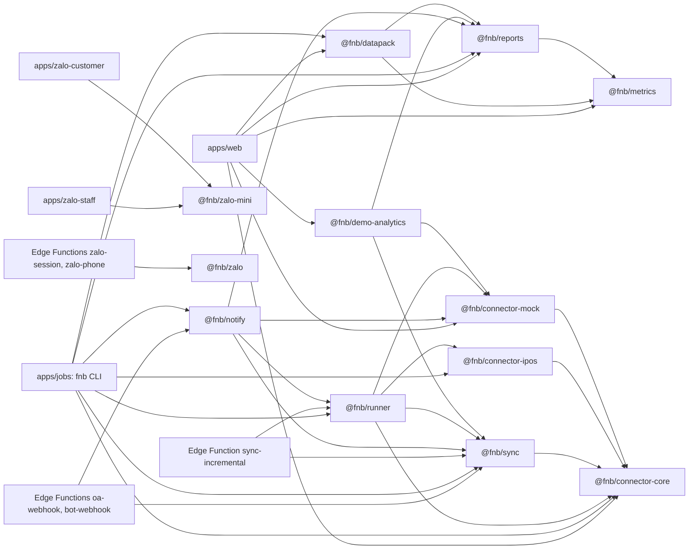

# Development guide

Purpose and audience: how to set up a machine, run every check, change the code and the database safely, and hand the work on. It is written for a developer who takes the work over on another machine, and for reviewers and testers who need to run the same checks. What is built, what is verified and what comes next lives in [status.md](status.md); what the system must do is in [requirements.md](requirements.md) and how it is tested in [test-plan.md](test-plan.md); this guide says how to work on it.

Last updated 2026-11-19 (the loyalty loop: `pnpm zalo:dev --app customer`, `pnpm loyalty:sale`, the local loyalty spec)

## 1. Set up a machine

| Need | Version | Pinned in |
|---|---|---|
| Node.js | 22 or later | `.nvmrc` (22) and `engines` in `package.json` (`>=22`) |
| pnpm | 9 | `packageManager` (`pnpm@9.15.3`) and `engines` (`>=9`) in `package.json` |
| Docker | a current release with at least 8 GB of memory for the containers | runs the local Supabase stack |
| git | any current release | |
| Supabase CLI | 3.0.0 | the `supabase` devDependency (locked in `pnpm-lock.yaml`); run it as `pnpm exec supabase` so every machine uses the same version |
| Deno (optional) | 2.x; CI uses v2.7.3 | only to type-check and test the Edge Functions and `supabase/functions/_shared` locally |
| Chromium for Playwright | the build of Playwright 1.65.0 | `pnpm --filter @fnb/web e2e:install`; the web app and both Mini Apps resolve the same Playwright, so one install serves the three (`pnpm --filter @fnb/zalo-staff e2e:install` does the same) |
| WebKit for Playwright (optional) | the build of Playwright 1.65.0 | only for the staff app's iPhone spec (`test:e2e:phone`): `npx playwright install webkit` in `apps/zalo-staff` |
| zmp-cli | none locally | the Zalo Mini App CLI is not a dependency: the Mini Apps build with Vite and run in a browser with a mocked Zalo SDK, and only the deploy job runs `zmp-cli@4.0.5`, through `npx` |
| Deno and cloudflared for `pnpm zalo:dev` | Deno 2.7.3; cloudflared 2026.10.7 | nothing to install: the loop runs `zalo-session` and `zalo-phone` under Deno 2.7.3 fetched once through `npx -y deno@2.7.3` (its path is cached in `apps/zalo-staff/node_modules/.cache/zalo-local/`), and `--tunnel` downloads the pinned `cloudflared` for Windows x64 into `%LOCALAPPDATA%\fnb-cloudflared\2026.10.7` and checks its SHA-256 on every start (section 3, "The staff app against the local backend") |

First run:

```sh
git clone <repository URL> fnb-manager
cd fnb-manager
pnpm install
pnpm db:start
cp .env.example .env
pnpm db:status
```

1. `pnpm db:start` runs `supabase start`. On a new machine the first start applies every migration and loads the synthetic seed.
2. Fill `.env`. It is gitignored; the names are in `.env.example` and their meaning in [secrets.md](secrets.md).
   - `SUPABASE_PUBLISHABLE_KEY` and `SUPABASE_SECRET_KEY`: the local keys that `pnpm db:status` prints.
   - `DATABASE_URL`: `.env.example` already points it at the local database on port 54322.
   - `POS_ACCOUNTS_JSON`: without POS credentials, use a synthetic account, for example `[{"key":"account-1","connector":"mock","seed":1}]` (optional `storeCount` 1 to 5). A real `ipos-fabi` entry also needs `IPOS_APP_KEY`. Real credentials come from the owner through a private channel, never through the repository.
   - `IPOS_REAL_API`: `on` (or unset) calls the real iPOS API; `off` replays the local snapshot in `.ipos-snapshot/` with no network and writes into `mock-local` only ([sync.md](sync.md#real-or-fake-ipos)). Develop with `off` once the snapshot exists.
3. Web app: `cp apps/web/.env.example apps/web/.env.local`, set `VITE_SUPABASE_URL` to the local API (`http://127.0.0.1:54321`) and `VITE_SUPABASE_PUBLISHABLE_KEY` to the publishable key from `pnpm db:status`, then run `pnpm --filter @fnb/web dev` and open `http://localhost:5173`. Sign in with the seeded development login `dev@example.com`; its password is the constant at the top of `supabase/seed.sql`. With either value empty the dev server runs the demo instead.
4. Check the machine with `pnpm lint`, `pnpm typecheck`, `pnpm test` and `pnpm exec supabase test db`.

To work with synthetic data through the CLI, the same steps the CLI integration test runs work on any stack: `fnb tenant create`, then `fnb onboard` and `fnb sync window … --kind backfill` with a `mock` account (see [sync.md](sync.md#cli-reference) for the options). Give such a tenant a slug that starts with `demo-`: the Postgres parity run refuses any database that holds another kind of tenant.

### The local stack

Ports come from `supabase/config.toml` (`project_id = "FNB_Managment"`) and the web configuration.

| Service | Address | Notes |
|---|---|---|
| API gateway (REST, Auth, Edge Functions) | `http://127.0.0.1:54321` | exposes the schemas `public` and `graphql_public`; `max_rows = 1000` |
| Database | `127.0.0.1:54322` | PostgreSQL 17; the `DATABASE_URL` of `.env.example` |
| Studio | `http://127.0.0.1:54323` | |
| Mail catcher | `http://127.0.0.1:54324` | receives every local auth e-mail (password resets, invitations) |
| Analytics | `127.0.0.1:54327` | |
| Shadow database | `127.0.0.1:54320` | used by `supabase db diff` only |
| Pooler | `54329` | disabled locally |
| Web dev server | `http://localhost:5173` | Vite; the local auth allow-list holds `http://127.0.0.1:5173` and `http://localhost:5173` |
| `vite preview` | `4173` | the Lighthouse recipe in [apps/web/README.md](../apps/web/README.md) |
| Playwright servers | live `5191`, demo `5192`, pages `5193` | each plus `E2E_PORT_OFFSET` |
| Mini App dev servers | staff `http://127.0.0.1:5741`, customer `http://127.0.0.1:5751` | Vite in browser mode with the mocked Zalo SDK; `vite preview` on 5744 and 5754 |
| Mini App Playwright servers | staff `5742`, customer `5752` | each plus `E2E_PORT_OFFSET` |
| `pnpm zalo:dev` | the staff app on `http://127.0.0.1:5741` (`--port`), or on the PC's Wi-Fi address with `--lan`; with `--app customer` the customer app on `5751`; `zalo-session`, `zalo-phone` and the mock Zalo Graph on free 127.0.0.1 ports | the staff app's local specs start it on `5761` (Chromium), `5766` (WebKit over the LAN) and `5767` (WebKit through the tunnel), the customer app's local spec on `5781` (customer) and `5782` (staff), each plus `E2E_PORT_OFFSET` |
| Notification mock providers | `127.0.0.1:8787` | `node packages/notify/scripts/mock-providers.mjs` (phase 12, in build) |

Local auth has sign-up turned off (`enable_signup = false`) and e-mail confirmations off. Logins are created with `fnb tenant add-member`, or by the seed.

### Move to another machine

Git carries the code, the migrations, the synthetic seed and every document except the private ones. Four things never go through the repository and have to be carried by hand, over a private channel (a USB drive or the owner's own encrypted storage):

| What | Where | Why it is not in git |
|---|---|---|
| Secrets | `.env` and `apps/web/.env.local` | credentials of the POS, Supabase and providers |
| Private documents | the whole `docs/private/` folder | build specs, local logins, the private identifier list the public-safety scan reads, the forbidden-terms list, the private reference figures |
| The real tenant's data | the local database | real sales and member logins |
| The iPOS snapshot | `.ipos-snapshot/` | real iPOS answers; `fnb ipos-snapshot from-db --tenant live-local` rebuilds it from the restored database without calling iPOS |

On the new machine:

1. Follow "First run" above, then copy `.env`, `apps/web/.env.local` and `docs/private/` into the checkout. Check that `node scripts/check-public-safe.mjs` reports the private-identifier rule as active (it reads `docs/private/identifiers.txt`).
2. Bring the real data back one of two ways:
   - Preferred: load it again from the POS with the CLI, as [sync.md](sync.md#cli-reference) describes (`fnb tenant create`, `fnb onboard`, then `fnb sync window … --kind backfill` over the history), with the credentials in `.env`.
   - Or copy the database: on the old machine `docker exec supabase_db_FNB_Managment pg_dump -U postgres -Fc -d postgres > fnb-local.dump`; on the new machine, after `pnpm db:start` has applied every migration, `docker exec -i supabase_db_FNB_Managment pg_restore -U postgres -d postgres --data-only --disable-triggers < fnb-local.dump`, then `pnpm exec supabase test db` and the reports live check. The dump holds real customer and sales data: keep it on the private channel and delete it once restored.
3. Work in progress lives on `wip/*` branches on the remote (`git branch -r --list 'origin/wip/*'`); [status.md](status.md) says what each holds and what it still needs before it can merge.

### Rules on a machine that holds real data

The build machine's local stack holds a real tenant loaded with `fnb`. On such a machine:

- Never run `pnpm db:reset` or `supabase db reset`. A reset reapplies every migration and the seed and wipes everything else, including the real tenant.
- Never run `supabase stop --no-backup`. It deletes the data volumes. `pnpm db:stop` stops the containers and keeps the data.
- Apply new migrations with `pnpm exec supabase migration up`.
- Run the CLI with `CI=1` whenever its output is shared; it then numbers accounts and stores instead of naming them.
- Never print or copy credential values from `.env` or `apps/web/.env.local`.
- Work with `IPOS_REAL_API=off`: every command then answers from `.ipos-snapshot/`, calls iPOS not at all, writes into `mock-local` and refuses `live-local`. Build the snapshot once with `IPOS_REAL_API=off pnpm --filter @fnb/jobs fnb -- ipos-snapshot from-db --tenant live-local`, then load `mock-local` with `IPOS_REAL_API=off pnpm db:load-real`. Switch to `on` only when real data is needed; real runs then refresh the snapshot.

## 2. Repository layout

| Path | What it holds | Read more |
|---|---|---|
| `apps/web` | `@fnb/web`: the React single-page app for managers (Vite, Tailwind CSS, ECharts), deployed to GitHub Pages; a build without Supabase variables is the demo | [apps/web/README.md](../apps/web/README.md), [web-app.md](web-app.md) |
| `apps/jobs` | `@fnb/jobs`: the `fnb` CLI for tenants, onboarding, sync, the full history, the iPOS snapshot, status, doctor, digests, notifications, the AI data pack and the loyalty steps (`fnb loyalty nightly`, `reconcile`, `fast-lane` and the simulated till `sale`) | [apps/jobs/README.md](../apps/jobs/README.md) |
| `apps/zalo-staff` | `@fnb/zalo-staff`: the staff Zalo Mini App (zmp-ui, React, Vite), one build per brand from configuration: four tabs, the sign-in states, the role-scoped home (#217), the shift's checklists, close, handover and incidents (14b), and the loyalty tools "Ghi nhận khách", "Kiểm tra ưu đãi", "Tra cứu thành viên" and the member queue (17b), in the browser against a stand-in session and demo data whose answers match the functions, or against the local backend with `pnpm zalo:dev` (phase 13 scaffold, phases 14a to 17b) | [README](../apps/zalo-staff/README.md) |
| `apps/zalo-customer` | `@fnb/zalo-customer`: the customer Zalo Mini App: browse first, joining with the phone after a purpose screen, the member card with stamps and points, the member code, receipt claims, "Đổi quà" and the voucher wallet (18a, 18b), on its deterministic demo data or with `pnpm zalo:dev --app customer --live` on the customer functions of the local stack; the phone-consent probe of phase 13 stays in Development builds | [README](../apps/zalo-customer/README.md) |
| `packages/core` | canonical POS-agnostic model and shared business rules | [README](../packages/core/README.md) |
| `packages/connector-core` | the `PosConnector` contract, registry, errors and conformance suite | [README](../packages/connector-core/README.md) |
| `packages/connector-mock` | seeded synthetic connector for tests, demos and end-to-end runs | [README](../packages/connector-mock/README.md) |
| `packages/connector-ipos` | the iPOS Fabi connector | [README](../packages/connector-ipos/README.md) |
| `packages/sync` | the sync engine and its in-memory and Postgres repositories | [README](../packages/sync/README.md) |
| `packages/runner` | what the CLI and the Edge Function share around the engine | [README](../packages/runner/README.md) |
| `packages/metrics` | the typed metric registry mirrored from [metrics.md](metrics.md) | [README](../packages/metrics/README.md) |
| `packages/reports` | the periodic report models and the typed contract of the report SQL functions | [README](../packages/reports/README.md) |
| `packages/demo-analytics` | the demo's TypeScript port of the report SQL functions, held to the SQL by a parity suite | [README](../packages/demo-analytics/README.md) |
| `packages/datapack` | the AI data pack and the plan format: canonical text, `pack_id`, the pack's content and its builder, the strategy prompt and the chat bundle, JSON Schema files, budget, the aggregates-only check, the plan lint and the sample plan (phase 11a, in build) | [README](../packages/datapack/README.md), [strategy.md](strategy.md) |
| `packages/zalo` | `@fnb/zalo`, the server side of Zalo, Web Crypto only so it runs under Deno and Node: the app-secret proof, a timed HTTP client (10 seconds), the Graph `me` and `me/info` clients, the Supabase calls of the sign-in functions, the refusal codes, and in `./testing` a local mock of the Zalo Graph and the `ZALO_INTEGRATION` gate with its synthetic-environment guard (#205); the `ZALO_LOCAL_DEV` gate and, in `src/local-dev/`, the `pnpm zalo:dev` loop (#208) | [api.md, section 5](api.md#zalo-session) |
| `packages/zalo-mini` | what both Mini Apps share: the Native Storage adapter, the session client and its stand-in, the Data API client and data endpoint, the React shell on zmp-ui, `app-config.json` per brand, the Vite plugin with the local mode's proxy and access guard, the size budgets, the mocked Zalo SDK and the Playwright design checks | [README](../packages/zalo-mini/README.md) |
| `packages/notify` | notifications: channels, templates, the outbox dispatcher, digests (phase 12, in build; no README yet) | [status.md](status.md) |
| `supabase/migrations` | 76 migrations on 2026-11-19 (`0ca91d3`) | [schema.md](schema.md) |
| `supabase/tests` | 72 pgTAP files on 2026-11-19 (`0ca91d3`), whose `plan()` lines add up to 4,358 tests | [schema.md](schema.md#tests) |
| `supabase/seed.sql` | the synthetic seed | section 5 |
| `supabase/functions/sync-incremental` | the Edge Function runner (Deno) | [sync.md](sync.md) |
| `supabase/functions/_shared` | what the Zalo functions share, not deployed itself: CORS for the Mini App origins, JSON answers and errors, bounded bodies, the request id, redacted logs, secrets read by name and `serveFunction`, with their Deno tests. The four Zalo functions use it | [api.md, section 5](api.md#5-edge-function-endpoints) |
| `supabase/functions/zalo-session`, `zalo-phone` | the Mini App sign-in and the phone-number exchange (#205), on `@fnb/zalo` | [api.md, section 5](api.md#zalo-session) |
| `supabase/functions/oa-webhook`, `bot-webhook` | the OA's signed events and the Zalo Bot's updates (#207), connecting as `postgres` like `sync-incremental` | [api.md, section 5](api.md#oa-webhook) |
| `scripts` | `check-public-safe.mjs`, `function-imports.mjs`, `cron-delay-report.mjs`, `check-api-docs.mjs`, `export-openapi.mjs`, `load-real-data.mjs` (`pnpm db:load-real`), `zalo-dev.mjs` (`pnpm zalo:dev`), `simulate-sale.mjs` (`pnpm loyalty:sale`, which runs `fnb loyalty sale`), `verify.sh` (`pnpm verify`), `regression.mjs` (`pnpm test:smoke`, `pnpm test:regression`) | sections 3 and 6 |
| `.github/workflows` | CI, deployments and scheduled jobs (11 files) | section 7 |
| `docs` | roadmap, status, decisions, schema, sync, web app, metrics, secrets, go-live, connectors, reports, exports ([exports.md](exports.md)), the data pack and plan formats ([strategy.md](strategy.md)) and deep dives; the documentation set of 2026-11-12: [plan.md](plan.md), [requirements.md](requirements.md), [test-plan.md](test-plan.md), [architecture.md](architecture.md), [security.md](security.md), [api.md](api.md), [operations.md](operations.md), this guide, [user-guide.md](user-guide.md) and [glossary.md](glossary.md); `docs/private/` is gitignored | [roadmap.md](roadmap.md) |

Runtime dependencies between the workspace packages (an arrow reads "uses"). Every box except `@fnb/metrics`, `@fnb/zalo`, the three Edge Function boxes, `@fnb/zalo-mini` and `apps/zalo-customer` also uses `@fnb/core` directly (the staff app since #217, for the business date of its home); those arrows are left out, and so are `@fnb/design-tokens` (used by the web app and both Mini Apps) and development-only dependencies. `supabase/functions/_shared` uses `@fnb/sync` for its redactor.



How a number travels: a connector reads the POS; the sync engine writes canonical sales and a `sync_checks` row per store-day (the POS's own daily totals against the stored ones); the analytics refresh fills the `agg_*` tables; the report SQL functions compute every report number; the web app calls them with `supabase.rpc()` as the signed-in member, so row-level security applies. The demo runs a TypeScript port of the same functions over generated days (ADR-029 in [decisions.md](decisions.md)).

## 3. Everyday commands

Run everything from the repository root.

| What | Command | Notes |
|---|---|---|
| Every check before a push | `pnpm verify` | `scripts/verify.sh` runs, in order and stopping at the first failure, every check of [plan.md](plan.md) section 2.4 that the build machine allows: lint, typecheck, unit tests, the import map and Deno checks, the API reference, pgTAP, the OpenAPI description, the web build, every end-to-end project, gitleaks and the public-safety scan. It needs the local stack running and never resets it. Set `E2E_PORT_OFFSET` when another run uses the default ports. On 2026-11-18 its Deno step type-checks `sync-incremental` only and it runs neither the Deno tests nor the Mini App builds and browser tests, which CI's `code` and `mini-apps` jobs run (section 7); run those yourself when they are touched |
| The smoke pack | `pnpm test:smoke` | `scripts/regression.mjs --smoke`, aimed at under five minutes (6 min 20 s on a loaded build machine on 2026-11-19): typecheck, the unit tests of `core`, `connector-ipos`, `zalo-mini`, `zalo`, `notify` and `reports`, the loyalty pgTAP subset (03, 47, 60 to 72, 80, 90 to 98, 130 to 139), the Deno tests, both Mini Apps' Playwright in `phone-light` and the web demo specs for loyalty, rewards, operations and announcements. Every step runs even after a failure; the summary table names each step's result, duration and skip reason, and the JSON report and step logs go to `<os temp>/fnb-regression/`. Exit code 1 when a step failed. See [test-plan.md](test-plan.md) section 2.13 |
| The full regression pack | `pnpm test:regression` | `scripts/regression.mjs`: lint, types, every package's unit tests, every pgTAP file, Postgres parity (`PARITY_POSTGRES=1`), every Edge Function's `deno check` and `deno test`, the import map, the API reference, the OpenAPI description, the public-safety scan, both Mini Apps' full Playwright, the web `demo` and `pages` projects, and with their switches the web `live` project, the customer app's local spec and the integration suites below. Put the switches on the command line, e.g. `DATABASE_URL=<local database URL> LOYALTY_INTEGRATION=1 pnpm test:regression`; `node scripts/regression.mjs --list` shows what would run or skip and why, `--only` and `--skip` take step ids. It never resets the database, never reads `.env`, skips the read-only check of the real tenant and runs with `IPOS_REAL_API=off` and without `LIVE`, so it calls neither the POS nor Zalo. On this Windows machine these stay red with a "known environment issue" note: the design-tokens biome `.cmd` shim, the reports reference-sheet path test, the CRLF wording sheets, `lint` on the CRLF working copy, and `check-openapi`, whose `export-openapi.mjs` spawns `pnpm` without its `.cmd` shim |
| Install | `pnpm install` | CI uses `pnpm install --frozen-lockfile` |
| Lint | `pnpm lint` | `biome check .`; Markdown is not linted |
| Format | `pnpm format` | `biome format --write .`; `pnpm exec biome check --write .` also applies safe lint fixes and sorts imports |
| Typecheck | `pnpm typecheck` | `tsc --noEmit` in every package, sources and tests |
| Unit tests, as CI runs them | `pnpm test` | `vitest run` in every package; the gated suites below skip |
| Unit tests on a shared machine | `pnpm -r --workspace-concurrency=1 --if-present run test --maxWorkers=2` | one package at a time, two workers each |
| One package | `pnpm --filter @fnb/reports run test --maxWorkers=2` | |
| One folder or file | `pnpm --filter @fnb/reports exec vitest run test/unit/reports/day --maxWorkers=2` | |
| pgTAP | `pnpm exec supabase test db` | every file in `supabase/tests`; it also takes file or directory paths (`pnpm exec supabase test db --help`) |
| Parity on PGlite | part of `pnpm test` in `@fnb/demo-analytics` | runs every migration in PGlite |
| Parity on Postgres | `DATABASE_URL=<local database URL> pnpm --filter @fnb/demo-analytics test:parity:postgres` | refuses a database that holds a tenant whose slug does not start with `demo-` or `parity-`; CI runs it on a fresh stack |
| Playwright, once | `pnpm --filter @fnb/web e2e:install` | installs the Chromium build Playwright needs |
| Playwright, one spec | `E2E_PORT_OFFSET=10 pnpm --filter @fnb/web exec playwright test --project=demo e2e/demo/report-day.spec.ts` | `--project` starts only that project's server |
| Playwright, everything | `pnpm --filter @fnb/web test:e2e` | 327 tests in 52 files (listed with `playwright test --list` on 2026-11-19 at `0ca91d3`: demo 190, live 134, pages 3), one worker; long, so prefer one spec on a shared machine |
| User-guide screenshots | `pnpm --filter @fnb/web docs:screenshots` | takes every screenshot of [user-guide.md](user-guide.md) from the demo at a fixed clock into `docs/user-guide/`, and the sign-in screens from a build pointed at an unreachable backend, so no real data can appear; retake them whenever a screen changes |
| A Mini App in the browser | `pnpm --filter @fnb/zalo-staff dev` (or `@fnb/zalo-customer`) | Vite in browser mode on 5741 (customer 5751): the mocked Zalo SDK, the synthetic `brand-1` configuration and a stand-in session. The address chooses the stand-in: `?session=unpaired`, `?session=notice` (signed in, but the staff notice must be accepted first) or `?session=failed` shows the other sign-in states, and `&delay=<ms>` (at most 10,000) holds "Đang kết nối…"; the stand-in refuses the binding and pairing code `000000`, and answers the pairing code `999999` with a 900-second wait. In the staff app `?role=owner` or `?role=staff` (one store) replaces the default manager of two sample stores, `?revenue=all`, `store_totals` or `none` sets the sample tenant's staff revenue level (default `all`), and `&dataDelay=<ms>` (at most 10,000) holds the home's loading state; the home shows fixed sample figures. The staff app's loyalty tools answer from their deterministic demo (the sample member codes, phones and reward codes are listed in [apps/zalo-staff/README.md](../apps/zalo-staff/README.md)), and the customer app runs on its demo data (`src/demo/`) with a stand-in customer session. The dev server builds the Development stage, so the customer app also shows its probe entry |
| The staff app against the local backend | `pnpm zalo:dev` | the real `zalo-session` on the local stack with a mock Zalo user; see "The staff app against the local backend" below |
| The customer app against the local backend | `pnpm zalo:dev --app customer --live` | the customer functions of the local stack as a mock customer on the synthetic tenant `loyalty-sim`; without `--live`, the demo data and the stand-in session with no database; see "The customer app against the local backend" below |
| A simulated till sale | `pnpm loyalty:sale -- --tenant loyalty-sim --amount 60000` | `fnb loyalty sale`: one synthetic sale on a local synthetic tenant, then the loyalty reconciliation of its day; see "The simulated till" below |
| The loyalty steps | `pnpm --filter @fnb/jobs fnb -- loyalty nightly --tenant <slug>`, `… loyalty reconcile --tenant <slug> --from YYYY-MM-DD --to YYYY-MM-DD`, `… loyalty fast-lane` | in the database only, counts printed: `nightly` reconciles the last 14 business days, claws back voided or edited earns, releases expired reward holds, expires stamps and points and stores the liability (`--all-tenants` for every tenant with an active or paused programme); `reconcile` runs paths A to D over a range, as every sync run already does at its end. `fast-lane` runs the store syncs that check-ins and receipt claims requested and does nothing unless `LOYALTY_FAST_LANE=on`; each such run calls the POS for one store's last 60 minutes, and nothing schedules it, so no POS call happens by default |
| A Mini App build | `pnpm --filter @fnb/zalo-staff build` | `vite build`, then the size budgets of `packages/zalo-mini/scripts/check-budget.mjs`: at most 3 MB a file and 10 MB a version, and no `echarts` or `zrender` in the dependency graph. Every build targets ES2015 and writes `dist/app-config.json`. Variables: `VITE_ZALO_RUNTIME` (`browser`, the default, mocks `zmp-sdk`; `zalo` builds for the Zalo runtime and also needs `VITE_BRAND_KEY`, `VITE_SUPABASE_URL`, `VITE_SUPABASE_PUBLISHABLE_KEY` and a generated `app-config.json`), `VITE_MINI_APP_STAGE` (`testing` for a build by default, `development` for the dev server; a Testing build fails when it still contains a Development-only screen), `VITE_BRAND_KEY`, and `MINI_APP_CONFIG`, the `app-config.json` to build from (without it a browser build uses the synthetic `brand-1`) |
| Mini App tests | `pnpm --filter @fnb/zalo-staff test`; `pnpm --filter @fnb/zalo-staff test:e2e` | Vitest; Playwright builds the Testing stage in browser mode, serves it on 5742 (customer 5752) plus `E2E_PORT_OFFSET` and runs the projects `phone-light`, `phone-dark` and `budget` at 360 × 800 px (staff 93 tests in 10 files, customer 33 in 4, listed with `playwright test --list` on 2026-11-19 at `0ca91d3`) |
| The staff app's local specs | `ZALO_LOCAL_DEV=1 pnpm --filter @fnb/zalo-staff test:e2e:local`; `ZALO_LOCAL_DEV=1 pnpm --filter @fnb/zalo-staff test:e2e:phone` | `playwright.local.config.ts`, one worker, with the local stack running and `.env` filled (they skip otherwise). `local`: Chromium at 360 × 800 px drives `pnpm zalo:dev`, signs in through the real `zalo-session` and compares the home's stamp, today's figures and yesterday's state with `sync_runs`, the sum of non-voided invoices and `sync_checks` read through the same session, reporting counts and booleans only. `iphone`: WebKit with the iPhone 14 profile through `pnpm zalo:dev --lan` (skipped when the PC has no LAN address), and, only with `E2E_TUNNEL=1`, through `--tunnel` and a real Cloudflare quick tunnel; each also checks that a request without the key gets 403. `test:e2e:phone` needs WebKit (`npx playwright install webkit` in `apps/zalo-staff`) |
| The customer app's local spec | `ZALO_LOCAL_DEV=1 pnpm --filter @fnb/zalo-customer test:e2e:local` | `apps/zalo-customer/playwright.local.config.ts`, project `local`, one worker, Chromium at 360 × 800 px; skipped unless `ZALO_LOCAL_DEV=1` and the local stack answers at the loopback `SUPABASE_URL` and `DATABASE_URL` of the shell or `.env`, and failing with the command to run when `loyalty-sim` does not exist yet (`pnpm loyalty:sale -- --setup --tenant loyalty-sim` creates it). `e2e/loyalty-local.spec.ts` (3 tests) drives `pnpm zalo:dev --app customer --live` with a synthetic customer per test (`--mock-user`, `--mock-name`, `--mock-phone`) and the staff app as a synthetic manager of one `loyalty-sim` store: join with the phone consent and a receipt claim confirmed after a till sale; a member code recorded in the staff app and earned by a sale rung in the window; a reward redeemed, verified in the staff app and confirmed by a sale carrying its discount entry ("Đã dùng"). Each test then erases its synthetic customers through the data-subject deletion and records the counts |
| A Mini App's `app-config.json` | `pnpm --filter @fnb/zalo-mini app-config --config <file> --brand <key> --app <staff or customer> --out <path>` | writes one brand's file from a configuration file shaped as the `mini_apps` rows (`packages/zalo-mini/config/synthetic-brands.json` holds two synthetic brands); `--config <file> --list` prints `<brand> <kind>` per row, and `--compare <first> <second>` fails when two files differ outside the configured fields. Exit 0, 1 on an invalid configuration, 2 on a usage error. The generated file is gitignored. `fnb zalo app-config`, which the deploy workflow calls to read the rows from the database, is not built yet |
| Data pack files | `pnpm --filter @fnb/datapack schemas`, `golden` or `fixtures` | regenerate the JSON Schema files, the golden demo pack or the plan fixtures; commit what they write ([strategy.md](strategy.md)) |
| Build an AI data pack | `pnpm --filter @fnb/jobs fnb -- datapack --tenant <slug>` | as a member of the tenant inside one read-only snapshot; files go only outside the repository or below `docs/private/`; `--check <file>` checks a pack file without a database ([strategy.md](strategy.md)) |
| Build every package | `pnpm build` | `tsc -p tsconfig.build.json` into each `dist/` (gitignored), plus the web build; packages are consumed as TypeScript source, so nothing needs building to run |
| Web build | `pnpm --filter @fnb/web build` | `vite build`, then `scripts/check-bundle.mjs` and `scripts/check-size.mjs` |
| Pages demo build | `VITE_BASE_PATH=/fnb-manager/ VITE_SUPABASE_URL= VITE_SUPABASE_PUBLISHABLE_KEY= pnpm --filter @fnb/web build` | empty variables in the environment win over `apps/web/.env.local`; rebuild the default `dist` afterwards |
| Design tokens | `pnpm --filter @fnb/design-tokens build` | regenerates `tokens.css` and `palette.ts` in `packages/design-tokens/src/generated/` from the DTCG files in `packages/design-tokens/tokens/`; commit both; the package's tests fail while they are stale ([design-system.md](design-system.md)) |
| Edge Function import maps | `node scripts/function-imports.mjs` | writes the `deno.json` of every folder of `supabase/functions` that has one (each function and `_shared`), or only of the folders named after it; `--check` only reports; `--affected` reads changed paths on standard input and prints the functions they affect (section 6) |
| Edge Function checks | `deno check index.ts` and `deno test --permit-no-files` in each function's folder; `deno test` in `supabase/functions/_shared` | as CI does (section 7) |
| Public-safety scan | `node scripts/check-public-safe.mjs` | prints `public-safe scan: no findings` and exits 0 when clean |
| API reference check | `DATABASE_URL=<local database URL> pnpm docs:check-api` | compares [api.md](api.md) with the functions in `public` that `authenticated` may execute, in a read-only transaction; without `DATABASE_URL` it reads the local container read-only. Exit 0 in step, 1 out of step, 2 on a usage or connection error |
| OpenAPI description | `pnpm docs:openapi` | regenerates `docs/api/openapi.json` from the local stack as the role `authenticated`; `pnpm docs:check-openapi` only reports; see [api.md](api.md) section 8 |
| API in Swagger UI | `pnpm docs:api` | serves `docs/api` at `http://127.0.0.1:5290` |
| Secret scan, as CI | `docker run --rm -v "$PWD:/repo" ghcr.io/gitleaks/gitleaks:v8.30.1 git /repo --redact --exit-code 1` | |
| The CLI | `pnpm --filter @fnb/jobs fnb -- --help` | `CI=1 pnpm --filter @fnb/jobs fnb -- status` for shareable output |
| Load the real history | `pnpm db:load-real --email <you@example.com>` | `fnb bootstrap` with `CI=1`: tenant, owner, every account, all months back to the first sales, the analytics refresh and `apps/web/.env.local` when missing; resumable, never resets the stack ([sync.md](sync.md#load-the-full-history-in-one-command)) |

`pnpm test -- --maxWorkers=2` does not limit the workers: pnpm passes the `--` on, and Vitest 5.1 ignores every argument after `--`. Use the `run test --maxWorkers=2` forms above.

### Gated suites

These suites skip unless their variables are set. They read the shell environment; only the iPOS live suite loads the repository's `.env` itself. Pass the variables on the command line, for example `DATABASE_URL=<local database URL> pnpm --filter @fnb/sync test`.

| Suite | Gate | Command |
|---|---|---|
| Sync Postgres repository (`packages/sync/test/integration`) | `DATABASE_URL` | `pnpm --filter @fnb/sync test` |
| CLI on the local stack (`apps/jobs/test/integration/local-stack.test.ts`) | `DATABASE_URL`; one test also `SUPABASE_URL` and `SUPABASE_SECRET_KEY` | `pnpm --filter @fnb/jobs test` |
| Notifications (`packages/notify/test/integration`, `apps/jobs/test/integration/notify-cli.test.ts`) | `NOTIFY_INTEGRATION=1` and `DATABASE_URL`; fixture tenants `notify-it-…` and synthetic `_IT` secrets | `pnpm --filter @fnb/notify test:integration` |
| The loyalty pipeline (`apps/jobs/test/integration/loyalty-pipeline.test.ts`): the real incremental run of `@fnb/runner` on the mock connector with the test's own till sales, `app.reconcile_loyalty`, the wallet; voids and edits clawed back at night; redemptions confirmed by a synced discount entry or pool code and released after the hold; re-runs that add nothing | `LOYALTY_INTEGRATION=1` and a loopback `DATABASE_URL`; a fixture tenant `loyalty-it-…` with synthetic `0900000xxx` members, removed at the end | `pnpm --filter @fnb/jobs exec vitest run test/integration/loyalty-pipeline.test.ts` |
| Mini App sign-in (`packages/zalo/test/integration/session.test.ts`): `zalo-session` and `zalo-phone` against the local stack and the mock Zalo | `ZALO_INTEGRATION=1` with `DATABASE_URL`, `SUPABASE_URL`, `SUPABASE_SECRET_KEY` and `SUPABASE_PUBLISHABLE_KEY` of the local stack, after a restart that loaded the access-token hook; fixture tenants `zalo-it-…` | `pnpm --filter @fnb/zalo test:integration` |
| `fnb zalo` on the local stack (`apps/jobs/test/integration/zalo-cli.test.ts`) | `ZALO_INTEGRATION=1` and `DATABASE_URL` | `pnpm --filter @fnb/jobs test` |
| The webhooks on the local stack (`supabase/functions/oa-webhook/integration.test.ts`, `bot-webhook/integration.test.ts`) | `ZALO_INTEGRATION=1` and a local `DATABASE_URL`, with Deno's environment and network permissions | `deno test -A integration.test.ts` in the function's folder |
| The staff app's local specs (`apps/zalo-staff/e2e/local.spec.ts`, `phone.spec.ts`) | `ZALO_LOCAL_DEV=1`, a running local stack whose loopback `SUPABASE_URL` is in the shell or `.env`, and what `pnpm zalo:dev` needs (below); the tunnel test also `E2E_TUNNEL=1` | `pnpm --filter @fnb/zalo-staff test:e2e:local`, `pnpm --filter @fnb/zalo-staff test:e2e:phone` |
| The loyalty loop on the local stack (`apps/zalo-customer/e2e/loyalty-local.spec.ts`) | `ZALO_LOCAL_DEV=1`, a running local stack whose loopback `SUPABASE_URL` and `DATABASE_URL` are in the shell or `.env`, and the synthetic tenant `loyalty-sim` with an active programme (`pnpm loyalty:sale -- --setup --tenant loyalty-sim`); synthetic customers with `0900000xxx` phones and `loyalty-sim-it-…` manager logins, erased or removed at the end of each test | `pnpm --filter @fnb/zalo-customer test:e2e:local` |
| Reports live check, read-only | `DATABASE_URL`; `LIVE_TENANT` (default `live-local`), `LIVE_SEED` (default 20261108) | `pnpm --filter @fnb/reports test:live` (the script sets `LIVE=1`) |
| Digest equals Ngày, live | `DATABASE_URL` | `pnpm --filter @fnb/notify test:live` (the script sets `LIVE=1`) |
| Live settings specs (`apps/web/e2e/live/settings-*.spec.ts`) | `apps/web/.env.local`; `E2E_DATABASE_URL` optional (the local stack when unset, loopback only) | `pnpm --filter @fnb/web test:e2e -- --project=live` |
| Live export spec (`apps/web/e2e/live/exports.spec.ts`) | `apps/web/.env.local`; `E2E_DATABASE_URL` as above for its fixture tenant. With `E2E_LOGIN_EMAIL` and `E2E_LOGIN_PASSWORD`, and `E2E_TENANT_SLUG` for a login with more than one tenant, it signs in as that login instead (`liveLogin()` in `apps/web/e2e/support/local-stack.ts`) and exports the last complete month of its tenant read-only, compared with `export_control_totals`; the personal-data and role tests then skip | `E2E_PORT_OFFSET=110 pnpm --filter @fnb/web exec playwright test --project=live e2e/live/exports.spec.ts` |
| iPOS live | `POS_ACCOUNTS_JSON` with an application key, from `.env` | `pnpm --filter @fnb/connector-ipos test:live`; prints counts and timings only |
| iPOS snapshot, offline bootstrap (`apps/jobs/test/integration/ipos-snapshot-bootstrap.test.ts`) | `DATABASE_URL`; a synthetic snapshot in a temporary folder, tenants `it-snap-…` and `it-real-…` | `pnpm --filter @fnb/jobs test` |
| iPOS snapshot fidelity, read-only (`apps/jobs/test/integration/ipos-snapshot-fidelity.test.ts`) | `DATABASE_URL` and a `live-local` tenant; prints counts only | `pnpm --filter @fnb/jobs test` |

The sync and CLI integration tests create their own tenants (slugs starting `it-`) and delete them at the end.

The live settings specs of phase 10b do the same through `createSettingsFixture()` in `apps/web/e2e/support/settings-fixture.ts`: in `beforeAll` it connects with postgres-js to `E2E_DATABASE_URL` (the local stack's URL when unset, and never a host other than this machine), removes `e2e-settings-` tenants and fixture-shaped `e2e-<role>-<hex>@example.com` logins older than an hour that an interrupted run left (never a login that belongs to another tenant), and builds a tenant `e2e-settings-<hex>` with two stores, items, payment methods, five weeks of generated sales refreshed into the aggregates and five logins (owner, manager, store-limited manager, staff, viewer) with a synthetic password. A spec signs in through `fixture.signIn(page, role)` or calls the API as a role through `fixture.clientAs(role)`, takes its dates from `fixture.sales`, and its `afterAll` calls `fixture.teardown()`, which deletes the tenant and the five logins and may be called twice. The fixture never reads or writes another tenant; `e2e:live/settings-fixture` checks that.

### The staff app against the local backend

`pnpm zalo:dev` (#208, `scripts/zalo-dev.mjs` over `packages/zalo/src/local-dev/`) runs the staff Mini App in a browser against the real backend on this PC before any Zalo account exists. It starts three parts and stops all three on Ctrl+C or `q` and Enter:

- a mock Zalo Graph on a free 127.0.0.1 port, which knows one mock user and checks the app-secret proof with an App secret drawn on every start;
- the unmodified `zalo-session` and `zalo-phone` under Deno 2.7.3, each on another free 127.0.0.1 port, with `ZALO_LOCAL_DEV=1`, the tenant's id and the mock Graph's address, against the local stack ([secrets.md](secrets.md), "The local staff-app loop");
- the staff app's Vite dev server in the `local` session mode (`VITE_ZALO_SESSION=local`: the browser runtime with the real session client), which proxies `/functions/v1/zalo-session` to the local function and `/supabase/rest/v1` and `/supabase/auth/v1` to the local API, so the home reads real rows through the member's session. The plain mode takes the API's address from a loopback `SUPABASE_URL` in the repository's `.env`, for the proxy only. The stand-in and Zalo-runtime builds do not change, and a build in the `local` mode is refused.

Before the first run:

1. The local stack runs, and `.env` holds its `SUPABASE_URL`, `DATABASE_URL`, `SUPABASE_SECRET_KEY` and `SUPABASE_PUBLISHABLE_KEY` (the loop refuses any that do not point at this machine) and `FNB_MEMBER_EMAIL`, the login of a member of the tenant (or pass `--member`). A publisher cannot be bound.
2. The brand has its Zalo rows in that tenant, written with `fnb zalo config set` with mock ids: a Zalo App id that starts with `mock-` and an active status, and for the staff app's header a `staff` Mini App row from a file (without it the synthetic configuration is used). The loop serves only brands whose Zalo App id starts with `mock-`.

On the first run for a mock user the loop issues a binding code and redeems it through the real function, which binds the mock user to the member; later runs sign in at once. It prints only the address, the tenant and brand, the member's role and store count; the function's and the dev server's own lines carry a prefix.

The staff app's loyalty tools (#256 to #258) use the live staff loyalty functions when the local stack has all eight of them (`staff_record_checkin`, `staff_verify_redemption`, `staff_member_lookup`, `staff_request`, `staff_loyalty_queue`, `staff_decide_loyalty_request`, `staff_my_loyalty_requests`, `resolve_loyalty_queue_item`; `staffLoyaltyMode` in `packages/zalo/src/local-dev/loop.ts` checks the catalogue at start and passes `VITE_STAFF_LOYALTY=live`), and their demo data marked "Dữ liệu mẫu" otherwise; the loop says which on its ready line. `?loyalty=demo` or `?loyalty=live` in the address switches either way. On the live functions a check-in, a code check or a request writes real rows of the tenant through the member's session, so use a synthetic tenant such as `loyalty-sim` for them.

| Option | Default | What it does |
|---|---|---|
| `--tenant <slug>` | `live-local` | the tenant |
| `--brand <key>` | `brand-1` | the brand key |
| `--member <login e-mail>` | `FNB_MEMBER_EMAIL` | the member the mock user signs in as |
| `--mock-user mock-<id>` | `mock-user-1` | the mock Zalo user id, which must start with `mock-`; one mock user per member, so pass another for another member |
| `--mock-name <name>` | `Người dùng Zalo thử` | the Zalo display name, 1 to 100 characters without control characters |
| `--mock-phone 0900000xxx` | `0900000789` | the synthetic number the mock Zalo Graph answers for the phone permission, one of `0900000000` to `0900000999`, so each mock customer can have a phone of its own |
| `--app customer` | the staff app | run the customer Mini App instead, on `5751` by default ("The customer app against the local backend" below); `--member` is refused with it |
| `--live` | off | with `--app customer`: against the real functions of the local stack instead of the demo data |
| `--port <port>` | `5741` | the dev server's port, 1024 to 65535 |
| `--lan` | off | listen on this PC's home-network IPv4 address (Wi-Fi first; virtual, VPN and container adapters skipped) for a phone on the same Wi-Fi, and print the phone link with a QR code; with no such address it listens on every interface and says so |
| `--host <ipv4>` | the detected address | with `--lan`: another IPv4 address of this PC, which must be one of its own |
| `--tunnel` | off | keep the dev server on 127.0.0.1 behind a Cloudflare quick tunnel and print its `https://….trycloudflare.com` link with a QR code; Windows x64 only, with the pinned `cloudflared` downloaded on first use |
| `--tunnel-hours <n>` | `4` | with `--tunnel`: stop the whole loop after this many hours, more than 0 and at most 12 |
| `forget` | | `pnpm zalo:dev forget [--tenant <slug>] [--brand <key>]` removes the brand's Zalo rows and mock identities when every Zalo id and every bound identity is a `mock-` one and nothing else hangs off the brand, so `fnb zalo config set` can store the real ids ([operations.md](operations.md), section 4.17) |
| `setup-staff` | | `pnpm zalo:dev setup-staff [--tenant <slug>] [--brand <key>] [--new-password]` gives a synthetic tenant (`loyalty-sim` by default, or `zalo-it-…`) on the local stack a manager login of every active store, `<slug>-manager@example.com`, seeding the brand first when it has none, and prints the `pnpm zalo:dev --tenant … --member … --mock-user …` command that opens the staff app as it; the generated password is printed once (at creation, or with `--new-password`) and stored nowhere else; idempotent; refuses `live-local`, other real tenants and a non-local database ([apps/zalo-customer/README.md](../apps/zalo-customer/README.md)) |

`--lan` and `--tunnel` cannot be combined. Both put an access guard in front of the dev server: the printed link carries a key drawn on every start, the first visit exchanges it for a cookie, and every request without it gets 403 ([security.md](security.md), section 4.9). Whoever has the link is signed in as the member, so keep it to yourself. With `--lan` only the dev server leaves loopback: `zalo-session`, the mock Graph and the local API stay on 127.0.0.1 behind its proxy. If the phone cannot connect, allow TCP on the port (5741 by default) for private networks in this PC's firewall; the loop prints the same hint. Nothing in the staff app needs a secure context, so the plain `http` LAN link works in Safari on an iPhone.

### The customer app against the local backend

`pnpm zalo:dev --app customer [--live] [--tunnel] [--mock-user mock-<id>] [--mock-phone 0900000xxx]` runs the customer Mini App (#261 to #265, #272) the same way, on `http://127.0.0.1:5751` unless `--port` says otherwise; `--lan`, `--host`, `--tunnel` and `--tunnel-hours` work as for the staff app, behind the same access guard.

- **Without `--live`** only the app's Vite dev server starts, on its deterministic demo data and the stand-in customer session; it needs no database, no `.env` and no Zalo rows.
- **With `--live`** the loop starts the mock Zalo Graph, `zalo-session` and `zalo-phone` as above and the app in the `local` session mode, against the local stack. The tenant defaults to `loyalty-sim` (`--tenant` picks another). The mock user signs in as a customer, not a member, so it needs no binding code and `--member` is refused; "Tham gia thành viên" asks the mock Graph for the phone, which answers `--mock-phone` (`0900000789` by default), and the join goes through `zalo-session`; the app then calls the customer functions of `CUSTOMER_FUNCTIONS` in `@fnb/zalo-mini/loyalty` (`customer_home`, `customer_wallet`, `customer_member_code`, `customer_submit_claim`, `customer_coupons`, `customer_redeem`, `customer_vouchers`, `customer_stop_marketing`, `customer_request_deletion`; [api.md](api.md)) through the customer's session.
- **Zalo rows.** For a synthetic tenant, `loyalty-sim` or a `zalo-it-…` one, the loop first seeds the brand when the tenant has none: a synthetic brand over its stores, a mock Zalo App and OA and both Mini Apps, all with `mock-` ids (`packages/zalo/src/local-dev/seed.ts`). Any other tenant is never seeded and needs its rows from `fnb zalo config set` with mock ids, as for the staff app; the loop serves only brands whose Zalo App id starts with `mock-`.
- **The tenant.** `loyalty-sim` does not exist on a fresh stack: `pnpm loyalty:sale -- --setup --tenant loyalty-sim` creates it with a mock POS account, two stores and an active synthetic programme (next section).
- Give each mock customer its own `--mock-user` and `--mock-phone`, as the local spec does. `ZALO_LOCAL_DEV=1 pnpm --filter @fnb/zalo-customer test:e2e:local` runs the whole loop by itself (section 3).

### The simulated till

`pnpm loyalty:sale -- --tenant <slug> --amount <dong> [--store <external id>] [--phone <phone>] [--discount-name <entry name>] [--voucher-code <code>] [--discount-amount <dong>] [--setup]` (`scripts/simulate-sale.mjs`, which runs `fnb loyalty sale`, `apps/jobs/src/commands/loyalty-sale.ts`) rings one completed sale, sold now, so the loyalty flow can be tried without the POS. It writes the sale through the store-day write the sync uses, with the store's next receipt number (per business day for a store that resets daily, per year otherwise), then runs the loyalty reconciliation of that business day and prints the store, the business date, the receipt number and the amounts, which is what a receipt claim in the customer app asks for.

| Option | What it does |
|---|---|
| `--tenant <slug>` | the tenant, required |
| `--amount <dong>` | the sale's amount, a whole number of đồng from 1 to 100,000,000 (dots, commas and spaces between digits are ignored) |
| `--store <external id>` | the store, by POS external id or id; the tenant's first active store otherwise |
| `--phone <phone>` | puts the number on the invoice as a cashier attaching a member would (path A); use a synthetic `0900000xxx` number |
| `--discount-name <entry name>` | a payment discount entry of that name on the invoice, as the cashier rings it on the fallback rail after staff checked a reward code |
| `--voucher-code <code>` | a voucher code on the invoice, as on the CRM code rails |
| `--discount-amount <dong>` | the discount, 0 by default and at most the amount: the payment discount with `--discount-name`, else the voucher amount; the net is the amount less it. Only with one of the two options above |
| `--setup` | creates a missing tenant whose slug starts with `loyalty-sim`, with a mock POS account, two stores (receipt numbers resetting daily and yearly) and an active synthetic programme |

It calls no POS and refuses a database that is not the local stack, the `live-local` tenant and any tenant registered in `app.tenant_ipos_sources` as fed by the real iPOS API. The reconciliation it runs is the one that ends every sync run; to try a whole redemption, redeem in the customer app, check the code in the staff app, then ring `--discount-name` with the entry the staff app showed (or `--voucher-code` with the code).

### Before you hand work over

```sh
pnpm lint
pnpm typecheck
pnpm test
pnpm exec supabase test db
node scripts/function-imports.mjs --check
pnpm --filter @fnb/web build
pnpm docs:check-api
node scripts/check-public-safe.mjs
CI=1 pnpm --filter @fnb/jobs fnb -- status
```

CI adds the Postgres parity run and the web end-to-end suite on a freshly reset stack, the Deno checks and tests of every function, and the Mini App job (section 7). CI does not run the web build with its bundle and size checks (the end-to-end `pages` project builds with plain `vite build`); only `deploy-web.yml` runs it, on `main`, so run it yourself before handing over. CI does not run `pnpm docs:check-api` either (request R-AP01). Every phase so far was closed the same way: build, an independent review, fixes, then an independent verification that reruns what CI runs plus checks against real data on the local stack ([status.md](status.md)).

## 4. Conventions

### Code

- TypeScript everywhere (ADR-002). `tsconfig.base.json` sets `strict`, `noUncheckedIndexedAccess`, `exactOptionalPropertyTypes`, `verbatimModuleSyntax` and `NodeNext` modules; relative imports end in `.js`.
- Packages export their TypeScript source (`exports` points at `./src/index.ts`). The CLI runs it through tsx (`apps/jobs/bin/fnb.mjs`), the web app and the Mini Apps bundle it with Vite, and the Edge Functions reach the same files through their generated import maps.
- Biome 2.6.6: tabs, double quotes, the recommended rules, sorted imports.
- No comments in code. Names, small functions and test titles carry the explanation; the reasoning goes into the commit message, the pull request or the docs. Only comments a machine reads (pragmas, generated files) are allowed.
- Inputs from outside (POS responses, environment variables, RPC rows) are parsed with zod schemas at the edge.
- SQL: every function sets `search_path = ''` and qualifies every name (`app.data_roles` is the one exception today; request R-T01 in [plan.md, section 8.1](plan.md#81-open-correction-requests)); read functions are `stable` and `security invoker`; argument checks raise SQLSTATE `22023` with a plain message; `revoke` from `public` and `anon`, then `grant execute` to `authenticated` and `service_role` only where the browser or a job needs it; internal helpers live in the schema `app`, which the API does not expose.

### Words

- English in code, docs and commit messages. The app speaks Vietnamese by default, with English as the alternative.
- Every user-visible string goes through `t()` with a key in `apps/web/src/i18n/messages/<area>.vi.json` and `<area>.en.json`. Tests fail on a missing or misplaced key, a key in two files, JSX text that bypasses `t()`, and a report key without a translation.
- Vietnamese follows the metric registry's spelling with full diacritics: "hóa đơn", "hủy", "tùy" (not "hoá", "huỷ", "tuỳ").
- No assistant-product or vendor names in code, docs, commits or pull requests. Describe people by role: builder, reviewer, verifier, owner. The strategy step runs in "the owner's own assistant" (ADR-003).
- Absolute dates in docs (2026-11-12, never "today").

### Public repository

- The repository is public. No shop or brand names, account e-mails, chat ids, tokens, keys, passwords or revenue figures in any tracked file, fixture or log. In docs, say "the tea shop" and "the coffee shop".
- Fixtures are synthetic (ADR-009); recorded vendor responses are never committed. Use `example.com` addresses and synthetic UUIDs whose first eight characters repeat one hex digit (`11111111-…`), which the scanners accept.
- Account keys in `POS_ACCOUNTS_JSON` are neutral (`account-1`); output in CI numbers accounts and stores.
- Shop-specific material lives in `docs/private/` (gitignored) and never moves into a tracked file.
- Run `node scripts/check-public-safe.mjs` before every hand-over. It checks generic patterns and, when the file exists, every entry of `docs/private/identifiers.txt`. CI runs it and gitleaks on every push and pull request.

## 5. Database workflow

### Change the schema

1. `pnpm exec supabase migration new <snake_case_name>` creates `supabase/migrations/<timestamp>_<name>.sql`. Do not edit a migration that has been applied anywhere; write a new one that alters or redefines.
2. Write the SQL by the conventions in section 4. A new `public` table gets row-level security, its policies and its grants in the same migration.
3. `pnpm exec supabase migration up` applies the pending migrations to the local database and keeps the data.
4. Add or extend pgTAP files. A new `public` table also changes `01_schema.sql` and the table count in `03_rls_enabled.sql` (97 tables on 2026-11-19, since `data_subject_request_actions` in `62d7b8d`); new grants change the access tests. An operations table of phases 14b and 15 carries the four policies of the template ([schema.md](schema.md), "Operations access: helpers and the policy template"), which `47_operations_rls.sql` checks on every table that uses the helpers.
5. Run `pnpm exec supabase test db`.
6. If a function in `public` or its grants changed, run `pnpm docs:check-api` and update [api.md](api.md) until it passes.
7. Describe the change in [schema.md](schema.md).
8. If the change touches a function that `@fnb/demo-analytics` ports (the 16 report functions, their `app` helpers, `metric_value`), change the port too and run the parity suite.
9. On `main`, `migrate.yml` applies the migrations to the cloud project with `supabase db push`; pull requests from this repository get a dry run. It skips with a note until `SUPABASE_PROJECT_ID` exists.

### The seed

- `supabase/seed.sql` is synthetic: the tenant `demo-fnb` ("Demo F&B") with the stores `TEA` and `COF`, the development login `dev@example.com` as owner, seven business days of sales per store before the reset date, sync runs and checks with one deliberately unmatched day, a promotion, monthly targets, item costs and payment fee rates, and since phase 14a a published placeholder staff notice and three `invited` roster rows (two staff, one manager).
- Its dates are relative to `current_date` at reset time, so on a long-lived stack the seeded days age.
- It runs on every `supabase db reset`; CI resets before the database and end-to-end jobs.
- Seed synthetic rows only: no real names, accounts or amounts.
- Tests that count rows scope the count to the demo tenant or to their own fixture tenants, so another tenant on the same stack does not change the outcome.

### pgTAP files

- Files are `supabase/tests/NN_<area>.sql`, two-digit numbers grouped roughly by phase ([schema.md](schema.md#tests) describes each): on 2026-11-19 at `0ca91d3`, 72 files whose `plan()` lines add up to 4,358 tests, numbered `01` to `56` (`32` is held by phase 12c's branch), the loyalty ledger and matching `60` to `68`, the rewards and redemptions `70` to `72`, the customer phone privacy and shift anomalies `80` and `81`, and the staff phones on every earn, the data-subject deletion and the discount-cap mirror `90` to `92`. A new area takes the next free number in its group; agree it with anyone adding tests at the same time.
- Every file opens with `begin;` and `select plan(<n>);` with the exact number of tests, and ends with `select * from finish();` and `rollback;`. Fixture tenants, users and rows are created inside that transaction.
- The notification files use tenants named `notify-it-pgtap-…`, secret names ending in `_IT`, and a tenant filter on every scanning function. The Zalo files use tenants named `zalo-it-pgtap-…` and synthetic secret names such as `ZALO_APP_SECRET_BRAND_1`; the Zalo integration suites, gated by `ZALO_INTEGRATION=1`, use `zalo-it-…` tenants, `_IT` secret names with `synthetic-` values and a mock Zalo on 127.0.0.1 ([test-plan.md](test-plan.md), section 2.7). The phase 14a files use `roster-pgtap-…`, `ops-rls-pgtap-…`, `consent-pgtap-…` and `pairing-pgtap-…` tenants. The loyalty files (`60` to `92`) build their own fixture tenants named after their area (`loyalty-programmes-…`, `redemptions-…`, `phone-privacy-…`, `dsr-deletion-…` and so on) inside the transaction, with synthetic phone numbers.
- Anchor dates on the seeded data, not on today. `15_analytics_queries.sql` to `17_analytics_access.sql` take the demo tenant's newest invoice date plus one day: `select max(business_date) + 1 from public.invoices where tenant_id = '11111111-1111-4111-8111-111111111111'`. A test that compares seeded rows with `current_date` passes on a fresh stack, as in CI, and fails days later on a long-lived one. The live Playwright specs follow the same rule: they fix the browser clock just after the newest seeded date (`clockAfterSeed` in `apps/web/e2e/support/local-stack.ts`).

## 6. Recipes

### Add a POS connector

The contract, the capability matrix and the conformance options are in [connectors.md](connectors.md#writing-a-connector).

1. Create `packages/connector-<vendor>` that depends on `@fnb/core`, `@fnb/connector-core` and `zod` only. Keep the vendor client (response schemas, typed errors, pagination) apart from the adapter.
2. Implement `PosConnector`: `describe()` with a complete capability map and a credentials schema that rejects `{}`; methods behind a capability declared `false` throw `ConnectorCapabilityError` (`assertCapability` does this). Keep every vendor row in `raw`, emit `DataQualityFlag`s instead of guessing, and export a `ConnectorFactory` (`{ id, create(options) }`).
3. Test with synthetic fixtures and run the conformance suite from `@fnb/connector-core/conformance` (`runConnectorConformanceSuite`), as `packages/connector-mock/test/unit/conformance.test.ts` and `packages/connector-ipos/test/unit/connector-conformance.test.ts` do. Live checks are opt-in (`LIVE=1`) and print counts only.
4. Wire it into the runners in `@fnb/runner`: an entry schema in the `accountEntrySchema` union (`packages/runner/src/accounts.ts`), credential fields in `CREDENTIAL_FIELDS` so they are masked and redacted, the factory in `createConnectorRegistry`, the entry-to-credentials mapping in `credentialsFor` and any transport options in `connectAccount` (`packages/runner/src/connectors.ts`), and the package in `packages/runner/package.json`.
5. The Edge Function imports `@fnb/runner`, so run `node scripts/function-imports.mjs`. `.github/workflows/deploy-functions.yml` already watches the `src/` folder and `package.json` of every package and deploys the functions whose import graph holds a changed file, so the workflow needs no change.
6. `pos_accounts.connector` is free text, so the database needs no migration. Document the entry shape in [secrets.md](secrets.md) and the connector in [connectors.md](connectors.md) (capability matrix) and `docs/connectors/<vendor>.md`.

### Add a metric

1. Add a row to the right table of [metrics.md](metrics.md): id, Vietnamese and English labels, unit, formula, grain, direction, source, reports and status.
2. Add the same entry, in the same order, to `packages/metrics/src/metrics/<group>.ts`. `test/consistency/document.test.ts` fails when the registry and the document differ.
3. If the metric is available now with a store-day or store-period grain, `metricValueIds()` includes it and `public.metric_value` must compute it: redefine the function in a new migration with a `when '<id>' then` branch, extend `supabase/tests/18_metric_value.sql`, and add the id to the port in `packages/demo-analytics/src/functions/metric-value.ts`. `packages/metrics/test/consistency/metric-value.test.ts` reads the latest migration that defines `metric_value`, and the demo parity test compares its ids with `metricValueIds()`.
4. If the web app shows it, add the id to `registryMetricIds` in `apps/web/src/metrics/registry.ts` and its `metric.<id>.*` keys (label, formula, grain, convention) to `apps/web/src/i18n/messages/metrics.vi.json` and `metrics.en.json`; the labels must equal the registry's exactly.

### Add a report card

The phase 9 pattern: every number comes from SQL; TypeScript adds only what sits on top of SQL rows (changes, decomposition, like-for-like selection, rankings, sentences); the demo runs a parity-tested port. The report docs are in [reports/](reports/ngay.md) and the data path in [web-app.md](web-app.md#phase-9-decisions).

1. If the card needs a number no function returns, add or extend a report function in a new migration (`security invoker`, `stable`, `search_path = ''`, guards such as `app.require_store_ids`, `app.require_date_range` and `app.require_report_rows`, `grant execute` to `authenticated` and `service_role`), with pgTAP in `22_report_functions.sql` and `23_report_access.sql` or a new file.
2. Add its argument and row schemas to `packages/reports/src/contract/rows.ts` and an entry to `analyticsFunctions` in `contract/functions.ts`; `analyticsFunctionNames` follows.
3. Port it to `packages/demo-analytics/src/functions/` and add it to `handlers` in `src/source.ts`; a missing handler is a type error. Add a parity test under `test/parity/` that compares the port with the SQL over the parity datasets.
4. Write the card as a pure function from rows to a `CardModel` in `packages/reports/src/reports/<day|week|month|year>/cards/`; plan its calls in that report's `support.ts`, add it to `definition.ts` and its message keys to `keys.ts`; unit-test it in `packages/reports/test/unit/reports/<kind>/`.
5. Add the Vietnamese and English templates to `apps/web/src/i18n/messages/report-<day|week|month|year>.vi.json` and `.en.json`; `report-keys.test.ts` fails on a key the demo engine produces without a translation. List new sentences in [reports/cau-van-bao-cao.md](reports/cau-van-bao-cao.md) for the owner's wording review.
6. Extend the demo smoke test `packages/demo-analytics/test/reports/<kind>.smoke.test.ts` and the browser spec `apps/web/e2e/demo/report-<kind>.spec.ts` (the card count, CSV, print, axe at 360 px).
7. Update the card table in `docs/reports/<ngay|tuan|thang|nam>.md`, [schema.md](schema.md#report-functions-phase-9) for a new function and [metrics.md](metrics.md) for a new metric.

### Add a migration

Follow section 5. Before writing it, check [status.md](status.md) for work in progress that adds migrations at the same time.

### Add or move a file an Edge Function imports

Each folder of `supabase/functions` that holds a `deno.json` and an `index.ts` is a function; `_shared` holds what the Zalo functions share and is never deployed on its own. `sync-incremental` imports `@fnb/runner`, `@fnb/runner/postgres`, `@fnb/sync` and `@fnb/sync/postgres`, and through them `@fnb/core`, `@fnb/connector-core`, `@fnb/connector-ipos` and `@fnb/connector-mock`; `_shared/http.ts` imports `@fnb/sync` for its redactor. Deno reads them through each folder's generated `deno.json` import map: each workspace import maps to its source file, each relative `.js` import to its `.ts` file, and each npm package to `npm:<name>@<installed version>`. The script follows relative imports out of a function's folder, so a function that imports `../_shared/http.ts` gets `_shared`'s imports in its own map.

1. After adding, renaming or moving a file in a package a function imports, adding an import to one, or adding a function, run `node scripts/function-imports.mjs` and keep every regenerated `deno.json` in the change. `node scripts/function-imports.mjs <folder>…` writes only the named folders.
2. CI runs `node scripts/function-imports.mjs --check`, which fails on any stale map, then in each function's folder `deno check index.ts` and `deno test --permit-no-files`, and `deno test` in `_shared` (Deno v2.7.3); `deploy-functions.yml` runs the check before every deploy.
3. The script refuses a subpath import of an npm package (`name/sub`) until it learns that import, and an npm package that resolves to two versions in different packages.
4. `--affected` reads changed paths, one per line, on standard input and prints the functions whose folder or import graph holds one of them; a change to `supabase/config.toml` or to the script itself affects every function. For example `git diff --name-only HEAD~1 | node scripts/function-imports.mjs --affected`. On a push to `main`, `deploy-functions.yml` deploys exactly those functions (section 7; a manual dispatch deploys every function).
5. A new function also gets its `[functions.<name>]` entry in `supabase/config.toml` with `enabled`, `verify_jwt`, `import_map` and `entrypoint`, as the four Zalo entries have (all enabled since #205 and #207).
6. The local stack mounts each file of the import map when it starts, so a file added to the graph later is missing from the served function (`Module not found` at boot) until `pnpm db:stop` and `pnpm db:start` restart the stack; both keep the data.
7. The access-token hook (`[auth.hook.custom_access_token]`, #205) is read by Supabase Auth when the stack starts: a stack that was running before the migration `zalo_sign_in` issues tokens without the `memberships` claim until `pnpm db:stop` and `pnpm db:start` restart it, which keeps the data. The cloud project registers the hook in its dashboard ([go-live.md](go-live.md)).

### Serve a function and send a preflight

The shared helpers of `supabase/functions/_shared` answer CORS for the Mini App origins only ([api.md, section 5](api.md#5-edge-function-endpoints)). To check a function built on `serveFunction` locally:

1. Give its `[functions.<name>]` entry `enabled = true`. The running stack serves every enabled function at `http://127.0.0.1:54321/functions/v1/<name>` once restarted (`pnpm db:stop`, `pnpm db:start`); `pnpm exec supabase functions serve` serves them with reloading instead and reads the function secrets from `supabase/functions/.env` or `--env-file <file>`, a file git ignores like every `.env`.
2. Send a preflight from the Mini App origin:

```sh
curl -si -X OPTIONS http://127.0.0.1:54321/functions/v1/<name> \
  -H 'Origin: https://h5.zdn.vn' \
  -H 'Access-Control-Request-Method: POST' \
  -H 'Access-Control-Request-Headers: authorization, apikey, content-type'
```

3. Expect `204` with `access-control-allow-origin: https://h5.zdn.vn`, `vary: Origin`, `access-control-allow-methods: GET, POST, OPTIONS`, `access-control-allow-headers: authorization, apikey, content-type, x-client-info` and `access-control-max-age: 600`. With `Origin: zbrowser://h5.zdn.vn` the answer names that origin instead; with any other origin it is `204` with `vary: Origin` and no `access-control-*` header.
4. A request (`curl -si -X POST … -H 'Origin: https://h5.zdn.vn' -H 'content-type: application/json' -d '{}'`) answers with the same `access-control-allow-origin`, `vary: Origin` and an `x-request-id`; an error body is `{"error": "<code>", "request_id": "<id>"}`. A function with `verify_jwt = true`, such as `zalo-phone`, also needs `-H 'Authorization: Bearer <session token>'` on the request.

### Add a Mini App screen

The Mini Apps share their shell, sign-in, storage and checks through `@fnb/zalo-mini` ([packages/zalo-mini/README.md](../packages/zalo-mini/README.md)); an app holds only its screens, routes, tabs and strings.

1. Write the screen as a React component under `apps/zalo-<staff or customer>/src/`, with zmp-ui components and Tailwind classes on the design-token variables; read strings through `t` of `useI18n()`.
2. Add a route (`{ path, element }`) to `routes` in `src/app.tsx`, and for a bottom tab a `{ path, labelKey, icon }` to `tabs`. The shell refuses more than four tabs, a single tab, a tab without a route and a first tab that does not open `/`, and opens the first tab first. Routing stays in memory (`ZMPRouter`), so the address never changes.
3. Add its strings to `src/i18n/vi.json` and `src/i18n/en.json` with the same keys (the app's `catalog.test.ts` fails otherwise); strings both apps use go to `packages/zalo-mini/src/i18n/messages/`.
4. Keep state in Native Storage through `@fnb/zalo-mini`, never in LocalStorage, SessionStorage, IndexedDB or cookies: Biome's `noRestrictedGlobals` rule in each app and `zalo-mini:unit/no-web-storage` refuse them. Open no link outside the Mini App, call no external-open SDK function (`openWebview`, `openOutApp` and the like), and keep every target at least 44 × 44 CSS px. A screen that reads the database takes its endpoint from `useDataEndpoint()`: `{ kind: "stand-in" }` in browser mode, where the screen shows its own sample data, otherwise the Supabase URL (the configured one in the Zalo runtime, `/supabase` behind the dev server's proxy in `pnpm zalo:dev`) for `createRestClient({ url, publishableKey, accessToken })` with the signed-in session's access token, so RLS applies; the staff home in `apps/zalo-staff/src/home/` is the example.
5. A screen meant for Development builds only, such as the customer app's phone-consent probe, is imported lazily behind `import.meta.env.VITE_MINI_APP_STAGE === "development"`, and a string it contains goes into `developmentOnlyMarkers` in the app's `vite.config.ts`, so a Testing build that still holds it fails.
6. Test it: a Vitest case next to the app (`src/app.test.tsx`), and a Playwright case in `e2e/session.spec.ts` that calls `watchMiniAppPage(page)` before opening the page and `checkMiniAppScreen(page)` on the screen, which checks the tab count, the 44 px targets, outbound links and external-open calls, web storage and cookies, serious or critical axe violations and console errors. The projects run it at 360 × 800 px in light and dark.
7. `pnpm --filter @fnb/zalo-<staff or customer> build` then checks the size budgets; `echarts` and `zrender` are refused by the build and by the budget check.

### Add a CLI command

1. Write a `CommandSpec` in `apps/jobs/src/commands/<name>.ts`: `path` (for example `["sync", "window"]`), `summary`, `usage`, `options` (spread `HELP_OPTION`), `details` and `run(context, values)`, which returns the exit code: 0 success, 1 failure, 2 usage error (throw `UsageError`).
2. Add it to `COMMANDS` in `apps/jobs/src/commands/index.ts`; `fnb --help`, `fnb <command> --help` and `fnb help <command>` then list it.
3. Print through `context.output` (`line`, `error`, `table`), which redacts every collected secret and knows whether it runs in CI. In CI, name no shop: number accounts by their position in `POS_ACCOUNTS_JSON` and stores by position.
4. A new secret goes into `apps/jobs/src/config/secrets.ts` (`collectSecrets`), so `fnb mask-credentials` masks it on GitHub Actions and the redactor removes it from output.
5. Test it in `apps/jobs/test/unit/` with `runCli(argv, env, { streams, loadEnvFile: false })` and the `capture()` helper from `test/support/capture.ts`; a test against the local stack goes in `test/integration/` behind `DATABASE_URL`.
6. Document it in the CLI reference of [sync.md](sync.md#cli-reference) and what it needs in [secrets.md](secrets.md). A workflow that runs it sets secrets on that step only, never on the job.

## 7. CI and scheduled workflows

| Workflow | Runs on | What it checks or does |
|---|---|---|
| `ci.yml` (CI) | every push to `main` and every pull request | `secrets`: gitleaks v8.30.1 over the history and the public-safety scan. `code`: frozen install, `pnpm lint`, `pnpm typecheck`, `pnpm test`, the import-map check, then a loop over every folder of `supabase/functions` except `_shared` running `deno check index.ts` and `deno test --permit-no-files`, and `deno test` in `_shared`. `database`: the Supabase stack with most services left out, `supabase db reset`, `supabase test db`, parity on Postgres. `e2e`: Chromium, the stack with the mail catcher, `db reset`, `apps/web/.env.local` written from `supabase status -o env`, then `test:e2e` (30-minute limit). `mini-apps` (20-minute limit): builds both Mini Apps for the two synthetic brands of `packages/zalo-mini/config/synthetic-brands.json` from their generated `app-config.json` as Testing builds, checks that each pair of files differs only in configured fields and that every build keeps the size budgets, builds a Development customer app and checks it carries the probe screen, then runs both apps' Playwright projects (360 px in light and dark, and the paint budget on a throttled phone); a failed run keeps its traces for 7 days |
| `regression.yml` (Regression) | 02:40 Asia/Ho_Chi_Minh every night; manual, with the pack (`regression` or `smoke`) | `node scripts/regression.mjs` on a fresh stack (started and reset by the job, never by the script) with `DATABASE_URL`, `PARITY_POSTGRES`, `LOYALTY_INTEGRATION`, `NOTIFY_INTEGRATION` and `ZALO_INTEGRATION` on and Deno 2.7.3; the JSON report and step logs are kept as the `regression-report` artifact for 14 days. It keeps the per-push CI time unchanged |
| `deploy-web.yml` | push to `main` touching `apps/web/**`, `packages/**` or the workflow; manual | builds the web app (a live build when the repository variables `SUPABASE_URL` and `SUPABASE_PUBLISHABLE_KEY` exist, the demo otherwise) under the Pages base path and deploys it to GitHub Pages |
| `migrate.yml` | push to `main` touching `supabase/migrations/**` or `supabase/config.toml`; pull requests from this repository touching migrations; manual | `supabase db push --dry-run` on pull requests, `supabase db push` on `main`; skips until `SUPABASE_PROJECT_ID` exists |
| `deploy-functions.yml` | push to `main` touching `supabase/functions/**`, `supabase/config.toml`, the `src/` or `package.json` of any package, `pnpm-lock.yaml` or `scripts/function-imports.mjs`; manual | import-map check, then `function-imports.mjs --affected` on the push's changed paths, then `supabase functions deploy` for each affected function; a manual run deploys every function. A failed deploy does not stop the others, and the job fails at the end naming the failed ones ([operations.md, 4.11](operations.md#411-a-failed-pages-function-or-mini-app-deploy)). Skips until `SUPABASE_PROJECT_ID` and `SUPABASE_ACCESS_TOKEN` exist |
| `deploy-mini-apps.yml` | push to `main` touching `apps/zalo-staff`, `apps/zalo-customer`, `packages/zalo-mini`, `packages/design-tokens`, `pnpm-lock.yaml` or the workflow (a Development version); a `mini-v*` tag (a Testing version); manual (Development) | for each configured Mini App, numbered in the log: `fnb zalo app-config` writes its `app-config.json` from the `mini_apps` rows, a Zalo build with the budget check, `fnb zalo zmp env` for its id and developer token, then `zmp-cli@4.0.5 login` and `deploy`. Skips with a note until `SUPABASE_DB_URL`, `SUPABASE_URL` and `SUPABASE_PUBLISHABLE_KEY` exist, while the `fnb zalo` commands are not built, and while no Mini App row exists; it has never deployed ([operations.md, 4.17](operations.md#417-mini-app-deploys)) |
| `sync.yml` (Sync) | 03:23 Asia/Ho_Chi_Minh every night; manual with account number, dates, kind and dry run | the nightly window (14 business dates ending yesterday) or the dispatched one, then `fnb digest --due`, `fnb notify tick` and `fnb status`; skips until `SUPABASE_DB_URL` and `POS_ACCOUNTS_JSON` exist |
| `notify.yml` (Notify) | 06:07, 07:07 and 08:07 Asia/Ho_Chi_Minh; manual | `fnb notify tick --skip-if-scheduler-healthy --budget-seconds 300` (phase 12, in build); skips until `SUPABASE_DB_URL` exists |
| `backup.yml` | Sunday 19:23 UTC (Monday 02:23 in Vietnam); manual | `supabase db dump` of schema, data, roles and auth, encrypted with `age` and copied to S3-compatible storage; skips until configured |
| `cron-probe-peak.yml`, `cron-probe-offpeak.yml` | minutes 0 and 30, and 7 and 37, of every hour (UTC) | record when each scheduled run actually started; `node scripts/cron-delay-report.mjs` reads them through `gh api` |
| `workflows-active.yml` | Monday 02:17 UTC (09:17 in Vietnam); manual | re-enables scheduled workflows that GitHub disabled for inactivity |

The workflow secrets and variables are listed in [secrets.md](secrets.md). In `sync.yml`, `notify.yml`, `deploy-functions.yml` and `deploy-mini-apps.yml` the secrets are set only on the steps that need them, never on the job, and in the jobs that run `fnb` the first `fnb` step (`fnb mask-credentials`) masks the credential fields before any other `fnb` output.

## 8. Deployment

- **Web app.** `deploy-web.yml` publishes to GitHub Pages under `/<repository>/` (`/fnb-manager/`). Without the two repository variables the build is the demo; with them it is the live app behind login. A new build makes the app offer "Có phiên bản mới — tải lại".
- **Database.** `migrate.yml` pushes the migrations to the linked Supabase project.
- **Edge Functions.** `deploy-functions.yml` deploys the functions a push affects; today that is `sync-incremental`, the only deployable function. Its POS secrets and turning on its `pg_cron` schedule are owner steps.
- **Mini Apps.** `deploy-mini-apps.yml` deploys each brand's staff and customer Mini Apps with `zmp-cli`: a Development version from `main`, a Testing version from a `mini-v*` tag. It needs the owner's Zalo accounts (#8), the `mini_apps` rows, the developer token and the `fnb zalo` commands, so it has never deployed.
- **Scheduled jobs.** The nightly sync, the notification ticks and the weekly backup run on GitHub Actions once their secrets exist.
- **State on 2026-11-17.** No cloud project exists yet: creating it, the GitHub secrets and variables, SMTP and the backup destination wait for the owner ([go-live.md](go-live.md) is the step-by-step list). All finished work is pushed to `main`, and every push to `main` redeploys the demo to Pages, so the demo shows every page through phase 10b. Unfinished phase 11a and 12c work lives on the `wip/*` branches listed in [status.md](status.md).

## 9. Troubleshooting

### Docker stopped or the stack is down

- Symptoms: `pnpm db:start` or `pnpm db:status` cannot reach Docker; CLI commands or tests fail to connect to `127.0.0.1:54322`; the local web app shows "Không tải được dữ liệu. Thử lại sau."
- Fix: start Docker, then `pnpm db:start` (it restarts the existing containers and keeps the data) and `pnpm db:status`. Never reset to "fix" a stack that holds real data.

### Port collisions

- The stack's ports (54320 to 54329) are fixed in `supabase/config.toml` and assumed elsewhere: CI connects to 54322 and the live end-to-end helpers read the mail catcher on 54324. Stop whatever else holds them (for example another local Supabase project) instead of changing them.
- Vite moves to the next free port when 5173 is taken. The app still works, but local password-reset links return only to `127.0.0.1:5173` or `localhost:5173`.
- The Playwright servers start with `--strictPort` and never reuse a running server, so a second run on the same ports fails. Give each parallel run its own `E2E_PORT_OFFSET`; it also separates the Pages build folder and the results folder.

### Date drift

- The seed's dates follow its reset date; on a stack reset days ago, "yesterday" in the seed is not yesterday. Tests must anchor on the seeded data (section 5). If a pgTAP test fails only on a long-lived stack, look for `current_date` compared with seeded rows.
- Reports end at the last complete business day of the selected stores, in each store's time zone and day start; Hôm nay owns the running day. A report never shows today.
- The demo anchors its generated data to today in Asia/Ho_Chi_Minh, so its numbers move with the calendar.

### The machine sleeps during a long run

- Sleep pauses Docker and the network. A backfill, a pgTAP run or an end-to-end run then fails on timeouts.
- Keep the machine on power with the lid open, and prefix long commands with `caffeinate -i` on macOS, which stops idle sleep while the command runs.
- After waking, check `pnpm db:status` and run the interrupted command again. Re-running a sync window is safe: unchanged sales are skipped, and a run that failed part-way left its earlier store-days committed.

### The 1,000-row limit

- The Data API returns at most 1,000 rows per request (`max_rows = 1000` locally, the same as the cloud default).
- The web app pages fact tables with keyset pagination on keys that survive a re-sync, and small tables with `.range()` and a stable order (`apps/web/src/data/`).
- The report functions refuse a result above 900 rows with SQLSTATE `22023` and the hint "Ask for fewer stores, a shorter range or a coarser grain."; the card then asks for fewer stores or a shorter period. `createRpcAnalyticsSource` also treats a response of 1,000 rows or more as possibly truncated (`possible_truncation`) and fails instead of showing partial numbers.

### Other checks that fail

- **Integration tests skipped.** The tests read the shell environment, not `.env`; set `DATABASE_URL` (and `NOTIFY_INTEGRATION=1` for notifications, `ZALO_INTEGRATION=1` for the Zalo suites) on the command line.
- **Postgres parity refuses.** The database holds a tenant whose slug does not start with `demo-` or `parity-`. Run it in CI or on a stack without real data; the PGlite parity inside `pnpm test` runs anywhere.
- **Import map out of date.** Run `node scripts/function-imports.mjs` and keep the regenerated `deno.json`.
- **Web size check.** The initial JavaScript must stay at or under 400 kB gzipped, and each lazy pattern in `apps/web/scripts/lazy-chunks.mjs` must match a chunk; load new heavy code through a dynamic import.
- **Bundle check.** `dist` must hold no e-mail address, non-synthetic UUID, JWT, `sb_secret_` key or 32-hex string; a live build allows only its own publishable key and Supabase URL.
- **Public-safety scan finds something.** Replace the value with a synthetic one or a placeholder; never allow-list a real identifier.

## 10. Continuing on another machine

[status.md](status.md#picking-the-work-up-on-another-machine) has the steps. In short: install the tools of section 1, clone, `pnpm install` and `pnpm db:start`; copy `.env` and the whole `docs/private/` folder from the old machine through a private channel, never through the repository; write `apps/web/.env.local`; reload real data with `fnb tenant create`, `fnb tenant add-member`, `fnb onboard` and `fnb sync window … --kind backfill` month by month; then confirm with the checks of section 3. Before measuring the database size after heavy local testing, run `vacuum (full, analyze)` on the fact tables, as [status.md](status.md) describes.
