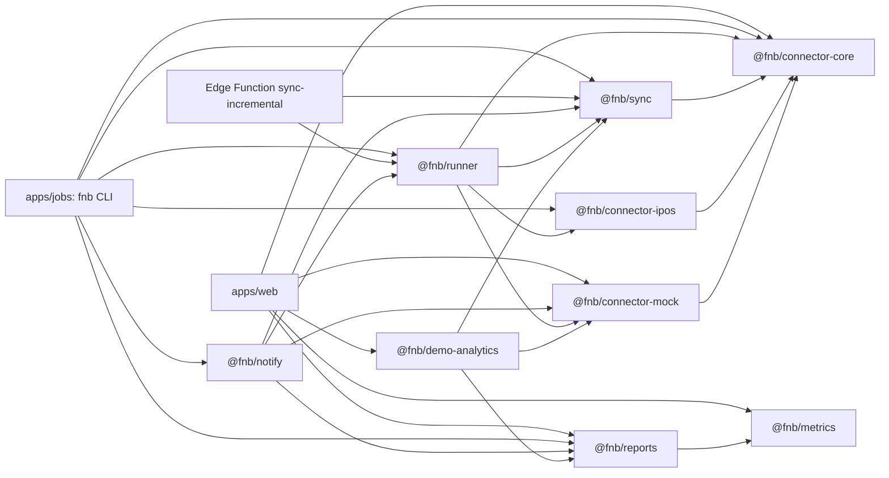

# Development guide

Purpose and audience: how to set up a machine, run every check, change the code and the database safely, and hand the work on. It is written for a developer who takes the work over on another machine, and for reviewers and testers who need to run the same checks. What is built, what is verified and what comes next lives in [status.md](status.md); what the system must do is in [requirements.md](requirements.md) and how it is tested in [test-plan.md](test-plan.md); this guide says how to work on it.

Last updated 2026-11-12

## 1. Set up a machine

| Need | Version | Pinned in |
|---|---|---|
| Node.js | 22 or later | `.nvmrc` (22) and `engines` in `package.json` (`>=22`) |
| pnpm | 9 | `packageManager` (`pnpm@9.15.3`) and `engines` (`>=9`) in `package.json` |
| Docker | a current release with at least 8 GB of memory for the containers | runs the local Supabase stack |
| git | any current release | |
| Supabase CLI | 3.0.0 | the `supabase` devDependency (locked in `pnpm-lock.yaml`); run it as `pnpm exec supabase` so every machine uses the same version |
| Deno (optional) | 2.x; CI uses v2.7.3 | only to type-check the Edge Function locally |

First run:

```sh
git clone <repository URL> fnb-manager
cd fnb-manager
pnpm install
pnpm db:start
cp .env.example .env
pnpm db:status
```

1. `pnpm db:start` runs `supabase start`. On a new machine the first start applies every migration and loads the synthetic seed.
2. Fill `.env`. It is gitignored; the names are in `.env.example` and their meaning in [secrets.md](secrets.md).
   - `SUPABASE_PUBLISHABLE_KEY` and `SUPABASE_SECRET_KEY`: the local keys that `pnpm db:status` prints.
   - `DATABASE_URL`: `.env.example` already points it at the local database on port 54322.
   - `POS_ACCOUNTS_JSON`: without POS credentials, use a synthetic account, for example `[{"key":"account-1","connector":"mock","seed":1}]` (optional `storeCount` 1 to 5). A real `ipos-fabi` entry also needs `IPOS_APP_KEY`. Real credentials come from the owner through a private channel, never through the repository.
3. Web app: `cp apps/web/.env.example apps/web/.env.local`, set `VITE_SUPABASE_URL` to the local API (`http://127.0.0.1:54321`) and `VITE_SUPABASE_PUBLISHABLE_KEY` to the publishable key from `pnpm db:status`, then run `pnpm --filter @fnb/web dev` and open `http://localhost:5173`. Sign in with the seeded development login `dev@example.com`; its password is the constant at the top of `supabase/seed.sql`. With either value empty the dev server runs the demo instead.
4. Check the machine with `pnpm lint`, `pnpm typecheck`, `pnpm test` and `pnpm exec supabase test db`.

To work with synthetic data through the CLI, the same steps the CLI integration test runs work on any stack: `fnb tenant create`, then `fnb onboard` and `fnb sync window … --kind backfill` with a `mock` account (see [sync.md](sync.md#cli-reference) for the options). Give such a tenant a slug that starts with `demo-`: the Postgres parity run refuses any database that holds another kind of tenant.

### The local stack

Ports come from `supabase/config.toml` (`project_id = "FNB_Managment"`) and the web configuration.

| Service | Address | Notes |
|---|---|---|
| API gateway (REST, Auth, Edge Functions) | `http://127.0.0.1:54321` | exposes the schemas `public` and `graphql_public`; `max_rows = 1000` |
| Database | `127.0.0.1:54322` | PostgreSQL 17; the `DATABASE_URL` of `.env.example` |
| Studio | `http://127.0.0.1:54323` | |
| Mail catcher | `http://127.0.0.1:54324` | receives every local auth e-mail (password resets, invitations) |
| Analytics | `127.0.0.1:54327` | |
| Shadow database | `127.0.0.1:54320` | used by `supabase db diff` only |
| Pooler | `54329` | disabled locally |
| Web dev server | `http://localhost:5173` | Vite; the local auth allow-list holds `http://127.0.0.1:5173` and `http://localhost:5173` |
| `vite preview` | `4173` | the Lighthouse recipe in [apps/web/README.md](../apps/web/README.md) |
| Playwright servers | live `5191`, demo `5192`, pages `5193` | each plus `E2E_PORT_OFFSET` |
| Notification mock providers | `127.0.0.1:8787` | `node packages/notify/scripts/mock-providers.mjs` (phase 12, in build) |

Local auth has sign-up turned off (`enable_signup = false`) and e-mail confirmations off. Logins are created with `fnb tenant add-member`, or by the seed.

### Rules on a machine that holds real data

The build machine's local stack holds a real tenant loaded with `fnb`. On such a machine:

- Never run `pnpm db:reset` or `supabase db reset`. A reset reapplies every migration and the seed and wipes everything else, including the real tenant.
- Never run `supabase stop --no-backup`. It deletes the data volumes. `pnpm db:stop` stops the containers and keeps the data.
- Apply new migrations with `pnpm exec supabase migration up`.
- Run the CLI with `CI=1` whenever its output is shared; it then numbers accounts and stores instead of naming them.
- Never print or copy credential values from `.env` or `apps/web/.env.local`.

## 2. Repository layout

| Path | What it holds | Read more |
|---|---|---|
| `apps/web` | `@fnb/web`: the React single-page app for managers (Vite, Tailwind CSS, ECharts), deployed to GitHub Pages; a build without Supabase variables is the demo | [apps/web/README.md](../apps/web/README.md), [web-app.md](web-app.md) |
| `apps/jobs` | `@fnb/jobs`: the `fnb` CLI for tenants, onboarding, sync, status, doctor, digests and notifications | [apps/jobs/README.md](../apps/jobs/README.md) |
| `packages/core` | canonical POS-agnostic model and shared business rules | [README](../packages/core/README.md) |
| `packages/connector-core` | the `PosConnector` contract, registry, errors and conformance suite | [README](../packages/connector-core/README.md) |
| `packages/connector-mock` | seeded synthetic connector for tests, demos and end-to-end runs | [README](../packages/connector-mock/README.md) |
| `packages/connector-ipos` | the iPOS Fabi connector | [README](../packages/connector-ipos/README.md) |
| `packages/sync` | the sync engine and its in-memory and Postgres repositories | [README](../packages/sync/README.md) |
| `packages/runner` | what the CLI and the Edge Function share around the engine | [README](../packages/runner/README.md) |
| `packages/metrics` | the typed metric registry mirrored from [metrics.md](metrics.md) | [README](../packages/metrics/README.md) |
| `packages/reports` | the periodic report models and the typed contract of the report SQL functions | [README](../packages/reports/README.md) |
| `packages/demo-analytics` | the demo's TypeScript port of the report SQL functions, held to the SQL by a parity suite | [README](../packages/demo-analytics/README.md) |
| `packages/notify` | notifications: channels, templates, the outbox dispatcher, digests (phase 12, in build; no README yet) | [status.md](status.md) |
| `supabase/migrations` | 28 migrations on 2026-11-12 | [schema.md](schema.md) |
| `supabase/tests` | 31 pgTAP files on 2026-11-12 | [schema.md](schema.md#tests) |
| `supabase/seed.sql` | the synthetic seed | section 5 |
| `supabase/functions/sync-incremental` | the Edge Function runner (Deno) | [sync.md](sync.md) |
| `scripts` | `check-public-safe.mjs`, `function-imports.mjs`, `cron-delay-report.mjs`, `check-api-docs.mjs` | sections 3 and 6 |
| `.github/workflows` | CI, deployments and scheduled jobs (10 files) | section 7 |
| `docs` | roadmap, status, decisions, schema, sync, web app, metrics, secrets, go-live, connectors, reports and deep dives; the documentation set of 2026-11-12: [plan.md](plan.md), [requirements.md](requirements.md), [test-plan.md](test-plan.md), [architecture.md](architecture.md), [security.md](security.md), [api.md](api.md), [operations.md](operations.md), this guide, [user-guide.md](user-guide.md) and [glossary.md](glossary.md); `docs/private/` is gitignored | [roadmap.md](roadmap.md) |

Runtime dependencies between the workspace packages (an arrow reads "uses"). Every box except `@fnb/metrics` and the Edge Function also uses `@fnb/core` directly; those arrows are left out, and so are development-only dependencies.



How a number travels: a connector reads the POS; the sync engine writes canonical sales and a `sync_checks` row per store-day (the POS's own daily totals against the stored ones); the analytics refresh fills the `agg_*` tables; the report SQL functions compute every report number; the web app calls them with `supabase.rpc()` as the signed-in member, so row-level security applies. The demo runs a TypeScript port of the same functions over generated days (ADR-029 in [decisions.md](decisions.md)).

## 3. Everyday commands

Run everything from the repository root.

| What | Command | Notes |
|---|---|---|
| Every check before a push | `pnpm verify` | `scripts/verify.sh` runs, in order and stopping at the first failure, every check of [plan.md](plan.md) section 2.4 that the build machine allows: lint, typecheck, unit tests, the import map and Deno checks, the API reference, pgTAP, the OpenAPI description, the web build, every end-to-end project, gitleaks and the public-safety scan. It needs the local stack running and never resets it. Set `E2E_PORT_OFFSET` when another run uses the default ports |
| Install | `pnpm install` | CI uses `pnpm install --frozen-lockfile` |
| Lint | `pnpm lint` | `biome check .`; Markdown is not linted |
| Format | `pnpm format` | `biome format --write .`; `pnpm exec biome check --write .` also applies safe lint fixes and sorts imports |
| Typecheck | `pnpm typecheck` | `tsc --noEmit` in every package, sources and tests |
| Unit tests, as CI runs them | `pnpm test` | `vitest run` in every package; the gated suites below skip |
| Unit tests on a shared machine | `pnpm -r --workspace-concurrency=1 --if-present run test --maxWorkers=2` | one package at a time, two workers each |
| One package | `pnpm --filter @fnb/reports run test --maxWorkers=2` | |
| One folder or file | `pnpm --filter @fnb/reports exec vitest run test/unit/reports/day --maxWorkers=2` | |
| pgTAP | `pnpm exec supabase test db` | every file in `supabase/tests`; it also takes file or directory paths (`pnpm exec supabase test db --help`) |
| Parity on PGlite | part of `pnpm test` in `@fnb/demo-analytics` | runs every migration in PGlite |
| Parity on Postgres | `DATABASE_URL=<local database URL> pnpm --filter @fnb/demo-analytics test:parity:postgres` | refuses a database that holds a tenant whose slug does not start with `demo-` or `parity-`; CI runs it on a fresh stack |
| Playwright, once | `pnpm --filter @fnb/web e2e:install` | installs the Chromium build Playwright needs |
| Playwright, one spec | `E2E_PORT_OFFSET=10 pnpm --filter @fnb/web exec playwright test --project=demo e2e/demo/report-day.spec.ts` | `--project` starts only that project's server |
| Playwright, everything | `pnpm --filter @fnb/web test:e2e` | 74 tests in 10 files (listed on 2026-11-14), one worker; long, so prefer one spec on a shared machine |
| User-guide screenshots | `pnpm --filter @fnb/web docs:screenshots` | takes every screenshot of [user-guide.md](user-guide.md) from the demo at a fixed clock into `docs/user-guide/`, and the sign-in screens from a build pointed at an unreachable backend, so no real data can appear; retake them whenever a screen changes |
| Build every package | `pnpm build` | `tsc -p tsconfig.build.json` into each `dist/` (gitignored), plus the web build; packages are consumed as TypeScript source, so nothing needs building to run |
| Web build | `pnpm --filter @fnb/web build` | `vite build`, then `scripts/check-bundle.mjs` and `scripts/check-size.mjs` |
| Pages demo build | `VITE_BASE_PATH=/fnb-manager/ VITE_SUPABASE_URL= VITE_SUPABASE_PUBLISHABLE_KEY= pnpm --filter @fnb/web build` | empty variables in the environment win over `apps/web/.env.local`; rebuild the default `dist` afterwards |
| Design tokens | `pnpm --filter @fnb/design-tokens build` | regenerates `tokens.css` and `palette.ts` in `packages/design-tokens/src/generated/` from the DTCG files in `packages/design-tokens/tokens/`; commit both; the package's tests fail while they are stale ([design-system.md](design-system.md)) |
| Edge Function import map | `node scripts/function-imports.mjs` | writes `supabase/functions/sync-incremental/deno.json`; `--check` only reports |
| Edge Function type-check | `deno check index.ts` in `supabase/functions/sync-incremental` | as CI does |
| Public-safety scan | `node scripts/check-public-safe.mjs` | prints `public-safe scan: no findings` and exits 0 when clean |
| API reference check | `DATABASE_URL=<local database URL> pnpm docs:check-api` | compares [api.md](api.md) with the functions in `public` that `authenticated` may execute, in a read-only transaction; without `DATABASE_URL` it reads the local container read-only. Exit 0 in step, 1 out of step, 2 on a usage or connection error |
| OpenAPI description | `pnpm docs:openapi` | regenerates `docs/api/openapi.json` from the local stack as the role `authenticated`; `pnpm docs:check-openapi` only reports; see [api.md](api.md) section 8 |
| API in Swagger UI | `pnpm docs:api` | serves `docs/api` at `http://127.0.0.1:5290` |
| Secret scan, as CI | `docker run --rm -v "$PWD:/repo" ghcr.io/gitleaks/gitleaks:v8.30.1 git /repo --redact --exit-code 1` | |
| The CLI | `pnpm --filter @fnb/jobs fnb -- --help` | `CI=1 pnpm --filter @fnb/jobs fnb -- status` for shareable output |

`pnpm test -- --maxWorkers=2` does not limit the workers: pnpm passes the `--` on, and Vitest 5.1 ignores every argument after `--`. Use the `run test --maxWorkers=2` forms above.

### Gated suites

These suites skip unless their variables are set. They read the shell environment; only the iPOS live suite loads the repository's `.env` itself. Pass the variables on the command line, for example `DATABASE_URL=<local database URL> pnpm --filter @fnb/sync test`.

| Suite | Gate | Command |
|---|---|---|
| Sync Postgres repository (`packages/sync/test/integration`) | `DATABASE_URL` | `pnpm --filter @fnb/sync test` |
| CLI on the local stack (`apps/jobs/test/integration/local-stack.test.ts`) | `DATABASE_URL`; one test also `SUPABASE_URL` and `SUPABASE_SECRET_KEY` | `pnpm --filter @fnb/jobs test` |
| Notifications (`packages/notify/test/integration`, `apps/jobs/test/integration/notify-cli.test.ts`) | `NOTIFY_INTEGRATION=1` and `DATABASE_URL`; fixture tenants `notify-it-…` and synthetic `_IT` secrets | `pnpm --filter @fnb/notify test:integration` |
| Reports live check, read-only | `DATABASE_URL`; `LIVE_TENANT` (default `live-local`), `LIVE_SEED` (default 20261108) | `pnpm --filter @fnb/reports test:live` (the script sets `LIVE=1`) |
| Digest equals Ngày, live | `DATABASE_URL` | `pnpm --filter @fnb/notify test:live` (the script sets `LIVE=1`) |
| iPOS live | `POS_ACCOUNTS_JSON` with an application key, from `.env` | `pnpm --filter @fnb/connector-ipos test:live`; prints counts and timings only |

The sync and CLI integration tests create their own tenants (slugs starting `it-`) and delete them at the end.

### Before you hand work over

```sh
pnpm lint
pnpm typecheck
pnpm test
pnpm exec supabase test db
node scripts/function-imports.mjs --check
pnpm --filter @fnb/web build
pnpm docs:check-api
node scripts/check-public-safe.mjs
CI=1 pnpm --filter @fnb/jobs fnb -- status
```

CI adds the Postgres parity run and the web end-to-end suite on a freshly reset stack. CI does not run the web build with its bundle and size checks (the end-to-end `pages` project builds with plain `vite build`); only `deploy-web.yml` runs it, on `main`, so run it yourself before handing over. CI does not run `pnpm docs:check-api` either (request R-AP01). Every phase so far was closed the same way: build, an independent review, fixes, then an independent verification that reruns what CI runs plus checks against real data on the local stack ([status.md](status.md)).

## 4. Conventions

### Code

- TypeScript everywhere (ADR-002). `tsconfig.base.json` sets `strict`, `noUncheckedIndexedAccess`, `exactOptionalPropertyTypes`, `verbatimModuleSyntax` and `NodeNext` modules; relative imports end in `.js`.
- Packages export their TypeScript source (`exports` points at `./src/index.ts`). The CLI runs it through tsx (`apps/jobs/bin/fnb.mjs`), the web app bundles it with Vite, and the Edge Function reaches the same files through its generated import map.
- Biome 2.6.6: tabs, double quotes, the recommended rules, sorted imports.
- No comments in code. Names, small functions and test titles carry the explanation; the reasoning goes into the commit message, the pull request or the docs. Only comments a machine reads (pragmas, generated files) are allowed.
- Inputs from outside (POS responses, environment variables, RPC rows) are parsed with zod schemas at the edge.
- SQL: every function sets `search_path = ''` and qualifies every name (`app.data_roles` is the one exception today; request R-T01 in [plan.md, section 8.1](plan.md#81-open-correction-requests)); read functions are `stable` and `security invoker`; argument checks raise SQLSTATE `22023` with a plain message; `revoke` from `public` and `anon`, then `grant execute` to `authenticated` and `service_role` only where the browser or a job needs it; internal helpers live in the schema `app`, which the API does not expose.

### Words

- English in code, docs and commit messages. The app speaks Vietnamese by default, with English as the alternative.
- Every user-visible string goes through `t()` with a key in `apps/web/src/i18n/messages/<area>.vi.json` and `<area>.en.json`. Tests fail on a missing or misplaced key, a key in two files, JSX text that bypasses `t()`, and a report key without a translation.
- Vietnamese follows the metric registry's spelling with full diacritics: "hóa đơn", "hủy", "tùy" (not "hoá", "huỷ", "tuỳ").
- No assistant-product or vendor names in code, docs, commits or pull requests. Describe people by role: builder, reviewer, verifier, owner. The strategy step runs in "the owner's own assistant" (ADR-003).
- Absolute dates in docs (2026-11-12, never "today").

### Public repository

- The repository is public. No shop or brand names, account e-mails, chat ids, tokens, keys, passwords or revenue figures in any tracked file, fixture or log. In docs, say "the tea shop" and "the coffee shop".
- Fixtures are synthetic (ADR-009); recorded vendor responses are never committed. Use `example.com` addresses and synthetic UUIDs whose first eight characters repeat one hex digit (`11111111-…`), which the scanners accept.
- Account keys in `POS_ACCOUNTS_JSON` are neutral (`account-1`); output in CI numbers accounts and stores.
- Shop-specific material lives in `docs/private/` (gitignored) and never moves into a tracked file.
- Run `node scripts/check-public-safe.mjs` before every hand-over. It checks generic patterns and, when the file exists, every entry of `docs/private/identifiers.txt`. CI runs it and gitleaks on every push and pull request.

## 5. Database workflow

### Change the schema

1. `pnpm exec supabase migration new <snake_case_name>` creates `supabase/migrations/<timestamp>_<name>.sql`. Do not edit a migration that has been applied anywhere; write a new one that alters or redefines.
2. Write the SQL by the conventions in section 4. A new `public` table gets row-level security, its policies and its grants in the same migration.
3. `pnpm exec supabase migration up` applies the pending migrations to the local database and keeps the data.
4. Add or extend pgTAP files. A new `public` table also changes `01_schema.sql` and the table count in `03_rls_enabled.sql` (52 tables on 2026-11-12); new grants change the access tests.
5. Run `pnpm exec supabase test db`.
6. If a function in `public` or its grants changed, run `pnpm docs:check-api` and update [api.md](api.md) until it passes.
7. Describe the change in [schema.md](schema.md).
8. If the change touches a function that `@fnb/demo-analytics` ports (the 16 report functions, their `app` helpers, `metric_value`), change the port too and run the parity suite.
9. On `main`, `migrate.yml` applies the migrations to the cloud project with `supabase db push`; pull requests from this repository get a dry run. It skips with a note until `SUPABASE_PROJECT_ID` exists.

### The seed

- `supabase/seed.sql` is synthetic: the tenant `demo-fnb` ("Demo F&B") with the stores `TEA` and `COF`, the development login `dev@example.com` as owner, seven business days of sales per store before the reset date, sync runs and checks with one deliberately unmatched day, a promotion, monthly targets, item costs and payment fee rates.
- Its dates are relative to `current_date` at reset time, so on a long-lived stack the seeded days age.
- It runs on every `supabase db reset`; CI resets before the database and end-to-end jobs.
- Seed synthetic rows only: no real names, accounts or amounts.
- Tests that count rows scope the count to the demo tenant or to their own fixture tenants, so another tenant on the same stack does not change the outcome.

### pgTAP files

- Files are `supabase/tests/NN_<area>.sql`, two-digit numbers from `01` to `31` on 2026-11-12, grouped roughly by phase ([schema.md](schema.md#tests) describes each). A new area takes the next free number; agree it with anyone adding tests at the same time.
- Every file opens with `begin;` and `select plan(<n>);` with the exact number of tests, and ends with `select * from finish();` and `rollback;`. Fixture tenants, users and rows are created inside that transaction.
- The notification files use tenants named `notify-it-pgtap-…`, secret names ending in `_IT`, and a tenant filter on every scanning function.
- Anchor dates on the seeded data, not on today. `15_analytics_queries.sql` to `17_analytics_access.sql` take the demo tenant's newest invoice date plus one day: `select max(business_date) + 1 from public.invoices where tenant_id = '11111111-1111-4111-8111-111111111111'`. A test that compares seeded rows with `current_date` passes on a fresh stack, as in CI, and fails days later on a long-lived one. The live Playwright specs follow the same rule: they fix the browser clock just after the newest seeded date (`clockAfterSeed` in `apps/web/e2e/support/local-stack.ts`).

## 6. Recipes

### Add a POS connector

The contract, the capability matrix and the conformance options are in [connectors.md](connectors.md#writing-a-connector).

1. Create `packages/connector-<vendor>` that depends on `@fnb/core`, `@fnb/connector-core` and `zod` only. Keep the vendor client (response schemas, typed errors, pagination) apart from the adapter.
2. Implement `PosConnector`: `describe()` with a complete capability map and a credentials schema that rejects `{}`; methods behind a capability declared `false` throw `ConnectorCapabilityError` (`assertCapability` does this). Keep every vendor row in `raw`, emit `DataQualityFlag`s instead of guessing, and export a `ConnectorFactory` (`{ id, create(options) }`).
3. Test with synthetic fixtures and run the conformance suite from `@fnb/connector-core/conformance` (`runConnectorConformanceSuite`), as `packages/connector-mock/test/unit/conformance.test.ts` and `packages/connector-ipos/test/unit/connector-conformance.test.ts` do. Live checks are opt-in (`LIVE=1`) and print counts only.
4. Wire it into the runners in `@fnb/runner`: an entry schema in the `accountEntrySchema` union (`packages/runner/src/accounts.ts`), credential fields in `CREDENTIAL_FIELDS` so they are masked and redacted, the factory in `createConnectorRegistry`, the entry-to-credentials mapping in `credentialsFor` and any transport options in `connectAccount` (`packages/runner/src/connectors.ts`), and the package in `packages/runner/package.json`.
5. The Edge Function imports `@fnb/runner`, so run `node scripts/function-imports.mjs`. The path filter of `.github/workflows/deploy-functions.yml` lists the packages the function imports; the new package belongs there too.
6. `pos_accounts.connector` is free text, so the database needs no migration. Document the entry shape in [secrets.md](secrets.md) and the connector in [connectors.md](connectors.md) (capability matrix) and `docs/connectors/<vendor>.md`.

### Add a metric

1. Add a row to the right table of [metrics.md](metrics.md): id, Vietnamese and English labels, unit, formula, grain, direction, source, reports and status.
2. Add the same entry, in the same order, to `packages/metrics/src/metrics/<group>.ts`. `test/consistency/document.test.ts` fails when the registry and the document differ.
3. If the metric is available now with a store-day or store-period grain, `metricValueIds()` includes it and `public.metric_value` must compute it: redefine the function in a new migration with a `when '<id>' then` branch, extend `supabase/tests/18_metric_value.sql`, and add the id to the port in `packages/demo-analytics/src/functions/metric-value.ts`. `packages/metrics/test/consistency/metric-value.test.ts` reads the latest migration that defines `metric_value`, and the demo parity test compares its ids with `metricValueIds()`.
4. If the web app shows it, add the id to `registryMetricIds` in `apps/web/src/metrics/registry.ts` and its `metric.<id>.*` keys (label, formula, grain, convention) to `apps/web/src/i18n/messages/metrics.vi.json` and `metrics.en.json`; the labels must equal the registry's exactly.

### Add a report card

The phase 9 pattern: every number comes from SQL; TypeScript adds only what sits on top of SQL rows (changes, decomposition, like-for-like selection, rankings, sentences); the demo runs a parity-tested port. The report docs are in [reports/](reports/ngay.md) and the data path in [web-app.md](web-app.md#phase-9-decisions).

1. If the card needs a number no function returns, add or extend a report function in a new migration (`security invoker`, `stable`, `search_path = ''`, guards such as `app.require_store_ids`, `app.require_date_range` and `app.require_report_rows`, `grant execute` to `authenticated` and `service_role`), with pgTAP in `22_report_functions.sql` and `23_report_access.sql` or a new file.
2. Add its argument and row schemas to `packages/reports/src/contract/rows.ts` and an entry to `analyticsFunctions` in `contract/functions.ts`; `analyticsFunctionNames` follows.
3. Port it to `packages/demo-analytics/src/functions/` and add it to `handlers` in `src/source.ts`; a missing handler is a type error. Add a parity test under `test/parity/` that compares the port with the SQL over the parity datasets.
4. Write the card as a pure function from rows to a `CardModel` in `packages/reports/src/reports/<day|week|month|year>/cards/`; plan its calls in that report's `support.ts`, add it to `definition.ts` and its message keys to `keys.ts`; unit-test it in `packages/reports/test/unit/reports/<kind>/`.
5. Add the Vietnamese and English templates to `apps/web/src/i18n/messages/report-<day|week|month|year>.vi.json` and `.en.json`; `report-keys.test.ts` fails on a key the demo engine produces without a translation. List new sentences in [reports/cau-van-bao-cao.md](reports/cau-van-bao-cao.md) for the owner's wording review.
6. Extend the demo smoke test `packages/demo-analytics/test/reports/<kind>.smoke.test.ts` and the browser spec `apps/web/e2e/demo/report-<kind>.spec.ts` (the card count, CSV, print, axe at 360 px).
7. Update the card table in `docs/reports/<ngay|tuan|thang|nam>.md`, [schema.md](schema.md#report-functions-phase-9) for a new function and [metrics.md](metrics.md) for a new metric.

### Add a migration

Follow section 5. Before writing it, check [status.md](status.md) for work in progress that adds migrations at the same time.

### Add or move a file the Edge Function imports

`supabase/functions/sync-incremental` imports `@fnb/runner`, `@fnb/runner/postgres`, `@fnb/sync` and `@fnb/sync/postgres`, and through them `@fnb/core`, `@fnb/connector-core`, `@fnb/connector-ipos` and `@fnb/connector-mock`. Deno reads them through the generated `deno.json` import map: each workspace import maps to its source file, each relative `.js` import to its `.ts` file, and each npm package to `npm:<name>@<installed version>`.

1. After adding, renaming or moving a file in those packages, or adding an import to one, run `node scripts/function-imports.mjs` and keep the regenerated `supabase/functions/sync-incremental/deno.json` in the change.
2. CI runs `node scripts/function-imports.mjs --check` and `deno check index.ts` (Deno v2.7.3); `deploy-functions.yml` runs the check before every deploy.
3. The script refuses a subpath import of an npm package (`name/sub`) until it learns that import, and an npm package that resolves to two versions in different packages.
4. A push to `main` that touches those packages' `src/` redeploys the function (`deploy-functions.yml`).

### Add a CLI command

1. Write a `CommandSpec` in `apps/jobs/src/commands/<name>.ts`: `path` (for example `["sync", "window"]`), `summary`, `usage`, `options` (spread `HELP_OPTION`), `details` and `run(context, values)`, which returns the exit code: 0 success, 1 failure, 2 usage error (throw `UsageError`).
2. Add it to `COMMANDS` in `apps/jobs/src/commands/index.ts`; `fnb --help`, `fnb <command> --help` and `fnb help <command>` then list it.
3. Print through `context.output` (`line`, `error`, `table`), which redacts every collected secret and knows whether it runs in CI. In CI, name no shop: number accounts by their position in `POS_ACCOUNTS_JSON` and stores by position.
4. A new secret goes into `apps/jobs/src/config/secrets.ts` (`collectSecrets`), so `fnb mask-credentials` masks it on GitHub Actions and the redactor removes it from output.
5. Test it in `apps/jobs/test/unit/` with `runCli(argv, env, { streams, loadEnvFile: false })` and the `capture()` helper from `test/support/capture.ts`; a test against the local stack goes in `test/integration/` behind `DATABASE_URL`.
6. Document it in the CLI reference of [sync.md](sync.md#cli-reference) and what it needs in [secrets.md](secrets.md). A workflow that runs it sets secrets on that step only, never on the job.

## 7. CI and scheduled workflows

| Workflow | Runs on | What it checks or does |
|---|---|---|
| `ci.yml` (CI) | every push to `main` and every pull request | `secrets`: gitleaks v8.30.1 over the history and the public-safety scan. `code`: frozen install, `pnpm lint`, `pnpm typecheck`, `pnpm test`, the import-map check and `deno check` of `sync-incremental`. `database`: the Supabase stack with most services left out, `supabase db reset`, `supabase test db`, parity on Postgres. `e2e`: Chromium, the stack with the mail catcher, `db reset`, `apps/web/.env.local` written from `supabase status -o env`, then `test:e2e` (30-minute limit) |
| `deploy-web.yml` | push to `main` touching `apps/web/**`, `packages/**` or the workflow; manual | builds the web app (a live build when the repository variables `SUPABASE_URL` and `SUPABASE_PUBLISHABLE_KEY` exist, the demo otherwise) under the Pages base path and deploys it to GitHub Pages |
| `migrate.yml` | push to `main` touching `supabase/migrations/**` or `supabase/config.toml`; pull requests from this repository touching migrations; manual | `supabase db push --dry-run` on pull requests, `supabase db push` on `main`; skips until `SUPABASE_PROJECT_ID` exists |
| `deploy-functions.yml` | push to `main` touching the function, `supabase/config.toml`, the `src/` of the packages it imports or `scripts/function-imports.mjs`; manual | import-map check, then `supabase functions deploy sync-incremental`; skips until `SUPABASE_PROJECT_ID` and `SUPABASE_ACCESS_TOKEN` exist |
| `sync.yml` (Sync) | 03:23 Asia/Ho_Chi_Minh every night; manual with account number, dates, kind and dry run | the nightly window (14 business dates ending yesterday) or the dispatched one, then `fnb digest --due`, `fnb notify tick` and `fnb status`; skips until `SUPABASE_DB_URL` and `POS_ACCOUNTS_JSON` exist |
| `notify.yml` (Notify) | 06:07, 07:07 and 08:07 Asia/Ho_Chi_Minh; manual | `fnb notify tick --skip-if-scheduler-healthy --budget-seconds 300` (phase 12, in build); skips until `SUPABASE_DB_URL` exists |
| `backup.yml` | Sunday 19:23 UTC (Monday 02:23 in Vietnam); manual | `supabase db dump` of schema, data, roles and auth, encrypted with `age` and copied to S3-compatible storage; skips until configured |
| `cron-probe-peak.yml`, `cron-probe-offpeak.yml` | minutes 0 and 30, and 7 and 37, of every hour (UTC) | record when each scheduled run actually started; `node scripts/cron-delay-report.mjs` reads them through `gh api` |
| `workflows-active.yml` | Monday 02:17 UTC (09:17 in Vietnam); manual | re-enables scheduled workflows that GitHub disabled for inactivity |

The workflow secrets and variables are listed in [secrets.md](secrets.md). In `sync.yml` and `notify.yml` the secrets are set only on the steps that need them, never on the job, and the first `fnb` step (`fnb mask-credentials`) masks the credential fields before any other `fnb` output.

## 8. Deployment

- **Web app.** `deploy-web.yml` publishes to GitHub Pages under `/<repository>/` (`/fnb-manager/`). Without the two repository variables the build is the demo; with them it is the live app behind login. A new build makes the app offer "Có phiên bản mới — tải lại".
- **Database.** `migrate.yml` pushes the migrations to the linked Supabase project.
- **Edge Function.** `deploy-functions.yml` deploys `sync-incremental`. Its POS secrets and turning on its `pg_cron` schedule are owner steps.
- **Scheduled jobs.** The nightly sync, the notification ticks and the weekly backup run on GitHub Actions once their secrets exist.
- **State on 2026-11-12.** No cloud project exists yet: creating it, the GitHub secrets and variables, SMTP and the backup destination wait for the owner ([go-live.md](go-live.md) is the step-by-step list). The last push to `main` is commit `0f8fa1d` of 2026-11-08; everything after it, phase 9 included, is not committed yet, so a Pages deployment can only contain what `0f8fa1d` holds (Hôm nay, with "Sắp có" under Báo cáo).

## 9. Troubleshooting

### Docker stopped or the stack is down

- Symptoms: `pnpm db:start` or `pnpm db:status` cannot reach Docker; CLI commands or tests fail to connect to `127.0.0.1:54322`; the local web app shows "Không tải được dữ liệu. Thử lại sau."
- Fix: start Docker, then `pnpm db:start` (it restarts the existing containers and keeps the data) and `pnpm db:status`. Never reset to "fix" a stack that holds real data.

### Port collisions

- The stack's ports (54320 to 54329) are fixed in `supabase/config.toml` and assumed elsewhere: CI connects to 54322 and the live end-to-end helpers read the mail catcher on 54324. Stop whatever else holds them (for example another local Supabase project) instead of changing them.
- Vite moves to the next free port when 5173 is taken. The app still works, but local password-reset links return only to `127.0.0.1:5173` or `localhost:5173`.
- The Playwright servers start with `--strictPort` and never reuse a running server, so a second run on the same ports fails. Give each parallel run its own `E2E_PORT_OFFSET`; it also separates the Pages build folder and the results folder.

### Date drift

- The seed's dates follow its reset date; on a stack reset days ago, "yesterday" in the seed is not yesterday. Tests must anchor on the seeded data (section 5). If a pgTAP test fails only on a long-lived stack, look for `current_date` compared with seeded rows.
- Reports end at the last complete business day of the selected stores, in each store's time zone and day start; Hôm nay owns the running day. A report never shows today.
- The demo anchors its generated data to today in Asia/Ho_Chi_Minh, so its numbers move with the calendar.

### The machine sleeps during a long run

- Sleep pauses Docker and the network. A backfill, a pgTAP run or an end-to-end run then fails on timeouts.
- Keep the machine on power with the lid open, and prefix long commands with `caffeinate -i` on macOS, which stops idle sleep while the command runs.
- After waking, check `pnpm db:status` and run the interrupted command again. Re-running a sync window is safe: unchanged sales are skipped, and a run that failed part-way left its earlier store-days committed.

### The 1,000-row limit

- The Data API returns at most 1,000 rows per request (`max_rows = 1000` locally, the same as the cloud default).
- The web app pages fact tables with keyset pagination on keys that survive a re-sync, and small tables with `.range()` and a stable order (`apps/web/src/data/`).
- The report functions refuse a result above 900 rows with SQLSTATE `22023` and the hint "Ask for fewer stores, a shorter range or a coarser grain."; the card then asks for fewer stores or a shorter period. `createRpcAnalyticsSource` also treats a response of 1,000 rows or more as possibly truncated (`possible_truncation`) and fails instead of showing partial numbers.

### Other checks that fail

- **Integration tests skipped.** The tests read the shell environment, not `.env`; set `DATABASE_URL` (and `NOTIFY_INTEGRATION=1` for notifications) on the command line.
- **Postgres parity refuses.** The database holds a tenant whose slug does not start with `demo-` or `parity-`. Run it in CI or on a stack without real data; the PGlite parity inside `pnpm test` runs anywhere.
- **Import map out of date.** Run `node scripts/function-imports.mjs` and keep the regenerated `deno.json`.
- **Web size check.** The initial JavaScript must stay at or under 400 kB gzipped, and each lazy pattern in `apps/web/scripts/lazy-chunks.mjs` must match a chunk; load new heavy code through a dynamic import.
- **Bundle check.** `dist` must hold no e-mail address, non-synthetic UUID, JWT, `sb_secret_` key or 32-hex string; a live build allows only its own publishable key and Supabase URL.
- **Public-safety scan finds something.** Replace the value with a synthetic one or a placeholder; never allow-list a real identifier.

## 10. Continuing on another machine

[status.md](status.md#picking-the-work-up-on-another-machine) has the steps. In short: install the tools of section 1, clone, `pnpm install` and `pnpm db:start`; copy `.env` and the whole `docs/private/` folder from the old machine through a private channel, never through the repository; write `apps/web/.env.local`; reload real data with `fnb tenant create`, `fnb tenant add-member`, `fnb onboard` and `fnb sync window … --kind backfill` month by month; then confirm with the checks of section 3. Before measuring the database size after heavy local testing, run `vacuum (full, analyze)` on the fact tables, as [status.md](status.md) describes.
