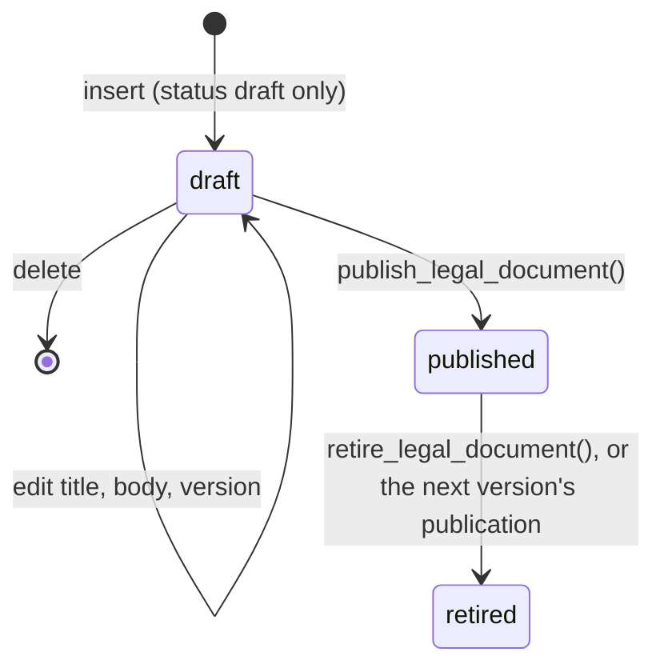

# Manual data

What the owner types in because the POS does not know it: item costs, monthly targets and payment fees. All three live on one settings page, **Cài đặt → Dữ liệu nhập tay** (`#/cai-dat/du-lieu-nhap-tay`), with one tab each:

| Tab | Route | Table | State |
|---|---|---|---|
| Giá vốn (item costs) | `?tab=gia-von`, the default | `item_costs` | built (#161) |
| Mục tiêu (targets) | `?tab=muc-tieu` | `targets` | a placeholder until #163 |
| Phí thanh toán (payment fees) | `?tab=phi` | `payment_fee_rates` | a placeholder until #163 |

The page is `apps/web/src/pages/settings/du-lieu-nhap-tay-page.tsx`. Its tabs are declared once in `MANUAL_TABS`, and each tab is a component of `TAB_SECTIONS`, so a new tab replaces its placeholder entry and nothing else. An unknown `tab` opens Giá vốn. The reports link here: the margin card's "Nhập giá vốn" to `?tab=gia-von`, Tháng's "Đặt mục tiêu tháng" to `?tab=muc-tieu`, the fee estimate's link to `?tab=phi`.

The business's legal texts are typed in too, on their own page, **Cài đặt → Pháp lý** (`#/cai-dat/phap-ly`): see [Legal documents](#legal-documents-settings--pháp-lý).

How the pages read and write is in [settings.md](settings.md): `ManualSettingsSource`, `useSettingsMutation` and the error codes. The tables and their policies are in [schema.md](schema.md#item_costs), with the write rules of every table under [who can write what](schema.md#who-can-write-what).

## Item costs

### What a cost row is

A row of `item_costs` holds the cost of one unit of one item, from one date on, for one scope:

- **Scope.** `store_id` null is a cost for every store of the business ("Tất cả cửa hàng"); a store id is that store's own cost. Both may exist for the same item and date; they are two rows (the key is `tenant_id, store_id, item_external_id, effective_from` with nulls not distinct).
- **Item.** `item_external_id`, the item key the sales lines carry. A cost is not tied to a POS account, so an item code shared by two accounts shares its cost.
- **Date.** `effective_from`, the first business date the cost applies to. It applies until the next row of the same scope and item starts.

### Which cost a day gets

The thematic reports (Thực đơn's `item_margins` and `menu_engineering`) cost each store-day on its own business date (decision D15 of the phase 10 build spec; [metrics.md](metrics.md#menu)). Phase 8's `menu_matrix` is the exception: it applies the one cost in force on its as-of date to its whole window, and no page of phase 10 calls it. For a store-day the thematic reports take:

1. the store's own row in force on that date (the latest `effective_from` on or before it), if there is one;
2. otherwise the row for all stores in force on that date;
3. otherwise the day has no cost, and the margin leaves it out (`cost_coverage` says how much revenue the margin rests on).

So a store's own cost wins over the cost for all stores from its own date, whichever started later, and a change never rewrites the days before its date; it does rewrite the past days from its date on, which is why the tab names them. Costs are read when a report is asked for, so a saved cost needs no catch-up.

### The Giá vốn tab

- **Áp dụng cho.** "Tất cả cửa hàng" or one of the stores the member sees. Owners and managers who see every store open on "Tất cả cửa hàng"; a manager or owner limited to some stores opens on the first of them. The choice is locked while changes are unsaved ("Lưu hoặc hủy các thay đổi trước khi đổi phạm vi.").
- **The list.** First the items sold over the last 90 days that end on the last complete day (`item_summary` over the scope's stores), by revenue; then the rest of the catalogue of the scope's POS accounts, active items first, then by name; modifiers are never listed; last, items that only have a cost in this scope (an item gone from the catalogue keeps its cost and can be deleted). For a store, only its own POS account's catalogue is listed. While the 90 days load the list waits; if they fail, the list comes in name order with a "Thử lại". The list shows 25 items at a time ("Xem thêm 25 món"). **Tìm món** filters by name, size, item code or category, Vietnamese marks optional.
- **Each item** shows its size, category, list price and 90-day revenue, then today's cost in the scope with its date and its share of the list price, and the audit line of that row. Today is the store's local date, or the business's for "Tất cả cửa hàng". In a store whose own cost has not started, today's cost is the one for all stores, marked "theo Tất cả cửa hàng".
- **A new cost.** "Giá vốn mới" (`MoneyField`: whole đồng, the numeric keyboard, `50.000` after leaving the field) and "Áp dụng từ ngày", always shown:
  - an item without a row in the scope and, for a store, without a cost for all stores defaults to **01/01/2023**, the first date the app accepts, with "Áp dụng cho toàn bộ lịch sử bán." A cost saved today then shows on every range at once; dated today it would show nothing until tomorrow, because ranges end on the last complete day;
  - an item with a row in the scope defaults to **today**, with "Từ ngày này trở đi; các ngày trước giữ giá vốn cũ.";
  - in a store, an item that only has a cost for all stores also defaults to **today**, with "Từ ngày này trở đi; các ngày trước giữ giá vốn chung.", so a store's first own cost never rewrites its history by surprise. Picking an earlier date says "Thay giá vốn chung ở cửa hàng này từ ngày này trở đi, kể cả các ngày đã qua.": those past days of this store then use the store's cost (`dateHintOf` in `src/settings/manual/costs.ts`);
  - when a later row of the scope exists, the hint names the last day the new cost covers ("… đến hết 31/05/2026 …"), since the later row takes over from its own date;
  - a date that already has a row says "Thay giá vốn đang có từ đúng ngày này.": saving updates that row (one upsert on the key); any other date adds a row.
- **Checks before a save.** The limits come from the phase 10 build spec and are enforced in the app today: a cost from 0 to 100,000,000 ₫ in whole đồng (`itemCost` in `src/settings/validation.ts`) and a date from 01/01/2023 to the end of next year. `item_costs.cost_amount` is `numeric(14,2)` without a check of its own; a database check follows with the CSV import (#162). A negative cost reads "Nhập giá trị từ 0 ₫ trở lên.", a fraction of a đồng (`25000,5`, `8333.33`) "Nhập số tiền chẵn đồng, không có phần lẻ." and is never rounded; a changed date without a cost asks for the cost. Lưu stays unavailable until every unsaved row passes.
- **Unsaved rows stay in view.** An item with a typed cost or a changed date counts as unsaved: it locks the scope, and it stays on the list whatever the search or the page of 25 ("Kèm n món có thay đổi chưa lưu…"), so a blocked Lưu always shows why.
- **Saving** sends every typed cost of the scope in one `saveItemCosts` call, one statement, so all are saved or none. The saved rows replace the cached list at once, the typed fields empty, and `useSettingsMutation` drops the tenant's cached analytics: Thực đơn's margin card and matrix use the new costs the next time they show, an in-app navigation back to a page opened before the save included. After a lost connection, "Thử lại" sends the same rows again.
- **History.** "Lịch sử giá vốn (n)" opens the rows of the scope, newest first, with the one in force marked "đang áp dụng" and each row's audit line. "Xóa" deletes a row at once and says so ("Đã xóa giá vốn từ … của …."); the days it covered fall back to the earlier row, or to the cost for all stores. A refused delete says so in its own words ("Không xóa được: …"), and after a lost connection "Thử lại" sends it again.

### Who may change what

| Scope | May save and delete | Everyone else |
|---|---|---|
| Tất cả cửa hàng | owners and managers who see every store (`useSettingsAccess("manualData", null)`) | a store-limited owner or manager reads it with "chọn cửa hàng của bạn để nhập giá vốn riêng"; staff and viewers read it with `settings.manual.readOnly.role` |
| One store | owners and managers with that store in scope (`useSettingsAccess("manualData", storeId)`) | staff and viewers read it; other members do not see the store |

A read-only scope shows every value and the history, with no field, no "Xóa" and no save bar. Row-level security decides regardless (`can_manage_store_scope`, pgTAP 05 and 07), and the trigger stamps `created_by` and `updated_by` with the writer.

### In the demo

The demo starts without any cost, so Thực đơn's margin card asks for costs. A cost saved on the tab goes into the session's `DemoSettingsStore`, which the demo engine's `item_margins` and `menu_engineering` read, so the card lists the costed items at the next view; a reload starts again without costs.

## Legal documents (Settings → Pháp lý)

The business's legal texts, kept as numbered versions in `legal_documents` (migration `settings_writes_and_legal`, hardened by `settings_writes_hardening`; ADR-021). A version's text never changes once it is published, so `consent_records.policy_version` (phases 14 to 19) always points at the words a person saw and the dates they were in force. The platform writes no legal wording: the owner writes or commissions the texts and publishes them when they are ready (#12).

### Kinds and languages

| Kind (`legal_document_kind`) | On the page | Read later by |
|---|---|---|
| `privacy_notice` | Thông báo bảo mật | the Mini Apps, before any staff or customer data is processed (FR-CMP-17; phases 14a and 18a) |
| `data_protection_rules` | Quy định bảo vệ thông tin | the Mini Apps, next to the privacy notice (FR-CMP-17) |
| `mini_app_terms` | Điều khoản Mini App | the Mini Apps' terms popup (ADR-022) |
| `staff_notice` | Thông báo cho nhân viên | the staff Mini App (phase 14a) |
| `loyalty_consent_text` | Nội dung đồng ý tích điểm | the consent screen for the `loyalty` purpose (FR-CMP-01) |
| `marketing_consent_text` | Nội dung đồng ý nhận tin quảng cáo | the consent screen for the `marketing` purpose (FR-CMP-01) |

Each kind has one list per language, `vi` and `en`. At most one version of a kind and language is published at a time (`legal_documents_one_published_key`).

### Versions

- **The label** (`version`) is what a consent record stores. It starts with a lower-case letter or a digit and holds only lower-case letters, digits, dots and hyphens, at most 40 characters (`^[a-z0-9][a-z0-9.-]{0,39}$`), and is unique per tenant, kind and language.
- **The suggestion.** The editor proposes `<kind>-YYYY-MM` with hyphens and the month of the tenant's current day, such as `privacy-notice-2026-11`, and adds `.2`, `.3`, … when that label is taken in the list. The owner may type another label.
- **The text** is a title of 1 to 200 characters and a Markdown body of 1 to 100,000 characters. The page's preview reads headings (`#` to `######` and a space; a closing run of `#` is dropped only when a space precedes it, so `# C#` stays "C#"), paragraphs, `-`, `*` or `+` bullets, numbered lists (which run on across blank lines and keep their first number, so clause 3 after a paragraph stays 3), `**bold**`, `*italic*` or `_italic_`, `` `code` `` and links; a link opens only when it starts with `https://`, `http://` or `mailto:` (any other, such as `javascript:`, `data:` or `//host`, shows as plain text), and the text is never read as HTML. Any 100,000 characters read in linear time.
- **The skeleton.** "Tạo bản nháp từ khung" fills an empty body with six headings in the document's language and no legal wording: purpose, data collected, retention, people's rights and how to use them, contact, and processors and hosting abroad (from [the personal-data deep dive](deep-dives/vietnam-legal-requirements.md#1-personal-data-pdpl-2025-decree-3562025-decree-3302026)). It is the demo engine's `legalDraftSkeleton`, held equal by `web:settings/legal/legal-rules`.

### Publication and retirement

- **Drafts.** An owner with an unlimited scope inserts drafts and edits their title, body and label; a draft can be deleted. A row inserted with `status = 'published'` or a `published_at` is refused (`42501`), and so is a change to `status` or a date by hand (column grants).
- **Publishing.** `publish_legal_document(id)` checks the caller, retires the version in force of the same kind and language and publishes the draft, in one call and under one lock, with `published_at` and `retired_at` set to the database's `now()`. The browser never sends a date.
- **Retiring.** `retire_legal_document(id)` withdraws the version in force without a replacement; the kind and language then have no version in force until the next publication.
- **A change made elsewhere.** Publishing a version that is no longer a draft, or retiring one that is no longer in force, is refused with `22023`, as happens after another tab's change or a retry whose first answer was lost. The page then says the text was published or withdrawn elsewhere and reads the list again.
- **Frozen.** A published or retired version's title, body, label, kind and language never change (`55000`), it never moves back, and it is never deleted from the browser. The page shows no edit control on it, and a refused write says `settings.legal.frozen`.
- **Who.** Writing, publishing and retiring need an owner with an unlimited scope, because the texts also govern managers and staff (`R-FX09` in [requirements.md](requirements.md) records the difference from FR-SET-10's acceptance line). Every data member reads the texts; the page shows the others `settings.legal.readOnly`.

### In the demo

The demo store (`DemoSettingsStore`) keeps the same kinds, languages, label, length and lifecycle rules and starts with one draft Vietnamese privacy notice built from the skeleton. Its dates are the browser's clock at the moment of the write, and a reload starts again from that draft.

### Later

The consent ledger (`consent_records`) and data-subject requests are listed on their own page in phase 17a; the Pháp lý page names that slot. Showing the texts inside the Mini Apps belongs to phases 14a and 18a.

## Tests

| Test | What it proves |
|---|---|
| `web:settings/manual/costs` | the list order (sellers by revenue, the rest of the catalogue, cost-only items; no modifiers; one POS account per store), the search, the precedence of a store's own row, the default dates (a store's first own cost dated today when a cost for all stores exists), the date hints (keeping or replacing the cost for all stores, the last day before a later row), the cost reading (whole đồng, negatives, fractions, the limit), a changed date without a cost counted as unsaved, the rows sent, the cached rows after a save or a delete |
| `web:settings/manual/costs-tab` | a first cost dated 01/01/2023 and a later one today, the earlier days kept; a store showing the cost for all stores until its own, dated today by default and replacing the shared cost on past days only when dated back; unsaved rows kept on the list through a search and locking the scope; the refusals and nothing sent; the history and a delete; delete refusals in their own words and the retry; a store-limited manager writing their store and reading the costs for all stores, with no 90-day read for all stores before the membership is known; staff read-only; a lost connection and "Thử lại"; the 90-day order, its loading and failure |
| `web:settings/manual/use-item-sales`, `web:pages/settings/du-lieu-nhap-tay-page`, `web:settings/access` | the 90-day window and order, the hook's loading, ready, failed and retried reads, no read without a store, a failed analytics source; the three tabs and their placeholders; the `manualData` access rules |
| `e2e:demo/settings-gia-von` | the A3 flow on store 1: Thực đơn open for store 1 first, five costs for that store dated 01/01/2023 (asserted before saving), back through the app's links, the margin card lists exactly those five with their unit costs while the matrix stays "tạm tính"; a later cost dated today leaving the margin on the earlier cost; the refusals; a store's own cost dated back over a cost for all stores showing on Thực đơn for that store while the other store keeps the shared cost; the search, axe at 360 and 1280 px in light and dark, English without raw keys |
| `web:settings/legal/legal-rules`, `web:settings/legal/markdown`, `web:settings/legal/markdown-preview`, `web:settings/legal/legal-editor`, `web:pages/settings/phap-ly-page`, `e2e:demo/settings-phap-ly` | the legal documents: see [settings.md](settings.md#tests) |
| `e2e:live/settings-manual` | on the fixture tenant: the A3 flow through the real tables for store 1 (the five costs alone on the margin card, the drinks "tạm tính" while one drink lacks a cost, a later cost dated today leaving the margin on the earlier cost); a store-limited manager saving their store's cost and reading the cost for all stores without a control; the legal lifecycle through the functions and the Pháp lý page |
