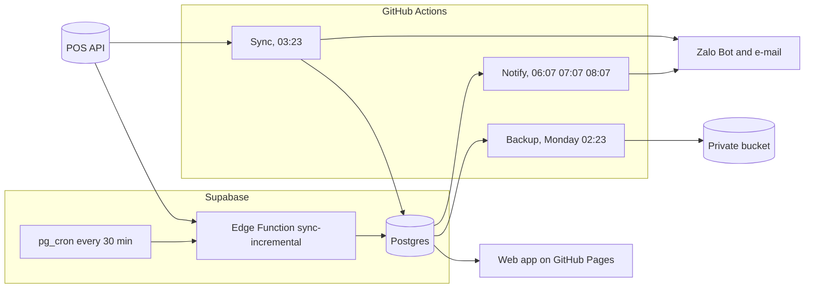

# Operations runbook

This runbook is for whoever runs FNB Manager day to day: the owner, a manager the owner trusts with operations, and the developer on call. It lists the environments and who holds which credential, what runs when, how to see that everything is healthy, what to do when something breaks, the maintenance calendar and whom to call. It builds on [sync.md](sync.md) (sync engine and CLI reference), [go-live.md](go-live.md) (first deployment) and [secrets.md](secrets.md) (secrets contract); [security.md](security.md) describes the threats and controls, [development.md](development.md) the local setup and checks, and [requirements.md](requirements.md) the operational requirements behind this runbook (FR-OPS, NFR-AVL and NFR-OBS). Phase 12 parts are marked as verified locally (12a), in build (12b) or planned (12c).

Last updated 2026-11-12

## 0. Read first: the state on 2026-11-12

- **No cloud project exists yet.** Gate G1 waits for the owner ([go-live.md](go-live.md)). The workflows that need the cloud ("Sync", "Backup database", "Migrate database") skip themselves with a note in their summary, and nothing syncs in the cloud. The local stack on the build machine holds a tenant loaded with real data, for verification only.
- **GitHub runs the workflows of commit `0f8fa1d`.** There, `sync.yml` has no digest or notification steps, and `deploy-functions.yml` and `notify.yml` do not exist yet. Pages serves the `0f8fa1d` demo build (Hôm nay on generated numbers).
- **Phase 12:** step 12a (outbox, Zalo Bot channel, `fnb notify tick`, `status`, `link`, `test`) is verified locally; step 12b (`fnb digest`, the alert rules, Brevo e-mail, `notify unlink`, `notify job-failed`, the Actions steps) is in build; step 12c (the Supabase dispatcher, the failure listener, Telegram, Resend and webhook, `docs/notifications.md`) is planned.
- Known issues are in section 3.8.

## 1. Environments and access

### 1.1 Environments

| Environment | What it is | Data | State on 2026-11-12 |
|---|---|---|---|
| Local, build machine | Supabase stack in Docker (`pnpm db:start`): API on port 54321, database 54322, Studio 54323, mail catcher 54324; the `fnb` CLI; the web dev server (`pnpm --filter @fnb/web dev`, port 5173) | the synthetic seed tenant `demo-fnb` and a tenant loaded from the real POS accounts | running; **never reset** (`supabase db reset` would wipe the real tenant) |
| Local, another machine | the same stack, fresh | the seed only, until the real data is reloaded ([status.md](status.md)) | – |
| CI | GitHub Actions runners | throwaway stacks (`supabase start`, `supabase db reset`); `ci.yml` reads no secret | runs on every push to `main` and every pull request |
| Production database and functions | a Supabase project on the Free plan, Singapore region | the real tenants | waits for owner (G1) |
| Production web app | GitHub Pages, under `/<repository>/` | none in the files; every number is read by the signed-in member under row-level security | live with the demo build |
| Scheduled compute | GitHub Actions (nightly sync, backups, notifications, deploys) and Supabase `pg_cron` (the incremental sync; from 12c the notification dispatcher) | – | Actions scheduled and skipping; `pg_cron` inert |

### 1.2 Who holds which credential

The owner holds every production credential. The operator needs none for the daily checks (web app, digest, Actions tab); `fnb status` and `fnb doctor` against the cloud run only on a machine with the owner's `.env`. Names and contents are in [secrets.md](secrets.md).

| Credential | Lives in | Held by | Used by |
|---|---|---|---|
| Supabase organisation and project owner login | Supabase dashboard | owner | SQL editor, function secrets, plan, pause and restore |
| GitHub repository admin | GitHub | owner | secrets, variables, Pages, enabling workflows |
| `SUPABASE_ACCESS_TOKEN` | GitHub secret; the owner's `.env` or `supabase login` | owner | `migrate.yml`, `backup.yml`, `deploy-functions.yml`; setting function secrets |
| `SUPABASE_DB_PASSWORD` | GitHub secret; `.env` | owner | `migrate.yml`, `backup.yml` |
| `SUPABASE_PROJECT_ID` | GitHub secret; `.env` | owner | `migrate.yml`, `backup.yml`, `deploy-functions.yml` |
| `SUPABASE_DB_URL` (session pooler; contains the database password) | GitHub secret; `.env` | owner | `sync.yml`, `notify.yml`; the CLI against the cloud |
| `SUPABASE_SECRET_KEY` | the owner's `.env` only; no workflow reads it | owner | `fnb tenant add-member` when it creates a login |
| `POS_ACCOUNTS_JSON`, `IPOS_APP_KEY` | GitHub secrets; Edge Function secrets; `.env` | owner; the build machine keeps a copy for the local tenant | sync, onboarding, `fnb doctor`, live tests, `sync-incremental` |
| `FNB_DB_URL`, `FNB_DB_CA_CERT`, `FNB_INCREMENTAL_WALL_MS`, `FNB_INCREMENTAL_CPU_MS` (optional) | Edge Function secrets | owner | `sync-incremental` |
| `BACKUP_AGE_RECIPIENT`, `BACKUP_S3_ENDPOINT`, `BACKUP_S3_BUCKET`, `BACKUP_S3_ACCESS_KEY_ID`, `BACKUP_S3_SECRET_ACCESS_KEY` | GitHub secrets | owner | `backup.yml` |
| The `age` private key | offline with the owner, never in GitHub or Supabase | owner | restoring a backup |
| `NOTIFY_ZALO_BOT_TOKEN`, `NOTIFY_EMAIL_API_KEY`, `NOTIFY_EMAIL_FROM`, `NOTIFY_EMAIL_FROM_NAME`, `NOTIFY_TELEGRAM_BOT_TOKEN`, `NOTIFY_WEBHOOK_SECRET` | GitHub secrets; `.env`; Edge Function secrets from 12c | owner | the notification steps of `sync.yml` and `notify.yml` (in build); `fnb notify …` |
| `SUPABASE_URL`, `SUPABASE_PUBLISHABLE_KEY` | GitHub variables, public by design | – | the web build; `SUPABASE_URL` also in `sync.yml` |
| Member logins (e-mail and password) | Supabase Auth | each member: owner, manager, staff, viewer; the publisher login from phase 11 | the web app, under row-level security |
| Local stack keys | printed by `pnpm db:start`; `.env`, `apps/web/.env.local` | builder, local only | development and tests |
| `docs/private/` | the build machine; copied between machines through a private channel | owner and delivery team | acceptance figures, build specs, the identifier list of the public-safety scan |

### 1.3 Running the CLI against the right database

- `pnpm --filter @fnb/jobs fnb -- <command>` (or `node apps/jobs/bin/fnb.mjs <command>`) reads the environment and the repository's `.env`. The environment wins, and an empty value in the environment hides the file's value.
- Without `CI`, the CLI reads `DATABASE_URL` (the local stack) before `SUPABASE_DB_URL` (the cloud). **With `CI=1` the order is reversed.** On a machine whose `.env` holds both, `CI=1 pnpm --filter @fnb/jobs fnb -- status` reads the cloud and `CI=1 SUPABASE_DB_URL= pnpm --filter @fnb/jobs fnb -- status` reads the local stack.
- `CI=1` makes the output safe to share: accounts are named by their position in `POS_ACCOUNTS_JSON` ("account 1"), stores are numbered, and no shop, member, address or amount is printed. The commands in this runbook use it.
- Three commands print private values and are refused with `CI` set: `fnb notify link`, `fnb onboard --print-secret-entry` and `fnb digest --show-text`. Run them without `CI=1`, on the owner's machine, and never paste their output anywhere.
- Exit codes: 0 success; 1 failure, a red `doctor` check or a failed `notify test`; 2 usage error; `notify job-failed` also returns 3 (database unreachable within 10 seconds) and 4 (connected, but the record failed).
- SQL in this runbook runs in the SQL editor of the cloud project, as the database owner. On the build machine the same statements run in `docker exec -it supabase_db_FNB_Managment psql -U postgres -d postgres`. Read amounts only there; never copy them into an issue, a chat or a file in the repository.

## 2. What runs when

### 2.1 Schedules

Times are Asia/Ho_Chi_Minh (UTC+7). GitHub starts scheduled runs late, often by hours (section 2.3).

| What | When | Defined in | What it does | State on 2026-11-12 |
|---|---|---|---|---|
| Incremental sync | every 30 minutes (`*/30 * * * *`) for each store that is open in its own time zone, once more just after it closes, and around the clock for a store without opening hours | `pg_cron` job `sync-incremental`, created by `app.enable_incremental_sync(<function URL>)` | `app.dispatch_incremental_sync()`: records expired tickets as `dispatch_failed`, prunes history, evaluates the dead-man's switch, then posts one single-use ticket per due store to the Edge Function `sync-incremental`, which checks the store's last three business days against the POS daily totals and pulls only the days that changed | built and verified locally; not deployed; waits for owner (go-live step 6) |
| "Sync" (nightly) | daily 03:23 (`23 3 * * *` with the `Asia/Ho_Chi_Minh` time zone) | `.github/workflows/sync.yml` | masks credentials; `fnb sync window --all-accounts --kind nightly` over the 14 business dates ending yesterday; then, even after a failure, `fnb digest --due`, `fnb notify tick` and `fnb status` | scheduled; skips until `SUPABASE_DB_URL` and `POS_ACCOUNTS_JSON` exist; the digest and send steps are in build (12b) and not on GitHub yet |
| "Notify" | daily 06:07, 07:07, 08:07 (`7 6,7,8 * * *`, same time zone) | `.github/workflows/notify.yml` | `fnb notify tick --skip-if-scheduler-healthy --budget-seconds 300`: builds the digests that are due, polls bot links, sends what is due; exits at once while the Supabase dispatcher is healthy | in build (12b); not on GitHub yet |
| Notification dispatcher in Supabase | a `pg_cron` tick that wakes the `notify` Edge Function when work is due | `app.enable_notify` | the same cycle, inside Supabase | planned (12c) |
| Failure alerts from Actions | when a watched workflow fails | `notify-on-failure.yml`, calling `fnb notify job-failed` | records a `job_failed` alert; a database-free fallback message when recording fails | `fnb notify job-failed` in build (12b); the listener and the fallback are planned (12c) |
| "Backup database" | Monday 02:23 (`23 19 * * 0`, UTC: Sunday 19:23) | `.github/workflows/backup.yml` | dumps schema, data, roles and auth data; packs and encrypts them with `age`; uploads `backup-<UTC stamp>.tar.gz.age` to `s3://<bucket>/database/`; the summary logs the encrypted size | scheduled; skips until `SUPABASE_PROJECT_ID`, `BACKUP_AGE_RECIPIENT` and `BACKUP_S3_BUCKET` exist |
| "Scheduled workflows active" | Monday 09:17 (`17 2 * * 1`, UTC) | `.github/workflows/workflows-active.yml` | re-enables any workflow GitHub disabled after 60 days without repository activity, and warns | scheduled; **failing** (section 3.8) |
| Cron probes | every :00 and :30, and every :07 and :37 | `cron-probe-peak.yml`, `cron-probe-offpeak.yml` | write the actual start time into the job summary; `node scripts/cron-delay-report.mjs` reads them | running |
| Sync retention | at every incremental tick | `app.prune_incremental_sync_history()` | keeps incremental `sync_runs` 35 days (90 when not succeeded), `cron.job_run_details` 7 days, resolved `app.sync_alerts` 90 days, `analytics_refreshes` 35 days (each tenant's newest kept) | runs only while the incremental schedule is enabled |
| Notification retention | inside the notify tick, at most once every 20 hours | `app.notify_housekeeping` | deletes finished queue rows after `retention_days` (default 400), clears message bodies after `body_retention_days` (default 90), deletes lapsed link codes and unaccepted bot destinations | verified locally (12a) |

### 2.2 Event-driven workflows

| Workflow | Runs on | Does | Secrets |
|---|---|---|---|
| "CI" (`ci.yml`) | push to `main`, every pull request | secret and identifier scan; lint, typecheck, unit tests, Edge Function checks; migrations, pgTAP and the Postgres parity suite on a fresh stack; web end-to-end tests | none |
| "Migrate database" (`migrate.yml`) | push to `main` touching `supabase/migrations/**` or `supabase/config.toml`; pull requests touching migrations (dry run); manual dispatch | `supabase link`, then `supabase db push`; skips without `SUPABASE_PROJECT_ID` | `SUPABASE_ACCESS_TOKEN`, `SUPABASE_DB_PASSWORD`, `SUPABASE_PROJECT_ID` |
| "Deploy web app" (`deploy-web.yml`) | push to `main` touching `apps/web/**`, `packages/**` or the workflow; manual dispatch | builds the web app (the demo while the two variables are empty) and deploys it to Pages | none; variables `SUPABASE_URL`, `SUPABASE_PUBLISHABLE_KEY` |
| "Deploy Edge Functions" (`deploy-functions.yml`) | push to `main` touching the function or the packages it imports; manual dispatch | checks the import map, deploys `sync-incremental`; skips without its two secrets | `SUPABASE_PROJECT_ID`, `SUPABASE_ACCESS_TOKEN` |

`deploy-functions.yml` is not on GitHub yet (it arrives with the owner's next commit).

### 2.3 How late GitHub starts scheduled runs

Measured on this repository through the GitHub API on 2026-11-12:

| Workflow | Scheduled | Actual starts (local time) |
|---|---|---|
| "Sync" | 03:23 daily | 2026-11-09 06:47, 2026-11-10 09:46, 2026-11-11 07:42, 2026-11-12 08:56: between 3 h 24 min and 6 h 23 min late |
| "Backup database" | Monday 02:23 | 2026-11-09 05:56: 3 h 33 min late |
| "Scheduled workflows active" | Monday 09:17 | 2026-11-09 16:54: 7 h 37 min late |
| Cron probes | every 30 minutes | 18 runs each between 2026-11-07 and 2026-11-12, out of more than 200 slots |

Plan for it: the nightly data and an Actions-sent digest can arrive mid-morning. The incremental sync and, from 12c, the notification dispatcher run inside Supabase for that reason (ADR-020). Every window run is idempotent, so a late or missed run heals at the next one.

### 2.4 One day, in a picture



The incremental path is built but inert until the owner enables it; the notification paths are in build (12b).

## 3. Monitoring

### 3.1 `fnb status`

```sh
CI=1 pnpm --filter @fnb/jobs fnb -- status
CI=1 pnpm --filter @fnb/jobs fnb -- status --tenant <tenant-slug>
```

Per account: the last run, its result and age, the age of the last successful window, and the runs flagged (warning-level data-quality flags or unmatched days) or failed in the last 14 days. Per store: the latest verified business date, the latest business date with sales, the unmatched and checked store-days of the 14 business dates ending yesterday, and the scheduler's open alerts.

| You see | It means | Go to |
|---|---|---|
| last run failed, or the last success older than a day | the nightly did not complete | 4.1 |
| `unmatched 14d` above 0 | some store-days disagree with the POS daily totals | 4.4 |
| `checked 14d` below 14 | some days were never reconciled: not synced, or no control totals | 4.5, 4.6 |
| an account in `auth_failed` | the POS refuses its login | 4.2 |
| `stale <n> min` or `dispatch failed x<n> (HTTP <status>)` | the dead-man's switch or the scheduler raised an alert | 4.3 |

### 3.2 `fnb doctor`

```sh
CI=1 pnpm --filter @fnb/jobs fnb -- doctor
```

It exits 1 when any check is red. It logs in to every POS account in `POS_ACCOUNTS_JSON` with the password itself, without the cached session.

| Check | Green | Yellow | Red |
|---|---|---|---|
| database | reachable | – | unreachable |
| database size, in MiB | below 400 | from 400 (the Pro trigger, gate G4) | from 475 (the Free quota is 500 MB) |
| migrations | every file applied | applied without a file | a file not applied |
| login, per account | the POS accepts it | – | the POS refuses it (4.2) |
| last sync, per account | last successful window within 26 h | within 72 h | older |
| pause risk (cloud only) | under 5 idle days | from 5 idle days | from 7 (4.12) |
| incremental schedule | enabled | not enabled | – |
| sync alerts | none open | – | any open alert in `app.sync_alerts` (4.3) |
| opening hours | usable or unknown | hours entered without a usable span | – |
| disk, egress | reported as unavailable: only the Supabase dashboard measures them | | |

While the incremental schedule is off, the 26-hour window plus GitHub's delays (2.3) can turn "last sync" yellow between two nightly runs.

### 3.3 The web app's badges

- **Freshness**, in the top bar: "cập nhật lúc {time}" (with the date when it is not today), "chưa đồng bộ" when the tenant has never synced, "chưa rõ lúc cập nhật" when the time is unknown. It reads the tenant's latest succeeded run in `sync_runs`. With the incremental schedule on, it should show a time less than 35 minutes old during opening hours (the phase 7 acceptance).
- **Verified**, on each day section of Hôm nay: "đã đối soát" only when every selected store-day has a matched check; otherwise cards carry "chưa đối soát". In the demo both badges read "dữ liệu mẫu".
- **New version:** after a deploy, an open app offers "Có phiên bản mới — tải lại" when its window regains focus (Pages caches `index.html` for ten minutes).

### 3.4 Reconciliation

Each synced store-day gets one `sync_checks` row: the POS count and net against ours. It is matched when the count is exact and the net is within the larger of 1,000 (in the tenant's currency) and 0.05 % of the POS net. Without control totals no row is written and the day stays unverified. ADR-014 accepts at least 99 % of store-days matched, with every exception explained privately.

### 3.5 The dead-man's switch

Three watchers, so a broken path is caught by another:

| Watcher | Fires when | Shows in |
|---|---|---|
| every incremental run, before it starts | the store had more than 90 minutes of opening time without a successful sync | a `sync_stale` notification from the runner |
| the scheduler, at every tick | the same reading, taken in the database for every watched store, so it fires even when the function is broken; and scheduled calls that expired unclaimed | `app.sync_alerts` (`sync_stale`, `dispatch_failed`); `fnb status`; `fnb doctor` red |
| the nightly run (`--kind nightly`), while the schedule is enabled | the longest stretch of yesterday's opening time without a successful sync was over 90 minutes | the nightly's log; a `sync_stale` notification |

Unknown opening hours count every minute. A store that is inactive, belongs to a paused account or carries `{"incremental_sync": false}` in `stores.settings` is not watched. After a closure (a store reactivated or opted back in, an account leaving `paused`), counting starts again from that moment.

### 3.6 Alerts and the daily digest (phase 12)

- **Destinations** are linked per member with `fnb notify link`: the Zalo Bot (12a, verified locally) and e-mail through Brevo (12b, in build). Telegram, Resend and a signed webhook arrive in 12c (planned). `fnb notify status` shows every destination and the outbox; `fnb notify test` sends one test message per active destination.
- **Quiet hours:** operational messages on the Zalo Bot, Telegram and e-mail go out between 06:00 and 24:00 in the reader's time zone, at most 20 per local day (the seeded `channel_policies`). A message outside that window is held until it opens. Critical alerts are held too, unless the owner sets `critical_bypass` on the tenant's policy.
- **The daily digest** is the Ngày report built as its recipient, so its numbers equal Ngày. It is due when every store of its scope has settled the day (no open shift, and a successful sync at least 30 minutes after the close and the last shift close), or at the 06:30 deadline the next morning. `fnb digest` queues it; `fnb notify tick` sends it. Until 12c only the Actions path sends, so GitHub's delays (2.3) apply.
- **Alert rules** (the catalogue `alert_rule_catalog`; owners override them per tenant or store):

| Rule | Delivery | Severity | To | Cool-down | Raised by |
|---|---|---|---|---|---|
| `daily_digest` | the digest itself | info | owner, manager | – | `fnb digest` (12b, in build) |
| `revenue_below_baseline` | a digest line | warning | owner, manager | – | net below 75 % of the same-weekday baseline, with at least 4 sample days (12b) |
| `ticket_drop` | a digest line | warning | owner, manager | – | average ticket more than 10 % below the baseline, with at least 20 invoices (12b) |
| `drawer_variance` | a digest line | warning | owner, manager | – | the shifts Ngày flags, at most 3 lines (12b) |
| `unverified_day` | a digest line | warning | owner, manager | – | a settled day unmatched or unchecked (12b) |
| `zero_sales_day` | a digest line | warning | owner, manager | – | no sales on a day the store was expected to open (12b) |
| `zero_sales_open` | immediate | warning | owner, manager | 24 h | planned (12c) |
| `sync_failed` | immediate | warning | owner | 6 h | two incremental failures in a row (12b) |
| `auth_failed` | immediate | critical | owner | 1 h; a notice when it clears | the POS refuses a login (12b) |
| `sync_stale` | immediate | critical | owner | 2 h; a reminder every 24 h; a notice when it clears | the dead-man's switch (12b) |
| `sync_dispatch_failed` | immediate | warning | owner | 6 h | scheduled calls expiring unclaimed (12b) |
| `nightly_missing` | immediate | warning | owner | 24 h; a notice when it clears | planned (12c): no successful nightly for 30 hours |
| `job_failed` | immediate | warning | owner | 12 h | `fnb notify job-failed` (12b); the listener workflow is planned (12c) |
| `channel_failed` | immediate | warning | owner | 24 h | a destination that keeps failing (12b) |
| `digest_failed` | immediate | warning | owner | 24 h | a digest that could not be built (12b) |

```sh
CI=1 pnpm --filter @fnb/jobs fnb -- notify status --tenant <tenant-slug>
CI=1 pnpm --filter @fnb/jobs fnb -- notify tick --dry-run
```

`notify status` lists messages by state, held and `uncertain` messages, each destination with its last success, this month's count (the Zalo Bot's Basic plan allows 3,000 a month) and last error code, the open alert episodes and the digests. `notify tick --dry-run` claims nothing and prints each waiting message's decision, for example `message 3: held until 2026-11-09 06:00 +07, outside_hours`. An `uncertain` message is never resent automatically: someone must decide.

### 3.7 GitHub and Supabase consoles

- **Actions tab:** each run's summary carries counts and numbered stores only. GitHub e-mails a scheduled run's failure only to the person who last edited its cron line, so the owner checks the tab until the failure listener (12c) exists.
- **Supabase dashboard:** database size and egress (5 GB a month on the Free plan) under usage; Edge Function logs, kept one day on the Free plan; the SQL editor.

### 3.8 Known issues on 2026-11-12

| Issue | Effect | Handling |
|---|---|---|
| "Scheduled workflows active" failed on its first run (2026-11-09): its `gh workflow list` call ran without a repository (no checkout and no `GH_REPO`) | GitHub's 60-day inactivity rule is not guarded | fix requested to the backend stream; meanwhile the owner's commits keep the repository active |
| On GitHub, CI for `0f8fa1d` failed in the secret-scan job: `actions/setup-node@v5` stopped with "Unable to locate executable file: pnpm" | CI is red although the code, database and end-to-end jobs passed | the fix (`package-manager-cache: false`) is in the working tree; the next push shows whether it holds |
| Scheduled runs start hours late (2.3) | the nightly and the Actions-sent digest arrive mid-morning | enable the incremental schedule; the Supabase dispatcher (12c) |
| Two date-sensitive pgTAP tests fail on the long-lived local stack | false failures on the build machine only; CI's fresh stack passes | fix in progress |
| `node scripts/cron-delay-report.mjs` attributes a run to the latest slot before it, so delays longer than the slot spacing read as minutes, and it ignores skipped slots | its medians understate the delays | read section 2.3 instead; fix requested |

## 4. Runbooks

Each runbook gives the symptoms, the checks (with `CI=1`), the fix and how to verify it. `<n>` is an account's position in `POS_ACCOUNTS_JSON` (1 for the first).

### 4.1 A failed or partial sync run

**Symptoms.** "Sync" shows a red run; its summary says "Sync failed; the log of the failing step has the counts and the credential-free error." `fnb status` shows a failed last run, or runs counted as failed or flagged. Incremental runs end `partial` or `failed`. From 12b, a `sync_failed` alert after two failed incremental runs in a row.

**Checks.**

```sh
CI=1 pnpm --filter @fnb/jobs fnb -- status
CI=1 pnpm --filter @fnb/jobs fnb -- doctor
```

Open the failing step's log in the Actions tab. In the SQL editor:

```sql
select kind, status, started_at, finished_at, error_message, rows_upserted -> 'summary' as summary
from public.sync_runs order by started_at desc limit 20;
```

**Fix.**

- `partial` with `stopped` = `store_busy`: another run held the store for more than 15 seconds; nothing is lost.
- `partial` with `stopped` = `cpu_time` or `wall_time` (with `deadline_reached` when a POS call was cut off): the changed days did not fit the Edge Function's budget; the nightly covers them. If `wall_time` stops happen every day on a paid plan, raise the `FNB_INCREMENTAL_WALL_MS` function secret (at most 390000). The CPU limit is 2 seconds on every plan.
- `failed`: fix what the redacted error names (a refused login: 4.2; the database unreachable: 4.12 or the URL in the secret; a POS schema error: escalate to the delivery team, section 6), then run the window again. Start with a dry run:

```sh
CI=1 pnpm --filter @fnb/jobs fnb -- sync window --account-number <n> --from <YYYY-MM-DD> --to <YYYY-MM-DD> --dry-run
CI=1 pnpm --filter @fnb/jobs fnb -- sync window --account-number <n> --from <YYYY-MM-DD> --to <YYYY-MM-DD>
```

Or dispatch "Sync" from the Actions tab with `account_number`, `from` and `to` (empty means the 14 business dates ending yesterday), `kind` and `dry_run`.

**Verify.** `fnb status` shows a succeeded last run and `unmatched 14d` 0; the freshness badge shows a recent time.

### 4.2 An account marked `auth_failed`

**Symptoms.** `fnb status` shows the account in `auth_failed`; `fnb doctor` shows its login red; the incremental schedule skips its stores. From 12b, a critical `auth_failed` alert, once per episode, with a notice when it clears.

**Checks.**

```sh
CI=1 pnpm --filter @fnb/jobs fnb -- doctor
```

A red login means the POS refuses the credentials in this machine's `POS_ACCOUNTS_JSON`. Log in to the POS back office by hand to confirm the current password.

**Fix.** Put the working password in all three places (4.7, step 3), then run any window for the account:

```sh
CI=1 pnpm --filter @fnb/jobs fnb -- sync window --account-number <n> --from <yesterday> --to <yesterday>
```

A successful login sets the account back to `active`, and the schedule picks its stores up again. On a small server that runs `fnb sync incremental` instead of `pg_cron`, `--retry-auth-failed` does the same.

**Verify.** `doctor` shows the login green; `status` shows the account `active`; the next incremental run of its stores succeeds.

### 4.3 Stale data

**Symptoms.** During opening hours the freshness badge shows a time more than about 35 minutes old, or "chưa đồng bộ". `fnb doctor` shows "sync alerts" red, or "last sync" yellow or red. `fnb status` lists `stale <n> min` or `dispatch failed x<n> (HTTP <status>)`. From 12b, a `sync_stale` alert (critical) or `sync_dispatch_failed`.

**Checks.**

```sh
CI=1 pnpm --filter @fnb/jobs fnb -- status
CI=1 pnpm --filter @fnb/jobs fnb -- doctor
```

In the SQL editor:

```sql
select * from app.sync_alerts where resolved_at is null;
select jobid, jobname, schedule, active from cron.job;
select jobid, status, return_message, start_time from cron.job_run_details order by start_time desc limit 20;
select id, status_code, timed_out, error_msg, created from net._http_response order by created desc limit 20;
```

`net._http_response` keeps the function's answers for 6 hours.

**Fix,** by what the checks show:

- The schedule is off (`doctor`: "incremental schedule" yellow; no `sync-incremental` row in `cron.job`): enable it as in go-live step 6.
- `dispatch_failed` with no answer or a `pg_net` error: the URL given to `app.enable_incremental_sync` is wrong or the function is not deployed (4.11). 500: a function secret or the database URL; read the function's log. 503: the function cannot reach the database; set `FNB_DB_URL` (go-live step 6). 401: the function connects to another database than the one that issued the ticket. 429: more than 32 claims at once on one worker; it clears by itself.
- An account in `auth_failed`: 4.2. Runs that fail: 4.1. The project paused: 4.12.
- Only the nightly is late: GitHub's delay (2.3); wait, or dispatch "Sync" by hand.

To run one store now, issue a manual ticket and post it within 10 minutes:

```sql
select app.issue_incremental_sync_ticket(id) from public.stores where active order by external_id limit 1;
```

```sh
curl -X POST https://<ref>.supabase.co/functions/v1/sync-incremental -H 'content-type: application/json' -d '{"ticket":"<ticket>","wait":true}'
```

**Verify.** The open row in `app.sync_alerts` gets `resolved_at` at the next tick that finds the store fresh; the badge shows a time from the last 30 minutes.

### 4.4 A store-day that does not reconcile

**Symptoms.** `fnb status` shows `unmatched 14d` above 0 for a store; Hôm nay or a report card shows "chưa đối soát". From 12b, the digest's `unverified_day` line.

**Checks.**

```sh
CI=1 pnpm --filter @fnb/jobs fnb -- status
```

```sql
select store_id, business_date, checked_at
from public.sync_checks where not is_matched order by business_date desc limit 20;
```

The amounts behind a mismatch are private: compare them only in the SQL editor.

**Fix.** Run the day again (4.6). Most mismatches are a late edit, a void or an adjustment the re-pull picks up. If the day stays unmatched, compare it privately with the POS's own daily report and record the explanation privately (ADR-014).

**Verify.** `unmatched 14d` is back to 0 and the day reads "đã đối soát".

### 4.5 Backfilling a month

One month per run keeps a backfill inside the call budget (400 connector calls per run). Load older history month by month, walking back with `--dry-run` until a month shows no sales. On the local stack one account-month took about a minute.

```sh
CI=1 pnpm --filter @fnb/jobs fnb -- sync window --account-number <n> --from 2026-10-01 --to 2026-10-31 --kind backfill --dry-run
CI=1 pnpm --filter @fnb/jobs fnb -- sync window --account-number <n> --from 2026-10-01 --to 2026-10-31 --kind backfill
```

From GitHub: dispatch "Sync" with `account_number`, `from`, `to` and `kind` = `backfill`. Analytics are refreshed after the window automatically.

**Verify.** `fnb status` shows the run succeeded and nothing unmatched; compare the month's totals privately with the POS monthly report.

### 4.6 Re-running a day

```sh
CI=1 pnpm --filter @fnb/jobs fnb -- sync window --account-number <n> --from <YYYY-MM-DD> --to <YYYY-MM-DD> --store <external id>
```

`--store` is optional and can repeat. A re-run is safe at any time: unchanged sales are skipped, changed ones are rewritten with an `edited` event, vanished ones are voided (an empty day only when the POS control totals confirm it). If another run holds the store, the window waits up to 10 minutes for it.

**Verify.** `fnb status` for that store; the day's badge.

### 4.7 Changing the POS password

1. Pick a quiet time: after the nightly run, outside opening hours.
2. Change the password in the POS back office (owner).
3. The same day, update `POS_ACCOUNTS_JSON` in all three places:
   - the owner's `.env`;
   - the GitHub secret `POS_ACCOUNTS_JSON` (Settings → Secrets and variables → Actions);
   - the Edge Function secret: write a file outside the repository with `POS_ACCOUNTS_JSON='<the JSON array>'` and `IPOS_APP_KEY='<the key>'`, each value in single quotes, run `pnpm exec supabase secrets set --env-file <that file> --remote=<project ref>`, then delete the file.
4. Check the `.env` copy with a fresh login: `CI=1 pnpm --filter @fnb/jobs fnb -- doctor`.
5. The runs reuse a cached POS session (`pos_account_tokens`) until it is within 12 hours of expiry, so a place still holding the old password can fail days later. To prove the other two places now: clear the cache, issue a ticket for one of the account's stores and post it with `"wait": true` as in 4.3 (this tests the Edge Function secret), clear the cache again and right away dispatch "Sync" for the account with a one-day window (this tests the GitHub secret, unless a scheduled tick logged in first).

```sql
delete from public.pos_account_tokens
where pos_account_id = (select id from public.pos_accounts where account_key = '<account-key>');

select app.issue_incremental_sync_ticket(s.id)
from public.stores s join public.pos_accounts a on a.id = s.pos_account_id
where a.account_key = '<account-key>' and s.active
order by s.external_id limit 1;
```

Add a tenant filter if several tenants use the same key.

**Verify.** `doctor` shows the login green; the ticket answers 200 with counts; the dispatched "Sync" run is green.

### 4.8 Rotating Supabase keys and provider tokens

Rotate at launch and whenever a person with access leaves ([secrets.md](secrets.md)). The order is always: rotate at the provider, update every place that holds the value, re-run the affected workflow, confirm the next scheduled run is green.

| Credential | Where to update | Verify with |
|---|---|---|
| Secret API key (`SUPABASE_SECRET_KEY`) | create a new secret key in the project's API settings, put it in `.env`, delete the old one; no workflow holds it | the next `fnb tenant add-member` that creates a login |
| Publishable key and URL | the GitHub variables `SUPABASE_PUBLISHABLE_KEY` and `SUPABASE_URL`, then dispatch "Deploy web app"; locally `apps/web/.env.local` | sign in on the Pages URL |
| Database password | reset it in the project's database settings; update `SUPABASE_DB_PASSWORD` and `SUPABASE_DB_URL` (GitHub secrets and `.env`) and the function secret `FNB_DB_URL` if it is set | dispatch "Backup database" or "Migrate database" (both link with the password; "Migrate database" also applies any migration not applied yet), and "Sync" with `dry_run` (the URL); a manual ticket with `"wait": true` (4.3) when `FNB_DB_URL` is set |
| Access token (`SUPABASE_ACCESS_TOKEN`) | create a new personal access token with the scopes in secrets.md, update the GitHub secret and `.env`, revoke the old one | dispatch "Deploy Edge Functions" or "Migrate database" |
| POS password, `IPOS_APP_KEY` | 4.7 | 4.7 |
| `NOTIFY_*` provider tokens and the e-mail sender | rotate at the provider; update the GitHub secrets and `.env`, and from 12c the Edge Function secrets. If the Zalo Bot itself must be replaced, every member links again with `fnb notify link` | `CI=1 pnpm --filter @fnb/jobs fnb -- notify test --tenant <tenant-slug>` prints "sent" per destination |
| Backup bucket keys | rotate at the storage provider; update `BACKUP_S3_ACCESS_KEY_ID` and `BACKUP_S3_SECRET_ACCESS_KEY` | dispatch "Backup database"; its summary logs the encrypted size |
| Backup `age` key | create a new pair with `age-keygen -o <file kept offline>`, set `BACKUP_AGE_RECIPIENT` to the new public key; keep the old private key as long as backups made with it are kept | the next backup; a restore drill (4.10) |

Phase 20b plans the move to the new key scheme with the legacy keys disabled.

### 4.9 Database size above budget

**Symptoms.** `fnb doctor` shows "database size" yellow (from 400 MiB) or red (from 475 MiB); the Supabase usage page agrees. With two stores the database grows by about 18 MiB a month.

**Checks.**

```sh
CI=1 pnpm --filter @fnb/jobs fnb -- doctor
```

```sql
select pg_size_pretty(pg_database_size(current_database()));
```

Retention runs only while the incremental schedule is enabled (2.1).

**Fix.**

1. Run the sync retention by hand: `select app.prune_incremental_sync_history();`
2. Reclaim dead rows after heavy reruns or tests: `vacuum (full, analyze)` on the large fact tables, one statement per table (`public.invoices`, `public.invoice_lines`, `public.invoice_payments`, `public.shifts`, `public.sale_payloads`). VACUUM cannot run inside a transaction block, needs free disk about the size of the table and locks it while it runs: do it after the nightly and outside opening hours. On the build machine this took the database from 338 MiB to 285 MiB after phase 7's test runs; on the cloud, autovacuum reuses most of that space by itself.
3. Ask the delivery team for code-level savings: two indexes duplicate the leading column of unique indexes (about 7 MB).
4. Decide gate G4: move to Pro before the database reaches the Free quota.

**Verify.** `doctor` shows the size green or yellow with room to spare.

### 4.10 Restoring a backup (drill)

No restore has been rehearsed yet; phase 20b plans the drill. Run it each quarter once backups exist, and record the result privately.

**Never restore into the build machine's local stack:** it holds the real tenant. Use a second Supabase project on the Free plan created for the drill (the Free plan allows two active projects), and delete it afterwards. The steps need the AWS command-line tool (or another S3 client), `age` and `psql`; none of them is installed on the build machine on 2026-11-12.

1. Find and fetch the newest backup:

```sh
aws s3 ls "s3://<bucket>/database/" --endpoint-url "<endpoint>"
aws s3 cp "s3://<bucket>/database/<file>.tar.gz.age" . --endpoint-url "<endpoint>"
```

2. Decrypt and unpack it, outside the repository:

```sh
age --decrypt -i <private key file> -o backup.tar.gz <file>.tar.gz.age
mkdir restore && tar -xzf backup.tar.gz -C restore
```

The archive holds `roles.sql`, `schema.sql`, `data.sql` and `auth-data.sql`.

3. Restore in the order Supabase documents (roles, schema, then data with triggers off), in one transaction:

```sh
psql --single-transaction --variable ON_ERROR_STOP=1 \
  --file restore/roles.sql \
  --file restore/schema.sql \
  --command 'SET session_replication_role = replica' \
  --file restore/data.sql \
  --dbname "<connection string of the drill project>"
```

Use the drill project's session-pooler string with `?sslmode=require`, as in go-live step 1. The default dump leaves out the `auth` schema, so the backup carries its data in `auth-data.sql`: restore it the same way, with `SET session_replication_role = replica` before it. This step has not been rehearsed; record exactly what worked.

4. Compare counts between production and the drill project, for example `select count(*) from public.invoices;` and the same for `invoice_lines`, `sync_checks`, `tenant_members` and `consent_records`.
5. Delete the drill project and the decrypted files.

**Verify.** The counts match the moment of the backup. For a real recovery, the new project then needs the GitHub secrets and variables of section 1.2 updated, the functions deployed, their secrets set and the schedules enabled again (go-live steps 2, 3 and 6).

### 4.11 A failed Pages or function deploy

**Pages ("Deploy web app" red).**

- The build step fails when a check of the bundle fails: `check-bundle.mjs` refuses an e-mail address, a non-synthetic UUID, a JWT, a secret key or a 32-hex string in `dist` (a live build may contain only its own publishable key and URL); `check-size.mjs` refuses more than 400 kB of gzipped initial JavaScript, or a lazy chunk pattern that matches nothing.
- Reproduce the demo build locally: `VITE_BASE_PATH=/<repository>/ VITE_SUPABASE_URL= VITE_SUPABASE_PUBLISHABLE_KEY= pnpm --filter @fnb/web build`.
- Fix the cause in a build step (delivery team), then the owner pushes or re-runs the workflow. A deploy-only failure is re-run from the Actions tab.
- **Verify:** the Pages URL loads; open tabs offer "Có phiên bản mới — tải lại".

**Functions ("Deploy Edge Functions" red).**

- A stale import map: `node scripts/function-imports.mjs --check` fails. Regenerate it with `node scripts/function-imports.mjs`, then let the owner commit the new `deno.json`.
- A type error: run `deno check index.ts` in `supabase/functions/sync-incremental`.
- A refused token: the access token lacks `edge_functions_write`, `edge_functions_read` or `projects_read` ([secrets.md](secrets.md)).
- A manual deploy from the owner's machine: `pnpm exec supabase functions deploy sync-incremental --remote=<project ref> --yes`.
- **Verify:** a manual ticket with `"wait": true` answers 200 with counts (4.3).

### 4.12 A paused Free project

**Symptoms.** Every job that touches the database fails; the web app cannot sign in or load; Supabase sent a warning e-mail about a week before. From 12c, the failure listener's `fnb notify job-failed` exits 3 (database unreachable) and its database-free fallback message goes out instead. Beforehand, `fnb doctor` shows the pause risk yellow from 5 idle days and red from 7.

**Fix.** The owner restores the project from the Supabase dashboard; the data stays intact ([deep-dives/supabase-platform.md](deep-dives/supabase-platform.md)). Then:

```sh
CI=1 pnpm --filter @fnb/jobs fnb -- doctor
```

Check that `cron.job` still lists `sync-incremental` if the schedule was enabled (4.3). Run the missed days: the nightly covers 14 business dates; a longer gap needs a backfill (4.5).

**Prevent.** Keep the nightly green, because it is the activity that keeps the project awake, and fix an `auth_failed` account within days.

**Verify.** `doctor` and `status` green; the badge fresh.

### 4.13 Onboarding a new shop, store or POS account

**A new store under an existing account.**

```sh
CI=1 pnpm --filter @fnb/jobs fnb -- sync master --account <account-key>
```

It discovers the store with its time zone and business-day start. Then backfill its history month by month with `--store <external id>` (4.5). Until the phase 10b settings pages exist, enter its opening hours in SQL; the database refuses a wrong shape:

```sql
update public.stores
set opening_hours = '{"mon": [["07:00", "22:00"]], "tue": [["07:00", "22:00"]], "wed": [["07:00", "22:00"]], "thu": [["07:00", "22:00"]], "fri": [["07:00", "22:00"]], "sat": [["07:00", "22:00"]], "sun": [["07:00", "22:00"]]}'
where id = '<store id>';
```

Keys run from `mon` to `sun`; each holds `[open, close]` pairs. A weekday without a pair counts as closed. A member limited to some stores (`tenant_members.store_ids`) does not see the new store until its id is added there. A store to leave out of the incremental sync gets `{"incremental_sync": false}` in `stores.settings`.

**A new POS account (another brand).**

1. Append the entry to `POS_ACCOUNTS_JSON` in `.env` with a neutral key such as `account-3`. Append, never insert: CI and the dispatch input name accounts by position.
2. `pnpm --filter @fnb/jobs fnb -- onboard --tenant <tenant-slug> --account <account-key>` (without `CI=1` if you need to see the store names; never share that output). Check each store's time zone and day start.
3. Backfill month by month (4.5).
4. Put the entry in the GitHub secret (`--print-secret-entry` prints it; it is refused in CI) and in the Edge Function secret (4.7, step 3).

**A new shop (a new tenant)** follows [go-live.md](go-live.md) step 4:

```sh
CI=1 pnpm --filter @fnb/jobs fnb -- tenant create --name "<company>" --slug <tenant-slug> --currency VND --locale vi-VN --timezone Asia/Ho_Chi_Minh --legal-form <form>
FNB_MEMBER_PASSWORD='<a long password>' pnpm --filter @fnb/jobs fnb -- tenant add-member --tenant <tenant-slug> --email <login e-mail> --role owner
```

`--invite` sends an invitation instead, through the project's SMTP. Then onboard its accounts as above and link its digests with `fnb notify link` (12a). Another owner runs their own deployment instead (roadmap section 8).

**Verify.** `CI=1 pnpm --filter @fnb/jobs fnb -- status --tenant <tenant-slug>` lists the stores with checked days; the member signs in and sees them.

### 4.14 Removing a member

1. Stop their notifications and withdraw their notifications consent (12b, in build):

```sh
CI=1 pnpm --filter @fnb/jobs fnb -- notify unlink --tenant <tenant-slug> --member <login e-mail> --all
```

2. Remove the membership. No CLI command does this yet; in the SQL editor:

```sql
delete from public.tenant_members
where tenant_id = (select id from public.tenants where slug = '<tenant-slug>')
  and user_id = (select id from auth.users where email = '<login e-mail>');
```

The trigger `tenant_members_redact_notifications` redacts their message rows at once; their destinations go with the membership; the consent ledger row stays as evidence.

3. If the person should lose the login altogether, delete the user in the Supabase dashboard (Authentication → Users); every membership of that login goes with it.
4. Rotate every shared credential the person knew: the POS passwords (4.7) and anything else they had (4.8).

**Verify.** The person sees no tenant data after signing in, or cannot sign in; `fnb notify status --tenant <tenant-slug>` shows no destination of theirs.

### 4.15 Handling a data-subject request

The law sets the deadlines ([deep-dives/vietnam-legal-requirements.md](deep-dives/vietnam-legal-requirements.md)): a first response within 2 working days; completion within 20 days, or 30 when a processor handles the data. The owner is the controller and answers; the operator records and acts. The dashboard tooling arrives in phase 17a; until then requests are handled in the SQL editor.

1. **Record** the request; the trigger fills both deadlines from the tenant's country and time zone:

```sql
insert into public.data_subject_requests (tenant_id, subject_type, contact, request_type)
select id, 'customer', '<how the requester asked to be answered>', 'access'
from public.tenants where slug = '<tenant-slug>'
returning id, first_response_due_at, completion_due_at;
```

`subject_type` is `customer` or `staff`; `request_type` is `access`, `correction`, `deletion`, `export`, `objection` or `withdraw_consent`. Set `uses_processor` to true when a processor handles the data for this request; the legal read (Track Z) settles when that applies.

2. **Find the data.** Members: the login e-mail (Supabase Auth), `tenant_members`, `notification_channels`, `outbound_messages`, `consent_records`. Customers, as the POS sends them: `customers` (phone, name), `invoices.customer_phone` and `customer_name`, and the raw payloads in `sale_payloads`. Cashiers: `shifts.cashier_name`. Backups hold copies for as long as they are kept.
3. **Act.**
   - Access or export: collect the rows privately and hand them over through a private channel, never through the repository.
   - Correction: members in Auth and `tenant_members`; POS data in the POS itself, then run those days again (4.6).
   - Deletion of a member: 4.14. Of a customer: remove the data in the POS first, because a re-sync of those days brings back what the POS still holds; then the delivery team removes our copies. Message rows of any subject can be redacted with `select app.redact_outbound_for_subject('<tenant id>', '<customer or staff>', '<subject id>');`.
   - Objection or withdrawal of consent: for notifications, `fnb notify unlink --member <login e-mail> --all` (4.14, step 1); the loyalty, marketing and staff purposes arrive with Tracks B and C.
4. **Close** the request:

```sql
update public.data_subject_requests
set status = 'completed', completed_at = now(), notes = '<what was done>'
where id = '<request id>';
```

Open requests and their deadlines:

```sql
select id, request_type, status, first_response_due_at, completion_due_at
from public.data_subject_requests
where status in ('received', 'in_progress') order by completion_due_at;
```

### 4.16 Responding to a personal-data breach

A breach is any unauthorised access to, loss of or disclosure of personal data: member e-mails and chat ids, customer phones and names, cashier names, consent evidence. The personal-data law requires notice to the Ministry of Public Security (A05) **within 72 hours**, and breach records are kept **5 years** ([deep-dives/vietnam-legal-requirements.md](deep-dives/vietnam-legal-requirements.md); ADR-021). The owner notifies, with legal advice; this runbook gets the facts ready. Phase 17a builds the full breach runbook with its tooling (roadmap); until then these steps apply.

1. **Contain, in the first hour.** Rotate every exposed credential (4.8). Disable a compromised login (Supabase dashboard, Authentication → Users). If the sync path is involved, pause the schedule with `select app.disable_incremental_sync();`, and disable the "Sync" workflow in the Actions tab if the nightly must stop too ("Scheduled workflows active" re-enables only workflows GitHub disabled for inactivity). To stop messages before 12c's switch exists, remove the `NOTIFY_*` GitHub secrets or unlink the destinations. If a secret reached the public repository, treat it as exposed: rotate first; rewriting git history needs the owner.
2. **Preserve evidence at once.** Platform logs are kept one day on the Free plan: export the relevant Supabase logs now. GitHub keeps run logs for 90 days by default.
3. **Assess within 24 hours.** Which data, which tenant, how many people, since when, and whether it left our control.
4. **Notify within 72 hours.** Count them from the earliest moment that could apply until the legal read confirms when the clock starts. The owner sends the notice with what is known and completes it later. Whether and how to inform the people affected is part of the legal read.
5. **Record** the breach, the timeline and the actions privately (never in this repository) and keep the record 5 years.
6. **Follow up:** fix the cause, add a test or a scan rule, update this runbook or an ADR, and add any new identifier to the private identifier list of the public-safety scan.

## 5. Maintenance calendar

| When | Task | Who | How |
|---|---|---|---|
| Daily | Open Hôm nay: a fresh freshness badge, yesterday "đã đối soát" | operator | web app |
| Daily, once phase 12 runs | Read the digest; act on its attention lines and on alerts | owner, managers | Zalo Bot, e-mail |
| Daily | Any red run in the Actions tab | operator | 4.1 |
| Weekly, Monday | "Backup database" ran and logged its encrypted size | operator | Actions tab |
| Weekly | `fnb doctor` all green, or every yellow understood | operator | 3.2 |
| Weekly | `fnb status`: `unmatched 14d` 0 and `checked 14d` 14 for every store | operator | 3.1 |
| Weekly, once phase 12 runs | `fnb notify status`: no `uncertain` message, no failing destination | operator | 3.6 |
| Weekly | "Scheduled workflows active" green | operator | 3.8 |
| Monthly | Database size trend against 400 MiB; egress against 5 GB in the Supabase usage page | operator | 3.2, 3.7 |
| Monthly | Compare last month's totals privately with the POS monthly report | owner | ADR-014 |
| Monthly | Open data-subject requests and their deadlines | owner | 4.15 |
| Monthly | Zalo Bot messages this month against the 3,000 allowed | operator | `fnb notify status` |
| Monthly | At least one commit, so GitHub's 60-day inactivity rule never disables the schedules | owner | – |
| Quarterly | Restore drill | operator, with the verifier | 4.10 |
| Quarterly | Review who has access (members, GitHub collaborators, the Supabase team); rotate after anyone left | owner | 4.8, 4.14 |
| Yearly, before 1 January | The seeded public holidays and Tết windows cover 2024 to 2028: add the next years before they start | delivery team | a migration |
| Yearly | Legal watch (the Decree 91 replacement, personal-data decrees, the e-invoice decree) and the privacy notice | owner | the legal read |
| Yearly, and at gate G4 | Supabase plan: Pro before public launch, or at about 400 MB, a second owner or mandatory daily backups | owner | roadmap section 6 |
| March 2028 | The year comparison drops one day after a leap year; check Năm then | delivery team | roadmap phase 9 |

## 6. Escalation by role

| Severity | Examples | First response | Who acts |
|---|---|---|---|
| 1, critical | personal data exposed; a credential leaked; data lost; the project down for every member | at once; the 72-hour clock of 4.16 may be running | owner, with the delivery team and legal advice |
| 2, major | no successful sync for a store through a business day; the digest missing; the project paused; a deploy broke the app | the same day | operator, then the delivery team for code or configuration defects |
| 3, minor | one unmatched store-day; one failing destination; a partial run; a yellow `doctor` check | within the week | operator |

| Role | Called for |
|---|---|
| Operator | first line: the badges, the digest, the Actions tab, the runbooks of section 4 |
| Owner | every credential, cloud change, vendor account and decision; legal notices; approving commits and pushes |
| Builder | defects in code, migrations or workflows; a fix goes through the definition of done ([plan.md](plan.md), section 2.4) |
| Verifier | confirming that a fix holds, on the real data |
| POS vendor (iPOS) | logins, the application key, API behaviour the connector cannot explain |
| Supabase | platform incidents, a paused or degraded project, billing |
| GitHub | Actions or Pages incidents |
| Zalo, the e-mail provider, the storage provider | their channel or bucket failing |
| Legal adviser | data-subject requests in doubt; breach notification; the dossier decision |
