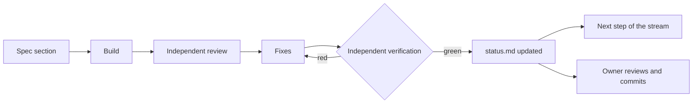
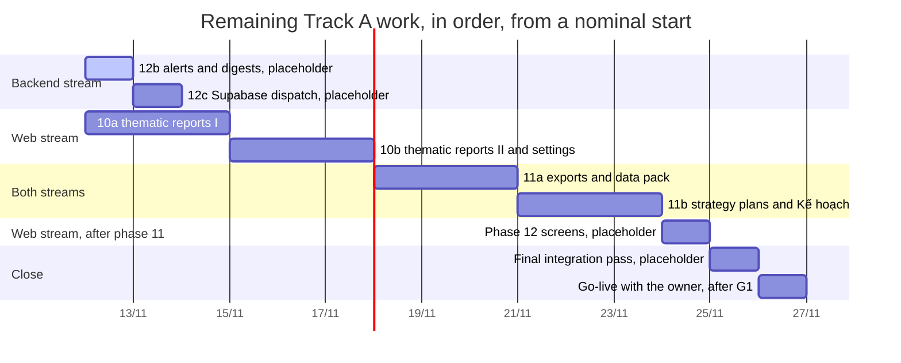

# Delivery plan

This plan explains how the FNB Manager programme is delivered: how work is cut into small steps that are built, reviewed and verified, in which order the remaining work runs, who decides and who does what, which risks are watched, and how changes and progress are recorded. The programme itself (tracks, 20 phases, deliverables, acceptance criteria, gates) is defined in the [roadmap](roadmap.md), and what the system must do is in the [requirements](requirements.md); this plan does not repeat them. It is written for the owner (a café and tea-shop owner), for a developer who takes the work over on another machine, for reviewers and testers, and for whoever runs the platform after go-live.

Last updated 2026-11-12

## 1. Purpose and scope baseline

### 1.1 Which document answers what

The roadmap stays the programme definition. Where this plan and the roadmap disagree on scope, size or order, the roadmap stands until the owner approves a new roadmap version (section 8). Where a document and the code disagree, the document is corrected to match the code, unless the code is the defect, which a build step then fixes.

| Question | Answered by |
|---|---|
| What is built, in which phases, with which acceptance criteria and gates | [roadmap.md](roadmap.md), version 1.1 of 2026-11-07, issued for approval |
| What the system must do, with stable IDs `FR-<AREA>-<nn>` and `NFR-<CAT>-<nn>` | [requirements.md](requirements.md) |
| Why it is built this way | [decisions.md](decisions.md): ADR-001 to ADR-029; ADR-030 to ADR-033 are reserved for phase 12 |
| How the system is built, and how it is protected | [architecture.md](architecture.md), [security.md](security.md) |
| How to set up a machine and run every check | [development.md](development.md) |
| How each phase is built, step by step | the build specs in `docs/private/` (gitignored because they quote real figures): phase 9 was built from its spec and phase 12 is being built from its spec; a phase 10 spec and a phase 11 spec, both dated 2026-11-12, exist privately and await review |
| How it is tested | [test-plan.md](test-plan.md) |
| How a client calls the database: functions, tables, roles, error codes | [api.md](api.md) |
| How owners and managers use the app, screen by screen | [user-guide.md](user-guide.md) |
| What the Vietnamese interface terms, the domain terms and the technical terms mean | [glossary.md](glossary.md) |
| What each package holds and how to test it | the README of each workspace package and app (`packages/*/README.md`, `apps/jobs/README.md`, `apps/web/README.md`); `packages/notify` gets its README in step 12c (WP-12c) |
| How it is run after go-live | [operations.md](operations.md) |
| What is built and verified, and what comes next | [status.md](status.md), the hand-off between machines |
| The first cloud deployment | [go-live.md](go-live.md) |

### 1.2 Scope

In scope: Tracks A to D and the owner's Track Z paperwork, as the roadmap defines them (section 2.1). Out of scope by decision:

- A paid or server-side assistant API. The platform prepares a data pack and stores plans; the strategy reasoning runs in the owner's own assistant (ADR-003).
- Hosting the platform for other businesses. Each owner runs their own deployment (roadmap section 8).
- Any POS call other than the documented read endpoints (ADR-025).

### 1.3 State on 2026-11-12

| Phase | State |
|---|---|
| 1 to 4 | complete; committed in `937ab46` (2026-11-07) and `0f8fa1d` (2026-11-08) |
| 5 Cloud project, onboarding, backups, first data | verified locally; the cloud steps wait for the owner |
| 6 Web app foundation and Hôm nay | verified locally; the demo build is live on GitHub Pages; the cloud checks wait for the owner |
| 7 Sync engine | verified locally, both the Node runner and the `sync-incremental` Edge Function; the deploy and the three-day freshness check wait for the owner |
| 8 Analytics aggregates and metric registry | verified locally |
| 9 Periodic reports Ngày, Tuần, Tháng, Năm | verified locally; the owner's comparison with the POS reports A01 and B01 and the wording review are open |
| 10 Thematic reports, settings, manual data | designed at roadmap level; detailed design pending |
| 11 Exports, data pack, strategy plans | designed at roadmap level; detailed design pending |
| 12 Alerts, digests, channel policies | 12a verified locally; 12b in build (integration and verification); 12c planned |
| 13 to 20 | planned; Tracks B and C wait for the owner's Track Z paperwork |

Nothing after commit `0f8fa1d` is committed. Everything verified since then (the Edge Function runner of phase 7, phase 9, step 12a and step 12b so far) exists only in the working tree of the build machine until the owner commits it.

## 2. Delivery approach

### 2.1 Tracks

| Track | Phases | Delivers | Roadmap effort |
|---|---|---|---|
| A Platform and analytics | 1 to 12 | verified sales data, reports, exports, data pack, strategy plans, digests, backups | about 37 working days |
| B Zalo manager and staff | 13 to 15 | Zalo foundation, staff Mini App, notices, alerts, approvals | about 30 working days for B and C together |
| C Zalo customer loyalty | 16 to 19 | phone capture, loyalty ledger, customer Mini App, coupons, messaging, legal filings, pilot | (with B) |
| D Cross-cutting | 20 | portability proof, hardening, launch, handover | about 5 working days |
| Z Owner paperwork | beside A | legal form, Zalo accounts and verification, e-invoicing, iPOS CRM questions, privacy notice | lead times, not build days |

Track A runs first. Track B starts when the Track Z paperwork allows it. Track C's loyalty rail (phase 16) needs only Track A; its ledger and apps (phases 17 to 19) build on Track B's foundation. Track D closes the programme (roadmap sections 3 and 7).

### 2.2 Two build streams

Inside Track A two streams build side by side because they touch different files.

| Stream | Owns | Remaining work |
|---|---|---|
| Web | `apps/web`; the report packages it renders, `packages/reports` and `packages/demo-analytics` (built in phase 9); `docs/web-app.md`, `docs/metrics.md`, `docs/reports/` | phase 10; the web parts of phases 11 and 12 |
| Backend | the other packages, `apps/jobs`, `supabase/` (migrations, pgTAP tests, seed, Edge Functions), `.github/workflows`, `scripts/`, and the documents that describe them (`docs/sync.md`, `docs/schema.md`, `docs/secrets.md`, `docs/go-live.md`) | steps 12b and 12c; the backend parts of phase 11 |

Rules between the streams:

- A stream re-reads a shared document before editing it and edits only its own sections.
- A stream uses another stream's packages through their public exports only.
- A fault found in another stream's file goes to that stream with file, line, problem and proposed text. Nobody edits across the boundary.
- Before finishing, each builder checks that every changed path belongs to their step.

### 2.3 Verifiable steps of at most about three days

Roadmap principle 13 caps a build step at about three days. Every step:

- has its own section in the phase's build spec, with the files each builder owns, the order of work and a verification checklist;
- is built by one or more builders in parallel on disjoint files (phase 12 used an SQL builder and a TypeScript builder);
- ends with something the owner can open or run, and with its acceptance checked by commands or tests;
- starts only when the previous step of its stream has a green verdict.

Phase 12 shows the split. The roadmap sized it at 2.5 days; its build spec re-planned it as three steps, which together are considerably larger than the roadmap's size. The step estimates stay in the private build spec.

| Step | Content | State |
|---|---|---|
| 12a | schema, outbox, the send decision in SQL, Zalo Bot channel, chat linking, `fnb notify tick`, `status`, `link`, `test` | verified locally |
| 12b | alert episodes and rules, the digest equal to Ngày, Brevo e-mail, `fnb digest`, `notify unlink`, `notify job-failed`, the Actions steps | in build |
| 12c | the Supabase dispatcher, failure alerts from Actions with a fallback, Telegram, Resend and webhook, the database functions for the web screens, documentation | planned |

The units differ between documents, and the difference matters for dates:

- Roadmap sizes are working days on the calendar: the roadmap adds them up to about 72 working days, or 14 to 15 weeks.
- A step can be estimated in builder-days or in elapsed days; with builders working in parallel, a step takes fewer elapsed days than builder-days.
- Roadmap principle 13 names no unit. Which unit governs the cap is an open owner decision (section 10, D3), and every build spec then uses that unit.

### 2.4 Definition of done

A step is done when all of these hold:

1. **Built** to its spec section, with the tests the spec lists (unit, pgTAP, integration, end-to-end, opt-in live checks) and the documents it assigns.
2. **Reviewed** by a reviewer who did not build it.
3. **Fixed**: the builders address every finding, or record why not.
4. **Verified** by an independent verifier who reruns, on the build machine, everything CI runs that a stack holding real data allows: `pnpm lint`, `pnpm typecheck`, `pnpm test` (with the PGlite parity suite inside it), `node scripts/function-imports.mjs --check`, the Deno type-check of the Edge Function, `pnpm exec supabase test db`, `pnpm --filter @fnb/web test:e2e`, the gitleaks scan (`docker run --rm -v "$PWD:/repo" ghcr.io/gitleaks/gitleaks:v8.30.1 git /repo --redact --exit-code 1`) and `node scripts/check-public-safe.mjs`. Then the build checks of `pnpm --filter @fnb/web build`, `pnpm docs:check-api` when a function in `public` or its grants changed, the step's checks against the real data loaded on the local stack (store-days against the POS control totals, the live checks) and the step's acceptance demonstrations. The Postgres parity run (`pnpm --filter @fnb/demo-analytics test:parity:postgres`) refuses a database that holds a real tenant, so it runs on a fresh stack without real tenants: CI's `database` job, or a second stack in the final pass, never the build machine's stack. The verdict is green only when every line passes. Unlike CI, the build machine never resets its stack.
5. **Recorded**: [status.md](status.md) gets the step's state and figures; at the end of a phase the roadmap's status column and status line follow.

The work is then ready for the owner, who reviews and commits it (roadmap principle 12). Nothing leaves the build machine before that.

**Every GitHub issue meets this bar before it closes** (owner rule, 2026-11-14):

- **All tests pass.** `pnpm verify` runs every check of item 4 that the build machine allows, and every one is green. Nothing CI runs is skipped, no assertion is weakened, and no retry, sleep or longer timeout is added to reach green. After the push, CI is green on the commit. A failure outside the issue's scope is fixed first or filed as its own issue; it never closes silently.
- **Specs adapted.** Every document the change touches is updated in the same change: the requirement's statement, acceptance, status and trace in [requirements.md](requirements.md); cases, suite counts and the trace matrix in [test-plan.md](test-plan.md); the build spec; an ADR in [decisions.md](decisions.md) for every decision; [status.md](status.md) and the roadmap's status; and the user-facing documents ([user-guide.md](user-guide.md), [web-app.md](web-app.md), [api.md](api.md), [schema.md](schema.md), [operations.md](operations.md)). Every feature a user can see has its section in the user guide with screenshots taken from the demo by `pnpm --filter @fnb/web docs:screenshots`, and a change to a screen retakes its screenshots in the same change.
- **Docs followed.** The change follows this plan's working rules (section 2.6), [development.md](development.md), [web-app.md](web-app.md), [security.md](security.md) and the ADRs. A departure needs an ADR before the code.
- **Traced.** The commit names its issue (`Closes #n`), the issue lists its requirement ids and the tests that prove them, and the trace columns of the requirements and the test plan name those tests.

### 2.5 Gates

The step gate is the green verdict above. The programme gates are the roadmap's (section 6):

| Gate | Question | State on 2026-11-12 |
|---|---|---|
| G1, before the cloud steps of phase 5 | Supabase project, SMTP and GitHub secrets in place? | waits for owner |
| G2, end of phase 16a | iPOS CRM as the loyalty rail, or the fallback rail? | planned |
| G3, before phase 19b | cross-border transfer dossier, or the household or micro-enterprise exemption? | waits for owner (legal form) |
| G4, before phase 19b, or earlier at about 400 MB, a second owner or mandatory daily backups | move Supabase to Pro? | planned; `fnb doctor` turns yellow from 400 MiB |
| G5, phase 11b | a monthly scheduled assistant run for plans? | open; default: start by hand |
| G6, phase 7 | scheduler for the incremental sync | decided: Supabase `pg_cron` plus the Edge Function (ADR-020); built; enabling it waits for owner |

### 2.6 Working rules that keep the work safe

- The local stack on the build machine holds a tenant loaded with real data. Never run `supabase db reset` there; apply new migrations with `pnpm exec supabase migration up`.
- Run the `fnb` CLI with `CI=1` whenever its output is shared: it then names no shop.
- No shop name, account e-mail, chat id, key or revenue figure goes into a tracked file. Run `node scripts/check-public-safe.mjs` before every commit. Shop-specific material stays in `docs/private/`.
- Never print or copy credential values from `.env` or `apps/web/.env.local`.
- Commits, pushes, deploys and anything else that leaves the build machine are the owner's to trigger, directly or by an explicit authorization. An authorized push carries only issues that meet the bar of section 2.4, never rewrites history and never forces.
- The build machine is shared by work running in parallel: long test runs belong to the verifier.
- Several working sessions can share one working tree and one local stack. Each commits only its own files, by explicit path (never `git add -A`), lists pending migrations before writing one, applies only its own, and starts no build in another stream without telling it.

## 3. Milestones

Dates come from the git history, the GitHub Actions history and [status.md](status.md). Future milestones carry no date: they depend on the build machine's availability and on owner actions. Section 4.2 gives their order and relative length.

| # | Milestone | Date | Status | Evidence |
|---|---|---|---|---|
| M1 | Roadmap v1.1 and ADR-001 to ADR-026 | 2026-11-07 | written; the roadmap is issued for approval | roadmap header; ADR dates |
| M2 | Public repository with CI; Pages serves a placeholder (phases 1 to 4) | 2026-11-07, 21:01 (+07) | complete | commit `937ab46`; the first "Deploy web app" run succeeded that evening |
| M3 | Proof-of-concept demo on GitHub Pages: the web app with Hôm nay on generated numbers; phases 5 to 8 verified locally | 2026-11-08, 14:20 (+07) | live on Pages | commit `0f8fa1d`, pushed; "Deploy web app" succeeded. On GitHub, CI's code, database and end-to-end jobs passed; the secret-scan job failed in its setup step (fix in the working tree, risk R-08) |
| M4 | Edge Function runner of phase 7 verified locally | 2026-11-08 | verified locally, not committed | status.md: all twelve checks of the phase 7 verification passed |
| M5 | Phases 1 to 9 verified locally | 2026-11-09 at the latest | verified locally, not committed; the phase 9 owner checks are open | status.md; roadmap phase 9 status |
| M6 | Step 12a verified locally | 2026-11-09 | verified locally, not committed | status.md |
| M7 | Step 12b verified | – | in build (integration and verification on 2026-11-12) | – |
| M8 | Step 12c verified: phase 12 complete locally | – | planned | – |
| M9 | Phase 10a, then 10b, verified | – | designed | – |
| M10 | Phase 11a, then 11b, verified | – | designed | – |
| M11 | Settings → Cảnh báo and the Bản tin panel | – | designed | – |
| M12 | Final integration pass: Track A complete locally, roadmap and status current | – | planned | – |
| M13 | Go-live: Pages serves the live app behind login, on the owner's cloud project | – | waits for owner (G1) | [go-live.md](go-live.md) |
| M14 | Track B (phases 13 to 15) | – | planned; starts after Track Z (owner) | – |
| M15 | Track C (phases 16 to 19) and the pilot | – | planned; starts after Track Z (owner); gates G2, G3, G4 | – |
| M16 | Track D (phase 20): portability proof, launch, tag v1.0.0 | – | planned | – |

## 4. Work breakdown

### 4.1 Remaining Track A work

| ID | Work package | Stream | Roadmap size | Detailed estimate | Depends on | Status | Ends with |
|---|---|---|---|---|---|---|---|
| WP-12b | Step 12b: alert episodes and rules, the digest lines, the daily digest equal to Ngày, the Brevo e-mail adapter, `fnb digest`, `fnb notify unlink`, `fnb notify job-failed`, the outbox notifier in the CLI, the digest and send steps of `sync.yml`, `notify.yml` | backend | part of phase 12 (2.5 d) | in the private phase 12 spec | 12a | in build | acceptance items A1 to A3 shown on the local stack; digests and alerts sent through Actions |
| WP-12c | Step 12c: the `notify` Edge Function and its `pg_cron` schedule (`app.enable_notify`), `sync-incremental` writing to the outbox, the failure listener `notify-on-failure.yml` with a database-free fallback, the Telegram, Resend and webhook adapters, `fnb notify check`, `notify resend`, `notify setup`, `digest --revise` and corrections, the intraday rules (`zero_sales_open`, `nightly_missing`), the database functions for the web screens, `docs/notifications.md`, `packages/notify/README.md`, ADR-030 to ADR-033, go-live step 8 | backend | part of phase 12 | in the private phase 12 spec | 12b | planned | the whole phase 12 verification checklist green |
| WP-10a | Phase 10a: Doanh thu & xu hướng; Giờ & ngày trong tuần; Thực đơn; Thanh toán & tiền mặt; item-type role mapping; range presets; CSV with a UTF-8 BOM | web, with SQL | 3 d | detailed design pending (a spec dated 2026-11-12 awaits review) | phase 9 | designed | four thematic reports on the real data |
| WP-10b | Phase 10b: Khuyến mãi & giảm giá; Ca & két tiền; So sánh cửa hàng; Chất lượng dữ liệu; the settings pages (store profile, hours, seats, legal form, item costs with CSV import, targets, fees, mappings, roles, holidays, language, legal texts; the day start stays with the POS, FR-SET-01); audit columns; browser write tests | web, with SQL | 3 d | detailed design pending (a spec dated 2026-11-12 awaits review) | 10a | designed | four more reports and every settings page; a viewer cannot save settings |
| WP-11a | Phase 11a: exports (CSV or JSON, split by month), `packages/datapack`, `fnb datapack`, the data-pack buttons and the "Dán kế hoạch" paste box | both | 2.5 d | detailed design pending (a spec dated 2026-11-12, under review) | phase 10 | designed | a month's export equals the invoices table; browser and CLI packs are byte-identical apart from the timestamp |
| WP-11b | Phase 11b: the versioned strategy prompt inside the pack, `/strategy` in the owner's own assistant, `fnb publish-plan` signing in as the `publisher` member, the Kế hoạch tab with KPI follow-up | both | 2.5 d | detailed design pending (a spec dated 2026-11-12, under review) | 11a | designed | a plan published and shown in Kế hoạch with live KPI values |
| WP-12w | Settings → Cảnh báo (`#/cai-dat/canh-bao`) with a test button, and the Bản tin panel | web | inside phase 12's 2.5 d | not estimated yet | 12c (database functions), 10b (settings pages) | designed | a member links a chat and sends a test message from the app; past digests are listed |
| WP-FP | Final integration pass: everything CI runs, on a freshly reset stack as CI uses (never the build machine's stack), the real-data checks on the local stack, the documents checked against the code with the correction requests of section 8.1 closed, roadmap and status updated | verifier | – | not estimated yet | all of the above | planned | a green verdict for Track A, ready for the owner's commit and push |
| WP-GL | Go-live with the owner (section 4.3) | owner, with the delivery team | G1: about 1 hour (roadmap section 5) | the steps of go-live.md; step 8 arrives with 12c | G1; the final pass first is recommended, not required | waits for owner | the live app on Pages; nightly, backups and schedules running; the cloud acceptance checks of phases 5 to 9 and 12 |

### 4.2 Order and dependencies

- The bars show the order of the work from a nominal start on 2026-11-12, not commitments. Phases 10 and 11 carry the roadmap's sizes. Steps 12b and 12c, whose estimates stay in the private build spec, and the work packages without an estimate carry a one-day placeholder.
- Phases 10 and 12 run side by side because they belong to different streams. Phase 11 needs phase 10 (roadmap) and a backend stream free of phase 12. The phase 12 screens need the database functions of 12c and the settings pages of 10b; the current build order places them after phase 11.
- Go-live does not depend on phases 10 to 12: phases 1 to 9 are ready for it. It needs the owner's G1 actions. Running the final pass first means the first deployment to the cloud carries one verified state, which CI on GitHub confirms before go-live.

### 4.3 Go-live with the owner

[go-live.md](go-live.md) is the checklist. In short:

| Step | What | Who | Time |
|---|---|---|---|
| 1 | Create the Supabase project (Free plan, Singapore), turn sign-ups off, set the URL configuration, SMTP and SSL enforcement | owner | about 10 minutes |
| 2 | Put the values in the local `.env` and in the GitHub secrets and variables | owner | minutes |
| 3 | Apply the schema: push to `main` or run "Migrate database" | owner | minutes |
| 4 | Create the tenant, the owner's login and the POS accounts; backfill month by month | owner, with the delivery team | about a minute per account-month on the local stack |
| 5 | Deploy the web app (automatic on a push that touches it) | owner | minutes |
| 6 | Turn on the incremental sync: deploy the function, set its secrets, try a manual ticket, enable the schedule | owner | about 10 minutes |
| 7 | Keep it fresh and safe: nightly sync, backups, `fnb doctor` | owner | – |
| 8 | Turn on digests and alerts (the step is written in 12c; `fnb notify link` and `fnb notify test` exist since 12a) | owner | – |

Acceptance items that only the cloud can show, all "waits for owner" until go-live:

- Phase 5: migrations applied by the workflow; the live RLS run with two throwaway users; both stores onboarded with the right names and opening dates; a month's daily invoice counts equal the POS daily totals; sign-ups disabled and custom SMTP configured; the first encrypted backup outside the repository, with its size logged.
- Phase 6: login on a phone; a password reset completed on the deployed site; Lighthouse on the live app (mobile performance at least 85, accessibility at least 90).
- Phase 7: the freshness badge younger than 35 minutes during opening hours on three consecutive days; monthly totals equal to the POS report A01 (owner check, private).
- Phase 8: the analytics refresh under 2 minutes on production.
- Phase 12: the digest arrives three nights running with numbers equal to Ngày.

### 4.4 Track Z at roadmap level

Track Z is the owner's paperwork. Its lead times cannot be shortened by building faster. The full table with weeks is roadmap section 5.

| Group | Actions | Lead time | Needed by | State on 2026-11-12 |
|---|---|---|---|---|
| Repository | create the public repository; enable Actions and Pages | minutes | phase 1 | done (2026-11-07) |
| POS security | change the tea shop's POS password; the owner's decision on the private vendor observations (ADR-025) | minutes; 1 day | phase 3 | open |
| Cloud (G1) | Supabase project, SMTP, secrets and variables, backup destination, backfill workflows; Pages variables and auth redirect URLs | about 1 hour | phases 5 and 6 | open |
| Legal form | each brand's legal form, revenue band and registered name | days | phases 13, 16, 19; gate G3 | open |
| Zalo | eKYC; one Official Account per brand, verified within 14 days; the Tăng trưởng package and a ZBS account; one Zalo App per brand; Mini App names, logos and test users | 1 day to 3 working days each | phases 13 to 15 | open |
| iPOS and e-invoicing | the iPOS CRM questions (shared tiers, rates, callback IPs); e-invoice registration of the coffee shop and the tea shop's status; member toggles and the receipt template | days to 2 weeks | phases 16 to 18; gate G2 | open |
| Store habits | individual cashier logins; asking every customer for a phone number at the till | 1 week | phases 7 and 16 | open |
| Inputs | review the report wording; item costs, a monthly target, seat counts, opening hours; the publisher login; run `/strategy` twice; the Zalo Bot and an e-mail provider account | about 1 hour each | phases 9 to 12 | open |
| Privacy | the Vietnamese privacy notice and information-protection rules, before any staff data is processed | 1 week | phase 14 | open |
| Legal read | dossier or exemption; programme notification against the 100 M₫ threshold; consent wording | 1 to 2 weeks | gate G3; phase 19 | open |
| Launch | fund the ZBS account, approve templates, print standees; Supabase Pro; the deploy-your-own dry run; tag v1.0.0 | 1 week; minutes; 2 hours | phases 19 and 20; gate G4 | open |

### 4.5 Tracks B, C and D at roadmap level

| Phase | Track | Size | Depends on | Owner must | State |
|---|---|---|---|---|---|
| 13 Zalo and platform foundation | B | 3 d | 5, 6 and Track Z | Zalo accounts, verified OA with package, Mini Apps, names and logos | planned; starts after Track Z (owner) |
| 14 Staff Mini App core (a, b) | B | 2.5 + 3 d | 13 | staff list, checklist items, cashier logins, staff notice | planned; starts after Track Z (owner) |
| 15 Notices, alerts, approvals; first review; internal publish | B | 2.5 d + review | 14, 12 | staff follow the OA, join the group, message the Bot | planned; starts after Track Z (owner) |
| 16 Loyalty rail (a, b) | C | 1.5 + 2 d | 7, 9 | cashier briefing, CRM questions, toggles, receipt template, e-invoice registration | planned; starts after Track Z (owner) |
| 17 Loyalty ledger and compliance tooling (a); staff loyalty tools (b) | C | 3 + 2.5 d | 16, 13, 15 | thresholds, blacklist, programme budget | planned; starts after Track Z (owner) |
| 18 Customer Mini App (a); coupons and redemption (b) | C | 3 + 2.5 d | 17 | brand assets, test users, reward catalogue, cashier training | planned; starts after Track Z (owner) |
| 19 Customer messaging (a); legal filings, review, publish, pilot (b) | C | 2.5 + 2 d | 18 | ZBS account, templates, Sở Công Thương decision, dossier decision, standees | planned; starts after Track Z (owner) |
| 20 Portability proof (a); hardening, launch, handover (b) | D | 2.5 + 2.5 d | all | deploy-your-own dry run, tag v1.0.0 | planned |

Each of these phases gets its own build spec, cut into verifiable steps, before it starts. The seven Zalo and iPOS deep dives number the phases of Tracks B and C two higher than the roadmap does.

## 5. Roles and responsibilities

| Role | Who | Does |
|---|---|---|
| Owner | the business owner | approves scope, sizes and gates; holds every credential; commits and pushes; runs the acceptance checks that need private figures; does the Track Z paperwork; is the data controller under the personal-data law |
| Designer | delivery team | writes a phase's build spec, settles contradictions between designs, lists the owner's review items |
| Builder | delivery team | builds a step to its spec, with its tests and documents |
| Reviewer | delivery team, not the step's builder | reviews a step independently |
| Verifier | delivery team, not the step's builder | reruns everything CI runs plus the real-data checks, gives the verdict, updates [status.md](status.md) and, at phase end, the roadmap status |
| Operator | the owner, or a manager the owner designates, after go-live | runs the platform with [operations.md](operations.md) |

R responsible, A accountable, C consulted, I informed.

| Activity | Owner | Designer | Builder | Reviewer | Verifier | Operator |
|---|---|---|---|---|---|---|
| Approve roadmap versions, scope, sizes and gates | A, R | C | I | I | I | – |
| Write a phase build spec and settle its open items | A | R | C | C | I | – |
| Build a step with its tests and documents | I | C | A, R | I | I | – |
| Review a step | I | C | C | A, R | I | – |
| Fix the findings | I | C | A, R | C | I | – |
| Verify a step and give the verdict | I | I | C | I | A, R | – |
| Update status.md after each verdict | I | – | C | – | A, R | – |
| Update the roadmap status at the end of a phase | A | – | – | – | R | – |
| Write an ADR | A | R | R | C | I | – |
| Commit, push, tag a release | A, R | – | I | I | C | – |
| Acceptance checks against private figures; wording review | A, R | – | – | – | C | – |
| Cloud setup (G1), function secrets, enabling schedules | A, R | – | C | – | C | I |
| Acceptance checks on the cloud after go-live | A | – | C | – | R | C |
| Track Z paperwork; decisions at gates G2 to G5 | A, R | C | – | – | – | I |
| Daily and weekly operations | A | – | – | – | – | R |
| Incident handling with the runbooks | A | – | C | – | I | R |
| Rotating secrets | A, R | – | – | – | – | C |
| Backups and the restore drill | A | – | – | – | C | R |
| Data-subject requests | A | – | C | – | – | R |
| Personal-data breach response and notification | A, R | – | C | – | – | C |

## 6. Quality management

[test-plan.md](test-plan.md) defines the test levels, suites, environments, entry and exit criteria and the traceability from requirements to tests. Delivery passes these quality gates:

- **Every step:** the definition of done (section 2.4). No step starts before the previous step of its stream is green.
- **Every push and pull request:** CI (`.github/workflows/ci.yml`) runs four jobs: the secret and identifier scan (gitleaks over the history, then `scripts/check-public-safe.mjs`); lint, typecheck, unit tests and the Edge Function checks; migrations and pgTAP on a fresh stack plus the Postgres parity suite; the web end-to-end tests.
- **Every phase:** the roadmap's acceptance criteria, shown by commands or tests. Checks that need real figures (POS reports, the private acceptance sheet) are the owner's and stay private. ADR-014 sets the gates.
- **Every commit:** `node scripts/check-public-safe.mjs`, which also reads the private identifier list when it is present.
- **Final pass:** all of the above on a freshly reset stack, and the documents checked against the code.

Latest known results:

| Check | Result | Source |
|---|---|---|
| Unit tests | 1,415 passed and 32 skipped (the gated live and integration suites), 142 files, 12 packages | test run of 2026-11-12, 14:00 to 14:02 |
| pgTAP | 31 files, 1,648 planned tests (file plans read 2026-11-12, 15:41); 2 date-drift failures on the long-lived local stack, being fixed | test files on 2026-11-12 |
| Playwright | 63 tests in 9 files; all 63 passed at the phase 9 verification | roadmap, phase 9 status |
| Lighthouse mobile, demo build | performance 93, accessibility 100, best practices 100, SEO 60 because of the deliberate `noindex` | status.md |
| Public-safety scan | no findings | 2026-11-12 |
| CI on GitHub | for `0f8fa1d`: code, database and end-to-end jobs green; the secret-scan job red in its setup step | GitHub Actions, 2026-11-08 |

## 7. Risk register

Likelihood and impact: H high, M medium, L low.

| ID | Risk | L | I | Mitigation | Owner |
|---|---|---|---|---|---|
| R-01 | **Build-machine availability.** All building and verification runs on one machine, which also holds the local stack with the real tenant and every change since `0f8fa1d`. Sleep, power loss or a fault stops delivery; a disk failure would lose the uncommitted work. | M | H | Commit each verified step (O1); [status.md](status.md) as the hand-off, with the steps to continue on another machine; keep the machine on power during builds; the real tenant can be reloaded from the POS at about a minute per account-month. | owner |
| R-02 | **Single-person dependency.** The owner alone holds the credentials, approves gates, commits, runs the private acceptance checks and does the paperwork. | H | H | The owner-action list with what each action unblocks (section 10); defaults built as rows so that decisions can wait; runbooks a manager can follow; a second trusted person with a manager login; the backup key stored offline in two places. | owner |
| R-03 | **POS API change.** The POS API is private and undocumented; a changed field, endpoint or login flow can break the sync or shift numbers. | M | H | Typed validation that fails a run instead of guessing; every store-day reconciled against the POS daily totals; raw payloads kept per store-day (ADR-027) for re-derivation; fixture contract tests and opt-in live tests; the connector isolated in one package; documented read endpoints only (ADR-025). | backend stream |
| R-04 | **Free-plan limits.** 500 MB database (about 18 MiB a month with two stores: roughly a year), 5 GB egress a month (weekly backups about 1.3 GB), no platform backups, one day of platform logs, 2 s of CPU per Edge Function request, 3,000 Zalo Bot messages a month. | M | M | Compressed payloads and retention; the CPU and wall-time guard; our own encrypted weekly backups; logs kept in our tables; `fnb doctor` (yellow from 400 MiB, red from 475 MiB); gate G4. | owner (G4), backend stream |
| R-05 | **Supabase project pauses.** A Free project pauses after about a week of low activity; a week of failed POS logins means no activity. | L | H | The nightly and incremental syncs are the activity; `fnb doctor` pause risk (yellow from 5 idle days, red from 7); runbook 4.12 in [operations.md](operations.md). | operator |
| R-06 | **GitHub schedules start late or not at all.** Measured on this repository: the nightly "Sync" started 3 h 24 min to 6 h 23 min after 03:23 on each day from 2026-11-09 to 2026-11-12; each half-hourly cron probe ran 18 times between 2026-11-07 and 2026-11-12, out of more than 200 slots. | H | M | The incremental sync runs inside Supabase (ADR-020); the Supabase notification dispatcher (12c); idempotent windows that heal a missed run; the dead-man's switch; the digest's 06:30 deadline; a small server as the documented fallback. | backend stream |
| R-07 | **Keep-alive check broken.** "Scheduled workflows active" failed on its first run (2026-11-09) because its `gh` call had no repository, so GitHub's 60-day inactivity rule is not guarded. | H | M | Fix requested to the backend stream; the owner's commits reset the timer; a missing nightly shows in `fnb doctor` and, from 12c, as the `nightly_missing` alert. | backend stream |
| R-08 | **Uncommitted work and GitHub drift.** GitHub runs the `0f8fa1d` workflows: `sync.yml` without the digest steps, no `deploy-functions.yml` or `notify.yml`; Pages shows the `0f8fa1d` demo; CI has never run on phases 7 to 12, and its secret-scan job is red. | H | M | Commit per verified step (O1); the final pass reruns CI locally and checks the workflow files; push before go-live and confirm CI green. | owner |
| R-09 | **Effort above the roadmap.** Phase 12's three steps are considerably larger than the roadmap's 2.5 days; the phase 10 and phase 11 specs are still under review, so their effort is not settled. | H | M | Steps with cut lists that keep every acceptance item; re-baseline the roadmap (D2, D3); report builder-days and elapsed days together. | owner, designer |
| R-10 | **No production yet (G1 open).** Every cloud acceptance check (phone login, deployed password reset, live Lighthouse, freshness, refresh timing, the cloud RLS run, the digest) is unproven. | H | H | go-live.md in about an hour; the demo on Pages in the meantime; the final pass before the first cloud deployment. | owner |
| R-11 | **Data loss before backups exist.** Supabase Free makes no backups; `backup.yml` skips until its secrets exist; no restore has been rehearsed. | M | H | Configure backups before real data reaches the cloud (go-live step 7); restore drill each quarter and in phase 20b; the POS keeps the sales history, but manual inputs, settings, members and consent records exist only in our database. | owner |
| R-12 | **Secrets or identifiers leak.** The repository and its Actions logs are public. | L | H | gitleaks and the public-safety scan in CI; the private identifier list checked locally; credential fields masked at job start; neutral account keys; `CI=1` for shared output; the bundle check of the web build. | delivery team; owner at each commit |
| R-13 | **Legal change.** New personal-data decrees, a draft replacing the anti-spam Decree 91 under consultation since September 2026, the 2026 e-invoice decree; the dossier duty depends on the legal form. | M | M | Compliance built into the schema (ADR-021); channel policies as rows with legal floors; the legal read (Track Z); legal-watch items in the maintenance calendar of operations.md. | owner |
| R-14 | **Zalo platform unknowns.** Zalo pages that disagree (roadmap section 11), review and permission lead times (about 3 working days per review, up to about 2 weeks for permissions), Official Account package expiry, message-price changes, undocumented Zalo Bot limits. | H | M | Track Z started early; probes in phase 13; e-mail as a second channel; budgets at the highest quoted price; Zalo policy as acceptance criteria (ADR-022). | owner, designer |
| R-15 | **Owner checks and decisions stay open.** Phase 9 comparisons and wording review, phase 12 defaults, G5, roadmap approval. | M | M | Defaults built as rows or constants; the owner-action list; checks scheduled at go-live. | owner |
| R-16 | **Long-lived test stack drifts.** The seed's dates age on the build machine, so date-sensitive pgTAP tests fail there while CI passes. | M | L | Tests anchored to the seed's date (fix in progress); CI's fresh stack is the reference. | backend stream |
| R-17 | **Documents drift from the code.** The review of 2026-11-12 found more than a dozen disagreements: stale dates, missing commands, a wrong secret name, CI checks the roadmap promises. | H | L | The final pass checks the documents against the code; corrections go to each file's owner as requests. | verifier |
| R-18 | **Alert fatigue or wrong thresholds** once digests run. | M | L | Business rules are lines in the daily digest, not immediate alerts; cool-downs; only owners change rules; the defaults are an owner review item (O8). | owner |

## 8. Change control

| What changes | Where it is recorded | Who decides |
|---|---|---|
| Architecture or a rule across packages | a new ADR in [decisions.md](decisions.md): date, status, decision, reasons, consequences. An ADR is amended with a dated note, never rewritten silently. ADR-030 to ADR-033 are reserved for phase 12 and are written in step 12c. | owner accepts; designer or builder writes |
| Scope, size, order, acceptance or a gate | a new roadmap version with an entry in its change log (roadmap section 12); until the owner approves it, the current version stands | owner |
| How a phase is built | its build spec (private), final before building. Contradictions between designs are settled in the spec with reasons; changes during the build are written back into the spec, and their public consequences into ADRs and documents. | designer; owner for the review items |
| Requirements | [requirements.md](requirements.md): IDs are never reused or renumbered; a status changes only with evidence | owner approves; verifier updates statuses |
| A document another stream owns | a request with file, line, problem and proposed text, tracked in section 8.1; the file's owner edits it | the file's owner |
| Code and a document disagree | the document is corrected to match the code, at the latest in the final pass, unless the code is the defect | verifier |

Changes pending on 2026-11-12:

- The roadmap still shows phase 12 as not started and sized at 2.5 days; the larger three-step plan is not in it.
- The roadmap and ADR-023 promise CI checks that do not exist: a schema-diff check, a generated-types drift check, a log preflight lint and a column-name lint (D4).
- ADR-013 says the publisher reads aggregates; the database grants the publisher no aggregate (D5).
- [status.md](status.md) still carries the date 2026-11-08 and the check figures of `0f8fa1d`.

### 8.1 Open correction requests

The documentation set written on 2026-11-12 found differences between documents and the code, and checks missing from files that other streams own. Each became a request to the file's owner (section 2.2). This table is their tracked record: the file's owner acts on a request, and the verifier closes its row with the date. The final pass (WP-FP) needs every row closed, or deferred by the owner with a dated note. [requirements.md, section 9.5](requirements.md#95-document-differences-found) and [test-plan.md, section 12.3](test-plan.md#123-correction-requests-referenced-in-this-plan) list the requests each of them refers to.

| Request | File | Problem | Proposed change | Owner | State |
|---|---|---|---|---|---|
| R-F01 | `docs/roadmap.md`, line 9 | Cites the decisions as ADR-001 to 026 | Cite ADR-001 to ADR-029, with ADR-030 to ADR-033 reserved for phase 12 | owner | open |
| R-F02 | `docs/roadmap.md`, phase table and phase 12 | Phase 12 shown as not started and sized at 2.5 days | Show 12a verified, 12b in build and 12c next; record the larger three-step plan once the owner agrees (D2) | owner | open |
| R-F03 | `docs/roadmap.md`, `docs/decisions.md` (ADR-023) | Promise CI checks that do not exist: a schema diff, a generated-types drift check, a preflight log lint, a column-name lint and a single probe workflow | Build the checks or amend the texts (D4) | owner | open |
| R-F04 | `docs/decisions.md` (ADR-013) | Says the publisher reads aggregates; the database grants it none | Reword to match the database (D5) | owner | open |
| R-F05 | `docs/status.md` | Stale date, stale phase 12 wording and the check figures of `0f8fa1d` only | Date the page 2026-11-12, give the current phase 12 state and add the checks of 2026-11-12 | verifier | open |
| R-F06 | `docs/secrets.md` | Names `ZALO_BOT_TOKEN` instead of `NOTIFY_ZALO_BOT_TOKEN` and misses four `NOTIFY_*` secrets and the `digest` and `notify` commands | Rename the secret and add the missing rows | backend (step 12c) | open |
| R-F07 | `docs/sync.md` | The notifier, the exit codes and the CLI reference predate step 12b | Describe the outbox notifier, exit codes 3 and 4 of `notify job-failed`, and the `digest` and `notify` commands | backend (step 12c) | open |
| R-F08 | `README.md` | The layout and the CLI list miss `packages/notify`, the `digest` and `notify` commands and two workflows | Add them | backend | open |
| R-F09 | `apps/web/README.md` | Says the size check counts the live analytics source as initial JavaScript; the check treats it as lazy | Reword once a live build confirms it | web | open |
| R-F10 | `docs/web-app.md` | Folds the two password routes into the login row; lists `stores` and `notification_channels` as browser writes that have no write grant | Add the two routes; mark the two writes as designed | web | open |
| R-F11 | `docs/schema.md` | Four `app` functions are not described | Describe them from their catalogue comments | backend | open |
| R-F12 | `fnb notify job-failed --help`, a table comment | Refer to step 12c parts that do not exist yet | Describe them as planned, unless step 12c lands as planned | backend | open |
| R-F13 | `docs/go-live.md` | No step for the notification secrets, linking and the test message | Add step 8 with step 12c | backend (step 12c) | open |
| R-F14 | `docs/deep-dives/github-pages-and-actions.md` | Starts with a level-2 heading | Make it a level-1 heading | final pass | open |
| R-AS01 | `docs/schema.md` | Says the jobs run as `service_role`; they connect as `postgres`. Also leaves `sale_payloads` out of the tables without a grant | Reword the four lines | backend | open |
| R-AS02 | `.github/workflows/migrate.yml`, `backup.yml` | The cloud secrets sit on the whole job, so `pnpm install` runs with them | Move them to the steps that use them | backend | open |
| R-AS03 | `.github/workflows/ci.yml` | No `permissions` block | Declare `contents: read` | backend | open |
| R-AS04 | `.github/workflows/` | Actions are pinned to major tags and no tool proposes dependency updates | Add automated updates or pin actions to commit SHAs (owner decides) | owner, backend | open |
| R-AS05 | `docs/decisions.md` (ADR-023), `docs/roadmap.md` (phase 5) | Promise a guard against `db reset --linked`; none exists | Build the guard or amend the texts (FR-OPS-06) | owner, backend | open |
| R-AS06 | `apps/jobs/src/services.ts` | The CLI accepts an explicit plaintext `sslmode` for a remote host | Apply `enforcedSsl` as the Edge Function does (NFR-SEC-05) | backend | open |
| R-AS07 | `docs/status.md` | Says printed charts keep their on-screen size; they redraw at the printed width | Drop the clause | verifier | open |
| R-AS08 | `docs/schema.md` | The publisher's read list leaves out the global notification catalogues | Add them (FR-TEN-06) | backend | open |
| R-AS09 | `.github/workflows/ci.yml` | CI never runs the web build with its bundle and size checks | Add the build step | web, backend | open |
| R-AS10 | `docs/go-live.md` | No step sets the Auth password policy or decides on MFA | Add an authentication-settings step | owner, backend | open |
| R-AS11 | `apps/web/index.html` | The app sets no Content Security Policy | Evaluate a `meta` policy with a Playwright check | web | open |
| R-DG01 | `docs/connectors.md` | Points at a deleted file; the connector registry now lives in `@fnb/runner` | Point at `packages/runner/src/connectors.ts` and `accounts.ts` | backend | open |
| R-DG02 | `docs/web-app.md` | Tells readers to run `pnpm db:reset`, which wipes the real tenant on the build machine | Say that the first `pnpm db:start` seeds a new machine and that a stack with real data is never reset | web | open |
| R-DG03 | `README.md` | Implies that `DATABASE_URL` in `.env` runs the integration tests; they read the shell environment only | Say so | backend | open |
| R-DG04 | the fact sheet and the test plan | `pnpm test -- --maxWorkers=2` does not limit the workers | Give the working command | documentation set | closed: [development.md](development.md) and [test-plan.md](test-plan.md) give it |
| R-P01 | `.github/workflows/workflows-active.yml` | Its only run on GitHub so far (2026-11-09) failed: `gh` had no repository | Set `GH_REPO` or pass `--repo`, then dispatch it once (FR-OPS-09) | backend | open |
| R-P02 | `.github/workflows/ci.yml`, `docs/status.md` | On GitHub the secret-scan job of `0f8fa1d` failed in its setup step; the fix in the working tree is untried | Confirm it with the next push and note it in status.md | backend, verifier | open |
| R-P03 | `scripts/cron-delay-report.mjs` | Counts late runs against the wrong slot and ignores missed slots | Report runs per slot and delays from the scheduled time (FR-OPS-10) | backend | open |
| R-P04 | `docs/roadmap.md` (phase 1 status), `docs/decisions.md` (ADR-020) | Still collecting cron data; ADR-020 expects delays of 20 to 40 minutes | Record the measured delays of hours ([operations.md, section 2.3](operations.md#23-how-late-github-starts-scheduled-runs)) | owner | open |
| R-P05 | `docs/status.md` | Does not say that nothing after `0f8fa1d` is committed | Add it to the owner actions | verifier | open |
| R-P06 | `docs/go-live.md`, `docs/sync.md` | Say the nightly Sync runs at 03:23 | Add that GitHub has started it hours later | backend | open |
| R-P07 | `docs/sync.md` | No command removes a member or changes a member's store scope | Add a command or document the SQL | backend | open |
| R-P08 | `docs/secrets.md`, `docs/roadmap.md` (phase 20b) | Point at a runbook that now exists as operations.md | Point at [operations.md, section 4.8](operations.md#48-rotating-supabase-keys-and-provider-tokens) | backend, owner | open |
| R-P09 | `README.md` | The documents paragraph does not name the documentation set | Replaced by R-FX02 | – | superseded |
| R-P10 | `docs/status.md` | Says the backend stream owns every package | Name the packages the web stream owns | verifier | open |
| R-P11 | `docs/roadmap.md` (principle 13) | The step cap names no unit | Name the unit once the owner decides (D3) | owner | open |
| R-AP01 | `.github/workflows/ci.yml` | Nothing in CI compares [api.md](api.md) with the database | Run `pnpm docs:check-api` in the `database` job | backend | open |
| R-AP02 | `docs/schema.md` | Says the heatmap averages divide by every date of the weekday; they divide by the dates with sales | Reword the `hour_weekday_heatmap` row | backend | open |
| R-AP03 | `README.md` | The reading list misses api.md and glossary.md | Replaced by R-FX02 | – | superseded |
| R-AP04 | `docs/sync.md` | Lists only some answers of `sync-incremental` | Point at [api.md, section 5](api.md#5-edge-function-endpoints) | backend | open |
| R-AP05 | a future migration | `period_compare` and `refresh_my_analytics` raise `P0001` instead of `22023` for bad arguments | Use `22023` in the next migration that touches them | backend | open |
| R-AP06 | the fact sheet | Counted 27 migrations; there are 28 | Use 28 | documentation set | closed: the documents of the set say 28 |
| R-Q01 | `docs/roadmap.md` (phase 5), `docs/decisions.md` (ADR-023) | The reset guard does not exist (as R-AS05) | Build it or mark it open (FR-OPS-06) | owner, backend | open |
| R-Q02 | `docs/roadmap.md` (phase 3) | The anonymising recorder is not in the repository | Say that every fixture is synthetic | owner | open |
| R-Q03 | `docs/roadmap.md` (phase 7) | The check levels ok, warn and fail differ from the built matched flag and data-quality flag | Describe what is built | owner | open |
| R-Q04 | `docs/roadmap.md` (phase 5 acceptance) | Expects opening dates from onboarding; they come from the store profile | Say so (FR-SET-01) | owner | open |
| R-Q05 | `docs/roadmap.md` (phase 8) | The aggregate list names work that report functions serve or that is not built | Say which report functions serve them | owner | open |
| R-Q06 | `docs/status.md` | As R-AS07 | As R-AS07 | verifier | open |
| R-Q07 | `docs/deep-dives/vietnam-legal-requirements.md`, `docs/decisions.md`, `docs/roadmap.md` | A reported 2026 change to the discount-day limit and to loyalty-programme notification is not reflected | A dated note once the legal read confirms it | owner | open |
| R-T01 | `supabase/tests/03_rls_enabled.sql`, a migration for `app.data_roles` | No pgTAP audit of every function's `search_path` and no assertion that no materialised view exists; `app.data_roles` pins no `search_path` | Add the assertions and run the database advisors in the verification or CI; the requirements part was applied on 2026-11-12 | backend | open |
| R-T02 | `docs/requirements.md` | NFR-SEC-05 overstated the CLI | Status built until the CLI refuses plaintext | documentation set | closed 2026-11-12 |
| R-T03 | `docs/status.md` | Calls step 12b verified while it is still in its integration and verification | Say so until its green verdict | verifier | open |
| R-T04 | `.github/workflows/ci.yml` | The sync and CLI integration suites never run in CI | Run them on CI's fresh stack | backend | open |
| R-FX01 | a future migration | `period_compare`, `item_velocity`, `month_pace` and `forecast_accuracy` have no store-count or range check in SQL; only the client contract caps store ids at 50 | Call `app.require_store_ids`, and a range limit where one fits, in the four functions (FR-ANA-12) | backend | open |
| R-FX02 | `README.md` | Nothing leads a reader to the documentation set | One documentation table naming the ten documents of the set and the package READMEs | final pass | open |
| R-FX03 | `docs/roadmap.md` (phase 3 owner actions, Track Z table) | Gives a detail of a live POS password | Say "change the tea shop's POS password" | owner | open |
| R-FX04 | `docs/decisions.md` (ADR-025), `docs/roadmap.md` (Track Z, risks) | Say what kind of issue the private vendor observations were | Keep only the rules and that the observations are recorded privately | owner | open |
| R-FX05 | `docs/web-app.md` | Gives the legal settings screen as "legal texts and consent" in 10b; the consent view comes in 17a | Say "legal texts" | web | open |
| R-FX06 | `docs/roadmap.md` (phase 10b) | Lists the day start among the settings; the master-data sync overwrites it from the POS | Drop it from the list, or change the sync first (FR-SET-01) | owner | open |
| R-FX07 | `docs/decisions.md` (ADR-014), `docs/roadmap.md` (phase 12) | Describe the digest as the last step of the final incremental window; it runs on a settle rule with a 06:30 deadline | Amend them with a dated note, or record the change in ADR-030 to ADR-033 (FR-NOT-20) | owner, backend (step 12c) | open |
| R-FX08 | `docs/roadmap.md` (phase 1) | Promises a probe of the cron `timezone` field; none exists | Build the probe or drop the clause (FR-OPS-10) | owner | open |
| R-FX09 | `packages/notify` | The only workspace package without a README | Write it in step 12c (WP-12c) | backend (step 12c) | open |

## 9. Reporting

- [status.md](status.md) is the hand-off between machines and the owner's view of progress: phase states, the latest verification figures, what comes next per stream, known small issues, how to continue on another machine, and the owner's open actions.
- **When it is updated:** by the verifier after each green verdict, at the final pass, and whenever an owner action or decision changes. Its first line carries the date of the update.
- The roadmap's status column and status lines: at the end of each phase, at the latest in the final pass.
- [requirements.md](requirements.md) statuses: with the verdict that proves them.
- After go-live: the Actions job summaries (counts and numbered stores, no identifiers), `fnb status` and `fnb doctor`, and from phase 12 the daily digest and the alerts.
- To the owner: a short plain-language note at each green verdict, and whenever an owner action blocks progress, pointing at status.md.

## 10. Owner actions and decisions still open

| ID | Action | Unblocks | Where |
|---|---|---|---|
| O1 | Review and commit the verified work since `0f8fa1d`, step by step, then push | CI on GitHub for phases 7 to 12; Pages showing the four periodic reports; the "Deploy Edge Functions" and "Notify" workflows on GitHub; a copy of the work off the build machine | [status.md](status.md) |
| O2 | Gate G1: the Supabase project, GitHub secrets and variables, SMTP | go-live; the nightly, migrations and function deploys on GitHub; every cloud acceptance check (section 4.3) | [go-live.md](go-live.md) steps 1 to 5 |
| O3 | Deploy the Edge Function, set its secrets and enable the incremental schedule | data fresh within 30 minutes during opening hours; the three-day freshness check; the dead-man's switch inside Supabase | go-live.md step 6 |
| O4 | Create the `age` key pair (private key offline) and the backup bucket; set the `BACKUP_*` secrets | weekly encrypted backups; the restore drill | go-live.md step 7; [secrets.md](secrets.md) |
| O5 | Change the tea shop's POS password; decide on the private vendor observations | closes the phase 3 owner actions | roadmap section 5; ADR-025 |
| O6 | Phase 9 checks: three days and a month against the POS reports A01 and B01; Năm's peak month and year-over-year change against the private sheet; the wording review of [cau-van-bao-cao.md](reports/cau-van-bao-cao.md) | closes phase 9's acceptance | roadmap phase 9 |
| O7 | Create the Zalo Bot and an e-mail provider account; add the `NOTIFY_*` secrets; link your own chat with `fnb notify link` and check with `fnb notify test` | digests and alerts on the owner's phone; the three-night digest check | roadmap phase 12; go-live step 8 (12c) |
| O8 | Review the phase 12 defaults: quiet hours (06:00 to 24:00 for operational messages), who receives digests (owners and managers), the thresholds of the alert catalogue | tuning without code changes; they are rows | [operations.md](operations.md) section 3.6 |
| O9 | Phase 10 inputs: item costs for the top items of one store, one monthly target, seat counts, opening hours | phase 10's acceptance; opening hours also stop night-time incremental calls and let the digest arrive soon after closing | roadmap phase 10 |
| O10 | Phase 11: the publisher login in a local `.env`; run `/strategy` twice; decide the monthly routine (G5) | phase 11b's acceptance | roadmap phase 11 |
| O11 | Track Z paperwork (section 4.4) | Tracks B and C | roadmap section 5 |
| O12 | Gate G4: Supabase Pro before public launch, or earlier at about 400 MB | daily platform backups, no pausing, higher limits | roadmap section 6 |

| ID | Decision | What it settles |
|---|---|---|
| D1 | Approve roadmap v1.1, issued for approval on 2026-11-07 | the programme baseline |
| D2 | Accept the phase 12 re-plan (three steps, considerably larger than the roadmap's 2.5 days) and record it in the roadmap, or take the optional cuts of 12c | the Track A baseline |
| D3 | Which unit the three-day cap on a step uses: builder-days, or elapsed days with builders working in parallel (roadmap principle 13 names none) | whether the phase 10 and phase 11 specs are re-cut before they are built |
| D4 | Build the missing CI checks, or amend the roadmap and ADR-023 | whether the roadmap's phase 1 and phase 2 deliverables are met |
| D5 | Amend ADR-013 to match the database (the publisher reads no aggregate) | how the phase 11 data pack is built and published |
| D6 | Who operates the platform day to day after go-live: the owner alone, or a designated manager | which logins exist and who receives which alerts |

## 11. Assumptions and constraints

Constraints:

- **Public repository.** GitHub Pages on a free account needs a public repository (ADR-001), so tracked files hold no shop identifier, credential or revenue figure.
- **Free plans.** Supabase Free, GitHub Free and GitHub Pages, with the limits in risks R-04 to R-07; Pages serves public files with a fixed ten-minute cache and without CSP or HSTS headers.
- **No paid or server-side assistant API** (ADR-003).
- **One build machine,** whose local stack holds the real tenant and is never reset.
- **The owner triggers** every commit, push and cloud change and holds every credential.
- **POS access** through documented read endpoints only; the POS API is private (ADR-025).
- **Vietnamese law** (ADR-021): per-purpose consent with evidence, data-subject deadlines, the 72-hour breach notice, an outbound-message log kept at least one year, anti-spam floors.
- **Vietnamese first:** the app's default language is Vietnamese, with English as the alternative; every user-facing string exists in both.

Assumptions:

- **A1** Roadmap week 1 started on 2026-11-07, the date of the roadmap and of the first commit; the roadmap's week numbers are read from there.
- **A2** Phases 10 and 11 keep their roadmap sizes until their build specs are reviewed.
- **A3** The web parts of phase 12, the final pass and go-live have no estimate yet; section 4.2 gives each a one-day placeholder.
- **A4** Builders work in parallel inside a step, so a step's elapsed days are fewer than its builder-days.
- **A5** The owner answers checks and approvals within days, not weeks.
- **A6** The two shops keep one store each on their current POS; a third store, another owner or another POS is configuration (roadmap section 8).
- **A7** The cloud project runs in Supabase's Singapore region ([go-live.md](go-live.md)).
- **A8** Prices and platform limits are those checked in the deep dives in November 2026 and are re-checked before the phases that depend on them.
