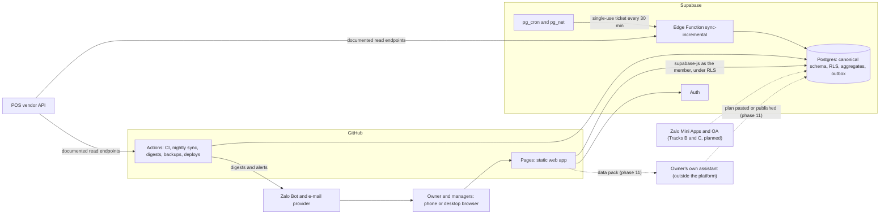
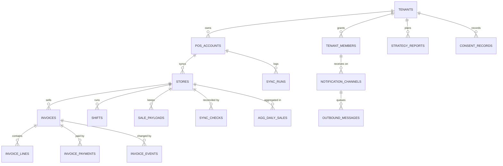
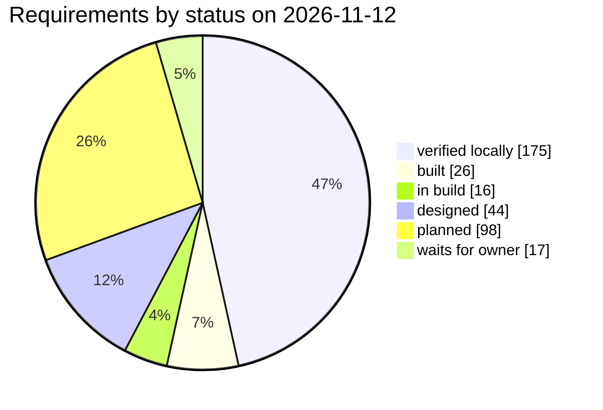

# Software requirements specification

This document states what FNB Manager must do and how well, for the whole programme: all 20 phases of Tracks A to D, with the owner's Track Z paperwork as a dependency. Every requirement has an ID, a source in the roadmap or a decision record, a measurable acceptance criterion, a priority, its status on 2026-11-12 and the tests or checks that verify it. It is written for the owner (who reads English; the app speaks Vietnamese), for a developer taking the work over on another machine, for reviewers and testers who plan and run the checks, and for whoever operates the platform after go-live.

Last updated 2026-11-12

376 requirements: 296 functional in 16 areas and 80 non-functional in 11 categories. By status: 177 verified locally, 27 built, 17 in build, 40 designed, 98 planned, 17 waits for owner.

## 1. Introduction

### 1.1 Purpose

FNB Manager is a portable manager platform for food and beverage shops. It syncs sales from the shop's POS into a Postgres database, turns them into periodic and thematic reports, prepares an aggregate-only data pack that the owner's own assistant turns into a store plan, sends daily digests and alerts, and later extends into a Zalo app for staff and a Zalo loyalty programme for customers. Two single-store shops use it today, a tea shop and a coffee shop; any shop, owner or POS is meant to join by configuration.

This specification gathers the requirements that are spread over [roadmap.md](roadmap.md), [decisions.md](decisions.md), the technical documents and the code into one list that can be planned, tested and traced. Where a document and the code disagree, it follows the code and lists the difference in section 9.5.

### 1.2 Scope

| Track | Phases | In scope |
|---|---|---|
| A, platform and analytics | 1–12 | Repository and CI, canonical schema with tenancy and RLS, POS connectors, sync engine and schedules, analytics and metric registry, the web app with Hôm nay and the periodic reports, thematic reports and settings, exports and the AI data pack, strategy plans, alerts and digests |
| B, Zalo for manager and staff | 13–15 | Zalo foundation (sessions, webhooks, tokens, Mini App builds), the staff Mini App (sign-in, roles, checklists, cash count, handover, incidents), notices, staff alerts, approvals, first review and internal publish |
| C, Zalo customer loyalty | 16–19 | Phone capture at the till, the loyalty rail (POS CRM or fallback), our loyalty ledger and reconciliation, compliance tooling, the customer Mini App, coupons, customer messaging, legal filings and the pilot |
| D, cross-cutting | 20 | Portability proof (CSV connector, onboarding wizard, deploy-your-own), hardening, launch and handover |
| Z, owner paperwork | beside A | Not built by the platform; listed as dependencies (section 2.5) and owner items (section 9) |

Out of scope:

- Writing to the POS. Connectors only read documented endpoints (ADR-025); points, stamps and coupons live in our own ledger (ADR-016, ADR-024).
- Server-side AI and paid AI APIs. The platform prepares the data pack and stores plans; the reasoning runs in the owner's own assistant (ADR-003).
- Ordering, payment and prices in the customer Mini App, which would need Zalo's Checkout SDK (phase 18a default: "Xem tại quầy").
- A hosted service for other owners: each owner runs their own deployment (roadmap section 8).
- Delivery-platform integration and HR or payroll (optional POS products, roadmap section 9, not built by us).
- In phase 12: English message templates, delivery receipts and more than one digest correction.

State on 2026-11-12. HEAD is commit `0f8fa1d`; everything built after it is not committed yet.

| Phases | State |
|---|---|
| 1 to 4 | complete |
| 5 and 6 | complete locally; the cloud steps wait for the owner |
| 7 and 8 | complete locally; the cloud deploy, the three-day freshness check and production timings wait for the owner |
| 9 | complete and verified locally; owner checks open |
| 10 and 11 | designed at roadmap level; build specs for both, dated 2026-11-12, exist privately and await review, so the detailed design is pending |
| 12 | step 12a verified locally, 12b in build (integration and verification), 12c planned |
| 13 to 20 | planned; Tracks B and C wait for the owner's Track Z paperwork |

### 1.3 Definitions

The terms used here (business date, store-day, control totals, verified day, data role, publisher, digest, episode, outbox, data pack, Track Z and others) are defined in [glossary.md](glossary.md). Four of them matter on almost every line:

- **Business date**: the trading day a sale belongs to, from the store's IANA time zone and business-day start (ADR-007).
- **Store-day**: one store on one business date, the unit that sync, reconciliation and the badges work on.
- **Control totals**: the POS's own count and net revenue per store-day, against which every synced day is reconciled.
- **Verified**: a store-day whose stored count equals the POS count and whose net is within tolerance (FR-DQ-01).

### 1.4 References

| Document | What it holds |
|---|---|
| [roadmap.md](roadmap.md) | Programme v1.1: tracks, 20 phases with deliverables, acceptance and owner actions, Track Z, gates, portability, costs, risks, open questions |
| [status.md](status.md) | What is built and verified, and how to continue on another machine |
| [decisions.md](decisions.md) | ADR-001 to ADR-029 and ADR-034 to ADR-036 (ADR-030 to ADR-033 are reserved for phase 12) |
| [schema.md](schema.md) | Field dictionary of the database, RLS model, business date, storage rule, pgTAP files |
| [sync.md](sync.md) | Sync engine, incremental runner, Edge Function, schedule, CLI reference and runbook |
| [web-app.md](web-app.md) | Web app contract: routes, layout, report card, data access, testing |
| [metrics.md](metrics.md) | The 41 metrics, report conventions and benchmark context |
| [reports/](reports/ngay.md) | Ngày, Tuần, Tháng, Năm and the Vietnamese wording list |
| [connectors.md](connectors.md), [connectors/ipos-fabi.md](connectors/ipos-fabi.md) | Connector contract, capability matrix, the iPOS Fabi adapter |
| [secrets.md](secrets.md), [go-live.md](go-live.md) | Secrets contract; the first cloud deployment step by step |
| [deep-dives/](deep-dives/vietnam-legal-requirements.md) | Research behind the roadmap, including the Vietnamese legal requirements (section 7) |
| [glossary.md](glossary.md) | Terms |
| [test-plan.md](test-plan.md) | The master test plan: it traces every ID here to its tests or owner checks and names a planned test for every gap |
| [plan.md](plan.md), [architecture.md](architecture.md), [api.md](api.md), [security.md](security.md), [operations.md](operations.md), [development.md](development.md), [user-guide.md](user-guide.md) | The other documents of this set, written alongside this specification; [plan.md, section 8.1](plan.md#81-open-correction-requests) tracks the correction requests |

### 1.5 Conventions

**IDs.** Functional requirements are `FR-<AREA>-<nn>` and non-functional ones `NFR-<CAT>-<nn>`, numbered from 01 in each area. Areas: TEN tenancy, members, roles and access; CON POS connectors; SYNC sync engine and schedules; DQ data quality and reconciliation; ANA analytics and metric registry; REP periodic reports; THM thematic reports; SET settings and manual data; EXP exports and AI data pack; STR strategy plans; NOT alerts, digests and channels; OPS operations; CMP legal compliance; STF staff app (Track B); LOY loyalty and customer app (Track C); POR portability. Categories: SEC security, PRV privacy, PERF performance, AVL availability and freshness, COST cost, A11Y accessibility, I18N internationalisation, UX responsive UX, MNT maintainability, OBS observability, HYG public-repository hygiene. An ID is never reused.

**Priority.** Must: the phase cannot be accepted without it. Should: expected in the phase; the phase can be accepted with the gap recorded. Could: optional, built when time allows.

**Status on 2026-11-12.**

| Status | Meaning |
|---|---|
| verified locally | Built and passed an independent verification on the local stack and in the commands CI runs |
| built | In the repository, but not yet verified as a whole, or verified only by review |
| in build | Being built and integrated now: phase 12 step 12b, and phase 10a requirements whose SQL is in and whose page is not |
| designed | Specified (roadmap, [web-app.md](web-app.md) or a build spec) but not built; phases 10 and 11 are designed at roadmap level |
| planned | In the roadmap, not designed in detail, not started |
| waits for owner | Built or ready, but its acceptance needs an owner action: the cloud project, a check against private figures or paperwork |

**Source.** `P7` is roadmap phase 7 (`P10a` its sub-step), `P12 (12b)` a step of phase 12, "principle 3" the third principle of roadmap section 2, `G4` a decision gate of roadmap section 6, `ADR-020` a decision record. "acceptance" marks a roadmap acceptance line.

**Verified by.** Test files are written as `<suite>:<path>`:

| Reference | File |
|---|---|
| `pgtap:04_tenant_isolation` | `supabase/tests/04_tenant_isolation.sql` |
| `sync:unit/checks` | `packages/sync/test/unit/checks.test.ts`, and likewise for every package under `packages/` (`integration/`, `live/`, `consistency/` folders the same way) |
| `demo-analytics:parity/aggregates` | `packages/demo-analytics/test/parity/aggregates.parity.test.ts` |
| `demo-analytics:reports/day` | `packages/demo-analytics/test/reports/day.smoke.test.ts` |
| `jobs:unit/doctor` | `apps/jobs/test/unit/doctor.test.ts` (and `integration/`) |
| `web:lib/format` | `apps/web/src/lib/format.test.ts` or `.test.tsx` |
| `e2e:demo/report-day` | `apps/web/e2e/demo/report-day.spec.ts` |

Gated suites run only with their switch: `LIVE=1` for live checks, `DATABASE_URL` for integration tests against the local stack, `NOTIFY_INTEGRATION=1` for the notification integration tests. "Owner check" means the owner compares the result with the POS or private figures; "planned" means no test exists yet.

## 2. Overall description

### 2.1 Product perspective and context

FNB Manager has no server of its own. The web app is static on GitHub Pages; data, sign-in, row-level security and the intraday schedule live in Supabase; GitHub Actions runs CI, deploys, the nightly sync, digests and backups; the `fnb` CLI runs the same jobs from the owner's machine (ADR-001, ADR-020).

The platform is multi-tenant from day one (ADR-005): a second owner, POS account or store is a row. POS details stay inside connector packages (ADR-004), and every number a report shows comes from SQL functions read as the signed-in member (ADR-029).

### 2.2 Users and roles

Roles come from the `tenant_role` enum and the RLS policies ([schema.md, Row-level security](schema.md#row-level-security)). A membership may be limited to some stores (`store_ids`); without a limit it covers every store of the tenant. `owner`, `manager`, `staff` and `viewer` are the data roles; `publisher` is kept outside them so that a leaked publisher credential cannot read a single sale (ADR-013).

| User | Who | May see | May do | Main requirements |
|---|---|---|---|---|
| Owner | The shop owner | Every row of the tenant within the store scope, including the message log; data-subject requests when the scope is unlimited | Manual inputs and plans within scope; consent records (except the `notifications` purpose, which only the member's own acceptance writes); data-subject requests and tenant-wide rows with an unlimited scope; alert rules and channel policies with an unlimited scope; an analytics refresh of the tenant | FR-TEN-02 to FR-TEN-09, FR-NOT-05, FR-NOT-06 |
| Manager | A store or tenant manager | Same as the owner | Same as the owner, except that alert rules and channel policies are read-only for managers | FR-TEN-08, FR-NOT-05 |
| Staff | A cashier or shift lead | Data of their stores, including consent records; messages sent to their own destinations; no data-subject request | Nothing in the web app; the staff Mini App adds shift operations (phases 14 and 15) | FR-TEN-07, FR-STF-09 to FR-STF-22 |
| Viewer | A read-only stakeholder | Same as staff | Nothing | FR-TEN-07 |
| Publisher | A service identity for publishing plans | Its tenant, the stores in its scope, plans, holidays, the calendar, and the global alert-rule catalogue and channel-policy defaults (no tenant data); no sale, aggregate, refresh log or live view | Insert plans | FR-TEN-06, FR-STR-03, FR-STR-08 |
| Customer (Track C) | A shop customer, through the customer Mini App and the OA | Their own wallet, member code and history (planned) | Join, claim receipts, redeem coupons, give or withdraw consent (planned) | FR-LOY-17 to FR-LOY-23, FR-CMP-16 |
| Caller without a session | Anyone holding the public web bundle | Nothing | Nothing | FR-TEN-05 |
| Jobs | The `fnb` CLI, the Actions workflows, the Edge Functions and `pg_cron`, as the database owner or service role | Everything (RLS does not apply) | Sync, refresh, digests and alerts, backups, deploys | NFR-SEC-03 to NFR-SEC-08 |

Whether staff and viewers may see revenue is an open owner decision: RLS allows it today and phase 14 decides (section 9.3).

### 2.3 Operating environment

| Part | Environment |
|---|---|
| Clients | Phones (tested at 360 px wide) and desktops (tested at 1280 px) in a current browser; the automated tests use Chromium with locale `vi-VN` and time zone Asia/Ho_Chi_Minh. Other browsers are not tested |
| Web hosting | GitHub Pages: static files only, hash routes (`#/…`), base path from the Pages configuration, `index.html` cached for ten minutes, no CSP or HSTS headers, `noindex`, no service worker |
| Backend | Supabase Free plan, Singapore region (the cloud project is still to be created): Postgres 17, Auth with e-mail and password, Data API (`max_rows` 1,000), Edge Functions (150 s wall clock, 2 s CPU, 256 MB), `pg_cron`, `pg_net`, Vault. Limits: 500 MB database, 5 GB egress and 500,000 function invocations a month, pause after about 7 idle days, platform logs kept one day |
| Scheduled compute | GitHub Actions on a public repository: free; scheduled runs start late: the nightly Sync started 3 h 24 min to 6 h 23 min after 03:23 on 2026-11-09 to 2026-11-12 ([operations.md, section 2.3](operations.md#23-how-late-github-starts-scheduled-runs); ADR-020 assumed 20 to 40 minutes), and they are disabled after 60 days without repository activity |
| Owner's machine | Node 22 or later, pnpm 9, Docker with at least 8 GB of memory for the local Supabase stack, git, and a local `.env` that is never committed |
| Later (Tracks B and C) | Zalo Mini Apps on the origin `https://h5.zdn.vn` in a secure context without LocalStorage or cookies (Native Storage), the Zalo OA Open API on the Tăng trưởng package, ZBS template messages |

### 2.4 Constraints

| Constraint | Source | Consequence |
|---|---|---|
| Static hosting, no server | ADR-001 | Security lives in RLS; the browser holds only the publishable key; hash routing with the PKCE flow |
| Public repository | ADR-001, ADR-015, principle 12 | Code only; identifiers and revenue figures live in the database, secrets or the gitignored `docs/private/`; scans in CI |
| No paid AI API | ADR-003, principle 10 | An aggregate-only data pack goes to the owner's own assistant; plans come back by paste or `fnb publish-plan` |
| Documented POS read endpoints only | ADR-025 | No POS writes; no CMS forwarding or CRM endpoints; loyalty runs on our own ledger |
| Free tiers | Roadmap section 9, ADR-023 | A 300 MB storage target with compressed payloads (ADR-027), an Edge Function CPU and wall-time guard, an egress budget, keep-alive against the pause |
| GitHub Actions terms and cron delays | ADR-020 | Intraday sync runs inside Supabase; Actions carries CI, deploys, the nightly job, backfills and backups |
| One deployment per owner | Roadmap section 8 | Another owner forks and runs their own copy; the platform is not a hosted service |
| Vietnamese law | ADR-019, ADR-021 | Compliance built into the schema, apps and campaign engine (section 7) |
| Zalo platform policies | ADR-017, ADR-018, ADR-022 | Review and messaging rules are acceptance criteria for Tracks B and C |
| Multi-tenant from day one | ADR-005 | `tenant_id` on every row and RLS on every table |
| Credentials never in the database or the repository | ADR-006, ADR-028 | Secrets in `.env`, GitHub and Supabase function secrets only; scheduled calls carry single-use tickets |
| One language and toolchain | ADR-002, ADR-008 | TypeScript everywhere, SQL in migrations with pgTAP, a local Docker stack |
| Small verifiable steps reviewed by the owner | Principles 12 and 13 | No build step much over three days; the owner reviews and commits every phase |
| No comments in code | [web-app.md](web-app.md) project rule | Names and small functions carry the explanation |

### 2.5 Assumptions and dependencies

- **Owner actions unblock the cloud work.** Gate G1 (the Supabase project, SMTP, GitHub secrets and variables, the backup destination) comes before every cloud acceptance item: migrations by workflow, live RLS, the nightly job, backups, the incremental schedule, the deployed sign-in and the freshness criterion ([go-live.md](go-live.md)).
- **Track Z paperwork gates Tracks B and C.** The owner confirms each brand's legal form and revenue band, completes eKYC on the Zalo account, creates and verifies one OA per brand with the Tăng trưởng package and a ZBS account, creates the Zalo Apps and Mini Apps with compliant names and logos, asks the POS vendor the CRM questions, registers the coffee shop for e-invoicing and confirms the tea shop's status, publishes the privacy notice, and has the legal read done before Track C goes public (roadmap section 5).
- **Decision gates** (roadmap section 6): G1 cloud project before phase 5; G2 POS CRM rail or fallback rail at the end of 16a; G3 cross-border dossier or exemption before 19b; G4 Supabase Pro before 19b or at about 400 MB; G5 a monthly scheduled strategy run (default: by hand); G6 the incremental scheduler (default and built: `pg_cron` with the Edge Function).
- **The POS API is not published.** The iPOS connector was built from observed behaviour; every response is validated with zod so that a change raises a typed error instead of writing bad rows ([connectors/ipos-fabi.md](connectors/ipos-fabi.md)).
- **Platform limits and prices** are those measured in 2026 (roadmap section 9, [sync.md](sync.md)); Zalo prices and policies drift, so budgets use the highest quoted price.
- **Private reference figures** used by owner checks (POS monthly reports, the reference window, the Năm peak month) live in `docs/private/`, never in this repository.
- **Design depth differs by phase.** Phases 10 and 11 are specified here at roadmap level; their detailed design is pending. Phase 12 follows its three-step plan as summarised in [status.md](status.md).

## 3. Functional requirements

One table per area. Each requirement is one testable statement. Where a requirement belongs to several phases, section 8.3 lists it under each.

### 3.1 TEN — Tenancy, members, roles and access

Every rule in this area is enforced in the database by row-level security (RLS), so it holds for the web app, the CLI and the later Zalo apps alike. The roles are those of `tenant_role`; section 2.2 says what each may see and do.

| ID | Requirement | Source | Acceptance criterion | Priority | Status | Verified by |
|---|---|---|---|---|---|---|
| FR-TEN-01 | **Tenant on every row.** The system shall store `tenant_id` on every tenant-owned row and reference stores and POS accounts together with their tenant, so the database refuses a row that mixes two tenants. | P2 · ADR-005 | A row naming tenant A with a store of tenant B is refused, even when written as the service role. | Must | verified locally | `pgtap:02_unique_keys` |
| FR-TEN-02 | **Membership roles and store scope.** The system shall grant access only through `tenant_members`, each with one role (`owner`, `manager`, `staff`, `viewer`, `publisher`) and an optional store scope, where no scope means every store of the tenant. | P2 · ADR-005, ADR-013 | The role enum holds exactly the five roles; a member without a scope sees every store, a scoped member only the listed ones. | Must | verified locally | `pgtap:01_schema`, `pgtap:07_write_scope_and_attribution` |
| FR-TEN-03 | **Two-tenant isolation.** The system shall let a member read rows of their own tenants only, on every table, view, aggregate and report function. | P2, P8, P9, P12 · principle 3 | A member of tenant A reads zero rows of tenant B everywhere. | Must | verified locally | `pgtap:04_tenant_isolation`, `pgtap:17_analytics_access`, `pgtap:23_report_access`, `pgtap:31_notify_access` |
| FR-TEN-04 | **Store scope on reads and writes.** The system shall limit a store-scoped member to the stores in their scope for facts, aggregates, sync runs and writes, and require an unlimited scope for tenant-wide rows. | P2, P7 | A manager of one store reads no fact, aggregate or incremental run of another store and cannot write a tenant-wide row. | Must | verified locally | `pgtap:07_write_scope_and_attribution`, `pgtap:17_analytics_access`, `pgtap:21_sync_freshness` |
| FR-TEN-05 | **Nothing for callers without a session.** The system shall give the `anon` role no privilege on any table or view and no right to execute any `public` or `app` function, so a caller without a session reads zero rows everywhere. | P2, P5, P6 · ADR-001 | `anon` reads nothing; a client holding only the publishable key reads zero invoices. | Must | verified locally | `pgtap:03_rls_enabled`, `pgtap:06_anon_and_tokens`, `e2e:live/auth` |
| FR-TEN-06 | **Publisher reads no sales.** The system shall let a `publisher` member read only its tenant, the stores in its scope, plans, holidays, the calendar, and the global alert-rule catalogue and channel-policy defaults (no tenant data), and insert plans; it shall read no sale, aggregate, refresh log or live view. | P2, P11 · ADR-013 (requests R-F04, R-AS08) | A publisher reads zero invoices and zero aggregate rows, gets empty report results and can insert a plan. | Must | verified locally | `pgtap:08_publisher_role`, `pgtap:17_analytics_access`, `pgtap:23_report_access` |
| FR-TEN-07 | **Staff and viewer are read-only.** The system shall let `staff` and `viewer` members read the data of their store scope and write nothing. | P2 | Every write by a staff or viewer member is refused. | Must | verified locally | `pgtap:05_write_policies`, `pgtap:31_notify_access` |
| FR-TEN-08 | **Who writes manual data.** The system shall accept writes to `item_costs`, `targets` and `payment_fee_rates` only from owners and managers within store scope, and to `item_type_roles` and tenant `holidays` only from owners and managers with an unlimited scope; global holiday rows stay service-role only. | P2, P10b | The write-policy matrix passes for every role and scope. | Must | verified locally | `pgtap:05_write_policies`, `pgtap:07_write_scope_and_attribution`, `pgtap:10_payment_fee_rates`, `pgtap:11_item_type_roles_and_holidays` |
| FR-TEN-09 | **Frozen attribution.** The system shall set `created_by` to the writer on insert and freeze it on update on `item_costs`, `payment_fee_rates`, `item_type_roles`, `targets`, `strategy_reports` and the notification settings tables. | P2, P10b (audit columns) | An insert naming another user is refused and an update cannot change `created_by`. | Must | verified locally | `pgtap:07_write_scope_and_attribution`, `pgtap:26_notify_schema` |
| FR-TEN-10 | **Create a tenant.** The system shall create a tenant with `fnb tenant create` (name, slug, currency, locale, timezone, legal form) idempotently and refuse an existing slug with different settings. | P5 | A second identical run changes nothing; a conflicting run is refused and overwrites nothing. | Must | verified locally | `jobs:integration/local-stack` |
| FR-TEN-11 | **Add a member.** The system shall give a login a role in a tenant with `fnb tenant add-member`, creating the login through the Auth admin API when it is missing (password from `--password` or `FNB_MEMBER_PASSWORD`, or an invitation with `--invite`). | P5 | A missing login is created once; a re-run with another role changes only the role. | Must | verified locally | `jobs:integration/local-stack` |
| FR-TEN-12 | **No self sign-up.** The system shall refuse self sign-up, so that members exist only through `fnb tenant add-member`. | P5 · ADR-023 | `enable_signup = false` locally; sign-ups are switched off on the cloud project. | Must | waits for owner | `supabase/config.toml`; owner check (`docs/go-live.md` step 1) |
| FR-TEN-13 | **Sign-in.** The web app shall sign members in with e-mail and password through Supabase Auth with the PKCE flow and a persisted session, and send a signed-out visitor to `#/dang-nhap`. | P6 · ADR-023 | A signed-out visitor lands on the login page; wrong credentials show an error; signing out returns to the login page. | Must | verified locally | `e2e:live/auth`, `e2e:live/today` |
| FR-TEN-14 | **Password reset.** The web app shall let a member request a reset e-mail at `#/quen-mat-khau` and set a new password from the recovery link at `#/mat-khau-moi`. | P6 | The reset e-mail reaches the local mail catcher; the new-password page explains an expired link. | Must | verified locally | `e2e:live/auth` |
| FR-TEN-15 | **Sign-in, reset and invitation on the deployed site.** The system shall complete a sign-in on a phone, a password reset and an invitation link on the deployed GitHub Pages site under its project-site path. | P6 acceptance | The owner signs in on a phone, completes a password reset and opens an invitation link on the Pages URL. | Must | waits for owner | owner check after `docs/go-live.md` steps 1 to 5 |
| FR-TEN-16 | **Tenant and store context.** The web app shall take the tenant and stores from the member's memberships, show a tenant selector only to members of several tenants, and offer a store multi-select with "Tất cả". | P6 | Switching to one store shows that store's numbers and verification state. | Must | verified locally | `e2e:live/today`, `web:state/preferences` |
| FR-TEN-17 | **RLS proven on the live project.** The system shall pass the two-tenant RLS checks against the live cloud project with two throwaway users, and again in the launch audit. | P5, P20b · principle 3 | The live RLS run and the launch RLS audit are green. | Must | waits for owner | planned live run after go-live |

### 3.2 CON — POS connectors

A connector turns one point-of-sale system into the canonical model. The contract and the capability matrix are in [docs/connectors.md](connectors.md); the iPOS Fabi adapter in [docs/connectors/ipos-fabi.md](connectors/ipos-fabi.md).

| ID | Requirement | Source | Acceptance criterion | Priority | Status | Verified by |
|---|---|---|---|---|---|---|
| FR-CON-01 | **Vendor-neutral connector contract.** The system shall reach every POS through the `PosConnector` contract (describe, authenticate, discover stores, fetch catalogue, sales, shifts, adjustments and control totals) with a complete map of the nine capability flags. | P4 · ADR-004, ADR-012 | Each descriptor has an id, a label and a boolean for every capability; its credentials schema rejects `{}`. | Must | verified locally | `connector-core:unit/registry`, `connector-mock:unit/conformance` |
| FR-CON-02 | **Capability gating.** The system shall throw `ConnectorCapabilityError` for a method whose capability is declared false, and the sync shall skip that method instead of failing. | P4 · ADR-012 | Gated calls throw; a sync with such a connector writes no shifts, adjustments or checks and succeeds. | Must | verified locally | `connector-core:unit/registry`, `sync:unit/window-changes` |
| FR-CON-03 | **Conformance suite.** The system shall accept a connector only when it passes the conformance suite (schemas, stable ids, business dates, money identities, modifiers, payments, pagination, window edges, boundary sales, control totals, adjustments). | P4 · ADR-012 | The mock connector and the iPOS adapter pass; a mock with a wrong timezone fails with the business-date rule named. | Must | verified locally | `connector-mock:unit/conformance`, `connector-ipos:unit/connector-conformance`, `connector-core:unit/checks` |
| FR-CON-04 | **Mock connector.** The system shall provide a seeded mock connector shaped like a Vietnamese drinks shop that generates the same data for the same seed, for tests, the demo and end-to-end runs. | P4 · ADR-012 | Generation is deterministic for a seed and passes the conformance suite. | Must | verified locally | `connector-mock:unit/shape`, `connector-mock:unit/conformance` |
| FR-CON-05 | **Money identities.** The system shall require every emitted sale to satisfy net = gross − item discount − bill discount − voucher + service charge + shipping + VAT, net = Σ line net − bill discount − voucher + charges, and paid = Σ payments. | P4 | The `net-components`, `line-sums` and `payments-sum` conformance rules pass. | Must | verified locally | `connector-core:unit/checks`, conformance suite |
| FR-CON-06 | **Flags instead of guesses.** The system shall emit an inconsistent vendor record with a `DataQualityFlag` rather than drop or guess, and throw only when the vendor cannot be read at all. | P4 | Clean fixtures raise no flag; a row with an unknown status is dropped with a flag. | Must | verified locally | `connector-ipos:unit/connector-conformance`, `connector-ipos:unit/adjustments` |
| FR-CON-07 | **iPOS login and token cache.** The system shall log in to iPOS with e-mail, password and the CMS application key, cache the 7-day token per account in `pos_account_tokens`, log in again within 12 hours of expiry or after a 401, and retry the failed call once. | P3 · ADR-006 | Login, reuse, stale-token, 401 and second-401 paths pass; the token cache is closed to `authenticated` and `anon`. | Must | verified locally | `connector-ipos:unit/auth`, `pgtap:06_anon_and_tokens` |
| FR-CON-08 | **iPOS request conventions.** The system shall send the exact CMS headers, always a store id (never an empty store list), inclusive millisecond windows, follow cursor pagination with de-duplication at the inclusive boundary only, and split C04, C05 and C08 ranges per calendar month in the store's timezone. | P3 | Tests for headers, both pagination styles, the empty-store guard, month splits and day-range boundaries pass. | Must | verified locally | `connector-ipos:unit/http`, `connector-ipos:unit/pagination`, `connector-ipos:unit/master-data`, `connector-ipos:unit/pos-cms`, `connector-ipos:unit/time` |
| FR-CON-09 | **iPOS validation, errors and retries.** The system shall validate every iPOS response with zod (keeping unknown fields), raise typed errors carrying endpoint and track id, retry 429, 5xx, network failures and timeouts with backoff but no other 4xx, and give each HTTP attempt 30 seconds. | P3 | Retry, non-retry, schema-error and timeout tests pass; every schema parses the synthetic fixtures. | Must | verified locally | `connector-ipos:unit/http` |
| FR-CON-10 | **Documented read endpoints only.** The system shall call only the read endpoints listed in `docs/connectors/ipos-fabi.md`, never CMS forwarding endpoints, CRM endpoints or anything that writes, and never store, log or reuse credentials or other brands' data such endpoints may return. | P3 · ADR-025 | Review of `packages/connector-ipos/src/endpoints` finds no forwarding, CRM or write path. | Must | built | review of `packages/connector-ipos/src/endpoints` |
| FR-CON-11 | **iPOS normalisation.** The system shall map iPOS rows to the canonical model: business date from the store's timezone and day start; discounts split into item, bill and voucher; lines classified with the item master first (a free topping stays an item, a zero-amount customisation is a modifier); sizes parsed from names; UUID-only item types resolved; one payment per payment row; control totals from the daily summary; customer phone, membership and voucher fields passed through. | P4 | Golden cases pass: 50 % Đá → modifier; free topping → item; "(L)" → size L; plain name → no size; "( M )" → size M; 23:30 local keeps its date; 00:30 with a 05:00 day start → previous date; split bill → one sale, two payments; UUID-only type resolved. | Must | verified locally | `connector-ipos:unit/connector-golden`, `core:unit/business-date`, `core:unit/size`, `core:unit/payment-kind` |
| FR-CON-12 | **Adjustments from the POS.** The system shall read cancelled and edited invoices (C05) and removed lines (C08) and emit `voided`, `edited` (with the absolute difference) and `line_removed` adjustments, de-duplicated by `adjustmentKey`. | P3, P4 | The conformance adjustment rules pass offline; a live 30-day pull per store shows zero schema errors. | Must | verified locally | `connector-ipos:unit/adjustments`, `connector-ipos:unit/connector-conformance`, `connector-ipos:live/adjustments`, `core:unit/adjustment` |
| FR-CON-13 | **Opt-in live checks.** The system shall run live connector checks only with `LIVE=1` and local credentials, printing counts, timings and flag counts only. | P3, P4 · ADR-009 | Live smoke passes for both accounts; control totals equal emitted sales per day within 1,000 ₫; the discount identity holds on voucher invoices. | Must | verified locally | `connector-ipos:live/smoke`, `connector-ipos:live/connector`, `connector-ipos:live/adjustments` |
| FR-CON-14 | **Connectors from configuration.** The system shall build connectors from `POS_ACCOUNTS_JSON` entries through a `ConnectorRegistry` (`ipos-fabi`, `mock`) and refuse unknown connectors and repeated keys without echoing any value. | P4, P5 | Both entry shapes parse; bad JSON, unknown connectors and repeated keys are refused with value-free messages. | Must | verified locally | `runner:unit/accounts`, `jobs:unit/config` |
| FR-CON-15 | **Shared canonical rules.** The system shall implement the business-date, size-suffix, payment-kind (Vietnamese defaults with per-tenant overrides) and money rules once in `@fnb/core`, for every connector and the sync. | P2, P4 · ADR-007 | 23:30 local keeps its date, 00:30 with a 05:00 day start moves to the previous date, the new date starts exactly at the day-start minute; overrides win over the default payment kinds. | Must | verified locally | `core:unit/business-date`, `core:unit/size`, `core:unit/payment-kind`, `core:unit/money`, `core:unit/wall-clock` |
| FR-CON-16 | **Public connector documentation.** The system shall document each connector publicly without identifiers (authentication, conventions, endpoints, normalisation, testing, quirks) and keep vendor evidence and security observations in the gitignored `docs/private/`. | P3, P4 · ADR-025 | `docs/connectors.md` and `docs/connectors/ipos-fabi.md` exist and the public-safety scan is clean; the loyalty rail adds the field names observed for phone, membership, voucher code and discount (16b). | Should | built | `scripts/check-public-safe.mjs` |
| FR-CON-17 | **CSV connector.** The system shall offer a CSV connector, filled from a CSV template, for shops whose POS has no API, passing the conformance suite. | P20a · ADR-012 | The CSV connector passes the conformance suite and onboards a store (FR-POR-05). | Should | planned | planned |

### 3.3 SYNC — Sync engine and schedules

One runtime-agnostic engine (`@fnb/sync`) with two runners: the `fnb` CLI on the owner's machine and GitHub Actions (nightly, backfills), and the Edge Function `sync-incremental` called by `pg_cron` (ADR-020). Details in [docs/sync.md](sync.md).

| ID | Requirement | Source | Acceptance criterion | Priority | Status | Verified by |
|---|---|---|---|---|---|---|
| FR-SYNC-01 | **Onboard an account.** The system shall add a POS account to a tenant with `fnb onboard`: authenticate through the connector, discover its stores with timezone and business-day start, write them and load the account's catalogue. | P5 | Both accounts onboard with their stores, timezones and day starts; a second run changes nothing. | Must | verified locally | `jobs:integration/local-stack`, `sync:unit/master-data` |
| FR-SYNC-02 | **Print the secret entry.** The system shall print an account's `POS_ACCOUNTS_JSON` entry on request (`--print-secret-entry`) for pasting into the GitHub secret, and refuse to do so in CI. | P5 | The flag prints locally and is refused with `CI` set. | Should | verified locally | `jobs:unit/cli` |
| FR-SYNC-03 | **Window sync.** The system shall pull a business-date window with `fnb sync window` for one account, a numbered account or all accounts, optionally limited to stores, with a run kind, and write nothing in `--dry-run`. | P5, P7 | A dry run writes no row, not even a `sync_runs` row; `--all-accounts` exits 1 when any account failed. | Must | verified locally | `sync:unit/window-mock`, `jobs:unit/cli`, `jobs:integration/local-stack` |
| FR-SYNC-04 | **Atomic store-days under a store lock.** The system shall write each store-day in one transaction while holding a per-store advisory lock, so overlapping runs on one store queue instead of planning from the same snapshot. | P7 | Two overlapping runs that re-pull the same change record one void and one edit, not two. | Must | verified locally | `sync:unit/window-robustness`, `sync:integration/postgres-repository` |
| FR-SYNC-05 | **Void and edit detection.** The system shall void a stored sale that the POS no longer lists (one `voided` event), rewrite a changed sale with one `edited` event when its net or line set changed, and keep a day that comes back empty unless the control totals confirm it. | P7 | An invoice removed from the re-pulled window ends voided and leaves the totals; a label-only change writes no event. | Must | verified locally | `sync:unit/window-changes`, `sync:unit/window-robustness` |
| FR-SYNC-06 | **POS adjustments stored once.** The system shall insert each POS-reported adjustment once, set the invoice status it implies, and refresh and re-check the earlier business dates it touches. | P7 | Repeats and re-runs insert nothing twice; an earlier date voided by a later adjustment is refreshed and re-checked. | Must | verified locally | `sync:unit/window-changes`, `sync:unit/window-robustness` |
| FR-SYNC-07 | **Idempotent runs.** The system shall change nothing when the same window runs twice. | P2, P7 | Every per-table count of the second run is zero and an md5 over the tenant's sales rows is unchanged. | Must | verified locally | `sync:unit/window-mock`, `sync:integration/postgres-repository`, `jobs:integration/local-stack` |
| FR-SYNC-08 | **Business date and receipt key.** The system shall assign each sale's business date from the stored store timezone and day start, and identify a receipt by store, business date and receipt number, flagging a repeat. | P2, P7 · ADR-007, ADR-024 | A 00:30 sale with a 05:00 day start books to the previous date; a connector date that disagrees is flagged. | Must | verified locally | `sync:unit/business-date`, `sync:unit/mapping` |
| FR-SYNC-09 | **Customer and voucher fields.** The system shall capture the customer phone and name, the voucher code, name and amount, and the bill discount on invoices whenever the connector supplies them. | P7 | Mapped invoices carry these columns, null when absent. | Must | verified locally | `sync:unit/mapping` |
| FR-SYNC-10 | **Call budget and retries.** The system shall keep each run within a connector call budget (default 400 calls) and retry transient and rate-limit errors up to three attempts with backoff, never authentication, schema or capability errors. | P7 · ADR-014 | A run fails once the budget is spent; authentication errors are not retried. | Must | verified locally | `sync:unit/run-bookkeeping` |
| FR-SYNC-11 | **Run bookkeeping.** The system shall record every non-dry run in `sync_runs` with kind, range, stores, timings, per-table counts and a summary (connector calls, retries, flags, checks, refresh, and the day outcomes of an incremental run), and close a failed run with a redacted message of at most 500 characters. | P7 | A failed run's message holds no credential and its store lock is released. | Must | verified locally | `sync:unit/run-bookkeeping`, `sync:unit/incremental` |
| FR-SYNC-12 | **Catalogue refresh.** The system shall refresh stores and the catalogue with `fnb sync master` and during onboarding, marking rows the POS no longer lists inactive and never deleting them. | P5, P7 | A store or item missing from the POS becomes inactive; nothing is deleted. | Must | verified locally | `sync:unit/master-data` |
| FR-SYNC-13 | **Analytics refreshed after a sync.** The system shall refresh analytics for the dates a run changed and the dates its adjustments touched, and an incremental run shall also refresh dates of the last 14 days that were committed but never refreshed. | P7, P8 | A date whose refresh failed is refreshed by the next incremental run without a new pull; a failed refresh leaves the run succeeded with a warning. | Must | verified locally | `sync:unit/incremental`, `sync:unit/run-bookkeeping`, `sync:unit/window-robustness` |
| FR-SYNC-14 | **Payloads kept, compressed.** The system shall keep every sale's original payload in one lz4-compressed JSON-lines document per store and business date (`sale_payloads`) and write null to the `raw` columns of invoices, lines and payments. | P2, P7 · ADR-004, ADR-027 | Every field of a line payload can be rebuilt from its record and the invoice payload; the document merges and moves with its sales. | Must | verified locally | `sync:unit/payloads`, `pgtap:19_sale_payloads` |
| FR-SYNC-15 | **Incremental run per store.** The system shall check one store's last 3 business days against the POS daily totals with one call, pull only unchecked, unmatched or changed days newest first, and make exactly one connector call when nothing changed. | P7 · ADR-020 | A second invocation right after the first pulls nothing. | Must | verified locally | `sync:unit/incremental`, `sync:unit/change-detection`, `sync:unit/incremental-window`, `runner:unit/incremental-run` |
| FR-SYNC-16 | **CPU and wall-time guard.** The system shall admit a day to an incremental run only while the estimated CPU time stays within 1.2 s and the wall time within 105 s including a 10-second reserve, then close the run as `partial` and leave the rest to the nightly job. | P7 · ADR-020 | Older changed days are handed off when the budget runs out; a budget outside the platform limits is refused. | Must | verified locally | `sync:unit/run-guard`, `sync:unit/incremental`, `runner:unit/budget` |
| FR-SYNC-17 | **Edge Function runner.** The system shall run the incremental sync in the Edge Function `sync-incremental`, which accepts `POST {"ticket": …}`, claims the ticket before any other work, answers 202 and continues in the background (or answers the run report with `"wait": true`), and answers 401 to an unknown, used or expired ticket, 429 while 32 claims wait, 500 when unconfigured or failed and 503 when the database is unavailable. | P7 · ADR-020, ADR-028 | Tickets are single-use and expire after 10 minutes; a scheduled call is answered at once. | Must | verified locally | `pgtap:20_incremental_schedule`, Deno type-check in CI, phase 7 verification (`docs/status.md`) |
| FR-SYNC-18 | **Thirty-minute schedule.** The system shall call the function from `pg_cron` every 30 minutes for each watched store that is open, was open in the previous 30 minutes or has unknown opening hours, issuing one single-use ticket per store, and stay inert until `app.enable_incremental_sync` is run. | P7 · ADR-020, ADR-028 · G6 | Store selection is right at six test ticks, including the run after closing and the paused, `auth_failed`, opted-out and inactive exclusions. | Must | verified locally | `pgtap:20_incremental_schedule` |
| FR-SYNC-19 | **Watched stores.** The system shall watch a store for the incremental sync only while it is active, its account is not paused and its settings do not opt it out (`{"incremental_sync": false}`). | P7 | The scheduler, the in-run dead-man's switch and the nightly check skip unwatched stores alike. | Must | verified locally | `pgtap:20_incremental_schedule`, `pgtap:21_sync_freshness`, `runner:unit/dead-man` |
| FR-SYNC-20 | **Nightly job.** The system shall run `sync.yml` nightly at 03:23 Asia/Ho_Chi_Minh over the 14 business dates ending yesterday for every account, accept dispatch by account number, dates, kind and dry run, never run two instances at once, and skip with a note until its secrets exist. | P5, P7 · ADR-020 | A scheduled run on the cloud project syncs every account; a run without secrets ends with a skip note. | Must | waits for owner | `.github/workflows/sync.yml`; owner dispatch after go-live |
| FR-SYNC-21 | **Backfill.** The system shall backfill history month by month, each month within the call budget and in under 5 minutes. | P5, P7 · ADR-014 | One month in under 5 minutes (measured under a minute with four connector calls per account); the full history of both stores is loaded. | Must | verified locally | phase 7 verification (`docs/status.md`), `jobs:integration/local-stack` |
| FR-SYNC-22 | **Rejected credentials.** The system shall mark an account `auth_failed` once when the POS rejects its login (from `active` or `error`), skip it in the schedule, and set it back to `active` at the next successful login. | P7, P12 | The account is marked once, alerted once and resumes after a good login. | Must | verified locally | `runner:unit/incremental-run` |
| FR-SYNC-23 | **Dead-man's switch.** The system shall raise `sync_stale` when a watched store passes 90 minutes of opening time without a successful sync, in every incremental run, at every scheduler tick (without the function) and in the nightly check of the previous day. | P7 · ADR-020 | The alert fires only past 90 minutes, never for a store never synced, and not for the closure before a resumed sync. | Must | verified locally | `runner:unit/dead-man`, `pgtap:20_incremental_schedule`, `pgtap:21_sync_freshness` |
| FR-SYNC-24 | **Undelivered scheduler calls.** The system shall record a `dispatch_failed` alert when a scheduled ticket expires unclaimed, keeping the last HTTP status or error, and resolve it when a ticket of the store is claimed again. | P7 | An expired ticket opens the alert with the call's status; a later claim resolves it. | Must | verified locally | `pgtap:20_incremental_schedule` |
| FR-SYNC-25 | **Manual run of one store.** The system shall issue a manual ticket for one store with `app.issue_incremental_sync_ticket` whether or not the schedule is enabled, and record runs as `manual` or `schedule`. | P7 | A manual ticket runs the store once. | Should | verified locally | `pgtap:20_incremental_schedule` |
| FR-SYNC-26 | **Incremental runner on a small server.** The system shall run the same incremental run with `fnb sync incremental`, with a default budget of 10 minutes of wall and estimated CPU time per store and `--wall-budget-ms` and `--cpu-budget-ms` overrides. | P7 · ADR-020 | The CLI runner gets the server budget unless told otherwise. | Should | verified locally | `jobs:unit/incremental-checks` |
| FR-SYNC-27 | **Status report.** The system shall print with `fnb status`, per account, the last run, its result and age and the flagged or failed runs of 14 days, and per store the latest verified and sales dates, the unmatched and checked store-days of the 14 business dates ending yesterday and the open scheduler alerts. | P7 | The window covers exactly the dates the nightly run covers; today is never counted. | Must | verified locally | `jobs:unit/status-window`, `jobs:unit/incremental-checks` |
| FR-SYNC-28 | **Schedule history retention.** The system shall prune at every tick incremental `sync_runs` after 35 days (90 when not succeeded), `cron.job_run_details` after 7 days, resolved `app.sync_alerts` after 90 days and `analytics_refreshes` after 35 days, keeping each tenant's newest refresh. | P7 · ADR-023 | Rows past their age are gone after the next tick. | Should | verified locally | `pgtap:20_incremental_schedule` |

### 3.4 DQ — Data quality and reconciliation

Every synced business day is reconciled against the POS's own daily totals and shown as verified or not (principle 4).

| ID | Requirement | Source | Acceptance criterion | Priority | Status | Verified by |
|---|---|---|---|---|---|---|
| FR-DQ-01 | **Daily reconciliation.** The system shall write one `sync_checks` row per store-day with the POS count and net against the stored non-voided count and net, matched when the count is exact and the net is within the larger of 1,000 currency units and 0.05 % of the POS net (inclusive). | P7 · principle 4 | Boundary values match and one unit past them fails; a day missing on either side counts as zero. | Must | verified locally | `sync:unit/checks`, `sync:unit/window-mock` |
| FR-DQ-02 | **Unverified when unchecked.** The system shall write no check and leave the day unverified when the connector has no control totals. | P7 | The run records `checks: "unavailable"` and no `sync_checks` row. | Must | verified locally | `sync:unit/window-changes` |
| FR-DQ-03 | **Backfill reconciliation rate.** The system shall reconcile at least 99 % of store-days after a backfill, with every exception explained privately. | P7 · ADR-014 | At least 99 % matched (measured: every store-day of both stores from the first sales day; 930 of 930 checked at the phase 7 verification). | Must | verified locally | phase 7 verification, `fnb status` |
| FR-DQ-04 | **Monthly comparison with the POS report.** The system shall match the POS's own monthly sales report (Fabi A01) for every month. | P7, P9 | Each month equals A01 per store, checked by the owner against the private sheet. | Must | waits for owner | owner check |
| FR-DQ-05 | **Verified badge.** The system shall mark a business day "đã đối soát" only when every shown store-day has a matched check, and "chưa đối soát" otherwise, on Hôm nay and on every report card. | P6, P7, P9 · principle 4 | One unmatched or unchecked store-day turns the section unverified. | Must | verified locally | `web:metrics/verification`, `e2e:live/today` |
| FR-DQ-06 | **Freshness badge.** The web app shall show in the top bar the time of the tenant's latest successful sync, and "dữ liệu mẫu" in demo mode. | P6 | The badge shows the seeded run's time on the local stack and the sample state in the demo. | Must | verified locally | `e2e:live/today`, `web:demo/demo-row-source` |
| FR-DQ-07 | **Data-quality flags in the run summary.** The system shall count connector and engine data-quality flags by code and severity in each run's summary without printing a sale id. | P4, P7 | Repeated ids, reassigned dates, NUL characters, merged adjustments and kept empty days raise their codes. | Must | verified locally | `sync:unit/mapping`, `sync:unit/window-robustness`, `sync:unit/business-date` |
| FR-DQ-08 | **Hôm nay equals the POS.** The system shall show on Hôm nay the same invoices and net revenue as the POS daily totals for the same day, per store and for all stores. | P6 · ADR-011 | Equal on the real data per store and in total; the seeded numbers show on the local stack. | Must | verified locally | `e2e:live/today`, phase 6 verification |
| FR-DQ-09 | **Report numbers equal the POS.** The system shall produce report headlines for sampled days and the last complete month equal to the POS control totals in `sync_checks`, to `metric_value` and to the series buckets. | P9 | The read-only live check passes on the local tenant that holds real data. | Must | verified locally | `reports:live/live-check` (opt-in) |
| FR-DQ-10 | **Lagging aggregates marked.** The system shall mark a card "đang cập nhật" while a day from yesterday onwards has item, payment, shift, size or attach aggregates that disagree with its live totals. | P9 | `store_coverage` counts the lagging days and the card shows the marker. | Should | verified locally | `pgtap:22_report_functions`, `reports:unit/coverage-and-comparison`, `pgtap:35_mappings_and_catch_up` (pending days after a mapping write) |
| FR-DQ-11 | **Unmeasured is null.** The system shall return null, never zero, for a metric whose inputs are not configured or not measured. | P8 · ADR-026 | `metric_value` returns null for unmeasured inputs and refuses unknown or unavailable ids. | Must | verified locally | `pgtap:18_metric_value` |
| FR-DQ-12 | **Data-quality page.** The system shall offer a Chất lượng dữ liệu page listing uncategorised items, items without cost, unverified days, modifier share, unmapped payment methods, customer capture rate, consent coverage, e-invoice status, member toggles that are off and the receipt-number reset period, each with a "fix in POS" hint. | P10b | The page flags a store without e-invoicing. | Should | designed | planned |
| FR-DQ-13 | **Parallel verification before v1.0.** The system shall pass seven days of parallel verification against the POS reports A01, B07 and C02 per store before v1.0. | P20b · ADR-014 | Seven consecutive days equal per store. | Must | planned | planned |

### 3.5 ANA — Analytics and metric registry

The SQL analytics layer (calendar, aggregates, query and report functions) and the typed metric registry that reports, digests, the data pack and KPI follow-up share (ADR-010, ADR-026, ADR-029). Definitions in [docs/metrics.md](metrics.md).

| ID | Requirement | Source | Acceptance criterion | Priority | Status | Verified by |
|---|---|---|---|---|---|---|
| FR-ANA-01 | **Calendar.** The system shall keep a calendar dimension from 2023-01-01 to 2030-12-31 with ISO year and week, weekday, month start, quarter and weekend flag. | P8 | One row per day of the range. | Must | verified locally | `pgtap:13_analytics_schema` |
| FR-ANA-02 | **Holidays and Tết.** The system shall hold the Vietnamese public holidays and Tết days of 2024 to 2028 as 61 global rows, accept tenant custom holidays, and treat a gap inside a Tết run as Tết. | P2, P8, P9 | 30 public and 31 Tết rows; the Tết 2026 window is excluded for any Vietnamese tenant. | Must | verified locally | `pgtap:24_vn_public_holidays`, `pgtap:11_item_type_roles_and_holidays`, `core:unit/vietnam-holidays` |
| FR-ANA-03 | **Aggregates are tables with RLS.** The system shall keep analytics aggregates as ten ordinary `agg_*` tables keyed by tenant and store, written only by the refresh and protected by the same store-scoped RLS as the facts; no materialised view is exposed. | P8 · ADR-010 | The two-tenant RLS matrix passes on every aggregate table. | Must | verified locally | `pgtap:13_analytics_schema`, `pgtap:17_analytics_access` |
| FR-ANA-04 | **Refresh reproduces the facts.** The system shall refresh aggregates so that daily totals equal the non-voided invoices, hours sum to days, modifier lines never count as items, payments reconcile with the paid amount and a re-run changes nothing, serialising the refreshes of one tenant. | P8 | The refresh checks pass on the demo tenant; the browser port reproduces the same aggregates. | Must | verified locally | `pgtap:14_analytics_refresh`, `demo-analytics:parity/aggregates`, `pgtap:33_theme_functions` (modifier lines named like items), `pgtap:35_mappings_and_catch_up` (the rebuilt refresh equals its previous body without overrides), `demo-analytics:parity/overrides` (the demo ingest follows overrides as the refresh does) |
| FR-ANA-05 | **Hot and cold days.** The system shall read days before yesterday from the aggregates and yesterday onwards live from the facts, so today is right after every incremental sync without a refresh, and keep two `security_invoker` views of recent days (`v_recent_daily_sales`, `v_recent_hourly_sales`). | P8 · ADR-010 | The live and aggregate halves give equal totals. | Must | verified locally | `pgtap:15_analytics_queries`, `pgtap:25_live_half_lateral` |
| FR-ANA-06 | **Metric registry.** The system shall define 41 metrics once, each with id, Vietnamese and English label, unit, formula, grain, direction, source, report mapping and status, in a typed registry kept equal to `docs/metrics.md`. | P8 · ADR-026 | The consistency test fails on any difference; every metric has both labels, a unit, a formula, a grain and at least one report. | Must | verified locally | `metrics:consistency/document`, `metrics:unit/registry`, `web:metrics/registry` |
| FR-ANA-07 | **One function for any metric.** The system shall return any of the 21 available store-day or store-period metrics for any stores and range through `metric_value(store_ids, metric_id, from_date, to_date)` as the caller, and refuse other ids with SQLSTATE 22023. | P8 | Values equal the facts for every available metric; revenue and invoice counts equal the POS control totals on the real data. | Must | verified locally | `pgtap:18_metric_value`, `metrics:consistency/metric-value`, `demo-analytics:parity/metric-value` |
| FR-ANA-08 | **Median same-weekday baseline.** The system shall compute the same-weekday baseline as the median of the same weekday over the previous 8 weeks, excluding holidays, Tết and custom holidays and skipping days without data. | P8 · ADR-026 | Medians and exclusions equal the facts, in SQL and in the browser port. | Must | verified locally | `pgtap:15_analytics_queries`, `demo-analytics:parity/core-functions`, `web:metrics/today` |
| FR-ANA-09 | **Benchmark forecasts with tracked error.** The system shall compute the weekday-profile and seasonal-naïve (m = 7) forecasts from an origin that never sees its target day, and track the MAE and MAPE of both over the trailing 28 days. | P8 · ADR-026 | Forecasts at long horizons and clamped origins are right; both error measures are reported. | Must | verified locally | `pgtap:15_analytics_queries`, `demo-analytics:parity/forecasts` |
| FR-ANA-10 | **Exact ticket decomposition.** The system shall decompose average ticket exactly into items per ticket × average item price, and split a change in revenue or ticket into parts that add up exactly to the shown total. | P8, P9 · ADR-026 | The parts sum to the total for every report and comparison. | Must | verified locally | `reports:unit/decomposition-and-narrative` |
| FR-ANA-11 | **Query functions.** The system shall provide period summary and comparison, month pace, an hour × weekday heatmap, item velocity (28 days against the 28 before), a menu matrix (Kasavana–Smith per item-type role, provisional without costs) and cash variance flags (absolute 50,000, relative 0.5 % of cash sales, z-score over 2 on the trailing 56 days). | P8 · ADR-026 | Each function equals the facts in its pgTAP file; item velocity equals its browser port. | Must | verified locally | `pgtap:15_analytics_queries`, `pgtap:16_analytics_menu_and_cash`, `demo-analytics:parity/item-velocity`, `pgtap:33_theme_functions` (`menu_engineering` equal to `menu_matrix`), `pgtap:35_mappings_and_catch_up` (`cash_variance_flags` against its phase 9 body) |
| FR-ANA-12 | **Report functions with limits.** The system shall serve the reports through 16 `security invoker` report functions called by RPC. The 12 functions added in phase 9 shall refuse with SQLSTATE 22023 more than 50 store ids and, where they set such a limit, a reversed or over-long range and a result over 900 rows. The four phase 8 functions the reports also call (`period_compare`, `item_velocity`, `month_pace`, `forecast_accuracy`) have no store-count or range check in SQL and rely on the client contract's cap of 50 store ids (`MAX_STORE_IDS` in `@fnb/reports`). | P9 · ADR-029 (requests R-AP05, R-FX01) | All 16 run as the caller (pgTAP 13 and 22); 51 store ids and a 901-row result (`item_summary`), a reversed range (`payment_summary`), an over-long range (`daily_baselines`, `promotion_summary`, `item_summary`, `store_coverage`, `shift_review`) and a call over 900 rows (`period_series`) are refused with 22023. | Must | verified locally | `pgtap:13_analytics_schema`, `pgtap:22_report_functions`, `pgtap:23_report_access`, `reports:unit/rpc-source`, `pgtap:33_theme_functions` and `pgtap:34_theme_access` (the theme functions' limits and access) |
| FR-ANA-13 | **Parity of the browser port.** The system shall hold the browser port of the report functions to the SQL with a parity suite that loads the same days into the real migrations and compares every row and value. | P9 · ADR-029 | The suite passes in PGlite on every test run and on Postgres in CI. | Must | verified locally | `demo-analytics:parity/*` (7 files), CI `database` job, `demo-analytics:parity/overrides` |
| FR-ANA-14 | **Benchmark context kept apart.** The system shall keep published market figures as 10 dated context entries, separate from tenant metrics and never used as targets. | P8 · ADR-026 | The registry lists the 10 entries of `docs/metrics.md`. | Should | verified locally | `metrics:consistency/document` |
| FR-ANA-15 | **Refresh on demand.** The system shall let owners and managers trigger a bounded analytics refresh of their own tenant with `refresh_my_analytics`, and nobody else. | P8 | Other roles and `anon` are refused; the wrapper's limits hold. | Should | verified locally | `pgtap:17_analytics_access`, `pgtap:35_mappings_and_catch_up` (each refresh shrinks the pending catch-up range) |
| FR-ANA-16 | **Reference-window figures.** The system shall reproduce the reference-window figures of the private acceptance sheet with its aggregates. | P8 | Equal to the private sheet (the roadmap records phase 8 as complete locally). | Must | verified locally | phase 8 verification (private sheet) |
| FR-ANA-17 | **Customer metrics.** The system shall compute repeat rate, 30- and 90-day visit frequency, cohort retention, RFM quintiles, lifetime value, loyalty liability, breakage, reward cost rate and member frequency uplift on identified customers, always shown next to the customer capture rate. | P8, P17 · ADR-026 | Each metric equals a hand calculation on synthetic identified customers. | Should | planned | planned |

### 3.6 REP — Periodic reports

Hôm nay (phase 6) and the periodic reports Ngày, Tuần, Tháng and Năm (phase 9). Each report is documented in [docs/reports/](reports/ngay.md); the card contract is in [docs/web-app.md](web-app.md).

| ID | Requirement | Source | Acceptance criterion | Priority | Status | Verified by |
|---|---|---|---|---|---|---|
| FR-REP-01 | **Hôm nay.** The system shall show on Hôm nay today and yesterday for the selected stores against the same-weekday median of the previous 8 weeks up to the same time of the business day, with an hourly curve against the usual one. | P6 · ADR-011 | The seeded numbers show for all stores and per store; the demo shows non-zero numbers with a baseline. | Must | verified locally | `web:metrics/today`, `e2e:live/today`, `e2e:demo/demo` |
| FR-REP-02 | **Ngày.** The system shall offer Ngày with nine cards (net revenue, invoices, average ticket, hourly curve, top items without modifiers, payments with cash to count, shifts with drawer variance, discounts and vouchers, member-attached share), compared with the previous day, the same weekday 52 weeks earlier and the median baseline. | P9 | All nine cards settle with a headline and a sentence; Hôm nay's yesterday equals Ngày's day. | Must | verified locally | `reports:unit/reports/day/*`, `demo-analytics:reports/day`, `e2e:demo/report-day`, `e2e:live/reports` |
| FR-REP-03 | **Tuần.** The system shall offer Tuần with eight cards (net revenue, invoices, average ticket, weekday curve, risers and fallers, category mix, promotions run, best and worst days), compared with last week, the 4-week average (weeks with a Tết day skipped) and the same week a year earlier. | P9 | All eight cards settle; net revenue shows the 4-week average next to last week and last year; stepping back from 2026-W01 lands in 2025-W52. | Must | verified locally | `reports:unit/reports/week/*`, `demo-analytics:reports/week`, `e2e:demo/report-week` |
| FR-REP-04 | **Tháng.** The system shall offer Tháng with ten cards (month to date with both benchmark forecasts as pace, daily trend, Pareto with the 80 % line, size mix, attach rate, new items, payment mix, discount cost, shift statistics, target progress), compared with last month and the same month a year earlier. | P9 | All ten cards settle; the forecast with the lower MAE is listed first; the Pareto chart draws the 80 % line. | Must | verified locally | `reports:unit/reports/month/*`, `demo-analytics:reports/month`, `e2e:demo/report-month` |
| FR-REP-05 | **Năm.** The system shall offer Năm with seven cards (month × year matrix, growth, seasonality with the Tết marker, ticket trend, item lifecycle, year over year, since-opening curve for young stores). | P9 | All seven cards settle; the heat table has a row per year; since opening follows the young store only. | Must | verified locally | `reports:unit/reports/year/*`, `demo-analytics:reports/year`, `e2e:demo/report-year` |
| FR-REP-06 | **Numbers from SQL only.** The system shall take every report number from the SQL report functions as the signed-in member, and compute in TypeScript only changes, the decomposition, like-for-like selection, rankings, statuses and sentence drivers. | P9 · ADR-029 | The RPC source passes the contract's argument and row schemas; the report functions run as `security invoker`. | Must | verified locally | `reports:unit/rpc-source`, `reports:unit/definition`, `pgtap:22_report_functions` |
| FR-REP-07 | **As-of rule.** The system shall end every report at the last complete business day of the selected stores; a link to today shows yesterday with a link to Hôm nay, and a period not started yet shows the latest period and rewrites the link. | P9 | Today's date stops at yesterday; a future period is replaced and the URL rewritten. | Must | verified locally | `reports:unit/as-of-and-bounds`, `web:reports/report-route`, `e2e:demo/report-day` |
| FR-REP-08 | **Deep links.** The system shall give each report a deep link with its period (`?date=`, `?week=YYYY-Www`, `?month=YYYY-MM`, `?year=YYYY`) and stores (`&store=`), stable across reloads and history steps. | P9 | A deep link survives a reload and stepping returns to it; a store link keeps its store over the stored choice. | Must | verified locally | `web:reports/report-route`, `web:reports/period-navigator`, `e2e:demo/report-day` |
| FR-REP-09 | **Coverage and young stores.** The system shall compare several stores like for like, using only the stores whose history covers the reference period with the label "cùng cửa hàng (k/N)", and show "chưa có dữ liệu năm trước" (or "kỳ trước") instead of a number when no store is covered. | P9 | A young store shows the graceful state on each report; a seven-day seed says there is no data from last year. | Must | verified locally | `reports:unit/coverage-and-comparison`, `e2e:live/reports`, `e2e:demo/report-year` |
| FR-REP-10 | **Sentences from templates.** The system shall explain each card in one plain-language sentence built from i18n templates with driver attribution, from the data and never from a model. | P6, P9 | Sentences name the direction, the reference and the largest driver; a missing reference produces no driver. | Must | verified locally | `reports:unit/decomposition-and-narrative`, `web:metrics/sentences` |
| FR-REP-11 | **Report card.** The system shall build every card from one component with, in order, a compact headline with the exact value on hover, comparison chips coloured by the metric's direction, the sentence, a lazily loaded chart with an accessible table, a sortable table with CSV download and a collapsed "Giải thích chỉ số" from the registry. | P6 | The six parts render in order and the chips follow the direction. | Must | verified locally | `web:components/report-card/report-card`, `web:components/report-card/report-card-extensions` |
| FR-REP-12 | **CSV download.** The system shall download exactly the rows of a table as UTF-8 CSV with a BOM, with cell text that cannot run as a spreadsheet formula, on every report and thematic table. | P9, P10a | Files carry the BOM and the shown rows; the owner opens one in Excel with correct Vietnamese characters. | Must | verified locally | `web:components/report-card/report-card`, `web:lib/csv`, `e2e:demo/report-day`, `e2e:demo/theme-doanh-thu`, `e2e:demo/theme-gio-ngay` |
| FR-REP-13 | **Print layout.** The system shall print reports on A4 portrait, black on white, without navigation, banners or buttons, one card per row, with charts redrawn at the printed width. | P6, P9 | The printed page keeps cards black on white without controls; charts measure the print width. | Should | verified locally | `e2e:demo/demo`, `e2e:demo/report-day` |
| FR-REP-14 | **Card loading and errors.** The system shall show each card as soon as its calls answer, keep the previous content dimmed while a new period loads, turn a failed card into an error card with a retry, and ask for fewer stores or a shorter period when a call is refused for size. | P9 | Cards settle without browser errors; a refused call shows the size message. | Should | built | `e2e:demo/report-day` (cards settle); no named test for the error path |
| FR-REP-15 | **Store and period selection.** The system shall let the user pick one store or several ("Tất cả") and a period of day, week, month, year or custom range, summing stores before any ratio. | P6, P9 | The picker offers the five kinds; multi-store figures equal the sum of the stores. | Must | verified locally | `web:shell/period-picker`, `web:state/preferences`, `pgtap:22_report_functions` |
| FR-REP-16 | **Target progress.** The system shall show a monthly target's progress and pace on Tháng when every selected store has a target. | P9, P10b | Progress shows with targets for every selected store and names the stores without one. | Should | verified locally | `reports:unit/reports/month/shifts-targets`, `e2e:demo/report-month` |
| FR-REP-17 | **Demo mode.** The system shall run a build without the Supabase variables as a demo: no login, a fixed demo tenant with an established and a young store generated in the browser from a fixed seed, reports on the parity-tested port, no request outside its origin and a banner saying the numbers are samples; a live build offers "Xem bản demo" for the session. | P6, P9 | The demo opens without login and shows the banner; reports make no request outside the origin; the live login page opens the demo with a visible exit. | Must | verified locally | `e2e:demo/demo`, `e2e:demo/report-month`, `e2e:live/auth`, `web:demo/demo-row-source` |
| FR-REP-18 | **Navigation.** The system shall offer Hôm nay, Báo cáo, Chủ đề, Kế hoạch and Cài đặt as a bottom bar on phones and a side rail on wide screens, with placeholders that say what is coming and in which phase. | P6 | Placeholder pages name their phase. | Must | verified locally | `e2e:live/today` |
| FR-REP-19 | **Owner wording review.** The system shall have its Vietnamese report sentences (679 templates in `docs/reports/cau-van-bao-cao.md`) reviewed by the owner. | P9 | The owner approves or corrects the wording list. | Should | waits for owner | owner check |
| FR-REP-20 | **Owner comparison with POS reports.** The system shall match the POS reports A01 and B01 on three random days and one month, and show the right peak month and year-over-year change on Năm against the private sheet. | P9 acceptance | The owner check passes after the verifier's live check. | Must | waits for owner | owner check after `reports:live/live-check` |
| FR-REP-21 | **Shift labels carry no personal data.** The system shall label shifts in reports by their number within the store and day ("Ca 1", "Ca 2", by opening time, the same numbering as the digest) and never show the POS shift name or external id, and shall show the unknown-cashier label instead of a cashier value shaped like an e-mail address, in the table, chart, sentence, print view and CSV. | Privacy review 2026-11-14 · ADR-021 | Ngày and Tháng show "Ca n" for one store and for all stores; no e-mail-shaped text appears in their card models, print or CSV on the demo, the seed or the real tenant. | Must | verified locally | `reports:unit/model/shifts`, `reports:unit/reports/day/details`, `reports:unit/reports/month/shifts-targets`, `web:reports/card-adapter`, `e2e:demo/report-day`, `e2e:demo/report-month`, `e2e:live/reports`, `reports:live/live-check` |

### 3.7 THM — Thematic reports

Phase 10 (10a and 10b). The detailed build spec exists (private). Doanh thu & xu hướng and Giờ & ngày trong tuần are built under `#/chu-de/doanh-thu` and `#/chu-de/gio-ngay` on SQL functions held to their demo ports (ADR-035, ADR-036); the other themes follow, and until then `#/chu-de/*` opens Doanh thu. The Chất lượng dữ liệu page is FR-DQ-12.

| ID | Requirement | Source | Acceptance criterion | Priority | Status | Verified by |
|---|---|---|---|---|---|---|
| FR-THM-01 | **Doanh thu & xu hướng.** The system shall offer a Doanh thu & xu hướng page with revenue and its trend for any store set and range. | P10a | Totals equal `period_compare_by_store` for the same stores and range. | Should | verified locally | `pgtap:33_theme_functions`, `demo-analytics:parity/theme-revenue-hours`, `demo-analytics:themes/revenue.smoke`, `reports:unit/themes/definition`, `e2e:demo/theme-doanh-thu`, `e2e:live/themes` |
| FR-THM-02 | **Giờ & ngày trong tuần.** The system shall offer a Giờ & ngày trong tuần page with the hour × weekday heatmap, dead-hour and peak call-outs, sales and invoices per opening hour, RevPASH only where a seat count is entered, and suggested shift windows. | P10a · ADR-026 | The heatmap reproduces the reference window of the private sheet; RevPASH stays hidden without seats. | Should | built | `pgtap:33_theme_functions`, `pgtap:34_theme_access`, `demo-analytics:parity/theme-revenue-hours`, `demo-analytics:themes/hours.smoke`, `e2e:demo/theme-gio-ngay`, `e2e:live/themes`; the owner's comparison with the private sheet is open (OC-03) |
| FR-THM-03 | **Thực đơn.** The system shall offer a Thực đơn page with Kasavana–Smith menu engineering per item-type role and store over 28 days (tenant-configurable thresholds, a "provisional — no cost" badge until costs exist), movers, size mix, attach rates, items sold together, sugar and ice preferences, and margin where costs exist. | P10a, P10b · ADR-026 | Modifier lines never appear as items; entering costs for five items shows the margin of those five only. | Should | in build | `pgtap:33_theme_functions`, `pgtap:34_theme_access`, `pgtap:35_mappings_and_catch_up` (the menu functions); page planned; `menu_matrix`: `pgtap:16_analytics_menu_and_cash` |
| FR-THM-04 | **Thanh toán & tiền mặt.** The system shall offer a Thanh toán & tiền mặt page with the payment mix by kind, the cash share trend, expected against counted cash per shift with the three-threshold variance rule, and a fee estimate from the fee rates. | P10a | The payment mix reproduces the reference window of the private sheet. | Should | designed | `pgtap:35_mappings_and_catch_up` (the cash thresholds follow the settings); page planned |
| FR-THM-05 | **Range presets.** The system shall offer range presets on the thematic pages. | P10a | Each preset selects its documented range ending at the as-of day. | Could | verified locally | `reports:unit/themes/range`, `e2e:demo/theme-doanh-thu` |
| FR-THM-06 | **Khuyến mãi & giảm giá.** The system shall offer a Khuyến mãi & giảm giá page with discount and voucher cost, voucher share, the promotion catalogue with last-used dates, and promotion lift by difference-in-differences against a selectable comparator (same-weekday baseline, sister store or prior non-promotion weeks), always showing gross lift, discount cost and net lift. | P10b · ADR-026 | The lift equals a hand calculation on a synthetic promotion for each comparator. | Should | designed | planned |
| FR-THM-07 | **Ca & két tiền.** The system shall offer a Ca & két tiền page with per-shift sales and orders, drawer variance, edits after close, and voids and removed items ranked by z-score within a store. | P10b · ADR-026 | The flagged shifts equal those of `shift_review` and `cash_variance_flags`. | Should | designed | planned |
| FR-THM-08 | **So sánh cửa hàng.** The system shall offer a So sánh cửa hàng page comparing N stores on the same days and aligned since opening. | P10b | The per-store figures sum to the all-stores figure. | Should | designed | planned |
| FR-THM-09 | **Sections a POS cannot feed.** The system shall hide or mark as provisional the report sections whose input is missing (no costs, no seats, no customer identity, a capability the connector lacks) instead of failing. | P4, P10 · ADR-012 | With a connector that declares no costs and no manual costs entered, the margin sections are hidden or provisional. | Should | designed | `pgtap:33_theme_functions` (provisional menu roles, null attach rates without a role); cards planned |

### 3.8 SET — Settings and manual data

Phase 10b. The manual-input tables and their write policies exist since phase 2 and are verified; the screens under `#/cai-dat/*` are designed and their detailed design is pending. `stores` has no write grant for `authenticated` today (request R-F10).

| ID | Requirement | Source | Acceptance criterion | Priority | Status | Verified by |
|---|---|---|---|---|---|---|
| FR-SET-01 | **Store profile.** The system shall let owners and managers edit a store's profile (opening hours, seat count, opening date, e-invoice status, receipt-number reset period) and the tenant's legal form, while the store's name, address, time zone and business-day start keep coming from the POS through the sync. | P10b · ADR-021 | A viewer's save is refused; a saved profile changes the dependent figures (per-opening-hour metrics, RevPASH, since-opening comparisons); the next sync keeps the edited fields. | Must | designed | planned |
| FR-SET-02 | **Opening-hours shape.** The database shall refuse opening hours that are neither null nor a map of weekdays (`mon` to `sun`) to lists of `[open, close]` pairs between `0:00` and `24:00`. | P7, P10b | Malformed shapes are refused; hours without a usable span count as unknown. | Must | verified locally | `pgtap:20_incremental_schedule` |
| FR-SET-03 | **Item costs.** The system shall let owners and managers enter item costs per store or tenant-wide with an effective date, by hand or by CSV import. | P10b · ADR-026 | Imported rows equal the file; costs drive the margin and the menu matrix's margin axis. | Must | designed | `pgtap:05_write_policies` (table); screen planned |
| FR-SET-04 | **Targets.** The system shall let owners and managers enter monthly and weekly net revenue targets per store. | P10b | A saved monthly target shows progress and pace on Tháng (FR-REP-16). | Must | designed | `pgtap:05_write_policies` (table); screen planned |
| FR-SET-05 | **Payment fee rates.** The system shall let owners and managers enter a fee percentage and a fixed fee per payment method, per store or tenant-wide, with an effective date. | P10b | The fee estimate uses the rate in force on each day. | Should | designed | `pgtap:10_payment_fee_rates` (table); screen planned |
| FR-SET-06 | **Payment-kind mapping.** The system shall let owners correct the payment kind (cash, card, bank transfer, e-wallet, voucher, other) of a POS payment method, overriding the Vietnamese defaults. | P10b, P4 | A re-mapped method moves in the payment mix and in the expected cash at once. | Should | designed | `core:unit/payment-kind` (override rule); screen planned |
| FR-SET-07 | **Item-type roles and categories.** The system shall let owners and managers with an unlimited scope map each POS item type to a role (drink, topping, food, snack, other) and re-map uncategorised items. | P10a, P10b | Re-mapping an uncategorised item moves it at once; attach rates stay null until a role is mapped. | Must | designed | `pgtap:11_item_type_roles_and_holidays`, `pgtap:14_analytics_refresh`, `pgtap:35_mappings_and_catch_up` (overrides read at query time and applied by the refresh), `pgtap:33_theme_functions`; screen planned, `demo-analytics:parity/overrides`, `demo-analytics:unit/ingest` |
| FR-SET-08 | **Tenant holidays.** The system shall let owners and managers with an unlimited scope add the tenant's custom holidays, which baselines and forecasts then exclude. | P10b | A custom holiday is excluded from the baseline. | Should | designed | `pgtap:11_item_type_roles_and_holidays`, `pgtap:22_report_functions`; screen planned |
| FR-SET-09 | **Default language.** The system shall let the tenant choose its default interface language. | P10b | A new session opens in the tenant's language. | Could | designed | planned |
| FR-SET-10 | **Legal texts.** The system shall hold the tenant's legal texts (privacy notice, information-protection rules, consent wording) in Settings, each with the version label that consent records refer to. | P10b · ADR-021 | Owners and managers edit and publish the texts; staff and viewers cannot. | Must | designed | `pgtap:12_consent_and_legal` (tables); screen planned |
| FR-SET-11 | **Settings writes tested from the browser.** The system shall prove from the browser that a viewer cannot save any setting and that an owner can. | P10b acceptance | Browser write tests for every settings form pass on the local stack. | Must | designed | planned (database rules verified: `pgtap:05_write_policies`) |

### 3.9 EXP — Exports and AI data pack

Phase 11a. Designed at roadmap level; the detailed design is pending. `packages/datapack` and `fnb datapack` do not exist yet; the metric registry already maps metrics to the `data_pack` report and `#/xuat-du-lieu` shows a placeholder.

| ID | Requirement | Source | Acceptance criterion | Priority | Status | Verified by |
|---|---|---|---|---|---|---|
| FR-EXP-01 | **Browser export.** The system shall export invoices, lines, payments, shifts and the daily summary for any stores and range from the browser as CSV (UTF-8 with BOM) or JSON. | P11a | A month's export equals the invoices table and opens in Excel with correct diacritics. | Must | designed | planned |
| FR-EXP-02 | **Paged, split exports.** The system shall read exports through stable-ordered pagination under the 1,000-row API default, split them by month and report each export's egress. | P11a · ADR-023 | No row is lost or repeated while a sync runs; the egress estimate is shown. | Must | designed | `web:data/paginate` (keyset paging of Hôm nay); export planned |
| FR-EXP-03 | **Data pack builder.** The system shall build the AI data pack with `buildDataPack({stores, horizon, focus, language})` from the metric registry: store profile, weekly and monthly totals, heatmap, items with trends, category and size mix, attach rates, basket pairs, modifier preferences, payment and discount mix, shift statistics, cross-store comparison, data gaps, manual costs and targets, registry ids and formulas, benchmark context kept separate, and the focus. | P11a · ADR-003, ADR-026 | The pack validates against its schema for every focus and horizon. | Must | designed | planned |
| FR-EXP-04 | **Versioned schema and size budget.** The system shall version the data pack's JSON schema and keep a pack within an estimated 15,000 to 30,000 tokens. | P11a | Every pack validates and its estimate stays within the budget. | Must | designed | planned |
| FR-EXP-05 | **Aggregates only.** The system shall put only aggregates in the data pack: no invoice row, customer phone, name or other personal data. | P11a · principle 10, ADR-003 | A schema check refuses any row-level or personal field. | Must | designed | planned |
| FR-EXP-06 | **Prompt templates.** The system shall ship prompt templates with fixed sections, the cite-a-number rule and KPI front matter keyed by metric ids inside the pack. | P11a | Every template section is present and every KPI id exists in the registry. | Must | designed | planned |
| FR-EXP-07 | **Download and copy buttons.** The system shall offer "Tải gói dữ liệu cho AI" and "Sao chép gói + prompt" on the export page. | P11a | The downloaded file and the copied text equal the built pack. | Must | designed | planned |
| FR-EXP-08 | **Same pack from the CLI.** The system shall build the same pack with `fnb datapack`, byte-identical to the browser's apart from the timestamp. | P11a | A byte comparison of both packs for the same inputs differs only in the timestamp. | Must | designed | planned |
| FR-EXP-09 | **Built by a data role.** The system shall build the pack from an owner or manager session or from the CLI, never from the publisher identity, which reads no aggregate. | P11 · ADR-013 | A publisher session gets no aggregate rows. | Must | designed | `pgtap:08_publisher_role`, `pgtap:17_analytics_access` (publisher reads nothing) |
| FR-EXP-10 | **Verification state in the pack.** The system shall carry the verified or unverified state of the pack's days and its data gaps. | P11a · principle 4 | An unmatched day in the range is marked in the pack. | Must | designed | planned |

### 3.10 STR — Strategy plans

Phase 11b and the paste box of 11a. Designed at roadmap level; the detailed design is pending. The reasoning runs in the owner's own assistant, outside the platform (ADR-003); the platform prepares the pack and stores the plans.

| ID | Requirement | Source | Acceptance criterion | Priority | Status | Verified by |
|---|---|---|---|---|---|---|
| FR-STR-01 | **Paste a plan.** The system shall let an owner or manager paste a plan ("Dán kế hoạch") and store it in `strategy_reports` with the source `pasted`. | P11a · ADR-003 | The pasted plan appears in Kế hoạch. | Must | designed | planned |
| FR-STR-02 | **Strategy prompt in the pack.** The system shall ship a versioned strategy prompt inside the data pack, run by a `/strategy` command in the owner's own assistant, with any assistant-specific wrapper kept in the owner's personal configuration outside the repository. | P11b · ADR-003 | `/strategy` runs end to end on a pack with no API key in the repository. | Must | designed | planned |
| FR-STR-03 | **Publish a plan.** The system shall publish a plan with `fnb publish-plan`, signed in as the tenant's `publisher` member with credentials from a local gitignored `.env`, after validating its sections and KPI ids. | P11b · ADR-013 | A valid plan is inserted as the publisher; neither the manager's login nor the service key is used. | Must | designed | planned (database rules verified: `pgtap:08_publisher_role`) |
| FR-STR-04 | **Plan validation.** The system shall reject a plan that misses a required section or uses a KPI id that is not in the registry. | P11b | Both cases are refused with a message naming the problem. | Must | designed | planned |
| FR-STR-05 | **Cite-a-number check.** The system shall check that every initiative of a plan cites a number present in the pack. | P11b | An initiative without a number from the pack fails the check. | Must | designed | planned |
| FR-STR-06 | **Kế hoạch tab.** The system shall list plans in Kế hoạch and show a plan's Markdown detail, a KPI table with baseline, target, current value and status, and a comparison of two plans. | P11b | A published plan appears with its KPI table. | Must | designed | planned |
| FR-STR-07 | **KPI follow-up.** The system shall show live values for a plan's KPI ids from the registry. | P11b · ADR-026 | The current value of each KPI equals `metric_value` for the plan's stores and period. | Must | designed | planned |
| FR-STR-08 | **Plan storage rights.** The system shall store plans in `strategy_reports`, inserted by owners, managers or the publisher within scope, updated and deleted by owners and managers, and readable by members who see the store. | P2, P11 · ADR-013 | The publisher inserts but cannot update or delete; other tenants read nothing. | Must | verified locally | `pgtap:05_write_policies`, `pgtap:07_write_scope_and_attribution`, `pgtap:08_publisher_role` |
| FR-STR-09 | **Monthly routine guide.** The system shall document a monthly run of the strategy step, started by hand and scheduled only once the prompt is tuned (gate G5). | P11b · G5 | The guide exists and the owner's decision is recorded. | Could | designed | planned |
| FR-STR-10 | **Prompt-tuning log.** The system shall keep a prompt-tuning log of three runs on real data with no shop identifier in the repository. | P11b | Three runs are logged and the public-safety scan stays clean. | Should | designed | planned |

### 3.11 NOT — Alerts, digests and channels

Phase 12 is built in three steps: 12a (schema, outbox, policy decision in SQL, Zalo Bot channel, linking, `notify tick`, `status`, `link`, `test`) is verified locally; 12b (digest, alert episodes and rules, Brevo e-mail, `digest`, `notify unlink`, `notify job-failed`, the Actions steps) is in build; 12c (Supabase dispatch, failure listener, Telegram, Resend, webhook, documentation) is planned. ADR-030 to ADR-033 are reserved for its decisions. Phases 13, 15 and 19 add Zalo and customer channels.

| ID | Requirement | Source | Acceptance criterion | Priority | Status | Verified by |
|---|---|---|---|---|---|---|
| FR-NOT-01 | **Destinations.** The system shall keep notification destinations per member (per tenant for webhooks) with kind, provider, label, reader timezone, store narrowing, muted rules and a status of `pending`, `active`, `failing` or `disabled`. | P12 (12a) | The checks and the validation trigger refuse an unknown zone, a store of another tenant and an unknown muted rule. | Must | verified locally | `pgtap:26_notify_schema` |
| FR-NOT-02 | **Channel kinds.** The system shall support the kinds `zalo_bot`, `email`, `telegram` and `webhook` and hold `zalo_oa`, `zalo_gmf`, `zalo_zbs`, `mini_app` and `sms` as data for later phases. | P12 (12a) | `app.channel_kind_available` is true for the four built kinds only; the other kinds carry policies only. | Must | verified locally | `pgtap:26_notify_schema`, `notify:unit/channels/secrets` |
| FR-NOT-03 | **Credentials by reference.** The system shall keep a destination's credential as the name of an environment variable (`NOTIFY_` plus the kind's prefix), never its value, and hide a destination's address, secret name and configuration from the browser. | P12 · ADR-006 | A wrong prefix is refused; `select *` on destinations fails for `authenticated` because only 20 columns are granted. | Must | verified locally | `pgtap:26_notify_schema`, `pgtap:31_notify_access`, `notify:unit/channels/secrets` |
| FR-NOT-04 | **Rule catalogue.** The system shall seed 15 alert rules (six digest rules, the digest itself included, and nine immediate rules) with default severity, roles, parameters, cool-down, reminder and resolution behaviour. | P12 (12a) | The catalogue holds the 15 rules and every default passes its own parameter schema. | Must | verified locally | `pgtap:26_notify_schema` |
| FR-NOT-05 | **Rule overrides by owners.** The system shall let owners with an unlimited scope override a rule per tenant or store (enabled, severity, roles other than `publisher`, parameters checked against the rule's schema, cool-down of 0 to 7 days) and let managers read the rules without writing them. | P12 (12a) | Owners write through RLS; managers are refused; invalid parameters fail with SQLSTATE 22023. | Must | verified locally | `pgtap:26_notify_schema`, `pgtap:31_notify_access` |
| FR-NOT-06 | **Channel policies.** The system shall hold a send policy for each channel kind and message class (allowed, window in the reader's zone, daily and monthly caps, critical bypass, label, opt-out text, consent purpose, interaction window, API send allowed): 27 global defaults, and owner overrides that can never go below the legal floors. | P12 · ADR-021 | 27 defaults are seeded; an override below a floor is refused for every writer, the service role included. | Must | verified locally | `pgtap:26_notify_schema`, `pgtap:27_notify_policy` |
| FR-NOT-07 | **One outbox.** The system shall pass every message through one Postgres outbox (`outbound_messages`) with a dedupe key, leases and a guarded state machine (`queued`, `held`, `sending`, `sent`, `delivered`, `failed`, `cancelled`, `uncertain`). | P12 (12a) | Every allowed transition succeeds; others raise SQLSTATE 55000; enqueueing twice keeps one row. | Must | verified locally | `pgtap:26_notify_schema`, `pgtap:28_notify_outbox` |
| FR-NOT-08 | **Send decision at claim time.** The system shall decide each send in SQL when a dispatcher claims the message (policy, window, caps, consent, destination state, expiry) and hold a message outside its allowed hours until the window opens. | P12 acceptance · ADR-021 | A message queued at 00:30 local is held until exactly 06:00 local (acceptance A4), across time zones and daylight-saving changes. | Must | verified locally | `pgtap:27_notify_policy`, `notify:integration/dispatch` |
| FR-NOT-09 | **Caps.** The system shall enforce per-destination daily caps (local day or rolling 24 hours) and monthly caps, letting a critical operational alert through only where the policy allows it. | P12 | A cap releases at the exact instant; concurrent dispatchers never exceed a cap. | Must | verified locally | `pgtap:27_notify_policy`, `notify:integration/dispatch` |
| FR-NOT-10 | **Member consent before messages.** The system shall send digests and alerts to a member only after the member accepts the notice ("ĐỒNG Ý" in the bot chat, or the code of the e-mail notice), recorded as a `notifications` consent that no browser role can insert or revoke. | P12 · ADR-021 | A link without acceptance sends nothing; no owner or manager can forge or revoke the consent from the browser. | Must | verified locally | `pgtap:12_consent_and_legal`, `pgtap:28_notify_outbox`, `pgtap:31_notify_access`, `notify:unit/links` |
| FR-NOT-11 | **Link a Zalo Bot chat.** The system shall link a member's Zalo Bot chat with `fnb notify link` through a code of `FNB-` and 8 characters that is valid for 15 minutes, and refuse linking in CI. | P12 (12a) | The two-step flow links the chat and sends a test message; linking is refused with `CI` set. | Must | verified locally | `jobs:integration/notify-cli`, `jobs:unit/notify`, `pgtap:28_notify_outbox` |
| FR-NOT-12 | **Link a login e-mail.** The system shall link a member's login e-mail with `fnb notify link --kind email` through a confirmation code with at most 5 attempts. | P12 (12b) | The code from the notice e-mail links the address; after five wrong codes that code no longer works. | Must | in build | `jobs:integration/notify-cli`, `pgtap:28_notify_outbox` |
| FR-NOT-13 | **Zalo Bot channel.** The system shall send through the Zalo Bot API as plain text over HTTPS with a 10-second timeout, poll for link messages under a lease, and record its own timeout as `uncertain` without resending. | P12 (12a) · ADR-018 | A timeout becomes uncertain; an accepted send whose answer was lost is never resent. | Must | verified locally | `notify:unit/channels/zalo-bot`, `notify:unit/channels/timed-fetch`, `notify:integration/dispatch` |
| FR-NOT-14 | **E-mail channel.** The system shall send e-mail through an HTTPS provider (Brevo now, because Edge Functions cannot send SMTP) with escaped HTML, a verified sender and the 10-second timeout. | P12 (12b) · ADR-023 | The adapter posts the documented body and refuses to send without a sender. | Must | in build | `notify:unit/channels/brevo` |
| FR-NOT-15 | **Resend, Telegram and webhook.** The system shall add Resend for e-mail from a verified domain, an optional Telegram bot and a signed webhook for alerts only. | P12 (12c) | Each adapter passes the channel tests against the local mock providers. | Could | planned | planned |
| FR-NOT-16 | **Test message.** The system shall send one test message to each active destination of a tenant with `fnb notify test`. | P12 (the test button) | Each active destination receives one test; a failed test exits 1. | Must | verified locally | `jobs:integration/notify-cli` |
| FR-NOT-17 | **Notification status.** The system shall show the outbox, destinations, open alerts and digests per tenant with `fnb notify status`, by number and without names in CI. | P12 | Status in CI prints counts and numbers only. | Should | verified locally | `jobs:integration/notify-cli`, `jobs:unit/notify` |
| FR-NOT-18 | **Unlink and withdraw.** The system shall remove one destination with `fnb notify unlink` (cancelling its waiting messages) or withdraw a member's consent and stop all of that member's notifications. | P12 · ADR-021 | After a withdrawal no message reaches the member and the consent row is revoked. | Must | in build | `jobs:integration/notify-cli`, `pgtap:26_notify_schema` |
| FR-NOT-19 | **Digest equals Ngày.** The system shall build the daily digest as the Ngày report computed as its recipient (RLS applies), with every number equal to Ngày. | P12 acceptance · ADR-014 | Every scope of the last three complete days equals Ngày, the POS totals and `metric_value`; the digest arrives three nights running (acceptance A1). | Must | in build | `notify:unit/digest/model`, `notify:live/digest-equals-ngay`, `notify:integration/digests-and-alerts` |
| FR-NOT-20 | **When the digest goes out.** The system shall make a digest due once every store of its scope has settled the day (no open shift and a successful run at least 30 minutes after closing), and by 06:30 local the next morning at the latest, once per destination. | P12 (phase 12 design; differs from ADR-014, see section 8.4) | Stores closing at different times or in other zones settle as specified; a failed nightly still yields a digest by the deadline. | Must | in build | `pgtap:30_notify_digests`, `notify:integration/digests-and-alerts` |
| FR-NOT-21 | **Digest command and schedule.** The system shall build the due digests (or one date) and queue their messages with `fnb digest`, which `sync.yml` runs after the nightly sync; the notify cycle that `notify.yml` runs at 06:07, 07:07 and 08:07 local builds any digest still due. | P12 | `fnb digest --due` queues each due digest once; a re-run queues nothing. | Must | in build | `jobs:unit/digest-and-alerts`, `pgtap:30_notify_digests` |
| FR-NOT-22 | **Digest attention lines.** The system shall add digest lines for revenue below 75 % of the median baseline (at least 4 sample days), average ticket down more than 10 % (at least 20 invoices), drawer variance (at most 3 lines), an unverified day and a zero-sales day, and drop a line when its rule is disabled. | P12 acceptance | A synthetic low-revenue day shows the line and disabling the rule suppresses it (acceptance A2). | Must | in build | `notify:unit/rules/day`, `notify:integration/digests-and-alerts`, `pgtap:29_notify_alerts` |
| FR-NOT-23 | **Alert episodes.** The system shall turn immediate rules into one open episode per subject with cool-down, reminders, resolution notices and folding under an open credential failure. | P12 | Repeats inside the cool-down are silent; a reminder follows after 24 hours where configured; a resolution notice follows only a delivered opening. | Must | in build | `pgtap:29_notify_alerts` |
| FR-NOT-24 | **One alert for a credential failure.** The system shall produce exactly one alert when the POS rejects an account's credentials and mark the account `auth_failed`. | P12 acceptance | A forced credential failure gives one alert and the `auth_failed` status (acceptance A3). | Must | in build | `pgtap:29_notify_alerts`, `jobs:integration/notify-cli`, `runner:unit/incremental-run` |
| FR-NOT-25 | **Runner notifications in the outbox.** The system shall record run failures, credential failures and stale stores from the runners in the outbox (the CLI since 12b, the Edge Function in 12c) and import the scheduler's open sync alerts with the rule's cool-down, so a stale store is not repeated at every check. | P12 | A stale store produces one episode, not one message per evaluation. | Must | in build | `notify:unit/outbox`, `notify:integration/digests-and-alerts`, `pgtap:29_notify_alerts` |
| FR-NOT-26 | **Job failure alerts.** The system shall record a failed GitHub Actions run as a `job_failed` alert with `fnb notify job-failed` (exit 3 when the database is unreachable within 10 s, 4 when the record fails), delivered through a `workflow_run` listener with a database-free fallback (12c). | P12 | A failed run produces one alert; repeats within the 12-hour cool-down stay silent. | Must | in build | `jobs:unit/digest-and-alerts`, `jobs:integration/notify-cli`, `pgtap:29_notify_alerts` |
| FR-NOT-27 | **Channel and digest failures.** The system shall raise `channel_failed` once when a destination keeps failing (marking it failing or disabled with a reason) and `digest_failed` after a digest's fifth failed build. | P12 | Recovery clears the channel state; a later successful build clears the digest failure. | Should | in build | `pgtap:29_notify_alerts`, `pgtap:30_notify_digests`, `notify:integration/digests-and-alerts` |
| FR-NOT-28 | **Retries without double sends.** The system shall retry failed sends with back-off and jitter, honour retry-after, stop after five attempts, recover expired leases and never resend a message whose outcome is uncertain. | P12 (12a) | A crash between send and record leaves the row uncertain and it is not sent again. | Must | verified locally | `pgtap:28_notify_outbox`, `notify:unit/dispatch/cycle`, `notify:integration/dispatch` |
| FR-NOT-29 | **Dispatch from Actions.** The system shall send due messages with `fnb notify tick` (default budget 120 s and 500 sends) and, with `--skip-if-scheduler-healthy`, skip the run while the Supabase dispatcher is healthy. | P12 (12a, 12b) | A tick runs the SQL tick, link polling and every due message within its budget. | Must | verified locally | `notify:unit/dispatch/cycle`, `jobs:unit/notify` |
| FR-NOT-30 | **Dispatch from Supabase.** The system shall dispatch messages from a `notify` Edge Function called on single-use tickets by a `pg_cron` schedule (budget 90 s and 30 sends), and connect `sync-incremental` to the outbox. | P12 (12c), P13 · ADR-028 | With the schedule enabled, a due message leaves within one tick without Actions. | Must | planned | planned |
| FR-NOT-31 | **Intraday rules.** The system shall raise `zero_sales_open` (no sales for 120 open minutes after a fresh sync, holidays skipped) and `nightly_missing` (no nightly run for 30 hours). | P12 (12c) | Each rule opens and resolves an episode on a synthetic case. | Should | planned | planned |
| FR-NOT-32 | **Digest corrections.** The system shall correct a digest at most once when a shown figure or an attention line changes after it was sent. | P12 (12c) | A changed figure sends one correction; an item-only change sends none. | Should | planned | `notify:unit/digest/model` (fingerprint); correction planned |
| FR-NOT-33 | **Cảnh báo settings and Bản tin panel.** The system shall let owners edit rules and policies, let members manage their own destinations and send a test from Settings → Cảnh báo, and show recent digests in a Bản tin panel. | P12 | Managers see the rules read-only and mute rules only on their own destinations; the test button sends one message. | Must | designed | planned |
| FR-NOT-34 | **Message content.** The system shall write messages in Vietnamese with count-only parameters, fit each channel's size limit in a fixed truncation order, and put no amount in the first line or the e-mail subject. | P12 · ADR-021 | Fifty stores and twenty findings fit 1,900 units; every placeholder of every template is supplied. | Must | in build | `notify:unit/render/digest`, `notify:unit/render/templates`, `notify:unit/render/format`, `notify:unit/render/alert` |
| FR-NOT-35 | **Zalo OA and group channels.** The system shall add the `zalo_oa` and `zalo_gmf` channels under the phase 12 policies, a `bot-webhook`, and Zalo-specific alert rules for the Zalo Bot. | P13 | An OA test message is delivered under its policy. | Should | planned | planned |
| FR-NOT-36 | **Staff alert rules.** The system shall evaluate staff alert rules after each sync and nightly: sync failure, drawer variance, abnormal voids, voucher spike, unfinished checklist and the daily digest. | P15 | Each rule fires on a synthetic case and reaches the staff destination. | Should | planned | planned |
| FR-NOT-37 | **Free channels first.** The system shall route staff and owner messages through free channels first (OA consultation inside the 48-hour window with buttons that open the Mini App, the OA group, the Zalo Bot, then e-mail), offer a daily "Nhận bản tin" action that reopens the window, and never send a paid message when a free channel works. | P15 · ADR-018 | With the window closed the message falls back to the Bot without a paid message; the digest reaches the group and the owner's Bot chat three nights running; whether a staff member who only followed the OA receives a free message is tested and recorded. | Must | planned | planned |
| FR-NOT-38 | **Activity monitors.** The system shall alert when the OA has not been active toward followers within 180 days or a Mini App has fewer than 10 visits in a month. | P15 · ADR-022 | Each monitor fires on a synthetic case. | Should | planned | planned |
| FR-NOT-39 | **Customer messaging rules.** The system shall send customer messages in-app first, consultation messages only inside the interaction window after a quota check, check marketing consent before any promotional send, enforce per-user caps and monitor the report rate. | P19a · ADR-018, ADR-021 | A customer without marketing consent receives no promotional message; a customer who messaged the OA gets a free confirmation and no paid message for the same event. | Must | planned | planned |
| FR-NOT-40 | **Customer templates.** The system shall use approved ZBS templates for points confirmation, coupon issued, voucher and expiry reminder, and birthday or win-back only if accepted as after-sales templates. | P19a | All templates are approved; a voucher issued in the Mini App arrives as a template message within 2 minutes. | Must | planned | planned |
| FR-NOT-41 | **Messaging cost report.** The system shall report messaging cost with the reconciled price table and project the monthly cost at pilot volume. | P19a · ADR-018 | The projected monthly cost stays under the budget the owner agreed. | Should | planned | planned |
| FR-NOT-42 | **Notification operations commands.** The system shall let an operator resend an uncertain or failed digest or alert as a new message linked to the original (`fnb notify resend`), record the web app's address used in message links (`fnb notify setup`), and check that the dispatchers and the failure listener are alive (`fnb notify check`). | P12 (12c) | A resend creates one new row pointing at the original; the check is red when no dispatcher ran within its schedule. | Should | planned | planned |

### 3.12 OPS — Operations: backups, deploys, monitoring

GitHub Actions carries CI, deploys, the nightly sync, backups and probes; Supabase carries the intraday schedule. Most cloud items wait for the owner's cloud project (gate G1, [docs/go-live.md](go-live.md)).

| ID | Requirement | Source | Acceptance criterion | Priority | Status | Verified by |
|---|---|---|---|---|---|---|
| FR-OPS-01 | **Continuous integration.** The system shall run on every push to `main` and every pull request the gitleaks and public-safety scans; lint, typecheck, unit tests, the Edge Function import-map check and its Deno type-check; migrations, pgTAP and the Postgres parity suite on a fresh stack; and the web end-to-end suite. | P1 · ADR-023 | The commands of the four CI jobs pass locally; the jobs run on GitHub for every push. | Must | verified locally | `.github/workflows/ci.yml`, verification commands in `docs/status.md` |
| FR-OPS-02 | **Migrations by workflow.** The system shall apply migrations to the cloud project with `migrate.yml` (`supabase db push` on pushes that touch migrations, a dry run on pull requests, one concurrency group) and skip with a note until the project id exists. | P5 · ADR-023 | Migrations are applied by the workflow on the cloud project. | Must | waits for owner | `.github/workflows/migrate.yml`; owner run |
| FR-OPS-03 | **Web deploy.** The system shall build the web app with the base path from the Pages configuration (the demo while the variables are empty), run the bundle and size checks, and deploy it to GitHub Pages with `.nojekyll`. | P1, P6 · ADR-001 | A push touching `apps/web` or `packages` redeploys; the Pages-shaped build serves its icons and manifest under the base path. | Must | built | `.github/workflows/deploy-web.yml`, `e2e:pages/install` |
| FR-OPS-04 | **Edge Function deploy.** The system shall deploy the Edge Functions with `deploy-functions.yml` when they or the packages they import change, after checking the import map, and skip with a note until its secrets exist. | P7, P13 | A push touching the function deploys it to the cloud project. | Must | waits for owner | `.github/workflows/deploy-functions.yml`, `node scripts/function-imports.mjs --check` |
| FR-OPS-05 | **Encrypted weekly backups.** The system shall dump schema, data, roles and auth data weekly (Monday 02:23 Vietnam time), encrypt the archive with `age` to the owner's public key before upload, store it in a private S3-compatible bucket outside the repository, and log its size. | P5 · ADR-014, ADR-023 | The first encrypted backup exists outside the repository and its size is in the job summary. | Must | waits for owner | `.github/workflows/backup.yml`; owner run |
| FR-OPS-06 | **Guard against a linked reset.** The system shall refuse `supabase db reset --linked` against the cloud project. | P5 · ADR-023 | An attempted linked reset stops before touching the project. | Must | planned | planned (no guard in the repository; request R-Q01) |
| FR-OPS-07 | **Restore drill.** The system shall restore a backup into a fresh project and reproduce the counts. | P20b · ADR-014, ADR-023 | Row counts per table equal the source at backup time. | Must | planned | planned |
| FR-OPS-08 | **Health check.** The system shall report with `fnb doctor` database reachability and version, size against the 500 MB Free plan (yellow from 400 MiB, red from 475 MiB), applied migrations, a login per account, the age of each account's last successful window (green within 26 h, yellow within 72 h), pause risk (yellow from 5 idle days, red from 7), the incremental schedule, open sync alerts and the opening hours, and exit 1 when anything is red. | P5, P7 · ADR-023 | The thresholds grade as specified; disk and egress show as unavailable. | Must | verified locally | `jobs:unit/doctor`, `jobs:unit/incremental-checks` |
| FR-OPS-09 | **Scheduled workflows kept active.** The system shall re-enable every week the scheduled workflows that GitHub disabled for inactivity, and warn about it. | P1, P7 · ADR-020 | A disabled workflow is enabled again by the next weekly run. | Must | built | `.github/workflows/workflows-active.yml`; its only run on GitHub so far, on 2026-11-09, failed (request R-P01) |
| FR-OPS-10 | **Cron delay probes.** The system shall record the actual start of scheduled runs at peak and off-peak minutes and report the delay per slot with `scripts/cron-delay-report.mjs`. | P1 · ADR-020 | A week of per-slot delays is reported (still being collected at the roadmap's last update). | Should | built | `.github/workflows/cron-probe-peak.yml`, `.github/workflows/cron-probe-offpeak.yml`; the report misattributes late runs (request R-P03), so the measured delays are in [operations.md, section 2.3](operations.md#23-how-late-github-starts-scheduled-runs) |
| FR-OPS-11 | **Go-live checklist.** The system shall be deployable from the repository to a working dashboard on real data by following `docs/go-live.md` (project, secrets, migrations, tenant and accounts, Pages, incremental schedule). | P5, P6, P7 | The owner completes every step and `fnb status` shows incremental runs within 30 minutes. | Must | waits for owner | owner run of `docs/go-live.md` |
| FR-OPS-12 | **Notification go-live step.** The system shall document the owner's steps to turn on digests and alerts (Zalo Bot, e-mail provider, `NOTIFY_*` secrets, linking, test message). | P12 (12c) | The owner follows the step and receives a test message. | Must | planned | planned (request R-F13) |
| FR-OPS-13 | **Staging and stable end-to-end runs.** The system shall run the full Playwright suite, including the Mini Apps in browser mode with a mocked Zalo SDK, nightly against a staging Supabase project seeded with mock data. | P20b · ADR-014 | Five consecutive green nightly runs with zero flakes. | Must | planned | planned |
| FR-OPS-14 | **Resilience paths.** The system shall show a stale-data banner, recover from a Supabase pause, handle token expiry and password changes, and alert on schema drift and on OA package expiry. | P20b | Each path is exercised on the staging project. | Should | planned | planned |
| FR-OPS-15 | **Runbook and handover.** The system shall ship `docs/runbook.md`, `docs/handover.md`, a CHANGELOG and the v1.0.0 tag. | P20b | The owner performs "add a store", "rotate a secret", "re-run a month" and "run /strategy" from the runbook alone. | Must | planned | planned |
| FR-OPS-16 | **Launch stability.** The system shall run seven consecutive days of green sync and digests before launch. | P20b | Seven green days in `fnb status` and the digest log. | Must | planned | planned |
| FR-OPS-17 | **Paperwork renewals runbook.** The system shall document the renewals and their reminders: OA package, ZBS balance, OA token, group fees after 2026, review cadence and dispute handling. | P19b | Each renewal has a dated reminder. | Should | planned | planned |

### 3.13 CMP — Legal compliance

Duties from Vietnamese law built into the schema, the apps and the campaign engine (ADR-021). Section 7 maps each rule to its legal source.

| ID | Requirement | Source | Acceptance criterion | Priority | Status | Verified by |
|---|---|---|---|---|---|---|
| FR-CMP-01 | **Consent ledger.** The system shall record consent per subject (customer or staff) and purpose (`loyalty`, `marketing`, `staff_ops`, `notifications`) with policy version, channel, time and evidence, keep at most one active row per subject and purpose, and allow only a single, final revocation, for every role including the service role. | P2 · ADR-021 | Any update other than setting `revoked_at` once fails; no browser role can delete a consent row. | Must | verified locally | `pgtap:12_consent_and_legal` |
| FR-CMP-02 | **Consent checked before a send.** The system shall check active consent for the policy's purpose before every send to a member or a customer. | P2, P12, P19a · ADR-021 | A message to a member whose consent was revoked while it was held is cancelled. | Must | verified locally | `pgtap:27_notify_policy` |
| FR-CMP-03 | **Data-subject request deadlines.** The system shall record data-subject requests (access, correction, deletion, export, objection, withdrawal of consent) with the first response due in 2 working days (weekends and national holidays skipped) and completion due in 20 days, or 30 when a processor handles the data. | P2 · ADR-021 | A request received on a Friday at 10:00 is due on Tuesday at 10:00; one received on 29 April is due on 5 May. | Must | verified locally | `pgtap:12_consent_and_legal` |
| FR-CMP-04 | **Data-subject tooling.** The system shall give owners and managers a per-purpose consent view with opt-out, and let them look up, correct, export and delete a customer, cascading a deletion across memberships, points, coupons and consent evidence, tracked against the deadlines. | P17a · ADR-021 | A deletion request removes a synthetic customer and every dependent row and is logged against its deadline. | Must | planned | planned |
| FR-CMP-05 | **Breach runbook.** The system shall provide a breach runbook for notifying the authority within 72 hours and keeping breach records for 5 years. | P17a · ADR-021 | The runbook exists and a dry run meets the 72-hour clock. | Must | planned | planned |
| FR-CMP-06 | **Message log kept a year.** The system shall log every message to a customer or staff member with an opaque recipient reference (never a raw phone or address), channel, template, purpose, consent reference and time, and keep it at least one year. | P2, P12 · ADR-021 | Retention cannot be set below 366 days; bodies may be purged earlier while the log row stays. | Must | verified locally | `pgtap:26_notify_schema`, `pgtap:28_notify_outbox` |
| FR-CMP-07 | **Anti-spam floor for advertising.** The system shall refuse an allowed advertising policy unless it requires consent, allows at most 3 messages in a rolling 24 hours inside 07:00–22:00 without critical bypass, carries an opt-out text and a `[QC]` or `[AD]` label (or an approved template), and, for e-mail, puts the label in the subject with sender information and a refusal line. | P12 · ADR-021 | Every floor violation is refused as `postgres` and as the service role; a lawful tightening is accepted. | Must | verified locally | `pgtap:26_notify_schema` |
| FR-CMP-08 | **Operational messages kept apart.** The system shall treat internal operational messages as their own class, refuse customer classes on internal channels, and require the `notifications` consent for every member destination. | P12 | A customer class on the Zalo Bot is refused; an operational member policy without consent is refused. | Must | verified locally | `pgtap:26_notify_schema`, `pgtap:27_notify_policy` |
| FR-CMP-09 | **Legal form and cross-border decision.** The system shall record the tenant's legal form and hold Track C's public launch until the owner has filed the cross-border transfer dossier (within 60 days of the first transfer) or recorded the household or micro-enterprise exemption. | P2, P13, P19b · ADR-019 · G3 | The decision is recorded before the customer Mini App is published. | Must | waits for owner | `pgtap:01_schema` (column); owner decision |
| FR-CMP-10 | **E-invoice status flagged.** The system shall record each store's e-invoice status and receipt-number reset period and flag a store without e-invoicing on the data-quality page. | P2, P10b · ADR-021 | The data-quality page flags a store whose status is not `configured`. | Must | designed | `pgtap:01_schema` (columns); page planned |
| FR-CMP-11 | **Redemptions on the e-invoice.** The system shall map every reward to a POS discount or 0-price promotional line so the cash-register e-invoice shows it, and reconcile redemptions after each sync. | P16b, P18b · ADR-021 | A test redemption appears on the synced invoice as a discount or a 0-price line. | Must | planned | planned |
| FR-CMP-12 | **Discount caps.** The system shall check price-reducing promotions and coupons against the 50 % cap and count the discount days of each item per year; the 120-day limit is reported repealed from 26 June 2026 (section 7), so the count is shown as information until the legal read confirms it. | P10b, P18b · ADR-021 | A coupon over 50 % cannot be saved; the discount-day count is shown per item. | Must | designed | planned |
| FR-CMP-13 | **No cash-like rewards.** The system shall refuse cash payouts and stored-value wallets as rewards. | P18b · ADR-021 | The coupon editor offers no cash-like reward type. | Must | planned | planned |
| FR-CMP-14 | **Lucky-draw warning.** The system shall warn in the promotion checks that a lucky draw needs registration. | P10b | The warning shows on Khuyến mãi & giảm giá. | Should | designed | planned |
| FR-CMP-15 | **Loyalty programme notification check.** The system shall keep a loyalty programme record (name, period, reward budget) and hold the launch until the owner's decision on a Sở Công Thương notification is recorded with it (notification at least 3 working days before launch unless the total gift value stays under 100 M₫; reported removed for purchase-based loyalty programmes in 2026, section 7). | P16a, P19b · ADR-021 | Launch is blocked until the decision is stored with the programme. | Must | planned | planned |
| FR-CMP-16 | **Marketing consent and opt-out.** The system shall capture marketing consent as a separate toggle that is never pre-ticked, honour "Dừng nhận tin" within one sync interval, and send no promotional message without it. | P18a, P19a · ADR-021 | A customer who stops receives no further promotional message. | Must | planned | planned |
| FR-CMP-17 | **Privacy notice.** The system shall show the tenant's Vietnamese privacy notice and information-protection rules (purpose, scope, retention, measures, third parties including Supabase, GitHub and Zalo, foreign hosting, rights, contact) inside each Mini App, published before any staff data is processed. | Track Z week 6, P14a, P18a · ADR-022 | The notice is published and shown before the first staff record is created. | Must | waits for owner | owner action; app screens planned |
| FR-CMP-18 | **Staff notice and consent.** The system shall record staff consent for staff personal data under the `staff_ops` purpose after a staff notice, separate from the notification consent. | P14a · ADR-021 | A staff member without `staff_ops` consent cannot be paired. | Must | planned | planned (purpose exists: `pgtap:01_schema`) |
| FR-CMP-19 | **Loyalty card content.** The system shall show on the member card the programme name, the customer's identity and the purchase quantity or value. | P18a · ADR-021 | The wallet screen shows all three. | Must | planned | planned |
| FR-CMP-20 | **Data protection officer decision.** The system shall hold Track C's publication until the owner records whether the legal form requires a data protection officer and, if so, who it is. | P19b · ADR-021 | The decision is recorded before publication. | Should | waits for owner | owner decision |

### 3.14 STF — Staff app (Track B)

Phases 13 to 15: the Zalo foundation shared by both Mini Apps, then the staff Mini App; its second version with the loyalty tools is reviewed in phase 17b. Planned; Track B starts after the owner's Track Z paperwork (Zalo accounts, OA verification and package, Mini Apps, names and logos).

| ID | Requirement | Source | Acceptance criterion | Priority | Status | Verified by |
|---|---|---|---|---|---|---|
| FR-STF-01 | **Brand configuration.** The system shall hold per-brand Zalo configuration as rows (`brands`, `zalo_apps`, `oas`, `mini_apps`, `zbs_templates`, `gmf_groups`) and Zalo secrets as Edge Function or Vault secrets, never in code. | P13 · ADR-006, ADR-017 | A new brand is a configuration insert; no Zalo identifier appears in the repository. | Must | planned | planned |
| FR-STF-02 | **Mini App session.** The system shall exchange a Mini App access token, verified against Zalo with the app-secret proof, for a Supabase session with role and store claims (`zalo-session`). | P13 | A Development build of each Mini App opens on the owner's phone and gets a session with the right claims. | Must | planned | planned |
| FR-STF-03 | **Phone-number token.** The system shall decode the Zalo phone-number token within its 2-minute life (`zalo-phone`). | P13 | A token decoded inside its life returns the phone; an expired one is refused. | Must | planned | planned |
| FR-STF-04 | **OA webhook.** The system shall receive OA events at `oa-webhook`, check Zalo's signature (observe mode on the first live events, then fail closed), log the event and answer 200 within 2 seconds. | P13 · ADR-022 | An OA test message reaches the webhook, is verified and logged. | Must | planned | planned |
| FR-STF-05 | **Token jobs.** The system shall authorise the OA with OAuth v4 and PKCE, refresh its token every 12 hours under a single-row lock and rotate the Mini App developer refresh token used by CI, alerting on any token error. | P13 | The OA token refreshes twice without manual action; the developer-token rotation succeeds once. | Must | planned | planned |
| FR-STF-06 | **CORS and API domain.** The system shall answer CORS for `https://h5.zdn.vn` and declare the API domain for the Mini Apps. | P13 | The API works from a real device inside Zalo. | Must | planned | planned |
| FR-STF-07 | **Mini App builds per tenant.** The system shall build the staff and customer Mini Apps on zmp-ui with `app-config.json` generated per tenant in CI (titles in Vietnamese and English, header colours light and dark), without ECharts, the staff app hidden from search and the customer app listed. | P13 · ADR-017, ADR-022 | CI builds one Mini App per brand from configuration. | Must | planned | planned |
| FR-STF-08 | **Phone-consent probe.** The system shall record whether a test user on an unpublished build can complete the phone-number consent. | P13 | The result is recorded before phase 18a starts. | Should | planned | planned |
| FR-STF-09 | **Staff roster.** The system shall keep a staff roster (name, role, store scope, Zalo id, status) with a web admin page. | P14a | A manager adds and deactivates a staff member. | Must | planned | planned |
| FR-STF-10 | **Pairing.** The system shall pair a staff member's Zalo identity with the roster through a 6-digit code a manager issues, valid 10 minutes, keep the session in Native Storage, and offer phone linking as a separate, optional step. | P14a | A new tester opens the QR link, enters the code and sees only their store's tasks; an unpaired user sees only onboarding. | Must | planned | planned |
| FR-STF-11 | **Onboarding and refusal.** The system shall explain why a Zalo login is needed before asking for it, and offer a "từ chối" screen with contact instructions. | P14a · ADR-022 | Refusing leaves the user on a usable screen with the contact instructions. | Must | planned | planned |
| FR-STF-12 | **Operations RLS.** The system shall protect the staff operations tables with RLS keyed on role and store claims. | P14a · principle 3 | The RLS suite shows no cross-store or cross-role read. | Must | planned | planned |
| FR-STF-13 | **Role-scoped home.** The system shall show a staff home with role-scoped cards read from the phase 8 aggregates and the freshness stamp; managers see revenue cards. | P14a | A manager sees revenue cards; staff see only what the owner allows. | Must | planned | planned |
| FR-STF-14 | **No outbound links.** The system shall embed Privacy and Terms as in-app popups per tenant and put no outbound link on any Mini App screen. | P14a, P18a · ADR-022 | A link scan of every screen finds no outbound link. | Must | planned | planned |
| FR-STF-15 | **Checklists.** The system shall run checklists configured per store and shift phase, with required-photo items resized on the device and stored in per-brand buckets, and record each run with time and actor. | P14b | A checklist item changed in the dashboard appears in the app without a redeploy. | Must | planned | planned |
| FR-STF-16 | **Cash count at close.** The system shall compare the cash counted at shift close with the synced POS drawer total using the phase 8 variance thresholds and alert the manager. | P14b · ADR-026 | A deliberate 50,000 ₫ variance alerts the manager within one sync cycle. | Must | planned | planned |
| FR-STF-17 | **Handover and incidents.** The system shall record handover notes and incident and stock-out reports with photo and category, acknowledged by a manager. | P14b | A report is acknowledged and appears in the incident log. | Should | planned | planned |
| FR-STF-18 | **Operations pages on the web.** The system shall show checklist compliance, variance history and the incident log on the web, feeding Ca & két tiền and Chất lượng dữ liệu. | P14b | One full day at one store across three shifts appears on these pages. | Should | planned | planned |
| FR-STF-19 | **Announcements.** The system shall send announcements with read receipts and pinned notices. | P15 | Every staff member receives a test announcement and at least 80 % tap "Đã đọc" within a day. | Must | planned | planned |
| FR-STF-20 | **Approval queue.** The system shall give managers an approval queue for staff requests. | P15 | A request is approved or refused from the queue and the requester sees the result. | Should | planned | planned |
| FR-STF-21 | **First review and permissions.** The system shall be submitted for its first Testing review citing the internal-audience exception, with Privacy and Terms embedded and the phone-number, camera and QR-scan permissions filed with reason text and screenshots. | P15 · ADR-022 | The review passes and the approved permissions are confirmed in the console, not inferred from test users. | Must | planned | owner check in the Zalo console |
| FR-STF-22 | **Internal publish.** The system shall publish the staff Mini App hidden from search, opened only by deep link, QR or a home-screen shortcut. | P15 | The app cannot be found by search and opens from the QR. | Must | planned | planned |
| FR-STF-23 | **Second review with the loyalty tools.** The system shall submit the staff Mini App with the staff loyalty tools (FR-LOY-16) as a new Testing version for Zalo's review. | P17b · ADR-022 | The new Testing version is submitted and its review outcome is recorded. | Must | planned | owner check in the Zalo console |

### 3.15 LOY — Loyalty and customer app (Track C)

Phases 16 to 19. Planned; Track C waits for Track Z (legal form, e-invoice registration, POS CRM questions, privacy notice) and for gates G2, G3 and G4. The loyalty ledger is ours; the POS CRM is an optional rail (ADR-016, ADR-024).

| ID | Requirement | Source | Acceptance criterion | Priority | Status | Verified by |
|---|---|---|---|---|---|---|
| FR-LOY-01 | **Phone-capture KPI.** The system shall show the share of member-attached invoices per shift ("tỷ lệ hóa đơn có hội viên theo ca") to measure phone capture at the till before any loyalty code exists. | P16a · principle 6 | At least 20 invoices per store carry a phone after one week; the card shows the share per shift. | Must | planned | planned |
| FR-LOY-02 | **Rail facts settled.** The programme shall settle and record privately, before the rail decision, whether the POS sale payload carries the phone or membership once a test member is attached, whether the franchise CRM tiers are shared, the current CRM rates, the member toggles and both stores' e-invoice status. | P16a · G2 | Each answer is written down with its evidence. | Must | planned | planned |
| FR-LOY-03 | **Programme configuration.** The system shall configure loyalty programmes as rows (`loyalty_programmes` with name, period and reward budget, and the mechanic's parameters) rather than code, with a draft of the programme terms for the owner. | P16a · principle 1 | Changing a parameter changes the next earn without a deploy. | Must | planned | planned |
| FR-LOY-04 | **Rail per store.** The system shall select the loyalty rail per store in `coupon_rails` (POS CRM or fallback), with the ledger and both Mini Apps unchanged either way. | P16 · ADR-016, ADR-024 · G2 | Switching a store's rail needs no code change. | Must | planned | planned |
| FR-LOY-05 | **Voucher callback.** The system shall validate voucher codes typed at the POS in a `voucher-callback` Edge Function with a secret path, idempotency on the transaction id, amount sanity checks and an optional IP allow-list. | P16b · ADR-016 | A code typed at the POS returns the configured discount; a second use is refused; a 100-code pool round-trips. | Must | planned | planned |
| FR-LOY-06 | **Fallback rail.** The system shall support a rail without the POS CRM: rewards as POS payment-discount entries mapped by promotion name in `coupon_rails`, staff-verified check-ins and receipt-code claims. | P16b · ADR-016 | A test discount entry appears by name on the synced invoice. | Must | planned | planned |
| FR-LOY-07 | **Member on the synced invoice.** The system shall show a member attached at the POS on the synced invoice within 30 minutes on the CRM rail. | P16b acceptance | Measured with a test member. | Must | planned | planned |
| FR-LOY-08 | **Append-only ledger.** The system shall keep an append-only loyalty ledger (earn, confirm, clawback, redeem, adjust, expire, with the value at issue) with memberships, stamps, pending check-ins, receipt claims, coupons, coupon codes and redemptions, every earn referencing a real invoice. | P17a · ADR-016 · principle 4 | Replaying 30 days of invoices with 50 synthetic phones equals a hand calculation and a re-run is idempotent. | Must | planned | planned |
| FR-LOY-09 | **Matching paths.** The system shall match earns after each sync in precision order (the phone on the invoice; a dynamic check-in code at the same store within −2/+15 minutes; a receipt claim by store, business date, receipt number and amount within 72 hours; the voucher recipient), record the path and send ambiguous cases to a manager queue. | P17a · ADR-024 | A receipt claimed twice or by a second phone is rejected; a double-candidate case lands in the queue; a check-in during a live sale is confirmed within 10 minutes in at least 9 of 10 trials. | Must | planned | planned |
| FR-LOY-10 | **Fast-lane sync.** The system shall run a fast-lane sync for loyalty at most once per 5 minutes per store over a 60-minute window. | P17a | Two requests within 5 minutes start one run. | Should | planned | planned |
| FR-LOY-11 | **Anti-fraud rules.** The system shall apply configurable anti-fraud rules: one earn per invoice, a minimum bill, at most 3 earning invoices per phone per day, a staff-phone blacklist, delivery-source exclusion and a negative balance on clawback. | P17a | Each rule refuses its synthetic case. | Must | planned | planned |
| FR-LOY-12 | **Clawback.** The system shall reverse the earn of a voided or edited invoice in the nightly job. | P17a | A voided invoice's earn is reversed by the next nightly run. | Must | planned | planned |
| FR-LOY-13 | **Liability and breakage.** The system shall compute each night the points liability (outstanding × value × (1 − expected breakage), with 20 % breakage until six months of expiry data exist) and release deferred revenue in proportion to redemptions. | P17a · ADR-026 | The liability equals a hand calculation on synthetic balances. | Should | planned | planned |
| FR-LOY-14 | **Incrementality.** The system shall measure the programme's incrementality with a hold-out or matched cohorts. | P17a · ADR-026 | The uplift is reported with its comparison group. | Could | planned | planned |
| FR-LOY-15 | **Loyalty pages.** The system shall offer web pages for members, ledger lookup, the reconciliation queue and shift-level loyalty anomalies. | P17a | Each page lists the synthetic fixture's rows under RLS. | Should | planned | planned |
| FR-LOY-16 | **Staff loyalty tools.** The system shall let staff record a customer ("Ghi nhận khách") by phone or by scanning the customer's dynamic code, verify a redemption (pending until the synced invoice confirms it), look up a member with today's visits, and record disputes and adjustments with a reason for the manager. | P17b | A reused redemption code is rejected with a clear message. | Must | planned | planned |
| FR-LOY-17 | **Browse first.** The customer Mini App shall work without any permission (programme, store information, menu highlights without prices: "Xem tại quầy"), and only "Tham gia thành viên" and "Nhận điểm từ hóa đơn" shall ask for the phone number, after a purpose screen. | P18a · ADR-022 | Refusing the phone permission leaves the app usable; no screen shows a price. | Must | planned | planned |
| FR-LOY-18 | **Wallet and member code.** The customer Mini App shall show a wallet (stamps, points, tier, expiry, history with pending and confirmed states), a store-aware dynamic member code that refreshes every 60 seconds and is valid for 2 minutes, and a receipt-claim form (bill number and amount). | P18a | An expired code is refused at the till; a claim moves from pending to confirmed after the sync. | Must | planned | planned |
| FR-LOY-19 | **Store links and session.** The customer Mini App shall open from store deep links and QR standees, offer a follow-OA step after joining, and keep its session in Native Storage without LocalStorage. | P18a · ADR-022 | No LocalStorage use is found; a store's QR opens that store. | Must | planned | planned |
| FR-LOY-20 | **Listing assets.** The system shall produce listing assets per tenant: an owner-identifying name of 3 to 50 characters without "App", "Mini App" or "Zalo", a description of 20 to 500 characters in the F&B category, and a logo on a solid background without QR code or phone number. | P18a · ADR-022 | The assets pass the review checklist. | Must | planned | planned |
| FR-LOY-21 | **Join and earn end to end.** The system shall let five test users join and earn through every live path and see confirmed stamps within 10 minutes. | P18a acceptance | Five users, every path, within 10 minutes. | Must | planned | planned |
| FR-LOY-22 | **Coupon catalogue.** The system shall configure coupons (reward, cost in stamps or points, minimum bill, validity, store scope, exclusions) in a dashboard editor that enforces the discount caps. | P18b · ADR-021 | An over-cap coupon cannot be saved. | Must | planned | planned |
| FR-LOY-23 | **Voucher wallet.** The system shall redeem a coupon as a hold, then a single-use code with a countdown, then "Đã dùng" when the synced invoice confirms it, and release an unused hold after 24 hours with the stamps restored. | P18b | End to end, the wallet shows "Đã dùng" within 10 minutes; a used code shown again is refused (CRM rail) or flagged (fallback). | Must | planned | planned |
| FR-LOY-24 | **Redemption reconciliation.** The system shall reconcile redemptions against synced invoices with mismatch alerts and show redemption analytics on Khuyến mãi & giảm giá. | P18b | A mismatched redemption raises an alert. | Should | planned | planned |
| FR-LOY-25 | **OA enrolment.** The system shall offer an OA chat menu and welcome message with buttons (join, points, vouchers, open the Mini App) and enrol customers without the app through the OA request-user-info form. | P19a | A form submission creates a customer record through the webhook. | Should | planned | planned |
| FR-LOY-26 | **Pilot dashboard.** The system shall show a pilot dashboard (member-attached share, members joined, stamps issued, redemptions, repeat rate, message cost) with a weekly review note. | P19b | Two-week pilot: at least 25 % of invoices member-attached per store, at least 150 members, no dispute open longer than 48 hours; the owner runs the weekly review alone. | Must | planned | planned |
| FR-LOY-27 | **Publish the customer Mini App.** The system shall publish the customer Mini App after KYB through the verified OA, with the phone permission approved in the console and a Testing version carrying a full description and the listing assets. | P19b · ADR-022 | The app is published and reachable from the store and its QR; the phone permission is granted. | Must | planned | owner check in the Zalo console |
| FR-LOY-28 | **Store materials.** The system shall provide store materials: QR standees with store parameters, a receipt QR or bill number, a cashier cheat-sheet, consent wording at the till that never pre-ticks, and a staff announcement. | P19b | Materials exist per store and follow the consent rules. | Should | planned | planned |
| FR-LOY-29 | **Till materials for phone capture.** The system shall provide a cashier script and a one-page procedure for attaching a member at the till, and a receipt template that prints the bill number prominently (with a per-bill claim QR code if the template can render one). | P16a · principle 6 | Both exist before the capture week starts; the printed receipt shows the bill number. | Should | planned | planned |

### 3.16 POR — Portability

Another shop, store, owner or POS by configuration (principle 1, roadmap section 8). Phase 20a proves it with a CSV connector and a deploy-your-own guide.

| ID | Requirement | Source | Acceptance criterion | Priority | Status | Verified by |
|---|---|---|---|---|---|---|
| FR-POR-01 | **Configuration over code.** The system shall keep tenants, POS accounts, stores, timezones, day starts, currency, roles, payment kinds, fee rates, thresholds, channels and legal texts as rows or secrets, so the repository builds, tests and deploys without knowing any shop. | principle 1 · ADR-005 | The public-safety scan passes and the demo build runs without any shop data. | Must | verified locally | `scripts/check-public-safe.mjs`, `e2e:demo/demo`, `pgtap:35_mappings_and_catch_up` (thresholds read from the settings row) |
| FR-POR-02 | **Another store or account.** The system shall add a store of an onboarded account, or another account of a supported POS, with `fnb onboard` and a backfill and no code change. | roadmap section 8 | Onboarding another account discovers its stores and syncs them. | Must | verified locally | `jobs:integration/local-stack`, `sync:unit/master-data` |
| FR-POR-03 | **Another POS.** The system shall take another POS as one new connector package that passes the conformance suite and is registered in the runner's registry, with no schema or report change. | roadmap section 8 · ADR-004, ADR-012 | The CSV connector (FR-CON-17) is added this way. | Must | built | conformance suite (`@fnb/connector-core/conformance`) |
| FR-POR-04 | **Onboarding wizard.** The system shall offer an interactive `fnb onboard` wizard (connector picker including mock and CSV, credentials, discovery, store settings, manager invite, exact secret snippets) and an `onboard.yml` wrapper for deployers who use only the GitHub web interface. | P20a | A deployer onboards a store through the wizard and through the workflow. | Should | planned | planned |
| FR-POR-05 | **CSV onboarding.** The system shall onboard a shop from a CSV template with `fnb onboard --connector csv`, and such a store shall appear in every report with zero source changes. | P20a · roadmap section 8 | A third store onboarded by CSV appears in every report without a code change. | Should | planned | planned |
| FR-POR-06 | **Deployment doctor.** The system shall extend `fnb doctor` for deployers: secrets present, migrations applied, each account authenticates, each store synced and verified, Pages reachable, sign-ups disabled, SMTP configured, database size, disk, egress and pause risk with the Pro trigger, scheduled-workflow state, OA package and token status, OA activity and Mini App visits, and e-invoice status. | P20a · ADR-023 | Each check is green on the staging project and red on a deliberately broken one. | Should | planned | planned |
| FR-POR-07 | **Demo seed command.** The system shall seed a demo tenant on a fresh project with `fnb seed-demo`. | P20a | A fresh project shows the demo dashboard after one command. | Should | planned | planned |
| FR-POR-08 | **Store and connection settings.** The system shall offer Settings → Cửa hàng & kết nối with each store's connection, sync state and settings. | P20a | An owner sees and edits each store's connection settings. | Should | planned | planned |
| FR-POR-09 | **Deploy-your-own guides.** The system shall ship `docs/deploy-your-own.md`, `docs/add-a-store.md`, `docs/zalo-setup.md` and an updated `docs/connectors.md`, covering the Free-tier limits, the pause rule and the one-deployment-per-owner terms. | P20a | A second GitHub account follows the guide on a fresh Supabase project and reaches a working dashboard with demo data in under 60 minutes without editing any file. | Must | planned | planned |
| FR-POR-10 | **Base path by configuration.** The system shall take the web app's base path from the Pages configuration, so a fork on another domain or path changes no code. | P6 | The Pages-shaped build serves its icons and manifest under `/fnb-manager/`; the manifest's start URL and scope are relative. | Must | verified locally | `e2e:pages/install`, `web:shell/install-assets` |
| FR-POR-11 | **Scheduler and host by choice.** The system shall let each deployment choose the incremental scheduler (Supabase `pg_cron`, Actions or a small server running `fnb sync incremental`) and the static host (GitHub Pages or Cloudflare Pages) without engine changes. | roadmap section 8 · ADR-020, ADR-023 | The same incremental run serves the Edge Function and the CLI. | Should | built | `runner:unit/incremental-run`, `jobs:unit/incremental-checks` |
| FR-POR-12 | **Brands by configuration.** The system shall add a brand's Zalo apps and loyalty programme as configuration plus the owner's OA and Zalo App, with one codebase building one Mini App per brand. | P13 · ADR-017 · roadmap section 8 | A second brand builds from configuration only. | Should | planned | planned |

## 4. Non-functional requirements

### 4.1 SEC — Security

Row-level security carries the protection: the browser holds only the publishable key, and every credential stays outside the database and the repository (ADR-001, ADR-006, ADR-023, ADR-028).

| ID | Requirement | Source | Acceptance criterion | Priority | Status | Verified by |
|---|---|---|---|---|---|---|
| NFR-SEC-01 | **RLS on every table.** The database shall enable RLS on every `public` table (52 today), grant its policies to `authenticated` only and expose no materialised view. | P2 · ADR-010 | The audit finds no table without RLS and the expected table count. | Must | verified locally | `pgtap:03_rls_enabled` |
| NFR-SEC-02 | **Only the publishable key in the browser.** The web bundle shall contain no secret or service key, e-mail address, non-synthetic UUID, JWT or 32-hex string; a live build may contain only its own publishable key and Supabase URL. | P6 · ADR-001, ADR-023 | `check-bundle.mjs` passes after every build. | Must | verified locally | `apps/web/scripts/check-bundle.mjs` |
| NFR-SEC-03 | **Credentials outside the database.** POS and channel credentials shall live only in the owner's `.env`, GitHub secrets and Supabase function secrets; the database holds metadata, external ids, secret names and a service-role-only token cache. | P2, P5, P12 · ADR-006 | `pos_account_tokens` and `sale_payloads` have no policy and no grant to API roles; destinations store secret names only. | Must | verified locally | `pgtap:06_anon_and_tokens`, `pgtap:19_sale_payloads`, `pgtap:26_notify_schema` |
| NFR-SEC-04 | **Single-use tickets for scheduled calls.** Scheduled calls to Edge Functions shall carry a single-use ticket with a 10-minute life instead of an API key, and traffic without a valid ticket shall open no database connection of its own. | P7 · ADR-028 | A ticket cannot be reused or used after expiry; no credential for the schedule exists in the database or Vault. | Must | verified locally | `pgtap:20_incremental_schedule` |
| NFR-SEC-05 | **TLS to the database.** Every connection to a database host that is not local shall use TLS, and a connection string that could fall back to plaintext shall be refused. | P7 · ADR-028 | The Edge Function refuses `disable`, `allow` and `prefer` on a remote host; the CLI asks for `sslmode=require` when the URL names no `sslmode`, but still accepts an explicit plaintext mode (open, request R-AS06). | Must | built | `sync:unit/postgres-client` (the rule; the Edge Function applies it); the CLI refusal is open (requests R-AS06, R-T02) |
| NFR-SEC-06 | **Redaction.** Logs, run errors and notifier output shall pass through a redactor that replaces literal credentials, connection users and passwords, JWTs, `sb_` keys, 32-hex keys and `password=` pairs. | P7 · ADR-006 | The redaction tests remove every listed shape. | Must | verified locally | `sync:unit/helpers`, `sync:unit/run-bookkeeping`, `runner:unit/notifier` |
| NFR-SEC-07 | **Masking on GitHub Actions.** Every `fnb` run on GitHub Actions shall first register every credential field with the log masker: the POS entries and their keys, `IPOS_APP_KEY`, the secret key, the database URL's user and password, every `NOTIFY_*` credential and every field of the fallback targets. | P5, P12 · ADR-023 | The masks print before any other output, encoded the way the runner decodes them. | Must | in build | `jobs:unit/config`, `jobs:unit/cli` (the POS entries, `IPOS_APP_KEY`, the secret key and the database URL, verified locally since phase 5); `jobs:unit/digest-and-alerts` (the `NOTIFY_*` credentials and the fallback targets, step 12b, in build) |
| NFR-SEC-08 | **Secrets only on the steps that need them.** The sync and notify workflows shall pass secrets only to the configuration check and the steps that run `fnb`, never to checkout, setup or install steps. | P5, P7 · ADR-023 | Review of `.github/workflows/sync.yml` and `.github/workflows/notify.yml`. | Must | built | review of the two workflow files |
| NFR-SEC-09 | **Hardened database functions.** Helper functions shall live in the non-exposed `app` schema with an empty `search_path`, use `security definer` only where a policy needs it, be executable by no `anon` or `public` caller, and be called by policies once per statement. | P2 · ADR-023 | The grant and definition audits pass for every function, except `app.data_roles`, which pins no `search_path` (request R-T01). | Must | built | `pgtap:06_anon_and_tokens`, `pgtap:23_report_access`, `pgtap:31_notify_access` (grants); `pgtap:13_analytics_schema`, `pgtap:18_metric_value`, `pgtap:19_sale_payloads`, `pgtap:22_report_functions` (definer and `search_path` of their own functions); a read-only catalogue query and `supabase db advisors` on 2026-11-12; no pgTAP audit covers every function yet (request R-T01), `pgtap:34_theme_access` (`app.shrink_analytics_pending` executable by no API role) |
| NFR-SEC-10 | **No reliance on HTTP security headers.** The web app shall rely on RLS, not on HTTP security headers, because GitHub Pages sets no CSP or HSTS; Cloudflare Pages remains the drop-in fallback. | P6 · ADR-023 | Nothing secret is served (NFR-SEC-02); the limitation is recorded in ADR-023. | Should | built | ADR-023, `apps/web/scripts/check-bundle.mjs` |
| NFR-SEC-11 | **SMTP and SSL on the cloud project.** The cloud project shall use a custom SMTP provider before members are invited and enforce SSL on incoming database connections. | P5 · ADR-023 | Owner check in the Supabase dashboard (`docs/go-live.md` step 1). | Must | waits for owner | owner check |
| NFR-SEC-12 | **Key rotation.** The system shall rotate POS passwords, the Supabase secret key and Zalo secrets at launch and when a person with access leaves, and disable the legacy JWT keys once everything uses the new key scheme. | P20b · ADR-023 | After rotation every workflow's next run is green; the legacy keys are disabled. | Must | planned | planned |
| NFR-SEC-13 | **Signed inbound calls.** Webhooks from Zalo shall be signature-checked and fail closed after the observe period, and the POS voucher callback shall use a secret path, idempotency and amount checks. | P13, P16b | An unsigned or wrongly signed event is refused. | Must | planned | planned |
| NFR-SEC-14 | **Refused in CI.** Commands that print credentials, need the member's own action or print a rendered digest (`onboard --print-secret-entry`, `notify link`, `digest --show-text`) shall refuse to run in CI. | P5, P12 | All three refuse with `CI` set. | Must | in build | `jobs:unit/cli`, `jobs:unit/notify` (verified locally); `jobs:unit/digest-and-alerts` (`digest --show-text`, step 12b, in build) |
| NFR-SEC-15 | **New key scheme.** The jobs shall use the Supabase secret key (`SUPABASE_SECRET_KEY`) and the web build the publishable key (`SUPABASE_PUBLISHABLE_KEY`) of the new key scheme; the legacy service-role key is read only as a fallback when the secret key is empty, for older local stacks. | P5 · ADR-023 | The secrets contract and the workflows name only the new keys. | Should | built | `docs/secrets.md`, `apps/jobs/src/config/config.ts` |

### 4.2 PRV — Privacy

Personal data stays minimal, inside RLS and out of logs; analytics stay aggregate (ADR-019, ADR-021).

| ID | Requirement | Source | Acceptance criterion | Priority | Status | Verified by |
|---|---|---|---|---|---|---|
| NFR-PRV-01 | **Counts-only output.** Logs, job summaries, run reports and notification parameters shall carry counts only (no store name, account key, external id, sale id or amount), and CI output shall name accounts by position. | P5, P7, P12 · ADR-023 | CI output names "account 1" and "other 1" only; run reports carry counts. | Must | verified locally | `jobs:unit/account-numbers`, `jobs:unit/cli`, `runner:unit/incremental-run`, `runner:unit/notifier`, `notify:unit/outbox` |
| NFR-PRV-02 | **Opaque recipients, count-only facts.** The outbox shall store an opaque recipient reference (`channel:<id>`, never an address or phone) with count-only parameters and count-only alert facts. | P12 · ADR-021 | Facts that are not counts are refused with SQLSTATE 22023. | Must | verified locally | `pgtap:26_notify_schema`, `pgtap:29_notify_alerts` |
| NFR-PRV-03 | **Message content retention.** The system shall null message titles and bodies after the body retention (default 90 days, 31 to 400) and delete finished queue rows after the row retention (default 400 days, 366 to 1,100), keeping waiting and uncertain rows. | P12 · ADR-021 | Housekeeping purges bodies after 90 days and keeps the log row; a retention below 366 days is refused. | Must | verified locally | `pgtap:28_notify_outbox` |
| NFR-PRV-04 | **Former members redacted.** The system shall redact a member's notification rows when the member is removed, and delete a bot chat id whose 24-hour acceptance lapsed. | P12 · ADR-021 | After removal no row names the former member; an unaccepted chat id is gone after 24 hours. | Must | verified locally | `pgtap:28_notify_outbox` |
| NFR-PRV-05 | **No third-party tracking.** The web app shall send no request outside its own origin and its Supabase project, embed no tracker, and ask search engines not to index it. | P6 · ADR-021 | Demo reports make no request outside their origin; `index.html` carries `noindex`. | Must | verified locally | `e2e:demo/report-day`, `e2e:demo/report-year`, `apps/web/index.html` |
| NFR-PRV-06 | **Customer data for data roles only.** Customer phone numbers on invoices and in `customers` shall be readable only by data roles within their scope, never by the publisher or a caller without a session. | P2 · ADR-013 | The publisher and `anon` read zero customer rows. | Must | verified locally | `pgtap:04_tenant_isolation`, `pgtap:06_anon_and_tokens`, `pgtap:08_publisher_role` |
| NFR-PRV-07 | **Minimal Zalo-derived data.** The system shall keep Zalo-derived personal data to the Zalo id, display name and phone, and keep analytics aggregate, without behavioural tracking or location. | P13 · ADR-019 | A schema review finds no other Zalo-derived personal field. | Must | planned | planned |

### 4.3 PERF — Performance

Budgets for pages, bundles, queries and runs, sized for phones and for the Free plans.

| ID | Requirement | Source | Acceptance criterion | Priority | Status | Verified by |
|---|---|---|---|---|---|---|
| NFR-PERF-01 | **Initial bundle.** The web app's initial JavaScript shall stay at or under 400 kB gzipped, with ECharts, the demo modules, the four report pages and the live analytics source loaded lazily. | P6, P9, P20b | `check-size.mjs` passes on every build (about 215 kB measured at phase 6). | Must | verified locally | `apps/web/scripts/check-size.mjs`, `web:test/lazy-chunks` |
| NFR-PERF-02 | **Lighthouse performance.** The web app shall score at least 85 for performance in Lighthouse mobile. | P6, P20b | 95 on the demo build; the live app is measured after go-live. | Must | verified locally | Lighthouse recipe in `apps/web/README.md` |
| NFR-PERF-03 | **Largest contentful paint recorded.** Every Lighthouse run of the web app shall record its largest contentful paint, against a target the owner sets (section 9). | P6 | The LCP is reported with each run (2.3 s on the demo build). | Should | built | Lighthouse recipe in `apps/web/README.md` |
| NFR-PERF-04 | **Report query time.** Report-sized SQL calls shall answer in under 1.5 seconds. | P8 | Measured well under a second on a synthetic tenant of 54,000 invoices; the slowest call of each report under 50 ms on a local two-store tenant with two years of history. | Must | verified locally | phase 8 and 9 measurements (`docs/schema.md`) |
| NFR-PERF-05 | **Refresh time on production.** An analytics refresh shall finish in under 2 minutes on the cloud project. | P8 | Measured on the cloud project after go-live. | Must | waits for owner | `pgtap:14_analytics_refresh` (local timing); cloud measurement |
| NFR-PERF-06 | **Slow phones.** The heaviest report page (Năm) shall settle within 8 seconds on a CPU four times slower than the test machine. | P9 | The throttled Playwright check on the production build passes. | Should | verified locally | `e2e:pages/report-year-performance` |
| NFR-PERF-07 | **Incremental run within the Free plan.** One incremental invocation per store shall finish within the Free plan's Edge Function limits (150 s wall, 2 s CPU, 256 MB). | P7 · ADR-020 | Runs fit 105 s of wall time and 1.2 s of estimated CPU locally; confirmed on the cloud project after go-live. | Must | verified locally | `sync:unit/run-guard`, `runner:unit/budget` |
| NFR-PERF-08 | **Notification cycle budgets.** A notification cycle shall stay within its budget: 90 s, 4 digests and 30 sends on Supabase; by default 120 s, 50 digests and 500 sends from the CLI. | P12 | The cycle stops taking work when its budget is spent. | Must | verified locally | `notify:unit/dispatch/cycle` |
| NFR-PERF-09 | **Mini App budgets.** Mini Apps shall load with an LCP under 2.5 s and a page load under 1.5 s on a mid-range Android phone inside Zalo, within the bundle and per-file budgets, enforced in CI. | P13, P18a · ADR-022 | CI fails a build over any budget; the simulator gates pass. | Must | planned | planned |

### 4.4 AVL — Availability and data freshness

Fresh data during opening hours without depending on GitHub's scheduler (ADR-020).

| ID | Requirement | Source | Acceptance criterion | Priority | Status | Verified by |
|---|---|---|---|---|---|---|
| NFR-AVL-01 | **Freshness during opening hours.** During opening hours the freshness badge shall show a successful sync younger than 35 minutes. | P7 acceptance · ADR-020 | Holds for three consecutive days on the cloud project. | Must | waits for owner | owner check after go-live step 6 |
| NFR-AVL-02 | **Independent of GitHub's scheduler.** Intraday freshness shall not depend on GitHub's cron: the incremental sync runs from `pg_cron` in Supabase, and Actions schedules use off-peak minutes and the cron timezone field. | P7 · ADR-020 · G6 | The schedule selects stores with no Actions involved; the nightly run is set for 03:23 local. | Must | verified locally | `pgtap:20_incremental_schedule`, `.github/workflows/sync.yml` |
| NFR-AVL-03 | **No silent pause.** The cloud project shall not pause for inactivity unnoticed: the nightly job provides activity and `fnb doctor` warns from 5 idle days and turns red at 7. | P5 · ADR-023 | Doctor grades the pause risk as specified. | Must | verified locally | `jobs:unit/doctor` |
| NFR-AVL-04 | **Failures stay contained.** A failure in one part shall not stop the others: a failing analytics refresh leaves the sync succeeded, a failing notification channel never fails a run, and a store held by another run is left to the next run. | P7, P12 | Each case is covered by a test. | Must | verified locally | `sync:unit/run-bookkeeping`, `sync:unit/incremental`, `runner:unit/notifier`, `notify:unit/outbox` |

### 4.5 COST — Cost

Free tiers during build and pilot (roadmap section 9).

| ID | Requirement | Source | Acceptance criterion | Priority | Status | Verified by |
|---|---|---|---|---|---|---|
| NFR-COST-01 | **Free tiers during build and pilot.** The platform shall run on free tiers during build and pilot: Supabase Free, a public GitHub repository with Actions and Pages, the Zalo Bot on the Basic plan and a free e-mail plan. | roadmap section 9 · ADR-001, ADR-018 | No paid service is needed before gate G4. | Must | built | `docs/go-live.md`, `docs/secrets.md` |
| NFR-COST-02 | **No paid AI API.** The platform shall call no paid AI API; the strategy step runs under the owner's own assistant subscription. | ADR-003 · principle 10 | No AI API key or client in the repository or the secrets contract. | Must | built | `docs/secrets.md`; review |
| NFR-COST-03 | **Database size.** The database shall stay under 300 MB with the full history of the current stores, keeping sale payloads compressed per store-day. | P7 · ADR-027 | 285 MiB with the full history after compaction (about 291 MB at the `0f8fa1d` verification). | Must | verified locally | phase 7 verification, `fnb doctor` |
| NFR-COST-04 | **Upgrade trigger.** The system shall warn when the database reaches 400 MiB (yellow) and 475 MiB (red) against the Free plan's 500 MB, the trigger for moving to Supabase Pro (gate G4). | P5, P19b · ADR-023 · G4 | Doctor grades the database size as specified. | Must | verified locally | `jobs:unit/doctor` |
| NFR-COST-05 | **Function invocations.** Scheduled function calls shall stay well inside the Free plan's 500,000 invocations a month: at most 48 calls a day per store, fewer once opening hours are entered. | P7 · ADR-020 | Two stores need at most about 3,000 incremental calls a month. | Should | built | `pgtap:20_incremental_schedule` (store selection) |
| NFR-COST-06 | **Egress budget.** Backups and exports shall be budgeted against the Free plan's 5 GB of monthly egress, and each browser export shall report its egress. | P5, P11a · ADR-023 | The backup size is logged weekly; exports show their egress. | Should | designed | planned |

### 4.6 A11Y — Accessibility

WCAG 2.2 AA is the project standard (ADR-034, from 2026-11-14; WCAG 2.1 AA in phases 6 to 9).

| ID | Requirement | Source | Acceptance criterion | Priority | Status | Verified by |
|---|---|---|---|---|---|---|
| NFR-A11Y-01 | **No serious axe violations.** Every page shall have no serious or critical axe violation (WCAG 2.0, 2.1 and 2.2 A and AA plus best practice) at 1280 px and at 360 px, and in the dark colour scheme at 360 px. | P6, P9, P20b · ADR-034 | The Playwright page check passes on every demo page and report. | Must | verified locally | `apps/web/e2e/support/checks.ts`, `e2e:demo/demo`, `e2e:demo/report-day` |
| NFR-A11Y-02 | **Lighthouse accessibility.** The web app shall score at least 90 for accessibility in Lighthouse mobile. | P6 | 100 on the demo build. | Must | verified locally | Lighthouse recipe in `apps/web/README.md` |
| NFR-A11Y-03 | **Contrast.** Text and controls shall meet WCAG 2.2 AA contrast in the light and dark colour schemes. | P6 · ADR-034 | The axe contrast rule passes in light at both widths and in dark at 360 px; every text pair of the design tokens reaches 4.5:1 and the focus colour 3:1 in the light, dark and print themes. | Must | verified locally | `apps/web/e2e/support/checks.ts`, `design-tokens:tokens` |
| NFR-A11Y-04 | **Charts have tables.** Every chart shall have an accessible table of its data. | P6 | The card renders the table with the chart. | Must | verified locally | `web:components/report-card/report-card` |
| NFR-A11Y-05 | **Keyboard and screen readers.** In-app navigation shall move focus to the page heading and set the page title; period steps shall stay focusable at the ends and announce the new period politely; table sort buttons shall stay reachable by keyboard; and a focused control shall never be hidden under the sticky top bar (WCAG 2.2, 2.4.11). | P6, P9 · ADR-034 | Focus stays on the step button at the last period; tabbing forward and back through Ngày at 360 px never leaves the focused control fully under the top bar. | Should | verified locally | `web:reports/period-navigator`, `e2e:demo/demo` |

### 4.7 I18N — Internationalisation

Vietnamese first, English second; locale, currency and time zone come from data (ADR-007).

| ID | Requirement | Source | Acceptance criterion | Priority | Status | Verified by |
|---|---|---|---|---|---|---|
| NFR-I18N-01 | **Vietnamese first, English second.** The web app shall default to Vietnamese and offer English, with every user-visible string in the message files and a toggle that switches every string. | P6 | Equal keys in both languages (1,002 per language in 7 areas today); no JSX text outside `t()`; the toggle switches the visible strings. | Must | verified locally | `web:i18n/i18n`, `web:i18n/report-keys`, `e2e:live/today`, `e2e:demo/demo` |
| NFR-I18N-02 | **Formatting by locale and currency.** Numbers, money, dates and weekdays shall be formatted with `Intl` from the tenant's locale and currency: VND without decimals, compact "tr ₫" and "tỷ ₫" headlines with the exact value on hover, dates as dd/MM/yyyy and percentages with one decimal. | P6 · ADR-007 | The formatter tests pass for a VND tenant; no currency or locale is hard-coded. | Must | verified locally | `web:lib/format`, `notify:unit/render/format` |
| NFR-I18N-03 | **Registry spelling.** Vietnamese text shall use the registry's spelling ("hóa đơn", "hủy", "tùy") with full diacritics. | P9 · `docs/metrics.md` | No Vietnamese message uses the older spellings "hoá", "huỷ" or "tuỳ". | Should | verified locally | `web:i18n/i18n` |
| NFR-I18N-04 | **Notification language.** Notification templates shall be Vietnamese, with one catalogue file per locale so English can follow. | P12 | Every template renders in Vietnamese with every placeholder supplied. | Should | in build | `notify:unit/render/templates` |
| NFR-I18N-05 | **Time zones and day starts.** The system shall handle any IANA time zone and business-day start per store, including daylight saving, for business dates, schedules and message windows. | P2, P7, P12 · ADR-007 | Tests across Ho Chi Minh City, Tokyo and Berlin (spring gap, autumn overlap) pass. | Must | verified locally | `core:unit/business-date`, `core:unit/wall-clock`, `sync:unit/incremental-window`, `pgtap:20_incremental_schedule`, `pgtap:27_notify_policy`, `pgtap:30_notify_digests` |
| NFR-I18N-06 | **Currency-neutral amounts.** Amounts shall be stored as `numeric(14,2)` in the tenant's currency, so currencies with decimals fit without a schema change. | P2 · ADR-007 | Every money column is `numeric(14,2)` (`docs/schema.md`, Conventions). | Should | built | review of the migrations |

### 4.8 UX — Responsive UX

Phone first: 360 px wide phones and 1280 px desktops are the tested sizes.

| ID | Requirement | Source | Acceptance criterion | Priority | Status | Verified by |
|---|---|---|---|---|---|---|
| NFR-UX-01 | **Phone first.** Every page shall fit a 360 px wide phone without sideways page scroll; a wide table scrolls inside its card with the first column pinned, comes to rest with a whole column right after the pinned one (so no control rests half under it), and reaches its last column. | P6, P9 · ADR-034 | The 360 px checks pass on every demo page and report, before and after printing. | Must | verified locally | `apps/web/e2e/support/checks.ts`, `e2e:demo/demo`, `e2e:demo/report-month` |
| NFR-UX-02 | **Layout on phones and desktops.** The web app shall use a bottom navigation on phones and a side rail on wide screens, fold the store and period controls into one summary button below 1024 px, and keep 16 px side gutters. | P6 | Checked at 360 and 1280 px. | Should | built | `e2e:demo/demo` (360 px) |
| NFR-UX-03 | **Installable.** The web app shall be installable, with a manifest and icons that resolve under any base path and no service worker. | P6 | Favicon, touch icon, manifest and manifest icons resolve at `/` and under `/fnb-manager/`. | Should | verified locally | `e2e:demo/demo`, `e2e:pages/install`, `web:shell/install-assets` |
| NFR-UX-04 | **New version prompt.** The web app shall compare its build's `version.json` on window focus and offer "Có phiên bản mới — tải lại", because Pages caches `index.html` for ten minutes. | P6 · ADR-023 | A new deploy is offered on the next focus. | Should | built | no automated test |
| NFR-UX-05 | **Demo always labelled.** The demo banner shall stay visible at every scroll position, and the badges shall read "dữ liệu mẫu" in demo mode. | P6 | The demo says it shows sample numbers. | Must | verified locally | `e2e:demo/demo` |
| NFR-UX-06 | **Plain states instead of zeros.** The app shall show plain-language states ("chưa có dữ liệu năm trước", "đang cập nhật", "Đang tải…") instead of zeros or blank cards. | P9 | A day before the young store opened explains every empty card. | Must | verified locally | `e2e:demo/report-day`, `e2e:demo/report-month` |
| NFR-UX-07 | **Mini App design rules.** Mini Apps shall have at most 4 bottom tabs, one primary action per screen, touch targets of at least 44 × 44 pt, loading feedback within 300 ms and result modals that close after 1.5 s. | P14a · ADR-022 | A design review of every screen passes at the first Testing submission. | Must | planned | planned |

### 4.9 MNT — Maintainability

Typed code, tests at every layer, automated consistency checks and documents that follow the code (ADR-002, ADR-008).

| ID | Requirement | Source | Acceptance criterion | Priority | Status | Verified by |
|---|---|---|---|---|---|---|
| NFR-MNT-01 | **Typed code.** All application code shall be strict TypeScript (strict mode, no unchecked index access, exact optional properties, verbatim module syntax) and type-check cleanly, the Edge Function under Deno too. | P1 · ADR-002 | `pnpm typecheck` and `deno check` pass in CI. | Must | verified locally | CI `code` job |
| NFR-MNT-02 | **Lint and format.** The code shall pass Biome's recommended rules and formatter. | P1 · ADR-002 | `pnpm lint` passes. | Must | verified locally | CI `code` job |
| NFR-MNT-03 | **Tests at every layer.** Every package shall carry unit tests, the database pgTAP tests per area and the web app end-to-end specs per page, all runnable without the cloud. | P1, P2, P6, P9 · principle 11 | On 2026-11-12: 1,415 unit tests passed and 32 gated tests skipped in 142 files; pgTAP 31 files with 1,648 planned tests (file plans read at 15:41; two date-dependent tests fail on the long-lived local stack and are being fixed); Playwright 63 tests in 9 files. | Must | verified locally | `pnpm test`, `pnpm exec supabase test db`, `pnpm --filter @fnb/web test:e2e` |
| NFR-MNT-04 | **Consistency checks.** Automated checks shall keep copies in step: the metric registry with `docs/metrics.md` and `metric_value`, the two languages' message keys, the Edge Function's import map with the import graph, the browser port with the SQL, the size check's lazy chunks with the build, the design tokens: the generated CSS and palette with their DTCG source, with no colour value in the web app outside the token package, and the OpenAPI description of the API with the migrated database. | P7, P8, P9 · ADR-026, ADR-029, ADR-034 | Each check fails on a deliberate difference. | Must | verified locally | `metrics:consistency/document`, `metrics:consistency/metric-value`, `web:i18n/report-keys`, `web:test/lazy-chunks`, `node scripts/function-imports.mjs --check`, `demo-analytics:parity/*`, `design-tokens:generated`, `web:test/no-raw-colours`, `pnpm docs:check-openapi` |
| NFR-MNT-05 | **No code comments.** Code shall carry no comments; names and small functions carry the explanation. | `docs/web-app.md` (project rule) | Review at each phase; no automated check exists. | Should | built | review |
| NFR-MNT-06 | **Schema drift checks.** CI shall fail when the database drifts from the migrations (`supabase db diff --strict-coverage`) or the generated types go stale. | P1 · ADR-023 | A deliberate drift fails CI. | Should | planned | planned (request R-F03) |
| NFR-MNT-07 | **Canonical column-name lint.** A lint shall fail the build when a POS field name appears outside `raw` in the canonical schema. | P2, P4 · principle 2 | A deliberate vendor column fails the lint. | Should | planned | planned (request R-F03) |
| NFR-MNT-08 | **Local stack.** The full system shall run locally on a Docker Supabase stack with a synthetic seed and a development login, and a stack that holds real data shall take new migrations with `supabase migration up`, never a reset. | P1, P2 · ADR-008 | `pnpm db:start` applies every migration and the seed. | Must | verified locally | `supabase/seed.sql`, `docs/status.md` |
| NFR-MNT-09 | **Pinned toolchain.** The toolchain shall be pinned: Node 22 (`.nvmrc`), pnpm 9.15.3, the Supabase CLI through the lockfile (3.0.0), and gitleaks and Deno by version in CI. | P1 · ADR-023 | `pnpm install --frozen-lockfile` passes in CI. | Must | built | CI |
| NFR-MNT-10 | **Documents follow the code.** Each phase shall update its documents (`docs/schema.md` from the migrations, `docs/sync.md`, `docs/web-app.md`, `docs/metrics.md`, `docs/secrets.md`, `docs/go-live.md`, the ADRs and `docs/status.md`) before it is called complete. | principle 13 | The documentation pass of each phase finds no difference with the code; open differences are listed in section 9.5 and tracked in [plan.md, section 8.1](plan.md#81-open-correction-requests). | Should | built | review; `pnpm docs:check-api` (`scripts/check-api-docs.mjs`) compares `docs/api.md` with the functions in `public` that `authenticated` may execute (not in CI yet, request R-AP01) |
| NFR-MNT-11 | **POS details stay in their package.** Every POS-specific detail shall stay inside its connector package; the engine, the reports and the schema speak only the canonical model. | ADR-004 · principle 2 | Outside tests, only the runner's registry, the demo code and the notification test helpers import a connector package. | Must | built | review of package dependencies |

### 4.10 OBS — Observability

Logs live in the project's own tables because the Free plan keeps platform logs for one day (ADR-023).

| ID | Requirement | Source | Acceptance criterion | Priority | Status | Verified by |
|---|---|---|---|---|---|---|
| NFR-OBS-01 | **Job summaries.** Every scheduled workflow shall write a job summary with counts and numbered accounts and stores only, and a workflow that needs cloud secrets shall end with a skip note while they are missing. | P5, P7 · ADR-023 | No summary names a shop. | Must | built | `.github/workflows/*.yml`, `jobs:unit/account-numbers` |
| NFR-OBS-02 | **Logs in our own tables.** Sync, check, alert and message logs shall live in the project's own tables (`sync_runs`, `sync_checks`, `app.sync_alerts`, `alert_events`, `outbound_messages`, `digests`) with their retention rules. | P5, P7, P12 · ADR-023 | Each table exists with the retention of section 5.3. | Must | verified locally | `pgtap:01_schema`, `pgtap:20_incremental_schedule`, `pgtap:28_notify_outbox` |
| NFR-OBS-03 | **Notification observability.** The notification system shall record each tick's count-only summary, the last dispatch and the `NOTIFY_` names (never values) each runtime reported, and show them with `fnb notify status`. | P12 | Status shows the last tick and dispatch per runtime. | Should | verified locally | `pgtap:28_notify_outbox`, `jobs:integration/notify-cli` |
| NFR-OBS-04 | **Browser errors fail tests.** The end-to-end suite shall fail on any browser console error or page error once the cards have settled and after printing. | P9 | A console error during a report spec fails it. | Should | verified locally | `apps/web/e2e/support/reports.ts` |

### 4.11 HYG — Public-repository hygiene

The repository is public: it holds code only (ADR-001, ADR-015, principle 12).

| ID | Requirement | Source | Acceptance criterion | Priority | Status | Verified by |
|---|---|---|---|---|---|---|
| NFR-HYG-01 | **No identifiers in the repository.** Tracked and untracked, non-ignored files shall contain no shop or brand name, account e-mail, phone number, token, key, password, non-synthetic UUID or revenue figure. | P1 · ADR-001, ADR-015 · principle 12 | `node scripts/check-public-safe.mjs` reports no findings (2026-11-12); a test commit with a fake UUID under `apps/` fails CI. | Must | verified locally | `scripts/check-public-safe.mjs`, CI `secrets` job |
| NFR-HYG-02 | **Secret scan over the history.** CI shall scan the whole git history with gitleaks using the repository's configuration. | P1 · ADR-015 | The `secrets` job passes and fails on a planted secret. | Must | built | CI `secrets` job (`.gitleaks.toml`) |
| NFR-HYG-03 | **Private material ignored.** `docs/private/`, `.env` files (except the names-only `.env.example`) and local tool folders shall be gitignored and absent from `git ls-files`. | P1 | `git ls-files` lists nothing under `docs/private/` and no `.env`. | Must | verified locally | `.gitignore` |
| NFR-HYG-04 | **Synthetic fixtures only.** Tests, fixtures and the seed shall use synthetic data only; recorded vendor responses are never committed and live checks are opt-in. | P1, P3 · ADR-009 | The public-safety scan and gitleaks pass; fixtures are synthetic. | Must | verified locally | `scripts/check-public-safe.mjs` |
| NFR-HYG-05 | **Neutral keys and numbered output.** POS account keys shall be neutral (`account-1`), and CI output shall refer to accounts and stores by position, never by key or name, even in an error. | P5, P7 | CI output never names an account key or a tenant slug. | Must | verified locally | `jobs:unit/account-numbers`, `jobs:unit/cli` |
| NFR-HYG-06 | **Preflight log lint.** A preflight lint shall fail a job that prints a structured secret to its log. | P1 · roadmap section 10 | A step that prints a credential field fails. | Could | planned | planned (masking covers the risk today, NFR-SEC-07; request R-F03) |

## 5. Data requirements

### 5.1 Canonical model

The database holds 52 tables in the exposed `public` schema (RLS on all), 7 tables in the internal `app` schema (not exposed through the API) and 2 views, built by 28 migrations; [schema.md](schema.md) is the field dictionary and is derived from the migrations.

| Group | Tables | Purpose | Reference |
|---|---|---|---|
| Tenancy and access | `tenants`, `tenant_members` | Owner organisations and memberships with role and store scope | [Tenancy and access](schema.md#tenancy-and-access) |
| POS connectivity | `pos_accounts`, `pos_account_tokens` | Account metadata and external ids; a token cache only the jobs can read | [POS connectivity](schema.md#pos-connectivity) |
| Stores and master data | `stores`, `items`, `store_items`, `item_types`, `item_classes`, `units`, `packages`, `customizations`, `sources`, `payment_methods`, `promotions`, `devices`, `customers` | Stores with time zone, day start, opening hours, seats and compliance fields; the catalogue per POS account, marked inactive and never deleted | [Stores and master data](schema.md#stores-and-master-data) |
| Sales facts | `invoices`, `invoice_lines`, `invoice_payments`, `invoice_events`, `shifts`, `sale_payloads` | Receipts with status (completed, edited, voided), lines with kinds, tenders, voids and edits, shifts with drawer amounts, original payloads compressed per store-day | [Sales facts](schema.md#sales-facts) |
| Sync bookkeeping | `sync_runs`, `sync_checks`; `app.incremental_sync_settings`, `app.incremental_sync_tickets`, `app.sync_alerts` | Runs, daily reconciliation, the incremental schedule and its alerts | [Sync bookkeeping](schema.md#sync-bookkeeping) |
| Manual inputs and plans | `item_costs`, `payment_fee_rates`, `item_type_roles`, `holidays`, `targets`, `strategy_reports` | Owner-entered data, the holiday calendar and stored plans | [Manual inputs](schema.md#manual-inputs) |
| Consent and legal | `consent_records`, `data_subject_requests`, `outbound_messages` | Consent ledger, data-subject requests, message log and outbox | [Consent and legal records](schema.md#consent-and-legal-records) |
| Analytics | `dim_calendar`, ten `agg_*` tables, `analytics_refreshes`; views `v_recent_daily_sales`, `v_recent_hourly_sales` | Calendar, refreshed aggregates with RLS, refresh log | [Analytics](schema.md#analytics) |
| Notifications | `alert_rule_catalog`, `alert_rules`, `channel_policies`, `notification_channels`, `alert_events`, `digests`; `app.notification_link_codes`, `app.bot_poll_state`, `app.notify_settings`, `app.notify_tickets` | Rules, policies, destinations, alert episodes, digests and the dispatcher's state | [Notifications and alerts](schema.md#notifications-and-alerts-phase-12) |

Rules every table follows: a `uuid` key; `tenant_id` on every tenant row; store and account references made together with the tenant (composite foreign keys); POS identifiers kept verbatim in `external_id` and relations to POS entities expressed by external id, so a re-synced catalogue never breaks facts; `created_by`, `created_at` and `updated_at` on manual inputs.

Planned data, not in the schema yet: per-brand Zalo configuration (`brands`, `zalo_apps`, `oas`, `mini_apps`, `zbs_templates`, `gmf_groups`, phase 13); the staff roster, checklists and operations records (phase 14); `loyalty_programmes`, `coupon_rails` and `coupon_codes` (phase 16); `memberships`, `loyalty_ledger`, `stamps`, `pending_checkins`, `receipt_claims`, `coupons` and `redemptions` (phase 17).

### 5.2 Business day, money and counting conventions

- **Time.** Instants are `timestamptz`; calendar days are `date`. The sync assigns `business_date` as the store-local time minus the store's `business_day_start_minutes`, in the store's IANA time zone (ADR-007). With a 05:00 start a sale at 00:30 belongs to the previous date. Shifts are attributed to the business date of their opening.
- **Money.** `numeric(14,2)` in the tenant's currency; quantities `numeric(12,3)`; rates and shares are fractions (`0.25` is 25 %); columns ending in `_pct` are percentages (`1.100` is 1.1 %). VND is shown without decimals.
- **Counting.** Net is the invoice total after item, bill, extra and voucher discounts; gross is before them; service charge, shipping and VAT are not discounts. Sales are invoices that are not voided; an edited invoice counts with its latest amounts. Items sold count `item` lines only, never modifiers. Several stores are summed before any ratio. A figure whose input is not configured or measured is null, never zero ([metrics.md, Conventions](metrics.md#conventions)).
- **Periods.** Reports end at the last complete business day of the selected stores; Tuần is the ISO week, Tháng the calendar month and Năm the calendar year, each compared over the same elapsed days ([metrics.md, Report conventions](metrics.md#report-conventions)).

### 5.3 Retention

| Data | Kept | Enforced by | Requirement |
|---|---|---|---|
| Sales facts, sale payloads, master data | Indefinitely; master data marked inactive, never deleted | Sync design | FR-SYNC-12, FR-SYNC-14 |
| Incremental `sync_runs` | 35 days; 90 days when not succeeded | `app.prune_incremental_sync_history` at every tick | FR-SYNC-28 |
| `cron.job_run_details` | 7 days | Same | FR-SYNC-28 |
| Resolved `app.sync_alerts` | 90 days | Same | FR-SYNC-28 |
| `analytics_refreshes` | 35 days, always keeping each tenant's newest | Same | FR-SYNC-28 |
| Finished outbox rows | `retention_days`, default 400 (366 to 1,100); waiting and uncertain rows and plain log rows are never purged | Notification housekeeping | FR-CMP-06, NFR-PRV-03 |
| Message titles and bodies | `body_retention_days`, default 90 (31 to 400); the hash, template and parameters stay | Same | NFR-PRV-03 |
| Resolved alert episodes, digests | `retention_days` after resolution or business date | Same | NFR-PRV-03 |
| Link codes; unaccepted bot destinations | A day after expiry; deleted with the chat id once the 24-hour acceptance lapses | Same | NFR-PRV-04 |
| A former member's notification rows | Redacted at removal | Trigger on `tenant_members` | NFR-PRV-04 |
| `consent_records`, `data_subject_requests` | Kept; consent is revoked by setting `revoked_at`, never deleted from the browser | Append-only trigger, grants | FR-CMP-01, FR-CMP-03 |
| `pg_net` responses | 6 hours (platform) | Supabase | – |
| Platform logs | 1 day on the Free plan, which is why logs live in our own tables | Supabase | NFR-OBS-02 |
| Encrypted backups | In the owner's private bucket; the retention period is not defined yet (section 9.3) | Owner | FR-OPS-05 |

### 5.4 Data quality rules

- **Reconciliation.** One `sync_checks` row per store-day: matched when the invoice count equals the POS count exactly and the net is within the larger of 1,000 currency units and 0.05 % of the POS net. A day missing on either side counts as zero. Without control totals no check is written and the day stays unverified (FR-DQ-01, FR-DQ-02).
- **Status is derived, never guessed.** `voided` when the POS says so or a void was reported; `edited` when an edit, removed line or re-sync difference is on record; otherwise `completed`. A re-pulled day that comes back empty is voided only when the control totals confirm it (FR-SYNC-05).
- **Flags, not silent fixes.** Connectors and the engine raise data-quality flags (for example `business_date_reassigned`, `duplicate_receipt_key`, `payments_differ_from_paid`, `empty_day_kept`, `store_currency_differs_from_tenant`), counted per run without sale ids (FR-CON-06, FR-DQ-07).
- **Shown as verified or not.** Hôm nay and every report card show "đã đối soát" only when every shown store-day is matched (FR-DQ-05); cards say "đang cập nhật" while aggregates lag the live totals (FR-DQ-10).
- **Inputs are checked at the door.** Opening hours have a fixed shape (FR-SET-02); alert-rule parameters follow the catalogue's schema (FR-NOT-05); channel policies cannot go below the legal floor (FR-CMP-07); report functions refuse oversized requests (FR-ANA-12).
- **Volume.** With two stores the database grows by about 18 MiB a month, so the 500 MB Free plan lasts roughly a year at the present size ([status.md](status.md)); `fnb doctor` warns from 400 MiB (NFR-COST-04).

## 6. External interfaces

### 6.1 POS connector contract

Every POS is reached through `PosConnector` from `@fnb/connector-core` ([connectors.md](connectors.md)): `describe`, `authenticate`, `discoverStores`, `fetchCatalog`, `fetchSales`, `fetchShifts`, `fetchAdjustments` and `fetchControlTotals`, with nine capability flags (`lines`, `modifiers`, `payments`, `shifts`, `adjustments`, `controlTotals`, `customers`, `guestCount`, `costs`). Windows are inclusive business dates in the store's time zone and day start.

| Connector | Id | State | Notes |
|---|---|---|---|
| iPOS Fabi | `ipos-fabi` | verified locally | REST API of the vendor's CMS, read endpoints only: master data, the per-day sale summary as control totals, invoice, line and payment reports, shifts, and the C05 and C08 reports for adjustments; 7-day token; `costs` capability off ([connectors/ipos-fabi.md](connectors/ipos-fabi.md)) |
| Mock | `mock` | verified locally | Seeded synthetic data shaped like a drinks shop; every capability on |
| CSV | `csv` | planned (20a) | For shops whose POS has no API (FR-CON-17, FR-POR-05) |

Accounts are configured in `POS_ACCOUNTS_JSON` with neutral keys, plus `IPOS_APP_KEY` for iPOS ([secrets.md](secrets.md)).

### 6.2 Supabase services

| Service | Used for | Interface |
|---|---|---|
| Postgres 17 | Every table, RLS, the analytics and report functions, the outbox and the schedules | Direct connections from the CLI and the Edge Function over TLS (postgres.js); the browser through the Data API |
| Data API | Reads by the web app as the signed-in member | Schema `public`; `max_rows` 1,000, so lists page with a stable order; the 16 report functions through `supabase.rpc()` |
| Auth | E-mail and password sign-in with PKCE; sign-ups off; invitations and resets by e-mail through custom SMTP | supabase-js in the browser; the Auth admin API from `fnb tenant add-member` |
| Edge Functions | `sync-incremental` today; `notify` (12c) and the Zalo and voucher functions (phases 13 and 16) planned | `sync-incremental`: HTTPS with JWT verification off and a single-use ticket per call (below) |
| `pg_cron` and `pg_net` | The 30-minute incremental schedule, inert until enabled | `app.enable_incremental_sync(url)`, `app.disable_incremental_sync()`, `app.issue_incremental_sync_ticket(store)` |
| Vault and function secrets | POS credentials and, later, Zalo secrets for the functions | Set by the owner with the Supabase CLI ([go-live.md](go-live.md) step 6) |

The Edge Function `sync-incremental` accepts:

| Request | Answer |
|---|---|
| `POST {"ticket": "<uuid>"}` with a valid ticket | `202 {"accepted": true}`; the run continues in the background |
| The same with `"wait": true` | The run's count-only report (500 with the report when the run failed) |
| An unknown, used or expired ticket | `401` |
| More than 32 claims waiting on one worker | `429` |
| Missing or unusable secrets, or a plaintext database URL | `500` |
| The database unreachable | `503` |

### 6.3 The `fnb` CLI

The CLI is the operator's interface, used on the owner's machine and by the workflows: `pnpm --filter @fnb/jobs fnb -- <command>` or `node apps/jobs/bin/fnb.mjs <command>`. Exit codes: 0 success; 1 failure or a red check; 2 usage error; `notify job-failed` adds 3 (database unreachable within 10 s) and 4 (connected, but the record failed). With `CI` or `GITHUB_ACTIONS` set, output names no shop and numbers the accounts.

| Command | Purpose | Requirements | State |
|---|---|---|---|
| `tenant create`, `tenant add-member` | Tenants and members | FR-TEN-10, FR-TEN-11 | verified locally |
| `onboard` | Add a POS account, discover stores, load the catalogue | FR-SYNC-01, FR-SYNC-02 | verified locally |
| `sync window`, `sync master`, `sync incremental` | Window sync, catalogue refresh, incremental run | FR-SYNC-03, FR-SYNC-12, FR-SYNC-26 | verified locally |
| `status`, `doctor` | Run and reconciliation state; health check | FR-SYNC-27, FR-OPS-08 | verified locally |
| `mask-credentials` | Register credentials with the Actions log masker | NFR-SEC-07 | verified locally |
| `notify tick`, `notify status`, `notify test`, `notify link` | Dispatch, status, test message, linking | FR-NOT-11, FR-NOT-12, FR-NOT-16, FR-NOT-17, FR-NOT-29 | 12a verified locally; e-mail linking in build |
| `digest`, `notify unlink`, `notify job-failed` | Digests, unlinking and withdrawal, job failures | FR-NOT-18, FR-NOT-21, FR-NOT-26 | in build (12b) |
| `notify check`, `notify resend`, `notify setup`, `digest --revise` | Dispatcher check, resend, link address, digest correction | FR-NOT-32, FR-NOT-42 | planned (12c) |
| `datapack`, `publish-plan` | Data pack and plan publishing | FR-EXP-08, FR-STR-03 | designed (phase 11) |
| `onboard` wizard, `onboard --connector csv`, `seed-demo` | Portability | FR-POR-04, FR-POR-05, FR-POR-07 | planned (20a) |

### 6.4 Notification providers

All providers are called over HTTPS with a 10-second request timeout and the `User-Agent` header `fnb-manager-notify/1`. A destination names its credential's environment variable; the value lives only in GitHub and Supabase secrets and the owner's `.env`. Integration tests run against a local mock of the Zalo Bot and Brevo APIs (`packages/notify/scripts/mock-providers.mjs`).

| Provider | Channel kind | Default secret names | State |
|---|---|---|---|
| Zalo Bot API | `zalo_bot` (default digest channel) | `NOTIFY_ZALO_BOT_TOKEN` (or a suffixed name for a second bot) | verified locally (12a) |
| Brevo | `email` | `NOTIFY_EMAIL_API_KEY`, `NOTIFY_EMAIL_FROM`, optional `NOTIFY_EMAIL_FROM_NAME` | in build (12b) |
| Resend | `email` | same as Brevo | planned (12c) |
| Telegram Bot API | `telegram` (optional) | `NOTIFY_TELEGRAM_BOT_TOKEN` | planned (12c) |
| Signed webhook | `webhook` (alerts only) | `NOTIFY_WEBHOOK_SECRET` | planned (12c) |
| Zalo OA, OA group, ZBS, Mini App inbox, SMS | `zalo_oa`, `zalo_gmf`, `zalo_zbs`, `mini_app`, `sms` | – | policies seeded as data; built in phases 13, 15 and 19 |

### 6.5 GitHub

| Workflow | Trigger | Requirements |
|---|---|---|
| `ci.yml` | Every push to `main` and every pull request | FR-OPS-01, NFR-HYG-01, NFR-HYG-02 |
| `sync.yml` | Nightly 03:23 Asia/Ho_Chi_Minh; dispatch | FR-SYNC-20, FR-NOT-21 |
| `notify.yml` | 06:07, 07:07 and 08:07 Asia/Ho_Chi_Minh; dispatch | FR-NOT-21, FR-NOT-29 |
| `deploy-web.yml` | Push touching the web app or packages; dispatch | FR-OPS-03 |
| `deploy-functions.yml` | Push touching the Edge Function or what it imports; dispatch | FR-OPS-04 |
| `migrate.yml` | Push or pull request touching migrations; dispatch | FR-OPS-02 |
| `backup.yml` | Weekly, Monday 02:23 Vietnam time; dispatch | FR-OPS-05 |
| `cron-probe-peak.yml`, `cron-probe-offpeak.yml` | Every 30 minutes at peak and off-peak minutes | FR-OPS-10 |
| `workflows-active.yml` | Weekly, Monday 09:17 Vietnam time | FR-OPS-09 |
| `notify-on-failure.yml` (planned, 12c) | `workflow_run` of the other workflows | FR-NOT-26 |
| `onboard.yml` (planned, 20a) | Dispatch | FR-POR-04 |

GitHub Pages serves the web app; repository variables `SUPABASE_URL` and `SUPABASE_PUBLISHABLE_KEY` are public by design, everything else is a secret ([secrets.md](secrets.md)).

### 6.6 The owner's assistant

The platform has no interface to any AI service. Phase 11 produces a versioned JSON data pack of aggregates with a prompt ("Tải gói dữ liệu cho AI", "Sao chép gói + prompt" or `fnb datapack`); the owner runs the strategy step in their own assistant (a `/strategy` command, or by pasting the pack into a chat); the plan comes back as Markdown with KPI front matter, through the "Dán kế hoạch" box or `fnb publish-plan` as the `publisher` member (ADR-003, ADR-013). Any assistant-specific wrapper lives in the owner's personal configuration, outside this repository.

### 6.7 Later interfaces

| Interface | Phase | Use |
|---|---|---|
| Zalo Mini App platform (`zmp-cli`, `zmp-sdk`, `zmp-ui`) | 13 to 19 | Staff and customer Mini Apps, built per tenant in CI |
| Zalo OA Open API and webhooks | 13, 15, 19 | OA messages and events; the webhook must answer 200 within 2 seconds |
| ZBS template messages | 19 | Points confirmation, coupon issued, voucher and expiry reminder |
| POS CRM voucher callback | 16b | Validating codes typed at the till (CRM rail only) |
| S3-compatible private bucket | 5 | Weekly backups encrypted with `age` |

## 7. Compliance requirements

The rules below come from [deep-dives/vietnam-legal-requirements.md](deep-dives/vietnam-legal-requirements.md) (research draft of 2026-11-07); ADR-021 makes them build requirements and ADR-022 does the same for Zalo's platform policies. The owner's entity-specific choices are confirmed by a legal read before Track C goes public.

| Rule | Legal source | What the platform does | Requirements | Status |
|---|---|---|---|---|
| Consent is explicit, per purpose and provable; silence or pre-ticked boxes are not consent | Law 91/2025/QH15 on personal data (PDPL) Art. 9; Decree 356/2025 Art. 6 (§1) | Append-only consent ledger per purpose with evidence; member notifications only after the member's own acceptance | FR-CMP-01, FR-NOT-10 | verified locally |
| Marketing needs its own consent and can be stopped at any time | PDPL Art. 28 (§1) | A separate marketing toggle, never pre-ticked; "Dừng nhận tin" honoured within one sync interval; no promotional send without consent | FR-CMP-16, FR-NOT-39 | planned |
| Data-subject rights: first response in 2 working days, deletion in 20 days (30 with a processor) | PDPL; Decree 356/2025 (§1) | Request register with computed deadlines; lookup, correction, export and cascading deletion tooling | FR-CMP-03, FR-CMP-04 | verified locally (register); planned (tooling) |
| Breach notice within 72 hours; breach records kept 5 years | PDPL; Decree 356/2025 (§1) | Breach runbook | FR-CMP-05 | planned |
| Cross-border transfer and processing impact dossiers within 60 days, unless the household or micro-enterprise relief applies (small enterprises may defer to 2030) | PDPL Art. 20, 21, 38; Decree 356/2025 (§1) | Legal form recorded per tenant; the dossier or the exemption is recorded before Track C goes public (gate G3) | FR-CMP-09 | waits for owner |
| Data protection officer where required | Decree 356/2025 Art. 13 (§1) | Decision recorded before publication | FR-CMP-20 | waits for owner |
| Published information-protection rules; notice and consent before collection; a choice about advertising use; deletion when retention ends | Consumer Protection Law 19/2023 Art. 16, 17, 18, 20 (§4) | Privacy notice per tenant shown in the Mini Apps; retention and purge rules | FR-CMP-17, NFR-PRV-03 | waits for owner; verified locally (purge) |
| Advertising messages: prior consent, `[QC]` or `[AD]` label, 07:00–22:00, at most 3 per day, opt-out | Decree 91/2020 (§4) | Policy floor enforced in the database for every writer; operational messages kept as a separate class | FR-CMP-07, FR-CMP-08, FR-NOT-06 | verified locally |
| Outbound message log kept 12 months | Checklist item 10 (§ Checklist); ADR-021 | Outbox rows kept at least 366 days; bodies purged earlier | FR-CMP-06 | verified locally |
| Loyalty programmes notified to the Sở Công Thương at least 3 working days before launch, unless the total gift value is under 100 M₫ | Decree 81/2018 Art. 14, 17; Decree 128/2024 (§2); reported changed by Decree 239/2026/NĐ-CP (see below) | Programme record with budget; launch held until the decision is recorded | FR-CMP-15 | planned |
| Loyalty cards and apps show programme name, customer identity and purchase quantity or value | Decree 81/2018 Art. 14 (§2) | Member card content | FR-CMP-19 | planned |
| Discounts at most 50 % and at most 120 discount days per item per year; vouchers and gifts capped at 50 % of the unit price | Decree 81/2018 Art. 8 to 11 (§2); reported changed by Decree 239/2026/NĐ-CP (see below) | Cap and counter in the promotion checks and the coupon editor | FR-CMP-12 | designed |
| Lucky draws need registration | Decree 81/2018 Art. 13 (§2) | Warning in the promotion checks | FR-CMP-14 | designed |
| No cash-like rewards | ADR-021 | The coupon editor offers no cash-like reward | FR-CMP-13 | planned |
| Cash-register e-invoices for household businesses with F&B revenue of 1 bn VND or more; discounts and free promotional items shown on the invoice | Decree 70/2025; Decree 254/2026 with Circular 91/2026; Decree 123/2020 Art. 10 cl. 6(đ) (§3) | E-invoice status per store and a data-quality flag; every reward mapped to a POS discount or 0-price line | FR-CMP-10, FR-CMP-11 | designed; planned |
| Analytics stay aggregate, without behavioural tracking or location (online activity history counts as sensitive under Decree 356) | Checklist item 5; Decree 356/2025 (§1) | No tracker in the web app; aggregate-only data pack; minimal Zalo-derived data | NFR-PRV-05, NFR-PRV-07, FR-EXP-05 | verified locally; planned |
| Zalo rules: no outbound links, Terms and Privacy in the app, phone permission only at the step that needs it, no promotions in ZBS templates | Zalo platform policies (§4); ADR-022 | Acceptance criteria of the Mini Apps and templates | FR-STF-14, FR-LOY-17, FR-NOT-40 | planned |

A possible legal change after the deep dive: Decree 239/2026/NĐ-CP of 26 June 2026 is reported to change the 120-day limit on discount days and the notification of loyalty programmes. The report is not confirmed; the legal read checks it against the decree's text (request R-Q07) before ADR-021, roadmap principle 7 and the deep dive are amended. Until then FR-CMP-12 shows the discount-day count as information and FR-CMP-15 keeps the owner's recorded decision.

## 8. Traceability summary

### 8.1 Counts by area and status

Functional requirements:

| Area | verified locally | built | in build | designed | planned | waits for owner | Total |
|---|---:|---:|---:|---:|---:|---:|---:|
| FR-TEN | 14 | – | – | – | – | 3 | 17 |
| FR-CON | 14 | 2 | – | – | 1 | – | 17 |
| FR-SYNC | 27 | – | – | – | – | 1 | 28 |
| FR-DQ | 10 | – | – | 1 | 1 | 1 | 13 |
| FR-ANA | 16 | – | – | – | 1 | – | 17 |
| FR-REP | 18 | 1 | – | – | – | 2 | 21 |
| FR-THM | – | – | – | 9 | – | – | 9 |
| FR-SET | 1 | – | – | 10 | – | – | 11 |
| FR-EXP | – | – | – | 10 | – | – | 10 |
| FR-STR | 1 | – | – | 9 | – | – | 10 |
| FR-NOT | 16 | – | 13 | 1 | 12 | – | 42 |
| FR-OPS | 2 | 3 | – | – | 8 | 4 | 17 |
| FR-CMP | 6 | – | – | 3 | 8 | 3 | 20 |
| FR-STF | – | – | – | – | 23 | – | 23 |
| FR-LOY | – | – | – | – | 29 | – | 29 |
| FR-POR | 3 | 2 | – | – | 7 | – | 12 |
| **FR total** | **128** | **8** | **13** | **43** | **90** | **14** | **296** |

Non-functional requirements:

| Area | verified locally | built | in build | designed | planned | waits for owner | Total |
|---|---:|---:|---:|---:|---:|---:|---:|
| NFR-SEC | 5 | 5 | 2 | – | 2 | 1 | 15 |
| NFR-PRV | 6 | – | – | – | 1 | – | 7 |
| NFR-PERF | 6 | 1 | – | – | 1 | 1 | 9 |
| NFR-AVL | 3 | – | – | – | – | 1 | 4 |
| NFR-COST | 2 | 3 | – | 1 | – | – | 6 |
| NFR-A11Y | 5 | – | – | – | – | – | 5 |
| NFR-I18N | 4 | 1 | 1 | – | – | – | 6 |
| NFR-UX | 4 | 2 | – | – | 1 | – | 7 |
| NFR-MNT | 5 | 4 | – | – | 2 | – | 11 |
| NFR-OBS | 3 | 1 | – | – | – | – | 4 |
| NFR-HYG | 4 | 1 | – | – | 1 | – | 6 |
| **NFR total** | **47** | **18** | **3** | **1** | **8** | **3** | **80** |

### 8.2 Counts by priority and status

| Priority | verified locally | built | in build | designed | planned | waits for owner | Total |
|---|---:|---:|---:|---:|---:|---:|---:|
| Must | 159 | 13 | 14 | 26 | 65 | 15 | 292 |
| Should | 16 | 13 | 2 | 15 | 30 | 2 | 78 |
| Could | – | – | – | 3 | 3 | – | 6 |

### 8.3 Roadmap phases to requirements

Every deliverable and acceptance line of phases 1 to 20 maps to at least one requirement below; owner actions are listed in section 9 instead.

| Phase | Name | State on 2026-11-12 | Requirement IDs |
|---|---|---|---|
| 1 | Foundations and public-repo hygiene | complete | FR-OPS-01, FR-OPS-03, FR-OPS-09, FR-OPS-10, NFR-MNT-01, NFR-MNT-02, NFR-MNT-03, NFR-MNT-06, NFR-MNT-08, NFR-MNT-09, NFR-HYG-01, NFR-HYG-02, NFR-HYG-03, NFR-HYG-04, NFR-HYG-06 |
| 2 | Canonical schema, tenancy, RLS, consent and legal tables | complete | FR-TEN-01, FR-TEN-02, FR-TEN-03, FR-TEN-04, FR-TEN-05, FR-TEN-06, FR-TEN-07, FR-TEN-08, FR-TEN-09, FR-CON-15, FR-SYNC-07, FR-SYNC-08, FR-SYNC-14, FR-ANA-02, FR-STR-08, FR-CMP-01, FR-CMP-02, FR-CMP-03, FR-CMP-06, FR-CMP-09, FR-CMP-10, NFR-SEC-01, NFR-SEC-03, NFR-SEC-09, NFR-PRV-06, NFR-I18N-05, NFR-I18N-06, NFR-MNT-03, NFR-MNT-07, NFR-MNT-08 |
| 3 | iPOS connector and API contract spike | complete | FR-CON-07, FR-CON-08, FR-CON-09, FR-CON-10, FR-CON-12, FR-CON-13, FR-CON-16, NFR-HYG-04 |
| 4 | Connector contract, mock connector, normaliser | complete | FR-CON-01, FR-CON-02, FR-CON-03, FR-CON-04, FR-CON-05, FR-CON-06, FR-CON-11, FR-CON-12, FR-CON-13, FR-CON-14, FR-CON-15, FR-CON-16, FR-DQ-07, FR-THM-09, FR-SET-06, FR-POR-03, NFR-MNT-07, NFR-MNT-11 |
| 5 | Cloud project, onboarding v1, backups, first month of real data | verified locally; cloud steps wait for owner | FR-TEN-05, FR-TEN-10, FR-TEN-11, FR-TEN-12, FR-TEN-17, FR-CON-14, FR-SYNC-01, FR-SYNC-02, FR-SYNC-03, FR-SYNC-12, FR-SYNC-20, FR-SYNC-21, FR-OPS-02, FR-OPS-05, FR-OPS-06, FR-OPS-08, FR-OPS-11, FR-POR-02, NFR-SEC-03, NFR-SEC-07, NFR-SEC-08, NFR-SEC-11, NFR-SEC-14, NFR-SEC-15, NFR-PRV-01, NFR-AVL-03, NFR-COST-04, NFR-COST-06, NFR-OBS-01, NFR-OBS-02, NFR-HYG-05 |
| 6 | Web app foundation and "Hôm nay" | verified locally; cloud steps wait for owner | FR-TEN-05, FR-TEN-13, FR-TEN-14, FR-TEN-15, FR-TEN-16, FR-DQ-05, FR-DQ-06, FR-DQ-08, FR-REP-01, FR-REP-10, FR-REP-11, FR-REP-13, FR-REP-15, FR-REP-17, FR-REP-18, FR-OPS-03, FR-OPS-11, FR-POR-10, NFR-SEC-02, NFR-SEC-10, NFR-PRV-05, NFR-PERF-01, NFR-PERF-02, NFR-PERF-03, NFR-A11Y-01, NFR-A11Y-02, NFR-A11Y-03, NFR-A11Y-04, NFR-A11Y-05, NFR-I18N-01, NFR-I18N-02, NFR-UX-01, NFR-UX-02, NFR-UX-03, NFR-UX-04, NFR-UX-05, NFR-MNT-03 |
| 7 | Sync engine: incremental, nightly, backfill, reconciliation, voids | verified locally; cloud deploy and freshness wait for owner | FR-TEN-04, FR-SYNC-03, FR-SYNC-04, FR-SYNC-05, FR-SYNC-06, FR-SYNC-07, FR-SYNC-08, FR-SYNC-09, FR-SYNC-10, FR-SYNC-11, FR-SYNC-12, FR-SYNC-13, FR-SYNC-14, FR-SYNC-15, FR-SYNC-16, FR-SYNC-17, FR-SYNC-18, FR-SYNC-19, FR-SYNC-20, FR-SYNC-21, FR-SYNC-22, FR-SYNC-23, FR-SYNC-24, FR-SYNC-25, FR-SYNC-26, FR-SYNC-27, FR-SYNC-28, FR-DQ-01, FR-DQ-02, FR-DQ-03, FR-DQ-04, FR-DQ-05, FR-DQ-07, FR-SET-02, FR-OPS-04, FR-OPS-08, FR-OPS-09, FR-OPS-11, FR-POR-11, NFR-SEC-04, NFR-SEC-05, NFR-SEC-06, NFR-SEC-08, NFR-PRV-01, NFR-PERF-07, NFR-AVL-01, NFR-AVL-02, NFR-AVL-04, NFR-COST-03, NFR-COST-05, NFR-I18N-05, NFR-MNT-04, NFR-OBS-01, NFR-OBS-02, NFR-HYG-05 |
| 8 | Analytics aggregates and metric registry | verified locally | FR-TEN-03, FR-SYNC-13, FR-DQ-11, FR-ANA-01, FR-ANA-02, FR-ANA-03, FR-ANA-04, FR-ANA-05, FR-ANA-06, FR-ANA-07, FR-ANA-08, FR-ANA-09, FR-ANA-10, FR-ANA-11, FR-ANA-14, FR-ANA-15, FR-ANA-16, FR-ANA-17, NFR-PERF-04, NFR-PERF-05, NFR-MNT-04 |
| 9 | Periodic reports Ngày, Tuần, Tháng, Năm | verified locally; owner checks open | FR-TEN-03, FR-DQ-04, FR-DQ-05, FR-DQ-09, FR-DQ-10, FR-ANA-02, FR-ANA-05, FR-ANA-10, FR-ANA-12, FR-ANA-13, FR-REP-02, FR-REP-03, FR-REP-04, FR-REP-05, FR-REP-06, FR-REP-07, FR-REP-08, FR-REP-09, FR-REP-10, FR-REP-12, FR-REP-13, FR-REP-14, FR-REP-15, FR-REP-16, FR-REP-17, FR-REP-19, FR-REP-20, NFR-PRV-05, NFR-PERF-01, NFR-PERF-04, NFR-PERF-06, NFR-A11Y-01, NFR-A11Y-05, NFR-I18N-01, NFR-I18N-03, NFR-UX-01, NFR-UX-06, NFR-MNT-03, NFR-MNT-04, NFR-OBS-04 |
| 10 | Thematic reports, settings, manual data, compliance checks (10a, 10b) | designed; detailed design pending | FR-TEN-08, FR-TEN-09, FR-DQ-12, FR-REP-12, FR-REP-16, FR-THM-01, FR-THM-02, FR-THM-03, FR-THM-04, FR-THM-05, FR-THM-06, FR-THM-07, FR-THM-08, FR-THM-09, FR-SET-01, FR-SET-02, FR-SET-03, FR-SET-04, FR-SET-05, FR-SET-06, FR-SET-07, FR-SET-08, FR-SET-09, FR-SET-10, FR-SET-11, FR-CMP-10, FR-CMP-12, FR-CMP-14 |
| 11 | Exports, AI data pack, strategy plans (11a, 11b) | designed; detailed design pending | FR-TEN-06, FR-EXP-01, FR-EXP-02, FR-EXP-03, FR-EXP-04, FR-EXP-05, FR-EXP-06, FR-EXP-07, FR-EXP-08, FR-EXP-09, FR-EXP-10, FR-STR-01, FR-STR-02, FR-STR-03, FR-STR-04, FR-STR-05, FR-STR-06, FR-STR-07, FR-STR-08, FR-STR-09, FR-STR-10, NFR-COST-02, NFR-COST-06 |
| 12 | Alerts, digests and channel policies (12a, 12b, 12c) | 12a verified locally; 12b in build; 12c planned | FR-TEN-03, FR-TEN-09, FR-SYNC-22, FR-NOT-01, FR-NOT-02, FR-NOT-03, FR-NOT-04, FR-NOT-05, FR-NOT-06, FR-NOT-07, FR-NOT-08, FR-NOT-09, FR-NOT-10, FR-NOT-11, FR-NOT-12, FR-NOT-13, FR-NOT-14, FR-NOT-15, FR-NOT-16, FR-NOT-17, FR-NOT-18, FR-NOT-19, FR-NOT-20, FR-NOT-21, FR-NOT-22, FR-NOT-23, FR-NOT-24, FR-NOT-25, FR-NOT-26, FR-NOT-27, FR-NOT-28, FR-NOT-29, FR-NOT-30, FR-NOT-31, FR-NOT-32, FR-NOT-33, FR-NOT-34, FR-NOT-42, FR-OPS-12, FR-CMP-02, FR-CMP-06, FR-CMP-07, FR-CMP-08, NFR-SEC-03, NFR-SEC-07, NFR-SEC-14, NFR-PRV-01, NFR-PRV-02, NFR-PRV-03, NFR-PRV-04, NFR-PERF-08, NFR-AVL-04, NFR-I18N-02, NFR-I18N-04, NFR-I18N-05, NFR-OBS-02, NFR-OBS-03 |
| 13 | Zalo and platform foundation | planned; waits for Track Z | FR-NOT-30, FR-NOT-35, FR-OPS-04, FR-CMP-09, FR-STF-01, FR-STF-02, FR-STF-03, FR-STF-04, FR-STF-05, FR-STF-06, FR-STF-07, FR-STF-08, FR-POR-12, NFR-SEC-13, NFR-PRV-07, NFR-PERF-09 |
| 14 | Staff Mini App core (14a, 14b) | planned; waits for Track Z | FR-CMP-17, FR-CMP-18, FR-STF-09, FR-STF-10, FR-STF-11, FR-STF-12, FR-STF-13, FR-STF-14, FR-STF-15, FR-STF-16, FR-STF-17, FR-STF-18, NFR-UX-07 |
| 15 | Notices, alerts, approvals; first review; internal publish | planned; waits for Track Z | FR-NOT-36, FR-NOT-37, FR-NOT-38, FR-STF-19, FR-STF-20, FR-STF-21, FR-STF-22 |
| 16 | Loyalty rail (16a, 16b) | planned; waits for Track Z | FR-CON-16, FR-CMP-11, FR-CMP-15, FR-LOY-01, FR-LOY-02, FR-LOY-03, FR-LOY-04, FR-LOY-05, FR-LOY-06, FR-LOY-07, FR-LOY-29, NFR-SEC-13 |
| 17 | Loyalty ledger, reconciliation, compliance tooling; staff loyalty tools (17a, 17b) | planned; waits for Track Z | FR-ANA-17, FR-CMP-04, FR-CMP-05, FR-STF-23, FR-LOY-08, FR-LOY-09, FR-LOY-10, FR-LOY-11, FR-LOY-12, FR-LOY-13, FR-LOY-14, FR-LOY-15, FR-LOY-16 |
| 18 | Customer Mini App MVP; coupons and redemption (18a, 18b) | planned; waits for Track Z | FR-CMP-11, FR-CMP-12, FR-CMP-13, FR-CMP-16, FR-CMP-17, FR-CMP-19, FR-STF-14, FR-LOY-17, FR-LOY-18, FR-LOY-19, FR-LOY-20, FR-LOY-21, FR-LOY-22, FR-LOY-23, FR-LOY-24, NFR-PERF-09, NFR-UX-07 |
| 19 | Customer messaging; legal filings, KYB, review, publish, pilot (19a, 19b) | planned; waits for Track Z | FR-NOT-39, FR-NOT-40, FR-NOT-41, FR-OPS-17, FR-CMP-02, FR-CMP-09, FR-CMP-15, FR-CMP-16, FR-CMP-20, FR-LOY-25, FR-LOY-26, FR-LOY-27, FR-LOY-28, NFR-COST-04 |
| 20 | Portability proof; hardening, launch and handover (20a, 20b) | planned | FR-TEN-17, FR-CON-17, FR-DQ-13, FR-OPS-07, FR-OPS-13, FR-OPS-14, FR-OPS-15, FR-OPS-16, FR-POR-03, FR-POR-04, FR-POR-05, FR-POR-06, FR-POR-07, FR-POR-08, FR-POR-09, NFR-SEC-12, NFR-PERF-01, NFR-PERF-02, NFR-A11Y-01 |
| X | Cross-cutting (principles and decisions without one phase) | – | FR-POR-01, NFR-COST-01, NFR-MNT-05, NFR-MNT-10 |

### 8.4 Roadmap deliverables not built or designed as written

These deliverables are built or designed differently from the roadmap text, or not built at all; each has a requirement with its real status and a request to the file's owner (section 9.5).

| Roadmap text | What exists | Requirement | Request |
|---|---|---|---|
| CI with `db diff --strict-coverage` and generated-types drift checks (phase 1, ADR-023) | No drift check in CI; the Supabase CLI is pinned by the lockfile | NFR-MNT-06 | R-F03 |
| A preflight lint that fails when a structured secret is printed (phase 1) | Credential fields masked at the start of every run instead | NFR-HYG-06, NFR-SEC-07 | R-F03 |
| A column-name lint against POS field names (phase 2, principle 2) | None found | NFR-MNT-07 | R-F03 |
| One `cron-probe.yml` that records the delay per slot and tests the cron `timezone` field (phase 1) | Two probe workflows, peak and off-peak, on plain UTC crons; no probe tests the `timezone` field, which `sync.yml` and `notify.yml` use | FR-OPS-10 | R-F03, R-FX08 |
| An anonymising recorder to a gitignored folder (phase 3) | Not in the repository; fixtures are synthetic | NFR-HYG-04 | R-Q02 |
| A guard against `db reset --linked` (phase 5, ADR-023) | None | FR-OPS-06 | R-Q01 |
| Stores onboarded "with correct opening dates" (phase 5) | The connector supplies no opening date; it is entered in Settings (10b) | FR-SYNC-01, FR-SET-01 | R-Q04 |
| `sync_checks` with ok, warn and fail and a payments check (phase 7) | Matched or not; payment mismatches are a data-quality flag | FR-DQ-01, FR-DQ-07 | R-Q03 |
| Aggregates for adjustments, store comparison, data quality, sync health and member share per shift (phase 8) | Ten `agg_*` tables; the rest is served by report functions; member share per shift comes with 16a | FR-ANA-03, FR-LOY-01 | R-Q05 |
| Settings that include the store's day start (phase 10b) | The master-data sync overwrites each store's name, address, time zone and day start from the POS (`upsertStores` in `@fnb/sync`), so FR-SET-01 keeps them with the POS and the profile in Settings holds the other fields | FR-SET-01 | R-FX06 |
| `fnb digest` as the last step of the final incremental window of the day (phase 12, ADR-014) | A digest is due once every store of its scope has settled the day, at the latest at 06:30 the next morning (the `daily_digest` defaults of `alert_rule_catalog`); `sync.yml` builds it after the nightly and `notify.yml` at 06:07, 07:07 and 08:07, until the step 12c dispatcher runs inside Supabase | FR-NOT-20, FR-NOT-21 | R-FX07 |
| Phase 12 sized at 2.5 days and shown as not started | Re-planned as three steps (12a to 12c), larger than 2.5 days; 12a verified | section 1.2 | R-F02 |

## 9. Open questions and items for the owner

### 9.1 Owner actions that unblock built work

| Action | Unblocks |
|---|---|
| Create the Supabase project (Singapore, Free plan), turn off sign-ups, set custom SMTP, enforce SSL, add the GitHub secrets and variables, choose the backup bucket and `age` key (gate G1, [go-live.md](go-live.md)) | FR-TEN-12, FR-TEN-15, FR-TEN-17, FR-OPS-02, FR-OPS-04, FR-OPS-05, FR-OPS-11, FR-SYNC-20, NFR-SEC-11, NFR-PERF-05 |
| Set the Edge Function secrets and enable the incremental schedule (go-live step 6) | NFR-AVL-01, NFR-PERF-07 on the cloud |
| Change the tea shop's POS password (roadmap section 5) | Safe operation of the connector |
| Create the Zalo Bot and an e-mail provider account, add the `NOTIFY_*` secrets, link yourself and send a test (phase 12) | FR-NOT-11 to FR-NOT-16 on the cloud, FR-OPS-12 |
| Enter item costs for the top items of one store, one monthly target, seat counts and opening hours (phase 10) | FR-SET-01, FR-SET-03, FR-SET-04, FR-THM-02, FR-THM-03 |
| Create the publisher login's local `.env`, run `/strategy` twice and decide the monthly routine (phase 11, gate G5) | FR-STR-02, FR-STR-03, FR-STR-09 |
| Track Z: legal form and revenue band, Zalo eKYC, OA per brand with verification, the Tăng trưởng package and ZBS, Zalo Apps and Mini Apps with compliant names and logos, POS CRM questions, e-invoice registration and status, privacy notice, legal read (roadmap section 5) | Tracks B and C; FR-CMP-09, FR-CMP-17, FR-CMP-20 |

### 9.2 Owner checks waiting for the owner

| Check | Requirement |
|---|---|
| Every month equals the POS monthly report A01 | FR-DQ-04 |
| Three random days and one month equal A01 and B01; Năm's peak month and year-over-year change match the private sheet | FR-REP-20 |
| Wording review of the 679 Vietnamese report templates in [reports/cau-van-bao-cao.md](reports/cau-van-bao-cao.md) | FR-REP-19 |
| A CSV download opens in Excel with correct Vietnamese characters | FR-REP-12 |
| Sign-in on a phone, a password reset and an invitation link on the deployed site | FR-TEN-15 |
| The live RLS run with two throwaway users | FR-TEN-17 |
| Freshness under 35 minutes for three days; refresh under 2 minutes on production | NFR-AVL-01, NFR-PERF-05 |

### 9.3 Decisions with a built default

| Question | Default built today | Where it is set |
|---|---|---|
| May staff and viewers see revenue? | Yes: RLS lets every data role read its stores; phase 14 decides for the staff app | `tenant_members`, RLS; roadmap section 11 |
| Discount rate on gross or on net? | Gross ([metrics.md](metrics.md#sales-ticket-and-basket)) | Metric registry |
| Cash-variance thresholds | Absolute 50,000 ₫, relative 0.5 % of cash sales, z-score over 2; to be tuned in 10b | `shift_review`, `cash_variance_flags` defaults |
| Quiet hours for digests and alerts, and whether critical alerts break them | 06:00–24:00 in the reader's zone; critical alerts are held too | `channel_policies` |
| Who receives the digest | Owners and managers | `alert_rules` for `daily_digest` |
| Digest thresholds and timing | Revenue below 75 % of the baseline with at least 4 sample days; ticket down 10 % with at least 20 invoices; at most 3 drawer lines; due once a successful sync runs at least 30 minutes after the last close and the last shift close, and at 06:30 the next morning at the latest | `alert_rule_catalog` parameters |
| Who may change rules | Owners with an unlimited scope; managers read them | RLS on `alert_rules` |
| Message retention | Rows 400 days, bodies 90 days | `app.notify_settings` |
| Do operational alerts to employees rest on consent or on the work agreement, and may redacted log rows be kept after an erasure request or the end of employment? | Consent recorded; a leaving member's rows redacted, not deleted | Legal read (Track Z, week 9) |
| Monthly scheduled strategy run (gate G5) | Started by hand | FR-STR-09 |
| Holiday calendar after 2028 | Rows exist for 2024 to 2028 only; without rows for 2029 and later, baselines would include Tết | Holiday migration |
| A target for the web app's largest contentful paint | None set; 2.3 s measured on the demo build (the Mini App target is 2.5 s) | NFR-PERF-03 |
| Backup retention in the bucket | Not defined | FR-OPS-05 |
| Build or drop the drift checks, the column-name lint, the preflight lint and the reset guard | Not built; masking covers secrets in logs | NFR-MNT-06, NFR-MNT-07, NFR-HYG-06, FR-OPS-06 |
| Accept the re-planned effort of phases 9 and 12 in the roadmap | Built as split steps | Roadmap phase table |
| Does Decree 239/2026/NĐ-CP remove the 120-day discount limit and the loyalty-programme notification? | The count is shown as information; the notification decision is recorded per programme | Legal read; FR-CMP-12, FR-CMP-15 |

### 9.4 Open questions from the roadmap

From roadmap section 11, with the phase that answers each:

- Does the POS sale payload carry the customer's phone, membership id or check-in code once a member is attached at the till, and is it masked? (16a)
- Are the tea brand's CRM company and tiers shared with other franchisees, may the owner change them, and what are the current CRM rates? (16a)
- Does the CRM voucher callback still work, can its URL be set from the interface, does it carry authentication, from which addresses does the POS call it, and can the till's check-in field accept our dynamic codes? (16b)
- Can a custom receipt template print a per-bill QR code with the bill number in its URL? (16a)
- Does Zalo actually require Vietnam-resident storage of Zalo-derived data, and does the owner's legal form qualify for the personal-data exemptions? (Track Z, weeks 1 and 9)
- Which ZBS prices and template categories apply to a new OA, are "points credited" and "coupon issued" accepted when the purchase happened at the till, and may templates carry promotions, vouchers or birthday wishes? (19a)
- Can the staff Mini App stay a Testing build for a long pilot, is a login-gated app still classed as internal, and does server-driven content count as a change needing re-review? (15)
- Does a menu with prices but no buy button trigger the Checkout SDK rule? (18a; default: hide prices)
- How does the Sở Công Thương read the 100 M₫ threshold for an open-ended points programme, and are welcome stamps and birthday coupons loyalty rewards or capped gifts? (19b)
- Which articles of the 2026 e-invoice decree govern cash-register invoices and discount display, and how does the POS print 0-price promotional lines after its update? (16b)
- What resets GitHub's 60-day inactivity timer, and what cron delay does this repository see? (phase 1 probes)
- Does Supabase count service-role calls as activity for pausing, does the pooler suffice for dumps from IPv4-only runners, and does an auth-schema dump restore cleanly? (phase 5; the restore drill of 20b)
- Does the POS report voids before payment separately from cancellations after payment and removed lines? (phase 3)
- Do all staff have smartphones with Zalo, and will the owner enter seat counts and staff hours? (14a, 10b)
- Can test users complete the phone-number consent on an unpublished build, or only after the first review? (13, 18a)
- Does merely following the OA open the 48-hour free window, or only a message or menu interaction? (15)
- How long does a Mini App access token live, and how many admins, developers and test users may a Mini App have? (13)
- Does the GitHub `workflow_run` listener fire for a run that fails before any job starts? (12c, an owner-run probe)

### 9.5 Document differences found

Recorded for the owners of the affected files while this specification was written; the code is taken as correct. The rows below are the requests this specification refers to. The tracked list of every request of the documentation set, with its owner and state, is [plan.md, section 8.1](plan.md#81-open-correction-requests).

| Request | File | Difference |
|---|---|---|
| R-F01 | `docs/roadmap.md` | Cites the decisions as ADR-001 to 026; there are 29, and 030 to 033 are reserved |
| R-F02 | `docs/roadmap.md` | Phase 12 shown as not started at 2.5 days; 12a is verified and 12b in build |
| R-F03 | `docs/roadmap.md`, `docs/decisions.md` | Promises CI drift checks, a preflight lint, a column-name lint and one probe workflow (section 8.4) |
| R-F04 | `docs/decisions.md` | ADR-013 says the publisher reads aggregates; it reads none (FR-TEN-06) |
| R-F05 | `docs/status.md` | Stale date and phase 12 wording; the checks table stops at `0f8fa1d` |
| R-F06 | `docs/secrets.md` | Names `ZALO_BOT_TOKEN` instead of `NOTIFY_ZALO_BOT_TOKEN`; misses four `NOTIFY_*` secrets and the `digest` and `notify` commands |
| R-F07 | `docs/sync.md` | Notifier, exit codes and CLI reference predate step 12b |
| R-F08 | `README.md` | Layout and CLI list miss `packages/notify`, the `digest` and `notify` commands and two workflows |
| R-F09 | `apps/web/README.md` | Says the size check counts the live analytics source as initial JavaScript; it is lazy |
| R-F10 | `docs/web-app.md` | Folds the two password routes into the login row; lists `stores` and `notification_channels` as browser writes, which have no write grant |
| R-F11 | `docs/schema.md` | Four `app` functions undescribed |
| R-F12 | CLI help, a table comment | Forward references to step 12c (`notify-on-failure.yml`, `app.enable_notify`) |
| R-F13 | `docs/go-live.md` | No step for the notification secrets, linking and the test message (FR-OPS-12) |
| R-F14 | `docs/deep-dives/github-pages-and-actions.md` | Starts with a level-2 heading |
| R-Q01 | `docs/roadmap.md`, `docs/decisions.md` | The reset guard of phase 5 and ADR-023 does not exist (FR-OPS-06) |
| R-Q02 | `docs/roadmap.md` | The anonymising recorder of phase 3 is not in the repository |
| R-Q03 | `docs/roadmap.md` | Phase 7's ok, warn and fail check levels and payments check differ from the built matched flag and data-quality flag |
| R-Q04 | `docs/roadmap.md` | Phase 5 acceptance expects opening dates from onboarding; they come from Settings |
| R-Q05 | `docs/roadmap.md` | Phase 8's aggregate list names aggregates that are report functions or not built |
| R-Q06 | `docs/status.md` | Says printed charts keep their on-screen size; they redraw at the printed width |
| R-Q07 | `docs/deep-dives/vietnam-legal-requirements.md`, `docs/decisions.md`, `docs/roadmap.md` | Predate the reported 2026 change to the 120-day limit and to loyalty-programme notification (section 7) |
| R-AS06 | `apps/jobs/src/services.ts` | The CLI accepts an explicit plaintext `sslmode` for a remote host; the Edge Function refuses it (NFR-SEC-05) |
| R-AS08 | `docs/schema.md` | The publisher's read list leaves out the global notification catalogues (FR-TEN-06) |
| R-AP05 | a future migration | `period_compare` and `refresh_my_analytics` raise `P0001` instead of `22023` for bad arguments (FR-ANA-12) |
| R-P01 | `.github/workflows/workflows-active.yml` | The keep-alive workflow failed on its first run on GitHub, 2026-11-09 (FR-OPS-09) |
| R-P03 | `scripts/cron-delay-report.mjs` | Late runs are counted against the wrong slot (FR-OPS-10) |
| R-T01 | `supabase/tests/03_rls_enabled.sql`, a migration for `app.data_roles` | No pgTAP audit of every function's `search_path`, no assertion that no materialised view exists; `app.data_roles` pins no `search_path` (NFR-SEC-01, NFR-SEC-09) |
| R-T02 | `docs/requirements.md` | NFR-SEC-05 overstated the CLI; applied on 2026-11-12 (status built) |
| R-T03 | `docs/status.md` | Calls step 12b verified while it is still in its integration and verification |
| R-T04 | `.github/workflows/ci.yml` | The sync and CLI integration suites never run in CI (NFR-MNT-03) |
| R-FX01 | a future migration | The four phase 8 functions the reports call have no store-count or range check in SQL (FR-ANA-12) |
| R-FX06 | `docs/roadmap.md` | Phase 10b lists the day start among the settings; the sync keeps it with the POS (FR-SET-01, section 8.4) |
| R-FX07 | `docs/decisions.md`, `docs/roadmap.md` | ADR-014 and phase 12 describe a different digest trigger (FR-NOT-20, section 8.4) |
| R-FX08 | `docs/roadmap.md` | Phase 1 promises a probe of the cron `timezone` field; none exists (section 8.4) |
