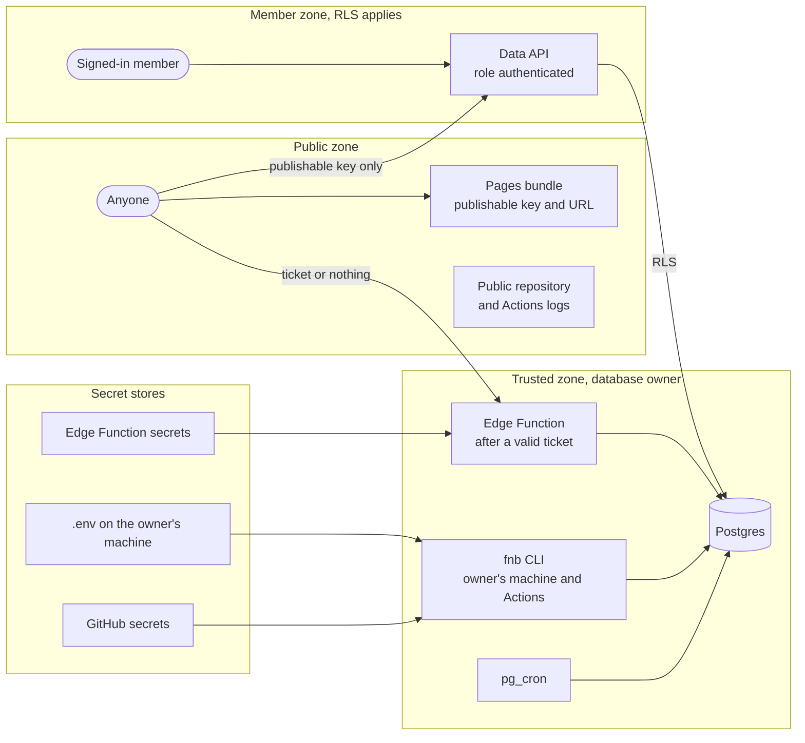

# Security and privacy

This document describes how FNB Manager protects the shops' data, credentials and customers: what data it holds and how sensitive each kind is, the threats to each surface with the controls that exist and the gaps that remain, who may do what, where secrets live, how the public repository stays clean, how the platform meets Vietnamese personal-data and messaging rules, and how security is kept up during development. It is written for the owner, for a developer taking the work over, for reviewers and testers, and for whoever operates the platform after go-live. It describes the code and the local database catalogue as they stand on 2026-11-12 and uses the status words that [requirements.md, section 1.5](requirements.md#15-conventions) defines (verified locally, built, in build, designed, planned, waits for owner); the numbered requirements behind these controls are NFR-SEC and NFR-PRV in [requirements.md, section 4](requirements.md#41-sec--security). Nothing here is legal advice; the legal points summarise [deep-dives/vietnam-legal-requirements.md](deep-dives/vietnam-legal-requirements.md), a research draft of 2026-11-07, and wait for the owner's legal read.

Last updated 2026-11-12

## 1. Security at a glance

What protects the data today:

- **Row-level security everywhere.** All 52 tables in `public` have RLS, with 80 policies; `anon` holds no privilege on any table and may execute no function; the helper schema `app` is not exposed through the API. pgTAP proves two-tenant isolation, store scope, the publisher's isolation and the browser write rules (verified locally).
- **No credential in the database or the repository** (ADR-006). POS logins, API keys and provider tokens live only in the owner's `.env`, GitHub secrets and Edge Function secrets. Notification destinations store the *name* of an environment variable, never its value.
- **A schedule with no key** (ADR-028). The Edge Function that `pg_cron` calls accepts only a single-use ticket that the database issued minutes earlier.
- **A clean public repository** (ADR-015). gitleaks and `scripts/check-public-safe.mjs` run in CI; the build fails if the web bundle contains a secret-shaped string; CI output numbers accounts and stores instead of naming them.
- **Lawful by design** (ADR-021). An append-only consent ledger, data-subject requests with statutory deadlines, channel policies that cannot be set below the legal floor, a message log kept at least one year.

What is not in place yet (section 12 lists every open item):

- The cloud project does not exist, so none of its settings (enforced TLS, sign-ups off, SMTP, redirect list, password policy) and no live RLS run exist yet. They wait for the owner ([go-live.md](go-live.md)).
- Backups are built but not running until the owner sets the bucket and key secrets.
- The web app has no Content Security Policy, because GitHub Pages cannot send headers (accepted in ADR-023).
- Two workflows expose two cloud secrets to dependency install scripts; CI has no explicit token permissions; actions are pinned to major tags and nothing updates dependencies automatically.
- Data-subject tooling, the breach runbook and the cross-border decision belong to Track C and are planned.

## 2. Data classification

| Class | What it covers here | Where it lives | Who can read it | Handling rules |
|---|---|---|---|---|
| Personal data | Customers: phone and name on `customers` and on `invoices` (`customer_phone`, `customer_name`), and the customer fields inside the POS payloads in `sale_payloads`. Members and staff: login e-mail and password hash in Supabase Auth, roles in `tenant_members`, cashier names (`shifts.cashier_name`, `invoices.employee_name`), notification destinations (a bot chat id in `notification_channels.address`), consent evidence, data-subject request contacts. Later, in Tracks B and C: Zalo ids, phone numbers from Zalo, memberships and the loyalty ledger | Postgres (Supabase Singapore once it exists; the local stack today) | Data roles of the tenant through RLS (section 5.3); never `anon` or the publisher; no API role reads the payload documents or destination addresses | Collect only what the POS already records; consent per purpose with evidence; no personal data in alerts or message parameters (count-only facts); redaction when a member leaves; cross-border decision before Track C (section 8) |
| Financial and business-confidential | Sales, invoices, payments, shifts and cash, aggregates, item costs, targets, fee rates, plans; digest and alert texts; revenue figures in the private acceptance notes; database dumps | Postgres; `outbound_messages` bodies for 90 days; providers' systems once sent; the gitignored `docs/private/`; encrypted backups | Data roles within store scope; the owner's chosen notification providers for digest numbers; the owner's own assistant for the data pack (planned, aggregates only) | Never in the public repository, logs, job summaries or the bundle; digests built as the recipient so they never show more than the app would; backups encrypted with `age` before upload |
| Credentials | POS logins (`POS_ACCOUNTS_JSON`) and the CMS application key (`IPOS_APP_KEY`); the POS session-token cache; the Supabase secret key, database password and URL, personal access token; `NOTIFY_*` provider tokens; backup bucket keys and the `age` private key; member passwords; notification link codes | `.env` (gitignored), GitHub secrets, Edge Function secrets; `pos_account_tokens` (no API role); password hashes in Supabase Auth; link codes only as SHA-256 hashes in `app.notification_link_codes`; the `age` private key offline with the owner | The owner; the jobs and the Edge Function at run time | ADR-006; masked in CI logs field by field; rotated at launch and when someone with access leaves ([secrets.md](secrets.md), "Rotation") |
| Shop identifiers | Shop and brand names, account e-mails, chat ids, POS account and store ids of the real shops | The database, secrets and `docs/private/` only | The owner and the data roles | Never in a tracked file; account keys in `POS_ACCOUNTS_JSON` stay neutral (`account-1`); the private identifier list feeds the local scan |
| Public | Source code, generic documents, the synthetic seed (tenant `demo-fnb`) and test fixtures, the publishable key and project URL, the web bundle, the browser demo's generated numbers | The public repository, GitHub Pages | Anyone | The publishable key authorises nothing by itself; RLS carries the protection |

## 3. Trust boundaries

The jobs and the Edge Function connect as `postgres`, which owns every table and has the `BYPASSRLS` attribute (catalogue, 2026-11-12). RLS therefore protects the member zone only; the trusted zone is protected by the schema and the code: tenant-consistent composite foreign keys; database functions that refuse a store, account, run or destination outside the tenant they are given (for example `app.record_runner_notification`, `app.digest_scope_check` and the trigger `notification_channels_validate`); and the digest builder switching to role `authenticated` with the recipient's claims before it reads. Test runs are fenced too: with a simulated clock, a provider override or `NOTIFY_INTEGRATION=1`, the notification repository refuses any scan without a tenant filter. `service_role`, the Data API role of the secret key, is used by no job for data today; `fnb tenant add-member` uses the secret key only for the Auth admin API.

## 4. Threat model per surface

Each table lists the threats, the controls that exist with their status, and the gap or next step.

### 4.1 The web app on GitHub Pages

| Threat | Controls in place | Status | Gap or next step |
|---|---|---|---|
| A secret or identifier ships in the public bundle | The bundle holds only the publishable key and the project URL; `apps/web/scripts/check-bundle.mjs` fails `pnpm --filter @fnb/web build` on an e-mail address, a non-synthetic UUID, a JWT, an `sb_secret_` key or a 32-hex string, and allows in a live build only that build's own key and URL by exact match; every Pages deploy runs that build | built | CI does not run the web build on pull requests (its end-to-end job builds with plain `vite build`), so a bad bundle is caught only at deploy time |
| Script injection steals the session, which supabase-js keeps in the browser's storage | React escapes output; no raw HTML injection in `apps/web/src`; no third-party script or origin in the source; report sentences come from i18n templates, never from a model or a database string | built | No Content Security Policy: Pages cannot send headers, and the app sets no CSP `meta` tag either; HSTS cannot be set (ADR-023). Next: evaluate a `meta` CSP; Cloudflare Pages is the fallback host that can send headers |
| Anyone calls the API with the publishable key | `anon` reads nothing and executes nothing; sign-ups are disabled, so nobody can create a login | verified locally (pgTAP `06_anon_and_tokens.sql`); the cloud setting waits for owner | none |
| Password guessing or weak passwords | Supabase Auth rate limits sign-ins (the local configuration allows 30 sign-in requests per 5 minutes per IP address); PKCE flow; refresh-token rotation | built (local configuration) | The local configuration keeps the default minimum password length of 6 with no complexity rule, and TOTP MFA is off. The cloud project's password policy and an MFA decision are open (section 12) |
| A reset or invite link is redirected elsewhere | Hash routing with PKCE; the Auth redirect allow-list holds only the Pages URL and the local development URL | designed ([go-live.md](go-live.md) step 1); waits for owner | none |
| A fixed bug stays cached | `version.json` is compared on window focus and offers "Có phiên bản mới — tải lại"; Pages caches `index.html` for ten minutes | built | none |
| The app appears in search results | `noindex` in `index.html` | built | none |
| Sample numbers are mistaken for real ones | The demo shows a permanent banner ("Bản demo: đây là số liệu mẫu, không phải của một cửa hàng thật.") and makes no network call | verified locally | none |
| Framing by another site | None on Pages: a CSP `frame-ancestors` rule needs a response header; ADR-023 accepts the missing headers and names Cloudflare Pages as the fallback host | designed (fallback only) | Revisit when the host changes or before Track C goes public |

### 4.2 The Data API: PostgREST and RPC

| Threat | Controls in place | Status | Gap or next step |
|---|---|---|---|
| A member reads another tenant | RLS on all 52 `public` tables; tenant and store helpers in `app`; composite foreign keys that bind every store and account row to its tenant | verified locally (pgTAP `04_tenant_isolation.sql`, `17_analytics_access.sql`, `23_report_access.sql`, `31_notify_access.sql`) | Run the two-tenant suite once against the cloud project (phase 5 acceptance; waits for owner) |
| A store-limited member reads other stores | Store-scoped policies on facts, shifts, aggregates and runs; report functions are `security invoker`, so RLS silently drops stores the caller may not see | verified locally | none |
| A member writes what they should not | Browser writes are limited to the manual-input tables, plans, the two legal ledgers, alert rules and channel policies; tenant-wide rows need a membership not limited to some stores; `created_by` must equal the caller and is frozen by trigger; destinations are written only by `security definer` functions | verified locally (pgTAP `05_write_policies.sql`, `07_write_scope_and_attribution.sql`, `31_notify_access.sql`) | none |
| A manager forges or silences consent | Two restrictive policies keep every browser role from inserting a `notifications` consent or touching its `revoked_at`; the append-only trigger binds every role, the service role and the database owner included | verified locally (pgTAP `12_consent_and_legal.sql`, `31_notify_access.sql`) | none |
| A channel policy is set below the legal floor | CHECK constraints bind every writer: an allowed advertising policy needs consent, a cap of 1 to 3 messages in 24 hours, hours inside 07:00–22:00, no critical bypass, an opt-out text, and a label or an approved template; an allowed operational policy for member destinations needs the `notifications` consent check | verified locally (pgTAP `26_notify_schema.sql`) | none |
| A secret or address leaks through a select | `notification_channels` grants column-level `SELECT` without `address`, `secret_name` and `config`; `pos_account_tokens` and `sale_payloads` have no grant at all; the seven `app` tables have no grant | verified locally | none |
| Bulk extraction or expensive calls | `max_rows = 1000`; 12 of the 16 report functions refuse more than 50 store ids. `period_series`, `item_summary`, `payment_summary`, `promotion_summary`, `shift_review` and `item_lifecycle` refuse more than 900 rows, and the functions with a range limit refuse a longer range (`22023`). `period_compare`, `item_velocity`, `month_pace`, `forecast_accuracy` and the other phase 8 query functions have no SQL limit; only the client contract caps store ids at 50. `refresh_my_analytics` is limited to owners and managers and 92 days per call | verified locally (pgTAP `22_report_functions.sql`; a read-only catalogue query on 2026-11-12) | No per-user rate limit beyond the platform's own. No SQL store-count or range guard on four report functions and the phase 8 query functions, so a direct RPC caller can ask for any number of stores or any range; only `max_rows` caps the result (request R-FX01) |
| A `security definer` function is abused | 17 definer functions (16 in `app`, `public.refresh_my_analytics`), each with an empty `search_path`; the membership helpers read only the caller's own memberships; every other function except the constant `app.data_roles()` also pins its `search_path` | verified by a read-only catalogue query on 2026-11-12 and `supabase db advisors`; pgTAP `18_metric_value.sql`, `19_sale_payloads.sql` and `22_report_functions.sql` assert the empty `search_path` for their own functions | No pgTAP audit of `search_path` for every function; `app.data_roles` pins none (request R-T01) |
| A leaked publisher credential exposes sales | The publisher reads no sale, aggregate, refresh log or live view; it reads its tenant, its stores, plans, holidays, the calendar and the global notification catalogues | verified locally (pgTAP `08_publisher_role.sql`, `17_analytics_access.sql`, `23_report_access.sql`) | none |

### 4.3 Edge Functions with `verify_jwt = false` and single-use tickets

| Threat | Controls in place | Status | Gap or next step |
|---|---|---|---|
| Anyone makes the function call the POS | Only a ticket the database issued starts a run: a random id with a 10-minute life, claimed and deleted before any work; an unknown, used or expired ticket gets 401 | verified locally (pgTAP `20_incremental_schedule.sql` and the phase 7 end-to-end runs on the local stack) | none |
| A ticket is read from the `pg_net` queue or a log | A ticket can start at most one sync of one store, once, within minutes; no credential exists for the schedule at all (ADR-028) | verified locally | none |
| Anonymous calls exhaust database connections | Claims share one connection per worker; with 32 claims waiting the function answers 429 without touching the database; only a claimed ticket opens the run's own two connections | verified locally | none |
| Anonymous calls exhaust the invocation quota | Each bad call costs only one invocation and one indexed delete | built | No rate limit in front of the function; the Free plan includes 500,000 invocations a month, so watch usage on the dashboard once the project exists |
| The database link falls back to plaintext | TLS for any non-local host; a URL whose `sslmode` would allow plaintext is refused with 500; an optional CA certificate (`FNB_DB_CA_CERT`) | built; the cloud connection waits for owner | none |
| Secrets appear in logs | Every log line passes the redactor, which knows the function's secrets and the injected Supabase keys; reports carry counts only, with accounts and stores by number | verified locally | none |
| Two runs corrupt one store's day | The session advisory lock per store is shared with the CLI and the nightly job; the function gives way after 15 seconds | verified locally | none |
| Future public endpoints (the `notify` function; Zalo webhooks) | `app.notify_tickets` and its issue and claim functions already follow ADR-028; Zalo webhooks are to verify the provider's signature on the raw body and start in observe mode before failing closed | ticket functions verified locally (12a); the `notify` function planned (12c); webhooks planned (phase 13) | none yet |

### 4.4 GitHub Actions jobs

| Threat | Controls in place | Status | Gap or next step |
|---|---|---|---|
| A credential appears in the public log | Every `fnb` run on Actions first prints `::add-mask::` for each field of each `POS_ACCOUNTS_JSON` entry, `IPOS_APP_KEY`, the Supabase secret key, the user and password inside the database URL (encoded and decoded), every `NOTIFY_*` credential and the fields of `NOTIFY_FALLBACK_TARGETS`; output and job summaries carry counts and numbered accounts and stores only | verified locally for the POS entries, `IPOS_APP_KEY`, the secret key and the database URL; in build (12b) for the `NOTIFY_*` credentials and the fallback targets | none |
| A dependency's install script reads secrets | `sync.yml`, `notify.yml` and `deploy-functions.yml` give secrets only to their configuration check and to the steps that run `fnb` or the deploy, never to checkout, setup or `pnpm install` | built | `migrate.yml` (lines 26 to 28) and `backup.yml` (lines 19 to 21) set `SUPABASE_ACCESS_TOKEN` and `SUPABASE_DB_PASSWORD` on the job, so `pnpm install --frozen-lockfile` runs with them; move them to the steps that use them |
| Script injection through dispatch inputs | `sync.yml` passes inputs to scripts through environment variables, checks both dates against `YYYY-MM-DD`, and takes the account as a position number, never a key | built | none |
| A fork's pull request reaches secrets | CI needs no secret; `migrate.yml` runs its dry run only for pull requests from this repository | built | none |
| The workflow token can do too much | Nine workflows declare `permissions: contents: read`, adding only `pages: write` and `id-token: write` (Pages deploy) or `actions: write` (`workflows-active.yml`) | built | `ci.yml` declares no `permissions` block and so gets the repository's default token permissions; declare `contents: read` |
| A compromised action or package | Actions are the official ones plus `pnpm/action-setup` and `denoland/setup-deno`; the lockfile is installed with `--frozen-lockfile`; gitleaks runs from a tagged image | built | Actions are pinned to major tags, not commit SHAs, and no tool proposes dependency updates (no Dependabot or Renovate configuration) |
| A destructive command reaches the cloud database | Migrations: a dry run on pull requests, `db push` only on a push to `main`, one concurrency group; no workflow runs a linked reset; CI resets only its own throw-away stack | built | ADR-023 and the roadmap promise a guard against `db reset --linked`; none exists, the rule is procedural |
| A scheduled job stops silently | `workflows-active.yml` re-enables workflows weekly; `fnb notify job-failed` records failures as `job_failed` alerts | built; the alert path is in build (12b) | The `workflow_run` listener and the database-free fallback are planned (12c) |

### 4.5 The `fnb` CLI

| Threat | Controls in place | Status | Gap or next step |
|---|---|---|---|
| The CLI bypasses RLS, so a bug could cross tenants | Composite tenant-consistent keys; database functions that refuse rows outside the given tenant; the digest built in a read-only transaction as role `authenticated` with the recipient's claims; test switches (`--at`, provider base-URL overrides, `NOTIFY_INTEGRATION=1`) accepted only with `--tenant` and a fixture tenant whose slug starts with `notify-it-`, and unfiltered scans refused while they are on | verified locally (pgTAP, integration tests); the digest path is in build (12b) | A dedicated least-privilege database role for the jobs is an open option |
| A plaintext connection to the cloud database | The CLI asks for TLS (`sslmode=require`) for every non-local host unless the URL names its own `sslmode`; the go-live checklist turns on server-side SSL enforcement | built; enforcement waits for owner | Unlike the Edge Function, the CLI does not refuse an explicit plaintext `sslmode` for a remote host |
| Credentials end up in shell history or logs | `FNB_MEMBER_PASSWORD` instead of `--password`; `.env` is gitignored; `onboard --print-secret-entry`, `notify link` and `digest --show-text` (step 12b, in build) are refused in CI; error messages pass the redactor (literal credentials, connection-string users and passwords, JWTs, `sb_` keys, 32-hex keys, `password=` pairs) before they are printed or stored, and a stored run error is cut to 500 characters | built | none |
| A test sends real messages | A provider base-URL override is accepted only for a loopback address (`http://127.0.0.1:<port>`); integration runs use synthetic `_IT` secret names and fixture tenants | built | none |
| The real local tenant is wiped | Locally the CLI reads `DATABASE_URL` before `SUPABASE_DB_URL`; the written rule "never run `supabase db reset` on the machine that holds real data" ([status.md](status.md)) | designed (a written rule) | No technical guard against `pnpm db:reset` on that machine |

### 4.6 POS credentials

| Threat | Controls in place | Status | Gap or next step |
|---|---|---|---|
| `POS_ACCOUNTS_JSON` or `IPOS_APP_KEY` leaks | Only in `.env`, GitHub secrets and Edge Function secrets (ADR-006); masked field by field in CI; account keys are neutral and CI refers to accounts by position | built | Each entry is the CMS login of an account (e-mail and password), so a leak exposes more than the read endpoints the sync uses; rotate on any doubt ([secrets.md](secrets.md)) |
| The session-token cache is read | `pos_account_tokens` has RLS with no policy and no grant to any API role | verified locally (pgTAP `06_anon_and_tokens.sql`) | none |
| A changed or revoked password goes unnoticed | The account turns `auth_failed` once, the schedule skips it, and an `auth_failed` alert (critical) is raised | verified locally (runners); the alert episode is in build (12b) | none |
| Endpoints outside the documented read set | The connector calls documented read endpoints only and stores, logs or reuses nothing from any other endpoint (ADR-025, section 9) | built | none |
| A POS password known to more people than need it | The owner changes it now (a roadmap owner action), and again at launch and whenever someone who knew it leaves ([operations.md](operations.md), sections 4.7 and 4.8) | waits for owner | none |

### 4.7 Notification provider tokens

| Threat | Controls in place | Status | Gap or next step |
|---|---|---|---|
| A token leaks and someone messages as the bot or sender | Values live only in `.env` and GitHub secrets (Edge Function secrets once the `notify` function exists); a destination row stores the variable name, which must start with `NOTIFY_` and the kind's prefix (`app.notify_secret_name_valid`); `app.notify_settings` records which names a runtime held, never values | verified locally (12a) | Rotation of `NOTIFY_*` secrets is not documented yet (planned with the step 12c documentation) |
| Someone links a chat that is not theirs | A one-time `FNB-` code valid 15 minutes and stored only as a SHA-256 hash; the chat id is learnt from the member's own message; the member must accept with an explicit reply ("ĐỒNG Ý") within 24 hours; e-mail destinations confirm a 6-digit code, and the fifth wrong code deletes the destination | verified locally (pgTAP `28_notify_outbox.sql`) | none |
| Messages reach the wrong person, too often or at night | Every send decision is taken in SQL at claim time: destination state, consent, mutes, allowed hours in the reader's zone, daily and monthly caps; webhook URLs must be `https://` with no user information, query or fragment | verified locally (pgTAP `27_notify_policy.sql`, acceptance A4) | none |
| Business numbers sit in third-party systems | Digests carry aggregates and store, item and shift names only; alert parameters are count-only; message bodies are cleared after 90 days | built | The owner chooses the providers; their terms apply |

### 4.8 The public repository

| Threat | Controls in place | Status | Gap or next step |
|---|---|---|---|
| A credential, identifier or revenue figure is committed | CI runs gitleaks over the whole history with redacted output, and `scripts/check-public-safe.mjs` over every tracked and untracked file that is not ignored; the owner runs the same script, with the private identifier list, before every commit | built | none |
| Shop identifiers slip past the generic rules | The private list `docs/private/identifiers.txt` (entries of at least four characters) is checked locally; CI cannot see it and relies on generic patterns (ADR-015) | built | Depends on running the scan locally before each commit |
| Real data leaks through tests or fixtures | Fixtures are synthetic (ADR-009); live suites need `LIVE=1` and print counts only; recorded real responses are never committed | built | none |
| Leaks through job logs, summaries or artifacts | Masking and numbering (section 4.4); the only uploaded artifact is the Pages site; backups go to a private bucket, encrypted, never to the repository | built | none |
| Private notes are committed | `.gitignore` covers `docs/private/`, `.env` and `.env.*` (except `.env.example`), the local browser-automation folder and the Supabase temp folders | built | none |

## 5. Authentication and authorisation

### 5.1 Identities

| Identity | Used by | Authenticates with | Database role | Status |
|---|---|---|---|---|
| Member login | Owners, managers, staff, viewers in the web app | Supabase Auth e-mail and password, PKCE flow; created or invited by `fnb tenant add-member`; sign-ups disabled | `authenticated` plus a `tenant_members` row | verified locally |
| Publisher | `fnb publish-plan` and an optional scheduled strategy run (ADR-013) | Its own login, from a local gitignored `.env` or the run's environment | `authenticated` with role `publisher` | role verified locally; the command is designed (phase 11b) |
| Jobs | The `fnb` CLI on the owner's machine and on Actions | The database URL (session pooler in the cloud) | `postgres` | verified locally |
| Edge Function | `sync-incremental` | The injected database URL; its callers present a single-use ticket | `postgres` | verified locally |
| Scheduler | `pg_cron` jobs | Inside the database | `postgres` | built |
| Auth administration | `fnb tenant add-member` | The secret API key against the Auth admin API | not applicable | verified locally |
| Caller without a session | Anyone holding the bundle | The publishable key | `anon`, which may do nothing | verified locally |
| Digest builder | `fnb digest` | Switches to `authenticated` with the recipient's claims inside a read-only transaction | `authenticated` | in build (12b) |

### 5.2 Roles and store scope

A membership (`tenant_members`) grants a login one role in one tenant and an optional store scope (`store_ids`; null means every store of the tenant). `owner`, `manager`, `staff` and `viewer` are the data roles; `publisher` is a service identity outside them, so a leaked publisher credential cannot read a single sale. Writes to tenant-wide rows (a null `store_id`, or tables without one) need a membership that is not limited to some stores. The definitions are in [schema.md](schema.md), "Row-level security".

### 5.3 RLS summary matrix

Read "scope" as "for the stores in the member's scope", "unlimited" as "only with a membership not limited to some stores", and "own" as "only rows about the member's own destinations". `anon` has no privilege on any table or view and may execute no function in `public` or `app`.

| Capability | owner | manager | staff | viewer | publisher |
|---|---|---|---|---|---|
| Read its tenant and the stores in scope | yes | yes | yes | yes | yes |
| Read sales facts, shifts, aggregates, sync runs and checks | scope | scope | scope | scope | no |
| Read the catalogue, POS account metadata and the member list | yes | yes | yes | yes | no |
| Read `customers` and `consent_records` (tenant-wide) | yes | yes | yes | yes | no |
| Call the 16 report functions | rows in scope | rows in scope | rows in scope | rows in scope | empty rows and null totals |
| Write item costs, targets and payment fee rates | scope | scope | no | no | no |
| Write item-type roles and tenant holidays | unlimited | unlimited | no | no | no |
| Refresh analytics (`refresh_my_analytics`, at most 92 days) | yes | yes | no | no | no |
| Read plans (`strategy_reports`) | scope | scope | scope | scope | scope |
| Insert plans, with `created_by` set to the caller | scope | scope | no | no | scope |
| Update or delete plans | scope | scope | no | no | no |
| Grant or revoke consent for `loyalty`, `marketing`, `staff_ops` | yes | yes | no | no | no |
| Grant or revoke a `notifications` consent from the browser | no | no | no | no | no |
| Read, file and update data-subject requests | unlimited | unlimited | no | no | no |
| Read alert rules and the tenant's channel-policy overrides | yes (store rows in scope) | yes (store rows in scope) | no | no | no |
| Write alert rules and channel-policy overrides | unlimited | no | no | no | no |
| Read the alert rule catalogue and the global channel policies | yes | yes | yes | yes | yes |
| Read destinations (columns without address, secret name and configuration) | all with unlimited scope, else own | all with unlimited scope, else own | own | own | own |
| Read alert episodes | scope | scope | no | no | no |
| Read digests | when every store of the digest is in scope | when every store of the digest is in scope | no | no | no |
| Read outbound messages | all with unlimited scope, else their stores; plus own | all with unlimited scope, else their stores; plus own | own | own | own |
| Write destinations, the outbox, episodes, digests, facts, the catalogue or stores | no | no | no | no | no |
| Read the POS token cache, the payload documents or anything in `app` | no | no | no | no | no |

Destinations are created, linked and withdrawn through `security definer` functions and the CLI, not by direct writes.

### 5.4 Database hardening

- Of our schemas the Data API exposes only `public` (`[api] schemas` in `supabase/config.toml` lists `public` and the platform's `graphql_public`); `anon` has no `USAGE` on `app`, and `authenticated` has it only so policies and invoker functions can call the helpers.
- Default privileges make a future table read-only for `authenticated` and invisible to `anon` until a migration grants more (pgTAP `03_rls_enabled.sql`).
- Policies call the array-returning helpers as `(select app.helper())`, so they run once per statement instead of once per row.
- Report and query functions are `security invoker` and `stable`, so RLS applies to the caller.
- Store- and account-scoped tables reference their tenant through composite foreign keys, so even a job that bypasses RLS cannot attach a row to another tenant's store or account ([schema.md](schema.md), "Tenant-consistent composite foreign keys").
- The two `public` views are `security_invoker`; the platform's materialised-view risk does not arise because aggregates are ordinary tables (ADR-010).

### 5.5 The publisher identity (ADR-013)

The plan-publishing path signs in as a dedicated member with role `publisher`, never with the owner's login or the secret key. The database lets it read its tenant, its stores, plans, holidays, the calendar and the global notification catalogues, and insert plans for stores in its scope with `created_by` set to itself; it reads no sale and no aggregate. ADR-013 says the publisher "reads aggregates"; the database and its tests say it does not, and a correction of the ADR text has been requested. The consequence for phase 11: the data pack must be built by an owner or manager session or by the CLI's own connection, not by the publisher.

## 6. Secrets management (ADR-006)

- **Where they live.** The owner's `.env` (gitignored), GitHub Actions secrets, and Supabase Edge Function secrets. Two values are public by design and live as GitHub variables: `SUPABASE_URL` and `SUPABASE_PUBLISHABLE_KEY`. The full list, with what each command and function needs, is in [secrets.md](secrets.md); [architecture.md](architecture.md), section 7.1, shows where each one lives.
- **What the database holds instead.** Account metadata and external ids; the POS session-token cache in `pos_account_tokens`, unreachable by any API role; the names of `NOTIFY_*` variables on destinations and in `app.notify_settings`; link codes and acceptances only as SHA-256 hashes. Vault holds no secret today (0 rows locally), and the incremental schedule deliberately keeps none there (ADR-028).
- **Edge Function secrets** are set from a file outside the repository with `pnpm exec supabase secrets set --env-file <file> --remote=<project ref>`, each value in single quotes; names may not start with `SUPABASE_`.
- **Masking.** GitHub masks whole secret values only; `fnb mask-credentials` masks the fields inside them at the start of every job (section 4.4).
- **Backups.** Dumps are encrypted with the `age` public key in `BACKUP_AGE_RECIPIENT` before upload; the private key stays offline with the owner.
- **Rotation.** Rotate the POS passwords, the Supabase secret key and the Zalo secrets at launch and whenever a person with access leaves: rotate at the provider, update the secret, re-run the affected workflow, and confirm the next scheduled run is green ([secrets.md](secrets.md), "Rotation"). A changed POS password must reach `.env`, the GitHub secret and the Edge Function secret.
- **Known drift.** [secrets.md](secrets.md) names the Zalo Bot secret `ZALO_BOT_TOKEN` and omits `NOTIFY_EMAIL_FROM`, `NOTIFY_EMAIL_FROM_NAME`, `NOTIFY_TELEGRAM_BOT_TOKEN` and `NOTIFY_WEBHOOK_SECRET`, which `sync.yml` and `notify.yml` already read; the update is scheduled for step 12c.

## 7. Public-repository hygiene (ADR-015)

The repository is public because GitHub Pages on a free account requires it (ADR-001). These controls keep it clean:

| Control | What it does | Where it runs |
|---|---|---|
| gitleaks v8.30.1 | Default rules over the whole git history, output redacted; `.gitleaks.toml` allows only the synthetic test fixtures under `packages/*/test/fixtures/` and two obviously synthetic hex tokens | CI job "Secret and identifier scan" |
| `scripts/check-public-safe.mjs` | Scans tracked and untracked, not ignored text files for e-mail addresses (except `example.com`, `example.org`, `users.noreply.github.com` and `email.com`), non-synthetic UUIDs, JWTs, secret prefixes (`sb_secret_`, `sk_live_`, `sk_test_`, `ghp_`, `github_pat_`, `AKIA`), 32-hex keys, Vietnamese phone numbers in `+84` form, and every entry of `docs/private/identifiers.txt` when the file is present; exits 1 on any finding and prints only a short sample | CI, and locally before every commit |
| The private identifier list | Shop names and other identifiers, kept in the gitignored `docs/private/` and copied between machines through a private channel ([status.md](status.md)) | locally only (ADR-015) |
| `apps/web/scripts/check-bundle.mjs` | Fails the web build on secret-shaped strings in `dist` (section 4.1) | every `pnpm --filter @fnb/web build`: each Pages deploy and local builds; not in `ci.yml` |
| CI output rules | With `CI` or `GITHUB_ACTIONS` set, the CLI names no shop: accounts are "account 1", "account 2" by position, other onboarded accounts "other 1", "other 2"; errors never repeat an account key or tenant slug | every `fnb` run on Actions |
| Synthetic data only | The seed tenant `demo-fnb` and the mock connector; the browser demo generates its days from a fixed seed | repository |
| Neutral keys | `POS_ACCOUNTS_JSON` keys such as `account-1`, because the key is stored and typed in commands | owner practice |

The owner reviews and commits every phase (roadmap principle 12). Run `node scripts/check-public-safe.mjs` before every commit; it reports "public-safe scan: no findings" when clean.

## 8. Privacy and legal compliance

### 8.1 The legal frame

The legal deep dive identifies these duties ([deep-dives/vietnam-legal-requirements.md](deep-dives/vietnam-legal-requirements.md)): the Law on Personal Data Protection 91/2025/QH15 (in force since 2026-01-01) with Decree 356/2025 and the sanctions of Decree 330/2026, the anti-spam Decree 91/2020, the Consumer Protection Law 19/2023, the promotions rules of Decree 81/2018 as amended by Decree 128/2024, and the e-invoice Decree 254/2026. ADR-021 turns them into build requirements; the owner's legal read is planned before Track C goes public (roadmap section 5, week 9).

### 8.2 Consent ledger

| Element | Design | Status |
|---|---|---|
| Ledger | `consent_records`: one row per grant, per subject (`customer` or `staff`) and purpose (`loyalty`, `marketing`, `staff_ops`, `notifications`), with policy version, channel, time and evidence; at most one active row per subject and purpose | verified locally |
| Append-only rule | The trigger `consent_records_keep_grant` freezes every column except `revoked_at`, lets a revocation happen once and never move; it binds every role, the service role included; there is no `DELETE` grant | verified locally (pgTAP `12_consent_and_legal.sql`) |
| Member notifications | A separate `notifications` purpose, recorded only at the member's own acceptance (`app.ensure_notifications_consent`) and withdrawn by `app.withdraw_notifications` or `fnb notify unlink --tenant <slug> --member <login e-mail> --all`, which also stops their messages | verified locally (12a) |
| Use at send time | The send decision cancels a message to a member destination without an active consent (`no_consent`); channel policies cannot drop the consent check below the floor | verified locally |
| Customer consent capture | Purpose screens and never pre-ticked marketing toggles in the customer Mini App and at the till | planned (Track C) |

### 8.3 Data-subject requests

`data_subject_requests` records access, correction, deletion, export, objection and withdrawal requests. A trigger fills the deadlines from `app.dsr_deadlines`: the first response is due two working days after receipt (Monday to Friday in the tenant's time zone, skipping the global public holidays of its country), completion 20 calendar days after receipt, or 30 when a processor is involved. Owners and managers with an unlimited scope file and update requests; the browser cannot delete one (verified locally, pgTAP `12_consent_and_legal.sql`). The tooling to look up, correct, export and delete a customer with cascading deletion is planned for phase 17a; until then requests are handled by the owner with the database.

### 8.4 Retention and redaction

| Data | Kept | Mechanism | Status |
|---|---|---|---|
| Outbox and message log | At least one year: `retention_days`, default 400 (366 to 1,100), then deleted in batches | `app.notify_housekeeping` | verified locally |
| Message titles and bodies | `body_retention_days`, default 90 (31 to 400), then cleared; hash, template and parameters stay | `app.notify_housekeeping` | verified locally |
| A removed member's messages | Redacted at once: text, parameters and subject cleared, recipient set to `redacted`; their destinations go with the membership; the consent ledger stays as evidence | trigger `tenant_members_redact_notifications` | verified locally |
| One subject's messages on request | Text, parameters and subject cleared, waiting rows cancelled | `app.redact_outbound_for_subject` | verified locally (12a); the request workflow around it is planned (phase 17a) |
| Link codes; unaccepted bot links | Until a day after expiry; a pending bot destination and its chat id are deleted once the 24-hour acceptance lapses | housekeeping | verified locally |
| Incremental runs, scheduler alerts, refresh log, `cron.job_run_details` | 35 days (90 when not succeeded); 90 days after resolution; 35 days keeping each tenant's newest; 7 days | `app.prune_incremental_sync_history` | verified locally |
| Sales facts with customer and cashier fields, `customers`, payload documents | Indefinitely today | none yet | deletion on request planned (phase 17a); a time-based retention rule is an open item (section 12) |

### 8.5 Cross-border hosting (ADR-019)

Hosting personal data on Supabase in Singapore and on GitHub is a cross-border transfer under the personal-data law. According to the deep dive, a household business or micro-enterprise is exempt from the transfer dossier, a small enterprise may defer it to 2030, and the relief is lost for a business that sells data-processing services, processes sensitive data directly or reaches 100,000 data subjects. `tenants.legal_form` records the entity type (default `unknown`); the decision is gate G3 and must be made before Track C goes public. ADR-019 is the only open ADR. Zalo-derived data stays minimal (Zalo id, display name, phone), and the database stays portable to a Vietnam-hosted Postgres.

### 8.6 Personal-data minimisation in practice

- Alerts and message parameters hold counts and short tokens only (`app.facts_are_count_only`), so no error text, name, address or URL reaches them.
- Digests hold aggregates and store, item and shift names; no customer data and no cashier names.
- The outbox never stores an address: `recipient_ref` is `channel:<id>`.
- The data pack is planned to hold aggregates only (phase 11 acceptance).
- Every data role can read customer phones and names (on invoices within its stores, in `customers` across the tenant) and the consent ledger. Narrowing this for staff and viewers is an open decision before Track C.

### 8.7 Breach procedure

The deep dive records a duty to notify the Ministry of Public Security's A05 department within 72 hours of a personal-data breach and to keep breach records for five years. ADR-021 calls for a 72-hour breach runbook; the roadmap places it in phase 17a. Until it exists, a suspected breach follows the incident steps in section 11 and is recorded with its time of discovery, the data and subjects involved and the actions taken, so that the 72-hour clock can be met.

## 9. Vendor security observations (ADR-025)

During the read-only review of the POS vendor's CMS, the owner noted security issues in endpoints that the connector does not use. They are recorded in the private notes and handled under ADR-025. The rules that follow:

- The connector calls only the documented read endpoints the sync needs, never the CMS forwarding or CRM endpoints ([connectors/ipos-fabi.md](connectors/ipos-fabi.md)).
- Nothing returned by any other endpoint is stored, logged or reused.
- The details stay in the private notes, never in this repository.
- What to do about the observations is the owner's decision under ADR-025; this document does not record it.

## 10. Secure development practice

- **Review and verification.** Every phase goes through build, an independent review, fixes, then an independent verification that reruns everything CI runs plus checks against the real data on the local stack; nothing is called done before that verification passes ([status.md](status.md)). The owner reviews and commits each phase.
- **Tests that guard security.** pgTAP files `03_rls_enabled.sql` (9 tests), `04_tenant_isolation.sql` (11), `05_write_policies.sql` (8), `06_anon_and_tokens.sql` (7), `07_write_scope_and_attribution.sql` (16), `08_publisher_role.sql` (16), `12_consent_and_legal.sql` (57), `17_analytics_access.sql` (39), `23_report_access.sql` (28), `26_notify_schema.sql` (178), `27_notify_policy.sql` (58) and `31_notify_access.sql` (64); unit tests for redaction, masking, TLS selection (`enforcedSsl`) and secret-name rules; the two repository scans; the bundle check. CI runs the pgTAP files, the unit tests and the scans on every push and pull request; the bundle check runs with every Pages deploy and local build.
- **Validation at every boundary.** zod schemas for POS responses (with passthrough, so new vendor fields do not break the sync), account entries, CLI options and report rows; parameterised SQL only in the Postgres repositories.
- **Pinned versions.** `pnpm-lock.yaml` with `--frozen-lockfile` in every workflow that installs dependencies; `packageManager` `pnpm@9.15.3`; the Supabase CLI locked at 3.0.0; gitleaks image v8.30.1; Deno v2.7.3 for the CI check; the Edge Function's import map pins `zod` 4.6.7 and `postgres` 4.1.0; PGlite pinned to 0.3.16; Lighthouse run as `lighthouse@13.5.0`.
- **Dependency updates.** Manual today. There is no Dependabot or Renovate configuration, and GitHub Actions are referenced by major tag (gap, section 12).
- **Synthetic first.** Fixtures are synthetic; live suites are opt-in (`LIVE=1`, `NOTIFY_INTEGRATION=1`, `PARITY_DATABASE=postgres`) and print counts only (ADR-009).
- **Safe habits on the build machine.** Never run `supabase db reset` where real data is loaded; run the CLI with `CI=1` whenever its output is shared; never print or copy values from `.env`; run the public-safety scan before every commit ([status.md](status.md)).
- **Strict code.** TypeScript strict with `noUncheckedIndexedAccess` and `exactOptionalPropertyTypes`; Biome lint in CI.

## 11. Incident response

The operational runbook for incidents, including security incidents, is [operations.md](operations.md). The first steps that this document relies on:

1. **Contain.** Rotate the exposed credential at its provider, then update `.env`, the GitHub secret and, where it applies, the Edge Function secret ([secrets.md](secrets.md)). To stop scheduled POS calls, run `select app.disable_incremental_sync();` in the SQL editor, and disable the "Sync" workflow in the Actions tab if the nightly job must stop too (`workflows-active.yml` re-enables only workflows that GitHub disabled for inactivity). To stop a member's notifications, run `fnb notify unlink --tenant <slug> --member <login e-mail> --all`.
2. **Assess.** Use `sync_runs`, `app.sync_alerts`, `outbound_messages`, `alert_events`, `fnb status`, `fnb doctor` and `fnb notify status`; platform logs on the Free plan are kept for one day only.
3. **Notify.** If personal data was affected, the 72-hour notification duty applies (section 8.7).
4. **Recover and record.** Re-run the affected sync windows (a re-run is safe at any time), confirm the next scheduled runs are green, and record what happened in the private notes.

## 12. Open security items

| Item | Why it matters | Owner | When |
|---|---|---|---|
| Create the cloud project with SSL enforcement, sign-ups off, custom SMTP and the redirect allow-list; run the two-tenant suite against it | None of the cloud settings exist yet | owner | go-live ([go-live.md](go-live.md)) |
| Decide the cloud password policy and whether to enable MFA for owners and managers | The local configuration keeps a 6-character minimum and MFA off | owner | before inviting other people |
| Configure backups and run a restore drill | Real data has no off-site copy until then | owner | go-live; drill in phase 20b |
| Evaluate a `meta` Content Security Policy or a host that sends headers | No CSP or HSTS on Pages; the session sits in browser storage | web stream | open |
| Move `SUPABASE_ACCESS_TOKEN` and `SUPABASE_DB_PASSWORD` to step level in `migrate.yml` and `backup.yml`; declare `permissions: contents: read` in `ci.yml`; pin actions to commit SHAs or add automated dependency updates | Supply-chain exposure of cloud secrets and of the workflow token | backend stream | open |
| Run `pnpm --filter @fnb/web build` in `ci.yml` | The bundle and size checks then fail a pull request instead of a deploy | web stream | open |
| Make the CLI refuse a plaintext `sslmode` for remote hosts, as the Edge Function does | A mistyped URL could send credentials and sales in clear text | backend stream | open |
| Add a guard against `db reset --linked` in workflows and against a local reset where real data is loaded | Promised by ADR-023 and the roadmap; procedural today | backend stream | open |
| Consider a dedicated least-privilege database role for the jobs | Jobs run as the table owner and bypass RLS | backend stream | open |
| Decide what staff and viewers may see of customer data; add a retention rule for customer fields on sales | Every data role reads customer phones today; no retention rule exists | owner | before Track C |
| Document rotation of `NOTIFY_*` secrets and fix their names in [secrets.md](secrets.md) | Operators need the right names and steps | backend stream | step 12c |
| Render plans in Kế hoạch without raw HTML | Plans are text pasted or published from outside the platform | web stream | phase 11b design |
| Watch Edge Function invocations | Functions without JWT verification can be called by anyone | operator | after go-live |
| Write the 72-hour breach runbook and the data-subject tooling | Legal duties (ADR-021) | builder with the owner | phase 17a |
| Decide the cross-border dossier or exemption | ADR-019, gate G3 | owner | before Track C goes public |
| Change the tea shop's POS password; owner decision on the private vendor observations (ADR-025) | Owner actions in the roadmap | owner | open |

Related documents: [requirements.md](requirements.md), [test-plan.md](test-plan.md), [plan.md](plan.md), [api.md](api.md), [glossary.md](glossary.md), [development.md](development.md), [user-guide.md](user-guide.md), [architecture.md](architecture.md), [secrets.md](secrets.md), [schema.md](schema.md), [decisions.md](decisions.md), [go-live.md](go-live.md), [operations.md](operations.md), [deep-dives/vietnam-legal-requirements.md](deep-dives/vietnam-legal-requirements.md), [deep-dives/supabase-platform.md](deep-dives/supabase-platform.md).
