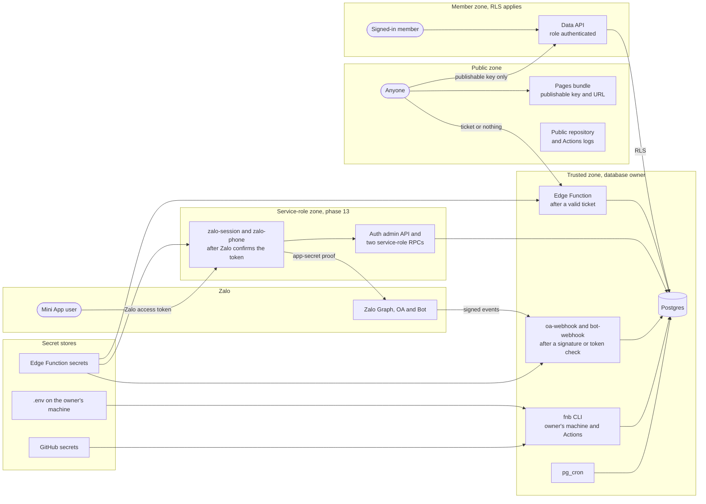

# Security and privacy

This document describes how FNB Manager protects the shops' data, credentials and customers: what data it holds and how sensitive each kind is, the threats to each surface with the controls that exist and the gaps that remain, who may do what, where secrets live, how the public repository stays clean, how the platform meets Vietnamese personal-data and messaging rules, and how security is kept up during development. It is written for the owner, for a developer taking the work over, for reviewers and testers, and for whoever operates the platform after go-live. It describes the code and the local database catalogue as they stand on 2026-11-12 and uses the status words that [requirements.md, section 1.5](requirements.md#15-conventions) defines (verified locally, built, in build, designed, planned, waits for owner); the numbered requirements behind these controls are NFR-SEC and NFR-PRV in [requirements.md, section 4](requirements.md#41-sec--security). Nothing here is legal advice; the legal points summarise [deep-dives/vietnam-legal-requirements.md](deep-dives/vietnam-legal-requirements.md), a research draft of 2026-11-07, and wait for the owner's legal read.

Last updated 2026-11-19

## 1. Security at a glance

What protects the data today:

- **Row-level security everywhere.** All 66 tables in `public` have RLS, with 126 policies on 62 of them (the payload documents, the POS and Zalo token caches and the OA webhook's event log have none and are closed to every API role; counted from the migrations at `313b20e`, 2026-11-18); `anon` holds no privilege on any table and may execute no function; the helper schema `app` is not exposed through the API. pgTAP proves two-tenant isolation, store scope, the publisher's isolation and the browser write rules (verified locally), and from phase 14a the roster's scope rules and the staff revenue levels (built).
- **No credential in the database or the repository** (ADR-006). POS logins, API keys and provider tokens live only in the owner's `.env`, GitHub secrets and Edge Function secrets. Notification destinations store the *name* of an environment variable, never its value.
- **A schedule with no key** (ADR-028). The Edge Function that `pg_cron` calls accepts only a single-use ticket that the database issued minutes earlier.
- **Zalo calls that prove themselves** (phase 13, built against a mock of Zalo). A Mini App gets a session only for a Zalo identity bound with a one-time code to an existing member, after Zalo's Graph confirmed its access token with the app-secret proof; the OA webhook checks Zalo's signature and the Bot webhook its secret token, which is stored only as a hash (section 4.3).
- **Staff paired by their manager, after a notice** (phase 14a, built against a mock of Zalo). A person on the staff roster pairs their Zalo account with a one-time code that an owner or manager issues for their roster row, only after accepting the published staff notice; wrong codes are limited per tenant and per Zalo identity, deactivation ends every session at once, and staff read revenue only at the level the owner sets (sections 4.2, 4.3 and 5.3).
- **A clean public repository** (ADR-015). gitleaks and `scripts/check-public-safe.mjs` run in CI; the build fails if the web bundle contains a secret-shaped string; CI output numbers accounts and stores instead of naming them.
- **Lawful by design** (ADR-021). An append-only consent ledger, data-subject requests with statutory deadlines, channel policies that cannot be set below the legal floor, a message log kept at least one year.

What is not in place yet (section 12 lists every open item):

- The cloud project does not exist, so none of its settings (enforced TLS, sign-ups off, SMTP, redirect list, password policy) and no live RLS run exist yet. They wait for the owner ([go-live.md](go-live.md)).
- Backups are built but not running until the owner sets the bucket and key secrets.
- The web app carries its Content Security Policy as a `meta` tag (since 2026-11-20, R-AS11), because GitHub Pages cannot send headers (ADR-023); a `meta` policy cannot set `frame-ancestors`, so framing stays unguarded on Pages.
- Two workflows expose two cloud secrets to dependency install scripts; CI has no explicit token permissions; actions are pinned to major tags and nothing updates dependencies automatically.
- Data-subject tooling, the breach runbook and the cross-border decision belong to Track C and are planned.

## 2. Data classification

| Class | What it covers here | Where it lives | Who can read it | Handling rules |
|---|---|---|---|---|
| Personal data | Customers: phone and name on `customers` and on `invoices` (`customer_phone`, `customer_name`), and the customer fields inside the POS payloads in `sale_payloads`. Members and staff: login e-mail and password hash in Supabase Auth, roles in `tenant_members`, cashier names (`shifts.cashier_name`, `invoices.employee_name`), notification destinations (a bot chat id in `notification_channels.address`), consent evidence, data-subject request contacts. From phase 13: a member's Zalo user id per Zalo App and Zalo display name in `zalo_identities`, written when the member binds the Zalo account (#205), and nothing else from Zalo: no phone, avatar or location; `zalo-phone` hands a phone number from Zalo to its caller and stores none. The OA user id of each OA webhook event in `oa_events`, kept 90 days with the event name and times, never the message text or any other content, and the time of that user's last interaction on their `zalo_oa` destination (#207). From phase 14a, staff on the roster (`staff_roster`): a display name the manager types, role, stores, status and pairing time, and a phone number only once the person links it themselves (`link_my_phone`), which no API role may select (screens show `phone_hint`, the last three digits) and which deactivation drops; the `staff_ops` consent with its evidence (method, notice version and channel, when shown and accepted, never a Zalo id, phone or device detail); the login created at a first pairing, `staff-<uuid>@zalo-staff.invalid` with no password, which names nobody; and wrong pairing codes per Zalo identity, keyed by a SHA-256 of the app and user id so no Zalo id is kept for a person who never paired. Later, in Tracks B and C: customers' phone numbers, memberships and the loyalty ledger | Postgres (Supabase Singapore once it exists; the local stack today) | Data roles of the tenant through RLS (section 5.3); never `anon` or the publisher; no API role reads the payload documents, destination addresses or `customers.phone` (screens get it masked; an owner's lookup the full phone, #253) | Collect only what the POS already records; consent per purpose with evidence; no personal data in alerts or message parameters (count-only facts); redaction when a member leaves; cross-border decision before Track C (section 8) |
| Financial and business-confidential | Sales, invoices, payments, shifts and cash, aggregates, item costs, targets, fee rates, plans; digest and alert texts; revenue figures in the private acceptance notes; database dumps | Postgres; `outbound_messages` bodies for 90 days; providers' systems once sent; the gitignored `docs/private/`; encrypted backups | Data roles within store scope; the owner's chosen notification providers for digest numbers; the owner's own assistant for the data pack (planned, aggregates only) | Never in the public repository, logs, job summaries or the bundle; digests built as the recipient so they never show more than the app would; backups encrypted with `age` before upload |
| Credentials | POS logins (`POS_ACCOUNTS_JSON`) and the CMS application key (`IPOS_APP_KEY`); the POS session-token cache; the Supabase secret key, database password and URL, personal access token; `NOTIFY_*` provider tokens; per brand from phase 13, the Zalo App secret and the OA secret key (`ZALO_APP_SECRET_<BRAND>`, `ZALO_OA_SECRET_<BRAND>`) and the rotating OA and Mini App developer token pairs; backup bucket keys and the `age` private key; member passwords; notification link codes; Zalo binding codes (#205), staff pairing codes (#213) and the secret token of a Zalo Bot in webhook mode (#207); on the developer's machine, the access key of `pnpm zalo:dev --lan` or `--tunnel` (section 4.9) | `.env` (gitignored), GitHub secrets, Edge Function secrets (the two Zalo secrets among them, named but never stored in `zalo_apps.secret_name` and `oas.secret_name`); `pos_account_tokens` and `zalo_tokens` (no API role); password hashes in Supabase Auth; link codes only as SHA-256 hashes in `app.notification_link_codes`, binding codes in `app.zalo_binding_codes`, pairing codes in `app.staff_pairing_codes` and the Bot's webhook token in `app.bot_poll_state`; the local access key only in the running loop's processes (the staff app's dev server gets it as `ZALO_LOCAL_ACCESS_KEY`), the printed link and the visitor's cookie, never in a file; the `age` private key offline with the owner | The owner; the jobs and the Edge Function at run time | ADR-006; masked in CI logs field by field; rotated at launch and when someone with access leaves ([secrets.md](secrets.md), "Rotation") |
| Shop identifiers | Shop and brand names, account e-mails, chat ids, POS account and store ids of the real shops; from phase 13 the ids of each brand's Zalo App, OA, Mini Apps, templates and staff groups | The database, secrets and `docs/private/` only | The owner and the data roles | Never in a tracked file; account keys in `POS_ACCOUNTS_JSON` stay neutral (`account-1`); the private identifier list feeds the local scan |
| Public | Source code, generic documents, the synthetic seed (tenant `demo-fnb`) and test fixtures, the publishable key and project URL, the web bundle, the browser demo's generated numbers | The public repository, GitHub Pages | Anyone | The publishable key authorises nothing by itself; RLS carries the protection |

## 3. Trust boundaries

The jobs and the Edge Function connect as `postgres`, which owns every table and has the `BYPASSRLS` attribute (catalogue, 2026-11-12). RLS therefore protects the member zone only; the trusted zone is protected by the schema and the code: tenant-consistent composite foreign keys; database functions that refuse a store, account, run or destination outside the tenant they are given (for example `app.record_runner_notification`, `app.digest_scope_check` and the trigger `notification_channels_validate`); and the digest builder switching to role `authenticated` with the recipient's claims before it reads. Test runs are fenced too: with a simulated clock, a provider override or `NOTIFY_INTEGRATION=1`, the notification repository refuses any scan without a tenant filter. `service_role`, the Data API role of the secret key, is used by no job for data; `fnb tenant add-member` uses the secret key only for the Auth admin API. From phase 13 two Edge Functions use it (#205): `zalo-session` and `zalo-phone` call two RPCs that only `service_role` may execute (`zalo_session_app`, `zalo_session_sign_in`), whose `security definer` functions in `app` resolve a brand and bind or find a Zalo identity, and the Auth admin API, to read a bound member's e-mail and mint that member's session (ADR-037). From phase 14a `zalo-session` calls a third such RPC, `zalo_session_pair`, for the pairing step, and uses the Auth admin API also to create the login of a first pairing, and to delete it again when the pairing does not use it (#213). Neither function reads a table directly. `oa-webhook` and `bot-webhook` connect as `postgres`, like `sync-incremental`, and reach only their `app` functions.

## 4. Threat model per surface

Each table lists the threats, the controls that exist with their status, and the gap or next step.

### 4.1 The web app on GitHub Pages

| Threat | Controls in place | Status | Gap or next step |
|---|---|---|---|
| A secret or identifier ships in the public bundle | The bundle holds only the publishable key and the project URL; `apps/web/scripts/check-bundle.mjs` fails `pnpm --filter @fnb/web build` on an e-mail address, a non-synthetic UUID, a JWT, an `sb_secret_` key or a 32-hex string, and allows in a live build only that build's own key and URL by exact match; every Pages deploy runs that build | built | CI does not run the web build on pull requests (its end-to-end job builds with plain `vite build`), so a bad bundle is caught only at deploy time |
| Script injection steals the session, which supabase-js keeps in the browser's storage | React escapes output; no raw HTML injection in `apps/web/src`; no third-party script or origin in the source; report sentences come from i18n templates, never from a model or a database string | built | A `meta` Content Security Policy since 2026-11-20: `default-src 'self'; script-src 'self'; style-src 'self'; img-src 'self' data: blob:; font-src 'self'; connect-src 'self' <API origin>; worker-src 'self'; manifest-src 'self'; object-src 'none'; base-uri 'self'; form-action 'self'`, where the API origin is the Supabase project's origin in a live build and absent in the demo, so the browser refuses any other script, inline script, eval or connection. HSTS and `frame-ancestors` cannot be set from a `meta` tag (ADR-023); Cloudflare Pages stays the fallback host that can send headers |
| Anyone calls the API with the publishable key | `anon` reads nothing and executes nothing; sign-ups are disabled, so nobody can create a login | verified locally (pgTAP `06_anon_and_tokens.sql`); the cloud setting waits for owner | none |
| Password guessing or weak passwords | Supabase Auth rate limits sign-ins (the local configuration allows 30 sign-in requests per 5 minutes per IP address); PKCE flow; refresh-token rotation | built (local configuration) | The local configuration keeps the default minimum password length of 6 with no complexity rule, and TOTP MFA is off. The cloud project's password policy and an MFA decision are open (section 12) |
| A reset or invite link is redirected elsewhere | Hash routing with PKCE; the Auth redirect allow-list holds only the Pages URL and the local development URL | designed ([go-live.md](go-live.md) step 1); waits for owner | none |
| A fixed bug stays cached | `version.json` is compared on window focus and offers "Có phiên bản mới — tải lại"; Pages caches `index.html` for ten minutes | built | none |
| The app appears in search results | `noindex` in `index.html` | built | none |
| Sample numbers are mistaken for real ones | The demo shows a permanent banner ("Bản demo: đây là số liệu mẫu, không phải của một cửa hàng thật.") and makes no network call | verified locally | none |
| Framing by another site | None on Pages: a CSP `frame-ancestors` rule needs a response header and is ignored in the `meta` policy; ADR-023 accepts the missing headers and names Cloudflare Pages as the fallback host | designed (fallback only) | Revisit when the host changes or before Track C goes public |

#### Content Security Policy (2026-11-20)

- **Where it comes from.** `apps/web/vite.config.ts` writes the policy into `index.html` as the first element of `<head>`, from `contentSecurityPolicy()` in `apps/web/src/lib/content-security-policy.ts`. The build reads the Supabase URL from `VITE_SUPABASE_URL` and allows only its origin; a URL that is not http(s) or carries credentials stops the build. The demo build allows no remote connection.
- **The dev server** adds what Vite's development mode needs and nothing ships with it: the hashes of its inline module scripts, inline styles and the `ws:` socket of the reload client on the loopback host.
- **zod** probes `new Function` once to decide whether to compile its parsers; the probe is caught but still reports a violation, so the app sets zod's `jitless` option before zod loads (`src/lib/zod-jitless.ts`).
- **Checks.** `apps/web/scripts/check-csp.mjs` runs after every `vite build`: one policy tag ahead of every script, no inline script or style in `index.html`, no `unsafe-inline`, `unsafe-eval` or wildcard source, and `connect-src` naming exactly the build's own API origin (none in the demo). Every Playwright spec of the live, demo and pages projects imports `test` from `e2e/support/policy-test.ts`, whose automatic fixture fails the test on any `securitypolicyviolation` event. The unit test `web:lib/content-security-policy` covers the policy text.
- **Limits.** A `meta` policy cannot set `frame-ancestors`, `report-uri` or `sandbox`, and HSTS needs a header; these stay with the host decision of ADR-023.

### 4.2 The Data API: PostgREST and RPC

| Threat | Controls in place | Status | Gap or next step |
|---|---|---|---|
| A member reads another tenant | RLS on all 66 `public` tables; tenant and store helpers in `app`; composite foreign keys that bind every store and account row to its tenant | verified locally (pgTAP `04_tenant_isolation.sql`, `17_analytics_access.sql`, `23_report_access.sql`, `31_notify_access.sql`) | Run the two-tenant suite once against the cloud project (phase 5 acceptance; waits for owner) |
| A store-limited member reads other stores | Store-scoped policies on facts, shifts, aggregates and runs; report functions are `security invoker`, so RLS silently drops stores the caller may not see | verified locally | none |
| A member writes what they should not | Browser writes are limited to the manual-input tables, plans, the two legal ledgers, alert rules and channel policies; tenant-wide rows need a membership not limited to some stores; `created_by` must equal the caller and is frozen by trigger; destinations are written only by `security definer` functions | verified locally (pgTAP `05_write_policies.sql`, `07_write_scope_and_attribution.sql`, `31_notify_access.sql`) | none |
| A manager forges or silences consent | Two restrictive policies keep every browser role from inserting a `notifications` consent or touching its `revoked_at`; the append-only trigger binds every role, the service role and the database owner included | verified locally (pgTAP `12_consent_and_legal.sql`, `31_notify_access.sql`) | none |
| An owner or manager records or withdraws a staff member's `staff_ops` consent | Two more restrictive policies keep every browser role, owners included, from inserting or updating a `staff_ops` row; only `security definer` functions write it, at the person's own acceptance of the published staff notice (the pairing step, `accept_staff_notice`) and at their own withdrawal (`withdraw_staff_ops_consent`), and the evidence names the notice version and times, never an identifier | built (pgTAP `48_staff_consent.sql`, #212) | none |
| Staff read revenue the owner withheld | The read policies of the 16 revenue tables go through `app.current_user_revenue_store_ids()`, which leaves out a `staff` membership's stores unless the tenant's `staff_revenue_visibility` is `all`; the report functions are `security invoker` and follow; at `store_totals` the only revenue a staff member reads is `today_store_totals()`; only an owner with an unlimited scope sets the level, through a function (the column grant excludes it) | built (pgTAP `47_operations_rls.sql`: at `none` and `store_totals` every report function taking a store list and `metric_value` return staff no revenue, at `all` exactly what a manager of the same store gets; #216) | The default is `all`, the owner's decision: until an owner changes it, staff read every revenue row of their stores, as a manager of those stores does |
| A store-limited manager widens access through the roster | `add_staff`, `update_staff`, `deactivate_staff`, `reactivate_staff` and `issue_pairing_code` check `app.can_manage_staff`: the caller's scope must hold every store of the row, old and new, and every store only with an unlimited scope; the roster role is `staff` or `manager`, never `owner`; `authenticated` has no write privilege on `staff_roster` and cannot select `phone` | built (pgTAP `46_staff_roster.sql`, `49_staff_pairing.sql`; `e2e:live/settings-staff` through PostgREST) | none |
| A person who left keeps access | `deactivate_staff` removes the membership (and with it the destinations and binding codes), deletes the person's Zalo identities in the tenant, revokes every Auth session of the login and deletes the live pairing code; removing a membership any other way deactivates the roster row by trigger; RLS reads `tenant_members`, so an access token issued before the deactivation reads nothing even before it expires | built (pgTAP `46_staff_roster.sql`: a token minted afterwards carries no membership and the next `zalo-session` call is unpaired) | none |
| A channel policy is set below the legal floor | CHECK constraints bind every writer: an allowed advertising policy needs consent, a cap of 1 to 3 messages in 24 hours, hours inside 07:00–22:00, no critical bypass, an opt-out text, and a label or an approved template; an allowed operational policy for member destinations needs the `notifications` consent check | verified locally (pgTAP `26_notify_schema.sql`) | none |
| A secret or address leaks through a select | `notification_channels` grants column-level `SELECT` without `address`, `secret_name` and `config`; `pos_account_tokens` and `sale_payloads` have no grant at all; the seven `app` tables have no grant | verified locally | none |
| Bulk extraction or expensive calls | `max_rows = 1000`; 12 of the 16 report functions refuse more than 50 store ids. `period_series`, `item_summary`, `payment_summary`, `promotion_summary`, `shift_review` and `item_lifecycle` refuse more than 900 rows, and the functions with a range limit refuse a longer range (`22023`). `period_compare`, `item_velocity`, `month_pace`, `forecast_accuracy` and the other phase 8 query functions have no SQL limit; only the client contract caps store ids at 50. `refresh_my_analytics` is limited to owners and managers and 92 days per call | verified locally (pgTAP `22_report_functions.sql`; a read-only catalogue query on 2026-11-12) | No per-user rate limit beyond the platform's own. No SQL store-count or range guard on four report functions and the phase 8 query functions, so a direct RPC caller can ask for any number of stores or any range; only `max_rows` caps the result (request R-FX01) |
| A `security definer` function is abused | 17 definer functions (16 in `app`, `public.refresh_my_analytics`), each with an empty `search_path`; the membership helpers read only the caller's own memberships; every other function also pins its `search_path`, the constant `app.data_roles()` too since migration `data_roles_search_path` (request R-T01) | verified by a read-only catalogue query on 2026-11-12; `supabase db advisors --type security --fail-on warn` in `security.yml` on every push and pull request; pgTAP `18_metric_value.sql`, `19_sale_payloads.sql` and `22_report_functions.sql` for their own functions and `120_security_function_matrix.sql` for every definer function of the loyalty, customer, staff, notification, OA and Zalo areas | none |
| A leaked publisher credential exposes sales | The publisher reads no sale, aggregate, refresh log or live view; it reads its tenant, its stores, plans, holidays, the calendar and the global notification catalogues | verified locally (pgTAP `08_publisher_role.sql`, `17_analytics_access.sql`, `23_report_access.sql`) | none |

### 4.3 Edge Functions with `verify_jwt = false` and single-use tickets

| Threat | Controls in place | Status | Gap or next step |
|---|---|---|---|
| Anyone makes the function call the POS | Only a ticket the database issued starts a run: a random id with a 10-minute life, claimed and deleted before any work; an unknown, used or expired ticket gets 401 | verified locally (pgTAP `20_incremental_schedule.sql` and the phase 7 end-to-end runs on the local stack) | none |
| A ticket is read from the `pg_net` queue or a log | A ticket can start at most one sync of one store, once, within minutes; no credential exists for the schedule at all (ADR-028) | verified locally | none |
| Anonymous calls exhaust database connections | Claims share one connection per worker; with 32 claims waiting the function answers 429 without touching the database; only a claimed ticket opens the run's own two connections | verified locally | none |
| Anonymous calls exhaust the invocation quota | Each bad call costs only one invocation and one indexed delete | built | No rate limit in front of the function; the Free plan includes 500,000 invocations a month, so watch usage on the dashboard once the project exists |
| The database link falls back to plaintext | TLS for any non-local host; a URL whose `sslmode` would allow plaintext is refused with 500; an optional CA certificate (`FNB_DB_CA_CERT`) | built; the cloud connection waits for owner | none |
| Secrets appear in logs | Every log line passes the redactor, which knows the function's secrets and the injected Supabase keys; reports carry counts only, with accounts and stores by number | verified locally | none |
| Two runs corrupt one store's day | The session advisory lock per store is shared with the CLI and the nightly job; the function gives way after 15 seconds | verified locally | none |
| A future public endpoint, the `notify` function | `app.notify_tickets` and its issue and claim functions already follow ADR-028 | ticket functions verified locally (12a); the function planned (12c) | none yet |
| Anyone obtains a Mini App session for someone else (`zalo-session`, JWT off) | The caller must hold a Zalo access token that Zalo's Graph accepts with the app-secret proof (HMAC-SHA256 of the token keyed with the brand's App secret), so only the Zalo App's own users pass; a session is minted only for a Zalo user id already bound to a member, or bound in the same call with a valid one-time code; from phase 14a a person on the staff roster also needs a current `staff_ops` consent, else the answer is `notice_required` with the notice; the session is the member's own login, with the member's roles and RLS; the answer to anything else is `unpaired`, with at most a reason that says nothing about who exists (`code_refused`, `wait`, `notice_outdated`) | built against a mock of Zalo (Deno and gated integration tests, pgTAP `44_zalo_identity.sql`, `48_staff_consent.sql`, `49_staff_pairing.sql`, #205, #213) | The real Graph error codes and the domain verification are open until #210 |
| Pairing codes are guessed, or a code pairs the wrong login (`zalo-session`, phase 14a) | Six digits valid 10 minutes, one live code per roster row, issued only by an owner or manager whose scope holds every store of the row and shown once; stored only as SHA-256 of the tenant id and the code. No code is checked until the request carries a valid acceptance of the published staff notice. A wrong code counts against every live code of the tenant (the sixth burns them all) and against the Zalo identity, keyed by a hash of the app and user id: its fifth wrong code makes it wait 15 minutes (`wait` with `retry_after`), and its requests during the wait count against nothing. Wrong, used, expired, deactivated and conflicting codes get byte-identical answers. A code never binds a login that is an owner, viewer or publisher of the tenant (refused at issue with `22023` and refused at pairing) and never an inactive row | built (pgTAP `49_staff_pairing.sql`; Deno `zalo-session/pairing.test.ts`; #213) | Like the binding codes, no per-caller rate limit of the function's own; every attempt needs a Zalo access token the Graph accepts, so a guesser needs Zalo accounts of the brand's Zalo App, and each one waits after five wrong codes |
| Reward codes, member phones or redemptions are tried repeatedly (`staff_verify_redemption`, `staff_member_lookup`, `loyalty_member_lookup`, `customer_redeem`) | Per-caller and per-store (per-tenant for the web lookup) limits in a 15-minute window with a 15-minute lockout (`app.code_attempt_policies`), counted under a per-store advisory lock so parallel guesses cannot pass together; a lock raises `code_guessing_lockout` to owners and managers; the receipt-claim daily cap holds under parallel claims (the membership row is locked) | built (pgTAP `170_code_guessing_limits.sql`; `jobs:integration/loyalty-concurrency`; #317) | The staff, customer and web apps show their generic refusal for the new `locked`, `rate_limited` and 429 answers until they get their own wording |
| The login of a first pairing is misused | `zalo-session` creates it through the Auth admin API only after the database accepted the code (`login_needed`), as `staff-<uuid>@zalo-staff.invalid` with a confirmed e-mail and no password: `.invalid` is reserved and receives no mail, so the login has no password to guess and no reset link to steal, and its only way in is a Mini App session minted for its bound identity. The database takes it only when it belongs to nobody yet (`app.staff_login_is_fresh`), and the function deletes it again when the pairing did not use it; the address and the login id are redacted from the log | built (Deno `zalo-session/pairing.test.ts`, the builder's end-to-end pairing through the local loop on a throwaway tenant; ADR-037 as amended) | A failed deletion leaves an unused login with no password and no membership; the log says so without naming it |
| Binding codes are guessed | Six digits valid 10 minutes, one live code per member and Zalo App, stored only as SHA-256 of the app id and the code; a wrong code counts against every live code of that Zalo App, so the app tolerates five wrong attempts and the sixth burns all its live codes, which a guesser can only exhaust, never extend; `fnb zalo bind` is refused in CI and a publisher login cannot be bound | built (pgTAP `44_zalo_identity.sql`) | The function has no rate limit per caller of its own; every attempt needs a Zalo access token that the Graph accepts, and the sixth wrong attempt ends the codes |
| A phone number from Zalo is kept or logged (`zalo-phone`, JWT on) | The caller needs a valid Supabase session, checked by the gateway and again with Supabase Auth, and the phone token's own two-minute, single-use life; the number goes back to the caller only, nothing is stored, and the probe mode returns and logs whether the exchange worked, never the number | built against a mock (#205) | The real error codes, 119 for a used token included, are confirmed in #210 |
| Forged OA events change destinations or flood the log (`oa-webhook`, JWT off) | `X-ZEvent-Signature` must equal SHA-256 of the app id, the body, its timestamp and the OA secret key (`ZALO_OA_SECRET_<BRAND>`), compared in constant time over the raw body and its compact re-serialisation. In `observe` mode, the default, a mismatch or a missing signature is still stored with its outcome; in `enforce` mode it gets 401 and nothing is stored but the day's `refused` count. Events are de-duplicated by an event id; an OA that no row (or several tenants' rows) matches stores nothing; bodies over 65,536 bytes get 413; the event's text is never stored. More unverified calls in a day than `max_per_day` (default 10) raise `zalo_webhook_unverified` to the owners | built against fake events (Deno and gated integration tests, pgTAP `45_zalo_events.sql`, #207) | Observe mode accepts unsigned events by design until #210 confirms the exact signed bytes, and follows them up like signed ones (a forged unfollow disables a destination; a forged message moves `last_interaction_at`); the owner switches each OA to `enforce` then ([operations.md](operations.md)). An answer sent before the store finished (after 1.5 seconds) is 200 even when `enforce` later refuses the event, which is still counted |
| Forged OA events enrol a stranger, record a consent or make the OA send messages (`oa-webhook`, phase 19a) | The customer step (`app.oa_customer_step`) acts only on an event whose signature matched, in `observe` mode too: an unverified follow, keyword or form answer enrols nobody, records no follower and sends nothing; every step runs once per event id, so a replay changes nothing, and a form answer enrols only while its signed event is under 48 hours old, so a delivery replayed after its id left the 90-day log enrols nobody (migration `oa_form_stale_events`). The welcome is one per follow and at most one a day, the form one every two minutes; every reply is a consultation message inside the 48-hour window and never a promotion; nothing is sent unless `ZALO_OA_MESSAGES=1`, the brand's OA token is valid and its package includes the Open API | built against a mock (#276, #277; Deno `customer.test.ts` and `security.test.ts`, the integration suite, pgTAP `106`–`108` and `125`) | The signature bytes are confirmed on the owner's OA (#210). Until `enforce`, an unsigned delivery stored first under an event id shadows the signed one that arrives later with the same id (app, OA, event, user, time and message id): the signed form answer is then a duplicate and enrols nobody |
| A form answer claims someone else's phone (`oa-webhook`, phase 19a) | Zalo's `request_user_info` form lets the user edit the phone, so the OA link is weaker than the Mini App's phone token: it never reveals a balance, a voucher or whether a phone is a member (the joined reply is the same for a new and an existing member, and the points and vouchers buttons open the Mini App, which reads the phone from Zalo's phone token); a phone already enrolled as, or tied to, another OA user of the OA is refused (`phone_in_use`); the consent evidence records `phone_source: user_submitted` | built (#277; pgTAP `107`) | A stranger can still enrol an unclaimed phone and record a loyalty consent for it; a data-subject request erases it ([8.3](#83-data-subject-requests)) |
| Forged Bot updates link, accept or stop a chat (`bot-webhook`, JWT off) | `X-Bot-Api-Secret-Token` must hash, by SHA-256, to the stored hash of a bot in webhook mode before the body is read; the token is never stored; a link still needs the member's one-time code and an explicit "ĐỒNG Ý", and "DỪNG" only withdraws the consent of the chat's own linked members; a chat id with a space, a control character or more than 128 characters is dropped; anything else is dropped and never stored | built against fake updates (#207; Deno `handler.test.ts` and `security.test.ts`) | No command sets the Bot's webhook yet, so bots are still polled; the Bot's real body shape and token format are confirmed in #210 |
| Anyone obtains discounts from the voucher callback (`voucher-callback`, JWT off, phase 16b) | iPOS documents no authentication, so the credential is a secret path segment per tenant and label (258 random bits), stored only as SHA-256 and shown once by `fnb loyalty callback-path issue` (refused in CI); a malformed path gets 404 before the body is read and without a database call, an unknown segment gets 404 after one read-only lookup. A discount needs a held redemption of that tenant on the `crm_callback` rail, at the store whose `callback_store_ref` the POS names, within its hold and the reward's conditions, the amount computed by the database from the posted lines; a code answers one sale only (the same sale gets the same answer back, any other sale 0 ₫). The callback is off per rail (`callback_enabled`, default false) | built, verified locally (Deno tests, pgTAP `95_voucher_callback.sql`, gated integration) | The POS egress addresses are unknown (hotline question 7, #9): fill `callback_ip_allowlist` once they are, and confirm how many proxies the hosted platform puts in front of the function and set `VOUCHER_CALLBACK_PROXY_HOPS` to it (the function trusts the connection's address by default and, with N hops, only the N-th `x-forwarded-for` entry from the right, so a forged entry is ignored and anything unreadable fails closed; #318). A leaked URL is rotated by issuing again |
| Posted amounts inflate a discount | The adapter refuses a line above its unit price times quantity, a line discount above its amount, quantities outside 0 to 10,000 and bills above 1,000,000,000 ₫ (422, no write); the database never gives more than the eligible lines, the reward's amount or percentage, nor, for price reductions, the dated legal cap | built | The line semantics (`Amount` before or after `Discount`) are assumed from the 2020 vendor sample until a live request is captured |
| Replays, races and retries give a code twice | The redemption row is locked for the decision; an accepted answer is stored per store, sale and redemption, so a retry of the sale gets its first answer and another sale gets 0 ₫ with "Mã đã được sử dụng"; a slow database (over 2,500 ms) answers 0 ₫ "busy" and the retry then reads the stored answer | built | Whether iPOS retries, and what it does with a removed voucher or a cancelled bill, is undocumented; an answered sale that never syncs is listed as `verified_without_invoice` after `grace_hours` |
| The callback log or answers leak codes or members | `app.voucher_callback_log` holds time, store, outcome, discount and latency; `app.voucher_callback_answers` holds the sale reference, the redemption and the amount; neither holds the code, the member reference or a phone, and both are closed to every API role; the function's log lines carry outcome and duration only, the path, code, sale and phone being redacted | verified locally | none |
| A web page on another origin uses a Zalo function through a visitor's browser | The shared CORS answer (`supabase/functions/_shared/cors.ts`) reflects only `https://h5.zdn.vn` and `zbrowser://h5.zdn.vn`, in exactly one `Access-Control-Allow-Origin` with `Vary: Origin`; any other origin gets no CORS header at all, on the preflight too, so the browser withholds the answer; the two webhooks answer no origin at all | built (Deno tests `_shared/cors.test.ts`, #204); `zalo-session` and `zalo-phone` use it, none is deployed yet | CORS binds browsers only, so each Zalo function authenticates its caller as the rows above say. Whether the Data API's own CORS answer works from inside Zalo is checked on a phone in #210 |
| An oversized or malformed body ties up a Zalo function | The shared reader refuses a body above 16,384 bytes by its `Content-Length` and again while reading (413 `body_too_large`), text that is not UTF-8 (`invalid_body`) and JSON that is not an object (`invalid_json`) | built (Deno tests `_shared/http.test.ts`) | none yet |
| A missing secret or an error leaks through an answer or a log | A missing or empty secret answers 500 `not_configured` with the request id only, and the log line names the secret, never a value; any other error answers `internal_error`. Every log line of the shared request context passes the redactor, which knows the `ZALO_` secret variables (all but `ZALO_INTEGRATION`, `ZALO_TENANT_ID` and the `_BASE_URL` overrides), the Supabase keys and JWT secret, the database URLs with their user and password, and every value the function read through it; line breaks are flattened, so a value cannot forge a second log line | built (Deno tests `_shared/http.test.ts`) | none yet |

### 4.4 GitHub Actions jobs

| Threat | Controls in place | Status | Gap or next step |
|---|---|---|---|
| A credential appears in the public log | Every `fnb` run on Actions first prints `::add-mask::` for each field of each `POS_ACCOUNTS_JSON` entry, `IPOS_APP_KEY`, the Supabase secret key, the user and password inside the database URL (encoded and decoded), every `NOTIFY_*` credential and the fields of `NOTIFY_FALLBACK_TARGETS`; output and job summaries carry counts and numbered accounts and stores only | verified locally for the POS entries, `IPOS_APP_KEY`, the secret key and the database URL; in build (12b) for the `NOTIFY_*` credentials and the fallback targets | none |
| A dependency's install script reads secrets | `sync.yml`, `notify.yml`, `deploy-functions.yml` and `deploy-mini-apps.yml` give secrets only to their configuration check and to the steps that run `fnb` or the deploy, never to checkout, setup or `pnpm install` | built | `migrate.yml` (lines 26 to 28) and `backup.yml` (lines 19 to 21) set `SUPABASE_ACCESS_TOKEN` and `SUPABASE_DB_PASSWORD` on the job, so `pnpm install --frozen-lockfile` runs with them; move them to the steps that use them |
| Script injection through dispatch inputs | `sync.yml` passes inputs to scripts through environment variables, checks both dates against `YYYY-MM-DD`, and takes the account as a position number, never a key | built | none |
| A fork's pull request reaches secrets | CI needs no secret; `migrate.yml` runs its dry run only for pull requests from this repository | built | none |
| A Mini App developer token appears in a log | `deploy-mini-apps.yml` holds no Zalo credential: it masks the credential fields first, reads the Mini App ids and the developer token through `fnb zalo` commands at deploy time, writes them to a `.env` in the app's folder for one `zmp-cli` login and deletes it after the deploy, and numbers the Mini Apps in its log | designed; the workflow is built and skips with a note, because `fnb zalo app-config --list` and `fnb zalo zmp env` are not built | The command that hands out the token must mask it (`::add-mask::`) before `zmp-cli` receives it on its command line (`login --token`) |
| The workflow token can do too much | Ten workflows declare `permissions: contents: read`, adding only `pages: write` and `id-token: write` (Pages deploy) or `actions: write` (`workflows-active.yml`) | built | `ci.yml` declares no `permissions` block and so gets the repository's default token permissions; declare `contents: read` |
| A compromised action or package | Actions are the official ones plus `pnpm/action-setup` and `denoland/setup-deno`; the lockfile is installed with `--frozen-lockfile`; gitleaks runs from a tagged image | built | Actions are pinned to major tags, not commit SHAs, and no tool proposes dependency updates (no Dependabot or Renovate configuration) |
| A destructive command reaches the cloud database | Migrations: a dry run on pull requests, `db push` only on a push to `main`, one concurrency group; no workflow runs a linked reset; CI resets only its own throw-away stack | built | ADR-023 and the roadmap promise a guard against `db reset --linked`; none exists, the rule is procedural |
| A scheduled job stops silently | `workflows-active.yml` re-enables workflows weekly; `fnb notify job-failed` records failures as `job_failed` alerts | built; the alert path is in build (12b) | The `workflow_run` listener and the database-free fallback are planned (12c) |

### 4.5 The `fnb` CLI

| Threat | Controls in place | Status | Gap or next step |
|---|---|---|---|
| The CLI bypasses RLS, so a bug could cross tenants | Composite tenant-consistent keys; database functions that refuse rows outside the given tenant; the digest built in a read-only transaction as role `authenticated` with the recipient's claims; test switches (`--at`, provider base-URL overrides, `NOTIFY_INTEGRATION=1`) accepted only with `--tenant` and a fixture tenant whose slug starts with `notify-it-`, and unfiltered scans refused while they are on | verified locally (pgTAP, integration tests); the digest path is in build (12b) | A dedicated least-privilege database role for the jobs is an open option |
| A plaintext connection to the cloud database | The CLI asks for TLS (`sslmode=require`) for every non-local host unless the URL names its own `sslmode`; the go-live checklist turns on server-side SSL enforcement | built; enforcement waits for owner | Unlike the Edge Function, the CLI does not refuse an explicit plaintext `sslmode` for a remote host |
| Credentials end up in shell history or logs | `FNB_MEMBER_PASSWORD` instead of `--password`; `.env` is gitignored; `onboard --print-secret-entry`, `notify link` and `digest --show-text` (step 12b, in build) are refused in CI; error messages pass the redactor (literal credentials, connection-string users and passwords, JWTs, `sb_` keys, 32-hex keys, `password=` pairs) before they are printed or stored, and a stored run error is cut to 500 characters | built | none |
| A test sends real messages | A provider base-URL override is accepted only for a loopback address (`http://127.0.0.1:<port>`); integration runs use synthetic `_IT` secret names and fixture tenants | built | none |
| A data pack leaves the machine through git or a CI log, or is built with more rights than a member has | `fnb datapack` builds as a member with a data role (owner, manager, staff or viewer; the publisher and non-members refused) inside one read-only repeatable-read transaction as `authenticated` with the member's claims (`withReportSnapshot`), never as the service role; it writes only outside the repository or below `docs/private/` where `git check-ignore` confirms git ignores the path, after resolving real paths, so a symbolic link into a tracked folder, another `docs/private/` folder and every other folder of the repository are refused (exit 2); with `CI` or `GITHUB_ACTIONS` set its output names no tenant, store, member, e-mail, path or amount, and `--list-stores` is refused ([strategy.md, section 8](strategy.md#8-building-and-checking-a-pack-from-the-command-line)) | built (unit tests, #137) | The byte comparison with the browser's pack in CI is #144; the pack itself holds aggregates only (section 8.6) |
| The real local tenant is wiped | Locally the CLI reads `DATABASE_URL` before `SUPABASE_DB_URL`; the written rule "never run `supabase db reset` on the machine that holds real data" ([status.md](status.md)) | designed (a written rule) | No technical guard against `pnpm db:reset` on that machine |

### 4.6 POS credentials

| Threat | Controls in place | Status | Gap or next step |
|---|---|---|---|
| `POS_ACCOUNTS_JSON` or `IPOS_APP_KEY` leaks | Only in `.env`, GitHub secrets and Edge Function secrets (ADR-006); masked field by field in CI; account keys are neutral and CI refers to accounts by position | built | Each entry is the CMS login of an account (e-mail and password), so a leak exposes more than the read endpoints the sync uses; rotate on any doubt ([secrets.md](secrets.md)) |
| The session-token cache is read | `pos_account_tokens` has RLS with no policy and no grant to any API role | verified locally (pgTAP `06_anon_and_tokens.sql`) | none |
| A changed or revoked password goes unnoticed | The account turns `auth_failed` once, the schedule skips it, and an `auth_failed` alert (critical) is raised | verified locally (runners); the alert episode is in build (12b) | none |
| Endpoints outside the documented read set | The connector calls documented read endpoints only and stores, logs or reuses nothing from any other endpoint (ADR-025, section 9) | built | none |
| A POS password known to more people than need it | The owner changes it now (a roadmap owner action), and again at launch and whenever someone who knew it leaves ([operations.md](operations.md), sections 4.7 and 4.8) | waits for owner | none |

### 4.7 Notification provider tokens

| Threat | Controls in place | Status | Gap or next step |
|---|---|---|---|
| A token leaks and someone messages as the bot or sender | Values live only in `.env` and GitHub secrets (Edge Function secrets once the `notify` function exists); a destination row stores the variable name, which must start with `NOTIFY_` and the kind's prefix (`app.notify_secret_name_valid`); `app.notify_settings` records which names a runtime held, never values | verified locally (12a) | Rotation of `NOTIFY_*` secrets is not documented yet (planned with the step 12c documentation) |
| Someone links a chat that is not theirs | A one-time `FNB-` code valid 15 minutes and stored only as a SHA-256 hash; the chat id is learnt from the member's own message; the member must accept with an explicit reply ("ĐỒNG Ý") within 24 hours; e-mail destinations confirm a 6-digit code, and the fifth wrong code deletes the destination | verified locally (pgTAP `28_notify_outbox.sql`) | none |
| Messages reach the wrong person, too often or at night | Every send decision is taken in SQL at claim time: destination state, consent, mutes, allowed hours in the reader's zone, daily and monthly caps; webhook URLs must be `https://` with no user information, query or fragment | verified locally (pgTAP `27_notify_policy.sql`, acceptance A4) | none |
| Business numbers sit in third-party systems | Digests carry aggregates and store, item and shift names only; alert parameters are count-only; message bodies are cleared after 90 days | built | The owner chooses the providers; their terms apply |

### 4.8 The public repository

| Threat | Controls in place | Status | Gap or next step |
|---|---|---|---|
| A credential, identifier or revenue figure is committed | CI runs gitleaks over the whole history with redacted output, and `scripts/check-public-safe.mjs` over every tracked and untracked file that is not ignored; the owner runs the same script, with the private identifier list, before every commit | built | none |
| Shop identifiers slip past the generic rules | The private list `docs/private/identifiers.txt` (entries of at least four characters) is checked locally; CI cannot see it and relies on generic patterns (ADR-015) | built | Depends on running the scan locally before each commit |
| Real data leaks through tests or fixtures | Fixtures are synthetic (ADR-009); live suites need `LIVE=1` and print counts only; recorded real responses are never committed | built | none |
| Leaks through job logs, summaries or artifacts | Masking and numbering (section 4.4); the only uploaded artifact is the Pages site; backups go to a private bucket, encrypted, never to the repository | built | none |
| Private notes are committed | `.gitignore` covers `docs/private/`, `.env` and `.env.*` (except `.env.example`), the local browser-automation folder and the Supabase temp folders | built | none |

### 4.9 The local staff-app loop (`pnpm zalo:dev`)

`pnpm zalo:dev` (#208) runs the staff Mini App on the developer's machine against the real `zalo-session` and the local stack, before any Zalo account exists: a mock Zalo Graph on 127.0.0.1, the unmodified function under Deno with `ZALO_LOCAL_DEV=1`, and the app's Vite dev server in the `local` session mode, which proxies `/functions/v1/zalo-session` to the function and `/supabase/rest/v1` and `/supabase/auth/v1` to the local API. Whoever opens the app is signed in as the member the loop binds. With `--lan` the dev server listens on the PC's home-network address so a phone on the same Wi-Fi can open it; with `--tunnel` it stays on 127.0.0.1 behind a Cloudflare quick tunnel with a public `https://….trycloudflare.com` link. [development.md](development.md) has the commands.

| Threat | Controls in place | Status | Gap or next step |
|---|---|---|---|
| `ZALO_LOCAL_DEV=1` reaches a deployed function, which would then trust a fake Zalo Graph | `zaloSettings` accepts the switch only when `SUPABASE_URL` is a loopback address (`http://127.0.0.1:<port>` or `localhost`) and `SUPABASE_DB_URL` names a database on 127.0.0.1 or localhost without a `host` or `hostaddr` parameter, a tenant is named (`ZALO_TENANT_ID`) and `ZALO_INTEGRATION` is off; a Graph override is accepted only then, and only for a loopback address. A deployed function cannot meet this: its injected `SUPABASE_URL` is the project's `https://<ref>.supabase.co` (under `supabase functions serve`, `http://kong:8000`) and its database is remote, so the function answers 500 before any call | built (`zalo:unit/local-gate`, 8 tests, and the Deno tests of `zalo-session`; #208) | none |
| The loop binds or stores a real Zalo id | The loop runs only for a brand whose Zalo App id starts with `mock-`, binds only `mock-` users, and `pnpm zalo:dev forget` removes a brand's Zalo rows only when every Zalo id and every bound identity is a `mock-` one, so real ids can be stored afterwards | built (`zalo:unit/local-dev`) | none |
| Someone else on the Wi-Fi or on the internet opens the app, and with it the member's data | An access guard runs before every Vite middleware and every WebSocket upgrade. The loop draws a 256-bit key (32 random bytes, base64url) on every start and never writes it to a file; the printed link carries it once as `?key=`, the guard compares it in constant time, answers with an HttpOnly, `SameSite=Strict` cookie and a page without the key in the address (no-store, no referrer), and from then on admits only requests with that cookie. Without it every request gets 403, a WebSocket upgrade included. On the LAN a loopback request passes only without forwarding headers (`Forwarded`, `X-Real-IP`, `X-Forwarded-*`, `CF-*`); through the tunnel nothing is trusted, the cookie is `Secure` and named `__Host-fnb_local_access`, Vite allows only the tunnel's host name and hot reload is off. Before printing a link the loop proves the guard on the real address: 403 without a key, 403 and no cookie for a wrong key, 200 and a cookie for the printed one, 200 with that cookie | built (`zalo-mini:unit/vite-plugin-access`, `zalo:unit/local-lan`; WebKit with the iPhone 14 profile over the LAN, 3 of 3, and once through a real quick tunnel; #208) | The link is a bearer credential: whoever has it is signed in as the member, so the loop and the guides say to keep it private. The LAN link is plain `http`, so someone who can read the Wi-Fi traffic can copy the cookie; nothing in the staff app needs a secure context |
| A tunnel is left open | `--tunnel` stops the whole loop after `--tunnel-hours` (default 4, at most 12) or on Ctrl+C or `q`; the key is new on every start, so an old link stops working | built | none |
| The downloaded tunnel binary is tampered with | `cloudflared` is pinned to release 2026.10.7 for Windows x64, downloaded from its GitHub release into its own empty folder under `%LOCALAPPDATA%\fnb-cloudflared\2026.10.7` (the loop refuses a folder holding other files), and checked against the release's published SHA-256 after the download and again on every start; a mismatch deletes the file | built (`zalo:unit/local-lan`) | `--tunnel` runs on Windows x64 only |
| Secrets of the stack leak into the page | The page gets only the publishable key and the mock Zalo access token; the local function URL, `SUPABASE_URL` and the secret key stay in the dev server's proxy and the function's environment, the plain mode reads a loopback `SUPABASE_URL` from `.env` only for the proxy, and a build with the `local` session mode is refused | built (`zalo-mini:unit/vite-plugin`, `zalo-mini:unit/vite-plugin-local-data`) | none |

## 5. Authentication and authorisation

### 5.1 Identities

| Identity | Used by | Authenticates with | Database role | Status |
|---|---|---|---|---|
| Member login | Owners, managers, staff, viewers in the web app | Supabase Auth e-mail and password, PKCE flow; created or invited by `fnb tenant add-member`; sign-ups disabled | `authenticated` plus a `tenant_members` row | verified locally |
| Publisher | `fnb publish-plan` and an optional scheduled strategy run (ADR-013) | Its own login, from a local gitignored `.env` or the run's environment | `authenticated` with role `publisher` | role verified locally; the command is designed (phase 11b) |
| Jobs | The `fnb` CLI on the owner's machine and on Actions | The database URL (session pooler in the cloud) | `postgres` | verified locally |
| Edge Function | `sync-incremental` | The injected database URL; its callers present a single-use ticket | `postgres` | verified locally |
| Webhook functions | `oa-webhook`, `bot-webhook` (#207) | The injected database URL; their callers present Zalo's signature or the Bot's secret token | `postgres` | built against fakes |
| Mini App member | A member in a Mini App (#205) | A Zalo access token that the Graph confirms, for a Zalo identity bound to the member with a one-time code; `zalo-session` then mints a session of the member's own login through the Auth admin API (ADR-037). The session is a normal one: `authenticated`, the `memberships` claim of the access-token hook, and RLS through `tenant_members` | `authenticated` plus the member's `tenant_members` row | built against a mock; the device check waits for owner (#210) |
| Staff login (phase 14a) | A person on the staff roster in the staff Mini App (#213) | Paired once: the person accepts the published staff notice and enters the 6-digit code an owner or manager issued for their roster row (#213 on the server and in the session client; the app's entry screen is #215, in progress); the pairing creates the membership from the roster's role and stores. At the first pairing the roster row gets a login of its own, `staff-<uuid>@zalo-staff.invalid` with no password, so the only way in is a Mini App session for a bound identity; the row keeps that login for every later pairing (another brand's app, or after a reactivation). Brute-force limits: five wrong codes tolerated per tenant before the sixth burns its live codes, and per Zalo identity a 15-minute wait after the fifth wrong code (section 4.3). Every later sign-in checks the `staff_ops` consent | `authenticated` plus a `staff` or `manager` row in `tenant_members` | built against a mock; the device acceptance waits for owner (#218) |
| Zalo sign-in functions | `zalo-session`, `zalo-phone` (#205) | The injected secret key (`SUPABASE_SECRET_KEYS`, or the legacy service-role key) against two `service_role` RPCs and the Auth admin API | `service_role` | built against a mock |
| Access-token hook | Supabase Auth, each time it issues a token | Inside the database | `supabase_auth_admin`, which may execute only `app.custom_access_token_claims` of this project | built |
| Scheduler | `pg_cron` jobs | Inside the database | `postgres` | built |
| Auth administration | `fnb tenant add-member`; `zalo-session` to mint a bound member's session and to create (and, when unused, delete) the login of a first pairing | The secret API key against the Auth admin API | not applicable | verified locally; the Zalo use built against a mock |
| Local loop visitor | Whoever opens the link `pnpm zalo:dev --lan` or `--tunnel` prints (section 4.9) | The 256-bit key in the link, exchanged once for an HttpOnly cookie; the loop's `zalo-session` then signs its mock Zalo user in as the member it bound, on the local stack only | `authenticated` as that member | built; developer machines only |
| Caller without a session | Anyone holding the bundle | The publishable key | `anon`, which may do nothing | verified locally |
| Customer session (phases 17 and 18, prepared) | A customer in the customer Mini App | A session minted by the server for an Auth user whose `app_metadata` holds `kind` `customer`, `tenant_id` and `customer_id`; only the service role sets `app_metadata`. `app.current_customer_id()` accepts the claim only when that customer belongs to that tenant and the signed-in login is that customer's login in `app.customer_logins`, of an active Zalo App and without a `tenant_members` row (migration `customer_claims_bound_to_login`; before it, RLS trusted the claims alone) | `authenticated`, reading its own loyalty rows, its own `customers` row without the phone, its tenant's programmes that are not drafts and its active rewards | built (#261); forged and inconsistent claims refused (pgTAP `122_security_session_spoofing.sql`) |
| Digest builder | `fnb digest` | Switches to `authenticated` with the recipient's claims inside a read-only transaction | `authenticated` | in build (12b) |

### 5.2 Roles and store scope

A membership (`tenant_members`) grants a login one role in one tenant and an optional store scope (`store_ids`; null means every store of the tenant). `owner`, `manager`, `staff` and `viewer` are the data roles; `publisher` is a service identity outside them, so a leaked publisher credential cannot read a single sale. Writes to tenant-wide rows (a null `store_id`, or tables without one) need a membership that is not limited to some stores. The definitions are in [schema.md](schema.md), "Row-level security".

From phase 14a the staff roster (`staff_roster`) says who may pair with the staff Mini App, with a role of `staff` or `manager` and a store scope; pairing creates the `tenant_members` row from it, `update_staff` changes both at once, and deactivating the row removes the membership. Owners and managers manage the people whose stores are all in their own scope, and only a member with an unlimited scope grants every store. What staff read of revenue follows `tenants.staff_revenue_visibility`: `all` (the default, the owner's choice), `store_totals` or `none` ([schema.md](schema.md), "Revenue for staff").

### 5.3 RLS summary matrix

Read "scope" as "for the stores in the member's scope", "unlimited" as "only with a membership not limited to some stores", and "own" as "only rows about the member's own destinations". `anon` has no privilege on any table or view and may execute no function in `public` or `app`.

| Capability | owner | manager | staff | viewer | publisher |
|---|---|---|---|---|---|
| Read its tenant and the stores in scope | yes | yes | yes | yes | yes |
| Read sales facts, shifts, aggregates and sync checks (the 16 revenue tables) | scope | scope | scope at the staff revenue level `all` (the default); no at `store_totals` and `none` | scope | no |
| Read sync runs | scope | scope | scope | scope | no |
| Read today's net revenue and invoice count per store (`today_store_totals`) | scope | scope | scope at `all` and `store_totals`; no at `none` | scope | no |
| Read the catalogue, POS account metadata and the member list | yes | yes | yes | yes | no |
| Read `customers` and `consent_records` (tenant-wide); of `customers` every column but `phone` (column grant, #253) | yes | yes | yes | yes | no |
| Read `customers.phone` through the Data API (select, filter or embed `customers(phone)`) | no | no | no | no | no |
| List members with masked phones and balances (`loyalty_members_page`) and see a member's masked phone (`memberships.phone_masked`) | yes | yes (balance over the stores in scope and store-less rows) | no | yes (balance as for managers) | no |
| Look a member up by phone (`loyalty_member_lookup`, POST only) | full phone in own tenant | masked | no | masked | no |
| Read the shift anomaly counts (`loyalty_shift_anomalies`; Ca n, never a cashier or POS shift label) | scope | scope | no rows | scope | no rows |
| Call the 16 report functions | rows in scope | rows in scope | rows in scope at `all`; no revenue at `store_totals` and `none` | rows in scope | empty rows and null totals |
| Write item costs, targets and payment fee rates | scope | scope | no | no | no |
| Write item-type roles and tenant holidays | unlimited | unlimited | no | no | no |
| Write report settings | unlimited | no | no | no | no |
| Write item category and payment-kind overrides | unlimited | unlimited | no | no | no |
| Write a store's profile (code, seats, opening date, e-invoicing, receipt numbering, member feature; column grant) | scope | scope | no | no | no |
| Write a store's opening hours | scope | no | no | no | no |
| Write the tenant profile (legal form, default language; column grant) | unlimited | no | no | no | no |
| Write legal text drafts, publish and retire them (`publish_legal_document`, `retire_legal_document`) | unlimited | no | no | no | no |
| Refresh analytics (`refresh_my_analytics`, at most 92 days) | yes | yes | no | no | no |
| Read plans (`strategy_reports`) | scope | scope | scope | scope | scope |
| Insert plans, with `created_by` set to the caller | scope | scope | no | no | scope |
| Update or delete plans | scope | scope | no | no | no |
| Grant or revoke consent for `loyalty` and `marketing` | yes | yes | no | no | no |
| Grant or revoke someone's `staff_ops` consent | no | no | no | no | no |
| Accept the staff notice or withdraw one's own `staff_ops` consent (`accept_staff_notice`, `withdraw_staff_ops_consent`; the pairing step) and link one's own phone (`link_my_phone`) | no (owners are not on the roster) | own, when on the roster | own | no | no |
| Grant or revoke a `notifications` consent from the browser | no | no | no | no | no |
| Read the staff roster | rows whose stores are all in scope | rows whose stores are all in scope | own row | no | no |
| Add, edit, deactivate and reactivate people on the roster, and issue their pairing codes | when every store of the row (old and new) is in scope; every store needs unlimited | the same | no | no | no |
| Set the staff revenue level (`set_staff_revenue_visibility`) | unlimited | no | no | no | no |
| Operations rows of phases 14b and 15 (the template; no such table yet) | read, write own, manage in scope | read, write own, manage in scope | read and write own in scope; delete nothing | no | no |
| Read, file and update data-subject requests | unlimited | unlimited | no | no | no |
| Read alert rules and the tenant's channel-policy overrides | yes (store rows in scope) | yes (store rows in scope) | no | no | no |
| Write alert rules and channel-policy overrides | unlimited | no | no | no | no |
| Read the alert rule catalogue and the global channel policies | yes | yes | yes | yes | yes |
| Read destinations (columns without address, secret name and configuration) | all with unlimited scope, else own | all with unlimited scope, else own | own | own | own |
| Read alert episodes | scope | scope | no | no | no |
| Read digests | when every store of the digest is in scope | when every store of the digest is in scope | no | no | no |
| Read outbound messages | all with unlimited scope, else their stores; plus own | all with unlimited scope, else their stores; plus own | own | own | own |
| Write destinations, the outbox, episodes, digests, facts, the catalogue, store names, addresses, time zones or day starts | no | no | no | no | no |
| Read the Zalo configuration (brands, Zalo Apps, OAs, Mini Apps, templates, staff groups) and the Zalo identities, whatever the store scope | yes | yes | no | no | no |
| Write the Zalo configuration | unlimited | no | no | no | no |
| Write Zalo identities | no | no | no | no | no |
| Read the OA webhook's day counts (`oa_event_counts`) | yes | no | no | no | no |
| Read loyalty programmes | yes | yes | yes | yes | no |
| Write loyalty programmes (activation refused while the notification decision is `pending`, for every writer) | unlimited | unlimited | no | no | no |
| Read and write the loyalty staff-phone list (`loyalty_staff_phones`) | yes | yes | no | no | no |
| Read coupon rails and reward mappings | scope | scope | scope | scope | no |
| Write coupon rails, reward mappings and the reward catalogue (`coupons`) | unlimited | unlimited | no | no | no |
| Read pool codes (`coupon_codes`) and the loyalty queue | scope | scope | no | no | no |
| Read memberships, stamps and the liability (tenant-wide), the ledger, check-ins, claims, redemptions and refusals | scope (tenant rows: yes) | scope (tenant rows: yes) | no (phase 17b functions only) | scope (tenant rows: yes) | no |
| Resolve a loyalty queue item (`resolve_loyalty_queue_item`) | scope | scope | no | no | no |
| Write memberships, the ledger, stamps, check-ins, claims, redemptions, refusals, pool codes or the liability | no | no | no | no | no |
| Read the native till's settings, closures, menu, price log and imports (ADR-060) | yes (settings, closures and availability: scope) | yes (the same) | no (counter functions only) | yes (the same) | no |
| Write a native brand's menu (categories, items, sizes, option groups, options) | when the scope holds every store of the brand | the same | no | no | no |
| Write a store's ordering settings, closures and per-store availability | scope (not the till mode, the payment methods or the pause) | scope (the same) | no (`counter_set_sold_out`, `counter_set_pause` up to 60 minutes) | no | no |
| Change a store's till mode, import a brand's menu from the POS | unlimited (the import: every store of the brand) | no | no | no | no |
| Write the price log or the import record | no | no | no | no | no |
| Read a store's tables and staff calls; never a table token or its hash | scope | scope | no (`counter_table_map`) | scope | no |
| Write tables (not the QR columns), print and rotate table QR codes | scope | scope | no | no | no |
| Read native orders, their lines and events | scope | scope | no (`counter_board`, `counter_order` for its store) | scope | no |
| Move an order through its lifecycle, key an order at the counter | scope | scope | scope (the `counter_*` functions) | no | no |
| Mark an order paid | no client: only the counter's payment record and the verified provider confirmation through the server-side seam | | | | |
| Record a cash or card payment; undo it within 10 minutes | scope | scope | scope (own payments within 10 minutes; later a manager) | no | no |
| Refund an order | scope | scope | only the due refund of a cancelled paid order, in full | no | no |
| Confirm an online payment or refund | no client: the service role only, through the payment Edge Functions after they verified the provider | | | | |
| Read the stamp cards, rewards and ledger | tenant | tenant | no | tenant | own card only (`customer_stamp_card`) |
| Set the brand's stamp card (on or off, stamps per reward, the reward's name) | brand | brand | no | no | no |
| Earn, use, return or take back stamps and rewards | no client: only completion, placement with `use_reward`, cancellation and succeeded refunds, through the ledger functions | | | | |
| Write a native order's invoice, its lines, payments and events, or refresh the aggregates of its date | no client: only the order hooks on completion and succeeded refunds, and the minute job | | | | |
| Read the requests inbox and answer a request | scope | scope | no | no | own requests only (`customer_requests`, `customer_cancel_request`) |
| Submit a request | no: customers from the app with their session; the website only through its Edge Function with the service role (anon nothing) | | | | |
| Clock in and out at the counter | scope (counter code) | scope (counter code) | scope (counter code) | no | no |
| Switch an online payment provider on or off, change its account (ADR-067) | when the scope holds every store of the brand (`checkout_set_provider`, logged with before and after) | no | no | no | no |
| Read payment providers, their change log and the manager queue of money not applied (ADR-068) | scope (brand-wide rows: every store) | scope (the same) | no (`counter_payment_methods` gives the store's methods) | no | no |
| Resolve an entry of the manager queue | scope | scope | no | no | no |
| Open, link or settle an online payment attempt | no client: `checkout-order` for the session's own order (or, VietQR only, a counter order of the staff member's store), the webhooks after verifying Zalo's MAC or the bank service's key, the payment job with its ticket | | | | |
| Read shifts and worked days; print the counter code; confirm a cash difference or close a forgotten shift (never one's own); the day's reconciliation | scope | scope | own shifts and days only | no | no |
| Write an order, a line or an event directly | no | no | no | no | no |
| Lift a customer's ordering block | scope (delete) | scope (delete) | no | no | no |
| Read the OA webhook's events (`oa_events`), the binding codes, the pairing codes and wrong-code counts, a staff member's phone, the POS or Zalo token caches, the payload documents or anything in `app` | no | no | no | no | no |

Destinations are created, linked and withdrawn through `security definer` functions and the CLI, not by direct writes.

Loyalty rows are written only by `app` functions run by the service role and the jobs (`app.loyalty_join`, `app.loyalty_earn`, `app.reconcile_loyalty`, the claim and check-in helpers, the nightly step). `loyalty_ledger` is append-only for every role, the service role and the database owner included: a trigger refuses every update, delete and truncate, and only `app.erase_loyalty_membership`, the data-subject deletion run as the owner with a transaction-local flag, or the deletion of the whole tenant removes rows. The customer session (section 5.1) reads only rows of its own memberships. The simulated till (`pnpm loyalty:sale`, `fnb loyalty sale`) writes synthetic sales only to the local stack and refuses `live-local` and every tenant registered as fed by the real iPOS API. The fast lane records requests in the database; it calls the POS only from `fnb loyalty fast-lane` with `LOYALTY_FAST_LANE=on`, which nothing schedules.

### 5.4 Database hardening

- Of our schemas the Data API exposes only `public` (`[api] schemas` in `supabase/config.toml` lists `public` and the platform's `graphql_public`); `anon` has no `USAGE` on `app`, and `authenticated` has it only so policies and invoker functions can call the helpers.
- Default privileges make a future table read-only for `authenticated` and invisible to `anon` until a migration grants more (pgTAP `03_rls_enabled.sql`).
- Policies call the array-returning helpers as `(select app.helper())`, so they run once per statement instead of once per row.
- Report and query functions are `security invoker` and `stable`, so RLS applies to the caller. The `security definer` functions a client may call (`refresh_my_analytics`, `publish_legal_document`, `retire_legal_document`, `oa_event_counts`) check the caller's role themselves and set an empty `search_path`.
- Phase 13 adds `security definer` functions that no client may call (#205, #207): `app.zalo_resolve_app` and `app.zalo_sign_in`, executable by `service_role` only through two `public` RPCs that `authenticated` and `anon` may not execute; `app.issue_zalo_binding_code` and `app.zalo_member_profile`, executable by `postgres` only; and the access-token hook `app.custom_access_token_claims`, executable by `supabase_auth_admin` only, which reads `tenant_members` for the token's user and writes nothing. The webhook functions in `app` run as the caller and only `postgres` may execute them.
- Phase 14a adds `security definer` functions of three kinds ([schema.md](schema.md), "Staff roster, consent and pairing (phase 14a)"). Those a client may call through an invoker wrapper in `public` each check the caller themselves: `add_staff`, `update_staff`, `deactivate_staff`, `reactivate_staff` and `issue_pairing_code` (an owner or manager whose scope holds every store of the row, through `app.can_manage_staff`), `set_staff_revenue_visibility` (an owner with an unlimited scope), `today_store_totals` (the caller's own scope and level), and `accept_staff_notice`, `withdraw_staff_ops_consent`, `my_staff_notice` and `link_my_phone` (the signed-in person, for themselves only); none is executable by `anon` or `service_role`. The helpers `app.current_user_revenue_store_ids`, `app.can_manage_staff`, `app.ops_can_read`, `app.ops_can_write_own`, `app.ops_can_manage` and `app.current_user_ops_store_ids` read only the caller's own memberships, like the phase 2 helpers. `app.zalo_pair` is executable by `service_role` only, through `public.zalo_session_pair`, which `authenticated` and `anon` may not execute; the consent and pairing internals (`app.record_staff_ops_consent`, `app.revoke_staff_ops_consent`, `app.staff_ops_gate`, `app.staff_login_is_fresh` and the others) are executable by no API role.
- Store- and account-scoped tables reference their tenant through composite foreign keys, so even a job that bypasses RLS cannot attach a row to another tenant's store or account ([schema.md](schema.md), "Tenant-consistent composite foreign keys").
- The two `public` views are `security_invoker`; the platform's materialised-view risk does not arise because aggregates are ordinary tables (ADR-010).

### 5.5 The publisher identity (ADR-013)

The plan-publishing path signs in as a dedicated member with role `publisher`, never with the owner's login, a database URL or the secret key (`fnb publish-plan` reads only `SUPABASE_URL`, `SUPABASE_PUBLISHABLE_KEY`, `FNB_PUBLISHER_EMAIL` and `FNB_PUBLISHER_PASSWORD`, and stops a login that can read `tenant_members`). Since phase 11b (#169) the database lets it read its tenant, its stores, holidays, the calendar and the global notification catalogues, and publish through `publish_strategy_plan` for stores in its scope, with `created_by` set to itself; it holds no `INSERT` on `strategy_reports` and reads no plan, no pack, no sale and no aggregate (pgTAP `08_publisher_role.sql`, `195_strategy_plans.sql`; integration scenario 2). Packs are built by a data member in the browser or by `fnb datapack` acting as one. A leaked publisher credential can publish a plan that passes every database check, at most 20 a day per tenant, and read nothing.

## 6. Secrets management (ADR-006)

- **Where they live.** The owner's `.env` (gitignored), GitHub Actions secrets, and Supabase Edge Function secrets. Two values are public by design and live as GitHub variables: `SUPABASE_URL` and `SUPABASE_PUBLISHABLE_KEY`. The full list, with what each command and function needs, is in [secrets.md](secrets.md); [architecture.md](architecture.md), section 7.1, shows where each one lives.
- **What the database holds instead.** Account metadata and external ids; the POS session-token cache in `pos_account_tokens`, unreachable by any API role; the names of `NOTIFY_*` variables on destinations and in `app.notify_settings`; link codes and acceptances only as SHA-256 hashes, and from phase 14a the staff pairing codes too; from phase 13, the names of the two Zalo secrets of each brand in `zalo_apps.secret_name` and `oas.secret_name`, which a CHECK keeps to `ZALO_` names and refuses when a value is pasted instead, and the rotating Zalo token pairs in `zalo_tokens`, unreachable by any API role.
- **Zalo credentials (phase 13).** `ZALO_APP_SECRET_<BRAND>` (the App secret: the app-secret proof of `zalo-session` and the phone-token exchange of `zalo-phone`) and `ZALO_OA_SECRET_<BRAND>` (the OA secret key with which `oa-webhook` checks the event signatures) are Edge Function secrets, set by the owner once the Zalo accounts exist (#8). The Zalo Bot's webhook secret token is kept nowhere but at Zalo: the database holds only its SHA-256 hash. The OA refresh token and the Mini App developer refresh token are single-use and change at every refresh, so they live in `zalo_tokens`, written by the token jobs (#206), and not in function secrets. The Mini App deploy workflow holds no Zalo credential of its own. [secrets.md](secrets.md) lists the same split. Vault holds no secret today (0 rows locally), and the incremental schedule deliberately keeps none there (ADR-028).
- **Edge Function secrets** are set from a file outside the repository with `pnpm exec supabase secrets set --env-file <file> --remote=<project ref>`, each value in single quotes; names may not start with `SUPABASE_`.
- **Masking.** GitHub masks whole secret values only; `fnb mask-credentials` masks the fields inside them at the start of every job (section 4.4).
- **Backups.** Dumps are encrypted with the `age` public key in `BACKUP_AGE_RECIPIENT` before upload; the private key stays offline with the owner.
- **Rotation.** Rotate the POS passwords, the Supabase secret key and the Zalo secrets at launch and whenever a person with access leaves: rotate at the provider, update the secret, re-run the affected workflow, and confirm the next scheduled run is green ([secrets.md](secrets.md), "Rotation"). A changed POS password must reach `.env`, the GitHub secret and the Edge Function secret.
- **Known drift.** [secrets.md](secrets.md) names the Zalo Bot secret `ZALO_BOT_TOKEN` and omits `NOTIFY_EMAIL_FROM`, `NOTIFY_EMAIL_FROM_NAME`, `NOTIFY_TELEGRAM_BOT_TOKEN` and `NOTIFY_WEBHOOK_SECRET`, which `sync.yml` and `notify.yml` already read; the update is scheduled for step 12c.

## 7. Public-repository hygiene (ADR-015)

The repository is public because GitHub Pages on a free account requires it (ADR-001). These controls keep it clean:

| Control | What it does | Where it runs |
|---|---|---|
| gitleaks v8.30.1 | Default rules over the whole git history, output redacted; `.gitleaks.toml` allows only the synthetic test fixtures under `packages/*/test/fixtures/`, two obviously synthetic hex tokens and, since `c9aeb90`, exactly one synthetic JWT (`{"alg":"HS256"}.{"sub":"1"}.signature`) that the `zalo-config` tests offer as a refused secret name. A run over the whole history (107 commits) at `c9aeb90` found no leak | CI job "Secret and identifier scan" |
| `scripts/check-public-safe.mjs` | Scans tracked and untracked, not ignored text files for e-mail addresses (except `example.com`, `example.org`, `users.noreply.github.com` and `email.com`), non-synthetic UUIDs, JWTs, secret prefixes (`sb_secret_`, `sk_live_`, `sk_test_`, `ghp_`, `github_pat_`, `AKIA`), 32-hex keys, Vietnamese phone numbers in `+84` form, and every entry of `docs/private/identifiers.txt` when the file is present; exits 1 on any finding and prints only a short sample | CI, and locally before every commit |
| The private identifier list | Shop names and other identifiers, kept in the gitignored `docs/private/` and copied between machines through a private channel ([status.md](status.md)) | locally only (ADR-015) |
| `apps/web/scripts/check-bundle.mjs` | Fails the web build on secret-shaped strings in `dist` (section 4.1) | every `pnpm --filter @fnb/web build`: each Pages deploy and local builds; not in `ci.yml` |
| CI output rules | With `CI` or `GITHUB_ACTIONS` set, the CLI names no shop: accounts are "account 1", "account 2" by position, other onboarded accounts "other 1", "other 2"; errors never repeat an account key or tenant slug | every `fnb` run on Actions |
| Synthetic data only | The seed tenant `demo-fnb` and the mock connector; the browser demo generates its days from a fixed seed | repository |
| Neutral keys | `POS_ACCOUNTS_JSON` keys such as `account-1`, because the key is stored and typed in commands | owner practice |

The owner reviews and commits every phase (roadmap principle 12). Run `node scripts/check-public-safe.mjs` before every commit; it reports "public-safe scan: no findings" when clean.

## 8. Privacy and legal compliance

### 8.1 The legal frame

The legal deep dive identifies these duties ([deep-dives/vietnam-legal-requirements.md](deep-dives/vietnam-legal-requirements.md)): the Law on Personal Data Protection 91/2025/QH15 (in force since 2026-01-01) with Decree 356/2025 and the sanctions of Decree 330/2026, the anti-spam Decree 91/2020, the Consumer Protection Law 19/2023, the promotions rules of Decree 81/2018 as amended by Decree 128/2024, and the e-invoice Decree 254/2026. ADR-021 turns them into build requirements; the owner's legal read is planned before Track C goes public (roadmap section 5, week 9).

### 8.2 Consent ledger

| Element | Design | Status |
|---|---|---|
| Ledger | `consent_records`: one row per grant, per subject (`customer` or `staff`) and purpose (`loyalty`, `marketing`, `staff_ops`, `notifications`), with policy version, channel, time and evidence; at most one active row per subject and purpose | verified locally |
| Append-only rule | The trigger `consent_records_keep_grant` freezes every column except `revoked_at`, lets a revocation happen once and never move; it binds every role, the service role included; there is no `DELETE` grant, and since #252 the triggers `consent_records_keep_on_delete` and `consent_records_no_truncate` refuse deletes and truncates for every role, the database owner included, except the data-subject deletion and a deleted tenant's cascade | verified locally (pgTAP `12_consent_and_legal.sql`, `91_data_subject_deletion.sql`) |
| Member notifications | A separate `notifications` purpose, recorded only at the member's own acceptance (`app.ensure_notifications_consent`) and withdrawn by `app.withdraw_notifications` or `fnb notify unlink --tenant <slug> --member <login e-mail> --all`, which also stops their messages | verified locally (12a) |
| Use at send time | The send decision cancels a message to a member destination without an active consent (`no_consent`); channel policies cannot drop the consent check below the floor | verified locally |
| Staff notice and `staff_ops` consent | The tenant's published Vietnamese staff notice (kind `staff_notice` on Pháp lý) is shown before pairing; accepting it records the person's `staff_ops` consent with the notice version, channel and times as evidence; a newer published version makes it outdated and the next sign-in asks again; only the person records or withdraws it (restrictive policies); a withdrawal unpairs the person's Zalo identities and ends their sessions, and leaves the `notifications` consent alone (Law 91/2025 Art. 9). Until a staff notice is published, no pairing code is checked | built (pgTAP `48_staff_consent.sql`, `49_staff_pairing.sql`; #212) |
| Customer consent capture | Purpose screens and never pre-ticked marketing toggles in the customer Mini App and at the till | planned (Track C) |
| Consent channels | `mini_app` (the Mini App's purpose screen, `app.customer_join`) and `oa_form` (the OA's `request_user_info` form, `app.oa_form_enrol`, #277): the form records only a `loyalty` consent, with the event id, the OA, the times, the form's title and subtitle, the fields shared, `phone_source: user_submitted` and `marketing: not_asked` as evidence and never the phone or name; an active `loyalty` record of the same policy version is kept whatever its channel. The form never implies a `marketing` consent, and the joined reply says how to opt in from the Mini App | built (pgTAP `107_oa_form_enrolment.sql`) |

### 8.3 Data-subject requests

`data_subject_requests` records access, correction, deletion, export, objection and withdrawal requests. A trigger fills the deadlines from `app.dsr_deadlines`: the first response is due two working days after receipt (Monday to Friday in the tenant's time zone, skipping the global public holidays of its country), completion 20 calendar days after receipt, or 30 when a processor is involved. Owners and managers with an unlimited scope file and update requests; the browser cannot delete one (verified locally, pgTAP `12_consent_and_legal.sql`). The deletion of a customer is built (#252, the database part): `dsr_delete(request)`, for owners with every store only, refused without a `deletion` request naming the customer, removes in one transaction the customer's loyalty rows (memberships, ledger, stamps, claims, check-ins, redemptions, queue items, refusals, requests), consent evidence, Mini App logins with their Auth users and the `customers` row, redacts their messages, completes the request and logs the counts per table against both deadlines in `data_subject_request_actions`; a second call deletes nothing (verified locally, pgTAP `91_data_subject_deletion.sql`). `responded_at` records the first response. Invoices and payload documents keep the customer fields the POS sent until the POS is corrected and the days are synced again. Look-up, correction and export are still planned (#252), with the web pages (#254); until then those requests are handled by the owner with the database (operations 4.15).

### 8.4 Retention and redaction

| Data | Kept | Mechanism | Status |
|---|---|---|---|
| Outbox and message log | At least one year: `retention_days`, default 400 (366 to 1,100), then deleted in batches | `app.notify_housekeeping` | verified locally |
| Message titles and bodies | `body_retention_days`, default 90 (31 to 400), then cleared; hash, template and parameters stay | `app.notify_housekeeping` | verified locally |
| A removed member's messages | Redacted at once: text, parameters and subject cleared, recipient set to `redacted`; their destinations go with the membership; the consent ledger stays as evidence | trigger `tenant_members_redact_notifications` | verified locally |
| One subject's messages on request | Text, parameters and subject cleared, waiting rows cancelled | `app.redact_outbound_for_subject`, run by `dsr_delete` for a customer | verified locally (12a, #252) |
| Link codes; unaccepted bot links | Until a day after expiry; a pending bot destination and its chat id are deleted once the 24-hour acceptance lapses | housekeeping | verified locally |
| OA webhook events (`oa_events`: event id, name, OA user id, times; never text) | 90 days after receipt; the day counts per OA and outcome stay | `app.notify_housekeeping` | built (#207) |
| OA users (`oa_users`: OA user id, follow state, welcome and form times, the customer enrolled as) | Indefinitely while the OA exists; deleted with the customer they enrolled as, so a data-subject deletion takes them along; a follower who never enrolled stays as an OA user id with times | foreign key `on delete cascade` to `customers`; the deletion of a customer through `dsr_delete` | built (#277; pgTAP `109_oa_privacy.sql`) |
| Zalo binding codes | 10 minutes at most; deleted when used, burnt, replaced or found expired | `app.zalo_sign_in`, `app.issue_zalo_binding_code` | built (#205) |
| Staff pairing codes | 10 minutes at most; deleted when used, burnt, replaced, found expired (at the tenant's next pairing request or code) or when the roster row is deactivated | `app.zalo_pair`, `app.issue_pairing_code`, trigger `staff_roster_drop_pairing_codes` | built (#213) |
| Wrong pairing codes per Zalo identity (a hash, never the id) | Until 15 minutes after the last wrong code, or the end of the 15-minute wait; deleted at the app's next pairing request once stale, and at once when the identity pairs | `app.zalo_pair` | built (#213) |
| A staff member's phone, Zalo identities and sessions | The phone until the person removes it or the row is deactivated; identities and sessions until deactivation or the person's withdrawal of `staff_ops`; the roster row and the consent ledger stay | `app.deactivate_staff`, `app.revoke_staff_ops_consent`, trigger `tenant_members_deactivate_staff` | built (#211, #212) |
| Incremental runs, scheduler alerts, refresh log, `cron.job_run_details` | 35 days (90 when not succeeded); 90 days after resolution; 35 days keeping each tenant's newest; 7 days | `app.prune_incremental_sync_history` | verified locally |
| Sales facts with customer and cashier fields, `customers`, payload documents | Indefinitely today; a customer's `customers` row, loyalty rows, consent evidence and Mini App login until a deletion request | `dsr_delete` (#252) for our own rows; the POS copies on invoices and payloads only through a correction in the POS and a re-sync | the deletion verified locally (#252); a time-based retention rule is an open item (section 12) |

### 8.5 Cross-border hosting (ADR-019)

Hosting personal data on Supabase in Singapore and on GitHub is a cross-border transfer under the personal-data law. According to the deep dive, a household business or micro-enterprise is exempt from the transfer dossier, a small enterprise may defer it to 2030, and the relief is lost for a business that sells data-processing services, processes sensitive data directly or reaches 100,000 data subjects. `tenants.legal_form` records the entity type (default `unknown`); the decision is gate G3 and must be made before Track C goes public. ADR-019 is the only open ADR. Zalo-derived data stays minimal (Zalo id, display name, phone), and the database stays portable to a Vietnam-hosted Postgres.

### 8.6 Personal-data minimisation in practice

- Alerts and message parameters hold counts and short tokens only (`app.facts_are_count_only`), so no error text, name, address or URL reaches them.
- Digests hold aggregates, store and item names and shift numbers; no customer data and no cashier names.
- Reports label shifts by their number in the store and day ("Ca 1", "Ca 2") and never show the POS shift name, which on the real data carries the cashier's POS login e-mail, nor its external id. A cashier value shaped like an e-mail address shows as "chưa rõ thu ngân", in the table, chart, sentence, print view and CSV (FR-REP-21).
- The outbox never stores an address: `recipient_ref` is `channel:<id>`.
- From Zalo (phase 13) the database keeps a member's per-app Zalo user id and display name once bound, and for each OA webhook event its OA user id, name and times for 90 days, never the message text; from the OA form (phase 19a) only the phone (in E.164 form) and the name reach the database, as the customer's row, and the form's birth date, gender and address are dropped in the function, never stored or logged; `zalo-phone` returns a phone number to its caller and stores none, and every Zalo function logs counts and outcomes only (NFR-PRV-07).
- For staff (phase 14a) the roster keeps a display name, role, stores and status; a phone only when the person links it, readable by no API role and shown as its last three digits; consent evidence without identifiers; a login whose address names nobody; and wrong-code counts keyed by a hash. Phone linking is optional and never blocks a sign-in.
- The data pack is planned to hold aggregates only (phase 11 acceptance).
- No API role reads `customers.phone` (#253, NFR-PRV): the web section Khách hàng gets members, balances and shift counts from `security definer` functions that mask the phone in the database (`•••• ••• 234`), and only an owner's phone lookup, sent by POST so the phone never sits in a URL, answers with the full phone (pgTAP `80`, `81`; the live Playwright spec checks that no Data API answer to a viewer holds a full phone). Every data role can still read customer names in `customers`, the phones and names on invoices within its stores (`invoices.customer_phone`, `customer_name`) and the consent ledger. Narrowing those for staff and viewers is an open decision before Track C.

### 8.7 Breach procedure

The deep dive records a duty to notify the Ministry of Public Security's A05 department within 72 hours of a personal-data breach and to keep breach records for five years. ADR-021 calls for a 72-hour breach runbook; the roadmap places it in phase 17a. Until it exists, a suspected breach follows the incident steps in section 11 and is recorded with its time of discovery, the data and subjects involved and the actions taken, so that the 72-hour clock can be met.

## 9. Vendor security observations (ADR-025)

During the read-only review of the POS vendor's CMS, the owner noted security issues in endpoints that the connector does not use. They are recorded in the private notes and handled under ADR-025. The rules that follow:

- The connector calls only the documented read endpoints the sync needs, never the CMS forwarding or CRM endpoints ([connectors/ipos-fabi.md](connectors/ipos-fabi.md)).
- Nothing returned by any other endpoint is stored, logged or reused.
- The details stay in the private notes, never in this repository.
- What to do about the observations is the owner's decision under ADR-025; this document does not record it.

## 10. Secure development practice

- **Review and verification.** Every phase goes through build, an independent review, fixes, then an independent verification that reruns everything CI runs plus checks against the real data on the local stack; nothing is called done before that verification passes ([status.md](status.md)). The owner reviews and commits each phase.
- **Tests that guard security.** pgTAP files `03_rls_enabled.sql` (10 tests), `04_tenant_isolation.sql` (11), `05_write_policies.sql` (8), `06_anon_and_tokens.sql` (7), `07_write_scope_and_attribution.sql` (16), `08_publisher_role.sql` (16), `12_consent_and_legal.sql` (57), `17_analytics_access.sql` (39), `23_report_access.sql` (28), `26_notify_schema.sql` (178), `27_notify_policy.sql` (58), `31_notify_access.sql` (64), `42_zalo_config.sql` (125), `44_zalo_identity.sql` (67), `45_zalo_events.sql` (87), `46_staff_roster.sql` (134), `47_operations_rls.sql` (111), `48_staff_consent.sql` (72) and `49_staff_pairing.sql` (125); Deno tests of the Zalo functions (the shared CORS and HTTP helpers, the sign-in and the pairing step, the phone exchange and both webhooks' signature and token checks); unit tests for redaction, masking, TLS selection (`enforcedSsl`), secret-name rules, the `ZALO_LOCAL_DEV` gate and the local loop's access guard; the two repository scans; the bundle check. CI runs the pgTAP files, the unit tests and the scans on every push and pull request; the bundle check runs with every Pages deploy and local build.
- **The security test pack and workflow (2026-11-19).** pgTAP `120_security_function_matrix.sql` to `125_security_rate_limits.sql` (an authorization matrix of every public loyalty, customer, staff, redemption, notification, OA and Zalo function and table for 15 kinds of caller, which fails when a new function or table of these areas has no row; session and JWT spoofing; boundary values and hostile input; personal data in answers, columns and logs and after erasure; the rate limits) and Deno `security.test.ts` next to `voucher-callback`, `oa-webhook` and `bot-webhook` ([test-plan.md, 2.11.1](test-plan.md#2111-the-security-test-pack-and-securityyml-2026-11-19)). `.github/workflows/security.yml` runs on every push and pull request to `main`: `pnpm audit --prod` against the reviewed allow-list `.github/audit-allowlist.json` (`scripts/security-audit.mjs`; an accepted advisory expires and must be reviewed again), the public-safety scan, Supabase's security advisors (failing on any warning) and plpgsql lint on a fresh local stack, and the six pgTAP files. What the pack found and fixed:

  | Severity | Finding | Fix |
  |---|---|---|
  | Medium | Customer RLS trusted the JWT's `app_metadata` alone: claims naming another customer or tenant, customer claims on a member's or visitor's login, and the sessions of a Zalo App the owner disabled (whose refresh token keeps minting tokens) read that customer's memberships, ledger, stamps, check-ins, claims, redemptions and `customers` row, although the customer RPCs already checked the login | migration `customer_claims_bound_to_login`: `app.current_customer_id()` also requires the caller's own login in `app.customer_logins` for that customer, of an active Zalo App, without a `tenant_members` row (pgTAP `122`; fixtures of `60`, `62`, `70` and `80` got a customer login) |
  | Low | A signed OA form answer had no freshness rule: replayed after its event id left the 90-day log (or after the customer's erasure and that purge), it enrolled the phone again and recorded a loyalty consent from an old answer | migration `oa_form_stale_events`: `app.oa_form_enrol` refuses an event 48 hours old or older as `stale` (pgTAP `125`) |
  | Low | `coupon_discount_days` with a year such as 0 or 2,147,483,647 failed with `22008` instead of the documented `22023` | migration `coupon_discount_days_year` (pgTAP `123`) |
  | Low | `app.data_roles()` had a mutable `search_path` (R-T01), the one warning of the security advisors | migration `data_roles_search_path` |
  | Low | `bot-webhook` linked, accepted or stopped a chat id holding a line break or other control character, which would become a destination address | the handler drops such chat ids (Deno `bot-webhook/security.test.ts`) |
- **Validation at every boundary.** zod schemas for POS responses (with passthrough, so new vendor fields do not break the sync), account entries, CLI options and report rows; parameterised SQL only in the Postgres repositories.
- **Pinned versions.** `pnpm-lock.yaml` with `--frozen-lockfile` in every workflow that installs dependencies; `packageManager` `pnpm@9.15.3`; the Supabase CLI locked at 3.0.0; gitleaks image v8.30.1; Deno v2.7.3 for the CI check and for `zalo-session` in `pnpm zalo:dev`; the Edge Function's import map pins `zod` 4.6.7 and `postgres` 4.1.0; PGlite pinned to 0.3.16; Lighthouse run as `lighthouse@13.5.0`; `cloudflared` 2026.10.7 for `pnpm zalo:dev --tunnel`, checked against its release's SHA-256 on every start (section 4.9).
- **Dependency updates.** Manual today. There is no Dependabot or Renovate configuration, and GitHub Actions are referenced by major tag (gap, section 12).
- **Synthetic first.** Fixtures are synthetic; live suites are opt-in (`LIVE=1`, `NOTIFY_INTEGRATION=1`, `PARITY_DATABASE=postgres`) and print counts only (ADR-009).
- **Safe habits on the build machine.** Never run `supabase db reset` where real data is loaded; run the CLI with `CI=1` whenever its output is shared; never print or copy values from `.env`; run the public-safety scan before every commit ([status.md](status.md)).
- **Strict code.** TypeScript strict with `noUncheckedIndexedAccess` and `exactOptionalPropertyTypes`; Biome lint in CI.

## 11. Incident response

The operational runbook for incidents, including security incidents, is [operations.md](operations.md). The first steps that this document relies on:

1. **Contain.** Rotate the exposed credential at its provider, then update `.env`, the GitHub secret and, where it applies, the Edge Function secret ([secrets.md](secrets.md)). To stop scheduled POS calls, run `select app.disable_incremental_sync();` in the SQL editor, and disable the "Sync" workflow in the Actions tab if the nightly job must stop too (`workflows-active.yml` re-enables only workflows that GitHub disabled for inactivity). To stop a member's notifications, run `fnb notify unlink --tenant <slug> --member <login e-mail> --all`.
2. **Assess.** Use `sync_runs`, `app.sync_alerts`, `outbound_messages`, `alert_events`, `fnb status`, `fnb doctor` and `fnb notify status`; platform logs on the Free plan are kept for one day only.
3. **Notify.** If personal data was affected, the 72-hour notification duty applies (section 8.7).
4. **Recover and record.** Re-run the affected sync windows (a re-run is safe at any time), confirm the next scheduled runs are green, and record what happened in the private notes.

## 12. Open security items

Owner defaults in force for customer data since 2026-11-19 (the choices that closed G-03, G-05 and G-08 in [test-gaps.md](test-gaps.md); the owner may change any of them):

- **Erasure blanks the POS fields.** A data-subject deletion blanks the phone and the name on the POS invoice rows of the customer and keeps a per-tenant memory of the erased phone as a hash only (`app.erased_phones`, migrations `erasure_blanks_invoice_phones`, `erased_phone_blank_before_rejoin` and `erased_phone_functions_internal`). The next sync or nightly re-pull that brings the phone back is blanked on arrival, so no customer, membership or ledger row is created from it. The raw POS payloads in `sale_payloads` are scrubbed too since 2026-11-24 (G-47 (a), migration `erasure_scrubs_sale_payloads`): the customer and e-invoice buyer fields of those sales and every text that writes the phone become null, at the erasure and again when a sync brings the phone back; a name written as free text is not searched for ([schema.md](schema.md#data-subject-deletion)). The hash is an unsalted sha-256: open below.
- **A re-join starts clean.** When the same phone joins again, it gets a new membership with the welcome stamps and no earlier ledger row; invoices sold before the new membership stay blank, invoices sold from then on carry the phone again.
- **A voided confirmed redemption is cancelled.** When the nightly re-pull voids the invoice that confirmed a redemption, the redemption is `cancelled`, the stamps and points are given back, the pool code is quarantined and the managers see a queue item and the `redemption_mismatch` alert ([schema.md](schema.md#a-voided-confirmed-redemption-migration-void_after_confirmation)).
- **Staff phones cannot be adjusted.** A manual adjustment or dispute credit on the membership of a staff phone (the owner's list or an active roster row) is refused, whoever asks, like the earn paths. The refusal is not counted in `loyalty_shift_anomalies` yet (G-45).

| Item | Why it matters | Owner | When |
|---|---|---|---|
| Create the cloud project with SSL enforcement, sign-ups off, custom SMTP and the redirect allow-list; run the two-tenant suite against it | None of the cloud settings exist yet | owner | go-live ([go-live.md](go-live.md)) |
| Decide the cloud password policy and whether to enable MFA for owners and managers | The local configuration keeps a 6-character minimum and MFA off | owner | before inviting other people |
| Configure backups and run a restore drill | Real data has no off-site copy until then | owner | go-live; drill in phase 20b |
| Evaluate a `meta` Content Security Policy or a host that sends headers | The `meta` policy is built and checked (2026-11-20, R-AS11); HSTS and `frame-ancestors` still need a host that sends headers | web stream | partly closed: the policy is in place; the header-only rules wait for a host change |
| Move `SUPABASE_ACCESS_TOKEN` and `SUPABASE_DB_PASSWORD` to step level in `migrate.yml` and `backup.yml`; declare `permissions: contents: read` in `ci.yml`; pin actions to commit SHAs or add automated dependency updates | Supply-chain exposure of cloud secrets and of the workflow token | backend stream | open |
| Run `pnpm --filter @fnb/web build` in `ci.yml` | The bundle and size checks then fail a pull request instead of a deploy | web stream | open |
| Make the CLI refuse a plaintext `sslmode` for remote hosts, as the Edge Function does | A mistyped URL could send credentials and sales in clear text | backend stream | open |
| Add a guard against `db reset --linked` in workflows and against a local reset where real data is loaded | Promised by ADR-023 and the roadmap; procedural today | backend stream | open |
| Consider a dedicated least-privilege database role for the jobs | Jobs run as the table owner and bypass RLS | backend stream | open |
| Decide what staff and viewers may see of customer data; add a retention rule for customer fields on sales | `customers.phone` is closed to every API role (#253), but every data role still reads the phones and names on invoices and the names in `customers`; no retention rule exists | owner | before Track C |
| Document rotation of `NOTIFY_*` secrets and fix their names in [secrets.md](secrets.md) | Operators need the right names and steps | backend stream | step 12c |
| Render plans in Kế hoạch without raw HTML | Plans are text pasted or published from outside the platform | web stream | phase 11b design |
| Watch Edge Function invocations | Functions without JWT verification can be called by anyone; from phase 13 that is `sync-incremental`, `zalo-session`, `oa-webhook` and `bot-webhook` | operator | after go-live |
| Confirm the hosted platform's proxy count for the voucher callback and set `VOUCHER_CALLBACK_PROXY_HOPS` | Done in code (#318): the allow-list no longer reads the first `x-forwarded-for` entry; it uses the connection's address, or with N trusted hops the N-th entry from the right, and fails closed otherwise (`functions:voucher-callback/security`, `integration`). Left: the number of hops on the hosted platform, checked once at go-live | backend stream | before the allow-list is used (hotline question 7) |
| Make the three-a-day receipt-claim cap race-free | `app.loyalty_submit_claim` counts the day's claims without a lock, so parallel submissions of one member can pass the cap together | backend stream | before Track C goes public |
| Salt or key the erased-phone hash | `app.phone_hash` is an unsalted sha-256 of the phone, so someone with database access can brute-force which numbers were erased (G-46) | backend stream, owner decision | before Track C goes public |
| Scrub the raw `sale_payloads` of an erased customer, or record the decision to keep them | Done 2026-11-24 (G-47 (a), migration `erasure_scrubs_sale_payloads`, pgTAP `247`): scrubbed by default, like the invoice fields; the owner may still choose to keep them. Left: a name written as free text, a phone written with three or more separators in a row, and the POS's own copy | owner, backend stream | done |
| Add per-caller limits where there are none | No limit of its own on `staff_member_lookup` and `loyalty_member_lookup` (phone-to-member enumeration by a member of the shop), `staff_verify_redemption` (code guessing by a member), `staff_record_checkin`, `staff_request`, `customer_member_code`, `customer_redeem`, the voucher callback (code guessing by whoever holds the secret path; only the 2,500 ms budget), `zalo-phone`, the customer branch of `zalo-session`, and the two webhooks beyond their credentials | backend stream | before Track C goes public |
| Correct the claim that no API role reaches the token caches | `service_role` holds Supabase's default grant on every `public` table, `pos_account_tokens`, `zalo_tokens`, `sale_payloads`, `oa_events` and `oa_users` included (pgTAP `42` relies on it for `zalo_tokens`); revoke what the service role does not use, or reword sections 2, 4.6 and 6 | backend stream | open |
| Switch each OA's webhook from `observe` to `enforce` | Until then an unsigned or wrongly signed OA event is stored with its outcome; the switch waits for the device check that confirms the signed bytes | owner, with the builder | #210 |
| Write and publish the staff notice (Cài đặt → Pháp lý, kind `staff_notice`, in Vietnamese) | No pairing code is checked until one is published; the seed's demo notice is a placeholder, not a legal text | owner | before staff pair (#218) |
| Write the 72-hour breach runbook and the data-subject tooling | Legal duties (ADR-021) | builder with the owner | phase 17a |
| Decide the cross-border dossier or exemption | ADR-019, gate G3 | owner | before Track C goes public |
| Change the tea shop's POS password; owner decision on the private vendor observations (ADR-025) | Owner actions in the roadmap | owner | open |

Related documents: [requirements.md](requirements.md), [test-plan.md](test-plan.md), [plan.md](plan.md), [api.md](api.md), [glossary.md](glossary.md), [development.md](development.md), [user-guide.md](user-guide.md), [architecture.md](architecture.md), [secrets.md](secrets.md), [schema.md](schema.md), [decisions.md](decisions.md), [go-live.md](go-live.md), [operations.md](operations.md), [deep-dives/vietnam-legal-requirements.md](deep-dives/vietnam-legal-requirements.md), [deep-dives/supabase-platform.md](deep-dives/supabase-platform.md).
