# User guide

Purpose and audience: what the FNB Manager app shows and how to read it, for the owner and the store managers. The app speaks Vietnamese by default; this guide is in English and quotes the Vietnamese labels exactly as the app shows them, with the app's own English label in brackets where it helps. It describes the app as built and verified on 2026-11-15; parts that are designed or planned say so.

The screenshots come from the demo, so they show the sample stores "Cửa hàng mẫu 1" and "Cửa hàng mẫu 2" and generated numbers, never a real shop. They are taken on 4 November 2026 at 12:30 in Vietnam, in Vietnamese unless a caption says otherwise, and are retaken whenever a screen changes (`pnpm --filter @fnb/web docs:screenshots`).

Last updated 2026-11-15

## What the app is for

FNB Manager reads the sales from the shop's POS, checks every day against the POS's own daily totals, and turns the numbers into plain reports: how today is going, and how each day, week, month and year compares with the usual. It runs in the browser of a phone or a computer. Every number comes from the POS; nothing is typed in by hand yet.

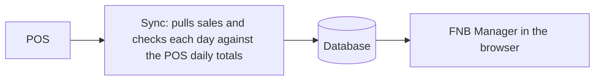

## Where to open it

| Where | Address | Numbers | State on 2026-11-12 |
|---|---|---|---|
| The local app on the build machine | `http://localhost:5173` while the app runs there | real, as fresh as the last sync run on that machine | verified locally |
| The cloud app | the project's GitHub Pages address, `https://<owner>.github.io/fnb-manager/` | real, synced automatically | waits for the owner's go-live steps |
| The demo | the same Pages address until go-live; afterwards "Xem bản demo" on the login page | sample numbers, no login | see "The demo" below |

**Now.** Until the cloud project exists, the app with real numbers runs only on the build machine. Whoever looks after that machine starts the database and the app ([development.md](development.md)), runs the sync, and creates your login. No schedule runs there: the numbers are as fresh as the last sync that was run.

**After go-live.** The owner creates the cloud project, the GitHub secrets and the e-mail sender step by step ([go-live.md](go-live.md)). The real app then lives at the Pages address behind a login. The owner adds members with the `fnb` command-line tool, either with an invitation e-mail or with a password set for them; nobody can sign up alone. A nightly sync at 03:23 covers the last 14 business days, and once the owner switches it on, a sync every 30 minutes keeps each open store current.

## Signing in

| Screen | What to do |
|---|---|
| **Đăng nhập** (Sign in) | Enter "E-mail" and "Mật khẩu", then press "Đăng nhập". A wrong pair shows "E-mail hoặc mật khẩu không đúng." |
| **Quên mật khẩu?** (Forgot your password?) | Enter the e-mail you were registered with and press "Gửi liên kết". The answer is the same whether or not the address exists. |
| **Mật khẩu mới** (New password) | Opens from the link in the e-mail. The new password needs at least 8 characters; press "Lưu mật khẩu", then "Vào ứng dụng". An old or used link shows "Liên kết đặt lại không còn hiệu lực. Hãy yêu cầu liên kết mới." |

- The browser keeps you signed in. "Đăng xuất" (Sign out) in the top bar ends the session.
- "Tài khoản này chưa thuộc chủ sở hữu nào…" means the login exists but has no access yet; ask the owner to add you.
- On the local app, reset e-mails do not reach a real inbox: they land in the local mail catcher of the build machine (`http://127.0.0.1:54324`). On the cloud app they need the e-mail sender the owner sets up at go-live.

| Đăng nhập (Sign in) | Quên mật khẩu? (Forgot your password?) |
|---|---|
| 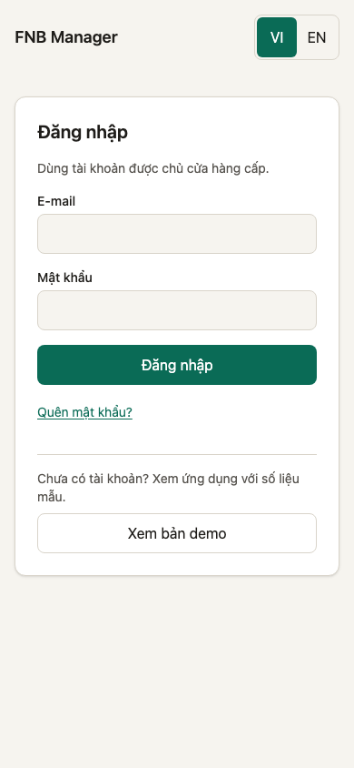 | 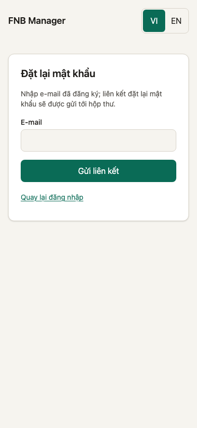 |

## Finding your way

The navigation sits at the bottom on a phone and on the left on a wide screen.

| Label | English | Opens | State on 2026-11-15 |
|---|---|---|---|
| Hôm nay | Today | today and yesterday | verified locally |
| Báo cáo | Reports | Ngày, Tuần, Tháng, Năm | verified locally |
| Chủ đề | Topics | thematic reports: Doanh thu & xu hướng, Giờ & ngày trong tuần, Thực đơn, Thanh toán & tiền mặt, Khuyến mãi & giảm giá, Ca & két tiền, So sánh cửa hàng | the first four verified locally; Khuyến mãi & giảm giá, Ca & két tiền and So sánh cửa hàng built |
| Kế hoạch | Plans | saved strategy plans | "Sắp có" |
| Cài đặt | Settings | Cửa hàng (the business and store profiles), Phân loại (item-type roles, item categories and payment kinds), Ngày lễ (the national holidays and your own days off) and Ngưỡng báo cáo (the report thresholds and this device's CSV format); the other settings pages say which phase brings them | Phân loại and Ngưỡng báo cáo verified locally; Cửa hàng and Ngày lễ built; the other pages planned |

- A page that is not built yet says "Sắp có" and names the roadmap phase that brings it ("Dự kiến ở giai đoạn … của lộ trình.").
- The top bar holds the language switch (**VI** / **EN**), "Đăng xuất", the store choice and the freshness badge. On a phone the store choice folds into one summary button; tap it to open.
- **VI** is the default. **EN** switches every label, sentence and number format to English. The browser remembers the choice.
- When a new version is published, a prompt says "Có phiên bản mới — tải lại"; tap it to reload.
- The app can be added to a phone's home screen (as "FNB Manager", or "FNB" where space is short) and then opens without the browser bar. It does not work offline.
- The app follows the light or dark setting of the phone or computer.

| On a phone, the controls fold into one summary button | Tapped open | Dark setting |
|---|---|---|
|  |  |  |

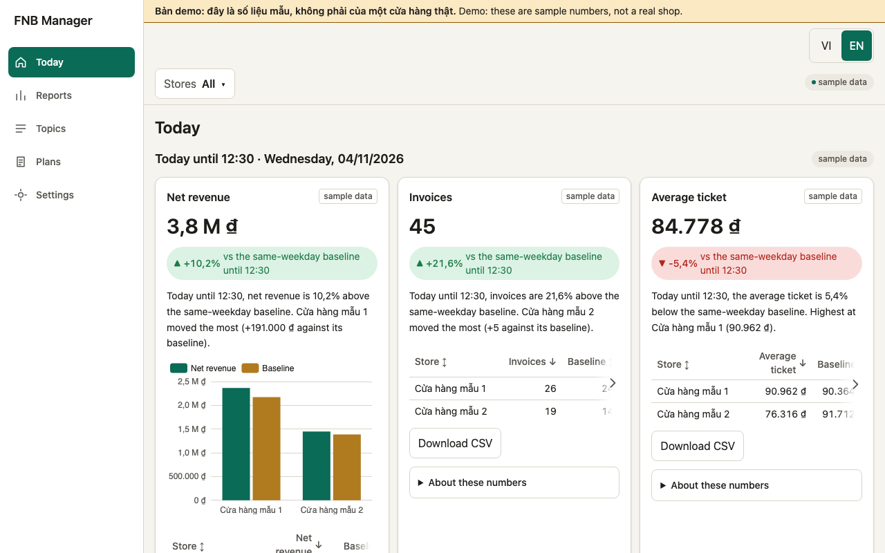

## Choosing stores

- The "Cửa hàng" button shows "Tất cả" (All), one store's name, or "{n} cửa hàng".
- Open it and tick "Tất cả" or the stores you want. At least one store always stays selected.
- With several stores, every figure is the sum of the stores before any ratio is taken. The average ticket of two stores is their total net revenue divided by their total invoices, not the average of two averages.
- You see only the stores your role covers. If your login belongs to more than one business, a "Chủ sở hữu" (Owner) list appears to switch between them.
- The browser remembers the choice, and report links carry it.

## Hôm nay (Today)

Hôm nay has two sections, each with a badge that says whether the day is reconciled (see "Data freshness" below).

| Section | Cards |
|---|---|
| "Hôm nay đến {time} · {date}" (today until now) | Doanh thu thuần, Số hóa đơn, Giá trị trung bình mỗi hóa đơn, Doanh thu theo giờ, Top 5 món hôm nay, Thanh toán hôm nay |
| "Hôm qua · {date}" (yesterday) | Doanh thu thuần, Số hóa đơn, Giá trị trung bình mỗi hóa đơn |

- **Doanh thu thuần** (Net revenue): the total of the invoices that were not voided, after item, bill and voucher discounts. **Số hóa đơn** (Invoices) counts those invoices. **Giá trị trung bình mỗi hóa đơn** (Average ticket) is net revenue divided by invoices.
- Each of these compares with **mức nền cùng thứ** (the same-weekday baseline): the median of the same weekday over the previous 8 weeks, with public holidays, Tết days and your own days off (Cài đặt → Ngày lễ) left out. For today it counts only up to the same time of day ("so với mức nền cùng thứ đến 10:15"), so a morning is never compared with a whole day. Without enough history the chip reads "chưa có mức nền cùng thứ".
- **Doanh thu theo giờ** (Revenue by hour): today's net revenue hour by hour against the usual curve, with the peak hour.
- **Top 5 món hôm nay** (Top 5 items today): the best sellers so far, with quantity and share of item revenue.
- **Thanh toán hôm nay** (Payments today): the amount per payment method, and **tiền mặt cần đếm** (cash to count): the total taken in cash today, not counting the opening float.
- With several stores, Doanh thu thuần adds a chart by store, and each table lists the stores.
- The page reads the database again every 5 minutes and when you come back to the tab; the numbers themselves change only after a sync.

## The reports: Ngày, Tuần, Tháng and Năm

"Báo cáo" opens Ngày. The four tabs at the top switch between **Ngày** (Day), **Tuần** (Week), **Tháng** (Month) and **Năm** (Year); the new tab opens the period that contains the last day you were looking at.

### Choosing the period

- "‹" (Kỳ trước, previous period) and "›" (Kỳ sau, next period) step one period. "Chọn ngày" (Pick a date) jumps to the period that contains a date; it moves once the date is complete, when you press Enter, leave the field or stop typing for a moment.
- Ngày is one business day; Tuần the ISO week, Monday to Sunday; Tháng the calendar month; Năm the calendar year. A running week, month or year shows "đến hết ngày {date}" (up to and including).
- Reports stop at the last complete business day. Today belongs to Hôm nay: a link to today, or to a week, month or year that starts today, shows the latest complete period with "Ngày hôm nay chưa kết thúc; báo cáo dừng ở ngày …" and a link "Xem Hôm nay". A later period shows the latest one with "Kỳ này chưa bắt đầu; đang hiển thị kỳ gần nhất đến hết ngày …".
- Dates go back to 1 January 2023.

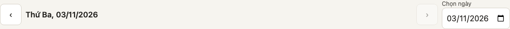

### Reading a card

Every report is a stack of cards, and every card has the same parts.

| Part | What it shows |
|---|---|
| Headline | the main number. Large amounts read "tr ₫" (million) or "tỷ ₫" (billion); hold the mouse pointer over the number for the exact amount, which screen readers announce as "Giá trị chính xác …". The CSV always holds exact amounts |
| Comparison chips | the change against each reference ("so với …"), with ▲ or ▼. Green when the change is good for that metric, red when it is bad (for the discount rate, lower is better), grey for a metric that is neither, such as the cash share. Shares and rates change in percentage points ("+1,2 điểm %"); everything else changes in per cent |
| Change line | for net revenue and the average ticket, how the change splits into its parts: "Chênh lệch {total} …: số hóa đơn … · số món mỗi hóa đơn … · giá trung bình mỗi món …". The parts add up exactly to the difference shown |
| Sentence | one plain sentence written from the numbers by fixed templates; it names what moved the number most (a store, an hour, a weekday, an item, a category, a payment method) |
| Chart and table | the detail. Column headers sort the table; a wide table scrolls inside its card with the first column fixed |
| "Tải CSV" (Download CSV) | the rows of the table, as shown |
| "Giải thích chỉ số" (About these numbers) | the formula, the level of detail and the conventions of each metric on the card |
| Markers | "chưa đối soát" (not reconciled), "đang cập nhật" (updating), "tạm tính" (provisional), "dữ liệu mẫu" (sample data), "Đang tải…" (loading) |

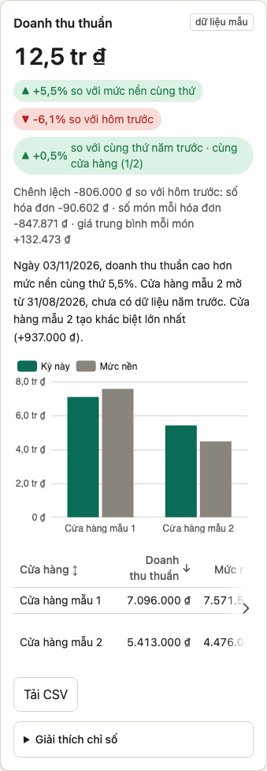

When a comparison has no number, the chip says why: "chưa có dữ liệu năm trước" (the stores have no data from last year), "cửa hàng mới, chưa đủ 4 tuần" (a new store, not 4 weeks yet), "đang tích lũy dữ liệu" (still collecting data), "chưa có số để so sánh" (nothing to compare with), "chưa thiết lập" (not set up).

### "Cùng cửa hàng": comparing like with like

When only some of the selected stores have sales history back to the reference period, the comparison uses only those stores and says so: "so với cùng thứ năm trước · cùng cửa hàng (1/2)" means the comparison with the same weekday last year covers one of the two selected stores. The sentence then names both figures: "Mức so sánh chỉ tính 1/2 cửa hàng có đủ dữ liệu: … so với …". A store that opened later shows "chưa có dữ liệu năm trước" (or "kỳ trước") in its own row instead of a change. The same-weekday baseline is never like for like. In the card above, the third chip compares with last year using "cùng cửa hàng (1/2)": the young sample store has no sales from last year.

### The sentences

Every sentence is filled in from the numbers by a fixed Vietnamese template (with an English twin); nothing is written by a model or by hand. A sentence has up to three parts:

- **The main comparison**, for example "Ngày {day}, doanh thu thuần cao hơn mức nền cùng thứ {delta}." Very small changes read "ngang" (level). Without a reference it gives the value and says why nothing is compared ("chưa đủ dữ liệu 8 tuần trước để so sánh").
- **What moved it most**: "{store} tạo khác biệt lớn nhất (…)", or "Riêng … đi ngược chiều (…)" when one part went against the overall change.
- **Where the change came from**: "Phần lớn do số hóa đơn (…)", or "… số món mỗi hóa đơn" or "… giá trung bình mỗi món". When the card compares with the baseline but splits the change against the day before, the sentence names that reference: "Chênh lệch … so với hôm trước phần lớn do …".

Every template, with its English meaning, is listed for the owner's wording review in [reports/cau-van-bao-cao.md](reports/cau-van-bao-cao.md).

### Ngày (Báo cáo ngày, Daily report)

| Card | What it shows | Compared with |
|---|---|---|
| Doanh thu thuần | the day's net revenue | the same-weekday baseline ("so với mức nền ({k}/8 tuần)" while fewer than 8 weeks exist), the day before, the same weekday last year |
| Số hóa đơn | invoices | the same three |
| Giá trị trung bình mỗi hóa đơn | the average ticket, with items per ticket and average item price | the same three |
| Theo giờ so với thường lệ (By hour against usual) | the peak hour and every hour against the usual curve of that weekday | the 20:00 to 22:00 share against the day before |
| 5 món bán chạy (Top 5 items) | the five best sellers: quantity, net revenue, share | the day before |
| Thanh toán và tiền mặt cần đếm (Payments and cash to count) | cash to count and each payment method | the cash share against the day before |
| Ca và chênh lệch két (Shifts and drawer variance) | shifts whose drawer differs from the expected cash by more than 50,000 ₫, by more than 0.5 % of the cash sales, or unusually against earlier shifts. Shifts are numbered "Ca 1", "Ca 2" by their opening time in each store and day; a cashier the POS records by an e-mail address shows as "chưa rõ thu ngân" | none |
| Giảm giá và voucher (Discounts and vouchers) | discount cost (item, bill, voucher), its share of gross revenue, and each promotion | the day before; the discount rate also against last year |
| Hóa đơn có số điện thoại thành viên (Invoices with a member phone number) | the share of invoices that carry a member's phone number | the day before |

More detail: [reports/ngay.md](reports/ngay.md).

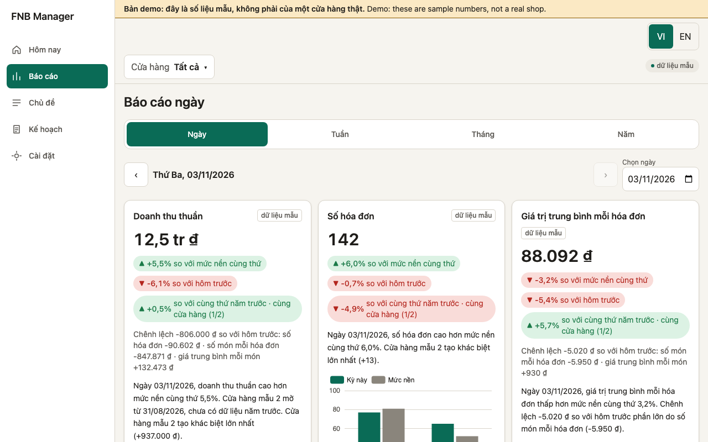

### Tuần (Báo cáo tuần, Weekly report)

| Card | What it shows | Compared with |
|---|---|---|
| Doanh thu tuần (Weekly revenue) | net revenue of the week | last week over the same elapsed days, the average of the 4 weeks before ("so với trung bình {n} tuần"; a week with Tết days is left out), the same week last year |
| Hóa đơn tuần (Weekly invoices) | invoices | the same three |
| Giá trị hóa đơn tuần (Weekly average ticket) | the average ticket | the same three |
| Đường theo ngày trong tuần (Curve across the week) | each day's net revenue and share of the week; the strongest day | last week and the 4-week average of each weekday |
| Món tăng, món giảm (Rising and falling items) | the last 28 days against the 28 before: up to 5 rising, 5 falling and 3 new items, each with at least 10 units | needs 8 weeks of history |
| Cơ cấu nhóm món (Category mix) | each category's share of item revenue; items without a category show as "Chưa phân loại" | last week, in percentage points |
| Khuyến mãi đã chạy (Promotions run) | the week's discount cost by promotion and the share of invoices with a voucher | last week |
| Ngày tốt nhất và kém nhất (Best and worst days) | the best and the worst day against each day's 8-week same-weekday median; a holiday is pointed out | none |

More detail: [reports/tuan.md](reports/tuan.md).

### Tháng (Báo cáo tháng, Monthly report)

| Card | What it shows | Compared with |
|---|---|---|
| Doanh thu tháng đến nay và nhịp tháng (Month to date and monthly pace) | net revenue of the month so far and where the month should end by two forecasts, "dự báo theo đặc trưng ngày trong tuần" and "dự báo mùa vụ đơn giản"; the one with the smaller error over the last 28 days comes first; the monthly target in the table when every selected store has one | the same days of last month and of last year; each forecast against the whole of last month |
| Xu hướng theo ngày (Day-by-day trend) | each day against its usual level; holidays in grey, Tết shaded, "Đóng cửa" for a checked day without sales | the same-weekday baseline |
| Pareto món (đường 80 %) (Item Pareto) | how many items make 80 % of item revenue | the same days of last month |
| Cơ cấu size (Size mix) | the share of size L among the drinks sold by size | last month and last year |
| Tỷ lệ kèm topping và đồ ăn nhẹ (Topping and snack attach rates) | how many drink invoices also carry a topping or a snack; until the item roles are set it says "Chưa gán vai trò món." | last month and last year |
| Món mới (New items) | items first sold this month and their rank | none |
| Cơ cấu thanh toán (Payment mix) | the cash share and the other payment kinds; estimated fees where fee rates exist | last month and last year |
| Chi phí giảm giá (Discount cost) | item, bill and voucher discounts and the costliest promotion | last month and last year |
| Thống kê ca (Shift statistics) | shifts over the drawer thresholds, by cashier and shift | the same days of last month |
| Tiến độ mục tiêu (Target progress) | the month so far divided by the monthly targets, and what is still needed per remaining day; without a target it says "Chưa đặt mục tiêu tháng cho …" | each forecast against the target |

More detail: [reports/thang.md](reports/thang.md).

### Năm (Báo cáo năm, Yearly report)

| Card | What it shows | Compared with |
|---|---|---|
| Doanh thu tháng × năm (Revenue by month and year) | a heat table of every month of this year and the two years before, with year totals; the peak month | last year's peak month |
| Tăng trưởng (Growth) | each month against the same month last year; month on month; the last 3 months against the 3 before | the same month last year |
| Mùa vụ và Tết (Seasonality and Tết) | the seasonality index of the last 12 complete months, the Tết dip of this year and last year, and the share of each weekday | none |
| Xu hướng giá trị hóa đơn (Ticket trend) | the average ticket year to date and per month, with items per ticket and average item price | last year |
| Vòng đời món (Item lifecycle) | items by stage: Mới, Tăng, Giảm, Ngừng bán, Ổn định | none |
| So với năm trước (Against last year) | net revenue year to date | the same elapsed days of last year |
| Từ ngày khai trương (Since opening) | for a store that opened during the last year, its average daily net revenue week by week since opening | its first week; shown only while a selected store is that young |

More detail: [reports/nam.md](reports/nam.md).

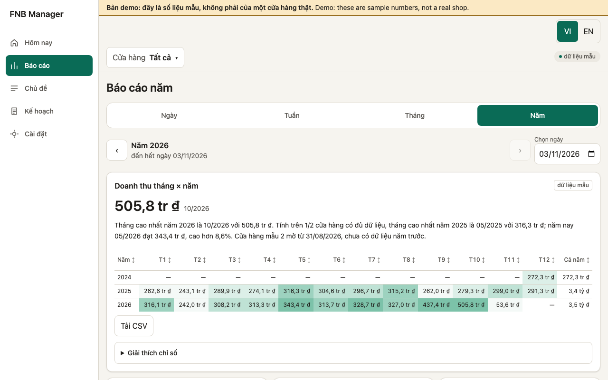

### Links to a given day, week, month or year

The address of a report names its period and, when not every store is selected, the stores. Copy it to share or bookmark exactly that view:

| Report | Address after the app's address |
|---|---|
| Ngày | `#/bao-cao/ngay?date=2026-11-07` |
| Tuần | `#/bao-cao/tuan?week=2026-W45` |
| Tháng | `#/bao-cao/thang?month=2026-10` |
| Năm | `#/bao-cao/nam?year=2026` |

Choose the stores first; the link then ends with `&store=…`. Opening such a link also sets your store choice.

### Printing

Use the browser's own print command (Ctrl+P or ⌘P on a computer, Share then Print on a phone). The app prints on A4 portrait, black on white, one card per row, without the navigation, banners and buttons, and starts with a line that names the report, the period, the stores and the last day included. "Giải thích chỉ số" prints only when it is open.

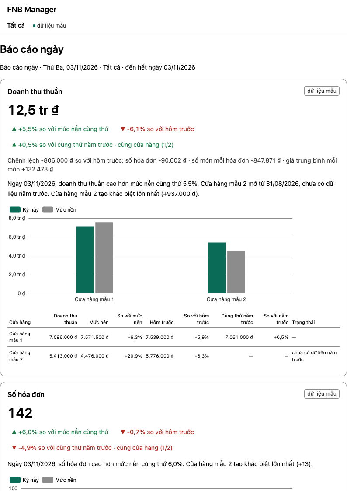

### CSV downloads

"Tải CSV" under a table downloads exactly the rows shown, in UTF-8 with a byte-order mark so that Excel shows the Vietnamese letters correctly. Values are separated by commas and decimals use a point; amounts are plain numbers without thousands separators, and percentage columns are marked "(%)". An Excel set to Vietnamese regional settings may put such a row in one column, because it expects semicolons and a decimal comma (`12,5`). If that happens, switch this device to the semicolon format on Cài đặt → Ngưỡng báo cáo, under "Thiết bị này" ([below](#thiết-bị-này-this-device)); each phone or computer keeps its own choice. A card with two tables offers "Tải CSV: {table}" for each. Report files are named `<report>-<card>-<period>.csv`, for example `ngay-net-revenue-2026-11-07.csv`.

## The thematic reports ("Chủ đề")

"Chủ đề" in the navigation opens reports that look at one subject over any range of days instead of a calendar period. All eight are built: **Doanh thu & xu hướng**, **Giờ & ngày trong tuần**, **Thực đơn**, **Thanh toán & tiền mặt**, **Khuyến mãi & giảm giá**, **Ca & két tiền**, **So sánh cửa hàng** and **Chất lượng dữ liệu**, and every tab keeps the range and the stores you chose.

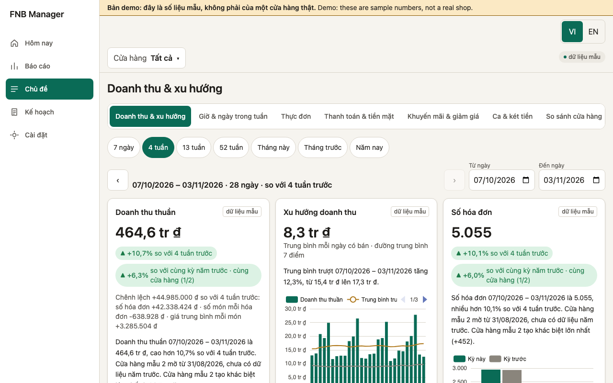

### Choosing the range

- **Presets:** 7 ngày, 4 tuần (the default), 13 tuần, 52 tuần, Tháng này, Tháng trước, Năm nay. Each ends at the last complete day, as the reports do.
- **‹ and ›** move the range back or forward by its own length, or by a month or a year for the month and year presets. › stops at the last complete day.
- **Từ ngày and Đến ngày** pick any range from 1 January 2023, at most 400 days (92 days on Ca & két tiền).
- The line under the presets says what is shown and what it is compared with: "07/10/2026 – 03/11/2026 · 28 ngày · so với 4 tuần trước". Every card also compares with the same weeks last year ("so với cùng kỳ năm trước"), except 52 tuần and Năm nay, whose range before is already last year.
- The app remembers the last preset on this device, and keeps the range and the stores when you switch between the thematic reports.
- A range longer than 400 days (92 on Ca & két tiền) is shortened to its last 400 (or 92) days, and an end after the last complete day is moved back to it; a line above the cards says so while that range is shown.

### Doanh thu & xu hướng (Revenue and trend)

| Card | What it shows | Compared with |
|---|---|---|
| Doanh thu thuần (Net revenue) | net revenue of the range, with the store that moved most or the split into invoices, items per ticket and item price | the range before; the same weeks last year |
| Xu hướng doanh thu (Revenue trend) | revenue per day (or per week for ranges over 92 days) with a 7-day (or 4-week) moving average; Tết is shaded | last year's moving average |
| Số hóa đơn (Invoices) | invoices of the range | as net revenue |
| Giá trị trung bình mỗi hóa đơn (Average ticket) | the average ticket with items per ticket and average item price | as net revenue |
| Theo tháng (By month), from 56 days | each month's revenue and the best month | the same month last year, on the same stores |
| Tỷ trọng từng cửa hàng (Share of each store), two or more stores | each store's share of revenue | the share in the range before, in points |

More detail: [reports/doanh-thu.md](reports/doanh-thu.md).

### Giờ & ngày trong tuần (Hours and weekdays)

| Card | What it shows |
|---|---|
| Bản đồ nhiệt giờ × thứ (Hour × weekday heat map) | two tables, revenue and invoices per day for every hour from the first to the last with sales, quiet hours in between included (rows), and weekday (columns T2 to CN), darker for higher; the best and the quietest cell |
| Giờ cao điểm và thấp điểm (Peak and quiet hours) | the hours that sell most (3 by default) and their share of revenue, and the quiet hours; compared with the range before in points |
| Theo thứ trong tuần (By weekday) | revenue per day for each weekday, the best and weakest, and the weekday that changed most |
| Doanh thu mỗi giờ mở cửa và mỗi ghế (Revenue per opening hour and per seat) | revenue and invoices per opening hour, and revenue per seat-hour (RevPASH) where the seat count is entered |
| Gợi ý khung ca (Suggested shift windows) | runs of busy and slow hours on weekdays and at the weekend, from invoices per hour; it does not count staff |

Revenue per opening hour needs the store's opening hours and RevPASH its seat count. Until they are entered, the card shows "—" and a link "Nhập giờ mở cửa và số ghế" to the store settings, which arrive with the settings pages. In the demo the young store has neither, so you can see that state.

More detail: [reports/gio-ngay.md](reports/gio-ngay.md).

### Thực đơn (Menu)

Thực đơn shows which items carry the menu. **Ma trận thực đơn** classes every item within its group (drinks, toppings, snacks) and store, over the menu window that ends on the range's last day (28 days unless Settings says otherwise): *Ngôi sao* sells well and earns more than its group's average, *Ngựa kéo cày* sells well but earns less, *Câu đố* earns well but sells little, *Chó* does neither. The number at the top is the stars among the drinks; the bars show each group's mix of classes, and the table lists the items with their class first, the stars of the drinks at the top, with each item's share of the group's quantity, its price and its cost. It opens on the first 20 items: **Xem tất cả n dòng** shows the rest, a click on a column heading sorts every item, and the CSV and the printed page hold them all. Below it, one row per group gives the popularity line, how many items fall in each class and the stars' share of the group's revenue. While a group still has an item without a cost, it is classed on price and marked "tạm tính".

**Biên lợi nhuận món** shows the gross margin of the items that have a cost, with their cost, margin and the share of their revenue the cost covers. Items without a cost are left out, so the card lists only the items you have costed. In the demo no item has a cost yet, so the card asks you to enter costs and links to **Nhập giá vốn** in Settings ([Dữ liệu nhập tay](#dữ-liệu-nhập-tay-manual-data)).

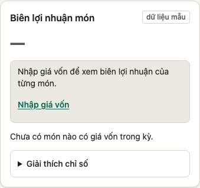

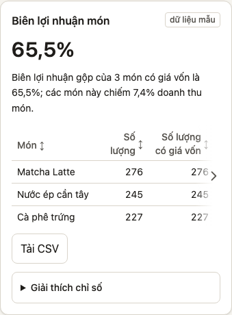

**Món tăng, món giảm** compares each item's quantity with the range before: the five that rose and fell most among items that sold at least 10 in the range before (a rising item also at least 10 in this one), and the best-selling new items. When a store has no sales in the range before, it says so instead of guessing.

**Cơ cấu nhóm món** shows each category's share of item revenue and how it moved. An item without a category is listed as **Chưa phân loại**, and the card links to **Phân loại món** in Settings so you can give it one.

**Cơ cấu size** is the share of size L among drinks sold by size, against the range before in points, with the L share of each drink.

**Tỷ lệ kèm topping và đồ ăn nhẹ** is how many invoices with a drink also have a topping or a snack, over the last 92 days of the range at most (the subtitle says how many), against as many days before. It names the drink most often taken with a topping. A rate shows "—" with a link to Settings until an item type of the selected stores carries the topping or snack role, and both do until one carries the drink role.

**Món hay bán cùng nhau** lists the pairs of items found together on at least 3 invoices over the same window, with how often one comes with the other and the lift (above 1 means more often than chance): candidates for a combo.

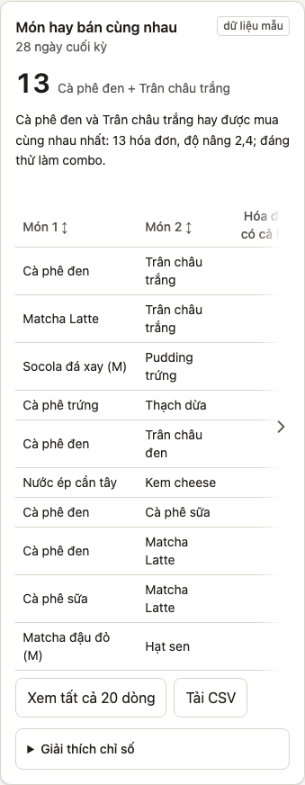

**Đường và đá** shows which sugar and ice levels customers choose, each as a share of its kind against the range before. Other options are listed apart under **Khác**.

More detail: [reports/thuc-don.md](reports/thuc-don.md).

### Thanh toán & tiền mặt (Payments and cash)

Thanh toán shows how customers pay. **Cơ cấu thanh toán theo loại** gives the share of cash in the money taken, against the range before and the same range last year in points, then each kind (cash, bank transfer, e-wallet, card…) and each payment method with its share. The bars put the range before beside this one, so a shift from cash to e-wallets shows at a glance. Apart from cash, the sentence names the kind whose share moved most.

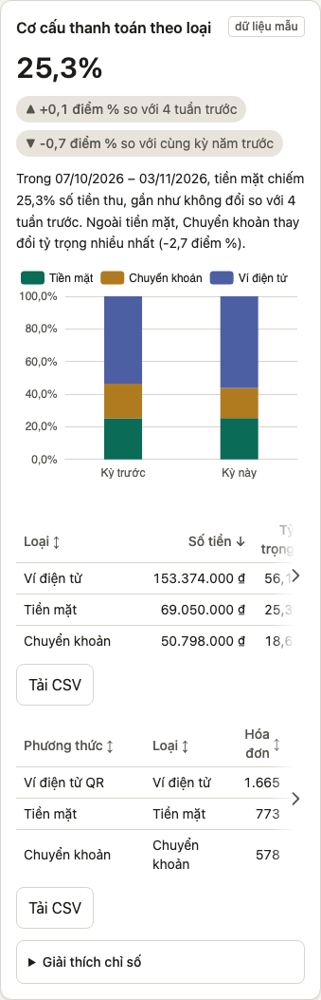

**Xu hướng tỷ trọng tiền mặt** follows the cash share day by day (week by week beyond 35 days), with the cash taken as bars and its share as a line. When, over the range, the cash share rises while revenue per day falls, the card says so: a sign worth checking against the cash counted in each shift.

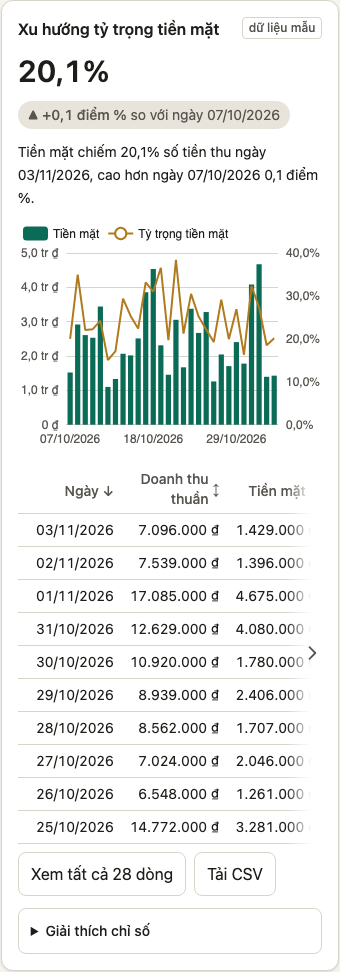

**Tiền mặt dự kiến và đếm được theo ca** checks every shift of the last 92 days of the range at most: the cash expected in the drawer against the cash counted, and how many shifts went over your thresholds (an amount, a share of cash sales and an unusual size for the store). The thresholds are written under the sentence and come from Settings. Shifts read "Ca 1", "Ca 2"… in the order they opened that day; a cashier's e-mail address never shows. A cash payout made during a shift is not synced from the POS, so it reads as a shortage.

**Phí thanh toán ước tính** estimates what card and e-wallet payments cost in fees, at the rate you enter for each payment method, beside the fee the POS reported. Until a rate is entered the card shows "—" and links to Settings.

More detail: [reports/thanh-toan.md](reports/thanh-toan.md).

### Khuyến mãi & giảm giá (Promotions and discounts)

Khuyến mãi shows what your promotions cost, whether one of them paid for itself, and how they stand against the promotion rules.

**Chi phí giảm giá** adds up the item discounts, bill discounts and vouchers of the range, with their share of gross revenue ("2,0% doanh thu gộp"). Its chips compare the cost, then the rate in points, with the range before and the same range last year. The sentence names the promotion that cost most; the first table lists every promotion with its invoices, discount, share of the cost and the first and last day it was used, and the second splits the cost into items, bills and vouchers for this range and the one before. The bars stack the three by day, or by week beyond 35 days.

**Voucher** gives the share of invoices that used a voucher, against the range before and last year in points, names the voucher used on the most invoices and lists every voucher.

**Hiệu quả khuyến mãi** asks whether one promotion brought in more than it gave away, over the last 92 days of the range at most. Choose the promotion in **Chương trình** (the costliest comes first) and what to compare with in **So với**:

- **Cùng thứ các tuần trước**: the same weekday over the 8 weeks before, at the same stores (the default);
- **Các tuần trước chương trình**: the weeks before the first day of the promotion, as many as Cài đặt → Ngưỡng báo cáo says (4 by default);
- **Cửa hàng không chạy chương trình**: a store you selected that did not run it. When every selected store ran it, as with a single store, this choice is greyed out and the reason is written under it.

The card then shows the net result in big type, "+" for a gain and "−" for a loss, with the extra gross revenue and the discount cost beside it: net = extra revenue − discount cost. The general trend, measured on days without the promotion, is taken out first, so a busy month does not count as the promotion's doing. A promotion that runs every day leaves no such days: the card then shows "—" with the reason and what to try (a range with days without the promotion, or a store that did not run it when one is selected), never a simple before-and-after figure. The table lists every day, promotion days first, with the expected revenue next to the real one.

| | |
|---|---|
| 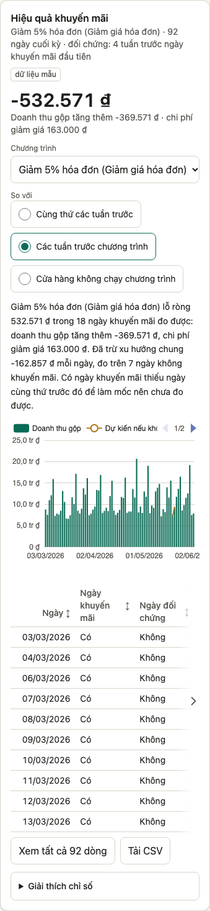 | 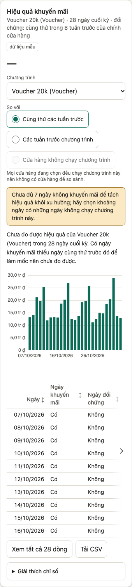 |

Your choices are in the address (`&promo=…&cmp=prior_weeks`), so a link opens the same comparison.

The last three cards check your promotions against the Vietnamese promotion rules that apply on each date. They inform; they never say you broke a rule, and each legal sentence names the decree or circular and its article, the date the rules were last checked (12/11/2026) and that it is not legal advice.

**Danh mục khuyến mãi** counts the promotions used in the range and lists every promotion, voucher and named bill discount with whether it is in the POS catalogue, whether it is switched on, when it was last used and its days and discount over the last 365 days. It names how many catalogue promotions that are still switched on have not been used for more than 90 days, which you may switch off in the POS. When the name of a promotion holds a word of a lucky draw ("bốc thăm", "quay số", "trúng thưởng", "lucky draw" and the like, also written without tone marks), a yellow note reminds you that a promotion with an element of chance must be registered with the Sở Công Thương, or with the Bộ Công Thương when it runs in several provinces, and that Decree 239/2026/NĐ-CP is reported to have changed this procedure. In the demo, the catalogue promotion "Vòng quay may mắn" shows the note.

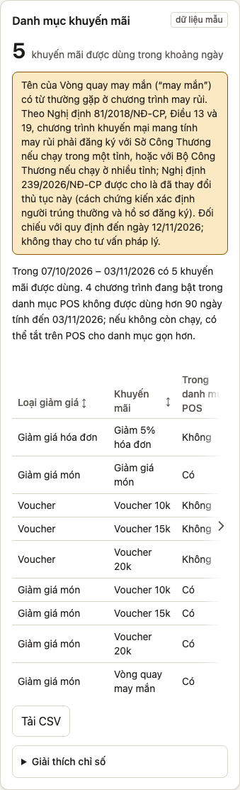

**Mức giảm tối đa** counts the item and bill discounts that took more than 50 % off the price before the promotion at least once (the cap of Circular 39/2025/TT-BCT, Article 4; a range across 1 July 2025 names Decree 81/2018/NĐ-CP, Article 7, too, with the dates of each). A free item ("món tặng") and a fully free invoice ("hóa đơn miễn phí") are never counted as over the cap: they are named apart with their dates for you to check against the rules of the programme. Vouchers are another form of promotion and are listed apart too, in their own sentence and table, when one took more than 50 % off the rest of an invoice. The first table ends with a row for whole invoices, vouchers included. A note says that state-run concentrated promotion programmes allow up to 100 %; their dates are not in the data, so every day is checked against 50 %.

**Số ngày giảm giá bán trong năm** counts, for each item, the days of this year on which it was sold at a discount, on its line or through a bill discount; gift and voucher days are shown beside them, never added. The old limit of 120 such days per item and year (Decree 81/2018/NĐ-CP, Article 10) is reported repealed from 26/06/2026 by Decree 239/2026/NĐ-CP, which is still being checked: for a range ending after 25/06/2026 the count is marked "chỉ để theo dõi" (for information only), and an item is named as over 120 days only for the days up to 25/06/2026.

| | |
|---|---|
|  |  |

More detail: [reports/khuyen-mai.md](reports/khuyen-mai.md).

### Ca & két tiền (Shifts and cash drawer)

Ca & két tiền looks at each shift of the range, at most the last 92 days: a longer range is shortened to its last 92 days, and the tabs from another theme open it on those days. Shifts read "Ca 1", "Ca 2"… in the order they opened that day in their store; the POS shift name and a cashier's e-mail address never show, on screen, in print or in a CSV file, and a cashier entered as an e-mail address reads "chưa rõ thu ngân".

**Doanh thu và hóa đơn theo ca** gives the average net revenue of a shift and names the shift of the day ("Ca 1", "Ca 2"…) that sells most and least on average. The table lists every shift, newest first, with its cashier, opening and closing time, invoices and net revenue; the bars show the last 40 shifts.

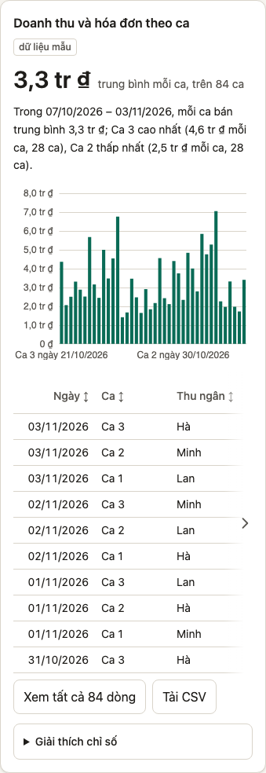

**Chênh lệch két** is Thanh toán's drawer check over the whole range: the shifts over your cash thresholds, the largest variance and the thresholds in force, every shift's expected and counted cash, and a second table per cashier with the shifts, how many went over the drawer thresholds, the total and average variance counted without its sign ("tuyệt đối") and the largest shortage and overage.

**Hủy, xóa món và sửa sau khi đóng ca** compares each shift's voids and removed lines with the store's own shifts of the 56 days before, as z-scores, and marks a shift only when a rate is higher than usual or an invoice was changed after the shift closed; the bars show the shifts marked for a rate. The sentence names the shift most worth a look and why; the table ranks the shifts by their higher z-score, then by edits after the close. A z-score compares a shift with earlier shifts; it is not a judgement of the person on the shift. A z-score needs 3 earlier shifts of the store whose rates differ; without them (a new store, or a store that has never removed a line) the cell reads "—" and the card says why.

**Theo thu ngân** puts the same shifts side by side per cashier, to show where a pattern repeats across shifts: for each cashier the shifts, net revenue, shifts over your drawer thresholds, total drawer variance counted without its sign, voids, removed lines and edits after the close. The headline counts the shifts over the drawer thresholds of the cashier with the most, and the sentence names that cashier; when several share the most, the card names nobody. A cashier entered as an e-mail address, or not entered at all, reads "chưa rõ thu ngân": those shifts keep their row in the table, but that row is never named as the cashier with the most, and the sentence says how many shifts it holds. It is a prompt to look again, not a conclusion about a person, and the card says so. When every shift of a store carries the same cashier login, as when all cashiers share one POS login, the card shows no ranking and says that figures per cashier need each cashier's own POS login. When the logins differ but none has a display name (each is an e-mail address or empty), it shows no ranking either and asks you to give each cashier login a display name in the POS.

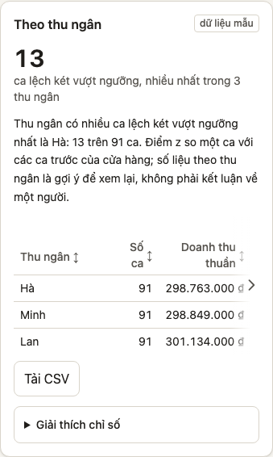

More detail: [reports/ca-ket-tien.md](reports/ca-ket-tien.md).

### So sánh cửa hàng (Store comparison)

So sánh puts two or more stores side by side. Choose them in the store picker ("Tất cả" or several stores); with one store, every card says "Chọn ít nhất hai cửa hàng để so sánh."

**Chỉ số theo cửa hàng** gives the share of revenue of the store that sells most, then one row per store with the same figures: revenue and its change against the range before, invoices, average ticket and its change, items per ticket, average item price, cash share, discount rate, invoices with a voucher, the share of invoices with an identified customer, revenue per opening hour and per seat-hour. The last row, **Tất cả cửa hàng**, is the stores added together: revenue and invoices are the sum of the rows above, and the averages and shares are worked out from those sums, not averaged. The sentence names the widest gap in average ticket and in items per ticket, or says the stores are about even. Revenue per opening hour shows "chưa thiết lập" for a store whose opening hours are not entered, and revenue per seat-hour for a store without opening hours or a seat count; the card links to the store settings. A store that opened after the range before began reads "chưa có dữ liệu kỳ trước" in the change columns; the all-stores row then compares only the stores that were open in both ranges, says so in its name ("cùng cửa hàng"), and the sentence gives how many of the stores that is. In any figure column, a cell with words instead of a number sorts after the numbers.

**Cùng ngày, so sánh dáng** compares the shape of the stores' days rather than their size: each day's revenue of a store is divided by that store's own average day over the range, so 1 is an ordinary day for that store whatever its size. The lines show each store's index (five colours, then the same colours dashed from the sixth store on) and the card names the day the stores went most apart, with the gap between the highest and the lowest index that day as the number at the top. Ranges over 92 days, or many stores, are compared by week (or month) instead, per day with sales so a short week is not read as a weak one.

**Từ ngày khai trương** lines the stores up on their own opening: week 1 of each store is its first seven days, whatever the date. It compares up to 26 weeks, as many as the youngest store has complete, with each week's average revenue per day with sales (as Năm does for a young store), and says how far the youngest store reached against an older store in the same week of its life, using the latest week in which neither store had a Tết day: Tết weeks are marked "có ngày Tết" in the table, and the sentence says when it had to step back from them. This card does not follow the chosen range. A store with less than one complete week is left blank ("—") and named under the sentence; several such stores are named together.

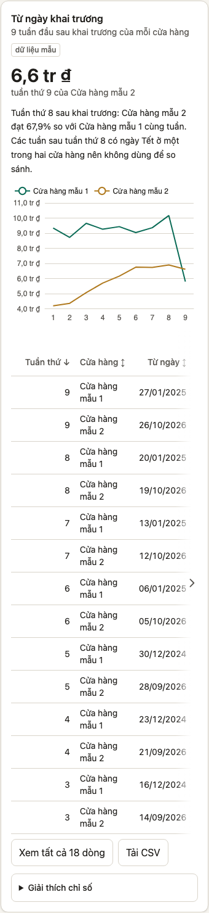

More detail: [reports/so-sanh.md](reports/so-sanh.md).

### Chất lượng dữ liệu (Data quality)

Chất lượng dữ liệu lists what is missing or wrong in your data, so that every other report gets more complete over time. Each card counts one kind of finding, and every finding says where to fix it, in the column "Cách sửa": "Sửa trong POS: …" when the fix belongs in the POS, the Settings page and tab when it belongs in the app, or running the sync again for a day. The link under the card's note opens that Settings page. The page itself changes nothing, and it shows counts only, never a customer.

**Hóa đơn điện tử, đánh số hóa đơn và hồ sơ cửa hàng** names every store whose e-invoice status is not recorded as "Đã đăng ký" in Cài đặt → Cửa hàng, with the hint to register cash-register e-invoices in the POS and the link "Ghi trạng thái hóa đơn điện tử" to record the status once it is done. A store not yet recorded reads "Chưa rõ" and is flagged too. The same card flags a receipt numbering that is not recorded or that the data contradicts, a member feature switched off (switch it on in the POS, then record it), and missing opening hours, seats or opening date; "Mở hồ sơ cửa hàng" opens Cài đặt → Cửa hàng for those, and the second table shows each store's profile at a glance.

**Món chưa có nhóm, nhóm chưa có vai trò** lists the items sold without a category, with their share of item revenue, and the categories with sales but no role. "Phân loại món" opens Cài đặt → Phân loại → Nhóm của món, where the same items are listed under Chưa phân loại; once you choose a category there, the item is gone from this card the next time you open it. "Gán vai trò món" opens the roles.

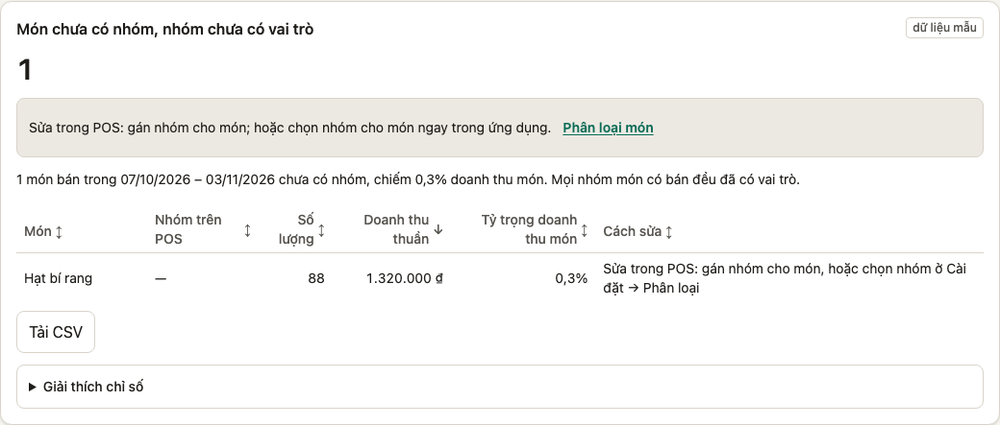

**Ngày chưa đối soát** lists the store-days that do not match the POS totals or were not checked, the same rule as the "chưa đối soát" badge, with the hint to run the sync again for that day. Over long ranges the days are grouped by week or month. **Món chưa có giá vốn** gives the share of item revenue that had a cost on the day it was sold, the same figure as on Thực đơn, and the 20 best sellers that still have no cost, with the link to enter costs. **Phương thức thanh toán chưa phân loại** lists the payment methods the POS counts as "Khác" and that you have not classified, with the link to Loại thanh toán (a method you set to "Khác" yourself is not listed), and any method missing from the POS catalogue. **Dòng tùy chọn** shows how many sold lines are sugar, ice or free-topping choices, which never count as items, and how many catalogue modifiers were sold as items (normally 0). **Định danh khách và đồng ý** gives the share of invoices that carry a phone number or a customer id and, once invoices are linked to customers of the customer list, how many of them agreed to loyalty, with the reminder to use "Thêm khách hàng" at payment. Until then, while invoices carry phone numbers only, the card says so instead of showing a 0 % coverage.

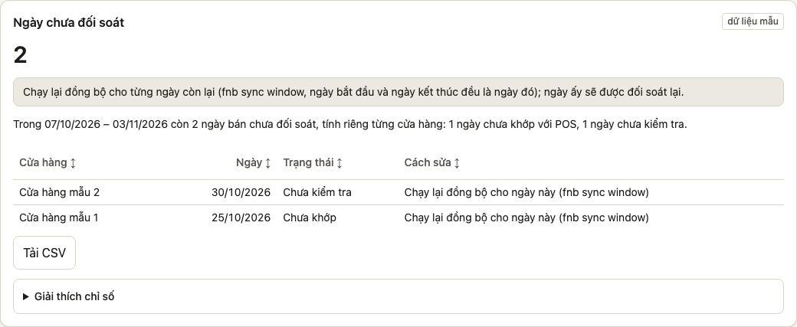

More detail: [reports/chat-luong.md](reports/chat-luong.md).

### Links, printing and CSV

The address names the range (`#/chu-de/gio-ngay?range=28d`, or `?from=2026-10-08&to=2026-11-06`) and, when not every store is selected, the stores (`&store=…`). Two dates that make up a preset open as that preset, so the address then reads `range=…`. Printing and "Tải CSV" work as on the reports; theme files are named `<theme>-<card>-<from>_<to>.csv`, for example `doanh-thu-net_revenue-2026-10-07_2026-11-03.csv`.

## Cài đặt (Settings)

"Cài đặt" in the navigation opens the settings. The page names sit in a row under the heading on a phone and stand as a column on the left on a wide screen. Five pages are open today, **Cửa hàng**, **Dữ liệu nhập tay** (item costs so far), **Phân loại** (item-type roles, item categories and payment kinds), **Ngày lễ** and **Ngưỡng báo cáo**; Pháp lý says which roadmap phase brings it. **Cảnh báo** (alerts) and **Bản tin** (the daily digest) are already in the list: each says what it will hold and that it comes with phase 12.

### Cửa hàng (Stores)

Settings open on this page. It holds the facts of your business and of each store that the reports, alerts and compliance checks rely on.

- **Doanh nghiệp** (Business): the **Loại hình pháp lý** (household business, micro-enterprise, small enterprise, other enterprise, or not yet known), which decides whether storing customer data on servers abroad needs a dossier, and the **Ngôn ngữ mặc định** (Tiếng Việt or English). A member who has never pressed VI or EN on a device opens the app in the default language; once they press it, that device keeps their choice. If you have never pressed VI or EN yourself, saving English as the default switches your own screen to English at once; press VI to keep Vietnamese on your device. Only an owner who sees every store can change this block.
- **One block per store you can see.** The name, address, time zone and the hour the business day starts are marked "lấy từ POS": they come from the POS and cannot be changed here. You can set:
  - **Mã cửa hàng**: up to 12 characters, different from the other stores' codes; it appears in labels and in the cost CSV. Leave it empty for no code.
  - **Ngày khai trương**: lines up comparisons since opening.
  - **Giờ mở cửa**: per weekday, closed or up to three spans (a store whose hours were never entered says so above the days, which all start as closed); a span closing at or before its opening runs past midnight, and "Chép sang các ngày khác" copies a day. Saving the hours changes Giờ & ngày, the opening-hour figures of Hôm nay, when the sync runs during the day and when the digest is sent. Only an owner of the store can change them; a manager sees them with a note saying why.
  - **Số ghế**: RevPASH (revenue per seat per hour) appears on Giờ & ngày once it is set.
  - **Hóa đơn điện tử** (not known, not registered, registered, turned off), **Đánh số hóa đơn** (every day, every year, never, not known) and **Tính năng thành viên trên POS** (not known, on, off). Under Đánh số hóa đơn the page says what the receipt numbers of the last months suggest, once at least 20 days have numeric receipt numbers; "Dùng gợi ý" fills it in when they restart every day. The demo's receipt numbers are not plain numbers, so the demo shows no suggestion.
- Each block has its own save bar: **Lưu** saves only what you changed in that block, and the line under it says when it last changed and who changed it ("Bạn", or the role). A code another store already uses is refused with "Không lưu được: mã này đã dùng cho một cửa hàng khác của chuỗi.", and an unfinished time span keeps Lưu unavailable.
- Owners and managers of a store can change its block; other members see every value with a note saying why not. In the demo a change lasts until the page is reloaded.

### Dữ liệu nhập tay (Manual data)

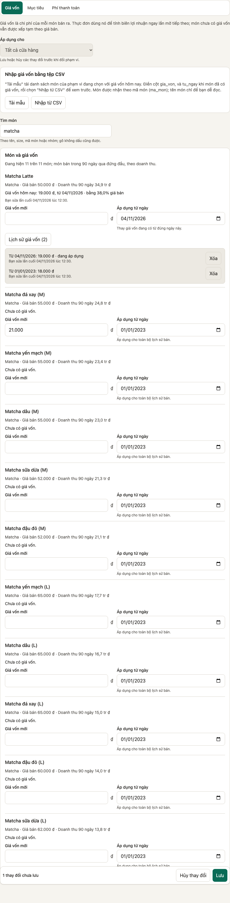

This page holds what the POS does not know. It has three tabs: **Giá vốn** (item costs) is open; **Mục tiêu** (monthly targets) and **Phí thanh toán** (payment fees) say which phase brings them.

**Giá vốn** is what one item sold costs you. Thực đơn uses it for the margin of each item and for the menu matrix; an item without a cost is still classed on its price and marked "tạm tính".

- **Áp dụng cho**: "Tất cả cửa hàng" sets one cost for every store; choosing a store sets that store's own cost, which it uses instead of the shared one from its date. A store that has no cost of its own shows the shared one, marked "theo Tất cả cửa hàng". You can switch only once your changes are saved or cancelled.
- **The list** starts with the items sold over the last 90 days, best sellers first, then the rest of the menu (toppings and other options are never listed). Each item shows its size, category, list price and 90-day revenue, today's cost with the date it started and its share of the price, and who saved it last. **Tìm món** finds an item by name, size, code or category, with or without Vietnamese marks; **Xem thêm 25 món** shows more.
- **Entering a cost**: type it in **Giá vốn mới** (whole đồng; "18000" becomes "18.000" when you leave the field) and check **Áp dụng từ ngày**:
  - an item's very first cost starts on **01/01/2023** and covers the whole sales history ("Áp dụng cho toàn bộ lịch sử bán."), so Thực đơn shows its margin for any range at once;
  - a later change starts **today** ("Từ ngày này trở đi; các ngày trước giữ giá vốn cũ."): the days before keep the earlier cost, so past margins do not move;
  - a store's own cost for an item that already has a cost for all stores also starts **today** ("… các ngày trước giữ giá vốn chung."). If you pick an earlier date, the page warns that the store's cost replaces the shared one on those past days too ("… kể cả các ngày đã qua.");
  - when a later cost exists, the line under the date says the last day your cost covers ("… đến hết 31/05/2026 …");
  - picking a date that already has a cost replaces that cost ("Thay giá vốn đang có từ đúng ngày này.").
- **Lưu** saves every cost you typed together, or none of them. A negative cost, a fraction of a đồng ("Nhập số tiền chẵn đồng, không có phần lẻ."), more than 100.000.000 ₫ or a changed date without a cost keeps Lưu unavailable; nothing is rounded for you. An item you are changing stays on the list even when the search would hide it, and you can switch **Áp dụng cho** only once the changes are saved or cancelled.
- **Lịch sử giá vốn** lists an item's costs in the chosen scope, newest first, with the one in force marked "đang áp dụng"; **Xóa** removes one, and the days it covered go back to the earlier cost. If the connection drops, the page says it could not delete and offers **Thử lại**.
- After a save, the next Thực đơn you open uses the new costs, even if you go back to a page you had open before.
- Owners and managers can enter costs for their stores; the costs for all stores need an owner or manager who sees every store. A manager of one store sees the shared costs read-only and enters their store's own. Other members read every cost with a note saying why not. In the demo a cost lasts until the page is reloaded.

More detail: [manual-data.md](manual-data.md).

### Phân loại (Classification)

Each item type of the POS (the categories the POS sorts its items into, such as "Trà sữa" or "Topping") needs a **role**: Đồ uống, Đồ ăn, Đồ ăn nhẹ, Topping or Khác. The reports use the roles to measure how often a drink comes with a topping or a snack (the attach rates on Tháng and Thực đơn), and the menu matrix compares each item only with the others of its role. A type without a role reads **Chưa gán**, and the attach-rate cards say so with a link here ("Gán vai trò món").

- The **Vai trò nhóm món** tab lists the item types under the name of their POS account, each with how many of its items sold over the last 28 days (an item sold in several sizes counts once) and its share of the business's item revenue, so the types that matter come to mind first. If you change a role on another phone meanwhile, the page takes it and keeps what you are changing.
- An unassigned type whose name says what it is shows a suggestion ("Gợi ý: Topping"). **Áp dụng gợi ý cho … nhóm chưa gán** fills every suggestion in at once; nothing is saved until you press **Lưu**, so check them first.
- Choosing **Chưa gán** takes a role away. Lưu saves only the types you changed; Hủy thay đổi goes back to the saved roles.
- Owners and managers who see every store can change the roles; everyone else sees them with a note saying why not.
- Attach rates are worked out from the stored daily numbers, so after a save the line "Số liệu đang cập nhật theo thay đổi phân loại" appears on the thematic reports and in Cài đặt while those days are recalculated ([Data freshness](#data-freshness-and-the-verified-badge)); it starts by itself for owners and managers. Labels such as the role of an item follow at once.
- The **Nhóm của món** tab puts an item into an item type when the POS has none for it, or has one the POS catalogue lacks. **Chưa phân loại** lists the items sold like that over the last 90 days, best sellers first. These are the same items Thực đơn counts as "Chưa phân loại", an item the POS sent without a code included. Each row says what the POS gives it ("Trên POS: chưa có nhóm"). An item can only go to an item type of its own POS account; there are no categories of the app's own, and the POS stays the best place to fix a category for good. Below them, **Đã chọn nhóm tại đây** lists the items you have already moved, with who saved them last, and **Tìm món** searches every item by name, size, item code or type; you can type without Vietnamese marks ("banh flan" finds "Bánh flan"). Choosing **Theo POS** removes your choice and the item counts in its POS type again. After **Lưu** the item leaves Chưa phân loại, and the next report you open, Thực đơn's category mix included, shows it in its new type; the attach rates follow once the days are recalculated (the line above).

  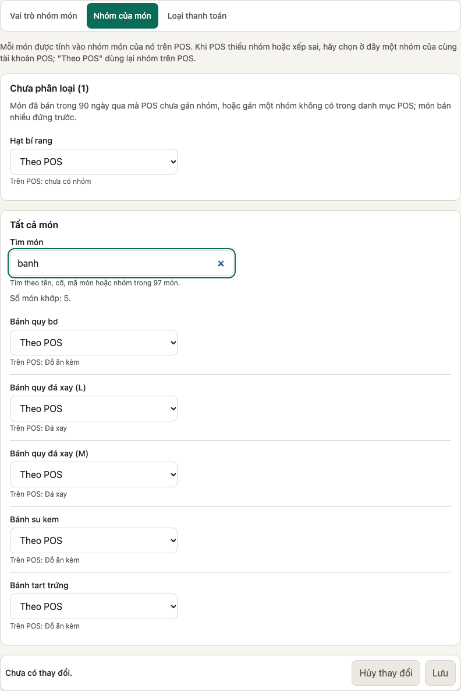

- The **Loại thanh toán** tab lists each payment method of the POS with the kind the POS gives it, your choice and the kind in effect ("Trên POS: Khác · Đang tính là: Ví điện tử"). Choose the right kind when the POS has it wrong, or **Theo POS** to go back to the POS's kind. The cash figures and the payment mix follow once the days are recalculated. The expected cash in the drawer of past shifts changes only after those days are synced again, and the tab says so.

  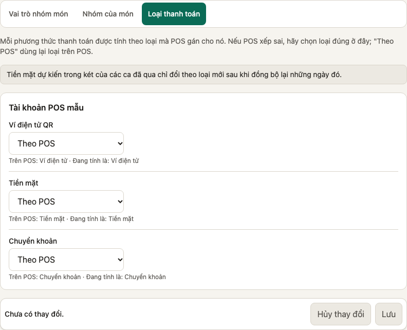

- The same people may save these two tabs as the roles; everyone else reads them with the same note.

### Ngày lễ (Holidays)

The reports compare a day with the same weekday of the 8 weeks before ("mức nền cùng thứ") and forecast from past days. A holiday, or a day the shop was closed or unusually busy, would pull those numbers off, so such days are left out. This page shows which days that are.

- **Năm** chooses the year, from 2024 to 2030; the page opens on the current year.
- **Ngày nghỉ riêng** (your own days off): days that count for your business only, such as a day closed for repairs or a local festival. Add one with its date and a name of up to 80 characters, then **Thêm**; **Xóa** removes it. The line under each day says when it was saved and who saved it ("Bạn", or the role). The same date cannot hold two days off with the same name.
- The next report you open leaves such a day out. On Ngày, for example, the chip "so với mức nền cùng thứ" turns into "so với mức nền (7/8 tuần)" when one of the 8 weeks is a day off; deleting the day brings the week back.
- **Ngày lễ quốc gia** (national holidays) lists the public holidays and the Tết days of the year, each marked "Ngày lễ" or "Tết". They come with the app and cannot be changed here. The national calendar comes with the app for 2024 to 2028 only, because the days that follow the lunar calendar (Tết, Giỗ Tổ Hùng Vương) are worked out year by year, so 2029 and 2030 show no national days yet; your own days off of those years still count.
- Owners and managers who see every store can add and remove days off; everyone else sees both lists with a note saying why not. In the demo a change lasts until the page is reloaded.

### Ngưỡng báo cáo (Report thresholds)

The reports decide what to flag from nine thresholds. They belong to the whole business, not to one store, and every report reads the same values: saving here changes Ngày, Tháng, the thematic reports and the daily digest together, and the page says so.

| Group | Threshold | What it changes | Default | Allowed |
|---|---|---|---|---|
| Thực đơn | Số ngày xét thực đơn | how many of the latest days the menu matrix classes items over | 28 ngày | 7 to 91 |
| Thực đơn | Ngưỡng bán chạy | an item is popular when its share of the quantity sold reaches this much of an even split among the items of its role | 70 % | 10 to 100 % |
| Thực đơn | Số món tối thiểu mỗi vai trò | a role with fewer items is classed for reference only | 10 món | 2 to 50 |
| Tiền mặt | Chênh lệch két theo số tiền | a shift is flagged when its drawer variance exceeds this amount | 50.000 ₫ | 0 ₫ or more, whole đồng |
| Tiền mặt | Chênh lệch két theo tỷ lệ | a shift is flagged when its drawer variance exceeds this share of the shift's cash sales | 0,5 % | 0 to 10 % |
| Giờ | Số giờ cao điểm | how many of the best-selling hours count as peak hours | 3 giờ | 1 to 6 |
| Giờ | Ngưỡng giờ thấp điểm | an hour selling below this share of the average hour is a quiet hour | 50 % | 10 to 90 % |
| Giờ | Ngưỡng giờ đông | an hour with invoices at or above this share of the average hour is busy; busy hours in a row form the suggested shift windows | 125 % | 105 to 300 % |
| Khuyến mãi | Số tuần trước khuyến mãi | how many weeks before the first promotion day Hiệu quả khuyến mãi compares with, when it compares with the weeks before or with a store that did not run it | 4 tuần | 2 to 8 |

- A shift is flagged when it passes any of three rules. The third, the z-score of the variance, is fixed at 2 and shown for reference. If most shifts are flagged for small differences, raise the two cash thresholds; lower them to watch the drawer more closely.
- Each field shows its default under it. A value outside its range is refused as soon as you leave the field, with the allowed range in words, and "Lưu" stays unavailable until it is corrected. An amount may be typed as `80000`, `80.000` or `80,000`: all three are 80.000 ₫, since đồng have no fraction. A percentage takes a comma or a point as its decimal mark.
- Changes wait in the bar at the foot of the page, which counts them: **Lưu** saves only what you changed, so a value someone else saved meanwhile is kept, and **Hủy thay đổi** goes back to the saved values. After a save the line under the fields says when the thresholds last changed and who changed them: "Bạn" for yourself, otherwise the role (chủ, quản lý), never a name.
- **Khôi phục mặc định** fills every field with its default; press Lưu to apply it. When a save leaves every threshold at its default, the business has no thresholds of its own any more, and the line reads "Đang dùng giá trị mặc định."
- Only an owner who sees every store can change the thresholds, because they also decide which of a manager's shifts are flagged. Everyone else sees the values with a note saying why they cannot be changed, and no save bar.
- In the demo a change lasts until the page is reloaded.

#### Thiết bị này (This device)

| | |
|---|---|
|  | The box under the thresholds holds a choice that belongs to the phone or computer in your hand, and any member may make it: the format of the files that "Tải CSV" writes. |

- **Dấu phẩy (mặc định)**: commas between values and a decimal point. Google Sheets, Numbers, LibreOffice and an Excel set to English read it.
- **Dấu chấm phẩy cho Excel cài đặt vùng Việt Nam**: semicolons and a decimal comma (`12,5`). Choose it when Excel puts a whole row in one column.
- The choice takes effect at once, for every table of the reports and the thematic reports, and stays on this device after a reload. Both formats keep the byte-order mark, so Vietnamese letters show correctly.

## Data freshness and the verified badge

- **The freshness badge** in the top bar shows when the last sync for your business succeeded: "cập nhật lúc {time}" today, "cập nhật lúc {time} ngày {date}" on an earlier day, "chưa đồng bộ" if no sync has succeeded yet, and "chưa rõ lúc cập nhật" if the app could not read it. It checks again every 5 minutes. A sale rung up after that time appears after the next sync.
- **The verified badge** on each Hôm nay section reads "đã đối soát" (reconciled) when every selected store's day has been checked against the POS's own daily totals and matched: the same number of invoices, and net revenue within the larger of 1,000 ₫ and 0.05 %. Otherwise it reads "chưa đối soát" (not reconciled): the day has not been checked yet, or it did not match.
- **On report cards**, "chưa đối soát" means that at least one selected store has a day in the period without a matched check. "đang cập nhật" means the item, payment or shift summaries of a recent day are still catching up with the latest sales. "tạm tính" means an input the metric needs is missing, such as item costs or seat counts.
- **After a change to a mapping** (an item type's role, an item's category, a payment kind or a fee rate), the numbers that depend on it are recalculated day by day, newest first. Today the roles, item categories and payment kinds on Cài đặt → Phân loại are the changes you can make yourself; fee rates come with phase 10b. Until every past day is done, each thematic report and settings page shows a line saying when the change was made and how many days are left ("Số liệu đang cập nhật theo thay đổi phân loại lúc … ngày …: còn … ngày."), and the cards that depend on the change carry "đang cập nhật" while their range still holds one of those days. An owner or a manager can press **Cập nhật ngay** on that line: the app then works through the days, at most 92 at a time, and keeps going while you move between pages; it says "Đã cập nhật xong số liệu theo thay đổi phân loại." when it is done, or why it stopped ("Thử lại" carries on). Other members see the line with "Chủ hoặc quản lý có thể cập nhật ngay." and no button, and their numbers follow as soon as the days are done. The demo recalculates at once, so it never shows the line.
- A past day that stays "chưa đối soát": tell whoever runs the system. They sync that day again; if it still does not match, they compare it with the POS report.

## The demo

The demo shows the app with sample numbers and no login.

| | Demo | Real app |
|---|---|---|
| Login | none | e-mail and password |
| Banner | "Bản demo: đây là số liệu mẫu, không phải của một cửa hàng thật." on every screen, in Vietnamese and English | none |
| Stores | "Cửa hàng mẫu 1", open since 2 December 2024, with monthly targets, and "Cửa hàng mẫu 2", a young store that opened about two months before the current month | your stores |
| Numbers | generated in your browser from a fixed seed and anchored to today in Vietnam time, so they move with the calendar; nothing is sent over the network | your POS sales |
| Badges | "dữ liệu mẫu" (sample data) | freshness time; "đã đối soát" or "chưa đối soát" |
| Reports | the same screens and the same calculations: a copy of the database functions that tests keep equal to them | computed in the database |

- The young store shows the states a new store goes through: no data from last year, a baseline still building, and the "Từ ngày khai trương" card.
- The first screen can take a few seconds while the browser generates the sample days.
- Before go-live the project's Pages address serves the demo. It is rebuilt from each published version; since 2026-11-13 it includes the four reports.

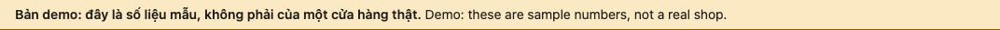
- After go-live the Pages address serves the real app. "Xem bản demo" on the login page opens the demo for that browser session, and "Thoát bản demo" in the top bar returns to the login page.

## What is coming next

No dates are promised here; [roadmap.md](roadmap.md) holds the plan and [status.md](status.md) the progress. A page that is not built yet looks like this:

- **The daily digest and alerts** (phase 12; the first part is verified locally, the second is being built). The digest ("Bản tin") is a short message in a Zalo Bot chat or by e-mail, built once every store has closed its day, or at a morning deadline (06:30 by default) if one has not: yesterday's Ngày numbers (net revenue, invoices, average ticket, payments, hours, top items), with a line when something looks off, such as revenue well below the usual level, a falling average ticket, a drawer variance, a day that did not reconcile or a day without sales. Alerts arrive on their own when the sync fails, a POS login stops working, the data goes stale or a scheduled job fails. By default the digest goes to owners and managers and the alerts about the sync and the jobs to the owner. Messages respect each channel's allowed hours. A settings page "Cài đặt → Cảnh báo" with a test button and a Bản tin panel in the app are designed; more channels come later.
- **More settings and manual data** ("Cài đặt", phase 10): Cửa hàng (the store profile, opening hours and seat counts), Dữ liệu nhập tay (item costs), Phân loại (item-type roles, item categories and payment kinds), Ngày lễ (your own days off) and Ngưỡng báo cáo are open (see above). The item-cost CSV import, monthly targets, payment fees and legal texts come next. Target progress waits for a monthly target. The links "Gán vai trò món" and "Đặt mục tiêu tháng" on the report cards lead to these settings; until a page exists it says which phase brings it.
- **Exports, the AI data pack and plans** ("Xuất dữ liệu" and "Kế hoạch", phase 11, designed at roadmap level): CSV and JSON exports by month; a data pack of summary numbers, with no individual sale, for the owner's own assistant to turn into a store plan; and the plan pasted back into "Kế hoạch", where its KPIs are followed with live values.
- **Later tracks**: the Zalo staff app and the loyalty programme wait for the owner's paperwork ([roadmap.md](roadmap.md), section 5).

## Words you will see

| Vietnamese | English in the app | Meaning |
|---|---|---|
| Doanh thu thuần | Net revenue | invoices not voided, after every discount |
| Doanh thu gộp | Gross revenue | the same invoices before discounts |
| Hóa đơn | Invoices | invoices not voided |
| Giá trị trung bình mỗi hóa đơn | Average ticket | net revenue ÷ invoices |
| Mức nền cùng thứ | Same-weekday baseline | median of the same weekday over 8 weeks, holidays and Tết left out |
| Hôm trước, tuần trước, tháng trước, năm trước | The day before, last week, last month, last year | the previous period; while the current one is still running, over the same number of days |
| Cùng cửa hàng ({k}/{n}) | Same stores | the comparison covers only the stores with enough history |
| Điểm % | pts | percentage points |
| Đã đối soát, chưa đối soát | Reconciled, not reconciled | matched, or not yet matched, against the POS daily totals |
| Đang cập nhật | Updating | summaries still catching up with the latest sales |
| Tạm tính | Provisional | an input the metric needs is missing |
| Dữ liệu mẫu | Sample data | the demo |
| Tiền mặt cần đếm | Cash to count | cash taken in the day, before the opening float |
| Chênh lệch két | Variance | drawer count against expected cash |
| Kỳ trước, kỳ sau, chọn ngày | Previous period, next period, pick a date | the period navigator |
| Tải CSV | Download CSV | the table as a file |
| Giải thích chỉ số | About these numbers | the definitions behind a card |
| Sắp có | Coming soon | a page that is not built yet |
| Lưu, Hủy thay đổi | Save, Discard changes | the bar at the foot of a settings page: save the pending changes, or go back to the saved values |
| Khôi phục mặc định | Restore defaults | put a settings page back to the platform's default values; nothing changes until you press Lưu |
| Nghỉ cả ngày | Closed all day | a weekday without opening hours |
| Ngưỡng báo cáo | Report thresholds | the settings page for what the reports flag |
| Mặc định | Default | the platform's value, used until the business saves its own |
| Thiết bị này | This device | a choice kept on this phone or computer only |
| Vai trò nhóm món, Chưa gán | Item-type role, Not assigned | the part an item type plays in the reports (Đồ uống, Đồ ăn, Đồ ăn nhẹ, Topping, Khác), or none yet |
| Gợi ý | Suggested | a role the app reads from an item type's name; saved only when you press Lưu |
| Cập nhật ngay | Refresh now | recalculate the days still waiting after a mapping change |
| Giá vốn, Áp dụng từ ngày | Item cost, Applies from | what one item sold costs you, and the first day that cost counts |
| Tất cả cửa hàng, theo Tất cả cửa hàng | All stores, from All stores | a cost shared by every store, and a store using that shared cost because it has none of its own |
