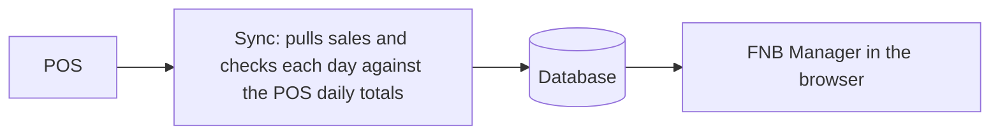

# User guide

Purpose and audience: what the FNB Manager app shows and how to read it, for the owner and the store managers. The app speaks Vietnamese by default; this guide is in English and quotes the Vietnamese labels exactly as the app shows them, with the app's own English label in brackets where it helps. It describes the app as built and verified locally on 2026-11-12; parts that are designed or planned say so.

Last updated 2026-11-12

## What the app is for

FNB Manager reads the sales from the shop's POS, checks every day against the POS's own daily totals, and turns the numbers into plain reports: how today is going, and how each day, week, month and year compares with the usual. It runs in the browser of a phone or a computer. Every number comes from the POS; nothing is typed in by hand yet.

## Where to open it

| Where | Address | Numbers | State on 2026-11-12 |
|---|---|---|---|
| The local app on the build machine | `http://localhost:5173` while the app runs there | real, as fresh as the last sync run on that machine | verified locally |
| The cloud app | the project's GitHub Pages address, `https://<owner>.github.io/fnb-manager/` | real, synced automatically | waits for the owner's go-live steps |
| The demo | the same Pages address until go-live; afterwards "Xem bản demo" on the login page | sample numbers, no login | see "The demo" below |

**Now.** Until the cloud project exists, the app with real numbers runs only on the build machine. Whoever looks after that machine starts the database and the app ([development.md](development.md)), runs the sync, and creates your login. No schedule runs there: the numbers are as fresh as the last sync that was run.

**After go-live.** The owner creates the cloud project, the GitHub secrets and the e-mail sender step by step ([go-live.md](go-live.md)). The real app then lives at the Pages address behind a login. The owner adds members with the `fnb` command-line tool, either with an invitation e-mail or with a password set for them; nobody can sign up alone. A nightly sync at 03:23 covers the last 14 business days, and once the owner switches it on, a sync every 30 minutes keeps each open store current.

## Signing in

| Screen | What to do |
|---|---|
| **Đăng nhập** (Sign in) | Enter "E-mail" and "Mật khẩu", then press "Đăng nhập". A wrong pair shows "E-mail hoặc mật khẩu không đúng." |
| **Quên mật khẩu?** (Forgot your password?) | Enter the e-mail you were registered with and press "Gửi liên kết". The answer is the same whether or not the address exists. |
| **Mật khẩu mới** (New password) | Opens from the link in the e-mail. The new password needs at least 8 characters; press "Lưu mật khẩu", then "Vào ứng dụng". An old or used link shows "Liên kết đặt lại không còn hiệu lực. Hãy yêu cầu liên kết mới." |

- The browser keeps you signed in. "Đăng xuất" (Sign out) in the top bar ends the session.
- "Tài khoản này chưa thuộc chủ sở hữu nào…" means the login exists but has no access yet; ask the owner to add you.
- On the local app, reset e-mails do not reach a real inbox: they land in the local mail catcher of the build machine (`http://127.0.0.1:54324`). On the cloud app they need the e-mail sender the owner sets up at go-live.

## Finding your way

The navigation sits at the bottom on a phone and on the left on a wide screen.

| Label | English | Opens | State on 2026-11-12 |
|---|---|---|---|
| Hôm nay | Today | today and yesterday | verified locally |
| Báo cáo | Reports | Ngày, Tuần, Tháng, Năm | verified locally |
| Chủ đề | Topics | thematic reports | "Sắp có" (coming soon) |
| Kế hoạch | Plans | saved strategy plans | "Sắp có" |
| Cài đặt | Settings | settings and manual data | "Sắp có" |

- A page that is not built yet says "Sắp có" and names the roadmap phase that brings it ("Dự kiến ở giai đoạn … của lộ trình.").
- The top bar holds the language switch (**VI** / **EN**), "Đăng xuất", the store choice and the freshness badge. On a phone the store choice folds into one summary button; tap it to open.
- **VI** is the default. **EN** switches every label, sentence and number format to English. The browser remembers the choice.
- When a new version is published, a prompt says "Có phiên bản mới — tải lại"; tap it to reload.
- The app can be added to a phone's home screen (as "FNB Manager", or "FNB" where space is short) and then opens without the browser bar. It does not work offline.

## Choosing stores

- The "Cửa hàng" button shows "Tất cả" (All), one store's name, or "{n} cửa hàng".
- Open it and tick "Tất cả" or the stores you want. At least one store always stays selected.
- With several stores, every figure is the sum of the stores before any ratio is taken. The average ticket of two stores is their total net revenue divided by their total invoices, not the average of two averages.
- You see only the stores your role covers. If your login belongs to more than one business, a "Chủ sở hữu" (Owner) list appears to switch between them.
- The browser remembers the choice, and report links carry it.

## Hôm nay (Today)

Hôm nay has two sections, each with a badge that says whether the day is reconciled (see "Data freshness" below).

| Section | Cards |
|---|---|
| "Hôm nay đến {time} · {date}" (today until now) | Doanh thu thuần, Số hóa đơn, Giá trị trung bình mỗi hóa đơn, Doanh thu theo giờ, Top 5 món hôm nay, Thanh toán hôm nay |
| "Hôm qua · {date}" (yesterday) | Doanh thu thuần, Số hóa đơn, Giá trị trung bình mỗi hóa đơn |

- **Doanh thu thuần** (Net revenue): the total of the invoices that were not voided, after item, bill and voucher discounts. **Số hóa đơn** (Invoices) counts those invoices. **Giá trị trung bình mỗi hóa đơn** (Average ticket) is net revenue divided by invoices.
- Each of these compares with **mức nền cùng thứ** (the same-weekday baseline): the median of the same weekday over the previous 8 weeks, with public holidays and Tết days left out. For today it counts only up to the same time of day ("so với mức nền cùng thứ đến 10:15"), so a morning is never compared with a whole day. Without enough history the chip reads "chưa có mức nền cùng thứ".
- **Doanh thu theo giờ** (Revenue by hour): today's net revenue hour by hour against the usual curve, with the peak hour.
- **Top 5 món hôm nay** (Top 5 items today): the best sellers so far, with quantity and share of item revenue.
- **Thanh toán hôm nay** (Payments today): the amount per payment method, and **tiền mặt cần đếm** (cash to count): the total taken in cash today, not counting the opening float.
- With several stores, Doanh thu thuần adds a chart by store, and each table lists the stores.
- The page reads the database again every 5 minutes and when you come back to the tab; the numbers themselves change only after a sync.

## The reports: Ngày, Tuần, Tháng and Năm

"Báo cáo" opens Ngày. The four tabs at the top switch between **Ngày** (Day), **Tuần** (Week), **Tháng** (Month) and **Năm** (Year); the new tab opens the period that contains the last day you were looking at.

### Choosing the period

- "‹" (Kỳ trước, previous period) and "›" (Kỳ sau, next period) step one period. "Chọn ngày" (Pick a date) jumps to the period that contains a date; it moves once the date is complete, when you press Enter, leave the field or stop typing for a moment.
- Ngày is one business day; Tuần the ISO week, Monday to Sunday; Tháng the calendar month; Năm the calendar year. A running week, month or year shows "đến hết ngày {date}" (up to and including).
- Reports stop at the last complete business day. Today belongs to Hôm nay: a link to today, or to a week, month or year that starts today, shows the latest complete period with "Ngày hôm nay chưa kết thúc; báo cáo dừng ở ngày …" and a link "Xem Hôm nay". A later period shows the latest one with "Kỳ này chưa bắt đầu; đang hiển thị kỳ gần nhất đến hết ngày …".
- Dates go back to 1 January 2023.

### Reading a card

Every report is a stack of cards, and every card has the same parts.

| Part | What it shows |
|---|---|
| Headline | the main number. Large amounts read "tr ₫" (million) or "tỷ ₫" (billion); hold the mouse pointer over the number for the exact amount, which screen readers announce as "Giá trị chính xác …". The CSV always holds exact amounts |
| Comparison chips | the change against each reference ("so với …"), with ▲ or ▼. Green when the change is good for that metric, red when it is bad (for the discount rate, lower is better), grey for a metric that is neither, such as the cash share. Shares and rates change in percentage points ("+1,2 điểm %"); everything else changes in per cent |
| Change line | for net revenue and the average ticket, how the change splits into its parts: "Chênh lệch {total} …: số hóa đơn … · số món mỗi hóa đơn … · giá trung bình mỗi món …". The parts add up exactly to the difference shown |
| Sentence | one plain sentence written from the numbers by fixed templates; it names what moved the number most (a store, an hour, a weekday, an item, a category, a payment method) |
| Chart and table | the detail. Column headers sort the table; a wide table scrolls inside its card with the first column fixed |
| "Tải CSV" (Download CSV) | the rows of the table, as shown |
| "Giải thích chỉ số" (About these numbers) | the formula, the level of detail and the conventions of each metric on the card |
| Markers | "chưa đối soát" (not reconciled), "đang cập nhật" (updating), "tạm tính" (provisional), "dữ liệu mẫu" (sample data), "Đang tải…" (loading) |

When a comparison has no number, the chip says why: "chưa có dữ liệu năm trước" (the stores have no data from last year), "cửa hàng mới, chưa đủ 4 tuần" (a new store, not 4 weeks yet), "đang tích lũy dữ liệu" (still collecting data), "chưa có số để so sánh" (nothing to compare with), "chưa thiết lập" (not set up).

### "Cùng cửa hàng": comparing like with like

When only some of the selected stores have sales history back to the reference period, the comparison uses only those stores and says so: "so với cùng thứ năm trước · cùng cửa hàng (1/2)" means the comparison with the same weekday last year covers one of the two selected stores. The sentence then names both figures: "Mức so sánh chỉ tính 1/2 cửa hàng có đủ dữ liệu: … so với …". A store that opened later shows "chưa có dữ liệu năm trước" (or "kỳ trước") in its own row instead of a change. The same-weekday baseline is never like for like.

### The sentences

Every sentence is filled in from the numbers by a fixed Vietnamese template (with an English twin); nothing is written by a model or by hand. A sentence has up to three parts:

- **The main comparison**, for example "Ngày {day}, doanh thu thuần cao hơn mức nền cùng thứ {delta}." Very small changes read "ngang" (level). Without a reference it gives the value and says why nothing is compared ("chưa đủ dữ liệu 8 tuần trước để so sánh").
- **What moved it most**: "{store} tạo khác biệt lớn nhất (…)", or "Riêng … đi ngược chiều (…)" when one part went against the overall change.
- **Where the change came from**: "Phần lớn do số hóa đơn (…)", or "… số món mỗi hóa đơn" or "… giá trung bình mỗi món". When the card compares with the baseline but splits the change against the day before, the sentence names that reference: "Chênh lệch … so với hôm trước phần lớn do …".

Every template, with its English meaning, is listed for the owner's wording review in [reports/cau-van-bao-cao.md](reports/cau-van-bao-cao.md).

### Ngày (Báo cáo ngày, Daily report)

| Card | What it shows | Compared with |
|---|---|---|
| Doanh thu thuần | the day's net revenue | the same-weekday baseline ("so với mức nền ({k}/8 tuần)" while fewer than 8 weeks exist), the day before, the same weekday last year |
| Số hóa đơn | invoices | the same three |
| Giá trị trung bình mỗi hóa đơn | the average ticket, with items per ticket and average item price | the same three |
| Theo giờ so với thường lệ (By hour against usual) | the peak hour and every hour against the usual curve of that weekday | the 20:00 to 22:00 share against the day before |
| 5 món bán chạy (Top 5 items) | the five best sellers: quantity, net revenue, share | the day before |
| Thanh toán và tiền mặt cần đếm (Payments and cash to count) | cash to count and each payment method | the cash share against the day before |
| Ca và chênh lệch két (Shifts and drawer variance) | shifts whose drawer differs from the expected cash by more than 50,000 ₫, by more than 0.5 % of the cash sales, or unusually against earlier shifts | none |
| Giảm giá và voucher (Discounts and vouchers) | discount cost (item, bill, voucher), its share of gross revenue, and each promotion | the day before; the discount rate also against last year |
| Hóa đơn có số điện thoại thành viên (Invoices with a member phone number) | the share of invoices that carry a member's phone number | the day before |

More detail: [reports/ngay.md](reports/ngay.md).

### Tuần (Báo cáo tuần, Weekly report)

| Card | What it shows | Compared with |
|---|---|---|
| Doanh thu tuần (Weekly revenue) | net revenue of the week | last week over the same elapsed days, the average of the 4 weeks before ("so với trung bình {n} tuần"; a week with Tết days is left out), the same week last year |
| Hóa đơn tuần (Weekly invoices) | invoices | the same three |
| Giá trị hóa đơn tuần (Weekly average ticket) | the average ticket | the same three |
| Đường theo ngày trong tuần (Curve across the week) | each day's net revenue and share of the week; the strongest day | last week and the 4-week average of each weekday |
| Món tăng, món giảm (Rising and falling items) | the last 28 days against the 28 before: up to 5 rising, 5 falling and 3 new items, each with at least 10 units | needs 8 weeks of history |
| Cơ cấu nhóm món (Category mix) | each category's share of item revenue; items without a category show as "Chưa phân loại" | last week, in percentage points |
| Khuyến mãi đã chạy (Promotions run) | the week's discount cost by promotion and the share of invoices with a voucher | last week |
| Ngày tốt nhất và kém nhất (Best and worst days) | the best and the worst day against each day's 8-week same-weekday median; a holiday is pointed out | none |

More detail: [reports/tuan.md](reports/tuan.md).

### Tháng (Báo cáo tháng, Monthly report)

| Card | What it shows | Compared with |
|---|---|---|
| Doanh thu tháng đến nay và nhịp tháng (Month to date and monthly pace) | net revenue of the month so far and where the month should end by two forecasts, "dự báo theo đặc trưng ngày trong tuần" and "dự báo mùa vụ đơn giản"; the one with the smaller error over the last 28 days comes first; the monthly target in the table when every selected store has one | the same days of last month and of last year; each forecast against the whole of last month |
| Xu hướng theo ngày (Day-by-day trend) | each day against its usual level; holidays in grey, Tết shaded, "Đóng cửa" for a checked day without sales | the same-weekday baseline |
| Pareto món (đường 80 %) (Item Pareto) | how many items make 80 % of item revenue | the same days of last month |
| Cơ cấu size (Size mix) | the share of size L among the drinks sold by size | last month and last year |
| Tỷ lệ kèm topping và đồ ăn nhẹ (Topping and snack attach rates) | how many drink invoices also carry a topping or a snack; until the item roles are set it says "Chưa gán vai trò món." | last month and last year |
| Món mới (New items) | items first sold this month and their rank | none |
| Cơ cấu thanh toán (Payment mix) | the cash share and the other payment kinds; estimated fees where fee rates exist | last month and last year |
| Chi phí giảm giá (Discount cost) | item, bill and voucher discounts and the costliest promotion | last month and last year |
| Thống kê ca (Shift statistics) | shifts over the drawer thresholds, by cashier and shift | the same days of last month |
| Tiến độ mục tiêu (Target progress) | the month so far divided by the monthly targets, and what is still needed per remaining day; without a target it says "Chưa đặt mục tiêu tháng cho …" | each forecast against the target |

More detail: [reports/thang.md](reports/thang.md).

### Năm (Báo cáo năm, Yearly report)

| Card | What it shows | Compared with |
|---|---|---|
| Doanh thu tháng × năm (Revenue by month and year) | a heat table of every month of this year and the two years before, with year totals; the peak month | last year's peak month |
| Tăng trưởng (Growth) | each month against the same month last year; month on month; the last 3 months against the 3 before | the same month last year |
| Mùa vụ và Tết (Seasonality and Tết) | the seasonality index of the last 12 complete months, the Tết dip of this year and last year, and the share of each weekday | none |
| Xu hướng giá trị hóa đơn (Ticket trend) | the average ticket year to date and per month, with items per ticket and average item price | last year |
| Vòng đời món (Item lifecycle) | items by stage: Mới, Tăng, Giảm, Ngừng bán, Ổn định | none |
| So với năm trước (Against last year) | net revenue year to date | the same elapsed days of last year |
| Từ ngày khai trương (Since opening) | for a store that opened during the last year, its average daily net revenue week by week since opening | its first week; shown only while a selected store is that young |

More detail: [reports/nam.md](reports/nam.md).

### Links to a given day, week, month or year

The address of a report names its period and, when not every store is selected, the stores. Copy it to share or bookmark exactly that view:

| Report | Address after the app's address |
|---|---|
| Ngày | `#/bao-cao/ngay?date=2026-11-07` |
| Tuần | `#/bao-cao/tuan?week=2026-W45` |
| Tháng | `#/bao-cao/thang?month=2026-10` |
| Năm | `#/bao-cao/nam?year=2026` |

Choose the stores first; the link then ends with `&store=…`. Opening such a link also sets your store choice.

### Printing

Use the browser's own print command (Ctrl+P or ⌘P on a computer, Share then Print on a phone). The app prints on A4 portrait, black on white, one card per row, without the navigation, banners and buttons, and starts with a line that names the report, the period, the stores and the last day included. "Giải thích chỉ số" prints only when it is open.

### CSV downloads

"Tải CSV" under a table downloads exactly the rows shown, in UTF-8 with a byte-order mark so that Excel shows the Vietnamese letters correctly. Values are separated by commas; amounts are plain numbers without thousands separators, and percentage columns are marked "(%)". A card with two tables offers "Tải CSV: {table}" for each. Report files are named `<report>-<card>-<period>.csv`, for example `ngay-net-revenue-2026-11-07.csv`.

## Data freshness and the verified badge

- **The freshness badge** in the top bar shows when the last sync for your business succeeded: "cập nhật lúc {time}" today, "cập nhật lúc {time} ngày {date}" on an earlier day, "chưa đồng bộ" if no sync has succeeded yet, and "chưa rõ lúc cập nhật" if the app could not read it. It checks again every 5 minutes. A sale rung up after that time appears after the next sync.
- **The verified badge** on each Hôm nay section reads "đã đối soát" (reconciled) when every selected store's day has been checked against the POS's own daily totals and matched: the same number of invoices, and net revenue within the larger of 1,000 ₫ and 0.05 %. Otherwise it reads "chưa đối soát" (not reconciled): the day has not been checked yet, or it did not match.
- **On report cards**, "chưa đối soát" means that at least one selected store has a day in the period without a matched check. "đang cập nhật" means the item, payment or shift summaries of a recent day are still catching up with the latest sales. "tạm tính" means an input the metric needs is missing, such as item costs or seat counts.
- A past day that stays "chưa đối soát": tell whoever runs the system. They sync that day again; if it still does not match, they compare it with the POS report.

## The demo

The demo shows the app with sample numbers and no login.

| | Demo | Real app |
|---|---|---|
| Login | none | e-mail and password |
| Banner | "Bản demo: đây là số liệu mẫu, không phải của một cửa hàng thật." on every screen, in Vietnamese and English | none |
| Stores | "Cửa hàng mẫu 1", open since 2 December 2024, with monthly targets, and "Cửa hàng mẫu 2", a young store that opened about two months before the current month | your stores |
| Numbers | generated in your browser from a fixed seed and anchored to today in Vietnam time, so they move with the calendar; nothing is sent over the network | your POS sales |
| Badges | "dữ liệu mẫu" (sample data) | freshness time; "đã đối soát" or "chưa đối soát" |
| Reports | the same screens and the same calculations: a copy of the database functions that tests keep equal to them | computed in the database |

- The young store shows the states a new store goes through: no data from last year, a baseline still building, and the "Từ ngày khai trương" card.
- The first screen can take a few seconds while the browser generates the sample days.
- Before go-live the project's Pages address serves the demo. It is rebuilt from each published version; on 2026-11-12 the published version predates the reports, so Báo cáo there still says "Sắp có" until the next version is published.
- After go-live the Pages address serves the real app. "Xem bản demo" on the login page opens the demo for that browser session, and "Thoát bản demo" in the top bar returns to the login page.

## What is coming next

No dates are promised here; [roadmap.md](roadmap.md) holds the plan and [status.md](status.md) the progress.

- **The daily digest and alerts** (phase 12; the first part is verified locally, the second is being built). The digest ("Bản tin") is a short message in a Zalo Bot chat or by e-mail, built once every store has closed its day, or at a morning deadline (06:30 by default) if one has not: yesterday's Ngày numbers (net revenue, invoices, average ticket, payments, hours, top items), with a line when something looks off, such as revenue well below the usual level, a falling average ticket, a drawer variance, a day that did not reconcile or a day without sales. Alerts arrive on their own when the sync fails, a POS login stops working, the data goes stale or a scheduled job fails. By default the digest goes to owners and managers and the alerts about the sync and the jobs to the owner. Messages respect each channel's allowed hours. A settings page "Cài đặt → Cảnh báo" with a test button and a Bản tin panel in the app are designed; more channels come later.
- **Thematic reports** ("Chủ đề", phase 10, designed at roadmap level): Doanh thu & xu hướng; Giờ & ngày trong tuần; Thực đơn; Thanh toán & tiền mặt; then Khuyến mãi & giảm giá; Ca & két tiền; So sánh cửa hàng; Chất lượng dữ liệu.
- **Settings and manual data** ("Cài đặt", phase 10, designed at roadmap level): the store profile, opening hours, seat counts, item costs, monthly targets, payment fees, item roles and categories, holidays and legal texts. Two of today's cards wait for them: the attach rates need item roles and target progress needs a monthly target. Later reports use item costs for margins and seat counts for revenue per seat-hour. The links "Gán vai trò món" and "Đặt mục tiêu tháng" on the report cards lead to these settings; until they exist the links open "Sắp có".
- **Exports, the AI data pack and plans** ("Xuất dữ liệu" and "Kế hoạch", phase 11, designed at roadmap level): CSV and JSON exports by month; a data pack of summary numbers, with no individual sale, for the owner's own assistant to turn into a store plan; and the plan pasted back into "Kế hoạch", where its KPIs are followed with live values.
- **Later tracks**: the Zalo staff app and the loyalty programme wait for the owner's paperwork ([roadmap.md](roadmap.md), section 5).

## Words you will see

| Vietnamese | English in the app | Meaning |
|---|---|---|
| Doanh thu thuần | Net revenue | invoices not voided, after every discount |
| Doanh thu gộp | Gross revenue | the same invoices before discounts |
| Hóa đơn | Invoices | invoices not voided |
| Giá trị trung bình mỗi hóa đơn | Average ticket | net revenue ÷ invoices |
| Mức nền cùng thứ | Same-weekday baseline | median of the same weekday over 8 weeks, holidays and Tết left out |
| Hôm trước, tuần trước, tháng trước, năm trước | The day before, last week, last month, last year | the previous period; while the current one is still running, over the same number of days |
| Cùng cửa hàng ({k}/{n}) | Same stores | the comparison covers only the stores with enough history |
| Điểm % | pts | percentage points |
| Đã đối soát, chưa đối soát | Reconciled, not reconciled | matched, or not yet matched, against the POS daily totals |
| Đang cập nhật | Updating | summaries still catching up with the latest sales |
| Tạm tính | Provisional | an input the metric needs is missing |
| Dữ liệu mẫu | Sample data | the demo |
| Tiền mặt cần đếm | Cash to count | cash taken in the day, before the opening float |
| Chênh lệch két | Variance | drawer count against expected cash |
| Kỳ trước, kỳ sau, chọn ngày | Previous period, next period, pick a date | the period navigator |
| Tải CSV | Download CSV | the table as a file |
| Giải thích chỉ số | About these numbers | the definitions behind a card |
| Sắp có | Coming soon | a page that is not built yet |
